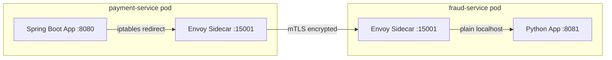
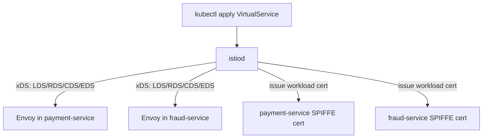
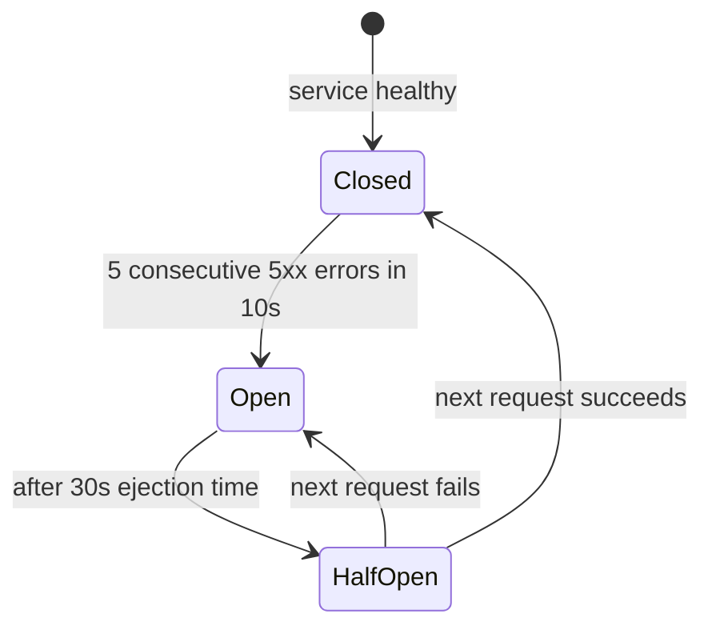

# Service Mesh — Istio Traffic Management and Observability

A service mesh adds a dedicated infrastructure layer for service-to-service communication, handling encryption, retries, circuit breaking, and distributed tracing transparently — without changing application code. For fintech platforms where every inter-service call carries financial data, Istio's mutual TLS enforcement and fine-grained authorization policies provide security controls that satisfy PCI-DSS Requirement 4 (encryption in transit) and Requirement 7 (access control).

---

## 1. Service Mesh Architecture

Istio's architecture separates the **data plane** (proxies that handle traffic) from the **control plane** (components that configure proxies).

### 1.1 Sidecar Proxy Model

Every pod in the mesh gets an Envoy proxy injected as a sidecar container. This injection is transparent to the application — the application sends traffic to `localhost`, and the sidecar intercepts it, applies policies, and forwards it to the destination.



The iptables rules injected by the `istio-init` init container redirect all inbound and outbound traffic through the Envoy proxy on port 15001 (outbound) and 15006 (inbound). The application never sees this — it still connects to `fraud-service:8081` as normal.

### 1.2 Istio Control Plane (istiod)

`istiod` consolidates three functions:

| Component | Function |
|-----------|----------|
| Pilot     | Service discovery, traffic management rules → Envoy xDS config |
| Citadel   | Certificate authority — issues SPIFFE X.509 certs for each workload identity |
| Galley    | Configuration validation and distribution |



---

## 2. Automatic mTLS Between Services

Istio's most valuable security feature is automatic mutual TLS (mTLS) between all services in the mesh. No application code changes are required — Envoy sidecars negotiate TLS transparently using SPIFFE/SPIRE certificates issued by istiod's built-in CA.

### 2.1 PeerAuthentication — Enforce STRICT mTLS

```yaml
# Enforce mTLS in the entire payments namespace
# Any service calling payment-service without a valid cert is rejected
apiVersion: security.istio.io/v1beta1
kind: PeerAuthentication
metadata:
  name: payments-mtls-strict
  namespace: payments
spec:
  mtls:
    mode: STRICT
```

With `STRICT` mode, any plaintext connection to a service in the `payments` namespace is rejected — even from other pods in the same cluster that are not part of the mesh. This satisfies PCI-DSS Requirement 4.2 (never transmit cardholder data over unencrypted protocols).

### 2.2 Verifying mTLS

```bash
# Check the mTLS status between two services
istioctl x check-inject -n payments
istioctl authn tls-check payment-service.payments.svc.cluster.local

# Expected output:
# HOST:PORT                                     STATUS     SERVER     CLIENT
# payment-service.payments.svc.cluster.local:8080  OK    STRICT     mTLS
```

---

## 3. Traffic Management

Istio's traffic management uses two CRDs working together: `VirtualService` (routing rules) and `DestinationRule` (load balancing and subset configuration).

### 3.1 VirtualService — Weighted Routing for Canary Deployments

```yaml
# Route 90% to stable v1, 10% to canary v2
apiVersion: networking.istio.io/v1alpha3
kind: VirtualService
metadata:
  name: payment-service-vs
  namespace: payments
spec:
  hosts:
    - payment-service
  http:
    - match:
        # Pin internal testers to canary via header
        - headers:
            x-canary:
              exact: "true"
      route:
        - destination:
            host: payment-service
            subset: v2
    - route:
        # Production traffic split
        - destination:
            host: payment-service
            subset: v1
          weight: 90
        - destination:
            host: payment-service
            subset: v2
          weight: 10
      timeout: 5s
      retries:
        attempts: 3
        perTryTimeout: 2s
        retryOn: "5xx,reset,connect-failure,retriable-4xx"
```

### 3.2 DestinationRule — Subsets and Load Balancing

```yaml
apiVersion: networking.istio.io/v1alpha3
kind: DestinationRule
metadata:
  name: payment-service-dr
  namespace: payments
spec:
  host: payment-service
  trafficPolicy:
    connectionPool:
      tcp:
        maxConnections: 100
        connectTimeout: 2s
      http:
        h2UpgradePolicy: UPGRADE
        http1MaxPendingRequests: 100
        http2MaxRequests: 1000
    loadBalancer:
      simple: LEAST_CONN     # least connections for payment processing
    outlierDetection:
      # Circuit breaking: eject pods with 5 consecutive errors for 30s
      consecutiveGatewayErrors: 5
      interval: 10s
      baseEjectionTime: 30s
      maxEjectionPercent: 50
  subsets:
    - name: v1
      labels:
        version: v1
      trafficPolicy:
        connectionPool:
          tcp:
            maxConnections: 80
    - name: v2
      labels:
        version: v2
      trafficPolicy:
        connectionPool:
          tcp:
            maxConnections: 20
```

---

## 4. Circuit Breaking with OutlierDetection

Istio's circuit breaking is configured in `DestinationRule.outlierDetection`. When a pod returns `consecutiveGatewayErrors` 5xx responses within the `interval`, it is ejected from the load-balancing pool for `baseEjectionTime`.



```yaml
# Dedicated circuit breaker for external payment gateway
apiVersion: networking.istio.io/v1alpha3
kind: DestinationRule
metadata:
  name: visa-gateway-cb
  namespace: payments
spec:
  host: visa-gateway.payments.svc.cluster.local
  trafficPolicy:
    outlierDetection:
      consecutiveGatewayErrors: 5
      interval: 10s
      baseEjectionTime: 30s
      maxEjectionPercent: 100   # eject ALL if all pods fail (failfast)
    connectionPool:
      http:
        http1MaxPendingRequests: 50  # backpressure — reject early
```

---

## 5. Retries and Timeouts in VirtualService

Combining retries with timeouts prevents cascading failures in payment processing chains.

```yaml
apiVersion: networking.istio.io/v1alpha3
kind: VirtualService
metadata:
  name: fraud-service-vs
  namespace: payments
spec:
  hosts:
    - fraud-service
  http:
    - route:
        - destination:
            host: fraud-service
      timeout: 3s
      retries:
        attempts: 2
        perTryTimeout: 1s
        retryOn: "gateway-error,connect-failure,retriable-4xx"
        # Do NOT retry on 5xx if the request is not idempotent
        # For POST /payments, use idempotency keys instead
```

**Rule for fintech**: Never retry non-idempotent payment mutations without idempotency keys. Retry only on connection failures (`connect-failure`, `reset`) or idempotent reads.

---

## 6. Distributed Tracing with Jaeger

Istio automatically injects trace context into every HTTP request. Jaeger collects and visualizes these traces.

### 6.1 B3 Trace Propagation Headers

Istio uses B3 propagation (Zipkin-compatible). The sidecar creates spans automatically, but applications must propagate the headers when making outbound calls.

```java
// TraceContextPropagationFilter.java
// Extract incoming B3 headers and forward them to downstream calls
@Component
public class TraceContextPropagationFilter implements Filter {

    private static final List<String> B3_HEADERS = List.of(
        "x-request-id",
        "x-b3-traceid",
        "x-b3-spanid",
        "x-b3-parentspanid",
        "x-b3-sampled",
        "x-b3-flags",
        "b3"
    );

    @Override
    public void doFilter(ServletRequest req, ServletResponse res,
                         FilterChain chain) throws IOException, ServletException {
        HttpServletRequest httpReq = (HttpServletRequest) req;

        // Store B3 headers in request-scoped context for downstream calls
        Map<String, String> traceHeaders = new HashMap<>();
        for (String header : B3_HEADERS) {
            String value = httpReq.getHeader(header);
            if (value != null) {
                traceHeaders.put(header, value);
            }
        }
        TraceContext.set(traceHeaders);
        chain.doFilter(req, res);
    }
}
```

```java
// PaymentClient.java — propagate trace headers on outbound calls
public PaymentResponse callFraudService(FraudRequest request) throws Exception {
    Map<String, String> traceHeaders = TraceContext.get();

    HttpRequest.Builder builder = HttpRequest.newBuilder()
        .uri(URI.create(FRAUD_SERVICE_URL + "/api/v1/fraud/score"))
        .POST(HttpRequest.BodyPublishers.ofString(request.toJson()));

    // Forward all B3 trace headers
    traceHeaders.forEach(builder::header);

    HttpResponse<String> response =
        httpClient.send(builder.build(), HttpResponse.BodyHandlers.ofString());
    return FraudResponse.fromJson(response.body());
}
```

### 6.2 Telemetry Resource for Sampling

```yaml
apiVersion: telemetry.istio.io/v1alpha1
kind: Telemetry
metadata:
  name: payment-tracing
  namespace: payments
spec:
  tracing:
    - providers:
        - name: jaeger
      randomSamplingPercentage: 100.0  # 100% sampling for payments (PCI audit)
```

For high-volume services, reduce to 10% sampling and use `x-b3-sampled: 1` header to force sampling for suspicious transactions.

---

## 7. Kiali Service Graph

Kiali provides a real-time service topology graph, showing traffic flow, error rates, and mTLS status between services.

```
Payment Platform Service Graph (Kiali):

[api-gateway] --100%mTLS--> [payment-service v1] --90%-->
                                                   --10%--> [payment-service v2]
[payment-service] --100%mTLS--> [fraud-service]
[payment-service] --100%mTLS--> [postgres (external)]
[payment-service] --100%mTLS--> [kafka]

Error rates:
  payment-service v1: 0.02%
  payment-service v2: 1.4%  <-- canary alert threshold exceeded
```

Access Kiali via port-forward:
```bash
kubectl port-forward svc/kiali 20001:20001 -n istio-system
# Open http://localhost:20001/kiali
```

---

## 8. AuthorizationPolicy — Service-to-Service RBAC

AuthorizationPolicy enforces which services can call which other services, based on SPIFFE identities (not IP addresses).

```yaml
# Only api-gateway can call payment-service
# All other callers receive HTTP 403 RBAC denied
apiVersion: security.istio.io/v1beta1
kind: AuthorizationPolicy
metadata:
  name: payment-service-authz
  namespace: payments
spec:
  selector:
    matchLabels:
      app: payment-service
  action: ALLOW
  rules:
    - from:
        - source:
            # SPIFFE identity: system:serviceaccount:api-gateway:api-gateway-sa
            principals:
              - "cluster.local/ns/api-gateway/sa/api-gateway-sa"
      to:
        - operation:
            methods: ["POST", "GET"]
            paths: ["/api/v1/payments/*", "/api/v1/payments"]
---
# payment-service can call fraud-service, but only the /score endpoint
apiVersion: security.istio.io/v1beta1
kind: AuthorizationPolicy
metadata:
  name: fraud-service-authz
  namespace: payments
spec:
  selector:
    matchLabels:
      app: fraud-service
  action: ALLOW
  rules:
    - from:
        - source:
            principals:
              - "cluster.local/ns/payments/sa/payment-service-sa"
      to:
        - operation:
            methods: ["POST"]
            paths: ["/api/v1/fraud/score"]
---
# Default deny all — must be last policy
apiVersion: security.istio.io/v1beta1
kind: AuthorizationPolicy
metadata:
  name: default-deny
  namespace: payments
spec:
  {}  # empty spec with no rules = deny all
```

---

## Production Pitfalls

### Pitfall 1: mTLS STRICT Mode Breaking Kubernetes Health Checks

**Problem**: When `PeerAuthentication` is set to `STRICT`, Kubernetes liveness and readiness probes (sent from kubelet, which is not part of the mesh) are rejected because they are plaintext connections. Services fail health checks and are restarted in a loop.

**Diagnosis**:
```bash
kubectl describe pod payment-service-xxx -n payments
# Events: Liveness probe failed: Get http://10.244.1.5:8080/health: EOF
# (EOF = connection closed by Envoy because kubelet has no client cert)
```

**Fix Option 1**: Use a port-based exclusion for the health check port in the sidecar annotation:

```yaml
# deployment.yaml annotations
annotations:
  traffic.sidecar.istio.io/excludeInboundPorts: "8081"
  # probe on 8081 bypasses Envoy; application logic on 8080 uses mTLS
```

**Fix Option 2**: Rewrite probes to use Istio's built-in probe rewrite (enabled by default in Istio 1.9+):

```yaml
# Istio automatically rewrites HTTP probes using the sidecar agent port
# Verify it is enabled in istiod config:
kubectl get configmap istio -n istio-system -o yaml | grep rewriteAppHTTPProbe
# Expected: rewriteAppHTTPProbe: true
```

**Fix Option 3**: Use exec probes instead of HTTP probes — exec probes run inside the container and bypass the sidecar:

```yaml
livenessProbe:
  exec:
    command:
      - /bin/sh
      - -c
      - wget -qO- http://localhost:8080/health || exit 1
  initialDelaySeconds: 30
  periodSeconds: 10
```

---

### Pitfall 2: VirtualService Not Matching Because Service Port Name Does Not Match Protocol

**Problem**: Istio routes HTTP vs TCP traffic differently. If a Service port is named `http` or `grpc`, Istio applies L7 routing rules. If it is named `tcp` or any unlisted name, Istio treats it as TCP and VirtualService HTTP rules have no effect — canary weights are silently ignored.

**Broken Service definition**:
```yaml
apiVersion: v1
kind: Service
metadata:
  name: payment-service
  namespace: payments
spec:
  ports:
    - name: api          # generic name — Istio treats as TCP
      port: 8080
      targetPort: 8080
```

**Fixed Service definition**:
```yaml
apiVersion: v1
kind: Service
metadata:
  name: payment-service
  namespace: payments
spec:
  ports:
    - name: http         # must start with 'http' for Istio L7 routing
      port: 8080
      targetPort: 8080
    - name: grpc-internal  # must start with 'grpc' for gRPC
      port: 9090
      targetPort: 9090
```

**Validation**:
```bash
# Confirm Istio detects the protocol correctly
istioctl proxy-config cluster payment-service-pod-xxx.payments | grep payment-service
# Expected: payment-service.payments.svc.cluster.local 8080 - outbound EDS http
# BAD output: ... TCP (not http)
```

---

### Pitfall 3: Envoy Sidecar Startup Order Causing Connection Refused at Boot

**Problem**: The Envoy sidecar and the application container start concurrently. If the application makes an outbound call during startup (e.g., connecting to a config service or database) before Envoy is ready, the connection fails because iptables redirects traffic to a not-yet-listening Envoy.

**Symptoms**: Application logs show `Connection refused to localhost:15001` during the first 2–5 seconds of pod startup.

**Fix**: Configure `holdApplicationUntilProxyStarts` in the mesh config:

```yaml
# MeshConfig in istio-system ConfigMap
apiVersion: v1
kind: ConfigMap
metadata:
  name: istio
  namespace: istio-system
data:
  mesh: |
    defaultConfig:
      holdApplicationUntilProxyStarts: true
      # Envoy must be ready before the app container starts
```

Or per-pod annotation:
```yaml
# deployment.yaml annotations
annotations:
  proxy.istio.io/config: |
    holdApplicationUntilProxyStarts: true
```

**Alternative**: Add a `postStart` lifecycle hook with a short sleep if `holdApplicationUntilProxyStarts` cannot be set globally:

```yaml
lifecycle:
  postStart:
    exec:
      command:
        - /bin/sh
        - -c
        - |
          until curl -sf http://localhost:15021/healthz/ready; do
            sleep 1
          done
```

---

## Checklist

### Istio Installation and Namespace Configuration
- [ ] Istio installed with production profile (`istioctl install --set profile=production`)
- [ ] Namespace injection label applied: `kubectl label namespace payments istio-injection=enabled`
- [ ] `holdApplicationUntilProxyStarts: true` set in MeshConfig
- [ ] All Service port names start with `http`, `grpc`, or `tls` (not generic names)
- [ ] istiod deployed with at least 2 replicas for HA

### mTLS and Security
- [ ] `PeerAuthentication` STRICT mode applied to all PCI-scope namespaces
- [ ] Kubernetes health check probes compatible with mTLS (probe rewrite enabled or exec probes used)
- [ ] `AuthorizationPolicy` default-deny applied to all production namespaces
- [ ] Explicit `AuthorizationPolicy` ALLOW rules for each service-to-service call path
- [ ] SPIFFE identities verified with `istioctl authn tls-check`

### Traffic Management
- [ ] `VirtualService` retries configured for connection failures only (not 5xx on non-idempotent POSTs)
- [ ] Timeouts set at VirtualService level (not only at application level)
- [ ] `DestinationRule` `outlierDetection` configured for all external dependencies
- [ ] Canary weights validated in staging before production deployment
- [ ] `maxEjectionPercent` set appropriately to prevent ejecting all pods simultaneously

### Observability
- [ ] Jaeger or Zipkin tracing backend deployed and connected to Istio
- [ ] Application propagates B3 trace headers on all outbound calls
- [ ] `Telemetry` resource configured with appropriate sampling rate (100% for payments)
- [ ] Kiali deployed and service graph reviewed weekly
- [ ] Envoy access logs shipping to centralized log aggregator (Fluentd/Loki)

### Compliance
- [ ] mTLS STRICT mode documented as PCI-DSS Requirement 4.2.1 control
- [ ] `AuthorizationPolicy` rules documented as PCI-DSS Requirement 7.2.1 control
- [ ] Distributed traces retained for 90+ days for PCI-DSS audit evidence

---

<!-- KNOWLEDGE-CHECK
{"questions":[{"text":"Why does setting PeerAuthentication to STRICT mode sometimes cause Kubernetes liveness probe failures?","options":["a) STRICT mode disables all TCP connections including health check probes","b) Kubernetes kubelet health check probes are plaintext HTTP and are rejected by Envoy because kubelet does not have a mesh certificate","c) STRICT mode requires the application to implement mTLS in its own code","d) Liveness probes are blocked by the default-deny AuthorizationPolicy"],"correct":1,"explanation":"Kubernetes kubelet sends liveness and readiness probes directly to the pod IP as plaintext HTTP. With mTLS STRICT mode, Envoy rejects these unauthenticated connections. The fix is to enable Istio's probe rewrite feature (holdApplicationUntilProxyStarts or rewriteAppHTTPProbe) or switch to exec probes that run inside the container."},{"text":"A VirtualService with 90/10 canary weight routing is deployed but all traffic continues going to v1. What is the most likely cause?","options":["a) The DestinationRule subsets are missing OutlierDetection configuration","b) The Kubernetes Service port is named 'api' instead of starting with 'http' or 'grpc', causing Istio to treat it as TCP and ignore L7 routing rules","c) The canary deployment has fewer pods than the stable deployment","d) The PeerAuthentication mode is PERMISSIVE instead of STRICT"],"correct":1,"explanation":"Istio determines the traffic protocol from the Service port name. Port names must start with 'http', 'grpc', or 'tls' for Istio to apply L7 routing rules. A generic name like 'api' causes Istio to treat the traffic as TCP, and VirtualService HTTP routing rules including canary weights are silently bypassed."},{"text":"What must Java Spring Boot services do to ensure distributed traces appear as a single trace across multiple services in Jaeger?","options":["a) Register each service with the Jaeger agent using a unique service name","b) Call istioctl proxy-config to export the trace context","c) Extract incoming B3 headers (x-b3-traceid, x-b3-spanid, etc.) and forward them on all outbound HTTP calls","d) Enable Istio's telemetry API with 100% sampling — no code changes are needed"],"correct":2,"explanation":"Istio's Envoy sidecars create spans automatically, but they cannot propagate trace context between application-level calls. The application must extract B3 headers from incoming requests and forward them on outbound calls. Without this, Jaeger shows disconnected single-service traces rather than end-to-end payment flow traces."}]}
-->

<!-- PRACTICAL-CHALLENGE
{"title":"Deploy Istio Service Mesh for Fintech Payment Platform","difficulty":"advanced","estimatedMinutes":100,"tasks":[{"id":"1","description":"Install Istio with the production profile on a local cluster (kind or minikube). Enable sidecar injection for a 'payments' namespace. Apply PeerAuthentication STRICT mode and verify that a curl from a non-mesh pod receives a connection error while a mesh pod succeeds. Confirm mTLS status with istioctl authn tls-check."},{"id":"2","description":"Deploy payment-service with two versions (v1 and v2). Create a DestinationRule with subsets for each version. Create a VirtualService routing 90% traffic to v1 and 10% to v2. Send 1000 requests using hey or wrk and verify approximately 100 (10%) reach v2 by checking Kiali or Envoy access logs."},{"id":"3","description":"Add OutlierDetection to the DestinationRule: eject a pod after 3 consecutive 5xx errors, with a 30-second ejection window. Inject failures into v2 (use Istio fault injection or a /fail endpoint). Observe in Kiali that v2 is ejected from the pool. Verify traffic automatically shifts to v1 during ejection."},{"id":"4","description":"Implement B3 header propagation in a Spring Boot payment service. Deploy payment-service and fraud-service with Jaeger tracing. Make a payment call that triggers a fraud check. In Jaeger UI, verify the full trace shows both payment-service and fraud-service spans in a single trace. Document the trace propagation code pattern used."}]}
-->
