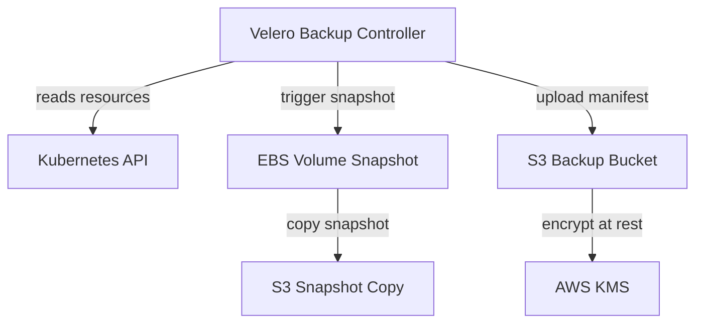

# Cloud-Native Storage — Persistent Volumes and StatefulSets

Stateful workloads in a fintech cluster — PostgreSQL for transaction records, Kafka for payment event streams, Redis for session data — require durable, high-performance storage with strict availability guarantees. Kubernetes provides the abstractions (PersistentVolume, PersistentVolumeClaim, StorageClass, StatefulSet) but the operational discipline — right storage class, correct reclaim policy, AZ-aware scheduling, automated backup — determines whether your data survives a node failure, AZ outage, or accidental deletion.

---

## 1. The Storage Abstraction Stack

```
┌──────────────────────────────────────────────────────────┐
│  Application (PostgreSQL, Kafka)                          │
├──────────────────────────────────────────────────────────┤
│  PersistentVolumeClaim (PVC) — developer request         │
├──────────────────────────────────────────────────────────┤
│  StorageClass — provisioner + parameters                  │
├──────────────────────────────────────────────────────────┤
│  PersistentVolume (PV) — dynamically provisioned          │
├──────────────────────────────────────────────────────────┤
│  CSI Driver (aws-ebs-csi-driver)                          │
├──────────────────────────────────────────────────────────┤
│  Cloud Block Storage (AWS EBS gp3 / io2)                  │
└──────────────────────────────────────────────────────────┘
```

### 1.1 PersistentVolume (PV)

A PV is a cluster-level storage resource provisioned by an administrator or dynamically by a StorageClass. It has an independent lifecycle from pods.

```yaml
# Manually provisioned PV (rare in modern clusters — prefer dynamic)
apiVersion: v1
kind: PersistentVolume
metadata:
  name: postgres-primary-pv
  labels:
    app: postgres
    tier: database
spec:
  capacity:
    storage: 500Gi
  volumeMode: Filesystem
  accessModes:
    - ReadWriteOnce
  persistentVolumeReclaimPolicy: Retain   # NEVER Delete in production
  storageClassName: gp3-encrypted
  csi:
    driver: ebs.csi.aws.com
    volumeHandle: vol-0a1b2c3d4e5f67890   # EBS volume ID
    fsType: ext4
  nodeAffinity:
    required:
      nodeSelectorTerms:
        - matchExpressions:
            - key: topology.kubernetes.io/zone
              operator: In
              values:
                - us-east-1a   # pin to same AZ as EBS volume
```

### 1.2 PersistentVolumeClaim (PVC)

A PVC is a namespaced request for storage by a user or StatefulSet. When a StorageClass is specified, the PV is provisioned dynamically.

```yaml
apiVersion: v1
kind: PersistentVolumeClaim
metadata:
  name: postgres-primary-data
  namespace: data
  labels:
    app: postgres
    pci-scope: "true"
spec:
  accessModes:
    - ReadWriteOnce
  volumeMode: Filesystem
  storageClassName: io2-encrypted   # high-IOPS for production DB
  resources:
    requests:
      storage: 500Gi
  # Optional: label selector to bind to a specific pre-provisioned PV
  selector:
    matchLabels:
      app: postgres
```

### 1.3 StorageClass

StorageClass defines the storage tier — provisioner, parameters, and reclaim policy.

```yaml
# AWS EBS gp3 — cost-effective, baseline 3000 IOPS
apiVersion: storage.k8s.io/v1
kind: StorageClass
metadata:
  name: gp3-encrypted
  annotations:
    storageclass.kubernetes.io/is-default-class: "true"
provisioner: ebs.csi.aws.com
parameters:
  type: gp3
  iops: "3000"
  throughput: "125"
  encrypted: "true"
  kmsKeyId: "arn:aws:kms:us-east-1:123456789:key/abc123"
reclaimPolicy: Retain        # NEVER Delete for financial data
allowVolumeExpansion: true   # required for online resize
volumeBindingMode: WaitForFirstConsumer  # wait for pod AZ before provisioning
---
# AWS EBS io2 — high-IOPS for latency-sensitive workloads
apiVersion: storage.k8s.io/v1
kind: StorageClass
metadata:
  name: io2-encrypted
provisioner: ebs.csi.aws.com
parameters:
  type: io2
  iops: "16000"       # up to 64000 IOPS for critical transactional DB
  encrypted: "true"
  kmsKeyId: "arn:aws:kms:us-east-1:123456789:key/abc123"
reclaimPolicy: Retain
allowVolumeExpansion: true
volumeBindingMode: WaitForFirstConsumer
```

---

## 2. Access Modes

| Mode            | Abbreviation | Description                                    | Typical Use              |
|-----------------|--------------|------------------------------------------------|--------------------------|
| ReadWriteOnce   | RWO          | Single node read/write                         | PostgreSQL, MySQL         |
| ReadOnlyMany    | ROX          | Multiple nodes read-only                       | Shared config, artifacts  |
| ReadWriteMany   | RWX          | Multiple nodes read/write                      | NFS, EFS for shared logs  |
| ReadWriteOncePod| RWOP         | Single pod read/write (Kubernetes 1.22+)        | Exclusive database access |

**Key rule**: EBS volumes only support `ReadWriteOnce`. For `ReadWriteMany` on AWS, use EFS with the `aws-efs-csi-driver`. PostgreSQL and Kafka both require `ReadWriteOnce` — each pod needs its own dedicated volume.

---

## 3. CSI Drivers for Fintech Workloads

The Container Storage Interface (CSI) is the standard for integrating storage systems with Kubernetes. AWS provides two key CSI drivers.

### 3.1 AWS EBS CSI Driver

```yaml
# Install via Helm
# helm install aws-ebs-csi-driver aws-ebs-csi-driver/aws-ebs-csi-driver \
#   --namespace kube-system \
#   --set controller.serviceAccount.annotations."eks.amazonaws.com/role-arn"=arn:aws:iam::123:role/EBSCSIRole

# Verify installation
# kubectl get pods -n kube-system -l app=ebs-csi-controller
```

Storage class selection for fintech workloads:

| Workload                   | Storage Class | IOPS     | Rationale                           |
|----------------------------|---------------|----------|-------------------------------------|
| PostgreSQL (production)    | io2-encrypted | 16,000+  | Latency-sensitive OLTP transactions |
| Kafka logs                 | gp3-encrypted | 3,000    | Sequential writes, cost-effective   |
| PostgreSQL (dev/staging)   | gp3-encrypted | 3,000    | Adequate for lower concurrency      |
| Redis snapshots (AOF)      | gp3-encrypted | 3,000    | Periodic sequential writes           |

**gp3 vs io2 cost comparison** (us-east-1 as of 2024):
- gp3: $0.08/GB/month + $0.005/provisioned IOPS above 3000
- io2: $0.125/GB/month + $0.065/provisioned IOPS
- For 500GB PostgreSQL at 16,000 IOPS: gp3 = $105/mo, io2 = $1,088/mo
- Use io2 only for critical primary databases; gp3 for replicas and dev

---

## 4. StatefulSet for Kafka and PostgreSQL

StatefulSets provide three guarantees that Deployments cannot:

1. **Stable network identity**: Each pod gets a predictable DNS name: `kafka-0.kafka.payments.svc.cluster.local`
2. **Ordered startup**: Pods start sequentially (kafka-0 → kafka-1 → kafka-2)
3. **Ordered shutdown**: Pods terminate in reverse order (kafka-2 → kafka-1 → kafka-0)
4. **Dedicated PVC per pod**: Each pod binds to its own PVC that survives pod restarts

### 4.1 Kafka StatefulSet

```yaml
apiVersion: apps/v1
kind: StatefulSet
metadata:
  name: kafka
  namespace: kafka
spec:
  serviceName: kafka          # headless service for stable DNS
  replicas: 3
  selector:
    matchLabels:
      app: kafka
  podManagementPolicy: OrderedReady   # sequential startup
  updateStrategy:
    type: RollingUpdate
    rollingUpdate:
      partition: 0            # update all pods in a rolling fashion
  template:
    metadata:
      labels:
        app: kafka
    spec:
      terminationGracePeriodSeconds: 60
      affinity:
        podAntiAffinity:
          requiredDuringSchedulingIgnoredDuringExecution:
            - labelSelector:
                matchLabels:
                  app: kafka
              topologyKey: topology.kubernetes.io/zone   # spread across AZs
      containers:
        - name: kafka
          image: confluentinc/cp-kafka:7.5.0
          ports:
            - name: kafka
              containerPort: 9092
            - name: kafka-internal
              containerPort: 9093
          env:
            - name: KAFKA_BROKER_ID
              valueFrom:
                fieldRef:
                  fieldPath: metadata.annotations['statefulset.kubernetes.io/pod-name']
            - name: KAFKA_ZOOKEEPER_CONNECT
              value: "zookeeper-0.zookeeper:2181,zookeeper-1.zookeeper:2181"
            - name: KAFKA_LOG_DIRS
              value: "/data/kafka"
          volumeMounts:
            - name: kafka-data
              mountPath: /data/kafka
          resources:
            requests:
              cpu: "2"
              memory: 8Gi
            limits:
              cpu: "4"
              memory: 16Gi
          livenessProbe:
            exec:
              command:
                - kafka-broker-api-versions.sh
                - --bootstrap-server=localhost:9092
            initialDelaySeconds: 60
            periodSeconds: 30
  volumeClaimTemplates:
    - metadata:
        name: kafka-data
        labels:
          app: kafka
      spec:
        accessModes:
          - ReadWriteOnce
        storageClassName: gp3-encrypted
        resources:
          requests:
            storage: 500Gi
---
# Headless service for stable DNS
apiVersion: v1
kind: Service
metadata:
  name: kafka
  namespace: kafka
spec:
  clusterIP: None          # headless — no ClusterIP, direct pod DNS
  selector:
    app: kafka
  ports:
    - name: kafka
      port: 9092
```

This creates PVCs named `kafka-data-kafka-0`, `kafka-data-kafka-1`, `kafka-data-kafka-2` — each bound to a dedicated 500Gi EBS gp3 volume.

### 4.2 PostgreSQL StatefulSet with Replication

```yaml
apiVersion: apps/v1
kind: StatefulSet
metadata:
  name: postgres
  namespace: data
spec:
  serviceName: postgres
  replicas: 2              # primary (index 0) + replica (index 1)
  selector:
    matchLabels:
      app: postgres
  template:
    metadata:
      labels:
        app: postgres
    spec:
      terminationGracePeriodSeconds: 120
      containers:
        - name: postgres
          image: postgres:15.4
          env:
            - name: POSTGRES_DB
              value: payments
            - name: POSTGRES_USER
              valueFrom:
                secretKeyRef:
                  name: postgres-credentials
                  key: username
            - name: POSTGRES_PASSWORD
              valueFrom:
                secretKeyRef:
                  name: postgres-credentials
                  key: password
            - name: PGDATA
              value: /var/lib/postgresql/data/pgdata
          volumeMounts:
            - name: postgres-data
              mountPath: /var/lib/postgresql/data
          resources:
            requests:
              cpu: "4"
              memory: 16Gi
            limits:
              cpu: "8"
              memory: 32Gi
  volumeClaimTemplates:
    - metadata:
        name: postgres-data
      spec:
        accessModes:
          - ReadWriteOnce
        storageClassName: io2-encrypted   # high-IOPS for primary DB
        resources:
          requests:
            storage: 500Gi
```

The pod `postgres-0` becomes the primary at DNS `postgres-0.postgres.data.svc.cluster.local`. Replicas connect to this address for WAL streaming replication.

---

## 5. StorageClass Reclaim Policies

| Policy  | What happens to PV when PVC is deleted | Use case              |
|---------|----------------------------------------|-----------------------|
| Retain  | PV stays; must be manually reclaimed   | Production databases  |
| Delete  | PV and underlying volume are deleted   | Ephemeral test data   |
| Recycle | PV data is scrubbed; PV made available | Deprecated; don't use |

**Golden rule for fintech**: All production StorageClasses must use `Retain`. With `Delete`, a developer accidentally running `kubectl delete pvc` would permanently destroy payment transaction data.

---

## 6. Velero Backup

Velero backs up Kubernetes resources and persistent volume data. For a fintech cluster, this is the first line of recovery for accidental deletion and the foundation of the DR runbook.

### 6.1 Velero Architecture



### 6.2 Velero Schedule CRD — Daily Backup

```yaml
apiVersion: velero.io/v1
kind: Schedule
metadata:
  name: daily-backup
  namespace: velero
spec:
  schedule: "0 2 * * *"      # 2 AM UTC daily
  useOwnerReferencesInBackup: false
  template:
    includedNamespaces:
      - payments
      - kafka
      - data
    includedResources:        # explicit list to avoid backing up ephemeral resources
      - persistentvolumeclaims
      - persistentvolumes
      - deployments
      - statefulsets
      - services
      - configmaps
      - secrets               # MUST include secrets for complete restore
      - ingresses
      - networkpolicies
    excludedResources:
      - events                # never useful in a backup
    snapshotVolumes: true     # snapshot EBS volumes via VolumeSnapshot API
    ttl: 720h                 # retain 30 days (720h = 30 * 24)
    storageLocation: default  # BackupStorageLocation referencing S3
    volumeSnapshotLocations:
      - default
    # Label selector — only back up resources with this label
    labelSelector:
      matchLabels:
        backup: "true"
```

### 6.3 BackupStorageLocation — S3 Configuration

```yaml
apiVersion: velero.io/v1
kind: BackupStorageLocation
metadata:
  name: default
  namespace: velero
spec:
  provider: aws
  objectStorage:
    bucket: fintech-cluster-backups
    prefix: prod-cluster
  config:
    region: us-east-1
    kmsKeyId: "arn:aws:kms:us-east-1:123456789:key/backup-key"
    serverSideEncryption: aws:kms
  credential:
    name: velero-credentials
    key: cloud
---
# Second region BSL for DR
apiVersion: velero.io/v1
kind: BackupStorageLocation
metadata:
  name: dr-region
  namespace: velero
spec:
  provider: aws
  objectStorage:
    bucket: fintech-cluster-backups-dr
    prefix: prod-cluster
  config:
    region: us-west-2        # DR region
    kmsKeyId: "arn:aws:kms:us-west-2:123456789:key/backup-key-dr"
    serverSideEncryption: aws:kms
```

### 6.4 Restore Procedure

```bash
# List available backups
velero backup get

# Restore from a specific backup
velero restore create payments-restore-20241101 \
  --from-backup daily-backup-20241101020000 \
  --include-namespaces payments \
  --wait

# Check restore status
velero restore describe payments-restore-20241101
velero restore logs payments-restore-20241101
```

---

## 7. Resizing a PVC Online

Online PVC resize is supported when the StorageClass has `allowVolumeExpansion: true` and the volume type supports expansion (EBS gp3/io2 do).

```bash
# Step 1: Patch the PVC to request more storage
kubectl patch pvc postgres-data-postgres-0 -n data \
  --type='merge' \
  -p '{"spec":{"resources":{"requests":{"storage":"1000Gi"}}}}'

# Step 2: Watch for the resize to complete
kubectl get pvc postgres-data-postgres-0 -n data -w
# STATUS transitions: Bound → FileSystemResizePending → Bound

# Step 3: Verify filesystem was expanded (may require pod restart for ext4)
kubectl exec -n data postgres-0 -- df -h /var/lib/postgresql/data
# Expected: 1000G total capacity
```

If the PVC status is stuck in `FileSystemResizePending`, the pod must be restarted to trigger the in-pod filesystem resize via kubelet.

---

## Production Pitfalls

### Pitfall 1: Using Delete Reclaim Policy in Production

**Problem**: The `Delete` reclaim policy means that deleting a PVC immediately and permanently deletes the underlying EBS volume and all data on it. In a production database environment, any `kubectl delete pvc` command — whether intentional or accidental — causes irreversible data loss.

**Wrong StorageClass (dangerous)**:
```yaml
apiVersion: storage.k8s.io/v1
kind: StorageClass
metadata:
  name: standard        # many cloud defaults use Delete
provisioner: ebs.csi.aws.com
parameters:
  type: gp3
reclaimPolicy: Delete   # NEVER use in production financial systems
```

**Correct StorageClass (production-safe)**:
```yaml
apiVersion: storage.k8s.io/v1
kind: StorageClass
metadata:
  name: gp3-encrypted
provisioner: ebs.csi.aws.com
parameters:
  type: gp3
  encrypted: "true"
reclaimPolicy: Retain   # PV persists after PVC deletion; must be manually cleaned
allowVolumeExpansion: true
volumeBindingMode: WaitForFirstConsumer
```

Additionally, protect PVCs with a finalizer annotation to require deliberate confirmation before deletion:
```bash
# Add deletion protection to critical PVC
kubectl annotate pvc postgres-data-postgres-0 -n data \
  "helm.sh/resource-policy=keep"
```

---

### Pitfall 2: StatefulSet Pods Scheduled in Different AZ Than EBS Volume

**Problem**: EBS volumes are AZ-scoped. If a StatefulSet pod is scheduled on a node in `us-east-1b` but its PVC was created in `us-east-1a` (because the StorageClass used `Immediate` binding), the pod will fail with `volume is not available in the node's AZ`.

**Wrong StorageClass** (Immediate binding):
```yaml
apiVersion: storage.k8s.io/v1
kind: StorageClass
metadata:
  name: gp3-immediate    # binds volume before pod AZ is known
provisioner: ebs.csi.aws.com
parameters:
  type: gp3
volumeBindingMode: Immediate   # volume created in a random AZ
```

**Correct StorageClass** (WaitForFirstConsumer):
```yaml
apiVersion: storage.k8s.io/v1
kind: StorageClass
metadata:
  name: gp3-encrypted
provisioner: ebs.csi.aws.com
parameters:
  type: gp3
  encrypted: "true"
volumeBindingMode: WaitForFirstConsumer
# Volume is provisioned only after a pod is scheduled,
# in the same AZ as the node — no cross-AZ failures possible
```

Verify AZ alignment for existing PVCs:
```bash
kubectl get pv -o=custom-columns='NAME:.metadata.name,ZONE:.metadata.labels.topology\.kubernetes\.io/zone,CLAIM:.spec.claimRef.name'
kubectl get node -o=custom-columns='NAME:.metadata.name,ZONE:.metadata.labels.topology\.kubernetes\.io/zone'
```

---

### Pitfall 3: Velero Backup Not Including Secrets

**Problem**: By default, some Velero configurations exclude Secrets to avoid storing sensitive credentials in backup. If Secrets are excluded and a full namespace restore is performed after a disaster, all services that depend on credential Secrets (database passwords, API keys, TLS certificates) fail to start.

**Broken Velero Schedule** (excludes Secrets):
```yaml
# DANGEROUS — restoring this backup will leave services unable to authenticate
spec:
  template:
    excludedResources:
      - events
      - secrets           # DO NOT exclude secrets from production backup
```

**Correct approach**: Include Secrets in backup but ensure the S3 backup bucket is encrypted with KMS, access-controlled with IAM policies, and versioned.

```yaml
spec:
  template:
    includedNamespaces:
      - payments
      - data
    excludedResources:
      - events            # only exclude truly worthless resources
    snapshotVolumes: true
    # Secrets ARE included by default when using includedResources: []
    # Explicitly add them if using an allowlist:
    includedResources:
      - persistentvolumeclaims
      - statefulsets
      - deployments
      - services
      - configmaps
      - secrets           # MUST be included for complete restore capability
      - ingresses
      - networkpolicies
      - serviceaccounts
```

Verify that Secrets are included in a test backup:
```bash
velero backup describe daily-backup-20241101020000 --details | grep Secret
# Expected: secrets: included
```

---

## Checklist

### StorageClass and PVC Configuration
- [ ] All production StorageClasses use `reclaimPolicy: Retain`
- [ ] All production StorageClasses use `volumeBindingMode: WaitForFirstConsumer`
- [ ] `allowVolumeExpansion: true` set on all StorageClasses
- [ ] StorageClass encryption enabled with KMS CMK (not AWS-managed key)
- [ ] io2 StorageClass used for latency-critical databases (PostgreSQL primary)
- [ ] gp3 StorageClass used for Kafka logs and read replicas (cost optimization)
- [ ] Default StorageClass (`is-default-class: "true"`) reviewed and appropriate

### StatefulSet Configuration
- [ ] `podAntiAffinity` with `topologyKey: topology.kubernetes.io/zone` on all StatefulSets
- [ ] `podManagementPolicy: OrderedReady` for databases (not Parallel)
- [ ] `terminationGracePeriodSeconds` ≥ 60 seconds for all stateful workloads
- [ ] `volumeClaimTemplates` using the correct StorageClass per workload
- [ ] Headless Service (`clusterIP: None`) created for each StatefulSet

### Backup and Recovery
- [ ] Velero Schedule deployed with daily schedule and 30-day retention
- [ ] Velero backup includes Secrets
- [ ] S3 backup bucket encrypted with KMS and versioning enabled
- [ ] Cross-region backup replication configured (BackupStorageLocation in DR region)
- [ ] Monthly restore drill scheduled and results documented
- [ ] `velero restore create` procedure tested and documented in runbook

### Operational
- [ ] PVC deletion protection (`helm.sh/resource-policy=keep`) on all production PVCs
- [ ] PVC capacity monitoring alert at 80% usage (triggers resize process)
- [ ] StorageClass reclaim policy reviewed in infrastructure code review checklist
- [ ] All StatefulSet PVs are in the same AZ as their nodes (verified with label inspection)

---

<!-- KNOWLEDGE-CHECK
{"questions":[{"text":"A Kafka StatefulSet pod fails to start with error 'volume is not available in the node's AZ'. What is the root cause and fix?","options":["a) The EBS volume type is gp3 but Kafka requires io2 — change the StorageClass type parameter","b) The StorageClass uses volumeBindingMode: Immediate, which created the EBS volume in a different AZ than where the pod was scheduled — change to WaitForFirstConsumer","c) The StatefulSet replicas field is set higher than the number of available nodes","d) The podAntiAffinity rule is preventing the pod from being scheduled in any AZ"],"correct":1,"explanation":"EBS volumes are AZ-scoped. With Immediate binding mode, the volume is provisioned before a pod is scheduled, potentially in a different AZ. WaitForFirstConsumer delays provisioning until after the pod's node is selected, ensuring the volume is created in the correct AZ."},{"text":"What is the risk of using reclaimPolicy: Delete on a production StorageClass in a fintech cluster?","options":["a) Pods cannot be restarted without manually re-provisioning the volume","b) The StorageClass cannot be used with StatefulSets","c) Deleting a PVC (accidentally or intentionally) immediately and permanently destroys the underlying EBS volume and all data, with no recovery path","d) StatefulSet pods will not respect ordered startup when Delete policy is active"],"correct":2,"explanation":"The Delete reclaim policy causes the PersistentVolume and the underlying cloud storage to be permanently deleted when the PVC is deleted. In a production financial system, this means a single accidental kubectl delete pvc command causes irreversible data loss. The Retain policy is mandatory for production databases."},{"text":"A team runs velero restore after a cluster disaster but payment-service fails to authenticate to PostgreSQL. What was likely missing from the Velero backup?","options":["a) The PostgreSQL StatefulSet was excluded from the backup namespace list","b) Secrets were explicitly excluded from the backup, so the postgres-credentials Secret was not restored","c) Velero does not support backing up StatefulSets","d) The PersistentVolumeClaim snapshots were not included in the VolumeSnapshotLocation"],"correct":1,"explanation":"Secrets are sometimes excluded from Velero backups to avoid storing credentials in backup storage. Without the postgres-credentials Secret, payment-service cannot authenticate to the database after restore. Secrets must be included in backup (with the backup bucket properly encrypted with KMS) to enable a complete namespace restore."}]}
-->

<!-- PRACTICAL-CHALLENGE
{"title":"Production-Grade Stateful Storage for Fintech PostgreSQL and Kafka","difficulty":"advanced","estimatedMinutes":90,"tasks":[{"id":"1","description":"Create two StorageClasses: 'gp3-encrypted' (for Kafka, with WaitForFirstConsumer and Retain policy) and 'io2-encrypted' (for PostgreSQL, 16000 IOPS). Deploy a 3-replica Kafka StatefulSet using volumeClaimTemplates with gp3-encrypted. Verify that three separate PVCs are created (kafka-data-kafka-0, kafka-data-kafka-1, kafka-data-kafka-2)."},{"id":"2","description":"Deploy a 2-replica PostgreSQL StatefulSet (primary + replica) using io2-encrypted StorageClass. Configure podAntiAffinity to spread replicas across AZs. Verify that each pod gets its own PVC and that PVCs use the io2 StorageClass. Test that deleting pod postgres-0 and letting it restart reconnects to the same PVC."},{"id":"3","description":"Install Velero with an S3 backend (use MinIO locally as S3-compatible). Create a Schedule to run every minute (for testing) backing up the data namespace including Secrets. Trigger a manual backup, verify it completes, then simulate data loss by deleting the namespace. Restore from the backup and verify PostgreSQL and Kafka resume normally."},{"id":"4","description":"Test PVC online resize: expand the postgres-data-postgres-0 PVC from its initial size to 2x. Watch the PVC status transition. If it enters FileSystemResizePending, restart the pod and verify the filesystem expands. Document the exact kubectl commands, any downtime observed, and whether the resize was truly online."}]}
-->
