# CI/CD Pipelines — Secure Delivery for Financial Services

A CI/CD pipeline in a financial services company is not just an automation convenience — it is a PCI-DSS control. Requirement 6 mandates that all system components and software are protected from known vulnerabilities, and that security is integrated into the development lifecycle. This lesson builds a complete, PCI-DSS-mapped pipeline from code commit to production deployment.

---

## 1. Pipeline Architecture Overview

```mermaid
graph LR
    dev[Developer Push] --> ci[CI Pipeline]
    ci --> build[Build JAR]
    build --> unit[Unit Tests]
    unit --> sast[SAST - SonarQube]
    sast --> scan[Container Scan - Trivy]
    scan --> integration[Integration Tests]
    integration --> sign[Sign Image - Cosign]
    sign --> sbom[Generate SBOM - Syft]
    sbom --> publish[Push to ECR]
    publish --> cd[CD - ArgoCD]
    cd --> dev_env[dev namespace]
    dev_env --> staging[staging namespace]
    staging --> approval[Manual Approval Gate]
    approval --> prod[production namespace]
```



### PCI-DSS Requirement 6 Mapping

| Pipeline Stage         | PCI-DSS Requirement | Control Description                               |
|------------------------|---------------------|---------------------------------------------------|
| SAST (SonarQube)       | Req 6.3.2           | Detect security vulnerabilities before deployment |
| Gitleaks secret scan   | Req 6.4.3           | Prevent secrets in code                          |
| Trivy container scan   | Req 6.3.3           | Known vulnerability scanning of images           |
| Code review gate       | Req 6.4.4           | Manual review before merge to main               |
| Cosign image signing   | Req 6.4.2           | Verify integrity of deployed artifacts           |
| Approval gate (prod)   | Req 6.5.6           | Change management for production deployments     |

---

## 2. Full GitHub Actions CI Pipeline

```yaml
# .github/workflows/ci.yml
name: Payment Service CI Pipeline

on:
  push:
    branches: [main, 'release/**']
  pull_request:
    branches: [main]

env:
  IMAGE_REGISTRY: 123456789.dkr.ecr.us-east-1.amazonaws.com
  IMAGE_NAME: payment-service
  JAVA_VERSION: "21"

jobs:
  # ─────────────────────────────────────────────────
  # Stage 1: Build and Unit Test
  # ─────────────────────────────────────────────────
  build:
    name: Build and Unit Test
    runs-on: ubuntu-latest
    permissions:
      contents: read
      checks: write
    steps:
      - name: Checkout code
        uses: actions/checkout@v4
        with:
          fetch-depth: 0    # full history for SonarQube blame analysis

      - name: Set up JDK ${{ env.JAVA_VERSION }}
        uses: actions/setup-java@v4
        with:
          java-version: ${{ env.JAVA_VERSION }}
          distribution: temurin
          cache: maven

      - name: Build with Maven
        run: mvn --batch-mode --no-transfer-progress clean package -DskipTests

      - name: Run unit tests
        run: mvn --batch-mode surefire:test

      - name: Publish test results
        uses: dorny/test-reporter@v1
        if: always()
        with:
          name: JUnit Test Results
          path: target/surefire-reports/*.xml
          reporter: java-junit

      - name: Upload JAR artifact
        uses: actions/upload-artifact@v4
        with:
          name: payment-service-jar
          path: target/payment-service-*.jar
          retention-days: 7

  # ─────────────────────────────────────────────────
  # Stage 2: SAST — SonarQube Analysis
  # PCI-DSS Req 6.3.2: Automated security review
  # ─────────────────────────────────────────────────
  sast:
    name: SAST Analysis (SonarQube)
    runs-on: ubuntu-latest
    needs: build
    permissions:
      contents: read
    steps:
      - uses: actions/checkout@v4
        with:
          fetch-depth: 0

      - uses: actions/setup-java@v4
        with:
          java-version: ${{ env.JAVA_VERSION }}
          distribution: temurin
          cache: maven

      - name: Run SonarQube scan
        env:
          SONAR_TOKEN: ${{ secrets.SONAR_TOKEN }}
          SONAR_HOST_URL: ${{ secrets.SONAR_HOST_URL }}
        run: |
          mvn --batch-mode sonar:sonar \
            -Dsonar.projectKey=payment-service \
            -Dsonar.qualitygate.wait=true \
            -Dsonar.coverage.jacoco.xmlReportPaths=target/site/jacoco/jacoco.xml

      - name: Scan Git history for secrets (Gitleaks)
        uses: gitleaks/gitleaks-action@v2
        env:
          GITHUB_TOKEN: ${{ secrets.GITHUB_TOKEN }}
          GITLEAKS_LICENSE: ${{ secrets.GITLEAKS_LICENSE }}
        # Fails the pipeline if any secrets are found in Git history
        # PCI-DSS Req 6.4.3: prevent secrets in source code

  # ─────────────────────────────────────────────────
  # Stage 3: Container Build and Vulnerability Scan
  # PCI-DSS Req 6.3.3: Known vulnerability scanning
  # ─────────────────────────────────────────────────
  container-scan:
    name: Build and Scan Container
    runs-on: ubuntu-latest
    needs: sast
    permissions:
      contents: read
      id-token: write     # required for Cosign keyless signing
      security-events: write
    outputs:
      image-digest: ${{ steps.build.outputs.digest }}
      image-tag: ${{ steps.meta.outputs.tags }}
    steps:
      - uses: actions/checkout@v4

      - name: Download JAR artifact
        uses: actions/download-artifact@v4
        with:
          name: payment-service-jar
          path: target/

      - name: Set up Docker Buildx
        uses: docker/setup-buildx-action@v3

      - name: Configure AWS credentials (OIDC — no long-lived keys)
        uses: aws-actions/configure-aws-credentials@v4
        with:
          role-to-assume: arn:aws:iam::123456789:role/GitHubActionsECRRole
          aws-region: us-east-1

      - name: Login to Amazon ECR
        id: ecr-login
        uses: aws-actions/amazon-ecr-login@v2

      - name: Extract image metadata
        id: meta
        uses: docker/metadata-action@v5
        with:
          images: ${{ env.IMAGE_REGISTRY }}/${{ env.IMAGE_NAME }}
          tags: |
            type=sha,prefix=sha-
            type=ref,event=branch
            type=semver,pattern={{version}}

      - name: Build container image
        id: build
        uses: docker/build-push-action@v5
        with:
          context: .
          push: false
          load: true
          tags: ${{ steps.meta.outputs.tags }}
          cache-from: type=gha
          cache-to: type=gha,mode=max
          provenance: true      # generate SLSA provenance
          sbom: true            # generate SBOM in image metadata

      - name: Scan image with Trivy
        uses: aquasecurity/trivy-action@master
        with:
          image-ref: ${{ env.IMAGE_REGISTRY }}/${{ env.IMAGE_NAME }}:sha-${{ github.sha }}
          format: sarif
          output: trivy-results.sarif
          exit-code: 1          # FAIL pipeline on CRITICAL or HIGH CVEs
          severity: CRITICAL,HIGH
          vuln-type: os,library
          ignore-unfixed: true  # ignore CVEs with no available fix

      - name: Upload Trivy results to GitHub Security tab
        uses: github/codeql-action/upload-sarif@v3
        if: always()
        with:
          sarif_file: trivy-results.sarif

      - name: Push image to ECR
        uses: docker/build-push-action@v5
        with:
          context: .
          push: true
          tags: ${{ steps.meta.outputs.tags }}
          cache-from: type=gha

  # ─────────────────────────────────────────────────
  # Stage 4: Integration Tests
  # ─────────────────────────────────────────────────
  integration-test:
    name: Integration Tests
    runs-on: ubuntu-latest
    needs: container-scan
    services:
      postgres:
        image: postgres:15.4
        env:
          POSTGRES_DB: payments_test
          POSTGRES_USER: test
          POSTGRES_PASSWORD: test
        options: >-
          --health-cmd pg_isready
          --health-interval 10s
          --health-timeout 5s
          --health-retries 5
    steps:
      - uses: actions/checkout@v4
      - uses: actions/setup-java@v4
        with:
          java-version: ${{ env.JAVA_VERSION }}
          distribution: temurin
          cache: maven
      - name: Run integration tests
        run: mvn --batch-mode failsafe:integration-test failsafe:verify
        env:
          DB_URL: jdbc:postgresql://localhost:5432/payments_test
          DB_USER: test
          DB_PASSWORD: test

  # ─────────────────────────────────────────────────
  # Stage 5: Sign Image and Generate SBOM
  # PCI-DSS Req 6.4.2: Artifact integrity
  # ─────────────────────────────────────────────────
  sign-and-publish:
    name: Sign Image and Generate SBOM
    runs-on: ubuntu-latest
    needs: integration-test
    if: github.ref == 'refs/heads/main'
    permissions:
      contents: read
      id-token: write     # required for keyless Cosign signing
      packages: write
    steps:
      - uses: actions/checkout@v4

      - name: Configure AWS credentials
        uses: aws-actions/configure-aws-credentials@v4
        with:
          role-to-assume: arn:aws:iam::123456789:role/GitHubActionsECRRole
          aws-region: us-east-1

      - name: Install Cosign
        uses: sigstore/cosign-installer@v3

      - name: Install Syft (SBOM generator)
        uses: anchore/sbom-action/download-syft@v0

      - name: Sign image with Cosign (keyless OIDC)
        env:
          COSIGN_EXPERIMENTAL: "1"
        run: |
          cosign sign \
            --yes \
            --rekor-url https://rekor.sigstore.dev \
            ${{ env.IMAGE_REGISTRY }}/${{ env.IMAGE_NAME }}@${{ needs.container-scan.outputs.image-digest }}

      - name: Generate SBOM with Syft
        run: |
          syft \
            ${{ env.IMAGE_REGISTRY }}/${{ env.IMAGE_NAME }}@${{ needs.container-scan.outputs.image-digest }} \
            --output spdx-json=sbom.spdx.json \
            --output cyclonedx-json=sbom.cdx.json

      - name: Attach SBOM to image
        run: |
          cosign attach sbom \
            --sbom sbom.spdx.json \
            --type spdx \
            ${{ env.IMAGE_REGISTRY }}/${{ env.IMAGE_NAME }}@${{ needs.container-scan.outputs.image-digest }}

      - name: Upload SBOM artifacts
        uses: actions/upload-artifact@v4
        with:
          name: sbom
          path: |
            sbom.spdx.json
            sbom.cdx.json
```

---

## 3. CD with ArgoCD — GitOps Delivery

ArgoCD watches a Git repository and reconciles the Kubernetes cluster state with the declared manifests.

### 3.1 ArgoCD Application CRD

```yaml
# deploy/argocd/payment-service-app.yaml
apiVersion: argoproj.io/v1alpha1
kind: Application
metadata:
  name: payment-service-prod
  namespace: argocd
  annotations:
    # Change management: link to change ticket
    change-ticket: "CHG-20241101-0042"
  finalizers:
    - resources-finalizer.argocd.argoproj.io
spec:
  project: payments-prod

  source:
    repoURL: https://github.com/fintech/k8s-manifests.git
    targetRevision: HEAD
    path: environments/prod/payment-service
    helm:
      releaseName: payment-service
      valueFiles:
        - values-prod.yaml

  destination:
    server: https://kubernetes.default.svc
    namespace: payments

  syncPolicy:
    # In production: manual sync only (no auto-sync without approval)
    # automated: {}  <-- DO NOT enable in production without approval gate
    syncOptions:
      - CreateNamespace=false
      - PrunePropagationPolicy=foreground
      - RespectIgnoreDifferences=true
    retry:
      limit: 3
      backoff:
        duration: 5s
        factor: 2
        maxDuration: 3m

  revisionHistoryLimit: 10

  ignoreDifferences:
    - group: apps
      kind: Deployment
      jsonPointers:
        - /spec/replicas    # HPA manages replicas; ignore drift
```

### 3.2 App-of-Apps Pattern

```yaml
# deploy/argocd/payments-apps.yaml — the "app of apps"
apiVersion: argoproj.io/v1alpha1
kind: Application
metadata:
  name: payments-platform
  namespace: argocd
spec:
  source:
    repoURL: https://github.com/fintech/k8s-manifests.git
    targetRevision: HEAD
    path: environments/prod/apps   # directory containing individual Application YAMLs
  destination:
    server: https://kubernetes.default.svc
    namespace: argocd
  syncPolicy:
    automated:
      prune: true
      selfHeal: true
```

### 3.3 Environment Promotion Flow

```mermaid
graph LR
    commit[Git commit to main] --> deploy_dev[ArgoCD auto-sync → dev]
    deploy_dev --> tests_dev[Automated smoke tests]
    tests_dev --> pr_staging[PR: promote SHA to staging]
    pr_staging --> review[Team review + approval]
    review --> deploy_staging[ArgoCD auto-sync → staging]
    deploy_staging --> tests_staging[Integration + performance tests]
    tests_staging --> change_ticket[Open change ticket]
    change_ticket --> approval[Change Advisory Board approval]
    approval --> pr_prod[PR: promote SHA to prod]
    pr_prod --> deploy_prod[ArgoCD manual sync → prod]
```



```yaml
# environments/dev/payment-service/values.yaml
image:
  repository: 123456789.dkr.ecr.us-east-1.amazonaws.com/payment-service
  tag: sha-abc123def456    # pinned SHA for reproducibility
  pullPolicy: IfNotPresent
replicaCount: 1
---
# environments/prod/payment-service/values.yaml
image:
  repository: 123456789.dkr.ecr.us-east-1.amazonaws.com/payment-service
  tag: sha-abc123def456    # same SHA — promoted from staging
replicaCount: 3
resources:
  requests:
    cpu: "2"
    memory: 4Gi
  limits:
    cpu: "4"
    memory: 8Gi
```

---

## 4. Cosign Keyless Signing and SBOM

Cosign with keyless signing uses the GitHub Actions OIDC token to sign the image against the public Rekor transparency log. No long-lived signing keys are managed.

```bash
# Verify an image signature before deployment
cosign verify \
  --certificate-identity "https://github.com/fintech/payment-service/.github/workflows/ci.yml@refs/heads/main" \
  --certificate-oidc-issuer "https://token.actions.githubusercontent.com" \
  123456789.dkr.ecr.us-east-1.amazonaws.com/payment-service@sha256:abc123...

# Inspect the SBOM attached to the image
cosign download sbom \
  123456789.dkr.ecr.us-east-1.amazonaws.com/payment-service@sha256:abc123... \
  | jq '.packages[].name' | head -20
```

Enforce signature verification at admission using Cosign's `policy-controller`:

```yaml
# ClusterImagePolicy — only signed images from our CI pipeline are admitted
apiVersion: policy.sigstore.dev/v1beta1
kind: ClusterImagePolicy
metadata:
  name: require-signed-images
spec:
  images:
    - glob: "123456789.dkr.ecr.us-east-1.amazonaws.com/**"
  authorities:
    - keyless:
        url: https://fulcio.sigstore.dev
        identities:
          - issuer: https://token.actions.githubusercontent.com
            subject: >-
              https://github.com/fintech/payment-service/.github/workflows/ci.yml@refs/heads/main
```

---

## Production Pitfalls

### Pitfall 1: Scanning Only the App Layer, Not the Full Image

**Problem**: Trivy and similar scanners can be misconfigured to scan only the application layer of a container image, missing CVEs in the OS base image (e.g., outdated `glibc` in `ubuntu:20.04`). Base image vulnerabilities represent the majority of CVEs in real deployments.

**Wrong Trivy configuration** (scan only application files):
```yaml
# This is NOT a valid Trivy flag but represents a common conceptual mistake:
# Running trivy on the JAR only (not the container image)
- name: Scan JAR only (WRONG)
  run: trivy fs --security-checks vuln target/payment-service.jar
  # Misses: OS CVEs, transitive native deps, base image issues
```

**Correct Trivy configuration** (scan the full image):
```yaml
- name: Scan full container image (CORRECT)
  uses: aquasecurity/trivy-action@master
  with:
    image-ref: ${{ env.IMAGE_REGISTRY }}/${{ env.IMAGE_NAME }}:latest
    format: sarif
    output: trivy-results.sarif
    exit-code: 1
    severity: CRITICAL,HIGH
    vuln-type: os,library    # scan BOTH OS packages AND application libraries
    ignore-unfixed: false    # include unfixed to track technical debt
```

Additionally, use a minimal base image to reduce attack surface:
```dockerfile
# Dockerfile — use distroless for minimal attack surface
FROM eclipse-temurin:21-jre-jammy AS runtime
# Better: use distroless
FROM gcr.io/distroless/java21-debian12 AS runtime
COPY --from=build /app/target/payment-service.jar /app/payment-service.jar
ENTRYPOINT ["java", "-jar", "/app/payment-service.jar"]
```

---

### Pitfall 2: ArgoCD Auto-Sync Enabled in Production Without Approval

**Problem**: When ArgoCD `automated.selfHeal: true` is set in the production Application, any push to the GitOps repo — including an accidental one — immediately applies to production. In a PCI-DSS environment, this violates change management requirements.

**Dangerous production ArgoCD Application**:
```yaml
syncPolicy:
  automated:
    prune: true
    selfHeal: true    # ANY git change auto-deploys to production — DANGEROUS
  syncOptions:
    - CreateNamespace=true
```

**Correct production configuration**:
```yaml
syncPolicy:
  # NO automated section in production — human approval required
  syncOptions:
    - CreateNamespace=false
    - PrunePropagationPolicy=foreground
  retry:
    limit: 3
    backoff:
      duration: 5s
      factor: 2
      maxDuration: 3m
```

Enforce this with an ArgoCD `AppProject` that restricts sync permissions:
```yaml
apiVersion: argoproj.io/v1alpha1
kind: AppProject
metadata:
  name: payments-prod
  namespace: argocd
spec:
  sourceRepos:
    - https://github.com/fintech/k8s-manifests.git
  destinations:
    - namespace: payments
      server: https://kubernetes.default.svc
  # Only users with the prod-deployer role can sync production
  roles:
    - name: prod-deployer
      policies:
        - p, proj:payments-prod:prod-deployer, applications, sync, payments-prod/*, allow
      groups:
        - fintech:platform-engineers
```

---

### Pitfall 3: Hardcoded Secrets in CI Environment Variables

**Problem**: Teams frequently store database passwords, API keys, and signing keys in GitHub Actions secrets and inject them as `env:` variables in workflow steps. While GitHub masks them in logs, the values are accessible to any step in the workflow and can leak through third-party actions.

**Dangerous approach**:
```yaml
# .github/workflows/ci.yml — secrets in env variables accessible to all steps
env:
  DB_PASSWORD: ${{ secrets.DB_PASSWORD }}     # accessible to ALL steps
  SIGNING_KEY: ${{ secrets.COSIGN_KEY }}     # accessible to ALL steps
  SONAR_TOKEN: ${{ secrets.SONAR_TOKEN }}    # fine, but scope it

steps:
  - name: Some third-party action
    uses: some-org/some-action@v1
    # This action can read all env vars including DB_PASSWORD
```

**Secure approach**: Use OIDC for cloud credentials (no static keys), scope secrets to the specific step, and use GitHub's secret scanning:

```yaml
jobs:
  deploy:
    permissions:
      id-token: write     # for OIDC — no static AWS credentials needed
      contents: read
    steps:
      - name: Configure AWS credentials via OIDC (no stored keys)
        uses: aws-actions/configure-aws-credentials@v4
        with:
          role-to-assume: ${{ vars.AWS_ROLE_ARN }}   # non-secret variable
          aws-region: us-east-1
        # AWS credentials are environment-scoped to this action's context
        # and expire after the job; they are never stored as secrets

      - name: Run database migration (scope secret to this step only)
        env:
          # Inject only in the step that needs it, not globally
          FLYWAY_PASSWORD: ${{ secrets.DB_MIGRATION_PASSWORD }}
        run: |
          flyway -url=${{ vars.DB_URL }} migrate
          unset FLYWAY_PASSWORD  # clear immediately after use
```

Enforce secret scanning in the repository settings and add Gitleaks to the pipeline as shown in Stage 2.

---

## Checklist

### CI Pipeline Security
- [ ] Trivy scans full container image (both OS and library vulnerabilities), not just the JAR
- [ ] SAST tool (SonarQube) integrated with Quality Gate — pipeline fails on new issues
- [ ] Gitleaks scans full Git history on every PR
- [ ] No static AWS access keys in GitHub secrets — OIDC role assumption used
- [ ] Secrets scoped to individual steps, not global `env:` block
- [ ] Container base image uses distroless or minimal image (not `ubuntu:latest`)
- [ ] Third-party GitHub Actions pinned to specific SHA (not `@v1` tags)

### Artifact Signing and Supply Chain
- [ ] Cosign keyless signing on every image merged to main
- [ ] SBOM generated (Syft) and attached to image on every release
- [ ] `ClusterImagePolicy` enforces that only signed images are admitted to production
- [ ] Image digest (SHA256) used in deployment manifests (not floating tags like `latest`)
- [ ] SLSA provenance level 2+ achieved (via `provenance: true` in docker/build-push-action)

### CD and GitOps
- [ ] ArgoCD production Applications have NO `automated:` sync policy
- [ ] ArgoCD `AppProject` restricts sync permissions to named role
- [ ] Environment promotion requires a Git PR with at least one approval
- [ ] Production deployments linked to change management ticket in annotation
- [ ] ArgoCD diff review conducted before every production sync
- [ ] `revisionHistoryLimit` set to retain at least 10 versions for rollback

### Compliance (PCI-DSS Requirement 6)
- [ ] SAST results retained as PCI-DSS Req 6.3.2 evidence
- [ ] Container scan results retained as PCI-DSS Req 6.3.3 evidence
- [ ] Image signatures retained as PCI-DSS Req 6.4.2 evidence
- [ ] Pipeline code reviewed and approved by security team annually
- [ ] All pipeline failures trigger PagerDuty alert (no silent failures)

---

<!-- KNOWLEDGE-CHECK
{"questions":[{"text":"A Trivy scan passes with zero findings but a production incident reveals a critical glibc vulnerability in the container. What was the most likely misconfiguration?","options":["a) Trivy was not configured to fail the pipeline on CRITICAL severity","b) The scan was run against the JAR file or application layer only, not the full container image including the OS base layer","c) The base image was distroless which Trivy does not support","d) Trivy was running in a GitHub Actions environment without Docker socket access"],"correct":1,"explanation":"Trivy must scan the full container image (vuln-type: os,library) to detect CVEs in both the OS base layer (glibc, openssl, etc.) and application dependencies. Scanning only the JAR or application files misses the majority of real-world CVEs which originate in OS packages of the base image."},{"text":"Why is enabling ArgoCD automated sync with selfHeal: true dangerous in a production PCI-DSS environment?","options":["a) selfHeal causes ArgoCD to delete all resources and recreate them from scratch on every sync","b) Any Git commit to the GitOps repository immediately deploys to production without human approval, violating change management requirements in PCI-DSS Requirement 6.5.6","c) selfHeal mode prevents ArgoCD from respecting Helm chart values overrides","d) Automated sync bypasses Kubernetes admission controllers including OPA Gatekeeper"],"correct":1,"explanation":"PCI-DSS Requirement 6.5.6 requires change management procedures for production deployments. With automated selfHeal enabled, any push to the GitOps repository — including accidental changes — immediately applies to production without approval. Production ArgoCD Applications must have no automated sync policy, requiring human initiation for every deployment."},{"text":"What is the security advantage of using Cosign keyless signing with OIDC over traditional key-based signing?","options":["a) Keyless signing produces smaller image manifests, reducing ECR storage costs","b) OIDC-based signing ties the signature to the CI workflow identity rather than a long-lived signing key that must be managed, rotated, and secured as a secret","c) Keyless signing allows images to be deployed without a ClusterImagePolicy","d) Keyless signing only works with public images and cannot be used in private ECR registries"],"correct":1,"explanation":"Traditional signing requires a long-lived private key stored as a CI secret — a secret that must be rotated, can be leaked, and represents a persistent risk. Cosign keyless signing uses the OIDC token from GitHub Actions to get a short-lived certificate from Fulcio, binding the signature to the specific workflow and commit. There is no long-lived key to manage or compromise."}]}
-->

<!-- PRACTICAL-CHALLENGE
{"title":"Build a PCI-DSS-Compliant CI/CD Pipeline for a Payment Service","difficulty":"advanced","estimatedMinutes":120,"tasks":[{"id":"1","description":"Create a GitHub Actions CI workflow with these stages in order: (1) Maven build and unit tests, (2) SonarQube SAST scan that fails on Quality Gate failure, (3) Gitleaks secret scanning of full Git history, (4) Trivy image scan that fails on CRITICAL/HIGH CVEs. Intentionally introduce a critical CVE (use an old base image) and verify the pipeline fails at the Trivy stage. Then fix the base image and verify it passes."},{"id":"2","description":"Add Cosign keyless signing and Syft SBOM generation to the pipeline. After a successful build on main branch, verify: (a) the image signature exists in the registry, (b) cosign verify succeeds with the GitHub Actions OIDC identity, (c) the SBOM is attached to the image, and (d) syft can list all packages from the attached SBOM."},{"id":"3","description":"Set up ArgoCD with two Application resources: one for staging (automated sync enabled) and one for production (manual sync only). Create an AppProject that restricts production sync to a 'prod-deployer' role. Demonstrate the promotion flow: merge to main triggers staging deploy automatically, then manually approve and sync production. Verify that a direct git push without PR approval cannot auto-deploy to production."},{"id":"4","description":"Add a ClusterImagePolicy (using Cosign policy-controller) that blocks deployment of unsigned images. Attempt to deploy an unsigned image to the payments namespace and verify it is rejected with an admission error. Then deploy a signed image and verify it is admitted. Document the full supply chain evidence chain: code commit → build provenance → image signature → SBOM → deployment."}]}
-->
