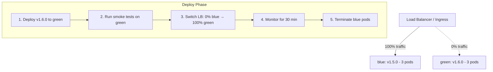

# Canary and Blue-Green Deployments — Zero-Downtime Releases

Payment services cannot afford downtime during deployments. A single minute of payment processing outage at a card-issuing bank can mean millions in lost transactions and regulatory exposure. Blue-green and canary deployment strategies provide the control mechanisms to release new versions safely, validate them under real production traffic, and roll back instantly when anomalies are detected.

---

## 1. Blue-Green Deployment

Blue-green maintains two identical environments — blue (current production) and green (new version). Traffic switches atomically from blue to green by updating the load balancer or DNS pointer. Rollback is instant: switch back to blue.



### 1.1 Blue-Green with Kubernetes Services

The simplest blue-green implementation uses a Service selector toggle:

```yaml
# blue deployment: payment-service v1.5.0
apiVersion: apps/v1
kind: Deployment
metadata:
  name: payment-service-blue
  namespace: payments
  labels:
    slot: blue
spec:
  replicas: 3
  selector:
    matchLabels:
      app: payment-service
      slot: blue
  template:
    metadata:
      labels:
        app: payment-service
        slot: blue
        version: v1.5.0
    spec:
      containers:
        - name: payment-service
          image: 123456789.dkr.ecr.us-east-1.amazonaws.com/payment-service:v1.5.0
---
# green deployment: payment-service v1.6.0 (pre-warmed, 0 traffic)
apiVersion: apps/v1
kind: Deployment
metadata:
  name: payment-service-green
  namespace: payments
  labels:
    slot: green
spec:
  replicas: 3
  selector:
    matchLabels:
      app: payment-service
      slot: green
  template:
    metadata:
      labels:
        app: payment-service
        slot: green
        version: v1.6.0
    spec:
      containers:
        - name: payment-service
          image: 123456789.dkr.ecr.us-east-1.amazonaws.com/payment-service:v1.6.0
---
# Service: initially pointing to blue
apiVersion: v1
kind: Service
metadata:
  name: payment-service
  namespace: payments
spec:
  selector:
    app: payment-service
    slot: blue       # switch to 'green' to cut over
  ports:
    - port: 8080
      targetPort: 8080
```

Traffic switch (zero downtime — Service selector update is atomic):
```bash
# Switch to green
kubectl patch service payment-service -n payments \
  --type=merge \
  -p '{"spec":{"selector":{"slot":"green"}}}'

# Instant rollback if needed
kubectl patch service payment-service -n payments \
  --type=merge \
  -p '{"spec":{"selector":{"slot":"blue"}}}'
```

---

## 2. Canary Deployment

Canary releases a new version to a small percentage of users first, progressively increasing traffic as confidence grows. Unlike blue-green's binary switch, canary allows observation under real production traffic before full rollout.

```
Traffic Split Progression:
  Deploy canary → 1% → observe → 10% → observe → 50% → observe → 100%
                  5 min          15 min           30 min
```

### 2.1 Canary with Istio VirtualService

```yaml
# 90% stable v1, 10% canary v2
apiVersion: networking.istio.io/v1alpha3
kind: VirtualService
metadata:
  name: payment-service-canary
  namespace: payments
spec:
  hosts:
    - payment-service
  http:
    - route:
        - destination:
            host: payment-service
            subset: stable
          weight: 90
        - destination:
            host: payment-service
            subset: canary
          weight: 10
---
apiVersion: networking.istio.io/v1alpha3
kind: DestinationRule
metadata:
  name: payment-service-subsets
  namespace: payments
spec:
  host: payment-service
  subsets:
    - name: stable
      labels:
        version: v1.5.0
    - name: canary
      labels:
        version: v1.6.0
```

---

## 3. Argo Rollouts

Argo Rollouts extends Kubernetes with a `Rollout` CRD that automates progressive delivery — canary steps, analysis, and automatic rollback.

### 3.1 Rollout Resource with Canary Steps

```yaml
apiVersion: argoproj.io/v1alpha1
kind: Rollout
metadata:
  name: payment-service
  namespace: payments
spec:
  replicas: 10
  revisionHistoryLimit: 5
  selector:
    matchLabels:
      app: payment-service
  template:
    metadata:
      labels:
        app: payment-service
    spec:
      containers:
        - name: payment-service
          image: 123456789.dkr.ecr.us-east-1.amazonaws.com/payment-service:v1.6.0
          ports:
            - containerPort: 8080
          resources:
            requests:
              cpu: "1"
              memory: 2Gi
            limits:
              cpu: "2"
              memory: 4Gi
          readinessProbe:
            httpGet:
              path: /actuator/health/readiness
              port: 8080
            initialDelaySeconds: 15
            periodSeconds: 5
  strategy:
    canary:
      canaryService: payment-service-canary    # Service for canary pods
      stableService: payment-service-stable    # Service for stable pods
      trafficRouting:
        istio:
          virtualService:
            name: payment-service-vs
          destinationRule:
            name: payment-service-dr
            canarySubsetName: canary
            stableSubsetName: stable
      steps:
        - setWeight: 5          # Step 1: route 5% to canary
        - pause:
            duration: 5m        # wait 5 minutes; allow metrics to populate
        - analysis:
            templates:
              - templateName: payment-error-rate
            args:
              - name: service-name
                value: payment-service-canary
        - setWeight: 20         # Step 2: increase to 20%
        - pause:
            duration: 10m
        - analysis:
            templates:
              - templateName: payment-error-rate
              - templateName: payment-latency-p99
        - setWeight: 50         # Step 3: increase to 50%
        - pause: {}             # Step 4: indefinite pause — requires manual promotion
        - setWeight: 100        # Step 5: full rollout (after manual approval)
      autoPromotionEnabled: false   # require manual promotion at indefinite pause
      maxSurge: "25%"
      maxUnavailable: 0            # zero downtime during rollout
```

---

## 4. Automated Canary Analysis

AnalysisTemplates query Prometheus to determine if the canary meets quality thresholds. If analysis fails, the Rollout automatically rolls back.

### 4.1 AnalysisTemplate — Error Rate

```yaml
apiVersion: argoproj.io/v1alpha1
kind: AnalysisTemplate
metadata:
  name: payment-error-rate
  namespace: payments
spec:
  args:
    - name: service-name
  metrics:
    - name: error-rate
      interval: 60s
      count: 5                 # run 5 measurements
      failureLimit: 1          # allow at most 1 failure before aborting rollout
      successCondition: result[0] < 0.01   # error rate < 1%
      failureCondition: result[0] >= 0.05  # abort if error rate >= 5%
      provider:
        prometheus:
          address: http://prometheus.monitoring.svc.cluster.local:9090
          query: |
            sum(rate(
              http_server_requests_seconds_count{
                service="{{ args.service-name }}",
                status=~"5.."
              }[2m]
            )) /
            sum(rate(
              http_server_requests_seconds_count{
                service="{{ args.service-name }}"
              }[2m]
            ))
```

### 4.2 AnalysisTemplate — P99 Latency

```yaml
apiVersion: argoproj.io/v1alpha1
kind: AnalysisTemplate
metadata:
  name: payment-latency-p99
  namespace: payments
spec:
  args:
    - name: service-name
  metrics:
    - name: p99-latency
      interval: 60s
      count: 5
      failureLimit: 1
      successCondition: result[0] < 0.5    # p99 latency < 500ms
      failureCondition: result[0] >= 1.0   # abort if p99 >= 1 second
      provider:
        prometheus:
          address: http://prometheus.monitoring.svc.cluster.local:9090
          query: |
            histogram_quantile(0.99,
              sum(rate(
                http_server_requests_seconds_bucket{
                  service="{{ args.service-name }}"
                }[2m]
              )) by (le)
            )
```

### 4.3 Automatic Rollback on Analysis Failure

When an AnalysisRun fails (failure condition exceeded), Argo Rollouts automatically:
1. Stops routing traffic to the canary
2. Removes canary pods
3. Marks the Rollout as `Degraded`
4. Sends a notification (if configured)

```bash
# Monitor rollout progress
kubectl argo rollouts get rollout payment-service -n payments --watch

# Example output:
# Name:            payment-service
# Namespace:       payments
# Status:          ✖ Degraded
# Strategy:        Canary
# Step:            2/8
# SetWeight:       5
# ActualWeight:    0
# Ready:           10/10
# ...
# AnalysisRun:     payment-service-5-error-rate - ✖ Failed
# Message:         AnalysisRun "payment-service-5-error-rate" has failed with message: Metric "error-rate" assessed Failed due to failureCondition.

# Manual rollback (if auto-rollback did not trigger)
kubectl argo rollouts abort rollout/payment-service -n payments
kubectl argo rollouts undo rollout/payment-service -n payments
```

---

## 5. Feature Toggles vs Deployment Strategies

Feature toggles and deployment strategies solve different problems and are frequently used together.

```
┌─────────────────────────────────────────────────────────────────┐
│  Deployment Strategies solve: when to route traffic to new code │
│  Feature Toggles solve: when to activate new behavior in code   │
└─────────────────────────────────────────────────────────────────┘
```

| Scenario                                              | Use                        |
|-------------------------------------------------------|----------------------------|
| New payment processing algorithm — test with 10% users | Canary deployment           |
| New UI feature — enable for beta users only           | Feature toggle              |
| Database schema change — backward compatible rollout  | Expand-contract + blue-green|
| Instant rollback capability needed                    | Blue-green                  |
| Gradual traffic increase with automated health check  | Canary + AnalysisTemplate   |
| Kill switch for a problematic feature without deploy  | Feature toggle              |

```java
// Feature toggle for new payment routing algorithm
// LaunchDarkly or Unleash SDK
@Service
public class PaymentRouter {

    private final LDClient ldClient;

    public PaymentProcessingResult route(PaymentRequest request) {
        LDUser user = new LDUser.Builder(request.getCustomerId())
            .country(request.getCountry())
            .build();

        boolean useNewRouter = ldClient.boolVariation(
            "new-payment-routing-algorithm", user, false);

        if (useNewRouter) {
            return newRoutingAlgorithm.process(request);
        } else {
            return legacyRouter.process(request);
        }
    }
}
```

---

## 6. Database Migration Compatibility

Blue-green and canary deployments require the new application version to be backward-compatible with the current database schema, since both versions run simultaneously.

### 6.1 Expand-Contract Pattern

```
Phase 1 — Expand (run with old + new code simultaneously):
  - Add column: ALTER TABLE payments ADD COLUMN new_processor_id VARCHAR(50);
  - Both v1.5.0 and v1.6.0 can read from either column

Phase 2 — Migrate (backfill data):
  - UPDATE payments SET new_processor_id = processor_id WHERE new_processor_id IS NULL;

Phase 3 — Contract (after full rollout to v1.6.0):
  - ALTER TABLE payments DROP COLUMN processor_id;
  - Only safe after v1.5.0 is fully retired
```

```java
// V3__add_new_processor_id.sql — Flyway migration (Phase 1: Expand)
// This migration is safe to run while v1.5.0 is still in production
ALTER TABLE payments
ADD COLUMN IF NOT EXISTS new_processor_id VARCHAR(50);

-- Backfill for existing rows
UPDATE payments
SET new_processor_id = processor_id
WHERE new_processor_id IS NULL
  AND processor_id IS NOT NULL;

-- Add NOT NULL constraint only after all rows are backfilled
-- and v1.5.0 is fully retired (Phase 3: Contract)
-- ALTER TABLE payments ALTER COLUMN new_processor_id SET NOT NULL;
```

---

## Production Pitfalls

### Pitfall 1: Blue-Green Database Schema Not Backward Compatible

**Problem**: Blue-green only works for stateless application logic. If the new version (green) applies a database schema change that removes or renames a column before the old version (blue) is fully drained, all in-flight requests processed by blue pods fail with database errors.

**Wrong approach**: Running Flyway migrations in the application startup without backward compatibility consideration.

```java
// V3__rename_column.sql — DANGEROUS for blue-green
-- This rename immediately breaks all blue (v1.5.0) pods
-- because v1.5.0 still SELECT processor_id which no longer exists
ALTER TABLE payments RENAME COLUMN processor_id TO legacy_processor_id;
```

**Correct approach**: Expand-contract pattern. Add the new column, copy data, make both columns work in parallel, then remove the old one only after full cutover.

```sql
-- Phase 1 (safe to deploy while blue is still active):
ALTER TABLE payments ADD COLUMN legacy_processor_id VARCHAR(50);
UPDATE payments SET legacy_processor_id = processor_id;

-- Application v1.6.0 reads from BOTH columns:
SELECT COALESCE(legacy_processor_id, processor_id) AS effective_processor_id
FROM payments WHERE id = ?;

-- Phase 3 (after blue is fully drained and retired):
ALTER TABLE payments DROP COLUMN processor_id;
ALTER TABLE payments RENAME COLUMN legacy_processor_id TO processor_id;
```

---

### Pitfall 2: Canary Traffic Split Not Working for gRPC Services

**Problem**: Istio's HTTP weight-based routing (via VirtualService `weight:`) works for HTTP/1.1 and HTTP/2 connections but requires the connection to be established per-request. gRPC clients typically establish a single long-lived connection and multiplex all calls over it. The initial connection is routed to either stable or canary based on the weight, but all subsequent calls go to the same destination — effectively bypassing the canary split.

**Symptoms**: 100% of gRPC traffic consistently goes to stable despite a 10% canary weight configured.

**Diagnosis**:
```bash
# Check actual traffic distribution in Kiali or Prometheus
kubectl port-forward -n istio-system svc/kiali 20001:20001
# In Kiali: Graph → payment-service → check canary vs stable percentages
# If canary shows 0%, the gRPC multiplexing issue is confirmed
```

**Fix**: Configure the Kubernetes Service with `sessionAffinity: None` and ensure the gRPC client creates a new connection (or uses a client-side load balancer like `grpc.NewClient` with round-robin). Additionally, Istio's `DestinationRule` can force connection pool limits that cause the client to open new connections more frequently:

```yaml
apiVersion: networking.istio.io/v1alpha3
kind: DestinationRule
metadata:
  name: payment-service-grpc
  namespace: payments
spec:
  host: payment-service
  trafficPolicy:
    connectionPool:
      http:
        # Force new connections to enable per-connection routing
        h2UpgradePolicy: UPGRADE
        http2MaxRequests: 100    # limit concurrent streams per connection
        http1MaxPendingRequests: 1
  subsets:
    - name: stable
      labels:
        version: v1.5.0
    - name: canary
      labels:
        version: v1.6.0
```

For gRPC-only services, consider using gRPC's native client-side load balancing with DNS-based discovery rather than relying solely on Istio service-mesh routing.

---

### Pitfall 3: Not Testing AnalysisTemplate Before Production Canary

**Problem**: An AnalysisTemplate with a Prometheus query error (wrong metric name, wrong label selector) fails immediately when the first AnalysisRun is created. This causes the canary rollout to roll back before any traffic is even analyzed — appearing as a false deployment failure. Worse, if `failureLimit` is set to 0, the rollback is instantaneous and the team assumes the canary code has bugs when the real problem is the analysis query.

**Diagnosis**:
```bash
kubectl get analysisrun -n payments
# payment-service-5-error-rate   Error

kubectl describe analysisrun payment-service-5-error-rate -n payments
# Message: Error evaluating query: ...
# Prometheus error: "unknown metric name: http_server_requests_seconds_coun"
#                                           (typo: "coun" instead of "count")
```

**Prevention**: Test the AnalysisTemplate query manually before the canary goes live.

```bash
# Step 1: Test the Prometheus query directly
kubectl port-forward svc/prometheus -n monitoring 9090:9090
# In browser or curl:
curl 'http://localhost:9090/api/v1/query' \
  --data-urlencode 'query=sum(rate(http_server_requests_seconds_count{service="payment-service"}[2m]))'
# Verify: returns a valid numeric result, not an error

# Step 2: Create a dry-run AnalysisRun to validate the template
kubectl create -f - <<EOF
apiVersion: argoproj.io/v1alpha1
kind: AnalysisRun
metadata:
  name: payment-analysis-test
  namespace: payments
spec:
  templates:
    - templateName: payment-error-rate
  args:
    - name: service-name
      value: payment-service
EOF

# Watch for success or error
kubectl get analysisrun payment-analysis-test -n payments --watch
```

**Best practice**: Store AnalysisTemplates in the GitOps repo and test them in staging with real Prometheus data before deploying to production. Add an integration test that runs the AnalysisTemplate in staging and asserts it produces a numeric result.

---

## Checklist

### Blue-Green Deployments
- [ ] Both blue and green environments are deployed before traffic switch
- [ ] Smoke tests run against green environment before traffic switch (not after)
- [ ] Database migrations are backward compatible — expand-contract pattern applied
- [ ] Service selector toggle script tested and timed (should be < 1 second)
- [ ] Rollback procedure documented and tested (switch selector back to blue)
- [ ] Blue pods retained for at least 30 minutes after green cutover before termination

### Canary Deployments
- [ ] AnalysisTemplate queries tested against Prometheus manually before production use
- [ ] Dry-run AnalysisRun created in staging to validate template before production canary
- [ ] gRPC services use connection pool limits or client-side load balancing for effective canary split
- [ ] `maxUnavailable: 0` set in Rollout strategy to prevent downtime during steps
- [ ] `autoPromotionEnabled: false` for all production Rollouts requiring human approval
- [ ] AnalysisTemplate `failureLimit` set to allow transient metric gaps (not `failureLimit: 0`)

### Argo Rollouts
- [ ] Argo Rollouts controller installed with HA (2+ replicas)
- [ ] Rollout notifications configured (Slack/PagerDuty on rollback events)
- [ ] `revisionHistoryLimit` set to retain at least 5 revisions for rollback
- [ ] Rollout status monitored during every canary deployment (`kubectl argo rollouts get rollout`)
- [ ] Manual promotion step included for production rollouts (indefinite `pause: {}`)

### Database Migrations
- [ ] All schema changes reviewed for backward compatibility before deployment
- [ ] Flyway/Liquibase migrations in expand phase only during blue-green releases
- [ ] Contract (remove old column) migrations deferred to a separate deployment after full rollout
- [ ] Database migration tested in staging with production-equivalent data volume

---

<!-- KNOWLEDGE-CHECK
{"questions":[{"text":"Why does the expand-contract database migration pattern matter for blue-green deployments?","options":["a) It prevents Flyway from running migrations on both the blue and green database instances simultaneously","b) Since both old and new application versions run simultaneously during the cutover window, the database schema must remain compatible with both; removing or renaming columns before blue is drained breaks in-flight requests","c) The contract phase must run before the blue-green switch to ensure green has the correct schema","d) Expand-contract is only needed for canary deployments, not blue-green"],"correct":1,"explanation":"During a blue-green cutover, both v1 (blue) and v2 (green) may be handling requests simultaneously (old in-flight requests continuing on blue while new requests go to green). If a schema change breaks v1's queries (e.g., renaming a column v1 reads), those in-flight requests on blue pods will fail. The expand-contract pattern ensures the schema is compatible with both versions throughout the cutover window."},{"text":"An Argo Rollouts canary immediately rolls back every time it starts. kubectl describe analysisrun shows 'Prometheus error: unknown metric name'. What is the most likely cause and fix?","options":["a) The Prometheus server is not reachable from the payments namespace — add a NetworkPolicy egress rule","b) The AnalysisTemplate was not tested before production deployment; the Prometheus query contains a typo or references a non-existent metric name — test with a dry-run AnalysisRun in staging first","c) The canary pods have not generated enough traffic for the metric to exist yet — increase the failureLimit to 10","d) AnalysisTemplates do not support parameterized queries with args; use hardcoded metric selectors"],"correct":1,"explanation":"An AnalysisTemplate with a Prometheus query error fails immediately on the first measurement, causing an instant rollback that looks like a code defect. The fix is to test the AnalysisTemplate query directly against Prometheus before the production canary, and to validate it with a dry-run AnalysisRun in staging."},{"text":"Why does Istio's HTTP weight-based canary routing often fail to produce the expected traffic split for gRPC services?","options":["a) Istio does not support gRPC traffic routing — only HTTP/1.1 is supported by VirtualService","b) gRPC clients typically establish one long-lived connection and multiplex all calls over it; the initial connection is routed once by weight, so all subsequent calls on that connection go to the same destination","c) The DestinationRule subset labels must use 'grpc' as the protocol name for gRPC routing","d) gRPC services require Envoy filters instead of VirtualService for canary routing"],"correct":1,"explanation":"gRPC uses HTTP/2 multiplexing — a single TCP connection carries many RPC calls. Istio routes at connection establishment time (applying the canary weight), but all subsequent calls on that connection bypass the weight decision. Limiting the connection pool size (http2MaxRequests) forces the client to open new connections more frequently, making each subject to the weight-based routing."}]}
-->

<!-- PRACTICAL-CHALLENGE
{"title":"Zero-Downtime Canary Deployment with Automated Rollback","difficulty":"advanced","estimatedMinutes":90,"tasks":[{"id":"1","description":"Deploy payment-service v1 as a stable Argo Rollout. Configure canary steps: 5% for 5 minutes, then 20%, then 50% with an indefinite pause, then 100%. Deploy an update (v2 image). Watch the rollout progress through the first two steps automatically and confirm the rollout pauses at 50%. Promote manually and confirm full rollout."},{"id":"2","description":"Create two AnalysisTemplates: one for error rate (< 1% threshold) and one for p99 latency (< 500ms). First, test both queries manually against Prometheus to confirm they return valid results. Then create a dry-run AnalysisRun and verify it completes successfully. Attach both templates to the canary steps in the Rollout."},{"id":"3","description":"Simulate a bad canary deployment: deploy a v3 image that returns 10% HTTP 500 errors (inject faults in the app or use an Istio fault injection policy). Watch the AnalysisRun detect the error rate violation and trigger automatic rollback. Verify that after rollback, 100% of traffic returns to v2 and no v3 pods are running."},{"id":"4","description":"Demonstrate the expand-contract database migration pattern: start with a 'payments' table with a 'processor_code' column. Deploy v1 that reads from processor_code. Add a migration (Phase 1: expand) that adds 'new_processor_code' and backfills it. Deploy v2 that reads from COALESCE(new_processor_code, processor_code). Do a blue-green switch. Then run the contract migration dropping the old column. Verify no errors occurred during any phase."}]}
-->
