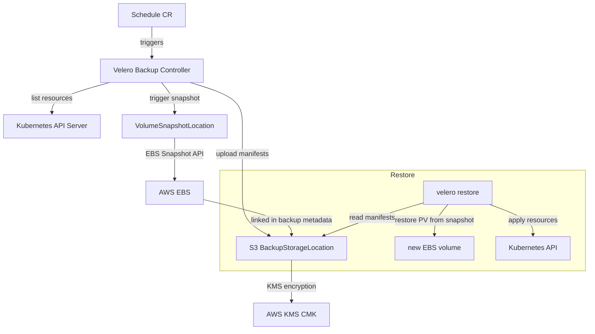
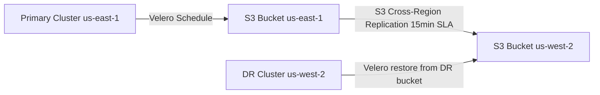

# Disaster Recovery on Kubernetes — Backup and Restore

A Kubernetes cluster without a tested disaster recovery plan is an operational liability. For financial services regulated under PCI-DSS Requirement 12.3.3, backup testing is not optional — it must be performed regularly and results documented. This lesson covers what must be backed up, how to back it up, and how to verify that recovery actually works before you need it.

---

## 1. DR Objectives for Kubernetes

### 1.1 RTO and RPO Definitions

**Recovery Time Objective (RTO)**: Maximum acceptable time between a disaster and full service restoration.

**Recovery Point Objective (RPO)**: Maximum acceptable data loss, expressed as a time window (e.g., RPO of 1 hour means you can lose at most 1 hour of data).

Typical targets for a fintech payment platform:

| Component                | RTO Target  | RPO Target  | Recovery Strategy              |
|--------------------------|-------------|-------------|-------------------------------|
| Payment processing API   | < 15 min    | 0 (no loss) | Multi-AZ with auto-failover    |
| PostgreSQL primary       | < 30 min    | < 5 min     | Streaming replication + PITR   |
| Kafka payment events     | < 1 hour    | < 15 min    | Multi-AZ Kafka + S3 backup     |
| Full cluster (etcd loss) | < 4 hours   | < 1 hour    | etcd snapshot + Velero backup  |
| Cross-region DR          | < 8 hours   | < 1 hour    | Velero cross-region restore    |

### 1.2 What Needs Backup in Kubernetes

A complete Kubernetes backup consists of:

```
┌─────────────────────────────────────────────────────────────┐
│  What must be backed up                                      │
├──────────────────────────────┬──────────────────────────────┤
│  etcd                        │  All Kubernetes API objects: │
│  (cluster state)             │  Deployments, Services,      │
│                              │  ConfigMaps, Secrets,        │
│                              │  NetworkPolicies, RBAC       │
├──────────────────────────────┼──────────────────────────────┤
│  PersistentVolumes           │  Actual application data:    │
│  (stateful data)             │  PostgreSQL, Kafka logs,     │
│                              │  Redis snapshots             │
├──────────────────────────────┼──────────────────────────────┤
│  Helm values                 │  Chart versions and          │
│  (deployment config)         │  override values per env     │
├──────────────────────────────┼──────────────────────────────┤
│  Certificates and PKI        │  TLS certificates, CA roots, │
│                              │  Sealed Secrets master key   │
└──────────────────────────────┴──────────────────────────────┘
```

---

## 2. Velero Architecture

Velero is the de-facto backup tool for Kubernetes. It backs up all Kubernetes API objects to object storage (S3) and uses the VolumeSnapshot API for persistent volume data.



### 2.1 Velero Schedule CRD — Daily Backup at 2am

```yaml
apiVersion: velero.io/v1
kind: Schedule
metadata:
  name: daily-cluster-backup
  namespace: velero
spec:
  schedule: "0 2 * * *"       # 2 AM UTC every day
  useOwnerReferencesInBackup: false
  template:
    includedNamespaces:
      - payments
      - fraud-detection
      - account-management
      - kafka
      - data
    excludedResources:
      - events.events.k8s.io
      - events
      - endpointslices
    snapshotVolumes: true       # trigger EBS VolumeSnapshots
    ttl: 720h                   # retain 30 backups (30 days)
    storageLocation: primary
    volumeSnapshotLocations:
      - primary
    includeClusterResources: true   # include RBAC, StorageClasses, CRDs
    metadata:
      labels:
        backup-type: scheduled
        pci-evidence: "true"        # flag for PCI-DSS audit evidence
---
# BackupStorageLocation — primary S3 bucket
apiVersion: velero.io/v1
kind: BackupStorageLocation
metadata:
  name: primary
  namespace: velero
spec:
  provider: aws
  default: true
  objectStorage:
    bucket: fintech-k8s-backups-prod
    prefix: cluster-backups
  config:
    region: us-east-1
    kmsKeyId: "arn:aws:kms:us-east-1:123456789:key/backup-cmk"
    serverSideEncryption: aws:kms
  credential:
    name: velero-credentials
    key: cloud
---
# VolumeSnapshotLocation — EBS
apiVersion: velero.io/v1
kind: VolumeSnapshotLocation
metadata:
  name: primary
  namespace: velero
spec:
  provider: aws
  config:
    region: us-east-1
```

### 2.2 Restore Procedure

```bash
# Step 1: List available backups
velero backup get -n velero
# NAME                               STATUS     ERRORS   EXPIRES
# daily-cluster-backup-20241101...   Completed  0        29d

# Step 2: Describe backup to verify contents
velero backup describe daily-cluster-backup-20241101020012 \
  --details -n velero
# Verify: Secrets: included, PVCs: included, Phase: Completed

# Step 3: Restore a full namespace
velero restore create payments-dr-restore \
  --from-backup daily-cluster-backup-20241101020012 \
  --include-namespaces payments \
  --restore-volumes=true \
  --include-cluster-resources=true \
  --wait

# Step 4: Monitor restore progress
velero restore describe payments-dr-restore -n velero
velero restore logs payments-dr-restore -n velero

# Step 5: Verify restored resources
kubectl get all -n payments
kubectl get pvc -n payments
kubectl get secrets -n payments     # verify Secrets are present

# Step 6: Run smoke tests
kubectl exec -n payments deploy/payment-api -- \
  curl -sf http://localhost:8080/actuator/health/readiness
```

---

## 3. etcd Backup and Restore

etcd is the Kubernetes control plane database. It stores all API objects — Deployments, Services, ConfigMaps, Secrets, and every other Kubernetes resource. Losing etcd without a backup means losing the entire cluster configuration.

### 3.1 etcd Backup with etcdctl

```bash
#!/bin/bash
# etcd-backup.sh — run on the control plane node every 6 hours

ETCD_ENDPOINT="https://127.0.0.1:2379"
BACKUP_DIR="/opt/etcd-backups"
BACKUP_FILE="${BACKUP_DIR}/etcd-snapshot-$(date +%Y%m%d-%H%M%S).db"
ETCD_CERT="/etc/kubernetes/pki/etcd/peer.crt"
ETCD_KEY="/etc/kubernetes/pki/etcd/peer.key"
ETCD_CA="/etc/kubernetes/pki/etcd/ca.crt"

mkdir -p "${BACKUP_DIR}"

# Take snapshot — consistent point-in-time snapshot
ETCDCTL_API=3 etcdctl \
  --endpoints="${ETCD_ENDPOINT}" \
  --cert="${ETCD_CERT}" \
  --key="${ETCD_KEY}" \
  --cacert="${ETCD_CA}" \
  snapshot save "${BACKUP_FILE}"

# Verify snapshot integrity
ETCDCTL_API=3 etcdctl snapshot status "${BACKUP_FILE}" \
  --write-out=table

# Encrypt and upload to S3 (offsite — NEVER keep only local)
aws s3 cp "${BACKUP_FILE}" \
  "s3://fintech-etcd-backups/prod-cluster/$(basename ${BACKUP_FILE})" \
  --sse aws:kms \
  --sse-kms-key-id "arn:aws:kms:us-east-1:123456789:key/etcd-backup-key"

# Remove local copy after successful S3 upload
rm -f "${BACKUP_FILE}"
echo "etcd backup completed: $(basename ${BACKUP_FILE})"
```

### 3.2 etcd Restore Procedure

Restoring etcd requires stopping the kube-apiserver to prevent concurrent writes during restore.

```bash
#!/bin/bash
# etcd-restore.sh — CAUTION: disrupts the cluster control plane

SNAPSHOT_FILE="/tmp/etcd-snapshot-20241101-020000.db"
RESTORE_DIR="/var/lib/etcd-restore"
ETCD_DATA_DIR="/var/lib/etcd"

# Step 1: Download snapshot from S3
aws s3 cp \
  "s3://fintech-etcd-backups/prod-cluster/etcd-snapshot-20241101-020000.db" \
  "${SNAPSHOT_FILE}"

# Step 2: Stop the API server and etcd by moving static pod manifests
mv /etc/kubernetes/manifests/kube-apiserver.yaml /tmp/
mv /etc/kubernetes/manifests/etcd.yaml /tmp/
sleep 10    # wait for containers to terminate

# Step 3: Restore snapshot to new data directory
ETCDCTL_API=3 etcdctl snapshot restore "${SNAPSHOT_FILE}" \
  --data-dir="${RESTORE_DIR}" \
  --name=master-0 \
  --initial-cluster="master-0=https://127.0.0.1:2380" \
  --initial-cluster-token=etcd-cluster-prod \
  --initial-advertise-peer-urls="https://127.0.0.1:2380"

# Step 4: Replace etcd data directory
mv "${ETCD_DATA_DIR}" "${ETCD_DATA_DIR}.old"
mv "${RESTORE_DIR}/member" "${ETCD_DATA_DIR}"
chown -R etcd:etcd "${ETCD_DATA_DIR}"

# Step 5: Restart control plane
mv /tmp/etcd.yaml /etc/kubernetes/manifests/
sleep 15
mv /tmp/kube-apiserver.yaml /etc/kubernetes/manifests/

# Step 6: Verify cluster health
kubectl get nodes
kubectl get pods -n kube-system
```

---

## 4. Multi-Region DR

For RTO targets under 8 hours, pre-stage a backup cluster in a second AWS region. Velero replicates backups to the DR region's S3 bucket.



```yaml
# Second region BackupStorageLocation
apiVersion: velero.io/v1
kind: BackupStorageLocation
metadata:
  name: dr-region
  namespace: velero
spec:
  provider: aws
  objectStorage:
    bucket: fintech-k8s-backups-dr
    prefix: cluster-backups
  config:
    region: us-west-2
    kmsKeyId: "arn:aws:kms:us-west-2:123456789:key/backup-cmk-dr"
    serverSideEncryption: aws:kms
---
# Updated Schedule to also write to DR location
apiVersion: velero.io/v1
kind: Schedule
metadata:
  name: daily-backup-with-dr
  namespace: velero
spec:
  schedule: "0 2 * * *"
  template:
    includedNamespaces:
      - payments
      - data
    snapshotVolumes: true
    ttl: 720h
    storageLocation: primary
    additionalBackupLocations:
      - name: dr-region      # write backup manifest to DR S3 as well
    volumeSnapshotLocations:
      - primary
```

---

## 5. DR Testing Runbook

DR testing must be performed quarterly to satisfy PCI-DSS Requirement 12.3.3. Execute on a non-production test cluster, not on production.

```
┌─────────────────────────────────────────────────────────────────┐
│  Quarterly DR Restore Drill — Step by Step                       │
├──────────────────────────────────────────────────────────────────┤
│                                                                   │
│  1. Pre-drill preparation (T-1 day)                              │
│     - velero backup get: identify most recent Completed backup   │
│     - Provision a clean test cluster (same size as production)   │
│     - Install Velero on test cluster with DR S3 bucket access    │
│     - Document baseline: pod count, service versions, DB rows    │
│                                                                   │
│  2. Cluster restore (T=0, record start time)                     │
│     - velero restore create drill-restore \                      │
│         --from-backup <backup-name> \                            │
│         --include-namespaces payments,data \                     │
│         --restore-volumes=true \                                 │
│         --wait                                                    │
│                                                                   │
│  3. Verification (T+30 min)                                      │
│     - kubectl get all -n payments → all pods Running             │
│     - kubectl get pvc -n payments → all PVCs Bound               │
│     - kubectl get secrets -n payments → credentials present      │
│     - Smoke test: payment API health check returns HTTP 200      │
│     - DB verification: row count matches pre-disaster baseline   │
│     - Record actual RTO vs target RTO                            │
│                                                                   │
│  4. PCI-DSS Evidence Collection                                  │
│     - Screenshot: velero restore describe output                 │
│     - Screenshot: kubectl get all -n payments → Running pods     │
│     - Smoke test results (pass/fail with timestamps)             │
│     - Actual RTO vs target signed by security officer            │
│                                                                   │
│  5. Post-drill cleanup                                           │
│     - Delete test cluster (never keep DR drill data in prod)     │
│     - File report in compliance documentation system             │
│     - Open P2 remediation tickets for any failures               │
│     - Schedule next drill: T+90 days                             │
│                                                                   │
└──────────────────────────────────────────────────────────────────┘
```

Automate the verification step:

```bash
#!/bin/bash
# dr-verify.sh — run after every restore to validate completeness
NAMESPACE=payments

echo "DR Restore Verification — $(date -u)"

# 1. Wait for pods to become Ready
kubectl wait pod --all -n "${NAMESPACE}" \
  --for=condition=Ready --timeout=300s

# 2. Check all expected Deployments are available
kubectl get deployments -n "${NAMESPACE}" \
  -o=custom-columns='NAME:.metadata.name,AVAILABLE:.status.availableReplicas,DESIRED:.spec.replicas'

# 3. Verify Secrets are present
SECRET_COUNT=$(kubectl get secrets -n "${NAMESPACE}" \
  --no-headers | grep -v default-token | wc -l)
echo "Secrets restored: ${SECRET_COUNT}"

# 4. Run application health check
kubectl exec -n "${NAMESPACE}" \
  "$(kubectl get pod -n ${NAMESPACE} -l app=payment-service \
     -o jsonpath='{.items[0].metadata.name}')" \
  -- curl -sf http://localhost:8080/actuator/health

echo "Verification complete — $(date -u)"
```

---

## Production Pitfalls

### Pitfall 1: Not Testing Restores Until Disaster Strikes

**Problem**: Organizations create Velero Schedules, verify that backup objects appear in S3, and consider their backup strategy complete. The first time they attempt a restore is during an actual incident — when time pressure, stress, and unfamiliar failure modes combine to maximize error likelihood.

**Common failures discovered only during first-ever restore**:
- Secrets excluded from backup (see Pitfall 3)
- CRDs (ArgoCD, Cert-Manager) must be re-installed before namespaced resources
- PVC snapshots succeeded but application data is corrupted
- ClusterRoleBindings needed by service accounts were not restored
- ECR images are in the failed region — pods cannot pull images in DR region

**Fix**: Schedule quarterly DR drills as a mandatory calendar event and treat restore failures as P1 incidents.

```bash
# Minimal automated restore verification — run after every drill
#!/bin/bash
NAMESPACE=payments
BACKUP_NAME=$1
DRILL_START=$(date +%s)

echo "Starting DR drill from backup: ${BACKUP_NAME}"

velero restore create "drill-$(date +%Y%m%d%H%M)" \
  --from-backup "${BACKUP_NAME}" \
  --include-namespaces "${NAMESPACE}" \
  --restore-volumes=true \
  --wait

kubectl wait pod --all -n "${NAMESPACE}" \
  --for=condition=Ready --timeout=300s

kubectl exec -n "${NAMESPACE}" \
  "$(kubectl get pod -n ${NAMESPACE} -l app=payment-service \
     -o jsonpath='{.items[0].metadata.name}')" \
  -- curl -sf http://localhost:8080/actuator/health

DRILL_END=$(date +%s)
RTO_MINUTES=$(( (DRILL_END - DRILL_START) / 60 ))
echo "Actual RTO: ${RTO_MINUTES} minutes (target: 240)"

if [ "${RTO_MINUTES}" -gt 240 ]; then
  echo "FAIL: RTO target exceeded — open P1 remediation ticket"
  exit 1
fi
echo "PASS: RTO target achieved"
```

---

### Pitfall 2: Backing Up etcd Without Stopping kube-apiserver

**Problem**: When kube-apiserver is actively writing multi-object transactions to etcd at the moment of a snapshot, the snapshot may capture a partially-written set of related objects. For example, a Deployment's creation generates a Deployment, ReplicaSet, and Pod objects in rapid succession — a snapshot mid-transaction captures some but not all.

**What actually happens**: `etcdctl snapshot save` takes a consistent point-in-time snapshot of etcd — it does not corrupt or truncate data. However, the **semantic consistency** between related Kubernetes objects is not guaranteed if objects were mid-creation at snapshot time. After restore, Kubernetes controllers will attempt to reconcile discrepancies (e.g., recreate the missing ReplicaSet), but this reconciliation has caused issues in some real-world restores.

**Recommended approach for self-managed clusters**:

```bash
# APPROACH 1: Scheduled backup during low-traffic window (safest)
# Move static pod manifests to pause kube-apiserver before snapshot

# Stop API server (moves manifest out of kubelet's watch directory)
mv /etc/kubernetes/manifests/kube-apiserver.yaml /tmp/kube-apiserver.yaml.backup
sleep 5   # wait for container to terminate

# Take snapshot — no concurrent writes possible
ETCDCTL_API=3 etcdctl snapshot save /opt/backups/etcd-clean.db \
  --endpoints=https://127.0.0.1:2379 \
  --cert=/etc/kubernetes/pki/etcd/peer.crt \
  --key=/etc/kubernetes/pki/etcd/peer.key \
  --cacert=/etc/kubernetes/pki/etcd/ca.crt

# Restore API server
mv /tmp/kube-apiserver.yaml.backup /etc/kubernetes/manifests/kube-apiserver.yaml

# APPROACH 2: For GitOps clusters — rely on Velero for objects, etcd as fallback
# If your cluster is fully GitOps (ArgoCD/Flux), all Kubernetes manifests
# are in Git. After an etcd restore, ArgoCD reconciles any missing/drifted
# objects automatically. This makes the semantic consistency risk acceptable.
```

**For EKS**: AWS manages etcd — no etcd backup is needed. Focus entirely on Velero for namespaced resource backup.

---

### Pitfall 3: Not Encrypting Backup Storage

**Problem**: Velero backups stored in S3 contain all Kubernetes Secrets in plaintext JSON — database passwords, API keys, TLS private keys, and signing certificates. Without encryption at rest and in transit, a compromised S3 bucket grants full access to all application credentials. This is a direct PCI-DSS Requirement 3.5 violation.

**Wrong backup storage configuration**:
```yaml
apiVersion: velero.io/v1
kind: BackupStorageLocation
metadata:
  name: default
  namespace: velero
spec:
  provider: aws
  objectStorage:
    bucket: fintech-backups-prod     # NO encryption configured
  config:
    region: us-east-1
    # Missing: kmsKeyId — data stored without encryption
    # Missing: serverSideEncryption — no at-rest protection
```

**Correct configuration with KMS CMK encryption**:
```yaml
apiVersion: velero.io/v1
kind: BackupStorageLocation
metadata:
  name: default
  namespace: velero
spec:
  provider: aws
  objectStorage:
    bucket: fintech-k8s-backups-encrypted
  config:
    region: us-east-1
    kmsKeyId: "arn:aws:kms:us-east-1:123456789:key/backup-cmk"
    serverSideEncryption: aws:kms    # AES-256 with customer-managed key
```

Enforce encryption at the S3 bucket policy level (denies any non-KMS upload):

```json
{
  "Version": "2012-10-17",
  "Statement": [
    {
      "Sid": "DenyUnencryptedObjectUploads",
      "Effect": "Deny",
      "Principal": "*",
      "Action": "s3:PutObject",
      "Resource": "arn:aws:s3:::fintech-k8s-backups-encrypted/*",
      "Condition": {
        "StringNotEquals": {
          "s3:x-amz-server-side-encryption": "aws:kms"
        }
      }
    },
    {
      "Sid": "DenyHTTP",
      "Effect": "Deny",
      "Principal": "*",
      "Action": "s3:*",
      "Resource": [
        "arn:aws:s3:::fintech-k8s-backups-encrypted",
        "arn:aws:s3:::fintech-k8s-backups-encrypted/*"
      ],
      "Condition": {
        "Bool": {
          "aws:SecureTransport": "false"
        }
      }
    }
  ]
}
```

This policy enforces that all uploads use KMS encryption and all API calls use TLS — satisfying PCI-DSS Requirement 3.5 for backup storage.

---

## Checklist

### Velero Configuration
- [ ] Velero Schedule deployed: daily at 2am, 30-day retention (720h TTL)
- [ ] `includedNamespaces` covers all application and data namespaces
- [ ] `snapshotVolumes: true` enabled for PVC backup via EBS VolumeSnapshot
- [ ] `includeClusterResources: true` to capture RBAC, StorageClasses, and CRDs
- [ ] Secrets explicitly NOT excluded from backup
- [ ] Backup stored in KMS-encrypted S3 bucket (CMK, not AWS-managed key)
- [ ] S3 bucket policy enforces KMS encryption (denies non-KMS uploads)
- [ ] S3 bucket versioning enabled to protect against backup file corruption
- [ ] Cross-region replication to DR region S3 bucket configured and tested
- [ ] `BackupStorageLocation` validated: `velero backup-location get` shows Available
- [ ] Velero backup success/failure alerts configured in Prometheus (page on failure)

### etcd Backup (self-managed clusters only)
- [ ] etcd CronJob runs every 6 hours minimum
- [ ] Snapshots uploaded to separate S3 bucket from Velero (different KMS CMK)
- [ ] `etcdctl snapshot status` verifies integrity after each backup
- [ ] etcd restore procedure documented and tested annually
- [ ] EKS clusters: skip etcd backup (AWS manages etcd for managed clusters)

### DR Testing (PCI-DSS Req 12.3.3)
- [ ] Quarterly DR drill scheduled as calendar event with named owner
- [ ] DR drill executed on test cluster (never on production cluster)
- [ ] Actual RTO measured and compared against target on each drill
- [ ] DR drill results signed by security officer and filed in compliance system
- [ ] P2 remediation tickets opened for any failures discovered
- [ ] CRD installation order documented (ArgoCD, Cert-Manager first)
- [ ] ECR cross-region image replication verified during drill (pods can pull images)

### Multi-Region DR
- [ ] `BackupStorageLocation` configured in secondary AWS region
- [ ] DR cluster infrastructure as code (Terraform/eksctl) verified runnable
- [ ] Velero on DR cluster verified with read access to DR S3 bucket
- [ ] Cross-region restore drill executed at least once per year

### Security and Compliance
- [ ] S3 bucket is not publicly accessible (AWS S3 Block Public Access enabled)
- [ ] Backup KMS CMK access controlled — only Velero service account can use it
- [ ] Backup access logs enabled (S3 server access logging) for PCI-DSS audit trail
- [ ] Backup encryption keys backed up separately (KMS key policy + cross-region CMK)
- [ ] DR drill reports retained for 3 years as PCI-DSS Requirement 12.3.3 evidence

---

<!-- KNOWLEDGE-CHECK
{"questions":[{"text":"PCI-DSS Requirement 12.3.3 mandates backup testing. What is the most critical mistake that invalidates a backup program and is only discovered at disaster time?","options":["a) Using Velero instead of etcdctl for cluster backup","b) Setting backup TTL to 30 days instead of 90 days","c) Never actually testing a restore — only verifying that backup files exist in S3, without validating that recovery from those backups completes within the RTO target","d) Using S3 Standard storage class instead of S3 Intelligent-Tiering"],"correct":2,"explanation":"Many organizations verify backup existence (files appear in S3) but never test restore. The first actual restore during a disaster reveals issues like excluded Secrets, missing CRDs, incorrect IAM permissions, ECR images in the failed region, and corrupt snapshots — all while under time pressure. PCI-DSS 12.3.3 explicitly requires testing that backups can be restored, not just created."},{"text":"Why should etcd backups be stored in a separate S3 bucket from Velero application backups, with separate KMS encryption keys?","options":["a) Velero cannot read etcd snapshot files — they are in a binary format incompatible with S3","b) etcd snapshots contain all Kubernetes API objects including every Secret; separate buckets with separate CMKs limit the blast radius — a compromise of one backup access path does not automatically expose the other","c) AWS S3 has a file size limit that requires splitting backups across multiple buckets","d) etcd snapshots must be stored on the control plane node and cannot be uploaded to S3"],"correct":1,"explanation":"etcd snapshots are complete dumps of all Kubernetes state including every Secret in the cluster. Separating etcd backups from Velero application backups — with different KMS CMKs, different IAM access policies, and different audit logs — means a compromise of one access path does not automatically expose the other, limiting the blast radius of a security incident."},{"text":"A velero restore create command completes successfully but payment-service pods fail to start because they cannot authenticate to PostgreSQL. What was most likely missing from the Velero backup configuration?","options":["a) The PostgreSQL StatefulSet was not included in the backup namespace list","b) The PVC snapshots were taken with snapshotVolumes: false","c) Kubernetes Secrets were explicitly excluded from the Velero backup, so the postgres-credentials Secret was not restored — payment-service has no database password after restore","d) The VolumeSnapshotLocation was configured for the wrong AWS region"],"correct":2,"explanation":"Excluding Secrets from Velero backups is a common misconfiguration, often done with the intention of avoiding credential storage in backup storage. Without the postgres-credentials Secret, payment-service cannot authenticate to the database after restore. Secrets must be included in backup (with the backup bucket encrypted with KMS) to enable a complete namespace restore."}]}
-->

<!-- PRACTICAL-CHALLENGE
{"title":"Implement and Test Kubernetes Disaster Recovery for a Payment Platform","difficulty":"advanced","estimatedMinutes":120,"tasks":[{"id":"1","description":"Install Velero with an S3-compatible backend (MinIO locally or real S3). Create a Schedule that backs up the payments and data namespaces every 5 minutes (for drill speed). Deploy a PostgreSQL StatefulSet with 10 test payment records. Take a manual backup with velero backup create, verify it shows Completed, and confirm the backup manifest in S3 includes Secrets by running velero backup describe with --details."},{"id":"2","description":"Simulate a full namespace disaster: delete the entire payments namespace. Then perform a full restore using velero restore create with --restore-volumes=true. Time the restore from deletion to all pods Running. Verify: all pods are Running, all PVCs are Bound, the postgres-credentials Secret exists, and PostgreSQL contains the original 10 test records. Document the actual RTO vs target."},{"id":"3","description":"Practice an etcd backup on a local kubeadm cluster. Run etcdctl snapshot save, verify the snapshot with etcdctl snapshot status (record the hash and key count). Simulate data loss by deleting a Deployment. Stop kube-apiserver, restore from the etcd snapshot following the restore procedure, restart the control plane, and verify the Deployment is present. Document any semantic consistency issues observed."},{"id":"4","description":"Configure a cross-region (or second MinIO instance) BackupStorageLocation. Modify the Schedule to write to both locations. Verify that after a backup, the manifest exists in both locations. Set up a Velero instance pointing only to the secondary location and perform a restore from it. Document the full multi-region DR runbook including all kubectl and velero commands, expected outputs, and verification steps as PCI-DSS 12.3.3 evidence."}]}
-->
