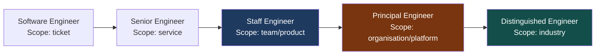

# نموذج عمل مهندس Staff ومهندس Principal

> [!NOTE]
> الانتقال إلى مستوى مهندس Staff أو Principal ليس ترقية — بل تغيير في الدور. فالمهارات التي جعلتك مهندسًا أول (Senior) ممتازًا ضرورية لكنها غير كافية. ويعرّف هذا الدرس نموذج العمل: ماذا تفعل، وكيف تصنع الأثر، وكيف يُقاس النجاح.

## فجوة المستويات

يتوقف معظم المهندسين عند المستوى الأول (Senior) لأن الطريق إلى الأمام يتطلب نوعًا مختلفًا من العمل. ففي مستوى Senior:
- تحل مشكلات معقدة تقنيًا ضمن نطاق محدد
- تكتب كودًا ممتازًا قابلًا للمراجعة
- توجّه أعضاء فريقك المباشر
- تسلّم الميزات بجودة واعتمادية عاليتين

وفي مستوى Staff/Principal، يتغير النطاق:
- أنت من يحدد المشكلات التي تستحق الحل
- مخرجك الأساسي هو **جودة القرارات وقدرات المؤسسة**، لا الكود
- يمتد توجيهك عبر فرق متعددة وآفاق زمنية مختلفة
- أنت مسؤول عن النتائج، لا عن التسليم فقط



---

## أنماط العمل الأربعة

يعمل المهندسون الرئيسيون في أربعة أنماط، يتنقلون بينها حسب ما تحتاجه المؤسسة:

### 1. القيادة التقنية — تشكيل الاتجاه

تحدد الاتجاه التقني للأنظمة ضمن نطاقك. وهذا ليس "قررت ما نبنيه" بل "أوجدت الظروف والقرارات التي تتيح للآخرين البناء بشكل صحيح".

المخرجات:
- سجلات القرارات المعمارية (ADRs) للاختيارات المهمة
- طلبات التعليقات (RFCs) للمقترحات التقنية الكبرى
- وثائق المبادئ الهندسية
- المساهمات في رادار التقنيات

```
Example ADR impact:
"We will use the Outbox pattern for all cross-service event publishing"
↓
This one decision prevents 3 future dual-write incidents
Affects 12 services over 2 years
No single piece of code — but 1000x leverage over fixing each incident individually
```

### 2. العمق التقني — حل المشكلات المستعصية

ما زال على مهندسي Staff/Principal التعمق حين يلزم. والفرق: تتعمق في مشكلات لا يستطيع الآخرون حلها، لا في مشكلات لم يصل إليها الآخرون بعد.

**خطأ:** أخذ تذكرة مثيرة للاهتمام لأنك تريد البرمجة
**صواب:** العمل الثنائي مع الفريق لفك مشكلة أداء متعثرة منذ 3 أسابيع مع خرق قادم لاتفاقية مستوى الخدمة

والاختبار: إن كان شخص آخر في الفريق يستطيع حلها خلال أسبوعين، فما كان يجب أن تقضي أنت أسبوعين عليها. فلوقتك كلفة فرصة على مستوى المؤسسة.

### 3. العمل اللاصق — التنسيق بين الفرق

المشكلات الهندسية التي لا تنتمي إلى فريق واحد كثيرًا ما لا تُحل. ويتولى المهندسون الرئيسيون المشكلات اليتيمة.

```
Payment reconciliation has three owners:
  - Payments team: owns the payment event
  - Finance team: owns the ledger
  - Settlement team: owns the settlement record

Reconciliation failures fall between all three.
Nobody wants to own the cross-cutting reconciliation platform.
The Principal Engineer makes it happen.
```

### 4. رفع المستوى — بناء القدرات

أعلى استثماراتك أثرًا هو جعل كل مهندس حولك أفضل.

- مراجعات تقنية تعلّم، لا تحرس البوابة فقط
- مراجعات تصميم تسأل "هل فكرت في X؟" بدل "يجب أن تفعل X"
- كتابة أدلة معمارية تصبح النموذج الذهني المشترك للفريق
- إنشاء مكتبات قابلة لإعادة الاستخدام تزيل فئات كاملة من المشكلات

---

## النطاق ونصف قطر التأثير

أوضح فرق بين Staff وPrincipal هو النطاق:

| المستوى | النطاق | الأفق الزمني | صلاحية القرار |
|---|---|---|---|
| **Senior** | خدمة / مكوّن | سباق / ربع سنة | اختيارات التنفيذ |
| **Staff** | فريق / مجال منتج | ربع سنة / نصف سنة | بنية الخدمة |
| **Principal** | مؤسسة / منصة | نصف سنة / سنة | استراتيجية المنصة |
| **Distinguished** | صناعة / تقنية | 1-3 سنوات | اتجاه التقنية |

> [!NOTE]
> النطاق يتعلق بأين يكون لقراراتك أثر، لا بعدد من يتبعونك إداريًا. فالمهندسون الرئيسيون مساهمون فرديون (ICs) — يبنون التأثير عبر القيادة التقنية، لا عبر خطوط التبعية الإدارية.

---

## قواعد التأثير لمن ليس مديرًا

كمهندس رئيسي دون سلطة مباشرة على المهندسين، يجب أن تؤثر عبر:

**المصداقية التقنية** — يتبع الناس توجيهك لأنك أثبت أنك تفهم المشكلة بعمق وأن قراراتك السابقة كانت صائبة.

```
Building credibility: be right often. When wrong, say so explicitly and publicly.
"I recommended X. It didn't work. Here's why I was wrong and what we're doing instead."
Engineers trust leaders who update on evidence.
```

**صياغة السردية** — أنت تشكّل كيفية فهم المشكلات. والمهندس الذي يستطيع التعبير عن المشكلة بأوضح شكل هو عادة من يقود الحل.

```
Weak: "We need to migrate off the legacy payment gateway"
Strong: "Our legacy payment gateway cannot produce the ISO 20022 messages our payment
        scheme requires from Q2. Migration cost is £2M over 6 months. Missing the
        deadline means losing direct access to the scheme for all payment flows.
        We need to decide by November to meet the Q2 deadline."
(Illustrative figures.)
```

**بناء التحالفات** — القرارات المعمارية الكبرى تؤثر على فرق متعددة. ابنِ التحالف قبل القرار — لا للتلاعب، بل لإظهار المخاوف مبكرًا وتصميم شيء يستطيع الجميع الالتزام به.

**العمل علنًا** — اكتب التصاميم والقرارات والدروس المستفادة في قنوات مشتركة. فالمهندس الرئيسي الذي يعمل بصمت في زاوية من قاعدة الكود ليس له أثر مؤسسي.

---

## ماذا ينتج المهندس الرئيسي فعلًا؟

هذا أكثر مصادر الالتباس شيوعًا. ينتج المهندسون الرئيسيون:

**الوثائق** (ADRs، وRFCs، ووثائق التصميم، وتحليلات ما بعد الحوادث، والأدلة الهندسية)
**القرارات** (ما نبنيه، وما لا نبنيه، وما نعتمده)
**الكود** (انتقائيًا — نماذج أولية تثبت الجدوى، ومكتبات تضع الأنماط، وإصلاحات للمشكلات المستعصية)
**المراجعات** (المراجعات المعمارية، وترقيات المهندسين الأوائل، ومعايرة المقابلات)
**العلاقات** (بين الفرق، ومع الإدارة، ومع الموردين/المنظمين الخارجيين)

وتتغير النسبة مع الأقدمية (دليل تقريبي — يختلف حسب الشركة والنمط):

| المستوى | الكود % | الوثائق/القرارات % | العلاقات % |
|---|---|---|---|
| Senior | 60-70% | 20-30% | 10% |
| Staff | 30-40% | 40-50% | 20% |
| Principal | 15-25% | 45-55% | 25-30% |
| Distinguished | 5-10% | 40-50% | 40-50% |

> [!WARNING]
> إن كنت مهندسًا رئيسيًا تكتب الكود 60% من الوقت، فأنت تسلّم أقل من المتوقع. وهذا نمط إخفاق شائع — المهندس القوي تقنيًا الذي يبقى في منطقة راحته بدل تطوير المهارات غير المريحة للتأثير والاستراتيجية وبناء التحالفات.

---

## أنماط مهندس Staff

يحدد كتاب Will Larson ‏*Staff Engineer* أربعة أنماط. وتحتاج مؤسسات الخدمات المالية إلى الأربعة جميعًا:

### قائد تقني (Tech Lead)
*"إلى أين يتجه الفريق الهندسي وكيف نصل إلى هناك؟"*

الأقرب إلى عمل المهندس الأول لكن بنطاق أوسع. يشارك الإدارة الهندسية. ويضع الاتجاه التقني لفريق أو فريقين.

### معماري (Architect)
*"ما الحل التقني الصحيح لهذه المشكلة المعقدة العابرة للفرق؟"*

يعمل عبر حدود الفرق. ويصمم أنظمة أكبر من أن يتولاها فريق واحد. وهو شائع في الخدمات المالية (منصة الدفع، وتحديث النظام المصرفي الأساسي، ومنصة البيانات).

### المُصلح (Solver)
*"هذه هي المشكلة المستحيلة التي لا يستطيع أحد غيري إصلاحها."*

يهبط في المواقف الحرجة: حادث الإنتاج غير المحلول منذ 72 ساعة، أو أزمة الأداء قبل 3 أسابيع من إطلاق كبير، أو الثغرة الأمنية التي تتطلب معالجة فورية.

### اليد اليمنى (Right Hand)
*"أمدّ نطاق وصول مسؤول تنفيذي لتحقيق رؤيته التقنية."*

يعمل عن قرب مع المدير التقني (CTO) أو نائب الرئيس للهندسة. ويترجم رؤية الأعمال إلى استراتيجية هندسية. ويمثل منظور الهندسة في قرارات الأعمال. وهو شائع في أعلى المستويات.

**يعمل معظم المهندسين الرئيسيين في الخدمات المالية أساسًا كمعماريين أو قادة تقنيين**، مع قدرات المُصلح للحوادث الحرجة.

---

## مقاييس النجاح للمهندسين الرئيسيين

يُقاس المهندسون الأوائل بما يبنونه. ويُقاس المهندسون الرئيسيون بما تبنيه فرقهم.

```
Wrong success metrics for Principal Engineer:
  ✗ Lines of code written
  ✗ PRs merged
  ✗ Jira tickets closed
  ✗ Features shipped by me

Right success metrics:
  ✓ Engineering decisions made that prevented incidents
  ✓ Architectural patterns adopted that accelerated team velocity
  ✓ Engineers promoted through mentoring and sponsorship
  ✓ Technical debt reduced systematically across the organisation
  ✓ Platform capabilities delivered that enable 10+ teams
  ✓ Regulatory compliance achieved through scalable technical design
```

### بيان الأثر لستة أشهر

تمرين مفيد: اكتب بيان أثر لستة أشهر بهذه الصيغة:

```
"Over the next 6 months, I will work on [problem/initiative].
The impact will be: [measurable outcomes for the organisation].
Success looks like: [specific, observable results].
I will know I've failed if: [counterfactual — what failure looks like]."
```

بيان أثر المهندس الأول عادة 1-3 نقاط عن الميزات المسلّمة.
أما بيان أثر المهندس الرئيسي فيصف تغيرات في القدرات: "سيتمكن 12 فريقًا من..."

<!-- KNOWLEDGE-CHECK
{
  "questions": [
    {
      "id": "q1",
      "text": "يلاحظ مهندس رئيسي عنق زجاجة حرجًا في أداء خدمة. ويقول قائد الفريق إنهم سيصلحونه في السباق القادم. ويستطيع المهندس الرئيسي إصلاحه في يومين. ماذا يجب أن يفعل؟",
      "options": [
        "يصلحه بنفسه — فهذا أسرع ويستطيع فعله بشكل أفضل",
        "يصلحه بنفسه لكن يوثق الحل ليتعلم الفريق",
        "يعمل مع قائد الفريق لفهم التعقيد، ويزيل أي عوائق، ويترك الفريق يصلحه — مع الاستعداد للعمل الثنائي إن تعثروا",
        "يصعّد إلى الإدارة الهندسية لإعادة ترتيب أولويات السباق"
      ],
      "correct": 2,
      "explanation": "أخذ العمل من الفريق يقلل قدرتهم وفرصتهم للنمو. ويكون أثر المهندس الرئيسي في أعلاه حين يمكّن الفريق من حل المشكلات، لا حين يحلها بدلًا منهم. والاستثناء: إن كان الفريق معطلًا بشيء لا يستطيع حله إلا المهندس الرئيسي (قيد معماري، أو تبعية خارجية)، فتلك نقطة التدخل الصحيحة."
    },
    {
      "id": "q2",
      "text": "أنت مهندس رئيسي تقترح ترحيل 8 خدمات من ناقل أحداث قديم إلى Kafka. وثلاثة قادة فرق مقاومون بسبب جهد الترحيل. ما النهج الأكثر فعالية؟",
      "options": [
        "اجعل المدير التقني يفرض الترحيل — فالسلطة ستتغلب على المقاومة",
        "اكتب RFC مقنعًا بتحليل كامل للكلفة/الفائدة، واعرضه على كل فريق مقاوم، وضمّن مخاوفهم في التصميم، وابنِ الإجماع قبل اجتماع القرار",
        "رحّل خدمة فريق واحد كإثبات مفهوم دون طلب إذن",
        "تخلَّ عن المبادرة — إن كانت الفرق مقاومة، فهي لا تستحق المتابعة"
      ],
      "correct": 1,
      "explanation": "بناء التحالفات عبر التأثير المشروع (الأدلة، والفهم المشترك، وتضمين المخاوف) ينتج قرارات دائمة. أما القرارات المفروضة بالسلطة فتولّد امتثالًا دون التزام — وستجد الفرق أسبابًا لإبطاء الترحيل. وإثبات المفهوم الأحادي يخلق عدم الثقة. وعملية RFC مع مشاركة واسعة هي النهج القياسي للمهندس الرئيسي."
    },
    {
      "id": "q3",
      "text": "مهندس رئيسي في شركة تقنية مالية يقضي 65% من وقته في كتابة الكود و35% في وثائق التصميم والمراجعات. ويشير مديره إلى ذلك كمصدر قلق. ما المشكلة الأرجح؟",
      "options": [
        "المهندس الرئيسي ينتج كثيرًا ويحتاج إلى الإبطاء",
        "تشير النسبة إلى أنه يعمل أقرب إلى مهندس أول — وأثره على مستوى المؤسسة على الأرجح أقل من المتوقع في مستوى Principal",
        "مديره لا يقدّر العمل التقني",
        "يجب أن يقضي وقتًا أطول في اجتماعات الإدارة"
      ],
      "correct": 1,
      "explanation": "يُتوقع من المهندسين الرئيسيين قضاء ~15-25% من الوقت في الكود، و45-55% في الوثائق/القرارات، و25-30% في العلاقات. و65% في الكود تشير إلى البقاء في منطقة الراحة وقلة الاستثمار في الأنشطة الأعلى أثرًا. والسؤال الذي يجب طرحه: هل الأثر على مستوى المؤسسة (القرارات، والقدرات، والمنصة) يتناسب مع التوقعات؟"
    },
    {
      "id": "q4",
      "text": "أي نمط يصف مهندسًا رئيسيًا يصمم منصة الدفع العابرة للفرق التي يبني عليها 12 فريق منتج، ويحدد معايير مخططات الأحداث، ويتولى الترحيل متعدد السنوات من النظام المصرفي الأساسي القديم؟",
      "options": [
        "قائد تقني — فهو يضع الاتجاه التقني",
        "المُصلح — فهو يحل مشكلة تقنية صعبة",
        "اليد اليمنى — فهو يعمل مباشرة مع المدير التقني",
        "معماري — فهو يصمم أنظمة عابرة للفرق والخدمات على مستوى المؤسسة"
      ],
      "correct": 3,
      "explanation": "يعمل نمط المعماري عبر حدود الفرق لتصميم أنظمة أكبر من أن يتولاها فريق واحد. ومنصات الدفع، وتحديث الأنظمة المصرفية الأساسية، ومنصات البيانات نطاق نموذجي للمعماري. ويركز القائد التقني أكثر على فريق أو فريقين. ويهبط المُصلح في أزمات محددة. واليد اليمنى شريك لمسؤول تنفيذي تحديدًا."
    }
  ]
}
-->

<!-- PRACTICAL-CHALLENGE
{
  "title": "نموذج عمل مهندس Staff ومهندس Principal — التطبيق العملي",
  "difficulty": "principal",
  "estimatedMinutes": 85,
  "tasks": [
    {
      "id": "1",
      "description": "اكتب خطتك لأول 90 يومًا في دور Staff أو Principal جديد: ما ستتعلمه في الأيام 1–30 (الأنظمة، والأشخاص، ونقاط الألم)، وأي مشكلة صغيرة عالية الظهور ستحلها في الأيام 31–60، وأي مبادرة على مستوى المؤسسة ستقترحها في الأيام 61–90. واذكر الأشخاص الذين ستقابلهم والأسئلة التي ستطرحها عليهم."
    },
    {
      "id": "2",
      "description": "حدد نمطك (قائد تقني، أو معماري، أو مُصلح، أو يد يمنى): اربط عملك في الأشهر الستة الأخيرة بالأنماط الأربعة، وقدّر حصة الوقت في كل منها، وقرر أي نمط تحتاجه مؤسستك منك أكثر في المرحلة القادمة — مع الأدلة."
    },
    {
      "id": "3",
      "description": "اكتب بيان أثرك لستة أشهر باستخدام القالب في هذا الدرس. واجعل النتائج قابلة للقياس على مستوى المؤسسة (مثل 'سيتمكن N فريقًا من…')، وضمّن سيناريو إخفاق ملموسًا."
    },
    {
      "id": "4",
      "description": "صمّم إطار اتخاذ قرار لمجالك: أي القرارات تحتاج ADR، وأيها تحتاج RFC، ومن يجب استشارته، وكيف تُصعَّد الخلافات، وكيف تُسجل القرارات وتُراجع. وطبّقه على قرار حقيقي تواجهه الآن."
    }
  ]
}
-->
