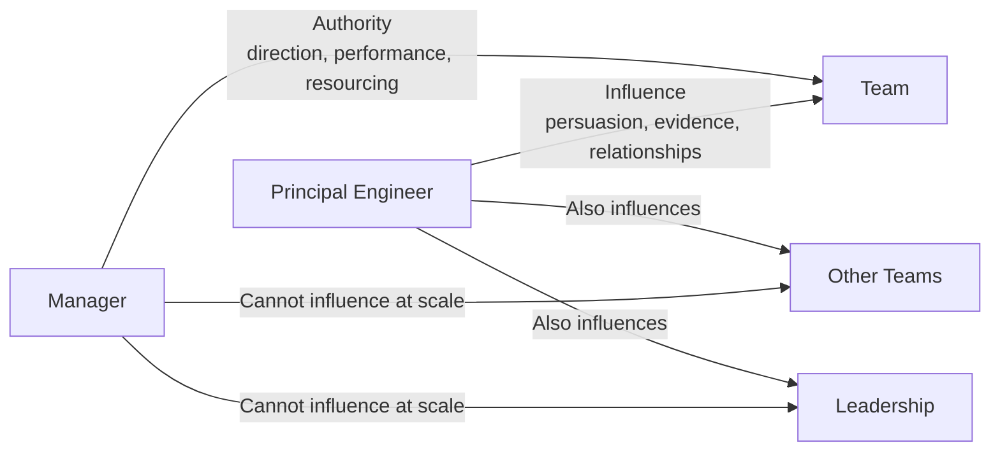
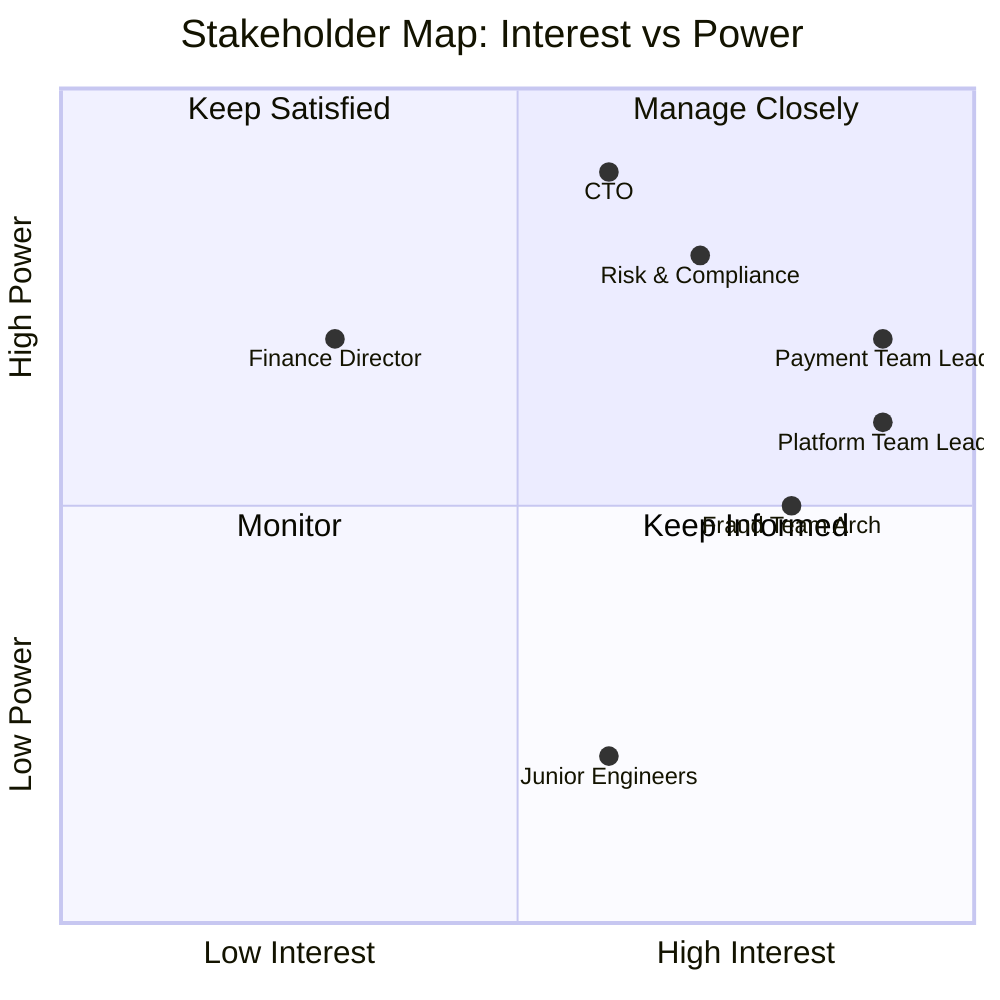
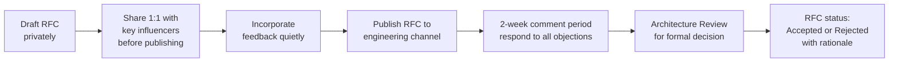

# التأثير بين الفرق — قيادة التغيير دون سلطة

أكثر المفاهيم الخاطئة شيوعًا لدى المهندس الرئيسي أن الصحة التقنية تصنع التغيير المؤسسي. وهي لا تفعل. فقد تكون محقًا تمامًا بشأن أفضل نهج تقني ومع ذلك تفشل في تغيير أي شيء، لأن المؤسسات لا تتخذ القرارات بناءً على الجدارة التقنية وحدها. بل تتخذها بناءً على الثقة، والعلاقات، والأولويات، والسياسة.

يتناول هذا الدرس الواقع العملي لقيادة التغيير التقني عبر الفرق حين لا تملك سلطة على مهندسيها، أو خرائط طريقها، أو سلاسلها الإدارية. ويغطي التقنيات العملية التي تنجح على نطاق واسع في مؤسسات الخدمات المالية: رسم خريطة أصحاب المصلحة، وبناء الحجة، واستخدام RFC كأدوات تأثير، والتعامل مع المقاومة، والتصعيد إلى الأعلى دون الإضرار بالعلاقات.

---

## فجوة السلطة

للمهندسين الرئيسيين تأثير لا سلطة. وهذا صحيح ومناسب. وإليك السبب:



السلطة سريعة وضيقة — يستطيع المدير أن يخبر فريقه بما يفعل. والتأثير بطيء وواسع — يستطيع المهندس الرئيسي تحويل اتجاه مؤسسة هندسية كاملة، لكن بمرور الوقت وعبر العلاقات فقط.

فجوة السلطة ميزة، لا نقص. فلو كانت للمهندسين الرئيسيين سلطة رسمية على فرق أخرى، لأصبحوا مديرين، ولضاق نطاق تأثيرهم، ولتوقفوا عن العمل التقني الذي يجعلهم قيّمين. والمقايضة مقصودة.

**الأثر العملي:** لن تستطيع أبدًا فرض قرارات تقنية عبر الفرق. لكنك تستطيع جعل قرار صحيحًا بوضوح، ومدعومًا بالأدلة جيدًا، ومُسوّقًا اجتماعيًا جيدًا لدرجة أن الفريق الآخر يختاره بنفسه. وذلك هو الهدف.

---

## الإقناع التقني مقابل التأثير المؤسسي

هاتان مهارتان مختلفتان كلتاهما مطلوبة:

| البُعد | الإقناع التقني | التأثير المؤسسي |
|-----------|---------------------|------------------------|
| الجمهور | المهندسون والمعماريون | المديرون الهندسيون، والمنتج، والمالية، والامتثال |
| العملة | الأدلة، والقياسات المعيارية، وجودة التصميم | الثقة، والعلاقات، والمواءمة الاستراتيجية |
| الوسيط | ‏RFC، ووثيقة تصميم، ومراجعة كود | لقاء فردي، واجتماع تمهيدي، وإحاطة تنفيذية |
| المدى الزمني | أيام إلى أسابيع | أشهر |
| نمط الإخفاق | أن تكون محقًا تقنيًا لكن أخرق اجتماعيًا | أن تفوز سياسيًا لكن تنفذ شيئًا خاطئًا |

المهندس الرئيسي الذي يملك مهارات الإقناع التقني فقط يستطيع إقناع فريقه لكنه لا يستطيع تغيير المؤسسة. ومن يملك مهارات التأثير المؤسسي فقط يستطيع قيادة التغيير لكنه قد يمرر قرارات ضعيفة تقنيًا. وتحتاج الاثنين.

**تطوير التأثير المؤسسي:** يطوّر معظم المهندسين الإقناع التقني بشكل طبيعي عبر عملهم. أما التأثير المؤسسي فيتطلب استثمارًا متعمدًا في علاقات تبدو غير منتجة على المدى القصير — لقاءات فردية منتظمة مع نظرائك في فرق أخرى، وحضور اجتماعات متعددة الوظائف لا لأنك مطالب بذلك بل لأنك تريد فهم قيودهم.

---

## رسم خريطة أصحاب المصلحة

قبل اقتراح تغيير، ارسم خريطة لكل من سيتأثر به أو سيكون له دور في تبنيه.



**أربعة أنواع من أصحاب المصلحة:**

**صانعو القرار** (قوة عالية، واهتمام عالٍ): موافقتهم الرسمية مطلوبة. واستثمر وقتًا كبيرًا في فهم مخاوفهم. ولا تفاجئهم أبدًا في غرفة مليئة بالناس — أحطهم مسبقًا.

**المؤثرون** (قوة متوسطة، واهتمام عالٍ): يشكلون آراء صانعي القرار. وكثيرًا ما يكونون قادة تقنيين أو مهندسين أوائل في الفرق المتأثرة. اكسبهم وسيدافعون عنك. وتجاهلهم وسيقوّضون المقترح.

**المعرقلون** (قوة عالية، واهتمام متفاوت): قد لا يكونون مستثمرين في النتيجة لكن لديهم القدرة على إيقاف التغيير. وكثيرًا ما يكون رئيس المخاطر والامتثال معرقلًا — لا لأنه يعارض التغيير بل لأن نهجًا جديدًا يُدخل عدم يقين امتثالي يحتاج إلى حله أولًا. فعالج مخاوفهم استباقيًا.

**الرعاة** (قوة عالية، ومواءمة استراتيجية): مسؤول تنفيذي يريد حدوث التغيير لأسباب استراتيجية. ووجود راعٍ لا يعني أنك تستطيع تخطي التأثير في الجميع — بل يعني أن لديك غطاء جويًا إن تعثرت العملية.

---

## بناء الحجة: الهيكل الذي ينجح

يحدد هيكل المقترح ما إذا كان سيُتبنى أو يُركن على الرف. ويكتب المهندسون المقترحات عادة بترتيب معكوس — يصفون الحل التقني أولًا والمشكلة أخيرًا. ويفكر صانعو القرار بالترتيب المعاكس.

```
Problem Statement (evidence-based, not opinion)
  ↓
Options Analysis (at least 3: status quo, your preferred option, alternative)
  ↓
Recommendation (clear, single recommendation — not "it depends")
  ↓
Specific Ask (what you need from this audience, right now)
```

**مثال: اقتراح البنية المدفوعة بالأحداث عبر منصة الدفع**

```markdown
## Problem Statement
Synchronous service calls between payment-service, fraud-service, and
notification-service create a dependency chain that causes 3–5 P2 incidents
per quarter. In Q3, payment-service latency degradation caused fraud-service
timeouts, which caused 23% of payments to fail during peak processing.
Evidence: incident reports INC-2026-087, INC-2026-134, INC-2026-201.

## Options

Option A — Status quo (synchronous calls):
  Pros: familiar, simple local reasoning
  Cons: cascading failures, tight temporal coupling, cannot scale services independently
  Risk: incident rate will increase as transaction volume grows 40% next year

Option B — Event-driven via Kafka:
  Pros: temporal decoupling, independent scaling, natural audit trail
  Cons: eventual consistency (acceptable for notifications, requires care for fraud checks)
  Cost: 6 weeks engineering across 3 teams, Kafka cluster (£800/month)
  Risk: team upskilling required

Option C — Circuit breakers + retry (without events):
  Pros: lower change surface
  Cons: masks the problem rather than solving it; shared latency budget still exists

## Recommendation
Option B — Event-driven via Kafka. The cascading failure risk is unacceptable
at projected transaction volumes. Option C treats symptoms.

## Specific Ask
Approval to run a 2-week proof of concept with the payment team, with
findings presented at the next architecture review (Nov 15).
```

الطلب المحدد ليس أبدًا "أرجو أن توافقني". بل خطوة تالية صغيرة وملموسة ومنخفضة المخاطر. وطلب إثبات مفهوم أسهل في القبول من "أرجو إعادة تصميم خدمتك بالكامل".

---

## ‏RFC كأداة تأثير

يُنظر إلى وثائق طلب التعليقات عادة كتوثيق تقني. لكنها أيضًا من أقوى أدوات التأثير المتاحة للمهندس الرئيسي، حين تُستخدم بشكل صحيح.

**‏RFC كتوثيق:** يلتقط قرارات التصميم للأجيال القادمة. مفيد لكنه سلبي.

**‏RFC كأداة تأثير:** يجبر المؤلف على هيكلة تفكيره بصرامة. ويعطي كل أصحاب المصلحة نصًا يتفاعلون معه بدل لوحة فارغة. وينشئ سجلًا بأن الأشخاص المناسبين استُشيروا. ويُظهر الاعتراضات كتابةً حيث يمكن معالجتها منهجيًا.

**سير عمل التأثير عبر RFC:**



الخطوة الحرجة التي يتخطاها معظم المهندسين هي B — مشاركة المسودة في لقاءات فردية قبل النشر. فحين تنشر RFC دون تسويقه مسبقًا، تكون أول مرة يراه فيها معظم الناس في المنتدى العام. فيشكّلون رد فعلهم الأولي علنًا، وتغيير موقف علني مكلف لهم. وبالمشاركة الفردية أولًا، تعطي الناس فرصة إثارة المخاوف سرًا، والشعور بأنهم مسموعون، وكثيرًا ما يصبحون مدافعين بمجرد معالجة مخاوفهم.

---

## العمل مع الفرق المقاومة

مقاومة التغيير ليست لاعقلانية. بل استجابة عقلانية لزيادة العمل والمخاطر مع فوائد غير مؤكدة. وأكثر أنماط المقاومة الأربعة شيوعًا في المؤسسات الهندسية للتقنية المالية:

**النمط 1: "ليس لدينا وقت"**

هذا صحيح دائمًا تقريبًا. فالفرق مشغولة دائمًا. وهو أيضًا دائمًا تقريبًا بديل عن "هذا ليس أولويتنا". فلا تجادل في ما إذا كان لديهم وقت. بل افهم ما أولوياتهم الحالية وجد التقاطع.

*الرد:* "أفهم أن خارطة الطريق ممتلئة. أين يقع هذا نسبة إلى عمل الاعتمادية في الربع الرابع؟ هل يمكننا تحديد نطاق التغيير الأولي بثلاثة أيام بدل ثلاثة أسابيع؟"

**النمط 2: "حالتنا مختلفة"**

هذا صحيح أحيانًا وخاطئ عادة. فكثيرًا ما تعتقد الفرق أن مجالها فريد بطرق تعفيها من المعايير الهندسية العامة. وأحيانًا يكونون محقين — فلمعالجة المدفوعات قيود ليست لخدمة التقارير. وكثيرًا ما يبررون.

*الرد:* تفاعل بصدق مع التفاصيل. "امشِ بي عبر ما هو مختلف في حالتك. أريد أن أفهمه". ثم إما اعترف بالاختلاف الحقيقي وكيّف المقترح، أو أظهر بلطف أن الحالة ليست فريدة كما يُعتقد. ولا ترفض القلق أبدًا دون تحقيق.

**النمط 3: "جربنا هذا من قبل وفشل"**

الإخفاق التاريخي يخلق تشككًا مشروعًا. وقد يكون الإخفاق لأن الفكرة خاطئة، أو لأن التنفيذ كان ضعيفًا، أو لأن السياق تغير.

*الرد:* "أخبرني بما حدث. أريد أن أفهم ما الذي سار بشكل خاطئ". ثم إما اعترف بأنه فشل لأسباب متأصلة (ومقترحك يعالجها)، أو أظهر أن السياق مختلف الآن. ولا تتظاهر أبدًا بأن الإخفاق السابق لم يحدث.

**النمط 4: "هذا ليس أولويتنا الآن"**

هذه إشارة إلى موقعك في كومة أولوياتهم، لا رفض دائم. وتعني أن التغيير يحتاج إما إلى أن يصبح أكثر إلحاحًا (أدلة جديدة، أو مخاطر جديدة) أو أن ينتظر فرصة طبيعية (ربع جديد، أو دورة خارطة طريق جديدة، أو حادث ذو صلة).

*الرد:* "ما الذي يجب أن يكون صحيحًا ليصبح هذا أولوية؟" افهم الشروط واعمل نحوها، أو اقبل أن الآن ليس الوقت المناسب وأعد النظر في دورة التخطيط التالية.

---

## بناء التحالفات

التحالف فريقان أو أكثر متوائمان على الاتجاه التقني نفسه. وهو أقوى أضعافًا من تأييد فريق واحد.

**كيف تبني تحالفًا:**

1. حدد فريقين أو ثلاثة يحل هذا التغيير مشكلاتهم أيضًا
2. أحط كل قائد فريق فرديًا قبل أي منتدى عام
3. حين تعرض على القيادة، اجعل ممثلين من كل فريق حاضرين بجانبك أو داعمين صراحة
4. وثّق أن فرقًا متعددة تريد هذا — فمقترح أحادي من مهندس رئيسي سهل التأجيل؛ وطلب من فرق متعددة أصعب بكثير في الرفض

**النمط المضاد للتحالف:** جمع أسماء على وثيقة دون قبول حقيقي. فإن لم يدعم أعضاء تحالفك التغيير فعلًا، سيكونون صامتين أو فاترين في الغرفة. وهذا أسوأ من العرض منفردًا لأنه يشير إلى أنك بالغت في دعمك.

---

## الاجتماع التمهيدي

الاجتماع التمهيدي أقل تقنيات التأثير استخدامًا في المؤسسات الهندسية. والغرض منه تسويق فكرة مع أصحاب المصلحة الرئيسيين قبل الاجتماع الرسمي الذي يُتخذ فيه القرار.

**لماذا ينجح:**
- لا يحب صانعو القرار المفاجآت في المنتديات العامة
- يعطيهم وقتًا للتفكير دون ضغط الأداء
- الاعتراضات المثارة سرًا أسهل في المعالجة من المثارة علنًا
- حين تكون في الغرفة، تعرف بالفعل من يدعم، ومن محايد، ومن لديه مخاوف

**كيف تجري اجتماعًا تمهيديًا:**

```
Duration: 30 minutes maximum
Format: 1:1 (not a group pre-meeting — that is just an earlier official meeting)
Agenda:
  - "I wanted to share something before the architecture review next week"
  - 5 minutes: explain the proposal at a high level
  - 20 minutes: listen actively, ask what concerns they have
  - 5 minutes: confirm whether they are comfortable, and what you will address before the review

After: incorporate their feedback (even partially), then say so in the review:
  "Thanks to [name] who raised a concern about X in a conversation earlier this week —
  I've addressed it by..."
```

ذكر أسماء من ساهموا في تشكيل المقترح جيد لهم (تقدير) وجيد لك (يُثبت الاستشارة).

---

## الكتابة مقابل الحديث: غير المتزامن مقابل المتزامن

| الموقف | فضّل غير المتزامن (RFC/وثيقة) | فضّل المتزامن (اجتماع) |
|-----------|----------------------|------------------------------|
| مقترح تقني معقد | نعم — يحتاج الناس وقتًا للاستيعاب | لا — رد الفعل الفوري سابق لأوانه |
| فريق موزع جغرافيًا | نعم — الكتابة تبقى | لا — المناطق الزمنية تخلق الإقصاء |
| القرار خلافي | نعم — ينشئ سجلًا | نعم أيضًا — لكن بعد غير المتزامن أولًا |
| مواءمة سريعة مطلوبة | لا | نعم — مكالمة 15 دقيقة تتفوق على 10 رسائل Slack |
| بناء العلاقات | لا | نعم — الكتابة تعاملية |
| إظهار المخاوف عبر أشخاص كثيرين | نعم — تتسع لـ 50 قارئًا | لا — 50 شخصًا في مكالمة ليس نقاشًا |

**قاعدة عملية:** اجعل الافتراضي غير متزامن للمقترحات التقنية ومتزامنًا لبناء العلاقات والقرارات النهائية. ولا تدعُ أبدًا إلى اجتماع لمشاركة معلومات كان يمكن أن تكون بريدًا إلكترونيًا.

---

## التصعيد إلى الأعلى

التصعيد إلى القيادة العليا ضروري أحيانًا. وإن أُحسن، يخلق زخمًا. وإن أُسيء، يضر العلاقة مع الفرق المعنية ومصداقيتك.

**متى تصعّد:**

- حُددت مخاطرة تقنية، وشُرحت على مستوى العمل، ولم يُتخذ إجراء
- يوجد جمود بين فرق لا يمكن حله بين النظراء
- يتطلب قرار موارد (موظفين، أو ميزانية بنية تحتية) لا تستطيع الموافقة عليها إلا القيادة
- توجد مخاطرة امتثال أو تنظيمية يجب أن تعرفها القيادة بغض النظر عن النقاش التقني

**كيف تصوغ للتنفيذيين:**

يفكر التنفيذيون بمصطلحات المخاطر، والكلفة، والنتائج الاستراتيجية. فلا تبدأ أبدًا بالتفاصيل التقنية.

```
Frame: "We have a reliability risk that will affect us in Q1 as volumes grow."
Not:  "Our synchronous service call model creates temporal coupling that
       degrades under backpressure scenarios."

Frame: "This change reduces incident rate by an estimated 60% based on
       the Q3 data, at a cost of 6 weeks engineering across three teams."
Not:  "Kafka gives us better decoupling."

Frame: "The fraud team and payment team both support this. We need your
       approval to allocate the 6 weeks."
Not:  "I think we should do this."
```

أحضر وثيقة. فنادرًا ما يتذكر التنفيذيون النقاشات الشفهية بدقة كافية للتصرف بناءً عليها. وتشير الوثيقة أيضًا إلى أنك فكرت في المشكلة بعناية.

---

## دراسة حالة: إدخال البنية المدفوعة بالأحداث عبر 8 فرق

*(سيناريو توضيحي مركّب.)*

**السياق:** شركة تقنية مالية تعالج 50 مليون دفعة شهريًا. وتسبب التبعيات المتزامنة بين 8 خدمات إخفاقات متتالية. ويريد مهندس رئيسي الترحيل إلى بنية مدفوعة بالأحداث. وليس لديه سلطة على أي من الفرق الثمانية.

**الشهر 1: توثيق المشكلة ورسم خريطة أصحاب المصلحة**

وثّق ثلاثة حوادث حديثة تُظهر نمط الإخفاق المتتالي. واحسب الأثر: معدل إخفاق مدفوعات 23% خلال 2 من الحوادث الخمسة. وحدد أصحاب المصلحة الرئيسيين: 8 قادة فرق، والمدير التقني، ورئيس الاعتمادية.

**الشهر 2: المقترح التقني وبناء التحالف**

صِغ RFC. وأحط قائدي الفريقين الأكثر تأثرًا (الدفع والاحتيال) فرديًا. وضمّن ملاحظاتهما. وأحط رئيس الاعتمادية — فهذا يحل هدف الاعتمادية لديه مباشرة. وأحط المدير التقني بالإطار التنفيذي (المخاطر، والكلفة، والفائدة).

**الشهر 3: أول مراجعة معمارية**

اعرض RFC في المراجعة المعمارية بين الفرق مع دعم صريح من قائدي فريقي الدفع والاحتيال. ولا يُوافق على المقترح — إذ يثير فريقان مخاوف بشأن اتساق البيانات. واعترف بالمخاوف كمشروعة؛ والتزم بمعالجتها في المراجعة التالية.

**الشهر 4: مقترح معدّل وإثبات مفهوم**

عدّل RFC لمعالجة مخاوف الاتساق بنمط محدد لكل حالة استخدام متأثرة. واقترح إثبات مفهوم مع فريقين (الدفع والإشعارات — أقل مخاطر اقتران). ويُوافق على إثبات المفهوم.

**الشهر 5: نتائج إثبات المفهوم**

يُظهر إثبات المفهوم صفر حوادث في 4 أسابيع من التشغيل المتوازي. وأثر زمن الاستجابة: +12 مللي ثانية للنشر غير المتزامن (مقبول). واعرض النتائج بالبيانات. فيصبح كل قادة الفرق الثمانية داعمين. ويوافق المدير التقني على الترحيل الكامل.

**الشهر 6: نشر خطة الترحيل وبدء العمل**

رُتّب الترحيل لتجنب المخاطر المتزامنة عبر الفرق. ويرحّل كل فريق بشكل مستقل بدعم فريق المنصة لتكامل Kafka.

**الدروس الأساسية من دراسة الحالة:**

1. استغرقت العملية 6 أشهر. وكان العمل التقني مباشرًا. أما العمل المؤسسي فلم يكن كذلك.
2. أُحيط المدير التقني في الشهر 2 — لم تُطلب موافقته، بل أُبلغ فقط. وحين طُلبت في الشهر 5، كانت الموافقة سريعة لأنه لم تكن هناك مفاجآت.
3. أصبح الفريقان اللذان أثارا المخاوف في الشهر 3 أقوى المدافعين بمجرد معالجة مخاوفهما. فلا تعامل الاعتراض أبدًا كعقبة — بل كفرصة لتحسين المقترح.

---

## مزالق الإنتاج

### المزلق 1: الاعتماد فقط على كونك محقًا

**المشكلة:** حدد مهندس رئيسي مشكلة معمارية حقيقية ولديه الحل الصحيح. فكتب وثيقة تقنية شاملة، وعرضها في المراجعة المعمارية، وقوبل باستقبال فاتر. فاستجاب بكتابة وثيقة أكثر تفصيلًا، وعرضها مجددًا بقوة أكبر، ولا يستطيع فهم لماذا لا يتحرك أحد.

المشكلة أن الصحة التقنية ضرورية لكنها غير كافية. فالفرق الأخرى مشغولة، ولها أولويات مختلفة، وليس لها مصلحة شخصية في مقترح هذا الشخص. والصحة التقنية لا تخلق إلحاحًا لأحد إلا لمن حدد المشكلة.

```
Symptom: "Why won't anyone just listen? The proposal is clearly right."
Root cause: Organisational influence was never built.
```

**الوقاية:** اسأل نفسك: "هل استثمرت في علاقة مع قائد كل فريق متأثر قبل هذا المقترح؟" فإن لم تعقد قط لقاءً فرديًا مع قائد فريق الدفع إلا حين تطلب منه فعل شيء، فأنت لم تبنِ قاعدة الثقة التي تجعل المقترحات سهلة التبني.

ابنِ العلاقات باستمرار، لا بشكل تعاملي. واستثمر في فهم مشكلات الفرق الأخرى ومساعدتها قبل أن تحتاج منها تبني مقترحك.

---

### المزلق 2: تخطي الاجتماع التمهيدي

**المشكلة:** ينشر مهندس رئيسي RFC ويحدد مراجعة معمارية للأسبوع التالي دون أي تحضير فردي. وفي المراجعة، يثير أكثر المديرين الهندسيين أقدمية في الغرفة فورًا قلقًا بشأن مخاطر الترحيل. فيتفق فجأة ثلاثة حضور آخرين لم يفكروا بعناية في المقترح على أن مخاطر الترحيل مقلقة. وينتهي الاجتماع دون قرار.

كان القلق قابلًا للمعالجة تمامًا — كانت خطة ترحيل مرحلية ستحله. لكنه أُثير علنًا ودون تحضير، فأصبح مرساة جرّت الجميع نحو التأجيل.

```
Timeline:
  Monday: RFC published
  Tuesday: Architecture review scheduled
  Wednesday-Thursday: No pre-meetings
  Friday: Architecture review — concern raised publicly — deferred

What should have happened:
  Monday: RFC draft shared with 3 key stakeholders
  Tuesday-Wednesday: 1:1 pre-meetings, migration concern raised privately
  Thursday: RFC revised to include phased migration plan
  Friday: Architecture review — no surprises — approved
```

**الوقاية:** أضف "قائمة الاجتماعات التمهيدية" إلى قالب RFC لديك. وقبل أي مراجعة رسمية، اعقد لقاءً فرديًا مع كل شخص قد يثير قلقًا معرقلًا.

---

### المزلق 3: عدم بناء التحالف قبل أن تحتاجه

**المشكلة:** يحتاج مهندس رئيسي إلى اعتماد معيار أمني جديد عبر 6 فرق. فيكتب RFC، ويعرضه، ويحصل على موافقة القيادة. ثم يمضي في تنفيذه مع فريقه. وحين يقترب من الفرق الخمسة الأخرى، يثير كل فريق مخاوف كان يمكن أن يثيرها خلال عملية RFC. فيجد المهندس نفسه يتفاوض على المقترح نفسه فرديًا مع 5 فرق بعد الموافقة الرسمية، وهذا أبطأ وأكثر إحباطًا من فعله قبلها.

الموافقة الرسمية من القيادة لا تخلق قبولًا على مستوى الفريق. فتشعر الفرق أن شيئًا فُعل *بها* لا *معها*.

```
Anti-pattern:
  Write RFC → Get leadership approval → Implement with own team
  → Discover other teams are not adopting → Start the influence work you should
  have done before the RFC

Correct pattern:
  Identify champions in each team → Co-author RFC with their input
  → Publish with broad support → Get leadership approval
  → Implementation is a formality because teams already own it
```

**الوقاية:** حين يتطلب RFC تبنيًا من فرق متعددة، أشرك ممثلًا من كل فريق في صياغته. فحتى جولة ملاحظات واحدة لكل فريق تعني أن لديهم ملكية فكرية للحل. فالناس ينفذون ما ساعدوا في تصميمه.

---

## قائمة تحقق الدرس

- [ ] تستطيع شرح فجوة السلطة ولماذا توجد في أدوار المهندس الرئيسي
- [ ] تستطيع تصنيف أصحاب المصلحة في الفئات الأربع: صانعو القرار، والمؤثرون، والمعرقلون، والرعاة
- [ ] تستطيع كتابة مقترح باستخدام هيكل المشكلة ← الخيارات ← التوصية ← الطلب المحدد
- [ ] تستطيع وصف سير عمل التأثير عبر RFC بما فيه خطوة اللقاء الفردي قبل النشر
- [ ] تستطيع تحديد كل من أنماط المقاومة الأربعة والرد عليه
- [ ] تستطيع وصف تقنية الاجتماع التمهيدي ومتى تستخدمها
- [ ] تفهم متى تفضّل التواصل المكتوب غير المتزامن مقابل الاجتماعات المتزامنة
- [ ] تستطيع صياغة مقترح تقني بشكل مناسب لجمهور تنفيذي (المخاطر، والكلفة، والفائدة — لا التفاصيل التقنية)
- [ ] عملت على دراسة حالة البنية المدفوعة بالأحداث وتستطيع تطبيق دروسها على سياقك

---

<!-- KNOWLEDGE-CHECK
{"questions":[{"text":"كتبت RFC يقترح معيارًا جديدًا لإصدارات الواجهات يؤثر على 6 فرق. والمراجعة المعمارية الخميس القادم. ما أهم خطوة يجب اتخاذها قبل الاجتماع؟","options":["أرسل رسالة Slack إلى الفرق الستة تطلب منهم مراجعة RFC","اجمع مزيدًا من البيانات لتقوية الحجة التقنية","اعقد اجتماعات تمهيدية فردية مع قادة الفرق المتأثرة لإظهار المخاوف ومعالجتها قبل الغرفة","أضف مزيدًا من التفاصيل التقنية إلى RFC فلا يجد أحد أي ثغرات"],"correct":2,"explanation":"الاجتماع التمهيدي أهم تقنيات التأثير قبل مراجعة رسمية. فهو يتيح لك إظهار المخاوف فرديًا حيث يمكن معالجتها دون آثار الالتزام العلني. وحين يُثار قلق علنًا في مراجعة، كثيرًا ما يرتكز عليه الحضور الآخرون ويصبح التأجيل مرجحًا. وبمعالجة المخاوف قبل الاجتماع، تضمن أن تسير المراجعة دون مفاجآت وأن للمقترح المعدّل دعمًا حقيقيًا."},{"text":"يقول لك قائد فريق: 'جربنا الانتقال إلى البنية المدفوعة بالأحداث قبل ثلاث سنوات وكان كارثة.' ما الرد الأكثر فعالية؟","options":["اشرح أن التقنية تحسنت كثيرًا منذ ذلك الحين","قل إن المحاولة السابقة فشلت بسبب التنفيذ لا المفهوم","اطلب منه أن يخبرك بما حدث لتفهم ما الذي سار بشكل خاطئ قبل تحديث مقترحك","اعترف بالقلق لكن امضِ في المقترح لأن الإخفاق السابق غير ذي صلة بالقرار الحالي"],"correct":2,"explanation":"يخلق الإخفاق التاريخي تشككًا مشروعًا يجب التفاعل معه بصدق. فبطلبك أن يشرح ما حدث، تُظهر احترامًا لخبرته، وتتعلم ما إذا كان الإخفاق بسبب مشكلات متأصلة في النهج أو مشكلات تنفيذ، ثم تستطيع إما الاعتراف بأن القلق مشروع (والتكيف) أو إثبات أن السياق تغير. ورفض الإخفاق السابق يضر الثقة ويشير إلى أنك لا تستمع."},{"text":"تحتاج موافقة تنفيذية لمبادرة بين الفرق مدتها 6 أسابيع. كيف يجب أن تفتتح النقاش مع المدير التقني؟","options":["اشرح البنية التقنية ولماذا هي أفضل من النهج الحالي","ابدأ بمخاطر الأعمال: مشكلة اعتمادية ستسوء مع نمو حجم المعاملات في الربع القادم","اطلب توسيع جدول أعمال الاجتماع ليشمل مراجعة تقنية مفصلة","شارك RFC واطلب ملاحظات على التفاصيل التقنية"],"correct":1,"explanation":"يفكر التنفيذيون بمصطلحات المخاطر، والكلفة، والنتائج الاستراتيجية. والبدء بمخاطر الأعمال (إخفاقات متتالية أثناء نمو حجم الذروة) يخلق الإلحاح والسياق للطلب. ويمكن أن تتبع التفاصيل التقنية بمجرد إثبات حالة الأعمال. ولا تطلب أبدًا من مسؤول تنفيذي تقييم التفاصيل التقنية قبل أن يفهم لماذا يهم التغيير."}]}
-->

<!-- PRACTICAL-CHALLENGE
{"title":"حملة تغيير تقني بين الفرق","difficulty":"principal","estimatedMinutes":90,"tasks":[{"id":"1","description":"ارسم خريطة أصحاب المصلحة لتغيير مقترح في مؤسستك (أو في شركة تقنية مالية افتراضية: إدخال التتبع الموزع عبر 5 فرق باستخدام OpenTelemetry). وأنشئ خريطة بثمانية أصحاب مصلحة على الأقل موضوعين على مربع القوة/الاهتمام. وصنّف كلًا منهم كصانع قرار، أو مؤثر، أو معرقل، أو راعٍ. واكتب خطة تفاعل من جملتين لكل نوع."},{"id":"2","description":"اكتب RFC كاملًا لمقترح تبني OpenTelemetry يتبع هيكل المشكلة-الخيارات-التوصية-الطلب المحدد. ويجب أن يتضمن RFC: بيان مشكلة محسوبًا بأدلة من الحوادث، وثلاثة خيارات بمزايا/عيوب/تكاليف، وتوصية واحدة واضحة، وطلبًا محددًا ومحدودًا (لا موافقة كاملة)، وقائمة اجتماعات تمهيدية بالأشخاص الذين تجب إحاطتهم قبل النشر."},{"id":"3","description":"لكل من أنماط المقاومة الأربعة (لا وقت، وحالتنا مختلفة، وجربنا من قبل، وليس أولويتنا)، اكتب ردًا من 3 جمل يعترف بالقلق، ويتفاعل معه بصدق، ويدفع النقاش إلى الأمام. ويجب أن يكون كل رد خاصًا بسياق تبني OpenTelemetry — لا نصيحة عامة."},{"id":"4","description":"اكتب إحاطة تنفيذية من صفحة واحدة للمدير التقني حول تبني OpenTelemetry. ويجب أن: تبدأ بمخاطر الأعمال (لا التقنية)، وتحسب الكلفة (أسابيع هندسية، وكلفة البنية التحتية)، وتحسب الفائدة (تقدير تقليل الحوادث، وتقليل وقت التصحيح)، وتذكر الفرق الداعمة، وتختم بطلب موافقة محدد. وتجنب كل المصطلحات التقنية — اكتب كأن القارئ لا يعرف ما التتبع (trace)."}]}
-->
