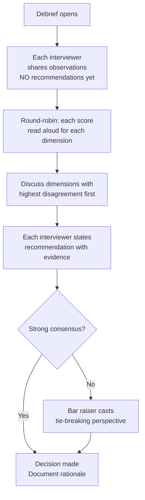

# المقابلات التقنية — التوظيف لأدوار المستوى الرئيسي

توظيف مهندس رئيسي من أعلى القرارات أثرًا التي تتخذها مؤسسة هندسية. فالمهندس الرئيسي القوي يرفع الجودة التقنية، واتخاذ القرار، والثقافة لعدة فرق في آن واحد. أما التوظيف الضعيف — خاصة لمن هو قوي تقنيًا لكنه غير فعال مؤسسيًا، أو لمن يضع معيارًا منخفضًا للجودة — فقد يضر المؤسسة لسنوات.

والتحدي أن التوظيف في المستوى الرئيسي يتطلب تقييم إشارات مختلفة نوعيًا عن توظيف المهندس الأول. فيُقيّم المهندسون الأوائل أساسًا على التنفيذ التقني. ويُقيّم المهندسون الرئيسيون على التفكير الاستراتيجي، والتأثير المؤسسي، والتعامل مع الغموض، والحكم على مستوى النظام كاملًا — وهي قدرات يصعب تقييمها في غرفة لمدة 90 دقيقة.

يغطي هذا الدرس حلقة المقابلات الكاملة للمستوى الرئيسي: الهيكل، واختيار المشكلات، ومعايير التقييم، وآليات جلسة المداولة، والأنماط المضادة التي تتسبب في رفض المرشحين الجيدين وتوظيف الضعفاء.

---

## لماذا يختلف توظيف المهندس الرئيسي عن المهندس الأول

الفرق ليس في العمق التقني — فكثير من المهندسين الأوائل يضاهون المهندسين الرئيسيين تقنيًا. بل الفرق في النطاق، والغموض، والتأثير عبر المؤسسة.

| البُعد | المهندس الأول | المهندس الرئيسي |
|-----------|---------------|-------------------|
| النطاق | ميزة، أو مكوّن، أو خدمة | منصة، أو مجال، أو على مستوى المؤسسة |
| تحمل الغموض | مرتاح مع مساحة مشكلة محددة | مرتاح مع تحديد مساحة المشكلة |
| التأثير | داخل فريقه | عبر فرق متعددة دون سلطة |
| الأفق الزمني | السباق الحالي إلى الربع الحالي | الربع الحالي إلى الأشهر الـ 18 القادمة |
| القرارات التقنية | يملك قرارات التنفيذ | يشكّل الاتجاه المعماري |
| نمط الإخفاق | قوي تقنيًا لكن بنطاق محدود | قد يكون قويًا تقنيًا لكنه عاجز عن العمل بالنطاق المطلوب |

تقييم مهندس أول وتسمية النتيجة "تقييمًا بمستوى رئيسي" هو أكثر إخفاقات توظيف المهندسين الرئيسيين شيوعًا. فيجب معايرة الأسئلة، والسيناريوهات، والإشارات وفق المسؤوليات الفعلية للدور.

---

## هيكل حلقة المقابلات

حلقة مقابلات بالمستوى الرئيسي لدور هندسي في التقنية المالية:

```mermaid
gantt
    title Principal Engineer Interview Loop
    dateFormat X
    axisFormat %s min

    section Hiring Manager Screen
    30 min context-setting + career history  :0, 30
    15 min role expectations + questions     :30, 45

    section System Design (Day 1)
    15 min problem framing + requirements    :0, 15
    50 min design + trade-off discussion     :15, 65
    15 min operational thinking + wrap       :65, 80
    10 min candidate questions               :80, 90

    section Technical Leadership (Day 2)
    15 min intro + context                   :0, 15
    35 min behavioural + scenario questions  :15, 50
    5 min debrief preview                    :50, 55
    5 min candidate questions                :55, 60

    section Cross-Functional (Day 2)
    20 min stakeholder collaboration stories :0, 20
    15 min ambiguity/conflict scenario       :20, 35
    5 min culture + questions                :35, 45

    section Bar Raiser (Day 2)
    20 min background + motivation           :0, 20
    30 min deep-dive on a previous decision  :20, 50
    10 min candidate questions               :50, 60
```



**مدير التوظيف (45 دقيقة):** يضع سياق الدور، ويقيّم المسار المهني، ويقيّم التفكير الاستراتيجي عبر سردية المسار المهني. ويجب أن يقيّم: هل يفكر هذا الشخص بالنطاق الصحيح؟ هل تُظهر قراراته السابقة حكمًا بمستوى رئيسي؟

**تصميم الأنظمة (90 دقيقة، مقابِلان):** الإشارة التقنية الأساسية. و90 دقيقة هي الحد الأدنى لمشكلة معقدة بما يكفي لكشف التفكير بالمستوى الرئيسي. ويتيح وجود مقابِلين أن يقود أحدهما بينما يلاحظ الآخر ويدوّن ملاحظات مفصلة — فيمنع تضخم الذاكرة اللاحق.

**القيادة التقنية (60 دقيقة):** أسئلة سلوكية تركز على التأثير بين الفرق، والتعامل مع الخلاف، وقيادة الاتجاه التقني. وتتجنب الأسئلة التي يمكن الإجابة عنها بقصص عامة مثل "تواصلت جيدًا".

**متعددة الوظائف (45 دقيقة):** يقيّم مقابِل غير هندسي (المنتج، أو المالية، أو المخاطر) ما إذا كان المرشح يستطيع إيصال المفاهيم التقنية لأصحاب مصلحة غير تقنيين وفهم قيود الأعمال.

**رافع المعيار (60 دقيقة):** مقيّم مستقل ليس جزءًا من فريق التوظيف. ودوره التقييم مقابل المعيار الهندسي على مستوى الشركة، لا الاحتياجات الفورية للفريق. ولديه حق النقض.

---

## اختيار مشكلة تصميم الأنظمة في التقنية المالية

يجب أن تكون المشكلة معقدة بما يكفي لتتطلب تفكيرًا معماريًا حقيقيًا بالمستوى الرئيسي. ويجب ألا تكون لها إجابة صحيحة واحدة، وأن تكون لها مقايضات مشروعة متعددة، وبُعد تشغيلي.

**معايير مشكلة تصميم أنظمة جيدة بالمستوى الرئيسي:**

- متطلبات متعددة متعارضة (الإنتاجية مقابل الاتساق، وزمن الاستجابة مقابل المتانة)
- حجم يفرض اختيارات معمارية غير بسيطة (لا يمكن حلها بقاعدة بيانات واحدة)
- أنماط إخفاق حقيقية تتطلب تفكيرًا تشغيليًا (ما الذي ينكسر؟ كيف تكتشفه؟ كيف تتعافى؟)
- غموض في المتطلبات (يجب أن يطرح المرشح أسئلة توضيحية ويصوغ المشكلة)
- سياق مجال يكافئ معرفة التقنية المالية دون أن يتطلب معرفة متخصصة للحل

**مشكلات تصميم أنظمة في التقنية المالية معايرة للمستوى الرئيسي:**

| المشكلة | لماذا تنجح في المستوى الرئيسي |
|---------|--------------------------------|
| اكتشاف الاحتيال عند 100,000 معاملة في الثانية | تتطلب مقايضة الفوري مقابل الدفعي، وتصميم مخزن الخصائص، وقابلية التفسير، وإدارة معدل الإيجابيات الكاذبة، والمراقبة التشغيلية |
| دفتر أستاذ بالقيد المزدوج مع عدم التكرار | تتطلب اختيار نموذج الاتساق، وتصميم مفتاح عدم التكرار، واستراتيجية المطابقة، واعتبارات تعدد العملات |
| مطابقة المدفوعات عبر 15 قناة دفع | تتطلب تصميم المعالجة غير المتزامنة، ومعالجة الإخفاق لكل قناة، وعتبات التنبيه، وسير عمل الاستثناءات البشري |
| فرض حدود المخاطر عند 5 مللي ثانية p99 | تتطلب استراتيجية التخزين المؤقت، ومقايضة الاتساق مقابل الإتاحة، وتصميم قاطع الدائرة، ونشر تحديثات الحدود |

**صياغة المشكلة:** أعطِ المرشحين دائمًا بيان مشكلة ناقص التحديد عمدًا. "صمّم نظام اكتشاف احتيال لشركة مدفوعات" صحيح. و"صمّم نظام اكتشاف احتيال يستخدم مخزن خصائص باتفاقية مستوى خدمة 50 مللي ثانية، ويعالج أحداث Kafka، ويستخدم نموذج XGBoost" يزيل كل التفكير المثير للاهتمام.

---

## إشارة ممتازة مقابل ضعيفة: المهندس الرئيسي مقابل المهندس الأول القوي

يُستخدم هذا الجدول في جلسة المداولة لمعايرة الملاحظات. فالسلوك نفسه قد يكون إشارة إيجابية قوية أو إشارة محايدة حسب السؤال.

| البُعد | إشارة مهندس أول قوي | إشارة مهندس رئيسي | إشارة ضعيفة (في المستوى الرئيسي) |
|-----------|---------------------|-----------------|----------------------------------|
| المتطلبات | يطرح أسئلة توضيحية جيدة | يصوغ المقايضات في المتطلبات صراحة قبل التصميم | يقبل أول متطلبات مذكورة دون تحدٍّ |
| النطاق | يصمم النظام المطلوب جيدًا | يتحدى حدود المشكلة — "هل يجب أن يكون هذا نظامًا واحدًا أم اثنين؟" | يغوص فورًا في تفاصيل التنفيذ |
| المقايضات | يحدد المقايضات الرئيسية | يحسب المقايضات بالأرقام والأثر على الأعمال | يسرد الخيارات دون مقارنتها |
| العمق التقني | عمق قوي في المجال المختار | يُظهر عمقًا عبر مجالات متعددة، ويعرف الحدود | سطحي في كل المواضيع |
| التفكير التشغيلي | يأخذ المراقبة في الاعتبار | يصمم لقابلية المراقبة، وأنماط الإخفاق، وأدلة التشغيل | لا ذكر للتشغيل حتى يُسأل |
| التواصل | شرح شفهي واضح | يكيّف مستوى الشرح حسب الجمهور، ويتحقق من الفهم | يتحدث منفردًا دون التحقق من المتابعة |
| القدرة على التكيف | يتعامل مع تغييرات القيود برشاقة | يحدد استباقيًا كيف تغيّر القيود التصميم | يرتبك أو يبدأ من جديد حين تتغير القيود |

---

## معايير التقييم: سبعة أبعاد

يقيّم كل مقابِل كل بُعد من 1–4 بشكل مستقل قبل جلسة المداولة.

| الدرجة | الوصف |
|-------|-------------|
| 4 — استثنائي | إشارة إيجابية واضحة للتوظيف؛ دليل على قدرة بمستوى رئيسي |
| 3 — قوي | إشارة جيدة؛ فوق التوقعات لمرشح قوي |
| 2 — كافٍ | يستوفي المعيار؛ لن يمنع التوظيف لكنه ليس إيجابيًا قويًا |
| 1 — ضعيف | دون المعيار؛ سيمنع التوظيف إن تكرر عبر المقابِلين |

**البُعد 1: توضيح المتطلبات**

يقيّم ما إذا كان المرشح يصوغ المشكلة قبل حلها. وفي المستوى الرئيسي، يشمل هذا تحدي حدود المشكلة وإظهار الافتراضات الخفية.

```
Score 4: Candidate identifies unstated requirements, challenges scope assumptions,
         and explicitly states what they will NOT cover and why.
Score 1: Candidate begins designing immediately with no clarifying questions;
         solves a different problem than the one intended.
```

**البُعد 2: إدارة النطاق**

هل يستطيع المرشح إدارة التوتر بين العمق والاتساع في جلسة 90 دقيقة؟

```
Score 4: Candidate creates a clear agenda at the start ("I'll cover X, Y, Z —
         let me start with X which is most critical"), adjusts when prompted,
         never gets stuck in one area for more than 20 minutes.
Score 1: Candidate spends 60 of 90 minutes on data modelling and never
         addresses failure handling.
```

**البُعد 3: تحليل المقايضات**

المهارة الجوهرية للمستوى الرئيسي: مقارنة الخيارات حقًا بمعايير محددة.

```
Score 4: "Option A gives us lower latency at p99 but requires accepting
         eventual consistency in the fraud signal. For a fraud prevention
         system, I'd trade latency for consistency — a delayed fraud block is
         better than missing a fraud signal. Option B achieves 5ms p99 by
         reading from a local cache, but I need to handle the case where the
         cache is stale during a risk limit update."
Score 1: "We could use Kafka or we could use a database. I'd use Kafka."
```

**البُعد 4: العمق التقني**

هل يفهم المرشح الأنظمة التي يقترحها بمستوى يكشف خبرة حقيقية؟

```
Score 4: When asked "how would you handle Kafka consumer lag during a surge?",
         candidate describes consumer group rebalancing, lag monitoring via
         consumer_lag metric, and a backpressure strategy — without being led.
Score 1: Candidate proposes Kafka but cannot discuss partition strategy,
         ordering guarantees, or consumer group mechanics.
```

**البُعد 5: التفكير التشغيلي**

هل يصمم المرشح للإخفاق والتعافي، لا للمسار السعيد فقط؟

```
Score 4: "I'd instrument this with three key metrics: processing latency p99,
         dead letter queue depth, and reconciliation lag. If DLQ depth exceeds
         threshold, the alert goes to the on-call engineer with a runbook
         that covers the three most likely causes."
Score 1: Candidate describes the system design completely but mentions
         monitoring only when explicitly asked.
```

**البُعد 6: التواصل**

هل يستطيع المرشح تكييف تواصله لمقابِل غير تقني؟

```
Score 4: When asked by a cross-functional interviewer "what does eventual
         consistency mean for the fraud team?", candidate says: "It means
         there's a short window — typically under 500ms — where a payment
         could proceed even if a fraud signal has just been raised. We manage
         this by flagging those payments for immediate human review rather
         than blocking them, so we avoid false positives while maintaining
         the control."
Score 1: Candidate responds to a non-technical question with a detailed
         explanation of CAP theorem without checking for understanding.
```

**البُعد 7: القدرة على التكيف**

كيف يتعامل المرشح مع تغيير في القيود أثناء المقابلة؟

```
Score 4: When told "actually, the regulator requires a fully synchronous
         fraud check with every payment", candidate says: "That changes the
         design significantly — let me show you how I'd adjust the latency
         budget. We'd need to move the model inference to a co-located
         service rather than a remote call. Here's how I'd reshape the
         critical path..."
Score 1: Candidate becomes visibly frustrated, restarts their design,
         and asks to disregard previous work.
```

---

## بنك أسئلة القيادة التقنية

أسئلة سلوكية لمقابلة القيادة التقنية. ولكل سؤال، يستخدم المقابِل صيغة STAR-E: الموقف (Situation)، والمهمة (Task)، والإجراء (Action)، والنتيجة (Result)، والدليل (Evidence) (ما الذي فعلته أنت تحديدًا — يجب أن يكون الإجراء قابلًا للتحقق).

### الفئة 1: قيادة الاتجاه التقني

- "أخبرني عن وقت حددت فيه مخاطرة تقنية كبيرة لم يلاحظها الفريق. كيف أثرتها وماذا حدث؟"
- "صِف معيارًا أو ممارسة تقنية أدخلتها واعتُمدت في النهاية خارج فريقك المباشر. ما كانت عملية التبني؟"
- "أخبرني عن وقت تبين فيه أن الاتجاه الذي دافعت عنه كان خاطئًا. كيف أدركت ذلك وماذا فعلت؟"

### الفئة 2: التعامل مع الخلاف

- "صِف موقفًا اختلفت فيه بشدة مع قرار تقني كان قد اتُّخذ بالفعل. كيف تعاملت معه؟"
- "أخبرني عن وقت نُقض فيه قرارك التقني من صاحب مصلحة أقدم. كيف استجبت، وهل كانت استجابتك الصحيحة بأثر رجعي؟"
- "هل اضطررت يومًا لإخبار فريق بأن النهج الذي يخططون له خاطئ؟ امشِ بي عبر كيف فعلت ذلك."

### الفئة 3: الغموض والإلحاح

- "صِف موقفًا اضطررت فيه لاتخاذ قرار تقني مهم بمعلومات غير كافية. ما كانت عمليتك؟"
- "أخبرني عن وقت كنت تقود فيه حادث إنتاج تبين أنه أعقد مما توقعت في البداية. ماذا فعلت حين كانت الفرضية الأولى خاطئة؟"
- "هل اضطررت يومًا لإدارة مشكلة إنتاج عاجلة وقرار معماري طويل المدى كانت تلك المشكلة تكشفه في آن واحد؟ كيف رتبت الأولويات؟"

### الفئة 4: التأثير متعدد الوظائف

- "أخبرني عن وقت اضطررت فيه لإقناع صاحب مصلحة غير هندسي (المنتج، أو المالية، أو الامتثال) بقبول قيد أو متطلب تقني. كيف تعاملت معه؟"
- "صِف وقتًا اضطررت فيه لتمثيل منظور الهندسة في قرار أعمال. ما كان نهجك وما كانت النتيجة؟"
- "هل حددت يومًا تغييرًا تقنيًا تطلب قبولًا من فرق خارج الهندسة؟ كيف بنيت ذلك القبول؟"

---

## هيكل جلسة المداولة: منع الارتكاز

جلسة المداولة هي حيث تُتخذ قرارات التوظيف. وهي أيضًا حيث تعمل أكثر الانحيازات شيوعًا. ويجب أن يمنع هيكل الجلسة الارتكاز (anchoring) — الميل لأن يهيمن أول رأي قوي يُطرح على الغرفة.



**الملاحظات قبل التوصيات:** يشارك كل مقابِل ما لاحظه — سلوكيات وأدلة محددة — قبل ذكر توصية. وهذا يمنع أول "وظّف/لا توظّف" من الارتكاز في الغرفة.

**الخلاف في الدرجات:** حين يقيّم مقابِلان البُعد نفسه بـ 4 و1، فهناك إما فرق حقيقي في المعايرة أو أن لدى أحدهما أدلة مختلفة. وإظهار هذا ينتج قرارات أفضل من حساب المتوسط.

**اشتراط الدليل:** يجب أن تستشهد كل توصية بدليل محدد من المقابلة. "بدا حادّ الذكاء" ليس دليلًا. أما "حين أضفت قيد أن كل المدفوعات يجب أن تُعالج بشكل متزامن، حدد فورًا أثر زمن الاستجابة واقترح تجميع نموذج الاحتيال في الموقع نفسه — دون توجيه" فهو دليل.

---

## دور رافع المعيار

رافع المعيار (ممارسة اشتهرت بها Amazon) مقابِل من خارج فريق التوظيف يقيّم مقابل المعيار الهندسي على مستوى الشركة، لا الاحتياجات الفورية للفريق أو ضغط ملء شاغر.

**ما الذي يجعل رافع المعيار فعالًا:**

- يعرف معايير المستوى الرئيسي في الشركة من لجان توظيف متعددة
- ليس لديه مصلحة في ملء الدور بسرعة
- يطرح الأسئلة نفسها على كل مرشح، فيتيح المعايرة بمرور الوقت
- يكتب أدلة محددة لأي نقض، لا مجرد "إحساس داخلي"

**نقض رافع المعيار:** يستطيع رافع المعيار نقض التوظيف. ويُمارس هذا النقض بأدلة محددة ("لم يستطع المرشح التعبير عن مقايضة عبر مقابلات متعددة ولم يستطع التكيف حين أُعطي قيودًا جديدة — هذا دون المعيار لنطاق المستوى الرئيسي") ويجب مناقشته في جلسة المداولة، لا إصداره منفردًا بعدها.

**خطأ شائع لرافع المعيار:** نقض توظيف لأن "المرشح كان قويًا فقط بقدر [مهندس رئيسي حالي محدد]". فالمعيار هو الحد الأدنى المقبول للدور، لا أفضل أداء في الشركة.

---

## مصفوفة المستويات: L5 / L6 / L7

تختلف أسماء المستويات وأرقامها بين الشركات؛ والمصفوفة أدناه ربط شائع واحد.

| البُعد | L5 ‏(مهندس Staff) | L6 ‏(مهندس رئيسي) | L7 ‏(مهندس متميز) |
|-----------|--------------------|-----------------------|----------------------------|
| النطاق | مجال واحد | مجالات متعددة أو منصة | وحدة أعمال أو الشركة |
| أفق الأثر | 1–2 ربع | 2–4 أرباع | 1–3 سنوات |
| الاستراتيجية | يساهم في الاستراتيجية | يضع الاستراتيجية التقنية للمجال | يضع استراتيجية تقنية متعددة المجالات |
| التأثير الخارجي | داخلي فقط | بعض التأثير الخارجي (المعايير، والموردون) | على مستوى الصناعة (متحدث، وهيئات معايير) |
| الغموض | يعمل في غموض محدد جيدًا | مرتاح في مساحات سيئة التحديد | يحدد المساحة للآخرين |
| نمط الإخفاق | تنفيذ قوي لكن بنطاق محدود | فعال مؤسسيًا لكنه يحتاج توجيهًا كبيرًا أحيانًا | نادر — معظم الفجوة في الصقل |

أثناء جلسة المداولة، سؤال المستوى ليس "وظّف أو لا توظّف" — بل "في أي مستوى ولماذا". فالمرشح القوي في L5 لكنه ليس L6 يجب أن يُعرض عليه L5 أو يُعطى ملاحظات للوصول إلى L6. وإجبار L5 على دور L6 ظلم للمرشح وضرر للمؤسسة.

---

## الأنماط المضادة في توظيف المهندسين الرئيسيين

**أثر الهالة**: يقول المرشح عبارة استثنائية واحدة مبكرًا في المقابلة فيقيّم المقابِل كل الأبعاد التالية بسخاء. والوقاية: قيّم كل بُعد بشكل مستقل على ورقة تقييم مادية، ولا تراجع الدرجات السابقة أثناء المقابلة.

**التوظيف بالمرآة**: يقيّم المقابِلون المرشحين الأكثر شبهًا بهم (الخلفية نفسها، وصاحب العمل السابق نفسه، وأسلوب التواصل نفسه) أعلى. والوقاية: لجان مقابلات متنوعة؛ ومعايير تقييم منظمة تركز على دليل القدرة، لا التشابه الأسلوبي.

**المؤهلات فوق الأدلة**: يُقيّم مرشح من شركة مرموقة أو بسيرة ذاتية مبهرة عاليًا دون أدلة من المقابلة الفعلية. والوقاية: قاعدة جلسة المداولة بأن كل توصية تتطلب دليلًا من المقابلة — فصاحب العمل السابق ليس دليلًا.

**التسامح مع العبقري المتعجرف**: يُوظف مرشح استثنائي تقنيًا يستخف بأسئلة المقابِلين، أو يقاطع، أو يُظهر ازدراءً للمهندسين الأقل خبرة بناءً على الجدارة التقنية وحدها. والوقاية: التواصل والقدرة على التكيف أبعاد مقيّمة؛ ودرجة 1 في أي منهما إشارة مانعة بغض النظر عن الدرجات التقنية.

**التقليل من قيمة الدور**: يصف المقابِلون الدور بحالته الحالية بدل إمكاناته، فينسحب المرشحون الأقوياء ذاتيًا. والوقاية: يجب أن يشرح مديرو التوظيف النطاق الكامل وفرصة النمو، لا العمل الفوري فقط.

---

## تجربة المرشح

يقيّم المرشحون الأقوياء المؤسسات بعناية تقييم المؤسسات لهم. وما يقيّمه المرشحون الرئيسيون الأقوياء أثناء عملية المقابلات:

- **جودة المقابِلين:** هل هم متأملون، ومستعدون جيدًا، ويطرحون أسئلة تكشف التفكير الحقيقي؟
- **جودة المشكلة:** هل مشكلة تصميم الأنظمة مثيرة للاهتمام وواقعية؟
- **احترام الوقت:** هل المقابلات منظمة جيدًا؟ هل تُقدم الملاحظات بسرعة؟
- **الشفافية:** هل يشرحون الحلقة، والتقييم، والجدول الزمني مسبقًا؟
- **إشارة الثقافة:** هل يتحدث المقابِلون بإيجابية عن زملائهم والعمل، أم يكشفون الخلل عبر ما يقولونه وما يتجنبونه؟

**اتفاقية مستوى خدمة للملاحظات خلال 48 ساعة:** يتلقى المرشحون الأقوياء عروضًا منافسة. وجدول ملاحظات من 7 أيام يخسر المرشحين لمؤسسات تتحرك أسرع. ويجب أن تُعقد جلسة المداولة خلال 24 ساعة من آخر مقابلة. ويجب أن تُسلم الملاحظات للمرشح خلال 48 ساعة.

إن لم تستطع الوفاء بمهلة 48 ساعة، تواصل استباقيًا: "نتوقع أن تكون لدينا ملاحظات لك بحلول [تاريخ محدد]". فالصمت يُفسر على أنه فوضى أو عدم اهتمام.

---

## مزالق الإنتاج

### المزلق 1: استخدام أسئلة معايرة للمهندس الأول لتقييم بالمستوى الرئيسي

**المشكلة:** تكيّف لجنة توظيف مقابلتها الحالية للمهندس الأول دون تغيير جوهر مشكلة تصميم الأنظمة. فللمشكلة حل أمثل معروف، ويمكن حلها بمخزن بيانات واحد، ولا تتطلب تفكيرًا بين الفرق. فينجح كل مرشح يستطيع تصميم تطبيق CRUD قياسي. وتوظف اللجنة شخصًا يؤدي جيدًا في المستوى الأول لكنه لا يستطيع العمل بنطاق المستوى الرئيسي.

```
Senior-calibrated problem: "Design a user authentication service."
  → Single service, well-understood problem, known solution
  → No multi-system trade-offs required
  → Strong senior can answer this fully

Principal-calibrated problem: "Design a fraud detection system for a
payments company processing 100,000 transactions per second."
  → Requires trade-off between batch ML and real-time inference
  → Requires operational thinking (model drift, feature drift)
  → Requires cross-team thinking (data team, risk team, platform team)
  → Strong senior will make a reasonable start; principal engineer will
    surface the hard trade-offs and address the operational questions unprompted
```

**الوقاية:** لكل مشكلة تصميم أنظمة في بنك المقابلات، اكتب ملاحظة صريحة "للمميِّز بالمستوى الرئيسي" — السلوك أو الإجابة المحددة التي لا يقدمها عادة إلا مهندس رئيسي.

---

### المزلق 2: جلسة مداولة يهيمن عليها الصوت الأقدم

**المشكلة:** يفتتح المدير الهندسي جلسة المداولة بـ "أظنه كان ممتازًا، توظيف بالتأكيد". فيعدّل كل المشاركين اللاحقين ملاحظاتهم صعودًا. ويدوّن رافع المعيار، الذي رأى نقاط ضعف كبيرة في تحليل المقايضات، القلق لكنه لا يدفع به بقوة كافية أمام حماس المدير. فيُوظف المرشح. وخلال ستة أشهر، يسبب عجز الموظف الجديد عن التفكير في المقايضات مشكلات في المراجعات المعمارية.

هذا أثر الارتكاز عمليًا. ويمكن منعه تمامًا.

```
Anchoring debrief (wrong):
  Director: "I thought they were excellent."
  Interviewer A: "Yes, I had a few concerns but overall positive."
  Interviewer B: "I saw some gaps but I think the director's experience
                  with the system design section is more relevant."
  Bar raiser: "I had concerns about trade-off analysis but let me note
               that my panel might not reflect the full picture."
  Decision: Hire

Evidence-first debrief (correct):
  Facilitator: "Let's go around and share observations — no recommendations yet."
  Interviewer A: [specific observations, no recommendation]
  Interviewer B: [specific observations, no recommendation]
  Director: [specific observations from their panel]
  Bar raiser: [specific observations]
  Facilitator: "I note scores of 4,4,1,2 on trade-off analysis.
                Let's understand that gap before moving to recommendations."
```

**الوقاية:** عيّن ميسّرًا لجلسة المداولة (ليس مدير التوظيف) مهمته الوحيدة فرض بروتوكول الملاحظات قبل التوصيات.

---

### المزلق 3: تجاهل تجربة المرشح للمرشحين الكبار

**المشكلة:** لدى مرشح 5 عروض منافسة. واستغرقت عملية التوظيف 3 أسابيع، وتأخر المقابِلون 20 دقيقة عن جلسة تصميم الأنظمة، واستغرقت الملاحظات 8 أيام للوصول. فيقبل المرشح عرضًا آخر. وتستنتج لجنة التوظيف أن المرشح لم يكن مهتمًا حقًا، بينما كان في الواقع متحمسًا لكنه اختبر العملية كإشارة عن أداء المؤسسة.

للمرشحين الأقوياء خيارات. وهم يفسرون جودة عملية المقابلات كمؤشر استباقي على كيف سيكون العمل في الشركة.

```
Candidate experience audit:
  Was the loop explained upfront with timing?         Yes / No
  Were all interviewers prepared with the same brief? Yes / No
  Did interviewers start and end on time?             Yes / No
  Was the system design problem interesting?          Yes / No
  Did each interviewer leave time for candidate Qs?   Yes / No
  Was feedback delivered within 48 hours?             Yes / No
  Was the feedback specific and actionable?           Yes / No
```

**الوقاية:** عيّن منسق توظيف مسؤولًا عن اللوجستيات ويفرض مهلة 48 ساعة. وأجرِ استعادة للعملية بعد كل عرض مرفوض — واسأل المرشح (إن رغب) عما أثّر في قراره.

---

## قائمة تحقق الدرس

- [ ] تستطيع شرح الفروق الأساسية بين تقييم مهندس أول وتقييم مهندس رئيسي
- [ ] تستطيع تصميم حلقة مقابلات من 5 مكونات للمهندس الرئيسي بتوقيت وأهداف مناسبة لكل مرحلة
- [ ] تستطيع اختيار أو إنشاء مشكلة تصميم أنظمة مناسبة للتقييم بالمستوى الرئيسي في التقنية المالية
- [ ] تستطيع تطبيق معايير التقييم ذات الأبعاد السبعة وإعطاء درجة 1 أو 4 بدليل محدد لكل بُعد
- [ ] تستطيع تيسير جلسة مداولة تمنع الارتكاز بفرض الملاحظات قبل التوصيات
- [ ] تستطيع شرح دور رافع المعيار ومتى يكون النقض مناسبًا
- [ ] تستطيع التمييز بين مرشحي L5/L6/L7 باستخدام مصفوفة المستويات
- [ ] تستطيع تحديد وتصحيح كل من الأنماط المضادة الخمسة في التوظيف
- [ ] تستطيع تصميم تجربة مرشح تفي بمهلة الملاحظات خلال 48 ساعة

---

<!-- KNOWLEDGE-CHECK
{"questions":[{"text":"أثناء جلسة مداولة لتصميم الأنظمة، يقول مدير التوظيف 'أظن أن هذا توظيف قوي بوضوح' قبل أن يشارك أي شخص آخر ملاحظاته. ما أهم شيء يجب أن يفعله ميسّر الجلسة بعد ذلك؟","options":["يشكر مدير التوظيف ويسأل الآخرين إن كانوا موافقين","يطلب من مدير التوظيف مشاركة الدليل المحدد لتقييمه، ثم يواصل بملاحظات المقابِلين الآخرين قبل أن يذكر أي شخص توصية","يمضي بسرعة لجمع الدرجات الفردية للتحقق من رأي مدير التوظيف","يطلب من رافع المعيار إعطاء توصيته الإجمالية لموازنة رأي مدير التوظيف"],"correct":1,"explanation":"يجب أن يفرض ميسّر الجلسة بروتوكول الملاحظات قبل التوصيات لمنع الارتكاز. فحين يذكر صوت أقدم توصية مبكرًا، يعدّل المشاركون اللاحقون ملاحظاتهم نحو ذلك الرأي. والاستجابة الصحيحة طلب الدليل المحدد (وهو مدخل مفيد على أي حال) ثم مواصلة جمع الملاحظات من كل المقابِلين قبل السماح بأي توصيات. وهذا يضمن تسجيل التقييم المستقل لكل مقابِل قبل أن تسيطر ديناميكيات المجموعة."},{"text":"يؤدي مرشح أداءً استثنائيًا في العمق التقني لكنه أثناء المقابلة متعددة الوظائف يرد على سؤال أعمال بسيط من مدير المنتج بشرح لمدة 10 دقائق لخوارزميات الإجماع الموزع دون التحقق من الفهم. كيف يجب أن ينعكس هذا في التقييم؟","options":["مشكلة بسيطة ولا يجب أن تؤثر على الدرجات التقنية القوية جدًا","يجب أن يُقيّم بـ 1 في بُعد التواصل — فالتكيف مع الجمهور متطلب للمستوى الرئيسي","يجب تدوينه لكن بوزن أقل من الأداء التقني الأهم في هذا المستوى","المقابِل متعدد الوظائف ليس نظيرًا تقنيًا فهذا البُعد أقل موثوقية"],"correct":1,"explanation":"يتطلب نطاق المهندس الرئيسي التواصل مع أصحاب المصلحة في المنتج، والمالية، والامتثال، والمخاطر بانتظام. والعجز عن تكييف مستوى التواصل حسب الجمهور فجوة حرجة في المستوى الرئيسي — لا مسألة أسلوبية. والتواصل أحد الأبعاد السبعة المقيّمة ودرجة 1 فيه إشارة مانعة بغض النظر عن الدرجات التقنية. فالمهندس اللامع تقنيًا الذي لا يستطيع العمل بفعالية مع أصحاب مصلحة غير تقنيين لا يستطيع العمل بنطاق المستوى الرئيسي."},{"text":"يريد رافع المعيار نقض توظيف. في أي ظروف يكون هذا مناسبًا؟","options":["حين لم يجد رافع المعيار شخصيًا المرشح مبهرًا أو صعب التواصل معه","حين تكون درجات المرشح أقل من الوسيط الحالي لفريق المهندسين الرئيسيين","حين يكون لدى رافع المعيار دليل محدد من المقابلة على أن المرشح دون المعيار على مستوى الشركة للدور الرئيسي، ويستطيع التعبير عن ذلك الدليل في جلسة المداولة","حين يكون لدى أكثر من مقابِل مخاوف، بغض النظر عما إذا كانت المخاوف محددة أم عامة"],"correct":2,"explanation":"يجب أن يستند نقض رافع المعيار إلى دليل محدد من المقابلة، معبّر عنه بوضوح في جلسة المداولة. و'الإحساس الداخلي'، أو 'بدا أقل حدة من مهندسينا الرئيسيين الحاليين'، أو المخاوف غير المحددة ليست أسبابًا صالحة للنقض. ودور رافع المعيار الحفاظ على الحد الأدنى للمعيار على مستوى الشركة، لا التصفية مقابل أفضل الأداء الحالي. والنقض دون دليل يقوّض عملية المداولة ويخلق أثرًا مثبطًا لرافعي المعيار اللاحقين."}]}
-->

<!-- PRACTICAL-CHALLENGE
{"title":"تصميم حلقة مقابلات المهندس الرئيسي وتنفيذها","difficulty":"principal","estimatedMinutes":120,"tasks":[{"id":"1","description":"صمّم مشكلة مقابلة تصميم أنظمة كاملة لدور مهندس رئيسي في شركة تقنية مالية. ويجب أن تكون المشكلة: ناقصة التحديد (لا ذكر لاختيارات التقنية)، وفيها 3 مقايضات حقيقية على الأقل دون إجابة صحيحة واحدة، وتتضمن بُعدًا تشغيليًا (أنماط الإخفاق، والمراقبة)، ولها ملاحظة مكتوبة 'للمميِّز بالمستوى الرئيسي' تصف السلوكيات المحددة التي تميز إجابة المهندس الرئيسي عن إجابة المهندس الأول القوي. واختبر المشكلة بتقدير كيف سيقضي كل من مهندس أول ومهندس رئيسي الدقائق التسعين."},{"id":"2","description":"ابنِ معايير تقييم لمشكلة تصميم الأنظمة التي أنشأتها. ولكل من الأبعاد السبعة (توضيح المتطلبات، وإدارة النطاق، وتحليل المقايضات، والعمق التقني، والتفكير التشغيلي، والتواصل، والقدرة على التكيف)، اكتب مثال إجابة بدرجة 4 ومثال إجابة بدرجة 1 خاصين بمشكلتك. ويجب أن تكون الأمثلة ملموسة بما يكفي ليصل مقابِلان مستقلان إلى الدرجة نفسها بفارق نقطة واحدة لسلوك المرشح نفسه."},{"id":"3","description":"اكتب بنك أسئلة لمقابلة القيادة التقنية: سؤالان لكل من الفئات الأربع (قيادة الاتجاه، والتعامل مع الخلاف، والغموض/الإلحاح، والتأثير متعدد الوظائف). ولكل سؤال، اكتب: نص السؤال، والسلوك المصمم لإظهاره، ومثال إجابة بدرجة 4 (مع تحديد عناصر STAR-E)، وسؤالي متابعة للمرشحين الذين يقدمون إجابات أولية سطحية."},{"id":"4","description":"صمّم عملية جلسة مداولة للجنة مقابلات من 5 أشخاص. واكتب: جدول أعمال الجلسة (توقيتات كل خطوة)، والتعليمات المحددة التي يعطيها الميسّر في كل خطوة لفرض بروتوكول الملاحظات قبل التوصيات، ومعايير التصعيد إلى رافع المعيار لقرار نهائي، وقالبًا للسجل المكتوب لقرار التوظيف/عدمه يوثق دليل القرار ويمكن الرجوع إليه إن شُكك في القرار لاحقًا."}]}
-->
