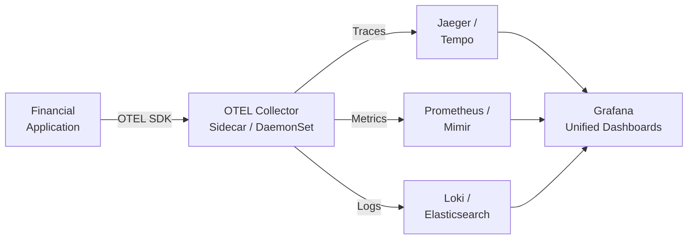

# OpenTelemetry — Instrumentation for Financial Services

> [!NOTE]
> OpenTelemetry is the CNCF standard for observability instrumentation. For financial services, it provides the unified telemetry foundation for understanding distributed payment flows, meeting audit requirements, and diagnosing production incidents.

## The Three Pillars of Observability

Observability is the ability to understand a system's internal state from its external outputs.

| Pillar | What It Answers | OTEL Signal |
|---|---|---|
| **Traces** | What happened to this specific payment request? | Spans linked by trace ID |
| **Metrics** | How is my system performing? | Counters, gauges, histograms |
| **Logs** | What was the system doing at this point in time? | Structured log records |

OpenTelemetry provides a **unified API and SDK** for all three signals, with vendor-neutral data export via OTLP (OpenTelemetry Protocol).



---

## Distributed Tracing — Following a Payment Across Services

A distributed trace links the execution of a request across multiple services, databases, and queues.

```mermaid
gantt
    title Distributed Trace: POST /payments (Trace ID: abc123)
    dateFormat X
    axisFormat %Lms
    
    section payment-api
    HTTP handler            :0, 180
    
    section fraud-service
    Fraud score lookup      :5, 85
    
    section account-service
    Balance read            :10, 65
    PostgreSQL query        :15, 55
    
    section payment-api
    Authorisation decision  :90, 120
    
    section ledger-service
    Debit entry write       :120, 170
    PostgreSQL INSERT       :125, 165
    
    section payment-api
    HTTP response           :170, 180
```



### Instrumenting with OpenTelemetry Java SDK

```java
// Automatic instrumentation (recommended for most financial services)
// Add javaagent to JVM args — instruments Spring Boot, JDBC, Kafka automatically
// -javaagent:/opt/opentelemetry-javaagent.jar
// -Dotel.service.name=payment-api
// -Dotel.exporter.otlp.endpoint=http://otel-collector:4317
// -Dotel.traces.exporter=otlp
// -Dotel.metrics.exporter=otlp
// -Dotel.logs.exporter=otlp

// Manual instrumentation for financial business logic
@Service
public class PaymentService {

    private final Tracer tracer;
    
    public PaymentService(OpenTelemetry openTelemetry) {
        this.tracer = openTelemetry.getTracer("com.bank.payment");
    }

    public PaymentResult authorisePayment(PaymentRequest request) {
        // Create a span for the authorisation decision
        Span span = tracer.spanBuilder("payment.authorise")
            .setAttribute("payment.id", request.getId().toString())
            .setAttribute("payment.amount", request.getAmount().toPlainString())
            .setAttribute("payment.currency", request.getCurrency())
            .setAttribute("payment.channel", request.getChannel().name())
            .startSpan();
        
        try (Scope scope = span.makeCurrent()) {
            // All child operations inherit this trace context
            FraudScore fraud = fraudService.score(request);
            Account account = accountService.getWithBalance(request.getAccountId());
            
            PaymentResult result = makeAuthorisationDecision(request, fraud, account);
            
            // Record the outcome on the span
            span.setAttribute("payment.decision", result.getDecision().name());
            span.setAttribute("payment.decline_reason", 
                result.getDeclineReason() != null ? result.getDeclineReason().name() : "");
                
            return result;
            
        } catch (Exception e) {
            span.recordException(e);
            span.setStatus(StatusCode.ERROR, e.getMessage());
            throw e;
        } finally {
            span.end();
        }
    }
}
```

### Critical: Propagating Trace Context

Trace context must be propagated across all service boundaries — HTTP headers, Kafka message headers, and async operations.

```java
// HTTP: W3C TraceContext propagation (automatic with javaagent)
// Incoming: traceparent: 00-abc123def456...-span1234-01
// Outgoing: propagated by OTEL HTTP client instrumentation

// Kafka: propagate trace context in message headers
@Component
public class PaymentEventPublisher {

    private final KafkaTemplate<String, PaymentEvent> kafkaTemplate;
    private final OpenTelemetry openTelemetry;
    
    public void publish(PaymentEvent event) {
        ProducerRecord<String, PaymentEvent> record = new ProducerRecord<>(
            "payments", event.getAccountId().toString(), event);
        
        // Inject current trace context into Kafka message headers
        // This allows the consumer to continue the same trace
        openTelemetry.getPropagators().getTextMapPropagator().inject(
            Context.current(),
            record.headers(),
            (headers, key, value) -> headers.add(key, value.getBytes(UTF_8))
        );
        
        kafkaTemplate.send(record);
    }
}

// Kafka consumer: extract and restore trace context
@KafkaListener(topics = "payments")
public void processPayment(ConsumerRecord<String, PaymentEvent> record) {
    // Extract trace context from Kafka headers to continue the trace
    Context extractedContext = openTelemetry.getPropagators().getTextMapPropagator()
        .extract(Context.current(), record.headers(),
            (headers, key) -> {
                Header header = headers.lastHeader(key);
                return header != null ? new String(header.value(), UTF_8) : null;
            });
    
    // All spans created inside this scope will be children of the original trace
    try (Scope scope = extractedContext.makeCurrent()) {
        settlementService.process(record.value());
    }
}
```

---

## Metrics — Measuring Financial System Health

OpenTelemetry metrics work alongside Micrometer in Spring Boot. The OTEL Java agent can export Micrometer metrics via OTLP.

```java
// Financial-specific metrics — go beyond the defaults
@Component
public class PaymentMetrics {
    
    private final LongCounter paymentCounter;
    private final DoubleHistogram paymentLatency;
    private final LongUpDownCounter queueDepth;

    public PaymentMetrics(OpenTelemetry openTelemetry) {
        Meter meter = openTelemetry.getMeter("com.bank.payment");
        
        // Payment outcome counter — split by channel and decision
        this.paymentCounter = meter.counterBuilder("payments.total")
            .setDescription("Total payment decisions")
            .setUnit("payments")
            .build();
        
        // End-to-end authorisation latency histogram
        this.paymentLatency = meter.histogramBuilder("payments.authorisation.duration")
            .setDescription("Payment authorisation duration")
            .setUnit("ms")
            // Bucket boundaries tuned for financial SLO (P50, P95, P99 visibility)
            .setExplicitBucketBoundariesAdvice(List.of(
                10.0, 25.0, 50.0, 100.0, 150.0, 200.0, 500.0, 1000.0))
            .build();
        
        // Queue depth gauge — payment processing backlog
        this.queueDepth = meter.upDownCounterBuilder("payments.queue.depth")
            .setDescription("Current payment processing queue depth")
            .build();
    }
    
    public void recordPaymentDecision(Payment payment, PaymentDecision decision, 
                                       Duration latency) {
        Attributes attrs = Attributes.builder()
            .put("channel", payment.getChannel().name())
            .put("decision", decision.name())
            .put("currency", payment.getCurrency())
            .put("amount_bucket", getAmountBucket(payment.getAmount()))
            .build();
        
        paymentCounter.add(1, attrs);
        paymentLatency.record(latency.toMillis(), attrs);
    }
    
    private String getAmountBucket(BigDecimal amount) {
        if (amount.compareTo(new BigDecimal("100")) < 0) return "micro";
        if (amount.compareTo(new BigDecimal("1000")) < 0) return "small";
        if (amount.compareTo(new BigDecimal("10000")) < 0) return "medium";
        return "large";
    }
}
```

---

## Structured Logs — Correlation with Traces

Logs are most valuable when they include the trace ID and span ID, enabling direct navigation from a log line to the distributed trace.

```java
// Spring Boot + Logback + OTEL: automatically inject trace/span IDs into MDC
// Add to logback-spring.xml pattern:
// %d{ISO8601} %-5level [%X{traceId},%X{spanId}] %logger{36} - %msg%n

// Application code: add business context to MDC
@Service
public class PaymentService {

    private static final Logger log = LoggerFactory.getLogger(PaymentService.class);
    
    public PaymentResult authorise(PaymentRequest request) {
        // Add financial context to log correlation
        MDC.put("paymentId",    request.getId().toString());
        MDC.put("accountId",    request.getAccountId().toString());
        MDC.put("channel",      request.getChannel().name());
        MDC.put("amountGBP",    request.getAmountGBP().toPlainString());
        
        try {
            log.info("Payment authorisation started");  
            // Log line: 2024-11-07T14:23:01 INFO [abc123,span456] PaymentService - 
            //           Payment authorisation started
            //           paymentId=pay-789 accountId=acc-012 channel=API amountGBP=250.00
            
            PaymentResult result = doAuthorise(request);
            
            log.info("Payment authorisation completed decision={} latencyMs={}", 
                result.getDecision(), result.getLatencyMs());
                
            return result;
            
        } finally {
            // Always clean up MDC to prevent context leaking to other requests
            MDC.remove("paymentId");
            MDC.remove("accountId");
            MDC.remove("channel");
            MDC.remove("amountGBP");
        }
    }
}
```

---

## OTEL Collector — Configuration for Financial Services

The OTEL Collector acts as a telemetry pipeline: receives data from services, processes it, and exports to backends.

```yaml
# otel-collector-config.yaml — financial services configuration
receivers:
  otlp:
    protocols:
      grpc:
        endpoint: 0.0.0.0:4317
      http:
        endpoint: 0.0.0.0:4318

processors:
  # Add environment metadata to all telemetry
  resource:
    attributes:
    - key: environment
      value: production
      action: insert
    - key: region
      value: eu-west-1
      action: insert
      
  # Sample traces — keep 100% of error traces, 10% of success traces
  # Critical for financial: never sample away errors or slow traces
  probabilistic_sampler:
    sampling_percentage: 10
    
  tail_sampling:
    decision_wait: 10s
    policies:
    - name: keep-errors
      type: status_code
      status_code: { status_codes: [ERROR] }    # keep all error traces
    - name: keep-slow
      type: latency
      latency: { threshold_ms: 500 }             # keep all traces > 500ms
    - name: keep-payments
      type: string_attribute
      string_attribute:                           # keep all payment traces
        key: payment.id
        values: [".*"]
        enabled_regex_matching: true
      
  # Batch for efficiency
  batch:
    timeout: 1s
    send_batch_size: 1000

exporters:
  otlp/jaeger:
    endpoint: jaeger-collector:4317
    tls:
      insecure: false
      cert_file: /certs/collector.crt
      key_file: /certs/collector.key
      
  prometheusremotewrite:
    endpoint: http://prometheus:9090/api/v1/write
    
  loki:
    endpoint: http://loki:3100/loki/api/v1/push

service:
  pipelines:
    traces:
      receivers: [otlp]
      processors: [resource, tail_sampling, batch]
      exporters: [otlp/jaeger]
    metrics:
      receivers: [otlp]
      processors: [resource, batch]
      exporters: [prometheusremotewrite]
    logs:
      receivers: [otlp]
      processors: [resource, batch]
      exporters: [loki]
```

---

## Compliance Tracing — Regulatory Requirements

Financial services have specific audit trail requirements beyond operational observability.

```java
// Compliance trace: every regulatory decision must be traceable
// PSD2 requires that Strong Customer Authentication decisions are auditable
@Component
public class SCAComplianceTracer {

    private final Tracer tracer;
    
    public void traceAuthenticationDecision(
            String paymentId, 
            SCAMethod method, 
            SCADecision decision,
            String regulatoryJustification) {
        
        Span complianceSpan = tracer.spanBuilder("sca.authentication.decision")
            .setSpanKind(SpanKind.INTERNAL)
            // PSD2 Article 97 required fields
            .setAttribute("compliance.regulation", "PSD2")
            .setAttribute("compliance.article", "97")
            .setAttribute("sca.payment_id", paymentId)
            .setAttribute("sca.method", method.name())
            .setAttribute("sca.decision", decision.name())
            .setAttribute("sca.justification", regulatoryJustification)
            .setAttribute("sca.timestamp", Instant.now().toString())
            .startSpan();
            
        complianceSpan.end();
        
        // Also emit a compliance event to the audit log — traces have TTL,
        // but compliance records must be retained for 5+ years
        complianceAuditLog.record(ComplianceEvent.sca(paymentId, method, decision));
    }
}
```

<!-- KNOWLEDGE-CHECK
{
  "questions": [
    {
      "id": "q1",
      "text": "A payment fails in production. The error appears in the logs of the payment-api service, but you cannot determine which downstream service (fraud-service, account-service, or ledger-service) caused it. What OTEL feature would have prevented this problem?",
      "options": [
        "Better error messages in the payment-api logs",
        "Distributed tracing with trace context propagation — a single trace ID spans all services, so you can follow the exact call chain for the failed payment",
        "More Prometheus metrics on each service",
        "Adding more log statements to each service"
      ],
      "correct": 1,
      "explanation": "Without distributed tracing, you have isolated log files per service with no way to correlate them to a specific request. With trace context propagation, every log line includes the same traceId, and Jaeger/Tempo shows the complete call tree with timing for the failed request — immediately showing which service and operation failed."
    },
    {
      "id": "q2",
      "text": "You are setting up tail sampling in the OTEL Collector. What is the advantage of tail sampling over head sampling for financial traces?",
      "options": [
        "Tail sampling is faster because it makes decisions immediately",
        "Tail sampling makes the sampling decision after seeing the complete trace — it can ensure all error traces and slow traces are kept, regardless of the sampling rate applied to successful fast traces",
        "Head sampling uses less memory because it discards traces immediately",
        "There is no advantage — head sampling and tail sampling are equivalent"
      ],
      "correct": 1,
      "explanation": "Head sampling decides to keep or discard a trace at the first span, before the outcome is known. A 10% head sample would discard 90% of error traces. Tail sampling waits for the full trace, then decides: keep all errors, keep all slow traces (> 500ms), and sample only the uninteresting fast-success traces. This is critical for financial services where errors must always be retained."
    },
    {
      "id": "q3",
      "text": "An engineer forgets to call MDC.remove() after adding paymentId to the MDC. What is the consequence in a thread-pool-based web server?",
      "options": [
        "No consequence — MDC values are automatically cleared per request",
        "Memory leak — MDC values accumulate infinitely",
        "MDC context leaks between requests — a subsequent request on the same thread will log with the previous request's paymentId, corrupting audit logs",
        "The application will throw a ConcurrentModificationException"
      ],
      "correct": 2,
      "explanation": "MDC values are stored in ThreadLocal variables. In a thread pool (Tomcat, Netty), threads are reused across requests. If you add paymentId to MDC in request A and forget to remove it, when thread T is reused for request B, it will log request B's actions with request A's paymentId. This is an audit trail corruption issue — critical in financial services."
    },
    {
      "id": "q4",
      "text": "PSD2 requires that SCA (Strong Customer Authentication) decisions are auditable. Why is an OTEL trace with a 7-day retention TTL NOT sufficient for this compliance requirement?",
      "options": [
        "OTEL traces cannot store compliance attributes",
        "PSD2 requires SCA records to be retained for the minimum 5-year financial record retention period — OTEL traces are operational data with short TTL, not compliance records",
        "OTEL is not approved by European Banking Authority",
        "Traces are not structured enough for regulatory queries"
      ],
      "correct": 1,
      "explanation": "OTEL traces are operational telemetry — typically retained for 7-30 days for incident investigation. Regulatory compliance records must be retained for 5+ years under PSD2 and GDPR. The correct architecture is: use OTEL for operational tracing AND write compliance events to a separate, long-retention, immutable audit store (append-only database, WORM storage)."
    }
  ]
}
-->

<!-- PRACTICAL-CHALLENGE
## Practical Challenge

**Scenario:** You are adding observability to a payment gateway Spring Boot application.

**Tasks:**

1. **Write the OTEL Java agent JVM arguments** for a production deployment: service name `payment-gateway-prod`, OTLP endpoint at `otel-collector.monitoring.svc.cluster.local:4317`, with traces, metrics, and logs all exported.

2. **Instrument the fraud scoring call**: write a manual span around the `fraudService.evaluate(payment)` call that records: payment ID, amount bucket, evaluation latency, and fraud decision. Ensure the span records the exception if the fraud service throws.

3. **Write the MDC setup and teardown** for the payment authorisation request handler. Include the try-finally pattern ensuring MDC is always cleaned up.

4. **Write the tail sampling configuration** for the OTEL Collector: keep 100% of error traces, keep 100% of traces where `payment.amount_bucket = "large"`, keep 5% of all other traces.

5. **Explain**: a payment fails at P99 (1 in 100 requests) but no one noticed for 3 hours. What observability components were missing that would have detected this earlier?
-->
