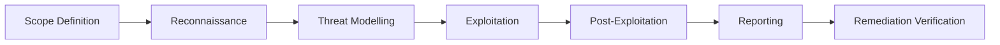
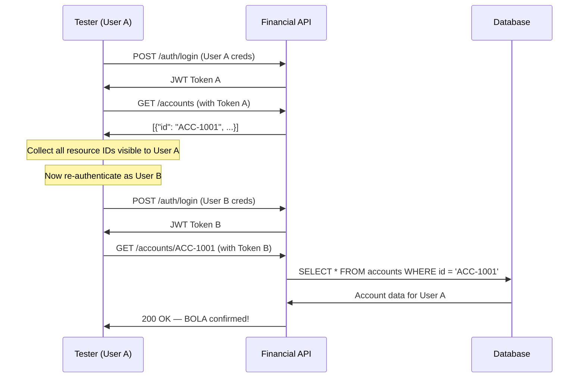
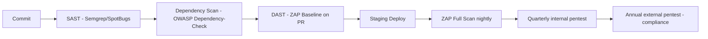

# Penetration Testing — Financial API Security Assessment

Penetration testing (pentesting) is the practice of simulating adversarial attacks against your own systems to discover vulnerabilities before malicious actors do. In financial services, where the cost of a breach can be regulatory fines, customer compensation, and permanent reputation damage, structured pentesting is not optional — it is a compliance requirement under PCI-DSS, FCA, and most national cyber-resilience frameworks.

This lesson covers the full pentest methodology applied to financial APIs, every category in OWASP API Top 10 with realistic fintech exploitation scenarios, and how to integrate automated dynamic testing into your CI/CD pipeline so you catch regressions before they reach production.

---

## Pentest Methodology Overview

A professional pentest follows a structured lifecycle. Without a defined scope and methodology, testing becomes random probing that misses critical paths and wastes time.



### Phase 1: Scope Definition

The scope document is a legal and technical contract between the testing team and the organisation. It must specify:

- **In-scope systems**: hostnames, IP ranges, API endpoints, mobile apps
- **Out-of-scope**: production databases with live customer data (use a copy), third-party payment rails
- **Testing window**: time of day, change freeze periods
- **Permitted techniques**: passive recon only vs full exploitation vs social engineering
- **Rules of engagement**: what happens if a critical vulnerability is found during testing (immediate escalation path)
- **Data handling**: how discovered credentials or PAN samples must be handled and destroyed

For a typical fintech API assessment, the scope document will also specify which test accounts and test card numbers are pre-authorised. Never use real customer credentials.

### Phase 2: Reconnaissance

Reconnaissance gathers intelligence about the target without triggering alerts. For API assessments:

- **Passive**: review published OpenAPI/Swagger specs, public GitHub repositories, job postings (which reveal tech stack), certificate transparency logs, Shodan/Censys for exposed services
- **Active**: endpoint enumeration via crawling, fuzzing path parameters, reviewing JavaScript bundles for internal API paths

A common finding in fintech: mobile app APKs decompiled with `apktool` reveal hardcoded staging API base URLs and internal endpoint paths that are never publicly documented.

### Phase 3: Exploitation

Exploitation proves vulnerabilities are real and measures their impact. The goal is not destruction — it is evidence. A good finding includes:

1. The exact HTTP request that triggers the vulnerability
2. The response that proves data exposure or privilege escalation
3. The business impact (what data or operation is exposed)
4. A recommended fix

---

## OWASP API Top 10 — Fintech Exploitation Scenarios

### API1: Broken Object Level Authorization (BOLA / IDOR)

BOLA is the most common and most impactful API vulnerability in financial services. The API allows a user to read or modify another user's resources simply by changing an identifier in the request.

**Vulnerable controller:**

```java
// VULNERABLE: no ownership check
@GetMapping("/accounts/{accountId}")
public ResponseEntity<AccountResponse> getAccount(
        @PathVariable String accountId,
        @AuthenticationPrincipal UserPrincipal principal) {
    // BUG: fetches any account by ID regardless of who is asking
    Account account = accountRepository.findById(accountId)
        .orElseThrow(() -> new AccountNotFoundException(accountId));
    return ResponseEntity.ok(AccountMapper.toResponse(account));
}
```

**Exploitation:** An attacker authenticated as user 1001 simply increments the account ID:

```
GET /api/v1/accounts/1002 HTTP/1.1
Authorization: Bearer <token_for_user_1001>
```

They receive full account details — balance, sort code, account number, transaction history — for user 1002.

**Fixed controller:**

```java
@GetMapping("/accounts/{accountId}")
public ResponseEntity<AccountResponse> getAccount(
        @PathVariable String accountId,
        @AuthenticationPrincipal UserPrincipal principal) {
    Account account = accountRepository.findByIdAndOwnerId(accountId, principal.getUserId())
        .orElseThrow(() -> new AccessDeniedException("Account not found or not accessible"));
    return ResponseEntity.ok(AccountMapper.toResponse(account));
}
```

The fix always filters by both the resource ID and the authenticated user ID. The error message is intentionally ambiguous — do not reveal whether the account exists but is inaccessible vs does not exist at all.

**Testing methodology:** Automate BOLA testing by logging in as two different test users, capturing all resource identifiers returned for user A, then replaying those requests authenticated as user B.

---

### API2: Broken Authentication

**Scenario: Weak JWT signing secret.** A common misconfiguration is signing JWTs with a predictable or short secret.

```bash
# Attacker brute-forces the JWT secret using hashcat or jwt_tool
python3 jwt_tool.py eyJ... -C -d /wordlists/common-jwt-secrets.txt

# If the secret is "secret123", the attacker can forge any token:
python3 jwt_tool.py eyJ... -T -S hs256 -p "secret123"
# Then modifies the payload: "sub": "admin", "role": "ADMIN"
```

**JWT algorithm confusion attack (RS256 → HS256):**

If the server accepts both RS256 and HS256, an attacker can:

1. Obtain the server's RSA public key (often exposed at `/.well-known/jwks.json`)
2. Forge a new token signed with HS256 using the public key as the HMAC secret
3. The server verifies the HS256 signature using the public key — and it succeeds

```java
// VULNERABLE: accepts algorithm from token header
Algorithm algorithm = Algorithm.valueOf(decodedJWT.getAlgorithm());
JWTVerifier verifier = JWT.require(algorithm).build();

// FIXED: always enforce expected algorithm
JWTVerifier verifier = JWT.require(Algorithm.RSA256(publicKey, null))
    .withIssuer("payments-service")
    .build();
```

---

### API3: Broken Object Property Level Authorization (Mass Assignment)

**Scenario:** A user updates their profile and the API binds all request fields directly to the entity, including fields like `role` or `kycStatus`.

```java
// VULNERABLE: binds all fields from request body
@PutMapping("/users/me")
public ResponseEntity<UserResponse> updateProfile(
        @RequestBody UserUpdateRequest request,
        @AuthenticationPrincipal UserPrincipal principal) {
    User user = userRepository.findById(principal.getUserId()).orElseThrow();
    // BUG: maps every field including role, kycStatus, creditLimit
    modelMapper.map(request, user);
    return ResponseEntity.ok(UserMapper.toResponse(userRepository.save(user)));
}
```

**Exploitation:**

```json
PUT /api/v1/users/me
{
  "displayName": "John",
  "email": "john@example.com",
  "role": "ADMIN",
  "kycStatus": "VERIFIED",
  "creditLimit": 1000000
}
```

**Fix:** Use dedicated DTOs with only the fields users are permitted to modify:

```java
// Only expose fields the user is allowed to change
public class UserProfileUpdateRequest {
    private String displayName;
    private String phoneNumber;
    // role, kycStatus, creditLimit — not present here
}
```

---

### API4: Unrestricted Resource Consumption

**Scenario:** No rate limiting on the transaction history endpoint allows an attacker to scrape every customer's full transaction history via BOLA.

```bash
# Attacker script: iterate account IDs and dump all transactions
for i in $(seq 10000 99999); do
  curl -s -H "Authorization: Bearer $TOKEN" \
    "https://api.bank.example/v1/accounts/$i/transactions?limit=1000" \
    >> transactions_dump.json
done
```

Without rate limiting, this completes in minutes and exfiltrates millions of transaction records.

**Spring Boot rate limiting with Bucket4j:**

```java
@Component
public class RateLimitingFilter extends OncePerRequestFilter {

    private final Cache<String, Bucket> buckets;

    public RateLimitingFilter(CacheManager cacheManager) {
        this.buckets = cacheManager.getCache("rateLimitBuckets");
    }

    @Override
    protected void doFilterInternal(HttpServletRequest request,
                                     HttpServletResponse response,
                                     FilterChain chain) throws IOException, ServletException {
        String userId = extractUserId(request);
        Bucket bucket = buckets.get(userId, key ->
            Bucket.builder()
                .addLimit(Bandwidth.classic(100, Refill.greedy(100, Duration.ofMinutes(1))))
                .build()
        );

        if (bucket.tryConsume(1)) {
            chain.doFilter(request, response);
        } else {
            response.setStatus(429);
            response.setHeader("Retry-After", "60");
            response.getWriter().write("{\"error\":\"Rate limit exceeded\"}");
        }
    }
}
```

---

### API5: Broken Function Level Authorization

**Scenario:** An admin endpoint for freezing customer accounts is accessible to regular users because it relies only on URL path security, not method-level authorization.

```java
// VULNERABLE: regular users can reach this endpoint
@PostMapping("/accounts/{accountId}/freeze")
public ResponseEntity<Void> freezeAccount(@PathVariable String accountId) {
    accountService.freeze(accountId);
    return ResponseEntity.noContent().build();
}
```

**Exploitation:**

```
POST /api/v1/accounts/9999/freeze HTTP/1.1
Authorization: Bearer <regular_user_token>
```

Account 9999 is frozen. The regular user has performed an administrative action.

**Fix:**

```java
@PostMapping("/accounts/{accountId}/freeze")
@PreAuthorize("hasRole('COMPLIANCE_OFFICER') or hasRole('ADMIN')")
public ResponseEntity<Void> freezeAccount(
        @PathVariable String accountId,
        @AuthenticationPrincipal UserPrincipal principal) {
    auditService.log("ACCOUNT_FREEZE", accountId, principal.getUserId());
    accountService.freeze(accountId);
    return ResponseEntity.noContent().build();
}
```

---

### API6: Server-Side Request Forgery (SSRF)

**Scenario:** A payment webhook configuration endpoint allows users to register callback URLs. An attacker registers the AWS metadata endpoint.

```
POST /api/v1/webhooks
{
  "url": "http://169.254.169.254/latest/meta-data/iam/security-credentials/",
  "events": ["PAYMENT_COMPLETED"]
}
```

When a payment completes, the application fetches the callback URL and returns the response in an error log — exposing IAM credentials for the EC2 instance.

**Fix:** Validate webhook URLs against an allowlist of schemes, block private IP ranges, and use a dedicated outbound proxy:

```java
public void validateWebhookUrl(String url) {
    URI uri = URI.create(url);

    if (!Set.of("https").contains(uri.getScheme())) {
        throw new InvalidWebhookUrlException("Only HTTPS URLs are permitted");
    }

    InetAddress address = InetAddress.getByName(uri.getHost());
    if (address.isSiteLocalAddress() || address.isLoopbackAddress()
            || address.isLinkLocalAddress()) {
        throw new InvalidWebhookUrlException("Private/internal URLs are not permitted");
    }
}
```

---

### API7: Security Misconfiguration — Swagger UI in Production

Swagger UI exposed in production gives attackers a fully documented attack surface with try-it-out functionality authenticated with no credentials.

**Detection:**

```bash
# Common paths to check
curl -I https://api.bank.example/swagger-ui.html
curl -I https://api.bank.example/v3/api-docs
curl -I https://api.bank.example/api-docs
```

**Fix in Spring Boot:**

```yaml
# application-production.yml
springdoc:
  api-docs:
    enabled: false
  swagger-ui:
    enabled: false
```

Or conditionally enable only in non-production profiles:

```java
@Configuration
@Profile({"development", "staging"})
public class OpenApiConfig {
    @Bean
    public GroupedOpenApi publicApi() {
        return GroupedOpenApi.builder().group("public").pathsToMatch("/api/**").build();
    }
}
```

---

### API8: Lack of Inventory

**Scenario:** An undocumented `/internal/admin` endpoint discovered during JavaScript bundle analysis:

```bash
# In the mobile app bundle:
grep -r "internal/admin" app.bundle.js
# Found: /internal/admin/users/{userId}/balance-override
```

This endpoint was built for load testing, never removed, and allows arbitrary balance modifications with no authentication in the HTTP path (it relied on network-level controls that were bypassed in production).

**Control:** Maintain a complete API inventory in your API gateway or a machine-readable spec. Run automated tests during CI that verify every deployed endpoint appears in your inventory.

---

### API9: Improper Asset Management — Old API Version

**Scenario:** API v1 (`/api/v1/`) was deprecated 18 months ago but never decommissioned. It has no rate limiting, no current JWT validation logic, and accepts MD5-hashed passwords.

```
POST /api/v1/auth/login
{"username": "user@example.com", "password": "md5hashhere"}
```

The v1 endpoint authenticates the user and returns a JWT that is accepted by all current v2 services.

**Fix:** Define explicit sunset dates for API versions. Gate old versions behind feature flags. Monitor traffic to deprecated versions and alert when usage approaches zero (indicating it is safe to remove) or spikes (indicating someone is targeting it).

---

### API10: Unsafe Consumption of External APIs

**Scenario:** The payment gateway returns a `status` field. The application trusts it without validation:

```java
// VULNERABLE: trusts external API response blindly
PaymentGatewayResponse gatewayResponse = callPaymentGateway(request);
if ("SUCCESS".equals(gatewayResponse.getStatus())) {
    ledgerService.credit(accountId, amount);
}
```

An attacker who can perform a man-in-the-middle attack on the gateway connection (or who compromises the gateway itself) can inject `"status": "SUCCESS"` for a failed payment.

**Fix:** Validate responses cryptographically (signature verification), check idempotency keys, and reconcile against the gateway's own reporting API asynchronously:

```java
PaymentGatewayResponse gatewayResponse = callPaymentGateway(request);
if (!signatureVerifier.verify(gatewayResponse)) {
    throw new PaymentResponseIntegrityException("Gateway response signature invalid");
}
// Also persist the raw response for async reconciliation
paymentAuditRepository.save(new PaymentAudit(request.getIdempotencyKey(), gatewayResponse));
```

---

## BOLA/IDOR Testing Methodology in Detail

A systematic BOLA test for a financial API:



Automate this with a Burp Suite Intruder or a custom script that replays requests across authentication contexts.

---

## Automated DAST with OWASP ZAP in CI/CD

Integrate OWASP ZAP baseline scanning into your GitHub Actions pipeline to catch regressions on every pull request.

```yaml
# .github/workflows/security-scan.yml
name: OWASP ZAP Security Scan

on:
  pull_request:
    branches: [main]
  schedule:
    - cron: '0 2 * * *'  # nightly full scan

jobs:
  zap-baseline:
    runs-on: ubuntu-latest
    steps:
      - name: Checkout
        uses: actions/checkout@v4

      - name: Start application
        run: |
          docker compose -f docker-compose.test.yml up -d
          ./scripts/wait-for-healthy.sh http://localhost:8080/actuator/health

      - name: ZAP Baseline Scan
        uses: zaproxy/action-baseline@v0.11.0
        with:
          target: 'http://localhost:8080'
          rules_file_name: '.zap/rules.tsv'
          cmd_options: '-a -j -l WARN'
          fail_action: true

      - name: Upload ZAP report
        if: always()
        uses: actions/upload-artifact@v4
        with:
          name: zap-report
          path: report_html.html

      - name: Stop application
        if: always()
        run: docker compose -f docker-compose.test.yml down
```

**ZAP rules file** to suppress known false positives:

```tsv
# .zap/rules.tsv
# Rule ID  Action  Parameter  Evidence
10038      IGNORE              # Content-Security-Policy header missing (handled at CDN)
10054      IGNORE              # Cookie without SameSite — session cookie set by auth service
90033      IGNORE              # Loosely scoped cookie domain
```

---

## Pentest Report Structure

A pentest report for financial services regulators and risk committees must follow a standard structure:

```
1. Executive Summary (1 page)
   - Testing period and scope
   - Critical findings count by severity
   - Risk posture statement

2. Methodology
   - Testing approach (black/grey/white box)
   - Tools used (Burp Suite Pro, OWASP ZAP, custom scripts)
   - OWASP Testing Guide version

3. Findings (per vulnerability)
   - ID, Title, Severity (Critical/High/Medium/Low/Informational)
   - CVSS v3.1 score and vector
   - Description
   - Evidence (request/response)
   - Business impact
   - Remediation recommendation

4. Risk Register
   - All findings mapped to risk register entries

5. Remediation Tracking
   - Status: Open / In Progress / Resolved / Risk Accepted
```

---

## Remediation SLAs for Fintech

Fintech firms operating under PCI-DSS and FCA supervision must adhere to defined remediation timelines. These are typically codified in the Information Security Policy and reviewed during audits.

| Severity | CVSS Range | SLA | Example |
|----------|-----------|-----|---------|
| Critical | 9.0–10.0 | 24 hours | BOLA exposing all account balances |
| High | 7.0–8.9 | 7 days | Broken authentication bypass |
| Medium | 4.0–6.9 | 30 days | Missing rate limiting on non-sensitive endpoint |
| Low | 0.1–3.9 | 90 days | Information disclosure in error messages |
| Informational | N/A | Next sprint | Missing security headers |

For Critical findings, the process is:

1. Finding confirmed by tester and security lead (1 hour)
2. Incident ticket raised and P1 on-call engaged (2 hours)
3. Temporary mitigation deployed (WAF rule, feature flag disable) (12 hours)
4. Root cause fix deployed to production (24 hours)
5. Retest confirmation by tester (48 hours)

---

## Production Pitfalls

### Pitfall 1: Testing Against Production Data

**Problem:** Pentest teams given access to production environments sometimes trigger functionality that modifies real customer data or sends real notifications.

```java
// A pentest that sends real payment instructions
POST /api/v1/payments
Authorization: Bearer <pentest_token_with_prod_access>
{
  "fromAccount": "REAL_CUSTOMER_ACCOUNT",
  "toAccount": "ATTACKER_ACCOUNT",
  "amount": 1000,
  "currency": "GBP"
}
```

This is both a security incident and a regulatory breach if the account is a real customer's.

**Prevention:** Maintain a fully isolated pentest environment with synthetic data that mirrors production schema. The pentest environment must have no network path to production databases or payment rails. Gate pentest tokens to a separate tenant in your auth service:

```java
@Component
public class PentestTenantIsolationFilter extends OncePerRequestFilter {
    @Override
    protected void doFilterInternal(HttpServletRequest request,
                                     HttpServletResponse response,
                                     FilterChain chain) throws IOException, ServletException {
        String tenant = extractTenant(request);
        if ("pentest".equals(tenant) && isProductionDataPath(request.getRequestURI())) {
            response.setStatus(403);
            response.getWriter().write("{\"error\":\"Pentest tenant cannot access production data paths\"}");
            return;
        }
        chain.doFilter(request, response);
    }
}
```

---

### Pitfall 2: Fixing Symptoms, Not Root Causes

**Problem:** A BOLA finding is "fixed" by adding an ownership check to the specific endpoint identified in the report, but dozens of other endpoints with the same pattern remain vulnerable.

```java
// "Fixed" only the reported endpoint
@GetMapping("/accounts/{id}")
public Account getAccount(@PathVariable String id, @AuthenticationPrincipal UserPrincipal p) {
    return accountRepository.findByIdAndOwnerId(id, p.getUserId()).orElseThrow();
}

// But these were not in scope and remain vulnerable:
// GET /loans/{id}        — no ownership check
// GET /cards/{id}        — no ownership check
// GET /beneficiaries/{id} — no ownership check
```

**Prevention:** Treat pentest findings as signals about vulnerability classes, not just individual bugs. When a BOLA is found, audit every resource endpoint in the codebase for the same pattern. Use a base repository that enforces ownership:

```java
// Enforce at the repository layer — cannot be bypassed per-controller
public interface OwnedResourceRepository<T, ID> extends JpaRepository<T, ID> {
    Optional<T> findByIdAndOwnerId(ID id, String ownerId);
    // findById is not exposed — callers must always provide ownerId
}
```

---

### Pitfall 3: Treating Annual Pentests as Sufficient

**Problem:** Financial regulations require annual penetration tests. Teams treat the annual test as the security safety net and do not test security continuously.

The annual test covers a point-in-time snapshot. Code deployed the week after the pentest may introduce new vulnerabilities that go untested for 51 weeks.

**Prevention:** Layer security testing across the development lifecycle:



Each layer catches different vulnerability classes. SAST finds code-level issues. DAST finds runtime configuration issues. The annual pentest is the compliance confirmation of an already-tested system, not the first line of defence.

---

## Lesson Checklist

- [ ] You can explain all 10 OWASP API security categories with a fintech-specific example for each
- [ ] You can identify BOLA vulnerabilities in Java Spring Boot code and write the correct fix
- [ ] You can describe the JWT algorithm confusion attack and prevent it by enforcing the expected algorithm server-side
- [ ] You can configure OWASP ZAP baseline scanning in a GitHub Actions workflow
- [ ] You know the fintech remediation SLAs: Critical 24h, High 7d, Medium 30d, Low 90d
- [ ] You can write a pentest scope document that prevents accidental impact to production
- [ ] You understand why annual pentests alone are insufficient and can describe a layered testing strategy

---

<!-- KNOWLEDGE-CHECK
{"questions":[{"text":"An attacker authenticated as user A successfully retrieves account details for user B by changing the account ID in the URL path. Which OWASP API Top 10 category does this represent?","options":["API2: Broken Authentication","API1: Broken Object Level Authorization","API5: Broken Function Level Authorization","API3: Broken Object Property Level Authorization"],"correct":1,"explanation":"BOLA (Broken Object Level Authorization), also known as IDOR, occurs when the API does not verify that the authenticated user owns the resource they are requesting. The fix is to always filter resource lookups by both the resource ID and the authenticated user's ID."},{"text":"A JWT is signed with RS256 and the server's public key is accessible at /.well-known/jwks.json. Which attack is possible if the server also accepts HS256 tokens?","options":["The attacker can steal the private key from the JWKS endpoint","The attacker can forge a valid HS256 token using the public key as the HMAC secret","The attacker can replay old RS256 tokens indefinitely","The attacker can enumerate user IDs from the JWT subject claim"],"correct":1,"explanation":"In the JWT algorithm confusion attack, the attacker downloads the RSA public key and uses it as the HMAC secret to sign a forged HS256 token. If the server accepts both algorithms and verifies HS256 tokens using the public key, the forged token passes validation. The fix is to enforce the expected algorithm explicitly on the server side."},{"text":"Under PCI-DSS and typical fintech security policies, what is the maximum remediation SLA for a Critical severity finding (CVSS 9.0+) discovered during a penetration test?","options":["7 days","30 days","24 hours","72 hours"],"correct":2,"explanation":"Critical findings must be remediated within 24 hours. This typically involves an immediate temporary mitigation (WAF rule, feature flag) within 12 hours and a root cause fix within 24 hours, followed by retest confirmation."}]}
-->

<!-- PRACTICAL-CHALLENGE
{"title":"Financial API Security Assessment","difficulty":"advanced","estimatedMinutes":90,"tasks":[{"id":"1","description":"Set up a local Spring Boot application with a /api/v1/accounts/{id} endpoint. Implement the vulnerable version (no ownership check), then write an automated test using two test user tokens that proves the BOLA vulnerability. Then fix the endpoint and confirm the test now returns 403 for the cross-user request."},{"id":"2","description":"Obtain a test JWT signed with HS256 using the secret 'secret123'. Use jwt_tool or a simple Java program to forge a new token with role=ADMIN. Then implement a JWT verifier in Spring Security that rejects any token not signed with the expected algorithm and secret, and confirm the forged token is rejected."},{"id":"3","description":"Add OWASP ZAP baseline scanning to a GitHub Actions workflow for a sample Spring Boot application. Configure the .zap/rules.tsv file to suppress at least two known false positives. Confirm the workflow fails the build when ZAP reports a High severity finding and passes when only Low/Informational findings are present."},{"id":"4","description":"Write a pentest scope document template for a fintech API assessment. It must include: in-scope/out-of-scope sections, testing window, permitted techniques, rules of engagement for critical findings, data handling requirements for discovered PAN samples, and the remediation SLA table (Critical through Informational)."}]}
-->
