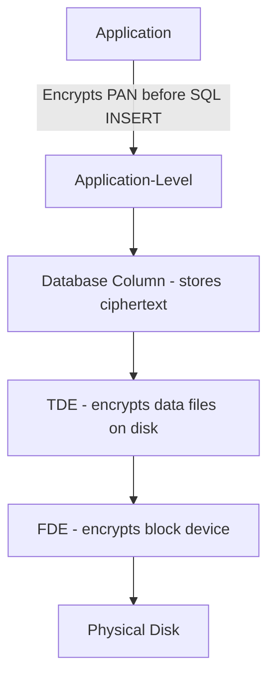
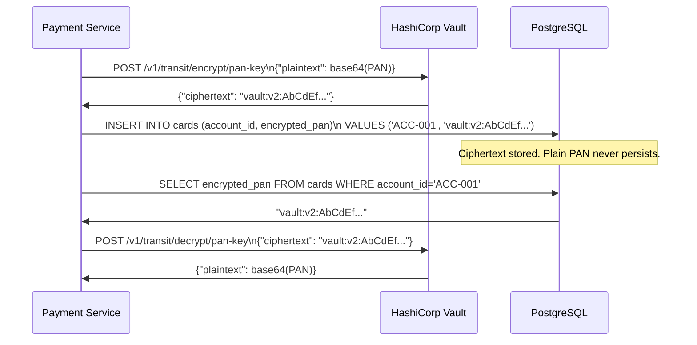
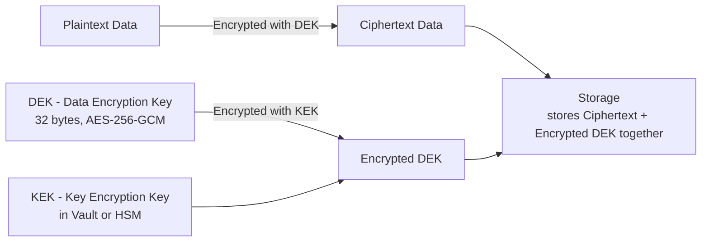
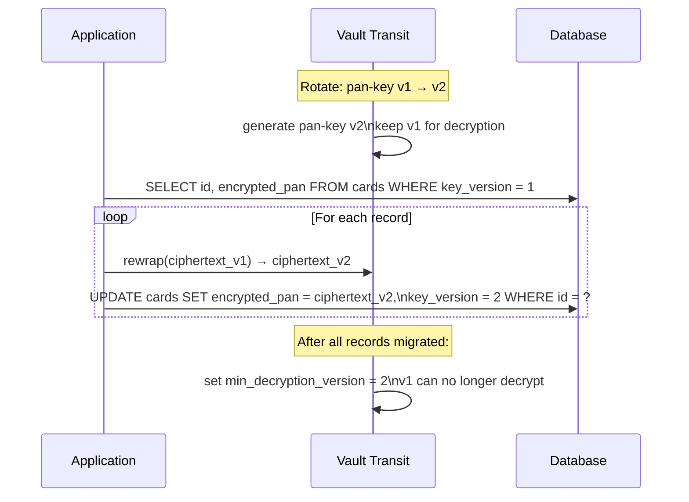

# Data Encryption — At-Rest and In-Transit for Finance

Financial data at rest and in transit is subject to the most stringent protection requirements of any industry. PCI-DSS Requirement 3 mandates that Primary Account Numbers (PANs) are rendered unreadable anywhere they are stored. Requirement 4 mandates strong cryptography over open networks. GDPR requires appropriate technical measures for personal data. The FCA expects firms to protect sensitive customer information as a condition of authorisation.

This lesson builds the technical foundation: encryption levels, AES-256-GCM implementation, TLS 1.3 configuration, field-level encryption via HashiCorp Vault, envelope encryption, HSMs, and key rotation — without downtime.

---

## Encryption at Rest: Choosing the Right Level

There is no single correct answer for where to apply encryption. Each layer protects against a different threat. In practice, financial services firms apply multiple layers simultaneously.

| Level | What It Protects | What It Does NOT Protect | Example Technology |
|-------|-----------------|--------------------------|-------------------|
| Full Disk Encryption (FDE) | Stolen physical media | Compromised OS, running DB | dm-crypt/LUKS, BitLocker |
| Transparent DB Encryption (TDE) | DB data files, backups | Privileged DB user, app layer | Oracle TDE, AWS RDS encryption |
| Column-Level Encryption | Specific sensitive columns | Application memory | SQL Server Always Encrypted |
| Application-Level Encryption | Data before it reaches the DB | Compromised application code | Java + Vault transit engine |



For PAN and sensitive authentication data (SAD), PCI-DSS requires application-level or column-level encryption because TDE alone does not protect against a compromised DBA or database admin credential.

---

## AES-256-GCM: Encrypting a PAN in Java

AES-256-GCM (Galois/Counter Mode) is the standard for financial data encryption. It provides both confidentiality (encryption) and integrity (authentication tag) in a single operation. Unlike CBC mode, GCM does not require padding and is parallelisable.

**Key components:**
- **Key**: 256-bit (32 bytes), generated from a cryptographically secure source
- **IV (Initialization Vector)**: 96-bit (12 bytes), unique per encryption operation — never reuse
- **AAD (Additional Authenticated Data)**: contextual data that is authenticated but not encrypted (e.g., account ID, timestamp)
- **Authentication Tag**: 128-bit tag appended to ciphertext — verifies integrity on decryption

```java
import javax.crypto.Cipher;
import javax.crypto.KeyGenerator;
import javax.crypto.SecretKey;
import javax.crypto.spec.GCMParameterSpec;
import javax.crypto.spec.SecretKeySpec;
import java.security.SecureRandom;
import java.util.Base64;

public class PanEncryptionService {

    private static final String ALGORITHM = "AES/GCM/NoPadding";
    private static final int GCM_IV_LENGTH = 12;   // 96 bits
    private static final int GCM_TAG_LENGTH = 128;  // bits

    private final SecretKey encryptionKey;

    public PanEncryptionService(byte[] keyBytes) {
        // keyBytes must be exactly 32 bytes for AES-256
        this.encryptionKey = new SecretKeySpec(keyBytes, "AES");
    }

    /**
     * Encrypts a PAN. The IV is prepended to the ciphertext so it can be
     * stored and retrieved together. AAD binds the ciphertext to a specific
     * account — prevents ciphertext from being moved to a different account.
     */
    public String encrypt(String pan, String accountId) throws Exception {
        byte[] iv = generateIv();
        byte[] aad = accountId.getBytes("UTF-8");

        Cipher cipher = Cipher.getInstance(ALGORITHM);
        GCMParameterSpec parameterSpec = new GCMParameterSpec(GCM_TAG_LENGTH, iv);
        cipher.init(Cipher.ENCRYPT_MODE, encryptionKey, parameterSpec);
        cipher.updateAAD(aad);

        byte[] ciphertext = cipher.doFinal(pan.getBytes("UTF-8"));

        // Prepend IV to ciphertext: [12 bytes IV][ciphertext + 16 byte tag]
        byte[] combined = new byte[iv.length + ciphertext.length];
        System.arraycopy(iv, 0, combined, 0, iv.length);
        System.arraycopy(ciphertext, 0, combined, iv.length, ciphertext.length);

        return Base64.getEncoder().encodeToString(combined);
    }

    /**
     * Decrypts a PAN. Extracts IV from the stored value.
     * AAD must match what was used during encryption — provides binding check.
     */
    public String decrypt(String encryptedPan, String accountId) throws Exception {
        byte[] combined = Base64.getDecoder().decode(encryptedPan);
        byte[] aad = accountId.getBytes("UTF-8");

        byte[] iv = new byte[GCM_IV_LENGTH];
        byte[] ciphertext = new byte[combined.length - GCM_IV_LENGTH];
        System.arraycopy(combined, 0, iv, 0, GCM_IV_LENGTH);
        System.arraycopy(combined, GCM_IV_LENGTH, ciphertext, 0, ciphertext.length);

        Cipher cipher = Cipher.getInstance(ALGORITHM);
        GCMParameterSpec parameterSpec = new GCMParameterSpec(GCM_TAG_LENGTH, iv);
        cipher.init(Cipher.DECRYPT_MODE, encryptionKey, parameterSpec);
        cipher.updateAAD(aad);

        byte[] plaintext = cipher.doFinal(ciphertext); // throws AEADBadTagException if tampered
        return new String(plaintext, "UTF-8");
    }

    private byte[] generateIv() {
        byte[] iv = new byte[GCM_IV_LENGTH];
        new SecureRandom().nextBytes(iv);
        return iv;
    }
}
```

**Unit test confirming tamper detection:**

```java
@Test
void decryptShouldFailWhenCiphertextTampered() throws Exception {
    PanEncryptionService service = new PanEncryptionService(generateKey());
    String encrypted = service.encrypt("4111111111111111", "ACC-001");

    // Flip a byte in the ciphertext
    byte[] raw = Base64.getDecoder().decode(encrypted);
    raw[20] ^= 0xFF;
    String tampered = Base64.getEncoder().encodeToString(raw);

    assertThrows(AEADBadTagException.class,
        () -> service.decrypt(tampered, "ACC-001"));
}
```

---

## TLS 1.3 Configuration for Spring Boot

TLS 1.3 eliminates weak cipher suites, reduces the handshake to one round trip, and enforces perfect forward secrecy. All financial APIs must use TLS 1.3; TLS 1.2 may be permitted as a fallback only where legacy clients require it.

```yaml
# application.yml
server:
  port: 8443
  ssl:
    enabled: true
    key-store: classpath:keystore/payments-api.p12
    key-store-password: ${SSL_KEYSTORE_PASSWORD}
    key-store-type: PKCS12
    key-alias: payments-api
    protocol: TLS
    enabled-protocols:
      - TLSv1.3
      - TLSv1.2       # Remove when all clients support TLS 1.3
    ciphers:
      # TLS 1.3 cipher suites (automatically selected, listed for documentation)
      - TLS_AES_256_GCM_SHA384
      - TLS_AES_128_GCM_SHA256
      - TLS_CHACHA20_POLY1305_SHA256
      # TLS 1.2 cipher suites (AES-GCM only, no CBC, no RC4, no 3DES)
      - TLS_ECDHE_RSA_WITH_AES_256_GCM_SHA384
      - TLS_ECDHE_RSA_WITH_AES_128_GCM_SHA256
```

**HSTS configuration** — force browsers and HTTP clients to always use HTTPS:

```java
@Configuration
@EnableWebSecurity
public class SecurityConfig {

    @Bean
    public SecurityFilterChain filterChain(HttpSecurity http) throws Exception {
        http
            .requiresChannel(channel ->
                channel.anyRequest().requiresSecure()
            )
            .headers(headers ->
                headers.httpStrictTransportSecurity(hsts ->
                    hsts
                        .includeSubDomains(true)
                        .maxAgeInSeconds(31536000)  // 1 year
                        .preload(true)
                )
            );
        return http.build();
    }
}
```

**Verifying TLS configuration:**

```bash
# Check supported protocols and cipher suites
openssl s_client -connect api.payments.example:8443 \
  -tls1_3 -ciphersuites TLS_AES_256_GCM_SHA384

# Check certificate chain and HSTS header
curl -v --tlsv1.3 https://api.payments.example:8443/actuator/health 2>&1 \
  | grep -E "(TLSv|Strict-Transport)"
```

---

## Field-Level Encryption with HashiCorp Vault Transit

The Vault Transit Secrets Engine provides encryption-as-a-service. Your application sends plaintext to Vault, which returns ciphertext. The encryption key never leaves Vault — your application never handles raw key material.



**Spring service wrapping Vault transit:**

```java
@Service
public class VaultFieldEncryptionService {

    private final VaultTemplate vaultTemplate;
    private static final String TRANSIT_PATH = "transit/";
    private static final String KEY_NAME = "pan-key";

    public VaultFieldEncryptionService(VaultTemplate vaultTemplate) {
        this.vaultTemplate = vaultTemplate;
    }

    public String encryptPan(String plainPan) {
        String base64Plaintext = Base64.getEncoder()
            .encodeToString(plainPan.getBytes(StandardCharsets.UTF_8));

        VaultTransitContext context = VaultTransitContext.builder()
            .context(Base64.getEncoder().encode("pan-encryption".getBytes()))
            .build();

        return vaultTemplate.opsForTransit()
            .encrypt(KEY_NAME, VaultTransitOperations.Plaintext.of(base64Plaintext, context));
    }

    public String decryptPan(String ciphertext) {
        VaultTransitContext context = VaultTransitContext.builder()
            .context(Base64.getEncoder().encode("pan-encryption".getBytes()))
            .build();

        String base64Plaintext = vaultTemplate.opsForTransit()
            .decrypt(KEY_NAME, VaultTransitOperations.Ciphertext.of(ciphertext, context));

        return new String(Base64.getDecoder().decode(base64Plaintext), StandardCharsets.UTF_8);
    }

    /**
     * Rewrap re-encrypts ciphertext under the latest key version without
     * decrypting to plaintext. Used during key rotation.
     */
    public String rewrap(String oldCiphertext) {
        return vaultTemplate.opsForTransit().rewrap(KEY_NAME, oldCiphertext);
    }
}
```

**Vault policy for the payment service** — principle of least privilege:

```hcl
# payment-service-policy.hcl
path "transit/encrypt/pan-key" {
  capabilities = ["update"]
}

path "transit/decrypt/pan-key" {
  capabilities = ["update"]
}

path "transit/rewrap/pan-key" {
  capabilities = ["update"]
}

# Explicitly deny key creation and deletion
path "transit/keys/pan-key" {
  capabilities = ["deny"]
}
```

---

## Envelope Encryption

Envelope encryption is the standard pattern when you need to encrypt large volumes of data efficiently while keeping key material manageable.



**Key properties:**
- **DEK (Data Encryption Key)**: ephemeral, generated per record or per batch, used for actual data encryption
- **KEK (Key Encryption Key)**: long-lived, stored in Vault or HSM, used only to protect DEKs
- Rotating the KEK requires re-encrypting DEKs, not re-encrypting data
- If a DEK is compromised, only that record's data is exposed

```java
public class EnvelopeEncryptionService {

    private final VaultFieldEncryptionService vaultService;

    public EncryptedRecord encrypt(byte[] plaintext) throws Exception {
        // Generate a random DEK for this record
        KeyGenerator keyGen = KeyGenerator.getInstance("AES");
        keyGen.init(256, new SecureRandom());
        SecretKey dek = keyGen.generateKey();

        // Encrypt the data with the DEK
        byte[] ciphertext = encryptWithDek(plaintext, dek);

        // Encrypt the DEK with the KEK (via Vault)
        String encryptedDek = vaultService.encryptPan(
            Base64.getEncoder().encodeToString(dek.getEncoded())
        );

        return new EncryptedRecord(
            Base64.getEncoder().encodeToString(ciphertext),
            encryptedDek
        );
        // Both ciphertext and encryptedDek are stored together
        // Plain DEK never persists
    }

    public byte[] decrypt(EncryptedRecord record) throws Exception {
        // Retrieve DEK from Vault
        String dekBase64 = vaultService.decryptPan(record.getEncryptedDek());
        byte[] dekBytes = Base64.getDecoder().decode(dekBase64);
        SecretKey dek = new SecretKeySpec(dekBytes, "AES");

        // Decrypt data with the DEK
        return decryptWithDek(Base64.getDecoder().decode(record.getCiphertext()), dek);
    }
}
```

---

## HSM and Master Key Management

A Hardware Security Module (HSM) is a tamper-resistant device that stores cryptographic keys and performs cryptographic operations. The master key (KEK root) for a financial institution must reside in an HSM, not in software.

**Key ceremony** — the process of generating and loading a master key into an HSM:

1. At least two key custodians are required (M-of-N split knowledge)
2. The ceremony is conducted in a physically secure room with no recording devices
3. Each custodian holds one component of the key on a smart card
4. All components are entered simultaneously into the HSM
5. The HSM generates the master key internally — it never leaves the device in plaintext
6. The ceremony is documented and signed by all custodians and a witness

**DUKPT (Derived Unique Key Per Transaction)** — PIN block encryption:

```
Master Key (BDK) → loaded into HSM
    ↓
Initial PIN Encryption Key (IPEK) → derived and loaded onto PIN entry device
    ↓
Per-transaction key → derived using DUKPT algorithm for each PIN entry
    ↓
PIN Block → encrypted with the per-transaction key
    ↓
Transmitted to HSM for decryption
```

DUKPT ensures that compromising one transaction key does not expose any other transaction's PIN.

---

## Key Rotation Without Downtime

Key rotation must be possible at any time, including during peak transaction processing, without service interruption.



**Spring Batch job for key rotation:**

```java
@Component
public class PanKeyRotationJob {

    private final CardRepository cardRepository;
    private final VaultFieldEncryptionService vaultService;

    @Transactional
    public KeyRotationResult rotateInBatches(int batchSize) {
        int totalProcessed = 0;
        int totalErrors = 0;

        List<CardEntity> batch;
        do {
            batch = cardRepository.findByKeyVersionNot(CURRENT_KEY_VERSION,
                PageRequest.of(0, batchSize));

            for (CardEntity card : batch) {
                try {
                    String rewrapped = vaultService.rewrap(card.getEncryptedPan());
                    card.setEncryptedPan(rewrapped);
                    card.setKeyVersion(CURRENT_KEY_VERSION);
                    cardRepository.save(card);
                    totalProcessed++;
                } catch (Exception e) {
                    log.error("Key rotation failed for card {}: {}", card.getId(), e.getMessage());
                    totalErrors++;
                }
            }
        } while (!batch.isEmpty());

        return new KeyRotationResult(totalProcessed, totalErrors);
    }
}
```

The `rewrap` operation re-encrypts under the latest key version without decrypting to plaintext — the plaintext PAN never appears in application memory during rotation.

---

## PCI-DSS Requirements Mapping

| PCI-DSS Requirement | Technical Control | Implementation |
|--------------------|-------------------|----------------|
| Req 3.4: Render PAN unreadable | Application-level AES-256-GCM | Vault transit engine + envelope encryption |
| Req 3.5: Protect keys | Key encryption key in HSM | HSM for master key, Vault for DEK/KEK |
| Req 3.6: Key management procedures | Key rotation, split knowledge | Vault rotation + key ceremony documentation |
| Req 4.1: TLS over open networks | TLS 1.3 | Spring Boot SSL config, cipher suite allowlist |
| Req 4.2: Never send PAN in messaging | PAN masking in logs and messages | Structured logging with field masking |

---

## Production Pitfalls

### Pitfall 1: Storing the DEK Next to the Ciphertext — Unencrypted

**Problem:** A well-intentioned developer implements envelope encryption but stores the DEK in plaintext alongside the ciphertext in the same database column.

```java
// WRONG: DEK stored in plaintext — envelope encryption provides zero benefit
public EncryptedRecord encryptWrong(byte[] plaintext) {
    SecretKey dek = generateDek();
    byte[] ciphertext = encryptWithDek(plaintext, dek);

    return new EncryptedRecord(
        Base64.getEncoder().encodeToString(ciphertext),
        Base64.getEncoder().encodeToString(dek.getEncoded())  // BUG: DEK in plaintext!
    );
}
```

Anyone with database read access can decrypt every record immediately. The DEK must always be encrypted with the KEK before storage:

```java
// CORRECT: DEK protected by Vault KEK before storage
String encryptedDek = vaultService.encryptDek(
    Base64.getEncoder().encodeToString(dek.getEncoded())
);
return new EncryptedRecord(ciphertext, encryptedDek);
```

**Detection:** Add a property test that verifies the stored DEK is never equal to the raw generated key bytes.

---

### Pitfall 2: Never Rotating Encryption Keys

**Problem:** A key is generated at system inception, written into a configuration file, and never rotated. After 5 years, the key has been seen by 40 different developers, stored in multiple CI/CD systems, and backed up in S3 without envelope encryption on the backup.

PCI-DSS Requirement 3.6.4 requires cryptographic key changes at least annually. Many firms have no rotation process because building one was deferred indefinitely.

**Prevention:** Design key rotation as a first-class operational procedure from day one:

```yaml
# Vault transit key configuration — enforce rotation policy
vault write transit/keys/pan-key \
  type=aes256-gcm96 \
  auto_rotate_period=8760h    # 365 days automatic rotation
  min_decryption_version=1    # updated after migration completes
  deletion_allowed=false
```

Include key rotation in your production runbook with estimated duration and rollback procedure. Test the rotation job in a staging environment under production-like data volumes monthly.

---

### Pitfall 3: Using AES-ECB Mode

**Problem:** A developer implements AES encryption using ECB (Electronic Codebook) mode, the default mode in many early tutorials and legacy code. ECB encrypts each 16-byte block independently, so identical plaintext blocks produce identical ciphertext blocks.

```java
// WRONG: ECB mode — deterministic, reveals patterns
Cipher cipher = Cipher.getInstance("AES");  // defaults to AES/ECB/PKCS5Padding
cipher.init(Cipher.ENCRYPT_MODE, key);
byte[] ciphertext = cipher.doFinal(plaintext);
```

For financial data, this is catastrophic. PANs that share prefixes (all Visa cards start with 4) will produce ciphertext with common prefixes, enabling statistical analysis and pattern matching across encrypted values.

```java
// CORRECT: GCM mode — probabilistic, authenticated
Cipher cipher = Cipher.getInstance("AES/GCM/NoPadding");
byte[] iv = new byte[12];
new SecureRandom().nextBytes(iv);
cipher.init(Cipher.ENCRYPT_MODE, key, new GCMParameterSpec(128, iv));
byte[] ciphertext = cipher.doFinal(plaintext);
// Store IV prepended to ciphertext
```

Add a code review checklist item and a Semgrep rule to catch `Cipher.getInstance("AES")` without a mode specification:

```yaml
# .semgrep/aes-mode.yml
rules:
  - id: aes-without-mode
    patterns:
      - pattern: Cipher.getInstance("AES")
    message: "AES without mode defaults to ECB — use AES/GCM/NoPadding"
    severity: ERROR
    languages: [java]
```

---

## Lesson Checklist

- [ ] You can compare FDE, TDE, column-level, and application-level encryption and explain which threats each protects against
- [ ] You can implement AES-256-GCM encryption and decryption in Java with correct IV generation and AAD usage
- [ ] You can configure TLS 1.3 with strong cipher suites and HSTS in a Spring Boot application
- [ ] You can describe envelope encryption: DEK encrypted by KEK, both stored with ciphertext
- [ ] You can configure HashiCorp Vault Transit Secrets Engine for field-level PAN encryption
- [ ] You can design a key rotation process that re-encrypts data using Vault's rewrap operation without downtime
- [ ] You know the PCI-DSS requirements Req 3 (render PAN unreadable) and Req 4 (TLS everywhere) and can map them to technical controls
- [ ] You can explain why AES-ECB is dangerous for financial data and enforce GCM mode via static analysis

---

<!-- KNOWLEDGE-CHECK
{"questions":[{"text":"You need to encrypt a customer's PAN and store it in a database. You want tamper detection so the application knows if the stored value has been modified. Which Java cipher transformation should you use?","options":["AES/CBC/PKCS5Padding","AES/ECB/NoPadding","AES/GCM/NoPadding","AES/CTR/NoPadding"],"correct":2,"explanation":"AES/GCM/NoPadding provides both confidentiality and integrity via its authentication tag. If the ciphertext is modified, decryption throws AEADBadTagException. CBC and CTR modes provide encryption but no integrity check. ECB is insecure because identical plaintext blocks produce identical ciphertext blocks, revealing patterns in the data."},{"text":"In envelope encryption, what is stored in the database alongside the encrypted data?","options":["The KEK (Key Encryption Key) in plaintext","The DEK (Data Encryption Key) encrypted with the KEK","The KEK identifier and a pointer to the HSM","The plaintext DEK XORed with the account ID"],"correct":1,"explanation":"Envelope encryption stores the ciphertext and the encrypted DEK together. The DEK is encrypted by the KEK before storage. This way the encryption key material in the database is useless without access to the KEK in Vault or the HSM. Only the DEK identifier or the encrypted DEK bytes are stored — never the raw DEK."},{"text":"Your Vault transit key pan-key is on version 3. You have records in the database still encrypted under version 1 and version 2. After completing a key rotation migration job, what Vault configuration change should you make?","options":["Delete versions 1 and 2 from Vault","Set auto_rotate_period to zero to prevent further rotation","Update min_decryption_version to 3 so old key versions can no longer be used to decrypt","Revoke the Vault token used by the rotation job"],"correct":2,"explanation":"Setting min_decryption_version to the current version prevents any ciphertext encrypted under old key versions from being decrypted. This enforces that all data is protected by the current key. This should only be done after verifying that all records have been migrated to the latest key version."}]}
-->

<!-- PRACTICAL-CHALLENGE
{"title":"Financial Data Encryption Pipeline","difficulty":"advanced","estimatedMinutes":100,"tasks":[{"id":"1","description":"Implement a PanEncryptionService in Java using AES-256-GCM. The service must: generate a random 96-bit IV per encryption, accept accountId as AAD, prepend the IV to the ciphertext before Base64 encoding, and throw AEADBadTagException if the ciphertext is tampered with. Write unit tests covering: successful round-trip, tamper detection, and AAD mismatch detection."},{"id":"2","description":"Configure a local HashiCorp Vault instance (dev mode) with the Transit Secrets Engine. Create a key named pan-key with type aes256-gcm96 and auto_rotate_period of 24h. Write a Spring Boot service that encrypts a list of test PANs using Vault transit, stores the ciphertext in an H2 database, then rotates the key and runs a rewrap job. Verify all records are on the new key version after rotation."},{"id":"3","description":"Configure TLS 1.3 for a Spring Boot application. The configuration must: load a PKCS12 keystore, enable only TLS 1.3 and TLS 1.2, restrict cipher suites to AES-GCM variants only (no CBC), and set an HSTS header with max-age of 31536000 and includeSubDomains. Verify the configuration using openssl s_client and confirm that TLS 1.0 and 1.1 connections are rejected."},{"id":"4","description":"Write a Semgrep rule that detects the following insecure patterns in Java code: (1) Cipher.getInstance with AES ECB mode or no mode specified, (2) IvParameterSpec constructed with a static/hardcoded byte array, (3) SecretKeySpec created from a string literal. Run the rule against a test file containing both vulnerable and safe examples and confirm it flags only the vulnerable ones."}]}
-->
