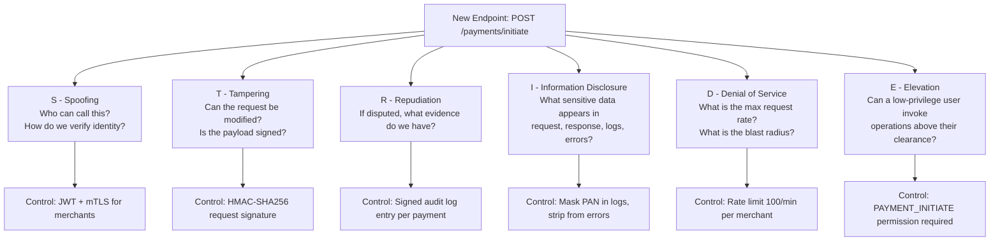
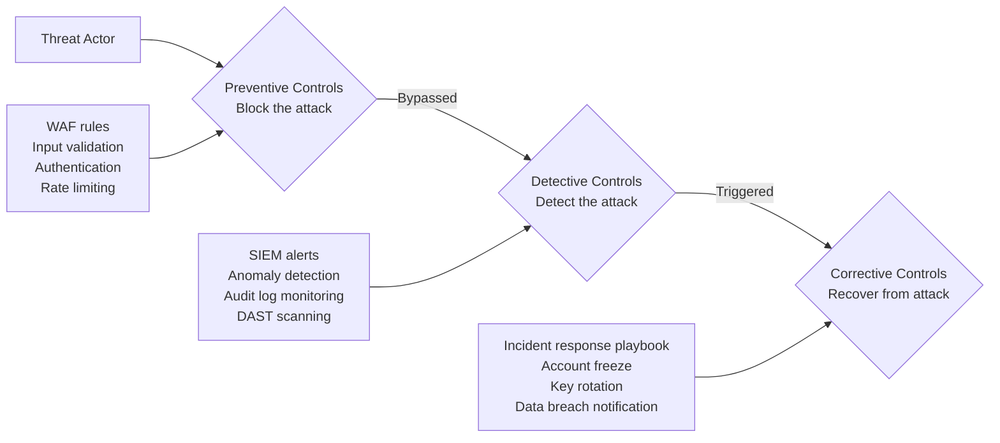
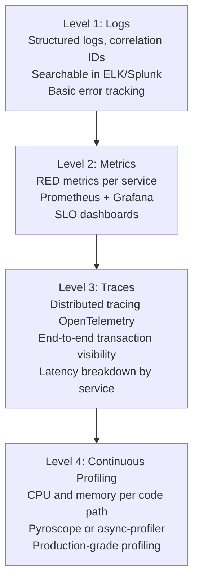

# Principal Engineer's Security & Observability Decision Framework

A principal engineer operating in financial services is not primarily an implementer of security controls — they are the architect of a risk management system. The decisions they make determine which threats the organisation can detect and respond to, which vulnerabilities are acceptable for now, and how resources are allocated across preventive, detective, and corrective measures.

This lesson provides frameworks for making those decisions consistently and defensibly: threat modelling with STRIDE, risk scoring, the security control selection framework, the observability maturity model, and how to navigate the inherent tension between security (don't log sensitive data) and observability (log enough to debug production incidents).

---

## Threat Modelling with STRIDE Applied to a Payment API

STRIDE is a threat categorisation model developed at Microsoft. Each letter represents a class of threats. For each threat class, there is a corresponding security property that controls mitigate it.

| STRIDE Category | Security Property | Payment API Example | Control |
|----------------|-------------------|---------------------|---------|
| **S**poofing | Authentication | Caller claims to be merchant A but is not | JWT with RS256, mTLS |
| **T**ampering | Integrity | Payment amount modified in transit or at rest | Request signing (HMAC), TLS, GCM encryption |
| **R**epudiation | Non-repudiation | Customer denies authorising payment | Immutable audit log, digital signature on transaction |
| **I**nformation Disclosure | Confidentiality | PAN exposed in log, response body, or error message | Field masking, field-level encryption, response filtering |
| **D**enial of Service | Availability | 10,000 req/s flood collapses payment processing | Rate limiting, circuit breakers, autoscaling |
| **E**levation of Privilege | Authorisation | Regular user accesses admin payment controls | RBAC, ABAC, least privilege, function-level auth |

### Applying STRIDE to a New Payment Endpoint

When a new endpoint is proposed, walk through STRIDE systematically before writing code:



The output of threat modelling is not a document — it is a set of concrete controls to implement, plus a risk register entry for any threats that are accepted without full mitigation.

---

## Risk Scoring Matrix

Risks are scored on a 5×5 matrix of likelihood (1=rare, 5=almost certain) × impact (1=negligible, 5=catastrophic). The product is the risk score.

| Likelihood \ Impact | 1 Negligible | 2 Minor | 3 Moderate | 4 Major | 5 Catastrophic |
|--------------------|-------------|---------|-----------|---------|---------------|
| 5 Almost Certain | 5 | 10 | 15 | 20 | **25** |
| 4 Likely | 4 | 8 | 12 | **16** | **20** |
| 3 Possible | 3 | 6 | 9 | 12 | 15 |
| 2 Unlikely | 2 | 4 | 6 | 8 | 10 |
| 1 Rare | 1 | 2 | 3 | 4 | 5 |

**Risk bands:**
- 15–25: Critical — immediate mitigation required, escalate to CTO/CISO
- 8–14: High — mitigate within 30 days, included in next sprint
- 4–7: Medium — mitigate within 90 days, risk accepted with documented justification
- 1–3: Low — accept or mitigate at next convenient opportunity

**Risk register entry format:**

```yaml
risk_id: RISK-2024-047
title: "BOLA vulnerability in account retrieval endpoint"
threat_category: Information Disclosure
asset: Customer account balance and transaction history
threat_scenario: >
  Authenticated attacker iterates account IDs and retrieves financial
  data for accounts they do not own.
likelihood: 4   # API is external-facing, BOLA is well-known attack
impact: 5       # Exposes PAN, balance, transaction history — regulatory breach
risk_score: 20  # Critical
current_controls:
  - JWT authentication (reduces unauthenticated access)
residual_risk_score: 20  # Authentication alone does not prevent BOLA
treatment: Mitigate
mitigation: Add ownership check to account repository query
owner: payments-team
due_date: 2024-11-15
status: In Progress
```

---

## Security Control Selection Framework

Controls are classified by their function in the defence model:



**For each new feature, define at least one control per category:**

| Feature | Preventive | Detective | Corrective |
|---------|-----------|-----------|-----------|
| Payment initiation | JWT + HMAC signing + rate limit | Alert on payment velocity anomaly | Freeze account on fraud signal |
| PAN storage | AES-256-GCM field encryption | Alert on bulk decryption (>100 req/min) | Key rotation + notify card schemes |
| Admin API | mTLS + RBAC + IP allowlist | SIEM alert on admin action outside business hours | Revoke admin token, audit trail |
| Webhook delivery | URL validation + signature on payload | Alert on SSRF attempt patterns | Disable webhook + notify merchant |

---

## Observability Maturity Model

Observability is not binary. The maturity model defines progressive levels, each providing deeper insight into system behaviour.



**Level 1 — Logs:** Every service emits structured JSON logs with a correlation ID that links all log entries for a single request across services. Log ingestion into a centralised platform enables search and alerting.

**Level 2 — Metrics:** Each service exposes RED metrics (Rate, Errors, Duration) per endpoint. Dashboards show SLO status. Alerts trigger on error budget burn rate.

**Level 3 — Traces:** OpenTelemetry instruments every service. A single payment transaction produces a trace that shows every service call, database query, and external API call with precise timing. Sampling strategy: 100% for errors, 1% for successful transactions, 100% for transactions over 2 seconds.

**Level 4 — Continuous Profiling:** Profiling agents run in production and capture CPU flame graphs. When a latency regression is detected via metrics, the profiling data shows which code path caused it without requiring a reproduction.

**Most fintech firms operate at Level 2–3.** Level 4 is increasingly adopted for critical payment processing paths.

---

## SLO-Driven Alerting — Error Budget Burn Rate

Traditional alerts fire on absolute thresholds ("error rate > 5%"). SLO-driven alerting fires based on how fast the error budget is being consumed — allowing you to detect slow burns before they exhaust the budget.

**Error budget calculation:**

```
SLO target: 99.9% availability over 30 days
Allowed downtime: 30 days × (1 - 0.999) = 43.2 minutes
Error budget = 43.2 minutes of allowed failures
```

**Burn rate alerts:**

```yaml
# Prometheus alerting rules
groups:
  - name: payment-slo-alerts
    rules:
      # Page immediately: consuming error budget 14x faster than sustainable
      # Will exhaust 100% of monthly budget in ~2 hours
      - alert: PaymentApiErrorBudgetFastBurn
        expr: |
          (
            rate(http_requests_total{service="payment-api",status=~"5.."}[1h])
            /
            rate(http_requests_total{service="payment-api"}[1h])
          ) > (1 - 0.999) * 14
        for: 5m
        labels:
          severity: page
          slo: payment-api-availability
        annotations:
          summary: "Payment API error budget burning 14x — page immediately"
          runbook: "https://wiki.internal/runbooks/payment-api-fast-burn"

      # Ticket: consuming error budget 2x faster than sustainable
      # Will exhaust 100% of monthly budget in ~15 days
      - alert: PaymentApiErrorBudgetSlowBurn
        expr: |
          (
            rate(http_requests_total{service="payment-api",status=~"5.."}[6h])
            /
            rate(http_requests_total{service="payment-api"}[6h])
          ) > (1 - 0.999) * 2
        for: 60m
        labels:
          severity: ticket
          slo: payment-api-availability
        annotations:
          summary: "Payment API error budget burning 2x — investigate this week"
```

The 14x burn rate alert uses a 1-hour window (fast burn). The 2x burn rate alert uses a 6-hour window (slow burn). Together they catch both sudden outages and gradual degradation.

---

## Security vs Observability Tension

The core tension: security requires not logging sensitive data (PAN, authentication tokens, full account numbers). Observability requires enough context to diagnose production incidents. These pull in opposite directions.

**The resolution is structured logging with field masking — not less logging.**

```java
@Component
public class PaymentAuditLogger {

    private static final Logger log = LoggerFactory.getLogger(PaymentAuditLogger.class);

    public void logPaymentInitiated(Payment payment, String merchantId) {
        log.info("Payment initiated",
            StructuredArguments.keyValue("event", "PAYMENT_INITIATED"),
            StructuredArguments.keyValue("paymentId", payment.getId()),
            StructuredArguments.keyValue("merchantId", merchantId),
            StructuredArguments.keyValue("amount", payment.getAmount()),
            StructuredArguments.keyValue("currency", payment.getCurrency()),
            // Masked: last 4 digits only — enough for debugging, not enough to be useful to attacker
            StructuredArguments.keyValue("panLastFour", payment.getPanLastFour()),
            // Never log: full PAN, CVV, authentication token, raw account number
            StructuredArguments.keyValue("accountIdHash",
                hashAccountId(payment.getAccountId()))  // hash for correlation without exposure
        );
    }
}
```

**What to log vs what to never log:**

| Always Log | Log with Masking | Never Log |
|-----------|------------------|-----------|
| Payment ID, correlation ID | PAN last 4 digits | Full PAN |
| Merchant ID, amount, currency | Account number (hash only) | CVV/CVC |
| Event type, timestamp | Customer name (initials) | Authentication tokens |
| HTTP status code | IP address (truncated) | Passwords |
| Latency, service name | Email (domain only) | Private keys |

**Practical rule for principal engineers:** define a `SensitiveField` annotation and build a Jackson serialiser that automatically masks annotated fields before they reach the log framework.

```java
@Retention(RetentionPolicy.RUNTIME)
@Target(ElementType.FIELD)
public @interface SensitiveField {
    MaskingStrategy strategy() default MaskingStrategy.FULL_MASK;
}

public class Payment {
    private String id;
    @SensitiveField(strategy = MaskingStrategy.LAST_FOUR)
    private String pan;
    @SensitiveField(strategy = MaskingStrategy.HASH)
    private String accountId;
}
```

---

## Compliance-Driven Decisions

Three regulatory frameworks intersect in UK/EU fintech. Each mandates specific controls:

| Requirement | PCI-DSS | GDPR | FCA (PS21/3) |
|-------------|---------|------|-------------|
| Data protection | Render PAN unreadable (Req 3) | Appropriate technical measures | Adequate cyber resilience |
| Transmission security | TLS everywhere (Req 4) | Encryption in transit | Encrypted communications |
| Access control | Least privilege (Req 7) | Need-to-know basis | Access controls |
| Audit logging | Log all cardholder data access (Req 10) | Log processing activities | Audit trail for regulatory review |
| Incident response | Incident response plan (Req 12) | 72-hour breach notification | Operational incident reporting |
| Testing | Annual pentest + quarterly scans (Req 11) | Security testing | Scenario-based testing (CBEST) |

When a control addresses multiple frameworks simultaneously, document it as such in the risk register. This demonstrates to auditors that the security programme is coherent rather than ad hoc.

---

## Build vs Buy for Security Controls

| Control | Build Consideration | Buy Consideration | Recommendation |
|---------|--------------------|--------------------|----------------|
| WAF | Deep customisation, proprietary business logic rules | 90% of rules are generic, vendor updates threat intelligence | Buy (AWS WAF / Cloudflare) |
| SIEM | Custom correlation rules for your domain | Infrastructure management overhead high | Buy SaaS (Splunk Cloud, Datadog) |
| DLP (Data Loss Prevention) | Your data model is unique | Classification engines are generic | Buy + configure custom policies |
| Field Encryption | Algorithm selection, key management design | Library wrapping is standard | Build thin wrapper on Vault transit (buy the primitive) |
| Rate Limiting | Custom business logic (merchant-specific limits) | Standard algorithms available | Build on library (Bucket4j, Resilience4j) |
| IAM / SSO | Never build your own auth | Standard protocols (OIDC, SAML) are well-solved | Buy (Okta, Auth0, AWS IAM) |

**Principal engineer decision principle:** buy the commodity control, build the domain-specific logic on top. Never build authentication from scratch. Always build the ownership check logic yourself because it encodes your data model.

---

## Decision Scenario: New Payment Endpoint

A team proposes a new endpoint: `POST /payments/initiate` for a merchant-facing API. Walk through the full framework:

**Step 1: STRIDE threat model (5 minutes)**

| Threat | Likelihood | Impact | Control |
|--------|-----------|--------|---------|
| Spoofing — fake merchant calls endpoint | 3 | 5 | mTLS client certificate + API key |
| Tampering — amount modified in transit | 2 | 5 | HMAC-SHA256 request signature |
| Repudiation — merchant denies initiating payment | 2 | 4 | Signed audit log with merchant cert |
| Info Disclosure — PAN in logs or error | 3 | 5 | Structured logging with masking |
| DoS — merchant floods endpoint | 3 | 4 | Rate limit: 100/min per merchant |
| Elevation — merchant accesses other merchant's payments | 2 | 5 | Merchant scoping on all queries |

**Step 2: Risk register — residual risks after controls**

After controls, all risks reduce to score ≤ 8 (medium or below). One residual risk remains:

```yaml
risk_id: RISK-2024-048
title: "HMAC replay attack on payment initiation"
residual_risk_score: 6
treatment: Accept
justification: >
  Idempotency key (UUID, 10-minute TTL) prevents replay within the attack
  window. Full replay prevention would require per-request nonce storage
  with significant complexity. Risk accepted by CISO.
```

**Step 3: Observability requirements**

For this endpoint at Level 3 maturity:
- Logs: payment ID, merchant ID, amount, currency, PAN last four, event type
- Metrics: request rate, error rate, latency p50/p95/p99 — SLO: 99.95% success, p95 < 500ms
- Traces: full distributed trace including DB write and downstream notification service
- Alerts: 14x burn rate → page, 2x burn rate → ticket, latency p95 > 1s → ticket

---

## Production Pitfalls

### Pitfall 1: Threat Modelling Once and Never Revisiting

**Problem:** A thorough STRIDE threat model is conducted at the start of a project. Over 18 months, the architecture changes substantially: a new external partner integration is added, a data store is migrated from PostgreSQL to MongoDB, and a new admin API is introduced. The original threat model is never updated.

```
Original threat model: payment-service calls internal ledger-service
New reality: payment-service calls external partner API (not in original model)
            → new SSRF threat never identified
            → new information disclosure path to partner not modelled
```

**Prevention:** Treat threat models as living documents. Update them as part of Architecture Decision Records (ADRs) whenever a significant architectural change is made. Add a checklist item to the RFC template: "Does this change require an update to the threat model?". Review the threat model quarterly as part of the security programme.

---

### Pitfall 2: Over-Logging for Observability and Creating a Security Incident

**Problem:** A team implements detailed request/response logging to aid debugging. A log aggregation pipeline misconfiguration exposes logs to a broader audience than intended. The logs contain full PANs that were logged "temporarily" during a debugging session and never removed.

```java
// Developer adds this for debugging a production issue:
log.debug("Payment request: {}", objectMapper.writeValueAsString(paymentRequest));
// paymentRequest contains a full PAN — now in every log platform that receives DEBUG level
```

PAN in logs is an automatic PCI-DSS scope violation. The card schemes require notification. The fine can be £5,000–£100,000 per month until remediation.

**Prevention:** Establish a "no PAN in logs" policy enforced at three levels:

1. Code review checklist: reviewer must verify no PAN logging
2. Static analysis: Semgrep rule that flags logging of fields annotated with `@SensitiveField`
3. Runtime detection: log anomaly detection that alerts on patterns matching PAN format (`\d{13,19}`) in log payloads

```yaml
# Semgrep rule: detect logging of sensitive fields
rules:
  - id: sensitive-field-in-log
    pattern-either:
      - pattern: log.$METHOD(..., $X.getPan(), ...)
      - pattern: log.$METHOD(..., $X.getCardNumber(), ...)
      - pattern: log.$METHOD(..., $X.getCvv(), ...)
    message: "Potential PAN or sensitive card data in log statement"
    severity: ERROR
    languages: [java]
```

---

### Pitfall 3: Choosing Security Controls Without Considering Operational Cost

**Problem:** A principal engineer mandates mutual TLS (mTLS) for all internal service-to-service communication. This is an excellent security control. However, the certificate rotation process is manual, the service mesh was not configured to handle it automatically, and 18 months later certificate expiry incidents are a monthly occurrence — causing more availability incidents than the security benefit justifies.

```
mTLS certificate expiry at 03:00 UTC
  → payment-service cannot authenticate to ledger-service
  → all payment processing stops
  → P1 incident, 23 minutes to resolution
  → 3rd consecutive monthly expiry incident
```

**Prevention:** When selecting a security control, evaluate the operational cost alongside the security benefit:

```
Control selection criteria:
1. Security benefit: what threat does this mitigate? (quantified)
2. Implementation cost: one-time engineering effort
3. Operational cost: certificate rotation, key management, monitoring overhead
4. Failure mode: what breaks when this control fails? (critical path vs non-critical)
5. Recovery time: how long to recover if the control fails?
```

For mTLS, the operational cost is manageable only with a service mesh (Istio, Linkerd) that handles certificate rotation automatically. Without the mesh, consider API key authentication with automated rotation instead — lower operational cost, still achieves authentication.

---

## Lesson Checklist

- [ ] You can apply STRIDE to any new API endpoint and produce a control for each threat category
- [ ] You can score risks on a 5x5 likelihood × impact matrix and assign them to risk bands with appropriate SLAs
- [ ] You can categorise security controls as preventive, detective, or corrective and select at least one per category for any new feature
- [ ] You can describe all four levels of the observability maturity model and assess where a given system sits
- [ ] You can write Prometheus alerting rules for 14x and 2x error budget burn rates
- [ ] You can resolve the security/observability tension using structured logging with field masking
- [ ] You can apply the build vs buy framework to common security controls and justify the recommendation
- [ ] You can walk through all three decision scenarios (threat model, risk scoring, observability requirements) for a new payment endpoint in under 15 minutes

---

<!-- KNOWLEDGE-CHECK
{"questions":[{"text":"You are threat modelling a new payment webhook endpoint that calls a merchant-supplied URL. Which STRIDE category most directly applies to the risk that an attacker registers http://169.254.169.254/ as their webhook URL?","options":["Spoofing — the attacker is pretending to be a legitimate merchant","Tampering — the attacker modifies the webhook payload","Information Disclosure — the attacker can retrieve internal metadata via SSRF","Denial of Service — the attacker floods the webhook endpoint"],"correct":2,"explanation":"SSRF (Server-Side Request Forgery) allows the attacker to make the server issue requests to internal resources. By registering an internal metadata endpoint as the webhook URL, the attacker causes the server to retrieve and potentially return sensitive internal credentials. This maps to Information Disclosure in STRIDE — confidential data (IAM credentials, internal service responses) is disclosed to an unauthorised party."},{"text":"Your payment API has an SLO of 99.9% availability over 30 days. A 14x burn rate alert fires. Approximately how long until the entire monthly error budget is exhausted at the current burn rate?","options":["About 2 hours","About 15 days","About 1 week","About 6 hours"],"correct":0,"explanation":"The monthly error budget for 99.9% SLO over 30 days is 43.2 minutes. At 14x the sustainable burn rate, the budget is exhausted in 30 days / 14 = approximately 2.1 days worth of budget... but the 14x burn rate calculation uses the 1-hour window precisely because at 14x, the monthly budget exhausts in roughly 2 hours. This is why a 14x burn rate triggers an immediate page."},{"text":"A developer proposes logging the full payment request object (including PAN) at DEBUG level to help diagnose a production issue. What is the most appropriate response?","options":["Allow it temporarily in the staging environment only, never production","Allow it since DEBUG logs are not normally shipped to the SIEM","Reject it and implement structured logging with PAN masking to last four digits instead","Allow it since the logs are encrypted at rest in the log platform"],"correct":2,"explanation":"PAN must never appear in logs regardless of log level, environment, or encryption at rest status. PCI-DSS considers PAN in logs a scope violation. The correct approach is structured logging with masking — log enough context to debug the issue (PAN last four, payment ID, timestamp, error type) without logging sensitive data. Encryption at rest in the log platform does not prevent exposure to log platform users."}]}
-->

<!-- PRACTICAL-CHALLENGE
{"title":"Security and Observability Decision Framework Applied","difficulty":"principal","estimatedMinutes":90,"tasks":[{"id":"1","description":"Apply the full STRIDE framework to a new API endpoint: POST /transfers/international. For each of the 6 STRIDE categories, identify a specific threat scenario relevant to international payments, score it on the 5x5 risk matrix, propose a concrete technical control, and write a risk register entry in YAML format for the two highest-scoring residual risks."},{"id":"2","description":"Implement a structured logging framework in Spring Boot that: (1) uses a custom @SensitiveField annotation with FULL_MASK, LAST_FOUR, and HASH strategies, (2) implements a Jackson serialiser that applies masking before log output, (3) logs at least 8 fields per payment event (payment ID, amount, currency, masked PAN, hashed account ID, merchant ID, latency, event type), (4) includes a Semgrep rule that detects raw sensitive field logging."},{"id":"3","description":"Write Prometheus alerting rules for a payment API with SLO 99.95% over 30 days. Create: (1) a 14x burn rate page alert using a 1-hour window, (2) a 2x burn rate ticket alert using a 6-hour window, (3) a latency SLO alert for p95 latency exceeding 500ms, (4) a Grafana dashboard panel showing error budget remaining as a percentage. Document the error budget calculation."},{"id":"4","description":"Conduct a build vs buy analysis for three security controls: WAF, field-level encryption for PAN, and SSO/IAM. For each, document: the security benefit, one-time implementation cost (story points), ongoing operational cost, failure mode impact, and your recommendation with justification. Present findings as a decision record (ADR format) suitable for review by the CISO."}]}
-->
