## نظرة عامة

‏Spring Boot 4.0 ‏(صدر في نوفمبر 2025) أكبر إصدار رئيسي منذ القفزة من 2.x إلى 3.x. فهو يُبقي Java 17 حدًا أدنى (ويوصى بـ Java 21 أو LTS الحالي Java 25)، وينتقل إلى Spring Framework 7، ويعتمد Jakarta EE 11 ‏(Servlet 6.1، وJakarta Persistence 3.2، وBean Validation 3.1). ولفرق التقنية المالية التي تشغّل معالجات الدفع، أو خدمات دفاتر الأستاذ، أو محركات المخاطر على Spring Boot 3.x، تتطلب الترقية تخطيطًا متعمدًا: فمعظم التغييرات آلية، لكن الإعداد التلقائي المقسّم إلى وحدات، والانتقال إلى Jackson 3، وقيود AOT وGraalVM Native Image لها آثار معمارية.

الدافع ليس تراكم الميزات — بل إحالة التجريدات القديمة للتقاعد وتقسيم الإطار إلى قطع أصغر. فيُستبدل ملف `spring-boot-autoconfigure` الأحادي بوحدات خاصة بكل تقنية (`spring-boot-webmvc`، و`spring-boot-data-jpa`، و`spring-boot-flyway`، …) مع starters مقابلة، وانتقلت كثير من أصناف الإعداد التلقائي إلى حزم جديدة. ويصبح Jackson 3 (الحزمة `tools.jackson`) مكتبة JSON الافتراضية. وتجعل تعليقات JSpecify المنظومة كاملة آمنة من null. وأُزيلت واجهات مُهملة منذ زمن مثل `@MockBean`. وستجد فرق الخدمات المالية التي راكمت مكتبات منصة مشتركة، وstarters مخصصة، وامتدادات للإطار على مدى سنوات أن سطح الترقية أكبر مما يبدو من ملاحظات الإصدار وحدها.

يرسم هذا الدرس السطح الكامل للتغييرات الكاسرة، مع اهتمام خاص بالأنماط الشائعة في الخدمات المالية المنظمة: الإعداد التلقائي المخصص لمكتبات الامتثال، وتلميحات AOT للتسلسل كثيف الانعكاس (حمولات ISO-20022، وبروتوكول FIX)، وGraalVM Native Image لخدمات الدفع الحساسة لزمن الاستجابة حيث تهم كلفة إحماء JVM. ونغطي الخيوط الافتراضية على مستوى الإعداد فقط هنا — ويتعمق فيها الدرس 3.

## أهداف التعلم

- تحديد كل تغييرات خط الأساس في Java/Jakarta في Spring Boot 4 وأثرها على قواعد كود التقنية المالية القائمة
- شرح كيف يحل `AutoConfiguration.imports` محل `spring.factories` وكتابة starter مخصص متوافق مع SB4
- تسجيل `RuntimeHints` للانعكاس، والتسلسل، وJNI المطلوبة لمكتبات بروتوكولات الدفع
- تسجيل تلميحات الربط بـ `@RegisterReflectionForBinding` وضبط ملف Maven الشخصي للصورة الأصلية
- فهم ميزات SB3 التي أُزيلت، أو نُقلت، أو أُهملت في SB4
- ضبط مفتاح الخيوط الافتراضية وفهم سطح إعداده التلقائي
- تشخيص مشكلات المصدر المولّد بـ AOT التي تظهر أثناء الترجمة الأصلية لخدمة دفع

## تحولات خط الأساس في SB4: ‏Java 17+، وJakarta EE 11، وSpring Framework 7

يضع Spring Boot 4 ثلاثة حدود دنيا في آن واحد. وأي مكوّن في رسم تبعياتك لا يستوفيها سيكسر البناء أو بدء التشغيل.

**‏Java 17** يبقى الحد الأدنى، كما في Spring Boot 3 — لكن Java 21+ موصى به بشدة (الخيوط الافتراضية)، وJava 25، وهو LTS الحالي، مدعوم بالكامل. وتستغل معظم فرق التقنية المالية الترقية للانتقال إلى Java 21 أو 25 في الوقت نفسه.

**‏Jakarta EE 11** يعني أن خط أساس الـ servlet هو Servlet 6.1: ‏Tomcat 11 أو Jetty 12.1. **‏Undertow لم يعد مدعومًا** — فليس له إصدار يدعم Servlet 6.1 — لذا يجب على الخدمات التي تستخدم `spring-boot-starter-undertow` تبديل الحاوية. وقد حدث انتقال فضاء الأسماء من `javax.*` إلى `jakarta.*` بالفعل في SB3؛ وينتقل SB4 إلى إصدارات الواجهات الأحدث: ‏Jakarta Persistence 3.2 ‏(Hibernate ORM 7)، وJakarta Validation 3.1 ‏(Hibernate Validator 9)، وJakarta Servlet 6.1. والمكتبات التي تدعم واجهات Jakarta EE 10 الأقدم فقط تحتاج إلى ترقيات.

**‏Spring Framework 7** يجلب تغييرات يغطيها الدرس 2 بعمق: الأمان من null عبر JSpecify، وإصدارات الواجهات المدمجة، وتحسينات عملاء خدمات HTTP، وتعليقات المرونة في النواة (`@Retryable`، و`@ConcurrencyLimit`). وتذكير واحد: أسماء المعاملات لربط `@PathVariable` و`@RequestParam` و`@Param` في Spring Data تأتي من خيار المترجم `-parameters` (أُزيل البديل القائم على فحص bytecode منذ Framework 6.1) — ويضبط ملف POM الأب لـ Spring Boot هذا الخيار لك.

```java
// Spring Boot 2.x style — does not compile on Boot 3 or 4
import javax.persistence.Entity;
import javax.servlet.http.HttpServletRequest;

// Boot 3 and 4
import jakarta.persistence.Entity;
import jakarta.servlet.http.HttpServletRequest;

// New in Boot 4: Jackson 3 uses new packages (annotations stay in com.fasterxml)
import tools.jackson.databind.ObjectMapper;         // was com.fasterxml.jackson.databind
import com.fasterxml.jackson.annotation.JsonProperty; // unchanged
```

```xml
<!-- pom.xml — Java 17 is the minimum; 21 or 25 recommended -->
<properties>
    <java.version>21</java.version>
</properties>

<parent>
    <groupId>org.springframework.boot</groupId>
    <artifactId>spring-boot-starter-parent</artifactId>
    <version>4.0.0</version>
</parent>
```

## الإعداد التلقائي: من `spring.factories` إلى `AutoConfiguration.imports`

استخدم Spring Boot الملف `META-INF/spring.factories` لتسجيل الإعداد التلقائي منذ الإصدار 1.0. وقدّم Spring Boot 2.7 الملف `META-INF/spring/org.springframework.boot.autoconfigure.AutoConfiguration.imports` وأهمل طريق `spring.factories`؛ ثم **أزاله Spring Boot 3.0**. وما زال `SpringFactoriesLoader` موجودًا لنقاط امتداد أخرى، لكنه لم يعد يسجل مُدخلات `EnableAutoConfiguration`. فإن كانت مكتبة داخلية ما زالت تعتمد على `spring.factories` للإعداد التلقائي، فهي لم تُرحّل بشكل صحيح إلى Boot 3 قط — وترقية Boot 4 هي اللحظة لإصلاح ذلك.

الجديد في Boot 4 هو **التقسيم إلى وحدات**: انتقلت أصناف الإعداد التلقائي من ملف `spring-boot-autoconfigure` الواحد إلى وحدات خاصة بكل تقنية بأسماء حزم جديدة (مثل `org.springframework.boot.restclient.autoconfigure`). ويجب تحديث الـ starters الداخلية التي تشير إلى أصناف الإعداد التلقائي الخاصة بـ Boot — في `@AutoConfiguration(after = …)`، أو `@ImportAutoConfiguration`، أو الاستثناءات. (ويقدم Boot 4 أيضًا starters "كلاسيكية" تجلب كل شيء، لتسهيل الانتقال.)

لفرق منصات التقنية المالية، يؤثر هذا على كل مكتبة مشتركة داخلية توفر إعدادًا تلقائيًا: مسجلات تدقيق الامتثال، ومحددات المعدل، وعملاء بوابات الدفع، وتكاملات مفاتيح الميزات.

```
# OLD: META-INF/spring.factories (Spring Boot 2.x; ignored since 3.0)
org.springframework.boot.autoconfigure.EnableAutoConfiguration=\
  com.acme.payments.autoconfigure.PaymentGatewayAutoConfiguration,\
  com.acme.payments.autoconfigure.FraudEngineAutoConfiguration
```

```
# NEW: META-INF/spring/org.springframework.boot.autoconfigure.AutoConfiguration.imports (Boot 2.7+)
com.acme.payments.autoconfigure.PaymentGatewayAutoConfiguration
com.acme.payments.autoconfigure.FraudEngineAutoConfiguration
```

علّم الصنف بـ `@AutoConfiguration` ‏(متاح منذ 2.7) بدل `@Configuration` العادي: فهو يعلّم الصنف كإعداد تلقائي، ويعطّل الوكالة على دوال الـ bean، ويدعم سمات الترتيب `before` و`after` و`beforeName` و`afterName`. واستخدم صيغ `*Name` حين يقع الصنف المشار إليه في وحدة اختيارية — وافحص أسماء حزم Boot 4 الجديدة.

```java
package com.acme.payments.autoconfigure;

import org.springframework.boot.autoconfigure.AutoConfiguration;
import org.springframework.boot.autoconfigure.condition.ConditionalOnMissingBean;
import org.springframework.boot.autoconfigure.condition.ConditionalOnProperty;
import org.springframework.boot.context.properties.EnableConfigurationProperties;
import org.springframework.context.annotation.Bean;

// Boot 4 moved RestClientAutoConfiguration into the spring-boot-restclient module
@AutoConfiguration(afterName = "org.springframework.boot.restclient.autoconfigure.RestClientAutoConfiguration")
@ConditionalOnProperty(prefix = "acme.payment-gateway", name = "enabled", havingValue = "true", matchIfMissing = true)
@EnableConfigurationProperties(PaymentGatewayProperties.class)
public class PaymentGatewayAutoConfiguration {

    @Bean
    @ConditionalOnMissingBean
    public PaymentGatewayClient paymentGatewayClient(
            PaymentGatewayProperties properties,
            org.springframework.web.client.RestClient.Builder restClientBuilder) {

        var restClient = restClientBuilder
                .baseUrl(properties.baseUrl())
                .defaultHeader("X-Api-Key", properties.apiKey())
                .build();

        return new DefaultPaymentGatewayClient(restClient, properties);
    }

    @Bean
    @ConditionalOnMissingBean
    public PaymentGatewayHealthIndicator paymentGatewayHealthIndicator(PaymentGatewayClient client) {
        return new PaymentGatewayHealthIndicator(client);
    }
}
```

```java
package com.acme.payments.autoconfigure;

import org.springframework.boot.context.properties.ConfigurationProperties;

@ConfigurationProperties(prefix = "acme.payment-gateway")
public record PaymentGatewayProperties(
        String baseUrl,
        String apiKey,
        int connectTimeoutMs,
        int readTimeoutMs,
        int maxRetries
) {
    public PaymentGatewayProperties {
        if (baseUrl == null || baseUrl.isBlank()) {
            throw new IllegalArgumentException("acme.payment-gateway.base-url must be set");
        }
        if (connectTimeoutMs <= 0) connectTimeoutMs = 3000;
        if (readTimeoutMs <= 0) readTimeoutMs = 10000;
        if (maxRetries < 0) maxRetries = 3;
    }
}
```

## ترجمة AOT وRuntimeHints

تولّد ترجمة AOT ‏(المسبقة) في Spring Boot كود Java وقت البناء يحسب مسبقًا تعريفات الـ beans، وتقييمات الشروط، وإنشاء الوكلاء. ويوضع هذا المخرج تحت `target/spring-aot/main/sources/` ويُترجم في الأداة النهائية. وحين تبني GraalVM Native Image، يحل مخرج AOT محل تهيئة الحاوية القائمة على الانعكاس وقت التشغيل كليًا.

يولّد هدف `process-aot` في `spring-boot-maven-plugin` هذا الكود (ويرتبط بمرحلة `prepare-package`). ومع `spring-boot-starter-parent`، يضبطه ملف `native` الشخصي لك؛ ولـ AOT على JVM يمكنك إضافته صراحة:

```xml
<!-- pom.xml — explicit AOT processing (the native profile of the parent does this for you) -->
<plugin>
    <groupId>org.springframework.boot</groupId>
    <artifactId>spring-boot-maven-plugin</artifactId>
    <executions>
        <execution>
            <id>process-aot</id>
            <goals>
                <goal>process-aot</goal>
            </goals>
        </execution>
    </executions>
</plugin>
<!-- run the AOT-optimised app on the JVM with -Dspring.aot.enabled=true -->
```

يزيل الكود المولّد بـ AOT معظم الوصول الانعكاسي عند البدء. لكن أي كود يستخدم الانعكاس *وقت التشغيل* — بعد بدء التطبيق — يجب أن يسجل `RuntimeHints`. وكثيرًا ما تحتاج خدمات الدفع هذا لـ:

- أصناف رسائل ISO-20022 المحمّلة بالاسم من سجل
- ربط وسوم بروتوكول FIX بالحقول عبر `Class.forName()`
- توليد الوكلاء الديناميكيين لمعترضات تدقيق الامتثال
- (إلغاء) التسلسل في Jackson لأنواع يكتشفها وقت التشغيل (مثل تسلسلات الواجهات المختومة)

```java
package com.acme.payments.hints;

import com.acme.payments.model.PaymentInstruction;
import com.acme.payments.model.iso20022.CreditTransferMessage;
import com.acme.payments.model.iso20022.PaymentStatusReport;
import org.springframework.aot.hint.ExecutableMode;
import org.springframework.aot.hint.MemberCategory;
import org.springframework.aot.hint.RuntimeHints;
import org.springframework.aot.hint.RuntimeHintsRegistrar;
import org.springframework.aot.hint.TypeReference;

import java.util.List;

/**
 * Registers AOT runtime hints for ISO-20022 message types that are loaded
 * reflectively from a message type registry in the payment processing pipeline.
 *
 * Register via @ImportRuntimeHints on your @Configuration class, or via
 * META-INF/spring/aot.factories:
 *   org.springframework.aot.hint.RuntimeHintsRegistrar=\
 *   com.acme.payments.hints.PaymentRuntimeHints
 */
public class PaymentRuntimeHints implements RuntimeHintsRegistrar {

    // All ISO-20022 message classes that are loaded by name from the registry
    private static final List<Class<?>> ISO20022_TYPES = List.of(
            CreditTransferMessage.class,
            PaymentStatusReport.class,
            PaymentInstruction.class
    );

    @Override
    public void registerHints(RuntimeHints hints, ClassLoader classLoader) {
        // Reflection hints — allow instantiation + field access for Jackson deserialization
        ISO20022_TYPES.forEach(type ->
                hints.reflection().registerType(type,
                        MemberCategory.INVOKE_PUBLIC_CONSTRUCTORS,
                        MemberCategory.INVOKE_PUBLIC_METHODS,
                        MemberCategory.PUBLIC_FIELDS,
                        MemberCategory.DECLARED_FIELDS  // needed for Jackson private field access
                )
        );

        // Java serialization hints — ONLY needed if these types go through
        // java.io serialization (e.g. a Serializable cache entry). Jackson does
        // not use them; it needs the reflection hints above.
        hints.serialization().registerType(TypeReference.of(CreditTransferMessage.class));
        hints.serialization().registerType(TypeReference.of(PaymentStatusReport.class));

        // Resource hints — the ISO-20022 XSD schemas loaded from classpath
        hints.resources().registerPattern("iso20022/*.xsd");
        hints.resources().registerPattern("payments/message-registry.properties");

        // JNI hint for the native crypto library used in payment signing
        hints.jni().registerType(
                TypeReference.of("com.acme.payments.crypto.NativeHsmBridge"),
                MemberCategory.INVOKE_PUBLIC_METHODS
        );

        // Proxy hint — compliance audit uses a JDK dynamic proxy for the payment service
        hints.proxies().registerJdkProxy(
                TypeReference.of("com.acme.payments.service.PaymentService"),
                TypeReference.of("org.springframework.aop.SpringProxy"),
                TypeReference.of("org.springframework.aop.framework.Advised"),
                TypeReference.of("org.springframework.core.DecoratingProxy")
        );
    }
}
```

```java
// Attach the registrar to your configuration class
package com.acme.payments.config;

import com.acme.payments.hints.PaymentRuntimeHints;
import org.springframework.aot.hint.annotation.ImportRuntimeHints;
import org.springframework.context.annotation.Configuration;

@Configuration
@ImportRuntimeHints(PaymentRuntimeHints.class)
public class PaymentProcessingConfig {
    // ... bean definitions
}
```

## ‏GraalVM Native Image في SB4

يبني GraalVM Native Image ملفًا تنفيذيًا مستقلًا من التطبيق وكل تبعياته. ووقت البناء، يجري مترجم Native Image تحليل العالم المغلق: يتتبع كل الكود القابل للوصول من نقاط الدخول ويضمّن تلك الأصناف فقط. وأي مسار كود لا يُصل إليه إلا عبر الانعكاس، أو `Class.forName()`، أو توليد الوكلاء الديناميكيين يجب التصريح به مسبقًا عبر التلميحات أو ملفات إعداد JSON.

يوفر Spring Boot 4 ملف Maven شخصيًا باسم `native` يفعّل بناء GraalVM Native Image:

```xml
<!-- pom.xml — native profile -->
<profiles>
    <profile>
        <id>native</id>
        <build>
            <plugins>
                <plugin>
                    <groupId>org.graalvm.buildtools</groupId>
                    <artifactId>native-maven-plugin</artifactId>
                    <!-- version managed by spring-boot-starter-parent -->
                    <configuration>
                        <imageName>payment-service</imageName>
                        <buildArgs>
                            <!-- Never produce a JVM "fallback" image: fail the build instead -->
                            <buildArg>--no-fallback</buildArg>
                            <!-- G1 in native images requires Oracle GraalVM
                                 (GraalVM Community offers Serial GC only) -->
                            <buildArg>--gc=G1</buildArg>
                            <!-- Initialize Bouncy Castle crypto library at build time -->
                            <buildArg>--initialize-at-build-time=org.bouncycastle</buildArg>
                        </buildArgs>
                        <metadataRepository>
                            <!-- Pull GraalVM reachability metadata for common libraries -->
                            <enabled>true</enabled>
                        </metadataRepository>
                    </configuration>
                    <executions>
                        <execution>
                            <goals>
                                <goal>compile-no-fork</goal>
                            </goals>
                        </execution>
                    </executions>
                </plugin>
            </plugins>
        </build>
    </profile>
</profiles>
```

لحالات ربط البيانات البسيطة، يُعد `@RegisterReflectionForBinding` بديلًا تصريحيًا لـ `RuntimeHintsRegistrar`. ‏(كان التعليق الأقدم `@NativeHint` جزءًا من مشروع Spring Native التجريبي ولا يوجد في Spring Boot 3 أو 4.)

```java
package com.acme.payments;

import com.acme.payments.model.PaymentInstruction;
import com.acme.payments.model.iso20022.CreditTransferMessage;
import org.springframework.aot.hint.annotation.RegisterReflectionForBinding;
import org.springframework.boot.SpringApplication;
import org.springframework.boot.autoconfigure.SpringBootApplication;

@SpringBootApplication
// Shorthand: registers full reflection + serialization hints for Jackson binding
@RegisterReflectionForBinding({
        CreditTransferMessage.class,
        PaymentInstruction.class
})
public class PaymentServiceApplication {

    public static void main(String[] args) {
        SpringApplication.run(PaymentServiceApplication.class, args);
    }
}
```

**قيود Native Image التي يجب التخطيط لها في التقنية المالية:**

1. **لا فحص لمسار الأصناف وقت التشغيل**: يعمل `@ComponentScan` لأنه يُعالج وقت AOT. أما `Class.forName()` بنص محسوب وقت التشغيل (مثلًا من قاعدة بيانات أو ملف إعداد) فسيفشل إلا إن كان الهدف في تلميح انعكاس.
2. **لا وكيل ديناميكي دون تلميحات**: يتعامل معالج AOT تلقائيًا مع `@Transactional` و`@Cacheable` ووكلاء Spring المشابهة. والمكتبات الخارجية التي تولّد وكلاء JDK وقت التشغيل (بعض حزم تطوير الامتثال القديمة) تحتاج تلميحات وكلاء؛ أما المكتبات التي تولّد *bytecode* وقت التشغيل (الاستخدام الكلاسيكي لـ CGLIB/ByteBuddy) فلا تعمل في صورة أصلية إطلاقًا.
3. **ترتيب التهيئة الساكنة**: ينقل `--initialize-at-build-time` تهيئة الأصناف إلى وقت البناء. وأي صنف يقرأ خاصية نظام أو يفتح مقبسًا أثناء التهيئة الساكنة يجب نقله إلى `--initialize-at-run-time`.

## تحميل الإعداد التلقائي: الماضي والحاضر

يقارن المخطط أدناه إصدار Spring Boot 2.7 الانتقالي (يسارًا) مع Spring Boot 3.x/4.x ‏(يمينًا). فمنذ 3.0، يكون `AutoConfiguration.imports` ‏(المقروء عبر `ImportCandidates`) المصدر الوحيد للإعدادات التلقائية، وحين يكون AOT فعالًا تحل تعريفات الـ beans المحسوبة مسبقًا محل تقييم الشروط عند البدء.

```mermaid
flowchart TD
    subgraph SB3["Spring Boot 2.7 (transition release)"]
        A3[SpringApplication.run] --> B3[SpringFactoriesLoader]
        B3 --> C3{Source?}
        C3 -->|spring.factories| D3[EnableAutoConfiguration entries]
        C3 -->|AutoConfiguration.imports| E3[AutoConfiguration entries]
        D3 --> F3[Filter: @Conditional evaluation]
        E3 --> F3
        F3 --> G3[Register BeanDefinitions at runtime]
        G3 --> H3[Instantiate Beans]
    end

    subgraph SB4["Spring Boot 3.x / 4.x"]
        A4[SpringApplication.run] --> B4{AOT active?}
        B4 -->|Yes - Native or AOT JVM| C4[Load AOT-generated ApplicationContextInitializer]
        B4 -->|No - standard JVM| D4[ImportCandidates]
        C4 --> E4[Pre-computed BeanDefinitions — no reflection]
        D4 -->|AutoConfiguration.imports ONLY| F4[Filter: @Conditional evaluation]
        F4 --> G4[Register BeanDefinitions at runtime]
        G4 --> H4[Instantiate Beans]
        E4 --> H4
    end

    style SB3 fill:#f3f4f6,stroke:#d1d5db
    style SB4 fill:#fff7ed,stroke:#f97316
```



## الميزات المُزالة والمُهملة في SB4

**مُزال أو متغير (سيفشل البناء أو بدء التشغيل):**

| الميزة | الحالة في SB3 | الحالة في SB4 | البديل |
|---|---|---|---|
| خادم Undertow المدمج | مدعوم | أُزيل (لا إصدار يدعم Servlet 6.1) | ‏Tomcat 11 أو Jetty 12.1 |
| ‏`@MockBean` / `@SpyBean` | مُهمل (3.4) | أُزيل | ‏`@MockitoBean` / `@MockitoSpyBean` |
| ‏Jackson 2 كمكتبة JSON افتراضية | افتراضي | دعم مُهمل | ‏Jackson 3 (حزم `tools.jackson`) |
| ‏`spring-boot-autoconfigure` الأحادي | ملف واحد | قُسّم إلى وحدات | starters التقنيات (أو الـ starters "الكلاسيكية" أثناء الترحيل) |
| الإعداد التلقائي لـ Flyway / Liquibase عبر الـ starter الأساسي | تلقائي | يحتاج starter خاصًا به | ‏`spring-boot-starter-flyway`، و`spring-boot-starter-liquibase` |
| تكامل اختبارات Spock | مدعوم | أُزيل | ‏JUnit Jupiter |
| ملفات jar التنفيذية بالكامل ذات "سكربت الإطلاق" | مدعومة | أُزيلت | ‏`java -jar`، أو الحاويات، أو ملفات وحدات systemd |
| ‏`spring.factories` لـ `EnableAutoConfiguration` | أُزيل بالفعل في 3.0 | أُزيل | ‏`AutoConfiguration.imports` |

**ما زال متاحًا لكنه في طريقه للخروج:** ما زال `RestTemplate` و`RestTemplateBuilder` المضبوط تلقائيًا (الآن في وحدة `spring-boot-restclient`) يعملان في Boot 4، لكن فريق Spring يخطط لإهمال `RestTemplate` في إصدار 7.x — فاكتب الكود الجديد مقابل `RestClient` أو واجهات خدمات HTTP. وما زال النشر بصيغة WAR مع `SpringBootServletInitializer` مدعومًا.

**مفتاح الإعداد التلقائي للخيوط الافتراضية** (يغطيه الدرس 3 بعمق):

```yaml
# application.yml — SB4 virtual thread configuration
spring:
  threads:
    virtual:
      enabled: true   # Tomcat/Jetty, the @Async executor, @Scheduled, Kafka/RabbitMQ listeners

server:
  tomcat:
    # With virtual threads enabled, this is ignored — the executor
    # switches to VirtualThreadTaskExecutor automatically
    threads:
      max: 200
```

```java
// What SB4 auto-configuration does internally when virtual threads are enabled
// (simplified from TomcatVirtualThreadsWebServerFactoryCustomizer)
@Bean
@ConditionalOnProperty("spring.threads.virtual.enabled")
public TomcatProtocolHandlerCustomizer<?> virtualThreadTomcatProtocolHandlerCustomizer() {
    return protocolHandler -> protocolHandler.setExecutor(
            Executors.newVirtualThreadPerTaskExecutor()
    );
}
```

## الخلاصة

- يضع Spring Boot 4 الحدود الدنيا: ‏Java 17+ ‏(يوصى بـ 21 أو 25)، وJakarta EE 11 ‏(Servlet 6.1 — اختفى Undertow)، وSpring Framework 7. والتبعيات التي تدعم واجهات Jakarta EE الأقدم فقط تكسر البناء أو بدء التشغيل.
- الإعداد التلقائي مقسّم إلى وحدات: انتقلت أصناف الإعداد التلقائي الخاصة بـ Boot إلى وحدات وحزم جديدة، لذا يجب أن تحدّث الـ starters المخصصة مراجع الترتيب. والتسجيل عبر `META-INF/spring/org.springframework.boot.autoconfigure.AutoConfiguration.imports` ‏(أُزيل طريق `spring.factories` بالفعل في 3.0)، مع `@AutoConfiguration` على الصنف.
- ‏Jackson 3 هو الافتراضي الجديد (حزم `tools.jackson`)، وأُزيلت واجهات مُهملة منذ زمن مثل `@MockBean`.
- تولّد معالجة AOT تعريفات beans محسوبة مسبقًا وقت البناء. ويتطلب كود بروتوكولات الدفع كثيف الانعكاس (ISO-20022، وFIX) تسجيل `RuntimeHints` صراحة عبر `RuntimeHintsRegistrar` أو `@RegisterReflectionForBinding`.
- يجب أن تستخدم بناءات GraalVM Native Image الخيار `--no-fallback` ‏(ومستودع بيانات الوصول الوصفية لـ GraalVM) لتُفشل مشكلات البناء البناءَ — لكن تلميحات الانعكاس المفقودة لا تظهر إلا *وقت التشغيل*، لذا تحتاج الصور الأصلية تشغيل اختبارات تكامل خاصًا بها قبل الإنتاج.
- تُفعّل الخيوط الافتراضية بخاصية واحدة (`spring.threads.virtual.enabled=true`) لكنها تتطلب تدقيقًا لتثبيت الخيوط الحاملة (pinning) قبل تفعيلها في الخدمات التي تستدعي مكتبات قديمة تستخدم `synchronized`؛ ويغطي الدرس 3 هذا بالكامل.

<!-- KNOWLEDGE-CHECK [
  {
    "id": "kc-sb401-01",
    "question": "فريق تقنية مالية يرقّي مباشرة من Spring Boot 2.7 إلى 4.0 لديه مكتبة امتثال مشتركة تسجّل إعدادها التلقائي عبر META-INF/spring.factories. وبعد الترقية، لم يعد الإعداد التلقائي للمكتبة يتفعّل. ما السبب الجذري؟",
    "options": [
      "تعليق @AutoConfiguration مفقود من صنف الإعداد",
      "منذ Spring Boot 3.0، لم يعد spring.factories مصدرًا لمُدخلات EnableAutoConfiguration",
      "يجب إعادة بناء المكتبة بـ Java 25 قبل أن يُحمّل إعدادها التلقائي",
      "ما زال spring.factories مدعومًا لكنه يتطلب علم توافق في application.properties"
    ],
    "correct": 1,
    "explanation": "أهمل Spring Boot 2.7 طريق spring.factories لمُدخلات EnableAutoConfiguration وأزاله Spring Boot 3.0؛ ويستمر Boot 4 دونه. ويجب أن تسرد المكتبة أصنافها في META-INF/spring/org.springframework.boot.autoconfigure.AutoConfiguration.imports ‏(وينبغي أن تستخدم @AutoConfiguration). وإصدار Java ليس السبب — فـ Boot 4 يعمل على Java 17+."
  },
  {
    "id": "kc-sb401-02",
    "question": "تستخدم خدمة دفع Class.forName() لتحميل أصناف رسائل ISO-20022 بالاسم من خريطة إعداد وقت التشغيل. وبعد بناء GraalVM Native Image بـ --no-fallback، تفشل الخدمة وقت التشغيل بـ ClassNotFoundException. ما الإصلاح الصحيح؟",
    "options": [
      "أزل --no-fallback للسماح لمترجم JIT بالتعامل مع التحميل الديناميكي",
      "سجّل أصناف ISO-20022 في RuntimeHintsRegistrar مع MemberCategory.INVOKE_PUBLIC_CONSTRUCTORS",
      "علّم أصناف ISO-20022 بـ @Component ليضمّنها معالج AOT",
      "استبدل Class.forName() بـ ApplicationContext.getBean() لتجنب الانعكاس"
    ],
    "correct": 1,
    "explanation": "يجري GraalVM Native Image تحليل العالم المغلق وقت البناء. ويجب التصريح بالأصناف المحمّلة عبر Class.forName() وقت التشغيل في تلميحات الانعكاس. ويخبر RuntimeHintsRegistrar بقيم MemberCategory المناسبة المترجم الأصلي بتضمين تلك الأصناف وبياناتها الوصفية. ولا يمكن إزالة --no-fallback في صورة أصلية للإنتاج؛ و@Component لا يساعد في الإنشاء الانعكاسي؛ وApplicationContext.getBean() يستخدم الانعكاس داخليًا أيضًا."
  },
  {
    "id": "kc-sb401-03",
    "question": "أي خاصية في Spring Boot تحوّل معالجة طلبات Tomcat، ومنفذ @Async، ومهام @Scheduled إلى الخيوط الافتراضية دفعة واحدة؟",
    "options": [
      "server.tomcat.threads.virtual=true",
      "spring.mvc.async.virtual-threads=true",
      "spring.threads.virtual.enabled=true",
      "spring.task.execution.pool.virtual=true"
    ],
    "correct": 2,
    "explanation": "تجعل spring.threads.virtual.enabled=true ‏(التي قُدمت في Spring Boot 3.2 وما زالت المفتاح في Boot 4) خادم الويب المدمج، وapplicationTaskExecutor المضبوط تلقائيًا (@Async، والمعالجة غير المتزامنة في MVC)، ومجدول المهام (@Scheduled)، وحاويات مستمعي الرسائل المدعومة تستخدم الخيوط الافتراضية. وتتطلب Java 21+."
  },
  {
    "id": "kc-sb401-04",
    "question": "بعد الترقية إلى Spring Boot 4، لم تعد اختبارات التكامل لدى فريق تُترجم: لا يجد المترجم @MockBean. ما السبب والإصلاح؟",
    "options": [
      "انتقل @MockBean إلى حزمة جديدة في Spring Boot 4؛ ويجب تغيير الاستيراد فقط",
      "أُزيل @MockBean و@SpyBean ‏(المُهملان منذ 3.4) في Spring Boot 4؛ استخدم @MockitoBean و@MockitoSpyBean من دعم الاختبار في Spring Framework",
      "لم يعد Mockito مدعومًا في اختبارات Spring Boot 4",
      "يجب ترحيل الاختبارات من JUnit 5 إلى Spock"
    ],
    "correct": 1,
    "explanation": "أهمل Spring Boot 3.4 كلًا من @MockBean و@SpyBean لصالح @MockitoBean و@MockitoSpyBean في Spring Framework ‏(org.springframework.test.context.bean.override.mockito)، وأزال Spring Boot 4 التعليقات القديمة. ويبقى Mockito مدعومًا بالكامل؛ بل إن تكامل Spock هو الذي أُزيل في Boot 4."
  }
] -->

<!-- PRACTICAL-CHALLENGE {
  "id": "pc-sb4-01",
  "title": "ترحيل starter لمنصة تقنية مالية إلى Spring Boot 4",
  "description": "رحّل starter منصة مشتركًا قائمًا على Spring Boot 3.x ‏(يوفر الإعداد التلقائي لتسجيل التدقيق وعميل بوابة الدفع) إلى توافق كامل مع Spring Boot 4.",
  "tasks": [
    {
      "id": "pc-sb401-01",
      "description": "أنشئ وحدة Maven جديدة باسم acme-payments-spring-boot-starter بخط أساس Java 21 والأب Spring Boot 4. وتأكد من تسجيل الإعداد التلقائي في META-INF/spring/org.springframework.boot.autoconfigure.AutoConfiguration.imports ‏(أزل أي مُدخل spring.factories متبقٍ)، وعلّم الصنف بـ @AutoConfiguration، ورتّبه بعد RestClientAutoConfiguration المنقول في Boot 4 باستخدام afterName."
    },
    {
      "id": "pc-sb401-02",
      "description": "اكتب RuntimeHintsRegistrar للـ starter يسجّل تلميحات انعكاس لكل أنواع سجلات رسائل ISO-20022 ‏(3 أنواع على الأقل)، وتلميحات ربط (مثلًا عبر @RegisterReflectionForBinding) لسجل حدث الدفع المستخدم مع Jackson، وتلميح موارد لملف payments/message-registry.properties على مسار الأصناف."
    },
    {
      "id": "pc-sb401-03",
      "description": "أضف ملف Maven شخصيًا native إلى تطبيق payment-service نموذجي يستخدم الـ starter. واضبط native-maven-plugin لـ GraalVM ‏(الإصدار يديره أب Spring Boot) بـ --no-fallback وابنِ الصورة الأصلية. وشغّل اختبارات التكامل مقابل الملف التنفيذي الأصلي، ووثّق أي تلميحات مفقودة تظهر وقت التشغيل، وأضفها إلى RuntimeHintsRegistrar."
    }
  ]
} -->
