## Overview

Spring Boot 4.0 is the most disruptive major release since the 2.x-to-3.x jump. It raises the Java baseline from 17 to 21, moves entirely onto Spring Framework 7, and adopts Jakarta EE 11 as its servlet and persistence baseline. For fintech engineering teams running payment processors, ledger services, or risk engines on Spring Boot 3.x, the upgrade path requires deliberate planning: the namespace changes are mechanical, but the shifts in auto-configuration loading, AOT compilation requirements, and GraalVM Native Image constraints have architectural implications.

The driving motivation behind the version bump is not feature accumulation — it is permanent retirement of legacy abstractions. `spring.factories`-based auto-configuration loading is gone, replaced exclusively by the `AutoConfiguration.imports` file introduced as an opt-in migration in SB3. Dynamic proxies without explicit runtime hints will silently fail in native images. `RestTemplate` reaches end-of-life status in the Spring Framework 7 BOM. Financial services teams that have accumulated shared platform libraries, custom starters, and framework extensions over several years will find the upgrade surface larger than it appears from the release notes alone.

This lesson maps the full surface area of breaking changes, with particular attention to patterns common in regulated financial services: custom auto-configuration for compliance libraries, AOT hints for reflection-heavy serialization (ISO-20022, FIX protocol payloads), and GraalVM Native Image for latency-sensitive payment services where JVM warm-up cost matters. We cover virtual threads only at the configuration layer here — Lesson 3 goes deep on that topic.

## Learning Objectives

- Identify every Java/Jakarta baseline change in Spring Boot 4 and their effect on existing fintech codebases
- Explain how `AutoConfiguration.imports` replaces `spring.factories` and write a custom SB4-compatible starter
- Register `RuntimeHints` for reflection, serialization, and JNI required by payment protocol libraries
- Annotate a GraalVM Native Image build with `@NativeHint` and configure the Maven native profile
- Understand which SB3 features have been removed, relocated, or deprecated in SB4
- Configure the virtual thread toggle and understand its auto-configuration surface
- Diagnose AOT-generated source issues that surface during native compilation of a payment service

## SB4 Baseline Shifts: Java 21, Jakarta EE 11, Spring Framework 7

Spring Boot 4 sets three hard floors simultaneously. Any component in your dependency graph that does not meet all three will prevent the application from starting.

**Java 21** is the new minimum. Java 17 and 19 are unsupported. This matters because Java 21 ships several finalized features that Spring Boot 4 uses internally: virtual threads (Project Loom), record patterns, sealed interfaces, and sequenced collections. The Spring container itself uses `SequencedCollection` for ordering bean definitions, so attempting to run on Java 17 produces a `NoClassDefFoundError` at startup, not a warning.

**Jakarta EE 11** means the minimum servlet container version is Servlet 6.1 (Tomcat 11.x, Jetty 12.x, Undertow 3.x). The `javax.*` namespace was already replaced by `jakarta.*` in SB3. What SB4 adds is a dependency on new EE 11 APIs: `jakarta.data` for repository abstraction, `jakarta.validation` 3.1 with record support, and `jakarta.persistence` 3.2 which adds the `find` and `query` typed methods directly on `EntityManager`. Any transitive dependency still importing `javax.persistence` or `javax.servlet` will fail at compile time under SB4's enforced BOM.

**Spring Framework 7** brings changes covered in depth in Lesson 2. The critical callout for this lesson: SF7 drops `LocalVariableTableParameterNameDiscoverer`, which affects any code using implicit parameter name binding in JPA `@Query` annotations or Spring MVC controller methods. We examine this in detail in Section 4.

```java
// SB3 — still compiles but emits deprecation warning
import javax.persistence.Entity;         // WRONG in SB4
import javax.servlet.http.HttpServletRequest; // WRONG in SB4

// SB4 — required
import jakarta.persistence.Entity;
import jakarta.servlet.http.HttpServletRequest;
```

```java
// pom.xml — SB4 requires Java 21
<properties>
    <java.version>21</java.version>
    <spring-boot.version>4.0.0</spring-boot.version>
</properties>

<parent>
    <groupId>org.springframework.boot</groupId>
    <artifactId>spring-boot-starter-parent</artifactId>
    <version>4.0.0</version>
</parent>
```

## Auto-Configuration: From `spring.factories` to `AutoConfiguration.imports`

Spring Boot has used `META-INF/spring.factories` for auto-configuration registration since version 1.0. The file allowed any JAR on the classpath to register `EnableAutoConfiguration` implementations, which the framework would load, filter by conditions, and apply. SB3 introduced `META-INF/spring/org.springframework.boot.autoconfigure.AutoConfiguration.imports` as an alternative and printed a deprecation warning for `spring.factories`. In SB4, the `spring.factories` loading path for auto-configurations has been completely removed. The `SpringFactoriesLoader` class still exists but no longer processes `EnableAutoConfiguration` keys.

For fintech platform teams, this change affects every internal shared library that provides auto-configuration: compliance audit loggers, rate limiters, distributed transaction managers, payment gateway clients, and feature flag integrations. Each needs its `spring.factories` entry replaced.

```
# OLD: META-INF/spring.factories (SB3 and earlier)
org.springframework.boot.autoconfigure.EnableAutoConfiguration=\
  com.acme.payments.autoconfigure.PaymentGatewayAutoConfiguration,\
  com.acme.payments.autoconfigure.FraudEngineAutoConfiguration
```

```
# NEW: META-INF/spring/org.springframework.boot.autoconfigure.AutoConfiguration.imports (SB4 required)
com.acme.payments.autoconfigure.PaymentGatewayAutoConfiguration
com.acme.payments.autoconfigure.FraudEngineAutoConfiguration
```

The auto-configuration class itself must now be annotated with `@AutoConfiguration` rather than `@Configuration` (this was optional in SB3, mandatory in SB4 to trigger the new loading path). `@AutoConfiguration` supports `before`, `after`, `beforeName`, and `afterName` ordering attributes.

```java
package com.acme.payments.autoconfigure;

import org.springframework.boot.autoconfigure.AutoConfiguration;
import org.springframework.boot.autoconfigure.condition.ConditionalOnMissingBean;
import org.springframework.boot.autoconfigure.condition.ConditionalOnProperty;
import org.springframework.boot.context.properties.EnableConfigurationProperties;
import org.springframework.context.annotation.Bean;

@AutoConfiguration(after = org.springframework.boot.autoconfigure.web.client.RestClientAutoConfiguration.class)
@ConditionalOnProperty(prefix = "acme.payment-gateway", name = "enabled", havingValue = "true", matchIfMissing = true)
@EnableConfigurationProperties(PaymentGatewayProperties.class)
public class PaymentGatewayAutoConfiguration {

    @Bean
    @ConditionalOnMissingBean
    public PaymentGatewayClient paymentGatewayClient(
            PaymentGatewayProperties properties,
            org.springframework.web.client.RestClient.Builder restClientBuilder) {

        var restClient = restClientBuilder
                .baseUrl(properties.baseUrl())
                .defaultHeader("X-Api-Key", properties.apiKey())
                .build();

        return new DefaultPaymentGatewayClient(restClient, properties);
    }

    @Bean
    @ConditionalOnMissingBean
    public PaymentGatewayHealthIndicator paymentGatewayHealthIndicator(PaymentGatewayClient client) {
        return new PaymentGatewayHealthIndicator(client);
    }
}
```

```java
package com.acme.payments.autoconfigure;

import org.springframework.boot.context.properties.ConfigurationProperties;

@ConfigurationProperties(prefix = "acme.payment-gateway")
public record PaymentGatewayProperties(
        String baseUrl,
        String apiKey,
        int connectTimeoutMs,
        int readTimeoutMs,
        int maxRetries
) {
    public PaymentGatewayProperties {
        if (baseUrl == null || baseUrl.isBlank()) {
            throw new IllegalArgumentException("acme.payment-gateway.base-url must be set");
        }
        if (connectTimeoutMs <= 0) connectTimeoutMs = 3000;
        if (readTimeoutMs <= 0) readTimeoutMs = 10000;
        if (maxRetries < 0) maxRetries = 3;
    }
}
```

## AOT Compilation and RuntimeHints

AOT (Ahead-of-Time) compilation in Spring Boot generates Java source code at build time that pre-computes bean definitions, condition evaluations, and proxy creation. This output is placed under `target/spring-aot/main/sources/` and compiled into the final artifact. When you build a GraalVM Native Image, the AOT output replaces the runtime reflection-based container initialization entirely.

The `spring-boot-maven-plugin` process-aot goal runs before `compile`:

```xml
<!-- pom.xml — AOT processing is automatic when using spring-boot-maven-plugin 4.x -->
<plugin>
    <groupId>org.springframework.boot</groupId>
    <artifactId>spring-boot-maven-plugin</artifactId>
    <version>4.0.0</version>
    <executions>
        <execution>
            <goals>
                <goal>process-aot</goal>  <!-- runs at generate-sources phase -->
                <goal>repackage</goal>
            </goals>
        </execution>
    </executions>
</plugin>
```

AOT-generated code eliminates most reflective access at startup. However, any code that uses reflection at *runtime* — after the application has started — must register `RuntimeHints`. Payment services frequently need this for:

- ISO-20022 message classes loaded by name from a registry
- FIX protocol tag-to-field mappings via `Class.forName()`
- Dynamic proxy generation for compliance audit interceptors
- Jackson serialization of sealed interface hierarchies

```java
package com.acme.payments.hints;

import com.acme.payments.model.PaymentInstruction;
import com.acme.payments.model.iso20022.CreditTransferMessage;
import com.acme.payments.model.iso20022.PaymentStatusReport;
import org.springframework.aot.hint.ExecutableMode;
import org.springframework.aot.hint.MemberCategory;
import org.springframework.aot.hint.RuntimeHints;
import org.springframework.aot.hint.RuntimeHintsRegistrar;
import org.springframework.aot.hint.TypeReference;

import java.util.List;

/**
 * Registers AOT runtime hints for ISO-20022 message types that are loaded
 * reflectively from a message type registry in the payment processing pipeline.
 *
 * Register via @ImportRuntimeHints on your @Configuration class, or via
 * META-INF/spring/aot.factories:
 *   org.springframework.aot.hint.RuntimeHintsRegistrar=\
 *   com.acme.payments.hints.PaymentRuntimeHints
 */
public class PaymentRuntimeHints implements RuntimeHintsRegistrar {

    // All ISO-20022 message classes that are loaded by name from the registry
    private static final List<Class<?>> ISO20022_TYPES = List.of(
            CreditTransferMessage.class,
            PaymentStatusReport.class,
            PaymentInstruction.class
    );

    @Override
    public void registerHints(RuntimeHints hints, ClassLoader classLoader) {
        // Reflection hints — allow instantiation + field access for Jackson deserialization
        ISO20022_TYPES.forEach(type ->
                hints.reflection().registerType(type,
                        MemberCategory.INVOKE_PUBLIC_CONSTRUCTORS,
                        MemberCategory.INVOKE_PUBLIC_METHODS,
                        MemberCategory.PUBLIC_FIELDS,
                        MemberCategory.DECLARED_FIELDS  // needed for Jackson private field access
                )
        );

        // Serialization hints — Jackson uses Java serialization metadata
        hints.serialization().registerType(TypeReference.of(CreditTransferMessage.class));
        hints.serialization().registerType(TypeReference.of(PaymentStatusReport.class));

        // Resource hints — the ISO-20022 XSD schemas loaded from classpath
        hints.resources().registerPattern("iso20022/*.xsd");
        hints.resources().registerPattern("payments/message-registry.properties");

        // JNI hint for the native crypto library used in payment signing
        hints.jni().registerType(
                TypeReference.of("com.acme.payments.crypto.NativeHsmBridge"),
                MemberCategory.INVOKE_PUBLIC_METHODS
        );

        // Proxy hint — compliance audit uses a JDK dynamic proxy for the payment service
        hints.proxies().registerJdkProxy(
                TypeReference.of("com.acme.payments.service.PaymentService"),
                TypeReference.of("org.springframework.aop.SpringProxy"),
                TypeReference.of("org.springframework.aop.framework.Advised"),
                TypeReference.of("org.springframework.core.DecoratingProxy")
        );
    }
}
```

```java
// Attach the registrar to your configuration class
package com.acme.payments.config;

import com.acme.payments.hints.PaymentRuntimeHints;
import org.springframework.aot.hint.annotation.ImportRuntimeHints;
import org.springframework.context.annotation.Configuration;

@Configuration
@ImportRuntimeHints(PaymentRuntimeHints.class)
public class PaymentProcessingConfig {
    // ... bean definitions
}
```

## GraalVM Native Image in SB4

GraalVM Native Image builds a standalone executable from the application and all its dependencies. At build time, the Native Image compiler performs a closed-world analysis: it traces all reachable code from the entry points and includes only those classes. Any code path that is only reachable through reflection, `Class.forName()`, or dynamic proxy generation must be declared upfront via hints or configuration JSON files.

Spring Boot 4 provides a `native` Maven profile that activates the GraalVM Native Image build:

```xml
<!-- pom.xml — native profile -->
<profiles>
    <profile>
        <id>native</id>
        <build>
            <plugins>
                <plugin>
                    <groupId>org.graalvm.buildtools</groupId>
                    <artifactId>native-maven-plugin</artifactId>
                    <version>0.10.3</version>
                    <configuration>
                        <imageName>payment-service</imageName>
                        <buildArgs>
                            <!-- Fail on missing reflection hints rather than silently degrading -->
                            <buildArg>--strict-image-heap</buildArg>
                            <!-- Payment service has deterministic startup; no need for JIT fallback -->
                            <buildArg>--no-fallback</buildArg>
                            <!-- Enable G1 GC in the native image for large heap payment services -->
                            <buildArg>--gc=G1</buildArg>
                            <!-- Initialize Bouncy Castle crypto library at build time -->
                            <buildArg>--initialize-at-build-time=org.bouncycastle</buildArg>
                        </buildArgs>
                        <metadataRepository>
                            <!-- Pull GraalVM reachability metadata for common libraries -->
                            <enabled>true</enabled>
                        </metadataRepository>
                    </configuration>
                    <executions>
                        <execution>
                            <goals>
                                <goal>compile-no-fork</goal>
                            </goals>
                        </execution>
                    </executions>
                </plugin>
            </plugins>
        </build>
    </profile>
</profiles>
```

The `@NativeHint` annotation provides a declarative alternative to `RuntimeHintsRegistrar` for simpler cases:

```java
package com.acme.payments;

import com.acme.payments.model.PaymentInstruction;
import com.acme.payments.model.iso20022.CreditTransferMessage;
import org.springframework.aot.hint.annotation.RegisterReflectionForBinding;
import org.springframework.boot.SpringApplication;
import org.springframework.boot.autoconfigure.SpringBootApplication;

@SpringBootApplication
// Shorthand: registers full reflection + serialization hints for Jackson binding
@RegisterReflectionForBinding({
        CreditTransferMessage.class,
        PaymentInstruction.class
})
public class PaymentServiceApplication {

    public static void main(String[] args) {
        SpringApplication.run(PaymentServiceApplication.class, args);
    }
}
```

**Native Image limitations to plan for in fintech:**

1. **No runtime classpath scanning**: `@ComponentScan` works because it is processed at AOT time. `Class.forName()` with a string computed at runtime (e.g., from a database or config file) will fail unless the target is in a reflection hint.
2. **No dynamic proxy without hints**: `@Transactional`, `@Cacheable`, and similar Spring proxies are handled automatically by the AOT processor. Third-party libraries that generate proxies at runtime (some older compliance SDKs) require `--enable-url-protocols=https` and proxy hints.
3. **Static initialization order**: `--initialize-at-build-time` moves class initialization to build time. Any class that reads a system property or opens a socket during static initialization must be moved to `--initialize-at-run-time`.

## Auto-Configuration Loading Sequence: SB3 vs SB4

The diagram below shows how Spring Boot loads auto-configurations in SB3 (left) versus SB4 (right). The key change is the removal of `spring.factories` as a source, the introduction of a dedicated `AutoConfigurationLoader` backed by `AutoConfiguration.imports`, and the earlier integration of AOT-generated bean definitions.

```mermaid
flowchart TD
    subgraph SB3["Spring Boot 3.x Loading Sequence"]
        A3[SpringApplication.run] --> B3[SpringFactoriesLoader]
        B3 --> C3{Source?}
        C3 -->|spring.factories| D3[EnableAutoConfiguration entries]
        C3 -->|AutoConfiguration.imports| E3[AutoConfiguration entries]
        D3 --> F3[Filter: @Conditional evaluation]
        E3 --> F3
        F3 --> G3[Register BeanDefinitions at runtime]
        G3 --> H3[Instantiate Beans]
    end

    subgraph SB4["Spring Boot 4.x Loading Sequence"]
        A4[SpringApplication.run] --> B4{AOT active?}
        B4 -->|Yes - Native or AOT JVM| C4[Load AOT-generated ApplicationContextInitializer]
        B4 -->|No - standard JVM| D4[AutoConfigurationLoader]
        C4 --> E4[Pre-computed BeanDefinitions — no reflection]
        D4 -->|AutoConfiguration.imports ONLY| F4[Filter: @Conditional evaluation]
        F4 --> G4[Register BeanDefinitions at runtime]
        G4 --> H4[Instantiate Beans]
        E4 --> H4
    end

    style SB3 fill:#f3f4f6,stroke:#d1d5db
    style SB4 fill:#fff7ed,stroke:#f97316
```



## Removed and Deprecated Features in SB4

**Removed (compilation will fail):**

| Feature | SB3 status | SB4 status | Replacement |
|---|---|---|---|
| `spring.factories` for `EnableAutoConfiguration` | Deprecated | Removed | `AutoConfiguration.imports` |
| `RestTemplate` auto-configuration | Deprecated | Removed | `RestClient` auto-configuration |
| `spring-boot-starter-log4j2` | Available | Removed | Add Log4j2 BOM manually |
| `SpringBootServletInitializer` for WAR | Available | Removed | Embedded container only |
| `@SpringBootApplication(scanBasePackages)` class-level scan | Deprecated | Removed | Use `@ComponentScan` explicitly |
| `Flyway` < 10.x | Supported | Unsupported | Flyway 10.x required |
| `Liquibase` < 4.26 | Supported | Unsupported | Liquibase 4.26+ required |

**Virtual thread auto-configuration toggle** (covered in depth in Lesson 3):

```yaml
# application.yml — SB4 virtual thread configuration
spring:
  threads:
    virtual:
      enabled: true   # Configures Tomcat, @Async, @Scheduled, @EventListener

server:
  tomcat:
    # With virtual threads enabled, this is ignored — the executor
    # switches to VirtualThreadTaskExecutor automatically
    threads:
      max: 200
```

```java
// What SB4 auto-configuration does internally when virtual threads are enabled
// (simplified from TomcatVirtualThreadsWebServerFactoryCustomizer)
@Bean
@ConditionalOnProperty("spring.threads.virtual.enabled")
public TomcatProtocolHandlerCustomizer<?> virtualThreadTomcatProtocolHandlerCustomizer() {
    return protocolHandler -> protocolHandler.setExecutor(
            Executors.newVirtualThreadPerTaskExecutor()
    );
}
```

## Summary

- Spring Boot 4 sets hard minimums: Java 21, Jakarta EE 11, Spring Framework 7. Any transitive dependency failing these floors causes startup failure, not a warning.
- `spring.factories` auto-configuration loading is permanently removed. All custom starters must migrate to `META-INF/spring/org.springframework.boot.autoconfigure.AutoConfiguration.imports` and use `@AutoConfiguration` on the configuration class.
- AOT processing generates pre-computed bean definitions at build time. Reflection-heavy payment protocol code (ISO-20022, FIX) requires explicit `RuntimeHints` registration via `RuntimeHintsRegistrar` or `@RegisterReflectionForBinding`.
- GraalVM Native Image builds under SB4 use `--no-fallback` and `--strict-image-heap` to surface missing hints at build time rather than runtime — critical for production payment services.
- Virtual threads are enabled with a single property (`spring.threads.virtual.enabled=true`) but require carrier-thread pinning audits before enabling in services that call `synchronized` legacy libraries; Lesson 3 covers this in full.

<!-- KNOWLEDGE-CHECK [
  {
    "id": "kc-sb401-01",
    "question": "A fintech team has a shared compliance library that registers its auto-configuration via META-INF/spring.factories. After upgrading the application to Spring Boot 4, the library's auto-configuration no longer activates. What is the root cause?",
    "options": [
      "The @AutoConfiguration annotation is missing from the configuration class",
      "Spring Boot 4 removed spring.factories as a source for EnableAutoConfiguration entries",
      "The library must be rebuilt with Java 21 before its auto-configuration will load",
      "spring.factories is still supported but requires a compatibility flag in application.properties"
    ],
    "correct": 1,
    "explanation": "Spring Boot 4 completely removed the spring.factories loading path for EnableAutoConfiguration entries. The library must migrate to META-INF/spring/org.springframework.boot.autoconfigure.AutoConfiguration.imports. The @AutoConfiguration annotation and Java 21 rebuild are also needed but are not the root cause of the activation failure."
  },
  {
    "id": "kc-sb401-02",
    "question": "A payment service uses Class.forName() to load ISO-20022 message classes by name from a runtime configuration map. After building a GraalVM Native Image with --no-fallback, the service fails at runtime with a ClassNotFoundException. What is the correct fix?",
    "options": [
      "Remove --no-fallback to allow the JIT compiler to handle the dynamic loading",
      "Register the ISO-20022 classes in a RuntimeHintsRegistrar with MemberCategory.INVOKE_PUBLIC_CONSTRUCTORS",
      "Annotate the ISO-20022 classes with @Component so the AOT processor includes them",
      "Replace Class.forName() with ApplicationContext.getBean() to avoid reflection"
    ],
    "correct": 1,
    "explanation": "GraalVM Native Image performs closed-world analysis at build time. Classes loaded via Class.forName() at runtime must be declared in reflection hints. A RuntimeHintsRegistrar with the appropriate MemberCategory values tells the native compiler to include those classes and their metadata. --no-fallback cannot be removed in a production native image; @Component does not help for reflective instantiation; ApplicationContext.getBean() also uses reflection internally."
  },
  {
    "id": "kc-sb401-03",
    "question": "Which Spring Boot 4 property enables virtual thread support across Tomcat, @Async, @Scheduled, and @EventListener simultaneously?",
    "options": [
      "server.tomcat.threads.virtual=true",
      "spring.mvc.async.virtual-threads=true",
      "spring.threads.virtual.enabled=true",
      "spring.task.execution.pool.virtual=true"
    ],
    "correct": 2,
    "explanation": "spring.threads.virtual.enabled=true is the single toggle in Spring Boot 4 that activates virtual thread executors for all four subsystems: Tomcat's protocol handler executor, the default @Async task executor, the @Scheduled thread pool, and the @EventListener executor. Each subsystem has its own auto-configuration customizer that is conditional on this property."
  },
  {
    "id": "kc-sb401-04",
    "question": "A team migrating from Spring Boot 3.x to 4.x discovers that their WAR deployment to an external Tomcat server stopped working. What is the cause?",
    "options": [
      "Spring Boot 4 requires Tomcat 11.x which has a different deployment descriptor format",
      "SpringBootServletInitializer has been removed in Spring Boot 4; WAR deployment is no longer supported",
      "The application needs to add spring-boot-starter-tomcat as a provided dependency",
      "WAR packaging requires the native Maven profile to be disabled"
    ],
    "correct": 1,
    "explanation": "Spring Boot 4 removed SpringBootServletInitializer and no longer supports WAR deployment to external servlet containers. The embedded container model is the only supported deployment mode. Teams requiring external Tomcat deployment must remain on Spring Boot 3.x or refactor to embedded container deployment (JAR with embedded Tomcat 11)."
  }
] -->

<!-- PRACTICAL-CHALLENGE {
  "id": "pc-sb4-01",
  "title": "Migrate a Fintech Platform Starter to Spring Boot 4",
  "description": "Migrate an existing Spring Boot 3.x shared platform starter (providing audit logging and payment gateway client auto-configuration) to full Spring Boot 4 compatibility.",
  "tasks": [
    { "id": "pc-sb401-01", "description": "Create a new Maven module named acme-payments-spring-boot-starter with Java 21 baseline, Spring Boot 4.0.0 parent, and migrate the existing META-INF/spring.factories entry to META-INF/spring/org.springframework.boot.autoconfigure.AutoConfiguration.imports. Annotate the configuration class with @AutoConfiguration(after = RestClientAutoConfiguration.class)." },
    { "id": "pc-sb401-02", "description": "Write a RuntimeHintsRegistrar for the starter that registers reflection hints for all ISO-20022 message record types (at least 3 types), a serialization hint for the payment event record used with Jackson, and a resource hint for the payments/message-registry.properties file on the classpath." },
    { "id": "pc-sb401-03", "description": "Add a native Maven profile to a sample payment-service application that uses the starter. Configure the GraalVM native-maven-plugin 0.10.3 with --no-fallback, --strict-image-heap, and build the native image. Document any missing hints that surface during the build and add them to the RuntimeHintsRegistrar." }
  ]
} -->
