## Overview

Spring Boot 4.0 (released November 2025) is the biggest major release since the 2.x-to-3.x jump. It keeps Java 17 as the minimum (Java 21 or the current LTS, Java 25, is recommended), moves onto Spring Framework 7, and adopts Jakarta EE 11 (Servlet 6.1, Jakarta Persistence 3.2, Bean Validation 3.1). For fintech engineering teams running payment processors, ledger services, or risk engines on Spring Boot 3.x, the upgrade requires deliberate planning: most changes are mechanical, but the modularised auto-configuration, the move to Jackson 3, and AOT/GraalVM Native Image constraints have architectural implications.

The driving motivation is not feature accumulation — it is retiring legacy abstractions and splitting the framework into smaller pieces. The single, monolithic `spring-boot-autoconfigure` jar is replaced by technology-specific modules (`spring-boot-webmvc`, `spring-boot-data-jpa`, `spring-boot-flyway`, …) with matching starters, and many auto-configuration classes moved to new packages. Jackson 3 (package `tools.jackson`) becomes the default JSON library. JSpecify annotations make the whole portfolio null-safe. Long-deprecated APIs such as `@MockBean` are gone. Financial services teams that have accumulated shared platform libraries, custom starters, and framework extensions over several years will find the upgrade surface larger than it appears from the release notes alone.

This lesson maps the full surface area of breaking changes, with particular attention to patterns common in regulated financial services: custom auto-configuration for compliance libraries, AOT hints for reflection-heavy serialization (ISO-20022, FIX protocol payloads), and GraalVM Native Image for latency-sensitive payment services where JVM warm-up cost matters. We cover virtual threads only at the configuration layer here — Lesson 3 goes deep on that topic.

## Learning Objectives

- Identify every Java/Jakarta baseline change in Spring Boot 4 and their effect on existing fintech codebases
- Explain how `AutoConfiguration.imports` replaces `spring.factories` and write a custom SB4-compatible starter
- Register `RuntimeHints` for reflection, serialization, and JNI required by payment protocol libraries
- Register binding hints with `@RegisterReflectionForBinding` and configure the Maven native profile
- Understand which SB3 features have been removed, relocated, or deprecated in SB4
- Configure the virtual thread toggle and understand its auto-configuration surface
- Diagnose AOT-generated source issues that surface during native compilation of a payment service

## SB4 Baseline Shifts: Java 17+, Jakarta EE 11, Spring Framework 7

Spring Boot 4 sets three floors simultaneously. Any component in your dependency graph that does not meet them will break the build or the startup.

**Java 17** remains the minimum, as in Spring Boot 3 — but Java 21+ is strongly recommended (virtual threads), and Java 25, the current LTS, is fully supported. Most fintech teams use the upgrade to move to Java 21 or 25 at the same time.

**Jakarta EE 11** means the servlet baseline is Servlet 6.1: Tomcat 11 or Jetty 12.1. **Undertow is no longer supported** — it has no Servlet 6.1 release — so services using `spring-boot-starter-undertow` must switch containers. The `javax.*` → `jakarta.*` namespace move already happened in SB3; SB4 moves to the newer API versions: Jakarta Persistence 3.2 (Hibernate ORM 7), Jakarta Validation 3.1 (Hibernate Validator 9), and Jakarta Servlet 6.1. Libraries that only support the older Jakarta EE 10 APIs need upgrades.

**Spring Framework 7** brings changes covered in depth in Lesson 2: JSpecify null-safety, built-in API versioning, HTTP service client improvements, and core resilience annotations (`@Retryable`, `@ConcurrencyLimit`). One reminder: parameter names for `@PathVariable`, `@RequestParam` and Spring Data `@Param` binding come from the `-parameters` compiler flag (the bytecode-scanning fallback was removed back in Framework 6.1) — the Spring Boot parent POM sets this flag for you.

```java
// Spring Boot 2.x style — does not compile on Boot 3 or 4
import javax.persistence.Entity;
import javax.servlet.http.HttpServletRequest;

// Boot 3 and 4
import jakarta.persistence.Entity;
import jakarta.servlet.http.HttpServletRequest;

// New in Boot 4: Jackson 3 uses new packages (annotations stay in com.fasterxml)
import tools.jackson.databind.ObjectMapper;         // was com.fasterxml.jackson.databind
import com.fasterxml.jackson.annotation.JsonProperty; // unchanged
```

```xml
<!-- pom.xml — Java 17 is the minimum; 21 or 25 recommended -->
<properties>
    <java.version>21</java.version>
</properties>

<parent>
    <groupId>org.springframework.boot</groupId>
    <artifactId>spring-boot-starter-parent</artifactId>
    <version>4.0.0</version>
</parent>
```

## Auto-Configuration: From `spring.factories` to `AutoConfiguration.imports`

Spring Boot used `META-INF/spring.factories` for auto-configuration registration from version 1.0. Spring Boot 2.7 introduced `META-INF/spring/org.springframework.boot.autoconfigure.AutoConfiguration.imports` and deprecated the `spring.factories` route; **Spring Boot 3.0 removed it**. `SpringFactoriesLoader` still exists for other extension points, but it no longer registers `EnableAutoConfiguration` entries. If an internal library still relies on `spring.factories` for auto-configuration, it was never properly migrated to Boot 3 — the Boot 4 upgrade is the moment to fix it.

What is new in Boot 4 is **modularisation**: auto-configuration classes moved from the single `spring-boot-autoconfigure` jar into technology-specific modules with new package names (for example `org.springframework.boot.restclient.autoconfigure`). Internal starters that reference Boot's own auto-configuration classes — in `@AutoConfiguration(after = …)`, `@ImportAutoConfiguration`, or exclusions — must be updated. (Boot 4 also ships "classic" starters that pull in everything, to ease the transition.)

For fintech platform teams, this affects every internal shared library that provides auto-configuration: compliance audit loggers, rate limiters, payment gateway clients, and feature flag integrations.

```
# OLD: META-INF/spring.factories (Spring Boot 2.x; ignored since 3.0)
org.springframework.boot.autoconfigure.EnableAutoConfiguration=\
  com.acme.payments.autoconfigure.PaymentGatewayAutoConfiguration,\
  com.acme.payments.autoconfigure.FraudEngineAutoConfiguration
```

```
# NEW: META-INF/spring/org.springframework.boot.autoconfigure.AutoConfiguration.imports (Boot 2.7+)
com.acme.payments.autoconfigure.PaymentGatewayAutoConfiguration
com.acme.payments.autoconfigure.FraudEngineAutoConfiguration
```

Annotate the class with `@AutoConfiguration` (available since 2.7) rather than plain `@Configuration`: it marks the class as an auto-configuration, disables bean-method proxying, and supports the `before`, `after`, `beforeName`, and `afterName` ordering attributes. Use the `*Name` variants when the referenced class lives in an optional module — and check the new Boot 4 package names.

```java
package com.acme.payments.autoconfigure;

import org.springframework.boot.autoconfigure.AutoConfiguration;
import org.springframework.boot.autoconfigure.condition.ConditionalOnMissingBean;
import org.springframework.boot.autoconfigure.condition.ConditionalOnProperty;
import org.springframework.boot.context.properties.EnableConfigurationProperties;
import org.springframework.context.annotation.Bean;

// Boot 4 moved RestClientAutoConfiguration into the spring-boot-restclient module
@AutoConfiguration(afterName = "org.springframework.boot.restclient.autoconfigure.RestClientAutoConfiguration")
@ConditionalOnProperty(prefix = "acme.payment-gateway", name = "enabled", havingValue = "true", matchIfMissing = true)
@EnableConfigurationProperties(PaymentGatewayProperties.class)
public class PaymentGatewayAutoConfiguration {

    @Bean
    @ConditionalOnMissingBean
    public PaymentGatewayClient paymentGatewayClient(
            PaymentGatewayProperties properties,
            org.springframework.web.client.RestClient.Builder restClientBuilder) {

        var restClient = restClientBuilder
                .baseUrl(properties.baseUrl())
                .defaultHeader("X-Api-Key", properties.apiKey())
                .build();

        return new DefaultPaymentGatewayClient(restClient, properties);
    }

    @Bean
    @ConditionalOnMissingBean
    public PaymentGatewayHealthIndicator paymentGatewayHealthIndicator(PaymentGatewayClient client) {
        return new PaymentGatewayHealthIndicator(client);
    }
}
```

```java
package com.acme.payments.autoconfigure;

import org.springframework.boot.context.properties.ConfigurationProperties;

@ConfigurationProperties(prefix = "acme.payment-gateway")
public record PaymentGatewayProperties(
        String baseUrl,
        String apiKey,
        int connectTimeoutMs,
        int readTimeoutMs,
        int maxRetries
) {
    public PaymentGatewayProperties {
        if (baseUrl == null || baseUrl.isBlank()) {
            throw new IllegalArgumentException("acme.payment-gateway.base-url must be set");
        }
        if (connectTimeoutMs <= 0) connectTimeoutMs = 3000;
        if (readTimeoutMs <= 0) readTimeoutMs = 10000;
        if (maxRetries < 0) maxRetries = 3;
    }
}
```

## AOT Compilation and RuntimeHints

AOT (Ahead-of-Time) compilation in Spring Boot generates Java source code at build time that pre-computes bean definitions, condition evaluations, and proxy creation. This output is placed under `target/spring-aot/main/sources/` and compiled into the final artifact. When you build a GraalVM Native Image, the AOT output replaces the runtime reflection-based container initialization entirely.

The `spring-boot-maven-plugin` `process-aot` goal generates this code (it binds to the `prepare-package` phase). With `spring-boot-starter-parent`, the `native` profile configures it for you; for AOT on the JVM you can add it explicitly:

```xml
<!-- pom.xml — explicit AOT processing (the native profile of the parent does this for you) -->
<plugin>
    <groupId>org.springframework.boot</groupId>
    <artifactId>spring-boot-maven-plugin</artifactId>
    <executions>
        <execution>
            <id>process-aot</id>
            <goals>
                <goal>process-aot</goal>
            </goals>
        </execution>
    </executions>
</plugin>
<!-- run the AOT-optimised app on the JVM with -Dspring.aot.enabled=true -->
```

AOT-generated code eliminates most reflective access at startup. However, any code that uses reflection at *runtime* — after the application has started — must register `RuntimeHints`. Payment services frequently need this for:

- ISO-20022 message classes loaded by name from a registry
- FIX protocol tag-to-field mappings via `Class.forName()`
- Dynamic proxy generation for compliance audit interceptors
- Jackson (de)serialisation of types it discovers at runtime (e.g. sealed interface hierarchies)

```java
package com.acme.payments.hints;

import com.acme.payments.model.PaymentInstruction;
import com.acme.payments.model.iso20022.CreditTransferMessage;
import com.acme.payments.model.iso20022.PaymentStatusReport;
import org.springframework.aot.hint.ExecutableMode;
import org.springframework.aot.hint.MemberCategory;
import org.springframework.aot.hint.RuntimeHints;
import org.springframework.aot.hint.RuntimeHintsRegistrar;
import org.springframework.aot.hint.TypeReference;

import java.util.List;

/**
 * Registers AOT runtime hints for ISO-20022 message types that are loaded
 * reflectively from a message type registry in the payment processing pipeline.
 *
 * Register via @ImportRuntimeHints on your @Configuration class, or via
 * META-INF/spring/aot.factories:
 *   org.springframework.aot.hint.RuntimeHintsRegistrar=\
 *   com.acme.payments.hints.PaymentRuntimeHints
 */
public class PaymentRuntimeHints implements RuntimeHintsRegistrar {

    // All ISO-20022 message classes that are loaded by name from the registry
    private static final List<Class<?>> ISO20022_TYPES = List.of(
            CreditTransferMessage.class,
            PaymentStatusReport.class,
            PaymentInstruction.class
    );

    @Override
    public void registerHints(RuntimeHints hints, ClassLoader classLoader) {
        // Reflection hints — allow instantiation + field access for Jackson deserialization
        ISO20022_TYPES.forEach(type ->
                hints.reflection().registerType(type,
                        MemberCategory.INVOKE_PUBLIC_CONSTRUCTORS,
                        MemberCategory.INVOKE_PUBLIC_METHODS,
                        MemberCategory.PUBLIC_FIELDS,
                        MemberCategory.DECLARED_FIELDS  // needed for Jackson private field access
                )
        );

        // Java serialization hints — ONLY needed if these types go through
        // java.io serialization (e.g. a Serializable cache entry). Jackson does
        // not use them; it needs the reflection hints above.
        hints.serialization().registerType(TypeReference.of(CreditTransferMessage.class));
        hints.serialization().registerType(TypeReference.of(PaymentStatusReport.class));

        // Resource hints — the ISO-20022 XSD schemas loaded from classpath
        hints.resources().registerPattern("iso20022/*.xsd");
        hints.resources().registerPattern("payments/message-registry.properties");

        // JNI hint for the native crypto library used in payment signing
        hints.jni().registerType(
                TypeReference.of("com.acme.payments.crypto.NativeHsmBridge"),
                MemberCategory.INVOKE_PUBLIC_METHODS
        );

        // Proxy hint — compliance audit uses a JDK dynamic proxy for the payment service
        hints.proxies().registerJdkProxy(
                TypeReference.of("com.acme.payments.service.PaymentService"),
                TypeReference.of("org.springframework.aop.SpringProxy"),
                TypeReference.of("org.springframework.aop.framework.Advised"),
                TypeReference.of("org.springframework.core.DecoratingProxy")
        );
    }
}
```

```java
// Attach the registrar to your configuration class
package com.acme.payments.config;

import com.acme.payments.hints.PaymentRuntimeHints;
import org.springframework.aot.hint.annotation.ImportRuntimeHints;
import org.springframework.context.annotation.Configuration;

@Configuration
@ImportRuntimeHints(PaymentRuntimeHints.class)
public class PaymentProcessingConfig {
    // ... bean definitions
}
```

## GraalVM Native Image in SB4

GraalVM Native Image builds a standalone executable from the application and all its dependencies. At build time, the Native Image compiler performs a closed-world analysis: it traces all reachable code from the entry points and includes only those classes. Any code path that is only reachable through reflection, `Class.forName()`, or dynamic proxy generation must be declared upfront via hints or configuration JSON files.

Spring Boot 4 provides a `native` Maven profile that activates the GraalVM Native Image build:

```xml
<!-- pom.xml — native profile -->
<profiles>
    <profile>
        <id>native</id>
        <build>
            <plugins>
                <plugin>
                    <groupId>org.graalvm.buildtools</groupId>
                    <artifactId>native-maven-plugin</artifactId>
                    <!-- version managed by spring-boot-starter-parent -->
                    <configuration>
                        <imageName>payment-service</imageName>
                        <buildArgs>
                            <!-- Never produce a JVM "fallback" image: fail the build instead -->
                            <buildArg>--no-fallback</buildArg>
                            <!-- G1 in native images requires Oracle GraalVM
                                 (GraalVM Community offers Serial GC only) -->
                            <buildArg>--gc=G1</buildArg>
                            <!-- Initialize Bouncy Castle crypto library at build time -->
                            <buildArg>--initialize-at-build-time=org.bouncycastle</buildArg>
                        </buildArgs>
                        <metadataRepository>
                            <!-- Pull GraalVM reachability metadata for common libraries -->
                            <enabled>true</enabled>
                        </metadataRepository>
                    </configuration>
                    <executions>
                        <execution>
                            <goals>
                                <goal>compile-no-fork</goal>
                            </goals>
                        </execution>
                    </executions>
                </plugin>
            </plugins>
        </build>
    </profile>
</profiles>
```

For simple data-binding cases, `@RegisterReflectionForBinding` is a declarative alternative to a `RuntimeHintsRegistrar`. (The older `@NativeHint` annotation belonged to the experimental Spring Native project and does not exist in Spring Boot 3 or 4.)

```java
package com.acme.payments;

import com.acme.payments.model.PaymentInstruction;
import com.acme.payments.model.iso20022.CreditTransferMessage;
import org.springframework.aot.hint.annotation.RegisterReflectionForBinding;
import org.springframework.boot.SpringApplication;
import org.springframework.boot.autoconfigure.SpringBootApplication;

@SpringBootApplication
// Shorthand: registers full reflection + serialization hints for Jackson binding
@RegisterReflectionForBinding({
        CreditTransferMessage.class,
        PaymentInstruction.class
})
public class PaymentServiceApplication {

    public static void main(String[] args) {
        SpringApplication.run(PaymentServiceApplication.class, args);
    }
}
```

**Native Image limitations to plan for in fintech:**

1. **No runtime classpath scanning**: `@ComponentScan` works because it is processed at AOT time. `Class.forName()` with a string computed at runtime (e.g., from a database or config file) will fail unless the target is in a reflection hint.
2. **No dynamic proxy without hints**: `@Transactional`, `@Cacheable`, and similar Spring proxies are handled automatically by the AOT processor. Third-party libraries that generate JDK proxies at runtime (some older compliance SDKs) need proxy hints; libraries that generate *bytecode* at runtime (classic CGLIB/ByteBuddy usage) do not work in a native image at all.
3. **Static initialization order**: `--initialize-at-build-time` moves class initialization to build time. Any class that reads a system property or opens a socket during static initialization must be moved to `--initialize-at-run-time`.

## Auto-Configuration Loading: Then and Now

The diagram below compares the Spring Boot 2.7 transition release (left) with Spring Boot 3.x/4.x (right). Since 3.0, `AutoConfiguration.imports` (read via `ImportCandidates`) is the only source of auto-configurations, and when AOT is active the pre-computed bean definitions replace condition evaluation at startup.

```mermaid
flowchart TD
    subgraph SB3["Spring Boot 2.7 (transition release)"]
        A3[SpringApplication.run] --> B3[SpringFactoriesLoader]
        B3 --> C3{Source?}
        C3 -->|spring.factories| D3[EnableAutoConfiguration entries]
        C3 -->|AutoConfiguration.imports| E3[AutoConfiguration entries]
        D3 --> F3[Filter: @Conditional evaluation]
        E3 --> F3
        F3 --> G3[Register BeanDefinitions at runtime]
        G3 --> H3[Instantiate Beans]
    end

    subgraph SB4["Spring Boot 3.x / 4.x"]
        A4[SpringApplication.run] --> B4{AOT active?}
        B4 -->|Yes - Native or AOT JVM| C4[Load AOT-generated ApplicationContextInitializer]
        B4 -->|No - standard JVM| D4[ImportCandidates]
        C4 --> E4[Pre-computed BeanDefinitions — no reflection]
        D4 -->|AutoConfiguration.imports ONLY| F4[Filter: @Conditional evaluation]
        F4 --> G4[Register BeanDefinitions at runtime]
        G4 --> H4[Instantiate Beans]
        E4 --> H4
    end

    style SB3 fill:#f3f4f6,stroke:#d1d5db
    style SB4 fill:#fff7ed,stroke:#f97316
```



## Removed and Deprecated Features in SB4

**Removed or changed (the build or startup will fail):**

| Feature | SB3 status | SB4 status | Replacement |
|---|---|---|---|
| Undertow embedded server | Supported | Removed (no Servlet 6.1 release) | Tomcat 11 or Jetty 12.1 |
| `@MockBean` / `@SpyBean` | Deprecated (3.4) | Removed | `@MockitoBean` / `@MockitoSpyBean` |
| Jackson 2 as default JSON library | Default | Deprecated support | Jackson 3 (`tools.jackson` packages) |
| Monolithic `spring-boot-autoconfigure` | Single jar | Split into modules | Technology starters (or the "classic" starters during migration) |
| Flyway / Liquibase auto-config via core starter | Automatic | Needs its own starter | `spring-boot-starter-flyway`, `spring-boot-starter-liquibase` |
| Spock test integration | Supported | Removed | JUnit Jupiter |
| Fully executable "launch script" jars | Supported | Removed | `java -jar`, containers, or systemd unit files |
| `spring.factories` for `EnableAutoConfiguration` | Already removed in 3.0 | Removed | `AutoConfiguration.imports` |

**Still available, but on the way out:** `RestTemplate` and its auto-configured `RestTemplateBuilder` (now in the `spring-boot-restclient` module) still work in Boot 4, but the Spring team plans to deprecate `RestTemplate` in a 7.x release — write new code against `RestClient` or HTTP service interfaces. WAR deployment with `SpringBootServletInitializer` is still supported.

**Virtual thread auto-configuration toggle** (covered in depth in Lesson 3):

```yaml
# application.yml — SB4 virtual thread configuration
spring:
  threads:
    virtual:
      enabled: true   # Tomcat/Jetty, the @Async executor, @Scheduled, Kafka/RabbitMQ listeners

server:
  tomcat:
    # With virtual threads enabled, this is ignored — the executor
    # switches to VirtualThreadTaskExecutor automatically
    threads:
      max: 200
```

```java
// What SB4 auto-configuration does internally when virtual threads are enabled
// (simplified from TomcatVirtualThreadsWebServerFactoryCustomizer)
@Bean
@ConditionalOnProperty("spring.threads.virtual.enabled")
public TomcatProtocolHandlerCustomizer<?> virtualThreadTomcatProtocolHandlerCustomizer() {
    return protocolHandler -> protocolHandler.setExecutor(
            Executors.newVirtualThreadPerTaskExecutor()
    );
}
```

## Summary

- Spring Boot 4 sets the floors: Java 17+ (21 or 25 recommended), Jakarta EE 11 (Servlet 6.1 — Undertow is gone), Spring Framework 7. Dependencies that only support older Jakarta EE APIs break the build or startup.
- Auto-configuration is modularised: Boot's own auto-configuration classes moved to new modules and packages, so custom starters must update their ordering references. Registration is via `META-INF/spring/org.springframework.boot.autoconfigure.AutoConfiguration.imports` (the `spring.factories` route was already removed in 3.0), with `@AutoConfiguration` on the class.
- Jackson 3 is the new default (`tools.jackson` packages), and long-deprecated APIs such as `@MockBean` are removed.
- AOT processing generates pre-computed bean definitions at build time. Reflection-heavy payment protocol code (ISO-20022, FIX) requires explicit `RuntimeHints` registration via `RuntimeHintsRegistrar` or `@RegisterReflectionForBinding`.
- GraalVM Native Image builds should use `--no-fallback` (and the GraalVM reachability metadata repository) so that build problems fail the build — but missing reflection hints still only show up at *runtime*, so native images need their own integration test run before production.
- Virtual threads are enabled with a single property (`spring.threads.virtual.enabled=true`) but require carrier-thread pinning audits before enabling in services that call `synchronized` legacy libraries; Lesson 3 covers this in full.

<!-- KNOWLEDGE-CHECK [
  {
    "id": "kc-sb401-01",
    "question": "A fintech team upgrading straight from Spring Boot 2.7 to 4.0 has a shared compliance library that registers its auto-configuration via META-INF/spring.factories. After the upgrade, the library's auto-configuration no longer activates. What is the root cause?",
    "options": [
      "The @AutoConfiguration annotation is missing from the configuration class",
      "Since Spring Boot 3.0, spring.factories is no longer a source for EnableAutoConfiguration entries",
      "The library must be rebuilt with Java 25 before its auto-configuration will load",
      "spring.factories is still supported but requires a compatibility flag in application.properties"
    ],
    "correct": 1,
    "explanation": "Spring Boot 2.7 deprecated and Spring Boot 3.0 removed the spring.factories route for EnableAutoConfiguration entries; Boot 4 continues without it. The library must list its classes in META-INF/spring/org.springframework.boot.autoconfigure.AutoConfiguration.imports (and should use @AutoConfiguration). Java version is not the cause — Boot 4 runs on Java 17+."
  },
  {
    "id": "kc-sb401-02",
    "question": "A payment service uses Class.forName() to load ISO-20022 message classes by name from a runtime configuration map. After building a GraalVM Native Image with --no-fallback, the service fails at runtime with a ClassNotFoundException. What is the correct fix?",
    "options": [
      "Remove --no-fallback to allow the JIT compiler to handle the dynamic loading",
      "Register the ISO-20022 classes in a RuntimeHintsRegistrar with MemberCategory.INVOKE_PUBLIC_CONSTRUCTORS",
      "Annotate the ISO-20022 classes with @Component so the AOT processor includes them",
      "Replace Class.forName() with ApplicationContext.getBean() to avoid reflection"
    ],
    "correct": 1,
    "explanation": "GraalVM Native Image performs closed-world analysis at build time. Classes loaded via Class.forName() at runtime must be declared in reflection hints. A RuntimeHintsRegistrar with the appropriate MemberCategory values tells the native compiler to include those classes and their metadata. --no-fallback cannot be removed in a production native image; @Component does not help for reflective instantiation; ApplicationContext.getBean() also uses reflection internally."
  },
  {
    "id": "kc-sb401-03",
    "question": "Which Spring Boot property switches Tomcat's request handling, the @Async executor and @Scheduled tasks to virtual threads at once?",
    "options": [
      "server.tomcat.threads.virtual=true",
      "spring.mvc.async.virtual-threads=true",
      "spring.threads.virtual.enabled=true",
      "spring.task.execution.pool.virtual=true"
    ],
    "correct": 2,
    "explanation": "spring.threads.virtual.enabled=true (introduced in Spring Boot 3.2 and still the switch in Boot 4) makes the embedded web server, the auto-configured applicationTaskExecutor (@Async, MVC async), the task scheduler (@Scheduled) and supported messaging listener containers use virtual threads. It requires Java 21+."
  },
  {
    "id": "kc-sb401-04",
    "question": "After upgrading to Spring Boot 4, a team's integration tests no longer compile: the compiler cannot find @MockBean. What is the cause and the fix?",
    "options": [
      "@MockBean moved to a new package in Spring Boot 4; only the import must change",
      "@MockBean and @SpyBean (deprecated since 3.4) were removed in Spring Boot 4; use @MockitoBean and @MockitoSpyBean from Spring Framework's test support",
      "Mockito is no longer supported in Spring Boot 4 tests",
      "The tests must be migrated from JUnit 5 to Spock"
    ],
    "correct": 1,
    "explanation": "Spring Boot 3.4 deprecated @MockBean and @SpyBean in favour of Spring Framework's @MockitoBean and @MockitoSpyBean (org.springframework.test.context.bean.override.mockito), and Spring Boot 4 removed the old annotations. Mockito remains fully supported; Spock integration, in fact, was removed in Boot 4."
  }
] -->

<!-- PRACTICAL-CHALLENGE {
  "id": "pc-sb4-01",
  "title": "Migrate a Fintech Platform Starter to Spring Boot 4",
  "description": "Migrate an existing Spring Boot 3.x shared platform starter (providing audit logging and payment gateway client auto-configuration) to full Spring Boot 4 compatibility.",
  "tasks": [
    {
      "id": "pc-sb401-01",
      "description": "Create a new Maven module named acme-payments-spring-boot-starter with a Java 21 baseline and the Spring Boot 4 parent. Make sure the auto-configuration is registered in META-INF/spring/org.springframework.boot.autoconfigure.AutoConfiguration.imports (remove any leftover spring.factories entry), annotate the class with @AutoConfiguration, and order it after Boot 4's relocated RestClientAutoConfiguration using afterName."
    },
    {
      "id": "pc-sb401-02",
      "description": "Write a RuntimeHintsRegistrar for the starter that registers reflection hints for all ISO-20022 message record types (at least 3 types), binding hints (e.g. via @RegisterReflectionForBinding) for the payment event record used with Jackson, and a resource hint for the payments/message-registry.properties file on the classpath."
    },
    {
      "id": "pc-sb401-03",
      "description": "Add a native Maven profile to a sample payment-service application that uses the starter. Configure the GraalVM native-maven-plugin (version managed by the Spring Boot parent) with --no-fallback and build the native image. Run the integration tests against the native executable, document any missing hints that surface at runtime, and add them to the RuntimeHintsRegistrar."
    }
  ]
} -->
