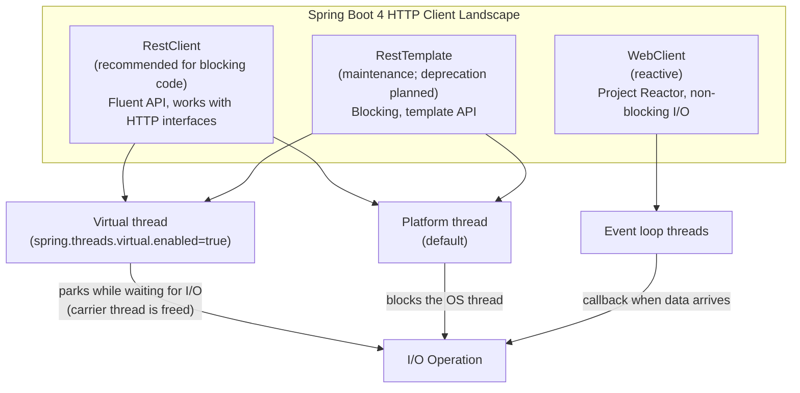
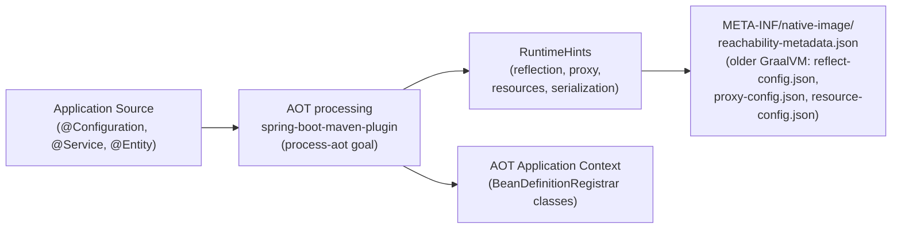

# ‏Spring Framework 7 — ميزات خط الأساس الجديدة

‏Spring Framework 7 ‏(نوفمبر 2025) هو أساس Spring Boot 4. وأبرز ميزاته *مجموعات* عملاء خدمات HTTP (عملاء تصريحيون يُضبطون جملة واحدة)، وإصدارات الواجهات المدمجة، والأمان من null عبر JSpecify في المنظومة كاملة، وتعليقات المرونة في النواة (`@Retryable`، و`@ConcurrencyLimit`)، ودعم Jackson 3، والانتقال إلى صيغة بيانات الوصول الوصفية الموحدة الجديدة في GraalVM. ويغطي هذا الدرس منظومة عملاء HTTP (واجهات `@HttpExchange` و`RestClient`، اللذين قُدما في Framework 6 وأصبحا الآن الطريقة الموصى بها لاستدعاء واجهات HTTP)، وتلميحات AOT، وقابلية المراقبة بواجهة `Observation` في Micrometer، وتغييرات Framework 7 الأخرى، وترحيل تعليقات الاختبار — مع أمثلة كود بجودة التقنية المالية.

---

## 1. واجهات HTTP ‏(`@HttpExchange`) — ‏HTTP تصريحي جاهز للإنتاج

اعتادت الفرق التي تكتب عملاء الخدمات المصغّرة الاختيار بين كتابة غلاف `WebClient`/`RestTemplate` يدويًا وجلب OpenFeign ‏(الذي أصبح تكامله مع Spring Cloud في وضع الصيانة). وكانت واجهات HTTP — ‏`@HttpExchange` — هي الإجابة الأصلية في Spring منذ Framework 6.0.

**ما الذي تغير في SF7**: *سجل خدمات HTTP*. فبدل بناء `HttpServiceProxyFactory` يدويًا لكل واجهة، تصرّح بمجموعات من الواجهات بـ `@ImportHttpServices`، ويضبط Spring Boot 4 كل مجموعة (العنوان الأساسي، والمهل) من خصائص `spring.http.serviceclient.<group>.*`. وتُولّد تلميحات AOT للواجهات تلقائيًا، فتعمل في الصور الأصلية أيضًا.

### تعريف عميل لبنية الدفع التحتية

نمط شائع في التقنية المالية: تستدعي خدمة دفع واجهة خارجية لفحص الاحتيال وخدمة أسعار صرف. وكلتاهما معرّفتان كواجهات `@HttpExchange`:

```java
// FraudCheckClient.java
@HttpExchange(url = "/v2/fraud", accept = "application/json")
public interface FraudCheckClient {

    @PostExchange("/check")
    FraudCheckResponse checkPayment(@RequestBody FraudCheckRequest request);

    @GetExchange("/rules/{merchantId}")
    FraudRules getRulesForMerchant(@PathVariable String merchantId);
}

// FxRateClient.java
@HttpExchange(url = "/v1/rates", accept = "application/json")
public interface FxRateClient {

    @GetExchange("/{baseCurrency}/{targetCurrency}")
    FxRate getRate(
        @PathVariable String baseCurrency,
        @PathVariable String targetCurrency,
        @RequestParam("asOf") LocalDate asOf
    );

    // Batch fetch — POST body with currency pairs
    @PostExchange("/batch")
    List<FxRate> getRatesBatch(@RequestBody List<CurrencyPair> pairs);
}
```

### تسجيل العملاء

طريقة SF7 — صرّح بالمجموعات واضبطها بالخصائص:

```java
@Configuration
@ImportHttpServices(group = "fraud", types = FraudCheckClient.class)
@ImportHttpServices(group = "fx", types = FxRateClient.class)
public class HttpServicesConfiguration {
    // Spring Boot 4 configures each group from properties, e.g.
    //   spring.http.serviceclient.fraud.base-url=https://fraud.vendor.example
    //   spring.http.serviceclient.fraud.read-timeout=2s
    //   spring.http.serviceclient.fx.base-url=http://fx-service
    //   spring.http.serviceclient.fx.read-timeout=500ms
    // Per-group customisation (auth headers, status handlers) goes in a
    // RestClientHttpServiceGroupConfigurer bean.
}
```

الطريقة الصريحة — ابنِ كل وكيل بنفسك (تعمل على Framework 6 أيضًا، وتعطي تحكمًا كاملًا):

```java
@Configuration
public class HttpClientConfiguration {

    // Fraud check: external vendor, strict 2s timeout
    @Bean
    public FraudCheckClient fraudCheckClient(
            @Value("${clients.fraud.base-url}") String baseUrl,
            @Value("${clients.fraud.connect-timeout-ms:1000}") long connectMs,
            @Value("${clients.fraud.read-timeout-ms:2000}") long readMs,
            @Value("${clients.fraud.api-key}") String apiKey) {   // from Vault / secret store

        RestClient restClient = RestClient.builder()
            .baseUrl(baseUrl)
            .requestFactory(clientHttpRequestFactory(connectMs, readMs))
            // A "${...}" inside a Java string literal is NOT resolved -- inject the value
            .defaultHeader(HttpHeaders.AUTHORIZATION, "Bearer " + apiKey)
            .defaultStatusHandler(
                HttpStatusCode::is4xxClientError,
                (req, resp) -> {
                    throw new FraudServiceException(
                        "Fraud API client error: " + resp.getStatusCode());
                })
            .defaultStatusHandler(
                HttpStatusCode::is5xxServerError,
                (req, resp) -> {
                    throw new FraudServiceUnavailableException(
                        "Fraud API unavailable: " + resp.getStatusCode());
                })
            .build();

        return HttpServiceProxyFactory
            .builderFor(RestClientAdapter.create(restClient))
            .build()
            .createClient(FraudCheckClient.class);
    }

    // FX rate service: internal, 500ms timeout — called on critical payment path
    @Bean
    public FxRateClient fxRateClient(
            @Value("${clients.fx.base-url}") String baseUrl) {

        RestClient restClient = RestClient.builder()
            .baseUrl(baseUrl)
            .requestFactory(clientHttpRequestFactory(300L, 500L))
            .build();

        return HttpServiceProxyFactory
            .builderFor(RestClientAdapter.create(restClient))
            .build()
            .createClient(FxRateClient.class);
    }

    private ClientHttpRequestFactory clientHttpRequestFactory(
            long connectMs, long readMs) {
        SimpleClientHttpRequestFactory factory = new SimpleClientHttpRequestFactory();
        factory.setConnectTimeout(Duration.ofMillis(connectMs));
        factory.setReadTimeout(Duration.ofMillis(readMs));
        return factory;
    }
}
```

### معالجة الأخطاء وتفاصيل المشكلة (RFC 9457)

حين لا يعترض معالج حالة مخصص الخطأ، يرمي `RestClient` (وواجهات HTTP المدعومة به) الاستثناء `HttpClientErrorException` لاستجابات 4xx؛ ويمكن فك جسم `application/problem+json` إلى `ProblemDetail` بـ `getResponseBodyAs(...)`:

```java
// If the fraud API returns 422 Unprocessable Entity with application/problem+json
// (and no defaultStatusHandler converts 4xx into a custom exception first):
try {
    var result = fraudCheckClient.checkPayment(request);
} catch (HttpClientErrorException ex) {
    ProblemDetail problem = ex.getResponseBodyAs(ProblemDetail.class);
    log.warn("Fraud check declined: type={} detail={}",
        problem.getType(), problem.getDetail());
    return AuthorizationResult.declined(problem.getDetail());
}
```

---

## 2. ‏`RestClient` — عميل HTTP الحاجب الجديد

قُدم `RestClient` في SF6.1 وهو تجريد HTTP الحاجب الأساسي في SF7. وهو ليس تفاعليًا — بل يستخدم `ClientHttpRequestFactory` مدعومًا بعميل `HttpClient` في JDK، أو Apache HttpComponents 5، أو Jetty، أو Reactor Netty. وحين تكون الخيوط الافتراضية مفعّلة (`spring.threads.virtual.enabled=true` — ما زالت اختيارية في SB4)، يُوقف استدعاء `RestClient` الحاجب الخيطَ الافتراضي أثناء انتظار الإدخال/الإخراج، فتتوسع الخدمات المعتمدة على الإدخال/الإخراج قريبًا من الخدمات التفاعلية دون نموذج البرمجة التفاعلية.

### المقارنة مع `WebClient` و`RestTemplate`



**متى تستخدم `RestClient` مقابل `WebClient`**:
- استخدم `RestClient` لكل الكود الحاجب الجديد في SB4. ومع تفعيل الخيوط الافتراضية، تقترب الإنتاجية لأحمال العمل المعتمدة على الإدخال/الإخراج من `WebClient`، والكود أبسط.
- استخدم `WebClient` فقط عند التكامل مع خط تفاعلي قائم (مثل خدمة تستخدم `Flux`/`Mono` من طرف إلى طرف، أو طبقة بيانات `R2DBC` تفاعلية).
- لا تكتب كودًا جديدًا بـ `RestTemplate`. فهو في وضع الصيانة، ويخطط فريق Spring لإهماله في إصدار 7.x، ويقدم `RestClient` الميزات نفسها بواجهة سلسة (بل يستطيع إعادة استخدام إعداد `RestTemplate` القائم عبر `RestClient.create(restTemplate)`).

### ‏`RestClient` في خدمة تسوية المدفوعات

```java
@Service
public class PaymentSettlementClient {

    private final RestClient restClient;

    public PaymentSettlementClient(RestClient.Builder builder,
            @Value("${clients.settlement.base-url}") String baseUrl) {
        this.restClient = builder
            .baseUrl(baseUrl)
            .defaultHeader("X-Service-Name", "payment-service")
            .build();
    }

    public SettlementConfirmation submitSettlement(SettlementRequest request) {
        return restClient.post()
            .uri("/settlements")
            .contentType(MediaType.APPLICATION_JSON)
            .body(request)
            .retrieve()
            .onStatus(HttpStatusCode::is5xxServerError, (req, resp) -> {
                throw new SettlementServiceException(
                    "Settlement backend error: " + resp.getStatusCode());
            })
            .body(SettlementConfirmation.class);
    }

    public Optional<SettlementStatus> getSettlementStatus(String settlementId) {
        try {
            return Optional.ofNullable(
                restClient.get()
                    .uri("/settlements/{id}", settlementId)
                    .retrieve()
                    .body(SettlementStatus.class));
        } catch (HttpClientErrorException.NotFound ex) {
            return Optional.empty();
        }
    }
}
```

**الإعداد التلقائي لـ `RestClient.Builder`**: يضبط SB4 تلقائيًا bean من نوع `RestClient.Builder` بنطاق prototype. احقنه (لا `RestClient` مبنيًا بالكامل) لتتيح لكل خدمة تخصيص عنوانها الأساسي وترويساتها دون مشاركة الحالة.

---

## 3. معالجة AOT: ‏`RuntimeHints`، و`@ImportRuntimeHints`، و`@RegisterReflectionForBinding`

تتطلب الصورة الأصلية في GraalVM معرفة كل صنف سيُصل إليه عبر الانعكاس، وكل واجهة وكيل، وكل مورد يُضمّن في الصورة وقت البناء. ويولّد خط AOT في SF7 معظم هذه التلميحات تلقائيًا؛ ويغطي هذا القسم ما ما زلت تحتاج إلى التعامل معه يدويًا.

### كيف يعمل خط AOT



### متى ما زالت التلميحات اليدوية مطلوبة

تتعامل معالجة AOT مع: الـ beans المكتشفة بفحص `@Component`، و`@ConfigurationProperties`، ومستودعات Spring Data وكيانات JPA، وأنواع أجسام الطلب/الاستجابة في تواقيع دوال المتحكمات. وتحتاج تلميحات يدوية لـ:

1. **التحميل الديناميكي للأصناف** — ‏`Class.forName(className)` حيث `className` نص وقت التشغيل
2. **المكتبات القائمة على JNI** — بعض مكتبات التشفير القديمة
3. **أنماط `TypeToken<>` المخصصة** — أنماط Gson أو TypeReference العامة

```java
// RuntimeHintsRegistrar for a custom ISO 20022 payment codec
public class PaymentCodecHints implements RuntimeHintsRegistrar {

    @Override
    public void registerHints(RuntimeHints hints, ClassLoader classLoader) {
        // Register reflection for internal payment codec (uses Class.forName internally)
        hints.reflection()
            .registerType(ISO20022PaymentCodec.class,
                MemberCategory.INVOKE_PUBLIC_CONSTRUCTORS,
                MemberCategory.INVOKE_PUBLIC_METHODS)
            .registerType(TransactionReference.class,
                MemberCategory.DECLARED_FIELDS);

        // Register JDK proxy for the codec interface
        hints.proxies()
            .registerJdkProxy(PaymentCodec.class);

        // Register classpath resources loaded at runtime
        hints.resources()
            .registerPattern("iso20022/schemas/*.xsd");
    }
}

// Apply to a @Configuration class
@Configuration
@ImportRuntimeHints(PaymentCodecHints.class)
public class PaymentCodecConfiguration {

    @Bean
    public PaymentCodec paymentCodec() {
        return new ISO20022PaymentCodec();
    }
}
```

### ‏`@RegisterReflectionForBinding`

تحصل الأنواع التي تظهر في تواقيع دوال `@RestController` على تلميحات الربط تلقائيًا. واستخدم `@RegisterReflectionForBinding` للأنواع التي يقوم Jackson بـ(إلغاء) تسلسلها *خارج* تلك التواقيع — الأجسام المرسلة بـ `RestClient`، وحمولات رسائل Kafka، أو الأنواع المقروءة من `Map`/`JsonNode` عام:

```java
// Types serialised by RestClient and the Kafka listener — not visible to AOT
// through any controller signature
@Configuration
@RegisterReflectionForBinding({
    SettlementRequest.class,
    SettlementConfirmation.class,
    PaymentEvent.class
})
public class SettlementBindingHints {
}
```

---

## 4. قابلية المراقبة — واجهة `Observation` و`@Observed`

واجهة `Observation` في Micrometer ‏(Micrometer 1.10+؛ ويأتي Spring Boot 4 مع Micrometer 1.16) هي أداة القياس الموحدة. ويمكن لـ `Observation` واحدة أن تنتج تلقائيًا:
- مقياس مؤقت/توزيع في `MeterRegistry`
- امتدادًا (span) في سياق التتبع (يُصدّر عبر OTLP أو Zipkin)
- ربطًا للسجلات المنظمة (`traceId`/`spanId` في MDC)

### ‏`@Observed` — قياس الدوال دون كود متكرر

```java
// Enable @Observed support: Spring Boot 4 registers the ObservedAspect when
// AspectJ is on the classpath (spring-boot-starter-aspectj) and
//   management.observations.annotations.enabled=true

// Apply to any Spring-managed bean method
@Service
@Observed(name = "payment.fraud-check",
          contextualName = "fraud-check-service")
public class FraudCheckService {

    private final FraudCheckClient client;

    public FraudCheckService(FraudCheckClient client) {
        this.client = client;
    }

    // Each method call produces a span + timer named "payment.fraud-check"
    @Observed(name = "payment.fraud-check.single")
    public FraudCheckResponse check(FraudCheckRequest request) {
        return client.checkPayment(request);
    }
}
```

### ‏`Observation` اليدوية للتحكم الدقيق

```java
@Service
public class LedgerUpdateService {

    private final ObservationRegistry registry;
    private final LedgerRepository ledger;

    public LedgerUpdateService(ObservationRegistry registry, LedgerRepository ledger) {
        this.registry = registry;
        this.ledger = ledger;
    }

    public LedgerEntry debit(String accountId, MonetaryAmount amount) {
        return Observation.createNotStarted("ledger.debit", registry)
            .lowCardinalityKeyValue("currency", amount.getCurrency().getCurrencyCode())
            .highCardinalityKeyValue("account.id", accountId)  // high-cardinality: not a metric tag
            .observe(() -> {
                var entry = LedgerEntry.debit(accountId, amount);
                return ledger.save(entry);
            });
    }
}
```

**الأصالة المنخفضة مقابل العالية**: تصبح قيم `lowCardinalityKeyValue` أبعاد وسوم للمقاييس (مجموعة محدودة، مثل رموز العملات). وتظهر قيم `highCardinalityKeyValue` في سمات الامتداد لكن لا كوسوم مقاييس — وهذا يمنع انفجار أصالة المقاييس مع معرّفات الحسابات الفردية.

---

## 5. تغييرات أخرى في Framework 7 تستحق المعرفة

**الأمان من null عبر JSpecify**: المنظومة كاملة في Spring معلّمة بـ JSpecify ‏(حزم `@NullMarked`، و`@Nullable` من `org.jspecify.annotations`)، بدل `@Nullable`/`@NonNull` الخاصة بـ Spring. وتستطيع أدوات مثل NullAway الآن فحص كودك مقابل واجهات Spring وقت البناء — وهذا جذاب لكود الدفع حيث يكون مبلغ null غير متوقع حادث إنتاج.

**إصدارات الواجهات**: لـ `@RequestMapping` وصيغه سمة `version` ‏(مثل `@GetMapping(path = "/payments/{id}", version = "2")`). ويُستخرج الإصدار من ترويسة، أو معامل استعلام، أو جزء من المسار، أو معامل نوع الوسائط، ويُضبط عبر `ApiVersionConfigurer` أو خصائص Spring Boot ‏`spring.mvc.apiversion.*`. ويستطيع `RestClient` وواجهات HTTP إرسال إصدار أيضًا.

**المرونة في النواة**: يغطي `@Retryable` ‏(مع التراجع والتشتيت) و`@ConcurrencyLimit`، المفعّلان بـ `@EnableResilientMethods`، احتياجات إعادة المحاولة والحواجز البسيطة دون Spring Retry أو Resilience4j. ولا تُعِد المحاولة إلا للعمليات عديمة الأثر عند التكرار — وفي المدفوعات، يعني ذلك الاستدعاءات التي تحمل مفتاح عدم تكرار.

**‏Jackson 3**: يدعم Framework 7 ‏Jackson 3 ‏(حزم `tools.jackson`)؛ ودعم Jackson 2 مُهمل. وتحتاج المُسلسِلات المخصصة وتخصيصات `ObjectMapper` إلى ترحيل.

**المواءمة مع Jakarta EE 11**: ‏Servlet 6.1، وJakarta Persistence 3.2، وBean Validation 3.1. وتعليقات التحقق الشائعة (`@NotNull`، و`@Size`، و`@Pattern`) لم تتغير؛ ويجب ترقية المكتبات المترجمة مقابل إصدارات Jakarta EE الأقدم.

**تجاوز تعريفات الـ beans** يبقى معطلًا افتراضيًا في Spring Boot ‏(كما منذ 2.1): فبيانان بالاسم نفسه يُفشلان بدء التشغيل بدل أن يحل أحدهما محل الآخر بصمت.

---

## 6. تغييرات الاختبار: ‏`@MockitoBean` و`@MockitoSpyBean`

يستحق تغيير تعليقات الاختبار مثالًا كاملًا لأن الترحيل آلي لكن سهل التفويت:

```java
// SB3.x test — @MockBean and @SpyBean from spring-boot-test
@SpringBootTest
class PaymentAuthorizationServiceTest {

    @MockBean                        // REMOVED in SB4 from spring-boot-test
    private FraudCheckClient fraudCheck;

    @SpyBean                         // REMOVED in SB4 from spring-boot-test
    private PaymentRepository repository;

    @Autowired
    private PaymentAuthorizationService service;

    @Test
    void shouldDeclinePaymentWhenFraudCheckFails() {
        given(fraudCheck.checkPayment(any())).willReturn(
            FraudCheckResponse.declined("velocity-limit"));

        var result = service.authorize(validPaymentRequest());

        assertThat(result.status()).isEqualTo(AuthorizationStatus.DECLINED);
    }
}

// SB4 test — @MockitoBean and @MockitoSpyBean from spring-test (not spring-boot-test)
@SpringBootTest
class PaymentAuthorizationServiceTest {

    @MockitoBean                     // Now in org.springframework.test.context.bean.override.mockito
    private FraudCheckClient fraudCheck;

    @MockitoSpyBean                  // Now in org.springframework.test.context.bean.override.mockito
    private PaymentRepository repository;

    @Autowired
    private PaymentAuthorizationService service;

    @Test
    void shouldDeclinePaymentWhenFraudCheckFails() {
        given(fraudCheck.checkPayment(any())).willReturn(
            FraudCheckResponse.declined("velocity-limit"));

        var result = service.authorize(validPaymentRequest());

        assertThat(result.status()).isEqualTo(AuthorizationStatus.DECLINED);
    }
}
```

**أين يمكن استخدام التعليقات الجديدة**: يُصرّح بـ `@MockitoBean` و`@MockitoSpyBean` ‏(جزء من Spring Framework منذ 6.2) على حقول *صنف الاختبار* (أو على مستوى نوع صنف الاختبار)، لا داخل أصناف `@Configuration`/`@TestConfiguration`. فإن كانت لديك حقول `@MockBean` في `@TestConfiguration` مشترك، فانقلها إلى الاختبارات (أو إلى صنف أساس مشترك أو واجهة اختبار).

**شرائح `@DataJpaTest` و`@WebMvcTest`**: ما زالت تعمل كما سبق؛ واجمعها مع `@MockitoBean` للمتعاونين الذين لا تحمّلهم الشريحة. ولاحظ أن تعليقات الشرائح في Spring Boot 4 انتقلت إلى وحدات اختبار خاصة بكل تقنية (مثل `spring-boot-data-jpa-test`، و`spring-boot-webmvc-test`)، فتتغير الاستيرادات وتبعيات الاختبار.

---

## الخلاصة

يرفع Spring Framework 7 سقف ما تستطيع بناءه دون اللجوء إلى مكتبات خارجية. فواجهات `@HttpExchange` — القابلة للضبط الآن في مجموعات — تحل محل Feign لمعظم حالات الاستخدام. ويحل `RestClient` محل `RestTemplate` للكود الحاجب الجديد. وتحل واجهة `Observation` في Micrometer محل قياس `Timer`/`Counter` الخام. وتزيل JSpecify وإصدارات الواجهات وتعليقات المرونة في النواة فئات كاملة من الكود المكتوب يدويًا. ويُظهر الانتقال من `@MockBean` إلى `@MockitoBean` أن بنية الاختبار أصبحت شأنًا لـ Spring Framework لا لـ Spring Boot.

يغطي الدرس 03 تكامل الخيوط الافتراضية على مستوى إعداد SB4 — تحديدًا كيف تغيرت الإعدادات الافتراضية، وكيف تكتشف تثبيت الخيوط الحاملة، وكيف يندمج HikariCP وHibernate 7 في الصورة.

---

<!-- KNOWLEDGE-CHECK
[
  {
    "id": "kc-15-02-01",
    "question": "تستدعي خدمة دفع واجهة احتيال خارجية عبر واجهة HTTP في Spring Framework 7 مدعومة بـ RestClient، دون معالج حالة مخصص. وتعيد واجهة الاحتيال 422 بجسم `application/problem+json`. كيف تصل إلى تفاصيل المشكلة؟",
    "options": [
      "لا تستطيع واجهات HTTP التعامل مع `application/problem+json` — يجب الانتقال إلى WebClient",
      "يرمي RestClient الاستثناء `HttpClientErrorException` ‏(وهو `RestClientResponseException`) لحالة 4xx؛ واستدعاء `getResponseBodyAs(ProblemDetail.class)` عليه يفك الجسم إلى `ProblemDetail`",
      "يجب تعليم دالة الواجهة بـ `@ProblemDetailResponse` لتفعيل فك RFC 9457",
      "تعيد دالة الواجهة `null` وتضيع تفاصيل المشكلة"
    ],
    "correct": 1,
    "explanation": "دون معالج حالة مخصص، يرمي RestClient ‏(وبالتالي وكيل واجهة HTTP) الاستثناء HttpClientErrorException لـ 4xx وHttpServerErrorException لـ 5xx. وكلاهما يرث RestClientResponseException، الذي يفك getResponseBodyAs(Class) فيه جسم الخطأ بمحولات الرسائل المضبوطة — فيعطيك getResponseBodyAs(ProblemDetail.class) النوع، والعنوان، والتفاصيل، والخصائص الإضافية. وإن سجّلت defaultStatusHandler يرمي استثناءك الخاص، يجب فك الجسم هناك. ولا يوجد تعليق @ProblemDetailResponse."
  },
  {
    "id": "kc-15-02-02",
    "question": "لخدمة SB4 صنف `PaymentCodecConfiguration` يسجل `PaymentCodecHints implements RuntimeHintsRegistrar`. ويستخدم صنف الإعداد `@ImportRuntimeHints(PaymentCodecHints.class)`. وأثناء بناء صورة أصلية في GraalVM، لا يُعثر على الصنف `ISO20022PaymentCodec`. ما السبب الأرجح؟",
    "options": [
      "يعمل `@ImportRuntimeHints` فقط على أصناف `@SpringBootApplication`، لا على أصناف `@Configuration`",
      "يجب سرد الصنف `PaymentCodecHints` في `src/main/resources/META-INF/spring/aot.factories` بدل استخدام `@ImportRuntimeHints`",
      "لم تُستدعَ الدالة `RuntimeHintsRegistrar.registerHints()` لأن صنف `@Configuration` استُبعد من معالجة AOT — تحقق من أن `PaymentCodecConfiguration` مكتشف بفحص المكونات وغير مرشح بـ `@ConditionalOnProperty` تُقيّم إلى `false` وقت البناء",
      "تلميح `MemberCategory.INVOKE_PUBLIC_METHODS` لا يغطي المُنشئات — تحتاج `MemberCategory.INVOKE_PUBLIC_CONSTRUCTORS` بشكل منفصل للإنشاء"
    ],
    "correct": 2,
    "explanation": "تعالج معالجة AOT فقط أصناف `@Configuration` القابلة للوصول من سياق التطبيق وقت البناء. فإن كان `PaymentCodecConfiguration` معلّمًا بـ `@ConditionalOnProperty(name='payment.codec.enabled')` ولم تُضبط تلك الخاصية أثناء مرحلة بناء AOT (مثلًا ليست في `application.yaml`)، يُستبعد الإعداد كاملًا، ولا يُعالج `@ImportRuntimeHints` أبدًا. والإصلاح ضمان أن يُقيّم الشرط إلى `true` أثناء مرحلة AOT في Maven/Gradle، أو تسجيل التلميحات عبر `aot.factories` كبديل. والخيار D صحيح جزئيًا (تحتاج المُنشئات `MemberCategory` منفصلة) لكنه ليس السبب الأرجح لعدم العثور على الصنف إطلاقًا."
  },
  {
    "id": "kc-15-02-03",
    "question": "في Spring Framework 7، ما الفرق الأساسي بين `lowCardinalityKeyValue` و`highCardinalityKeyValue` على `Observation`، ولماذا يهم لخدمة دفع بملايين معرّفات الحسابات الفريدة؟",
    "options": [
      "لا فرق وظيفي — كلاهما يُسجل كوسوم مقاييس وسمات امتداد؛ و`highCardinality` يشير فقط إلى نية المطور",
      "تصبح قيم `lowCardinalityKeyValue` أبعاد وسوم للمقاييس في `MeterRegistry` ‏(مجموعة محدودة، آمنة لـ Prometheus/Datadog)؛ وتظهر قيم `highCardinalityKeyValue` فقط في سمات امتدادات التتبع الموزع، لا كوسوم مقاييس — فيتجنب انفجار أصالة المقاييس مع قيم غير محدودة مثل معرّفات الحسابات",
      "تُجزّأ قيم `highCardinalityKeyValue` تلقائيًا قبل تخزينها كوسوم مقاييس لتقليل الأصالة",
      "‏`lowCardinalityKeyValue` لمقاييس `Timer` فقط؛ و`highCardinalityKeyValue` لمقاييس `Counter` فقط"
    ],
    "correct": 1,
    "explanation": "تميّز واجهة Observation في Micrometer الأصالة صراحة لمنع خطأ شائع في قابلية المراقبة. فقيم `lowCardinalityKeyValue` ‏(مثل `currency=USD`، و`channel=API`) آمنة كأبعاد وسوم للمقاييس لأن فضاء القيم محدود — فإضافتها إلى عداد أو مدرج تكراري في Prometheus لا تنشئ تسمية غير محدودة. أما قيم `highCardinalityKeyValue` ‏(مثل `account.id=acc_1234567890`) فلها فضاء قيم غير محدود وستسبب انفجار أصالة المقاييس في Prometheus أو Datadog أو أي قاعدة بيانات سلاسل زمنية إن استُخدمت كوسوم. ويوجّه Micrometer القيم عالية الأصالة إلى واجهة التتبع الخلفية فقط (كسمات امتداد)، ولا يوجهها أبدًا إلى واجهة المقاييس."
  },
  {
    "id": "kc-15-02-04",
    "question": "يرحّل فريق من `RestTemplate` إلى `RestClient` في Spring Boot 4. وكان لديهم bean من نوع `RestTemplateCustomizer` يضيف معترض طلبات لترويسات توقيع HMAC على كل طلب صادر. ما الآلية المكافئة في `RestClient`؟",
    "options": [
      "bean من نوع `RestClientCustomizer` — النمط نفسه، باسم واجهة مختلف، ويُطبق عالميًا على `RestClient.Builder` المضبوط تلقائيًا",
      "لا يوجد مكافئ — يجب استخدام `WebClient` إن احتجت معترضات طلبات عالمية",
      "سجّل المعترض على `RestClient.Builder` باستخدام `.requestInterceptor(ClientHttpRequestInterceptor)` قبل بناء العميل، أو استخدم bean من نوع `RestClientCustomizer` يُطبق عالميًا على الباني المضبوط تلقائيًا",
      "استخدم التعليق `@HttpExchangeFilter` على دوال واجهة `@HttpExchange` لإرفاق معترضات لكل طلب"
    ],
    "correct": 2,
    "explanation": "لدى `RestClient.Builder` الدالة `.requestInterceptor(ClientHttpRequestInterceptor)` وهي المكافئ المباشر لـ `RestTemplate.getInterceptors().add()`. وللتطبيق العالمي على كل نسخ `RestClient` المبنية من `RestClient.Builder` المضبوط تلقائيًا، يدعم Spring Boot 4 beans من نوع `RestClientCustomizer` ‏(الخيار A قريب لكنه يصف النهج نفسه). والإجابة الأدق لترحيل معترض قائم إلى عميل محدد هي الخيار C: استدعِ `.requestInterceptor()` على الباني. ولا يوجد `@HttpExchangeFilter` في SF7."
  }
]
-->

<!-- PRACTICAL-CHALLENGE
{
  "id": "pc-15-02",
  "title": "واجهات HTTP وRestClient لتكامل بوابة دفع",
  "description": "ابنِ طبقة عملاء HTTP بجودة الإنتاج لخدمة دفع تستدعي واجهة احتيال خارجية وخدمة أسعار صرف داخلية باستخدام واجهات HTTP في Spring Framework 7.",
  "tasks": [
    {
      "id": "pc-15-02-01",
      "description": "عرّف واجهتي `@HttpExchange`: ‏`FraudCheckClient` بـ `@PostExchange(\"/v2/fraud/check\")` تعيد `FraudCheckResponse`، و`FxRateClient` بـ `@GetExchange(\"/v1/rates/{base}/{target}\")` تعيد `FxRate`. وسجّلهما كـ beans باستخدام `HttpServiceProxyFactory.builderFor(RestClientAdapter.create(restClient)).build().createClient(...)`. ويجب أن يكون لكل عميل `RestClient` مستقل بمهل قراءة منفصلة (ثانيتان للاحتيال، و500 مللي ثانية لأسعار الصرف). واكتب اختبار تكامل باستخدام WireMock يتحقق من أن إعداد المهلة يسبب `ResourceAccessException` حين يؤخر البديل الاستجابة إلى ما بعد المهلة المضبوطة."
    },
    {
      "id": "pc-15-02-02",
      "description": "أضف `ClientHttpRequestInterceptor` يحقن ترويسة `X-Request-ID` ‏(UUID مولّد لكل طلب) وترويسة `X-Correlation-ID` ‏(من `traceId` في MDC إن وُجد، وإلا UUID جديد) على كل طلب صادر من العميلين. وسجّله على bean الباني `RestClient.Builder` باستخدام bean من نوع `RestClientCustomizer` ليُطبق على كل العملاء المبنيين من الباني المضبوط تلقائيًا. واكتب اختبار وحدة يتحقق من وجود الترويستين في طلب ملتقط."
    },
    {
      "id": "pc-15-02-03",
      "description": "قِس الدالة `FraudCheckService.check(FraudCheckRequest)` باستخدام `@Observed(name=\"payment.fraud-check\")` مع وسوم `lowCardinalityKeyValue` لـ `fraud.result` ‏(approved/declined/error) و`currency`. وفعّل دعم التعليقات بـ `management.observations.annotations.enabled=true` ‏(مع starter الخاص بـ AspectJ). واكتب اختبارًا باستخدام `TestObservationRegistry` ‏(من `micrometer-test`) يتحقق من تسجيل ملاحظة باسم `payment.fraud-check` بالوسوم الصحيحة بعد استدعاء ناجح لفحص الاحتيال."
    },
    {
      "id": "pc-15-02-04",
      "description": "رحّل صنف اختبار يستخدم `@MockBean FraudCheckClient` و`@SpyBean FraudCheckService` لاستخدام `@MockitoBean` و`@MockitoSpyBean` على التوالي. وتأكد من تغيير عبارات الاستيراد من `org.springframework.boot.test.mock.mockito.MockBean` إلى `org.springframework.test.context.bean.override.mockito.MockitoBean`. وأضف اختبار شريحة `@DataJpaTest` لـ `PaymentRepository` يستخدم أيضًا `@MockitoBean` لمحاكاة bean تابع `AuditEventPublisher`. وتأكد من نجاح كل الاختبارات مع `spring-boot-test:4.0.0`."
    }
  ]
}
-->
