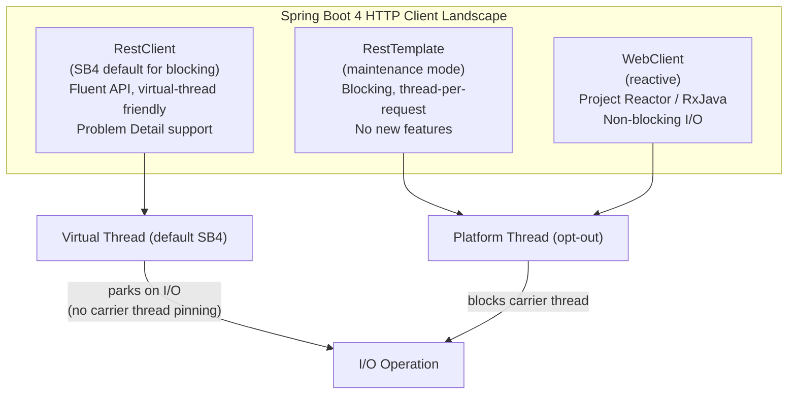
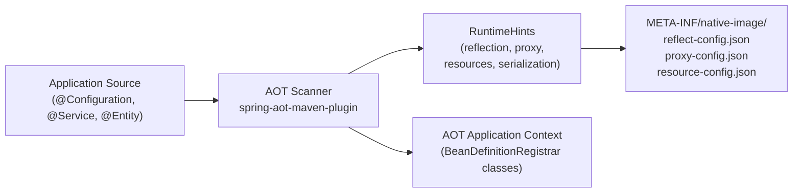

# Spring Framework 7 — New Baseline Features

Spring Framework 7 is the foundation of Spring Boot 4. Most of the user-visible changes live at the SF7 layer: a production-ready declarative HTTP client, a new blocking `RestClient` that supersedes `RestTemplate`, a significantly improved AOT metadata pipeline, the first-class `Observation` API, and test annotation renames. This lesson covers each in depth with fintech-grade code examples.

---

## 1. HTTP Interfaces (`@HttpExchange`) — Production-Ready Declarative HTTP

Before SF7, teams writing microservice clients faced a choice: hand-roll a `WebClient`/`RestClient` wrapper, pull in OpenFeign (a non-Spring dependency), or use `RestTemplate` with interceptors. SF7 makes `@HttpExchange` the canonical answer for declarative HTTP clients in the Spring ecosystem.

**What changed from SF6**: in SF6.1 (SB3.x), `@HttpExchange` was labelled "experimental / beta." SF7 removes that label, adds production-tested error handling, response body decoding for problem detail (RFC 9457), and native image AOT hints for all annotated interfaces.

### Defining a Payment Infrastructure Client

A common fintech pattern: a payment service calls an external fraud-screening API and an FX rate service. Both are defined as `@HttpExchange` interfaces:

```java
// FraudCheckClient.java
@HttpExchange(url = "/v2/fraud", accept = "application/json")
public interface FraudCheckClient {

    @PostExchange("/check")
    FraudCheckResponse checkPayment(@RequestBody FraudCheckRequest request);

    @GetExchange("/rules/{merchantId}")
    FraudRules getRulesForMerchant(@PathVariable String merchantId);
}

// FxRateClient.java
@HttpExchange(url = "/v1/rates", accept = "application/json")
public interface FxRateClient {

    @GetExchange("/{baseCurrency}/{targetCurrency}")
    FxRate getRate(
        @PathVariable String baseCurrency,
        @PathVariable String targetCurrency,
        @RequestParam("asOf") LocalDate asOf
    );

    // Batch fetch — POST body with currency pairs
    @PostExchange("/batch")
    List<FxRate> getRatesBatch(@RequestBody List<CurrencyPair> pairs);
}
```

### Registering the Clients

SF7's `HttpServiceProxyFactory` backed by `RestClient` (blocking):

```java
@Configuration
public class HttpClientConfiguration {

    // Fraud check: external vendor, strict 2s timeout
    @Bean
    public FraudCheckClient fraudCheckClient(
            @Value("${clients.fraud.base-url}") String baseUrl,
            @Value("${clients.fraud.connect-timeout-ms:1000}") long connectMs,
            @Value("${clients.fraud.read-timeout-ms:2000}") long readMs) {

        RestClient restClient = RestClient.builder()
            .baseUrl(baseUrl)
            .requestFactory(clientHttpRequestFactory(connectMs, readMs))
            .defaultHeader(HttpHeaders.AUTHORIZATION, "Bearer ${clients.fraud.api-key}")
            .defaultStatusHandler(
                HttpStatusCode::is4xxClientError,
                (req, resp) -> {
                    throw new FraudServiceException(
                        "Fraud API client error: " + resp.getStatusCode());
                })
            .defaultStatusHandler(
                HttpStatusCode::is5xxServerError,
                (req, resp) -> {
                    throw new FraudServiceUnavailableException(
                        "Fraud API unavailable: " + resp.getStatusCode());
                })
            .build();

        return HttpServiceProxyFactory
            .builderFor(RestClientAdapter.create(restClient))
            .build()
            .createClient(FraudCheckClient.class);
    }

    // FX rate service: internal, 500ms timeout — called on critical payment path
    @Bean
    public FxRateClient fxRateClient(
            @Value("${clients.fx.base-url}") String baseUrl) {

        RestClient restClient = RestClient.builder()
            .baseUrl(baseUrl)
            .requestFactory(clientHttpRequestFactory(300L, 500L))
            .build();

        return HttpServiceProxyFactory
            .builderFor(RestClientAdapter.create(restClient))
            .build()
            .createClient(FxRateClient.class);
    }

    private ClientHttpRequestFactory clientHttpRequestFactory(
            long connectMs, long readMs) {
        SimpleClientHttpRequestFactory factory = new SimpleClientHttpRequestFactory();
        factory.setConnectTimeout(Duration.ofMillis(connectMs));
        factory.setReadTimeout(Duration.ofMillis(readMs));
        return factory;
    }
}
```

### Error Handling and Problem Detail (RFC 9457)

SF7's `RestClient` and the HTTP interfaces adapter natively decode `application/problem+json` into `ProblemDetail`:

```java
// If the fraud API returns 422 Unprocessable Entity with application/problem+json,
// SF7 decodes it to ProblemDetail and wraps it in HttpClientErrorException
// with getProblemDetail() available on the exception.
try {
    var result = fraudCheckClient.checkPayment(request);
} catch (HttpClientErrorException ex) {
    ProblemDetail problem = ex.getProblemDetail();
    log.warn("Fraud check declined: type={} detail={}",
        problem.getType(), problem.getDetail());
    return AuthorizationResult.declined(problem.getDetail());
}
```

---

## 2. `RestClient` — The New Blocking HTTP Client

`RestClient` was introduced in SF6.1 and is now the primary blocking HTTP abstraction in SF7. It is not reactive — it uses a `ClientHttpRequestFactory` backed by JDK `HttpClient`, Apache `HttpComponents 5`, or `Jetty HttpClient`. With virtual threads (default in SB4), blocking `RestClient` calls park the virtual thread while waiting, so the application scales as well as reactive without the complexity.

### Comparison with `WebClient` and `RestTemplate`



**When to use `RestClient` vs `WebClient`**:
- Use `RestClient` for all new blocking code in SB4. With virtual threads, throughput is equivalent to `WebClient` for I/O-bound workloads, and the code is simpler.
- Use `WebClient` only when integrating with an existing reactive pipeline (e.g., a service already using `Flux`/`Mono` end-to-end, or a reactive `R2DBC` data layer).
- Do not write new code with `RestTemplate`. It is in maintenance mode and lacks Problem Detail support, `@HttpExchange` integration, and virtual-thread-aware timeouts.

### `RestClient` in a Payment Settlement Service

```java
@Service
public class PaymentSettlementClient {

    private final RestClient restClient;

    public PaymentSettlementClient(RestClient.Builder builder,
            @Value("${clients.settlement.base-url}") String baseUrl) {
        this.restClient = builder
            .baseUrl(baseUrl)
            .defaultHeader("X-Service-Name", "payment-service")
            .build();
    }

    public SettlementConfirmation submitSettlement(SettlementRequest request) {
        return restClient.post()
            .uri("/settlements")
            .contentType(MediaType.APPLICATION_JSON)
            .body(request)
            .retrieve()
            .onStatus(HttpStatusCode::is5xxServerError, (req, resp) -> {
                throw new SettlementServiceException(
                    "Settlement backend error: " + resp.getStatusCode());
            })
            .body(SettlementConfirmation.class);
    }

    public Optional<SettlementStatus> getSettlementStatus(String settlementId) {
        try {
            return Optional.ofNullable(
                restClient.get()
                    .uri("/settlements/{id}", settlementId)
                    .retrieve()
                    .body(SettlementStatus.class));
        } catch (HttpClientErrorException.NotFound ex) {
            return Optional.empty();
        }
    }
}
```

**`RestClient.Builder` auto-configuration**: SB4 auto-configures a `RestClient.Builder` prototype bean. Inject it (not a fully-built `RestClient`) to allow each service to customize its base URL and headers without sharing state.

---

## 3. AOT Processing: `RuntimeHints`, `@ImportRuntimeHints`, `@RegisterReflectionForBinding`

GraalVM native image requires knowing at build time every class that will be accessed via reflection, every proxy interface, and every resource to include in the image. SF7's AOT pipeline generates most of these hints automatically; this section covers what you still need to handle manually.

### How the AOT Pipeline Works



### When Manual Hints Are Still Needed

The AOT scanner handles: `@Component`-scanned beans, `@Entity` classes, Jackson-annotated types, standard `@ConfigurationProperties`. You need manual hints for:

1. **Dynamic class loading** — `Class.forName(className)` where `className` is a runtime string
2. **JNI-based libraries** — some legacy crypto libraries
3. **Custom `TypeToken<>` patterns** — Gson or generic TypeReference patterns

```java
// RuntimeHintsRegistrar for a custom ISO 20022 payment codec
public class PaymentCodecHints implements RuntimeHintsRegistrar {

    @Override
    public void registerHints(RuntimeHints hints, ClassLoader classLoader) {
        // Register reflection for internal payment codec (uses Class.forName internally)
        hints.reflection()
            .registerType(ISO20022PaymentCodec.class,
                MemberCategory.INVOKE_PUBLIC_CONSTRUCTORS,
                MemberCategory.INVOKE_PUBLIC_METHODS)
            .registerType(TransactionReference.class,
                MemberCategory.DECLARED_FIELDS);

        // Register JDK proxy for the codec interface
        hints.proxies()
            .registerJdkProxy(PaymentCodec.class);

        // Register classpath resources loaded at runtime
        hints.resources()
            .registerPattern("iso20022/schemas/*.xsd");
    }
}

// Apply to a @Configuration class
@Configuration
@ImportRuntimeHints(PaymentCodecHints.class)
public class PaymentCodecConfiguration {

    @Bean
    public PaymentCodec paymentCodec() {
        return new ISO20022PaymentCodec();
    }
}
```

### `@RegisterReflectionForBinding`

For Spring MVC / Spring WebFlux response/request bodies that are plain POJOs (not standard Jackson-annotated records), use `@RegisterReflectionForBinding` to declare the types that need full reflection:

```java
// SB4 / SF7: annotation directly on the @RestController
@RestController
@RequestMapping("/api/v1/payments")
@RegisterReflectionForBinding({
    PaymentRequest.class,
    PaymentResponse.class,
    PaymentError.class
})
public class PaymentController {
    // For records with @JsonProperty annotations, AOT handles hints automatically.
    // @RegisterReflectionForBinding is primarily needed for legacy POJO classes.
}
```

---

## 4. Observability — `Observation` API and `@Observed`

Micrometer's `Observation` API (shipped as part of Micrometer 1.14+, bundled with SB4) is the unified instrumentation primitive. A single `Observation` automatically produces:
- A timer/distribution metric in the `MeterRegistry`
- A span in the tracing context (exported via OTLP or Zipkin)
- Structured log correlation (MDC `traceId`/`spanId`)

### `@Observed` — Zero-Boilerplate Method Instrumentation

```java
// Enable @Observed AOP support in a @Configuration class
@Configuration
@EnableObservability  // new in SF7 — wires ObservationAspect
public class ObservabilityConfiguration {
}

// Apply to any Spring-managed bean method
@Service
@Observed(name = "payment.fraud-check",
          contextualName = "fraud-check-service")
public class FraudCheckService {

    private final FraudCheckClient client;

    public FraudCheckService(FraudCheckClient client) {
        this.client = client;
    }

    // Each method call produces a span + timer named "payment.fraud-check"
    @Observed(name = "payment.fraud-check.single")
    public FraudCheckResponse check(FraudCheckRequest request) {
        return client.checkPayment(request);
    }
}
```

### Manual `Observation` for Fine-Grained Control

```java
@Service
public class LedgerUpdateService {

    private final ObservationRegistry registry;
    private final LedgerRepository ledger;

    public LedgerUpdateService(ObservationRegistry registry, LedgerRepository ledger) {
        this.registry = registry;
        this.ledger = ledger;
    }

    public LedgerEntry debit(String accountId, MonetaryAmount amount) {
        return Observation.createNotStarted("ledger.debit", registry)
            .lowCardinalityKeyValue("currency", amount.getCurrency().getCurrencyCode())
            .highCardinalityKeyValue("account.id", accountId)  // high-cardinality: not a metric tag
            .observe(() -> {
                var entry = LedgerEntry.debit(accountId, amount);
                return ledger.save(entry);
            });
    }
}
```

**Low vs high cardinality**: `lowCardinalityKeyValue` values become metric tag dimensions (bounded set, e.g., currency codes). `highCardinalityKeyValue` values appear in span attributes but not as metric tags — this prevents metric cardinality explosion with per-account IDs.

---

## 5. `BeanDefinitionParserDelegate` Strictness and Context Changes

SF7 tightens several context bootstrap behaviors that were lenient in SF5/6:

**Duplicate bean definitions**: `spring.main.allow-bean-definition-overriding` defaults to `false` and now produces a startup failure rather than a silent override. This catches class-path ordering bugs that caused wrong beans to be loaded silently.

**Lazy `@Bean` resolution**: `@Bean` methods on `@Configuration` classes are now parsed strictly at context refresh time. A `@Bean` method that returns `null` causes an immediate startup error instead of a lazy NPE.

**Jakarta EE 11 package alignment**: SF7 requires Jakarta EE 11. For fintech services this mostly matters if you use `jakarta.validation.*` (Bean Validation 3.1) — the `@NotNull`, `@Size`, `@Pattern` annotations are unchanged, but `ConstraintValidator` SPI has new default methods. Any custom validators must be recompiled against Jakarta EE 11.

---

## 6. Testing Changes: `@MockitoBean` and `@MockitoSpyBean`

The test annotation rename deserves a full example because the migration is mechanical but easy to miss:

```java
// SB3.x test — @MockBean and @SpyBean from spring-boot-test
@SpringBootTest
class PaymentAuthorizationServiceTest {

    @MockBean                        // REMOVED in SB4 from spring-boot-test
    private FraudCheckClient fraudCheck;

    @SpyBean                         // REMOVED in SB4 from spring-boot-test
    private PaymentRepository repository;

    @Autowired
    private PaymentAuthorizationService service;

    @Test
    void shouldDeclinePaymentWhenFraudCheckFails() {
        given(fraudCheck.checkPayment(any())).willReturn(
            FraudCheckResponse.declined("velocity-limit"));

        var result = service.authorize(validPaymentRequest());

        assertThat(result.status()).isEqualTo(AuthorizationStatus.DECLINED);
    }
}

// SB4 test — @MockitoBean and @MockitoSpyBean from spring-test (not spring-boot-test)
@SpringBootTest
class PaymentAuthorizationServiceTest {

    @MockitoBean                     // Now in org.springframework.test.context.bean.override.mockito
    private FraudCheckClient fraudCheck;

    @MockitoSpyBean                  // Now in org.springframework.test.context.bean.override.mockito
    private PaymentRepository repository;

    @Autowired
    private PaymentAuthorizationService service;

    @Test
    void shouldDeclinePaymentWhenFraudCheckFails() {
        given(fraudCheck.checkPayment(any())).willReturn(
            FraudCheckResponse.declined("velocity-limit"));

        var result = service.authorize(validPaymentRequest());

        assertThat(result.status()).isEqualTo(AuthorizationStatus.DECLINED);
    }
}
```

**What else changed in `@SpringBootTest`**: SB4 replaces the internal mock-creation mechanism with Mockito 5's `MockitoSession`, which handles virtual threads correctly (no static `Mockito.reset()` required between tests running on different virtual threads).

**`@DataJpaTest` and `@WebMvcTest` slices**: still work but now use `@MockitoBean` in their auto-generated test slices. If you have custom `@TestConfiguration` classes that add `@MockBean`, they need updating.

---

## Summary

Spring Framework 7 raises the ceiling on what you can build without reaching for external libraries. `@HttpExchange` replaces Feign for most use cases. `RestClient` replaces `RestTemplate` for new blocking code. The `Observation` API replaces raw Micrometer `Timer`/`Counter` as the instrumentation primitive. The AOT improvements reduce the native image maintenance burden. And the test annotation renames, while mechanical, are a signal that test infrastructure is now a first-class Spring Framework concern rather than a Spring Boot concern.

Lesson 03 covers virtual thread integration at the SB4 configuration level — specifically how the defaults changed, how to detect carrier thread pinning, and how HikariCP and Hibernate 7 fit into the picture.

---

<!-- KNOWLEDGE-CHECK
[
  {
    "id": "kc-15-02-01",
    "question": "A payment service needs to call an external fraud API and an internal FX rate service using Spring Framework 7 HTTP interfaces. The fraud API returns `application/problem+json` on 4xx errors. Which statement correctly describes how SF7 handles this?",
    "options": [
      "SF7 HTTP interfaces cannot handle `application/problem+json` — you must register a custom `ResponseErrorHandler`",
      "`RestClientAdapter` automatically decodes `application/problem+json` responses into `ProblemDetail`, and `HttpClientErrorException.getProblemDetail()` returns the decoded object when a 4xx status is received",
      "You must annotate the interface method with `@ProblemDetailResponse` to enable RFC 9457 decoding",
      "`ProblemDetail` decoding only works with `WebClient`, not `RestClient` or HTTP interfaces backed by `RestClientAdapter`"
    ],
    "correct": 1,
    "explanation": "SF7's `RestClient` and `RestClientAdapter` natively support RFC 9457 / RFC 9110. When the response content type is `application/problem+json` and the status is 4xx or 5xx, the response body is decoded into a `ProblemDetail` object. The resulting `HttpClientErrorException` (for 4xx) or `HttpServerErrorException` (for 5xx) has a `getProblemDetail()` method that returns the decoded object. No additional annotation or configuration is required."
  },
  {
    "id": "kc-15-02-02",
    "question": "An SB4 service has a `PaymentCodecConfiguration` that registers `PaymentCodecHints implements RuntimeHintsRegistrar`. The configuration class uses `@ImportRuntimeHints(PaymentCodecHints.class)`. During a GraalVM native image build, the `ISO20022PaymentCodec` class is not found. What is the most likely cause?",
    "options": [
      "`@ImportRuntimeHints` only works on `@SpringBootApplication` classes, not on `@Configuration` classes",
      "The `PaymentCodecHints` class must be listed in `src/main/resources/META-INF/spring/aot.factories` instead of using `@ImportRuntimeHints`",
      "The `RuntimeHintsRegistrar.registerHints()` method was not called because the `@Configuration` class was excluded from the AOT scan — verify that `PaymentCodecConfiguration` is component-scanned and not filtered by a `@ConditionalOnProperty` that evaluates to `false` at build time",
      "The `MemberCategory.INVOKE_PUBLIC_METHODS` hint does not cover constructors — you need `MemberCategory.INVOKE_PUBLIC_CONSTRUCTORS` separately for instantiation"
    ],
    "correct": 2,
    "explanation": "The AOT scanner only processes `@Configuration` classes that are reachable from the application context at build time. If `PaymentCodecConfiguration` is annotated with `@ConditionalOnProperty(name='payment.codec.enabled')` and that property is not set during the AOT build phase (e.g., not in `application.yaml`), the entire configuration is excluded, and `@ImportRuntimeHints` is never processed. The fix is to ensure the condition evaluates to `true` during the Maven/Gradle AOT phase, or to register the hints via `aot.factories` as an alternative. Option D is also partially true (constructors need a separate `MemberCategory`) but is not the most likely cause of the class not being found at all."
  },
  {
    "id": "kc-15-02-03",
    "question": "In Spring Framework 7, what is the key difference between `lowCardinalityKeyValue` and `highCardinalityKeyValue` on an `Observation`, and why does it matter for a payment service with millions of unique account IDs?",
    "options": [
      "There is no functional difference — both are recorded as metric tags and span attributes; `highCardinality` just signals developer intent",
      "`lowCardinalityKeyValue` values become metric tag dimensions in the `MeterRegistry` (bounded set, safe for Prometheus/Datadog); `highCardinalityKeyValue` values appear only in distributed trace span attributes, not as metric tags — avoiding metric cardinality explosion with unbounded values like account IDs",
      "`highCardinalityKeyValue` values are automatically hashed before being stored as metric tags to reduce cardinality",
      "`lowCardinalityKeyValue` is for `Timer` metrics only; `highCardinalityKeyValue` is for `Counter` metrics only"
    ],
    "correct": 1,
    "explanation": "Micrometer's Observation API distinguishes cardinality explicitly to prevent a common observability mistake. `lowCardinalityKeyValue` values (e.g., `currency=USD`, `channel=API`) are safe as metric tag dimensions because the value space is bounded — adding them to a Prometheus counter or histogram does not create an unbounded label. `highCardinalityKeyValue` values (e.g., `account.id=acc_1234567890`) have an unbounded value space and would cause metric cardinality explosion in Prometheus, Datadog, or any TSDB if used as tags. SF7/Micrometer 1.14 routes high-cardinality values only to the tracing backend (as span attributes), never to the metrics backend."
  },
  {
    "id": "kc-15-02-04",
    "question": "A team migrates from `RestTemplate` to `RestClient` in Spring Boot 4. They had a `RestTemplateCustomizer` bean that added a request interceptor for HMAC signature headers on every outgoing request. What is the equivalent mechanism in `RestClient`?",
    "options": [
      "`RestClientCustomizer` bean — same pattern, different interface name, applies globally to the auto-configured `RestClient.Builder`",
      "There is no equivalent — you must use `WebClient` if you need global request interceptors",
      "Register the interceptor on the `RestClient.Builder` using `.requestInterceptor(ClientHttpRequestInterceptor)` before building the client, or use a `RestClientCustomizer` bean that applies globally to the auto-configured builder",
      "Use `@HttpExchangeFilter` annotation on the `@HttpExchange` interface methods to attach per-request interceptors"
    ],
    "correct": 2,
    "explanation": "`RestClient.Builder` has a `.requestInterceptor(ClientHttpRequestInterceptor)` method that is the direct equivalent of `RestTemplate.getInterceptors().add()`. For global application to all `RestClient` instances built from the auto-configured `RestClient.Builder`, Spring Boot 4 supports `RestClientCustomizer` beans (option A is close but describes the same approach). The most precise answer for migrating an existing interceptor to a specific client is option C: call `.requestInterceptor()` on the builder. `@HttpExchangeFilter` does not exist in SF7."
  }
]
-->

<!-- PRACTICAL-CHALLENGE
{
  "id": "pc-15-02",
  "title": "HTTP Interfaces and RestClient for a Payment Gateway Integration",
  "description": "Build a production-quality HTTP client layer for a payment service that calls an external fraud API and an internal FX rate service using Spring Framework 7 HTTP interfaces.",
  "tasks": [
    {
      "id": "pc-15-02-01",
      "description": "Define two `@HttpExchange` interfaces: `FraudCheckClient` with `@PostExchange(\"/v2/fraud/check\")` returning `FraudCheckResponse`, and `FxRateClient` with `@GetExchange(\"/v1/rates/{base}/{target}\")` returning `FxRate`. Register both as beans using `HttpServiceProxyFactory.builderFor(RestClientAdapter.create(restClient)).build().createClient(...)`. Each client must have an independent `RestClient` with separate read timeouts (2s for fraud, 500ms for FX). Write an integration test using WireMock that verifies the timeout configuration causes a `ResourceAccessException` when the stub delays the response beyond the configured timeout."
    },
    {
      "id": "pc-15-02-02",
      "description": "Add a `ClientHttpRequestInterceptor` that injects an `X-Request-ID` header (UUID, generated per request) and an `X-Correlation-ID` header (from MDC `traceId` if present, otherwise a new UUID) on every outgoing request from both clients. Register it on the `RestClient.Builder` prototype bean using a `RestClientCustomizer` bean so it applies to all clients built from the auto-configured builder. Write a unit test verifying both headers are present in a captured request."
    },
    {
      "id": "pc-15-02-03",
      "description": "Instrument the `FraudCheckService.check(FraudCheckRequest)` method using `@Observed(name=\"payment.fraud-check\")` with `lowCardinalityKeyValue` tags for `fraud.result` (approved/declined/error) and `currency`. Enable `@EnableObservability` on a `@Configuration` class. Write a test using `TestObservationRegistry` (from `micrometer-test`) that verifies an observation named `payment.fraud-check` is recorded with the correct tags after a successful fraud check call."
    },
    {
      "id": "pc-15-02-04",
      "description": "Migrate a test class that uses `@MockBean FraudCheckClient` and `@SpyBean FraudCheckService` to use `@MockitoBean` and `@MockitoSpyBean` respectively. Confirm the import statements change from `org.springframework.boot.test.mock.mockito.MockBean` to `org.springframework.test.context.bean.override.mockito.MockitoBean`. Add a `@DataJpaTest` slice test for a `PaymentRepository` that also uses `@MockitoBean` to mock a dependent `AuditEventPublisher` bean. Confirm all tests pass with `spring-boot-test:4.0.0`."
    }
  ]
}
-->
