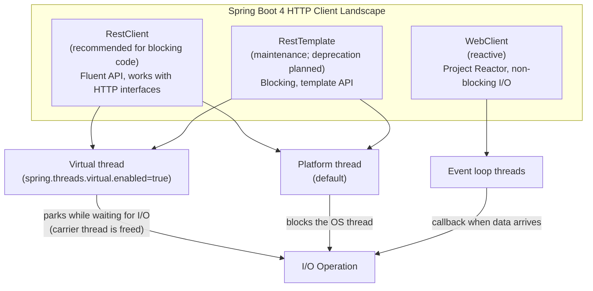
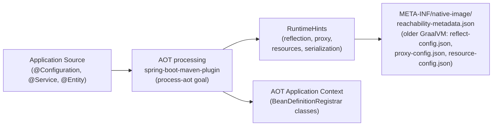

# Spring Framework 7 — New Baseline Features

Spring Framework 7 (November 2025) is the foundation of Spring Boot 4. Its headline features are HTTP service client *groups* (declarative clients configured in bulk), built-in API versioning, JSpecify null-safety across the portfolio, core resilience annotations (`@Retryable`, `@ConcurrencyLimit`), Jackson 3 support, and the move to GraalVM's new unified reachability metadata. This lesson covers the HTTP client stack (`@HttpExchange` interfaces and `RestClient`, both introduced in Framework 6 and now the recommended way to call HTTP APIs), AOT hints, observability with Micrometer's `Observation` API, the other Framework 7 changes, and the test annotation migration — with fintech-grade code examples.

---

## 1. HTTP Interfaces (`@HttpExchange`) — Production-Ready Declarative HTTP

Teams writing microservice clients used to choose between hand-rolling a `WebClient`/`RestTemplate` wrapper and pulling in OpenFeign (whose Spring Cloud integration is now in maintenance mode). HTTP interfaces — `@HttpExchange` — have been the Spring-native answer since Framework 6.0.

**What changed in SF7**: an *HTTP service registry*. Instead of building a `HttpServiceProxyFactory` by hand for every interface, you declare groups of interfaces with `@ImportHttpServices`, and Spring Boot 4 configures each group (base URL, timeouts) from `spring.http.serviceclient.<group>.*` properties. AOT hints for the interfaces are generated automatically, so they also work in native images.

### Defining a Payment Infrastructure Client

A common fintech pattern: a payment service calls an external fraud-screening API and an FX rate service. Both are defined as `@HttpExchange` interfaces:

```java
// FraudCheckClient.java
@HttpExchange(url = "/v2/fraud", accept = "application/json")
public interface FraudCheckClient {

    @PostExchange("/check")
    FraudCheckResponse checkPayment(@RequestBody FraudCheckRequest request);

    @GetExchange("/rules/{merchantId}")
    FraudRules getRulesForMerchant(@PathVariable String merchantId);
}

// FxRateClient.java
@HttpExchange(url = "/v1/rates", accept = "application/json")
public interface FxRateClient {

    @GetExchange("/{baseCurrency}/{targetCurrency}")
    FxRate getRate(
        @PathVariable String baseCurrency,
        @PathVariable String targetCurrency,
        @RequestParam("asOf") LocalDate asOf
    );

    // Batch fetch — POST body with currency pairs
    @PostExchange("/batch")
    List<FxRate> getRatesBatch(@RequestBody List<CurrencyPair> pairs);
}
```

### Registering the Clients

The SF7 way — declare groups and configure them with properties:

```java
@Configuration
@ImportHttpServices(group = "fraud", types = FraudCheckClient.class)
@ImportHttpServices(group = "fx", types = FxRateClient.class)
public class HttpServicesConfiguration {
    // Spring Boot 4 configures each group from properties, e.g.
    //   spring.http.serviceclient.fraud.base-url=https://fraud.vendor.example
    //   spring.http.serviceclient.fraud.read-timeout=2s
    //   spring.http.serviceclient.fx.base-url=http://fx-service
    //   spring.http.serviceclient.fx.read-timeout=500ms
    // Per-group customisation (auth headers, status handlers) goes in a
    // RestClientHttpServiceGroupConfigurer bean.
}
```

The explicit way — build each proxy yourself (works on Framework 6 too, and gives full control):

```java
@Configuration
public class HttpClientConfiguration {

    // Fraud check: external vendor, strict 2s timeout
    @Bean
    public FraudCheckClient fraudCheckClient(
            @Value("${clients.fraud.base-url}") String baseUrl,
            @Value("${clients.fraud.connect-timeout-ms:1000}") long connectMs,
            @Value("${clients.fraud.read-timeout-ms:2000}") long readMs,
            @Value("${clients.fraud.api-key}") String apiKey) {   // from Vault / secret store

        RestClient restClient = RestClient.builder()
            .baseUrl(baseUrl)
            .requestFactory(clientHttpRequestFactory(connectMs, readMs))
            // A "${...}" inside a Java string literal is NOT resolved -- inject the value
            .defaultHeader(HttpHeaders.AUTHORIZATION, "Bearer " + apiKey)
            .defaultStatusHandler(
                HttpStatusCode::is4xxClientError,
                (req, resp) -> {
                    throw new FraudServiceException(
                        "Fraud API client error: " + resp.getStatusCode());
                })
            .defaultStatusHandler(
                HttpStatusCode::is5xxServerError,
                (req, resp) -> {
                    throw new FraudServiceUnavailableException(
                        "Fraud API unavailable: " + resp.getStatusCode());
                })
            .build();

        return HttpServiceProxyFactory
            .builderFor(RestClientAdapter.create(restClient))
            .build()
            .createClient(FraudCheckClient.class);
    }

    // FX rate service: internal, 500ms timeout — called on critical payment path
    @Bean
    public FxRateClient fxRateClient(
            @Value("${clients.fx.base-url}") String baseUrl) {

        RestClient restClient = RestClient.builder()
            .baseUrl(baseUrl)
            .requestFactory(clientHttpRequestFactory(300L, 500L))
            .build();

        return HttpServiceProxyFactory
            .builderFor(RestClientAdapter.create(restClient))
            .build()
            .createClient(FxRateClient.class);
    }

    private ClientHttpRequestFactory clientHttpRequestFactory(
            long connectMs, long readMs) {
        SimpleClientHttpRequestFactory factory = new SimpleClientHttpRequestFactory();
        factory.setConnectTimeout(Duration.ofMillis(connectMs));
        factory.setReadTimeout(Duration.ofMillis(readMs));
        return factory;
    }
}
```

### Error Handling and Problem Detail (RFC 9457)

When no custom status handler intercepts the error, `RestClient` (and the HTTP interfaces backed by it) throws `HttpClientErrorException` for 4xx responses; the `application/problem+json` body can be decoded into a `ProblemDetail` with `getResponseBodyAs(...)`:

```java
// If the fraud API returns 422 Unprocessable Entity with application/problem+json
// (and no defaultStatusHandler converts 4xx into a custom exception first):
try {
    var result = fraudCheckClient.checkPayment(request);
} catch (HttpClientErrorException ex) {
    ProblemDetail problem = ex.getResponseBodyAs(ProblemDetail.class);
    log.warn("Fraud check declined: type={} detail={}",
        problem.getType(), problem.getDetail());
    return AuthorizationResult.declined(problem.getDetail());
}
```

---

## 2. `RestClient` — The New Blocking HTTP Client

`RestClient` was introduced in SF6.1 and is the primary blocking HTTP abstraction in SF7. It is not reactive — it uses a `ClientHttpRequestFactory` backed by the JDK `HttpClient`, Apache HttpComponents 5, Jetty, or Reactor Netty. When virtual threads are enabled (`spring.threads.virtual.enabled=true` — still opt-in in SB4), a blocking `RestClient` call parks the virtual thread while waiting for I/O, so I/O-bound services scale close to reactive ones without the reactive programming model.

### Comparison with `WebClient` and `RestTemplate`



**When to use `RestClient` vs `WebClient`**:
- Use `RestClient` for all new blocking code in SB4. With virtual threads enabled, throughput for I/O-bound workloads comes close to `WebClient`, and the code is simpler.
- Use `WebClient` only when integrating with an existing reactive pipeline (e.g., a service already using `Flux`/`Mono` end-to-end, or a reactive `R2DBC` data layer).
- Do not write new code with `RestTemplate`. It is in maintenance mode, the Spring team plans to deprecate it in a 7.x release, and `RestClient` offers the same features with a fluent API (it can even reuse your existing `RestTemplate` configuration via `RestClient.create(restTemplate)`).

### `RestClient` in a Payment Settlement Service

```java
@Service
public class PaymentSettlementClient {

    private final RestClient restClient;

    public PaymentSettlementClient(RestClient.Builder builder,
            @Value("${clients.settlement.base-url}") String baseUrl) {
        this.restClient = builder
            .baseUrl(baseUrl)
            .defaultHeader("X-Service-Name", "payment-service")
            .build();
    }

    public SettlementConfirmation submitSettlement(SettlementRequest request) {
        return restClient.post()
            .uri("/settlements")
            .contentType(MediaType.APPLICATION_JSON)
            .body(request)
            .retrieve()
            .onStatus(HttpStatusCode::is5xxServerError, (req, resp) -> {
                throw new SettlementServiceException(
                    "Settlement backend error: " + resp.getStatusCode());
            })
            .body(SettlementConfirmation.class);
    }

    public Optional<SettlementStatus> getSettlementStatus(String settlementId) {
        try {
            return Optional.ofNullable(
                restClient.get()
                    .uri("/settlements/{id}", settlementId)
                    .retrieve()
                    .body(SettlementStatus.class));
        } catch (HttpClientErrorException.NotFound ex) {
            return Optional.empty();
        }
    }
}
```

**`RestClient.Builder` auto-configuration**: SB4 auto-configures a `RestClient.Builder` prototype bean. Inject it (not a fully-built `RestClient`) to allow each service to customize its base URL and headers without sharing state.

---

## 3. AOT Processing: `RuntimeHints`, `@ImportRuntimeHints`, `@RegisterReflectionForBinding`

GraalVM native image requires knowing at build time every class that will be accessed via reflection, every proxy interface, and every resource to include in the image. SF7's AOT pipeline generates most of these hints automatically; this section covers what you still need to handle manually.

### How the AOT Pipeline Works



### When Manual Hints Are Still Needed

AOT processing handles: `@Component`-scanned beans, `@ConfigurationProperties`, Spring Data repositories and JPA entities, and the request/response body types in controller method signatures. You need manual hints for:

1. **Dynamic class loading** — `Class.forName(className)` where `className` is a runtime string
2. **JNI-based libraries** — some legacy crypto libraries
3. **Custom `TypeToken<>` patterns** — Gson or generic TypeReference patterns

```java
// RuntimeHintsRegistrar for a custom ISO 20022 payment codec
public class PaymentCodecHints implements RuntimeHintsRegistrar {

    @Override
    public void registerHints(RuntimeHints hints, ClassLoader classLoader) {
        // Register reflection for internal payment codec (uses Class.forName internally)
        hints.reflection()
            .registerType(ISO20022PaymentCodec.class,
                MemberCategory.INVOKE_PUBLIC_CONSTRUCTORS,
                MemberCategory.INVOKE_PUBLIC_METHODS)
            .registerType(TransactionReference.class,
                MemberCategory.DECLARED_FIELDS);

        // Register JDK proxy for the codec interface
        hints.proxies()
            .registerJdkProxy(PaymentCodec.class);

        // Register classpath resources loaded at runtime
        hints.resources()
            .registerPattern("iso20022/schemas/*.xsd");
    }
}

// Apply to a @Configuration class
@Configuration
@ImportRuntimeHints(PaymentCodecHints.class)
public class PaymentCodecConfiguration {

    @Bean
    public PaymentCodec paymentCodec() {
        return new ISO20022PaymentCodec();
    }
}
```

### `@RegisterReflectionForBinding`

Types that appear in `@RestController` method signatures get binding hints automatically. Use `@RegisterReflectionForBinding` for types that Jackson (de)serialises *outside* those signatures — bodies sent with `RestClient`, Kafka message payloads, or types read from a generic `Map`/`JsonNode`:

```java
// Types serialised by RestClient and the Kafka listener — not visible to AOT
// through any controller signature
@Configuration
@RegisterReflectionForBinding({
    SettlementRequest.class,
    SettlementConfirmation.class,
    PaymentEvent.class
})
public class SettlementBindingHints {
}
```

---

## 4. Observability — `Observation` API and `@Observed`

Micrometer's `Observation` API (Micrometer 1.10+; Spring Boot 4 ships Micrometer 1.16) is the unified instrumentation primitive. A single `Observation` can automatically produce:
- A timer/distribution metric in the `MeterRegistry`
- A span in the tracing context (exported via OTLP or Zipkin)
- Structured log correlation (MDC `traceId`/`spanId`)

### `@Observed` — Zero-Boilerplate Method Instrumentation

```java
// Enable @Observed support: Spring Boot 4 registers the ObservedAspect when
// AspectJ is on the classpath (spring-boot-starter-aspectj) and
//   management.observations.annotations.enabled=true

// Apply to any Spring-managed bean method
@Service
@Observed(name = "payment.fraud-check",
          contextualName = "fraud-check-service")
public class FraudCheckService {

    private final FraudCheckClient client;

    public FraudCheckService(FraudCheckClient client) {
        this.client = client;
    }

    // Each method call produces a span + timer named "payment.fraud-check"
    @Observed(name = "payment.fraud-check.single")
    public FraudCheckResponse check(FraudCheckRequest request) {
        return client.checkPayment(request);
    }
}
```

### Manual `Observation` for Fine-Grained Control

```java
@Service
public class LedgerUpdateService {

    private final ObservationRegistry registry;
    private final LedgerRepository ledger;

    public LedgerUpdateService(ObservationRegistry registry, LedgerRepository ledger) {
        this.registry = registry;
        this.ledger = ledger;
    }

    public LedgerEntry debit(String accountId, MonetaryAmount amount) {
        return Observation.createNotStarted("ledger.debit", registry)
            .lowCardinalityKeyValue("currency", amount.getCurrency().getCurrencyCode())
            .highCardinalityKeyValue("account.id", accountId)  // high-cardinality: not a metric tag
            .observe(() -> {
                var entry = LedgerEntry.debit(accountId, amount);
                return ledger.save(entry);
            });
    }
}
```

**Low vs high cardinality**: `lowCardinalityKeyValue` values become metric tag dimensions (bounded set, e.g., currency codes). `highCardinalityKeyValue` values appear in span attributes but not as metric tags — this prevents metric cardinality explosion with per-account IDs.

---

## 5. Other Framework 7 Changes Worth Knowing

**JSpecify null-safety**: the whole Spring portfolio is annotated with JSpecify (`@NullMarked` packages, `@Nullable` from `org.jspecify.annotations`), replacing Spring's own `@Nullable`/`@NonNull`. Tools such as NullAway can now check your code against Spring's APIs at build time — attractive for payment code where an unexpected `null` amount is a production incident.

**API versioning**: `@RequestMapping` and its variants have a `version` attribute (e.g. `@GetMapping(path = "/payments/{id}", version = "2")`). The version is resolved from a header, query parameter, path segment or media type parameter, configured via `ApiVersionConfigurer` or Spring Boot's `spring.mvc.apiversion.*` properties. `RestClient` and HTTP interfaces can send a version too.

**Resilience in the core**: `@Retryable` (with backoff and jitter) and `@ConcurrencyLimit`, enabled with `@EnableResilientMethods`, cover simple retry and bulkhead needs without Spring Retry or Resilience4j. Only retry operations that are idempotent — for payments, that means calls carrying an idempotency key.

**Jackson 3**: Framework 7 supports Jackson 3 (`tools.jackson` packages); Jackson 2 support is deprecated. Custom serialisers and `ObjectMapper` customisations need migrating.

**Jakarta EE 11 alignment**: Servlet 6.1, Jakarta Persistence 3.2, Bean Validation 3.1. The common validation annotations (`@NotNull`, `@Size`, `@Pattern`) are unchanged; libraries compiled against older Jakarta EE versions should be upgraded.

**Bean definition overriding** stays disabled by default in Spring Boot (as since 2.1): two beans with the same name fail the startup instead of silently replacing each other.

---

## 6. Testing Changes: `@MockitoBean` and `@MockitoSpyBean`

The test annotation rename deserves a full example because the migration is mechanical but easy to miss:

```java
// SB3.x test — @MockBean and @SpyBean from spring-boot-test
@SpringBootTest
class PaymentAuthorizationServiceTest {

    @MockBean                        // REMOVED in SB4 from spring-boot-test
    private FraudCheckClient fraudCheck;

    @SpyBean                         // REMOVED in SB4 from spring-boot-test
    private PaymentRepository repository;

    @Autowired
    private PaymentAuthorizationService service;

    @Test
    void shouldDeclinePaymentWhenFraudCheckFails() {
        given(fraudCheck.checkPayment(any())).willReturn(
            FraudCheckResponse.declined("velocity-limit"));

        var result = service.authorize(validPaymentRequest());

        assertThat(result.status()).isEqualTo(AuthorizationStatus.DECLINED);
    }
}

// SB4 test — @MockitoBean and @MockitoSpyBean from spring-test (not spring-boot-test)
@SpringBootTest
class PaymentAuthorizationServiceTest {

    @MockitoBean                     // Now in org.springframework.test.context.bean.override.mockito
    private FraudCheckClient fraudCheck;

    @MockitoSpyBean                  // Now in org.springframework.test.context.bean.override.mockito
    private PaymentRepository repository;

    @Autowired
    private PaymentAuthorizationService service;

    @Test
    void shouldDeclinePaymentWhenFraudCheckFails() {
        given(fraudCheck.checkPayment(any())).willReturn(
            FraudCheckResponse.declined("velocity-limit"));

        var result = service.authorize(validPaymentRequest());

        assertThat(result.status()).isEqualTo(AuthorizationStatus.DECLINED);
    }
}
```

**Where the new annotations can be used**: `@MockitoBean` and `@MockitoSpyBean` (part of Spring Framework since 6.2) are declared on fields of the *test class* (or at type level on the test class), not inside `@Configuration`/`@TestConfiguration` classes. If you had `@MockBean` fields in a shared `@TestConfiguration`, move them into the tests (or into a shared base class or test interface).

**`@DataJpaTest` and `@WebMvcTest` slices**: still work as before; combine them with `@MockitoBean` for the collaborators the slice does not load. Note that in Spring Boot 4 the slice annotations moved to technology-specific test modules (for example `spring-boot-data-jpa-test`, `spring-boot-webmvc-test`), so imports and test dependencies change.

---

## Summary

Spring Framework 7 raises the ceiling on what you can build without reaching for external libraries. `@HttpExchange` interfaces — now configurable in groups — replace Feign for most use cases. `RestClient` replaces `RestTemplate` for new blocking code. Micrometer's `Observation` API replaces raw `Timer`/`Counter` instrumentation. JSpecify, API versioning and core resilience annotations remove whole categories of hand-written code. And the move from `@MockBean` to `@MockitoBean` shows that test infrastructure is now a Spring Framework concern rather than a Spring Boot one.

Lesson 03 covers virtual thread integration at the SB4 configuration level — specifically how the defaults changed, how to detect carrier thread pinning, and how HikariCP and Hibernate 7 fit into the picture.

---

<!-- KNOWLEDGE-CHECK
[
  {
    "id": "kc-15-02-01",
    "question": "A payment service calls an external fraud API through a Spring Framework 7 HTTP interface backed by RestClient, without a custom status handler. The fraud API returns 422 with an `application/problem+json` body. How do you get at the problem details?",
    "options": [
      "HTTP interfaces cannot handle `application/problem+json` — you must switch to WebClient",
      "RestClient throws `HttpClientErrorException` (a `RestClientResponseException`) for the 4xx status; calling `getResponseBodyAs(ProblemDetail.class)` on it decodes the body into a `ProblemDetail`",
      "You must annotate the interface method with `@ProblemDetailResponse` to enable RFC 9457 decoding",
      "The interface method returns `null` and the problem details are lost"
    ],
    "correct": 1,
    "explanation": "Without a custom status handler, RestClient (and therefore the HTTP interface proxy) throws HttpClientErrorException for 4xx and HttpServerErrorException for 5xx. Both extend RestClientResponseException, whose getResponseBodyAs(Class) decodes the error body with the configured message converters — getResponseBodyAs(ProblemDetail.class) gives you type, title, detail and extension properties. If you register a defaultStatusHandler that throws your own exception, you must decode the body there instead. There is no @ProblemDetailResponse annotation."
  },
  {
    "id": "kc-15-02-02",
    "question": "An SB4 service has a `PaymentCodecConfiguration` that registers `PaymentCodecHints implements RuntimeHintsRegistrar`. The configuration class uses `@ImportRuntimeHints(PaymentCodecHints.class)`. During a GraalVM native image build, the `ISO20022PaymentCodec` class is not found. What is the most likely cause?",
    "options": [
      "`@ImportRuntimeHints` only works on `@SpringBootApplication` classes, not on `@Configuration` classes",
      "The `PaymentCodecHints` class must be listed in `src/main/resources/META-INF/spring/aot.factories` instead of using `@ImportRuntimeHints`",
      "The `RuntimeHintsRegistrar.registerHints()` method was not called because the `@Configuration` class was excluded from the AOT scan — verify that `PaymentCodecConfiguration` is component-scanned and not filtered by a `@ConditionalOnProperty` that evaluates to `false` at build time",
      "The `MemberCategory.INVOKE_PUBLIC_METHODS` hint does not cover constructors — you need `MemberCategory.INVOKE_PUBLIC_CONSTRUCTORS` separately for instantiation"
    ],
    "correct": 2,
    "explanation": "The AOT scanner only processes `@Configuration` classes that are reachable from the application context at build time. If `PaymentCodecConfiguration` is annotated with `@ConditionalOnProperty(name='payment.codec.enabled')` and that property is not set during the AOT build phase (e.g., not in `application.yaml`), the entire configuration is excluded, and `@ImportRuntimeHints` is never processed. The fix is to ensure the condition evaluates to `true` during the Maven/Gradle AOT phase, or to register the hints via `aot.factories` as an alternative. Option D is also partially true (constructors need a separate `MemberCategory`) but is not the most likely cause of the class not being found at all."
  },
  {
    "id": "kc-15-02-03",
    "question": "In Spring Framework 7, what is the key difference between `lowCardinalityKeyValue` and `highCardinalityKeyValue` on an `Observation`, and why does it matter for a payment service with millions of unique account IDs?",
    "options": [
      "There is no functional difference — both are recorded as metric tags and span attributes; `highCardinality` just signals developer intent",
      "`lowCardinalityKeyValue` values become metric tag dimensions in the `MeterRegistry` (bounded set, safe for Prometheus/Datadog); `highCardinalityKeyValue` values appear only in distributed trace span attributes, not as metric tags — avoiding metric cardinality explosion with unbounded values like account IDs",
      "`highCardinalityKeyValue` values are automatically hashed before being stored as metric tags to reduce cardinality",
      "`lowCardinalityKeyValue` is for `Timer` metrics only; `highCardinalityKeyValue` is for `Counter` metrics only"
    ],
    "correct": 1,
    "explanation": "Micrometer's Observation API distinguishes cardinality explicitly to prevent a common observability mistake. `lowCardinalityKeyValue` values (e.g., `currency=USD`, `channel=API`) are safe as metric tag dimensions because the value space is bounded — adding them to a Prometheus counter or histogram does not create an unbounded label. `highCardinalityKeyValue` values (e.g., `account.id=acc_1234567890`) have an unbounded value space and would cause metric cardinality explosion in Prometheus, Datadog, or any TSDB if used as tags. Micrometer routes high-cardinality values only to the tracing backend (as span attributes), never to the metrics backend."
  },
  {
    "id": "kc-15-02-04",
    "question": "A team migrates from `RestTemplate` to `RestClient` in Spring Boot 4. They had a `RestTemplateCustomizer` bean that added a request interceptor for HMAC signature headers on every outgoing request. What is the equivalent mechanism in `RestClient`?",
    "options": [
      "`RestClientCustomizer` bean — same pattern, different interface name, applies globally to the auto-configured `RestClient.Builder`",
      "There is no equivalent — you must use `WebClient` if you need global request interceptors",
      "Register the interceptor on the `RestClient.Builder` using `.requestInterceptor(ClientHttpRequestInterceptor)` before building the client, or use a `RestClientCustomizer` bean that applies globally to the auto-configured builder",
      "Use `@HttpExchangeFilter` annotation on the `@HttpExchange` interface methods to attach per-request interceptors"
    ],
    "correct": 2,
    "explanation": "`RestClient.Builder` has a `.requestInterceptor(ClientHttpRequestInterceptor)` method that is the direct equivalent of `RestTemplate.getInterceptors().add()`. For global application to all `RestClient` instances built from the auto-configured `RestClient.Builder`, Spring Boot 4 supports `RestClientCustomizer` beans (option A is close but describes the same approach). The most precise answer for migrating an existing interceptor to a specific client is option C: call `.requestInterceptor()` on the builder. `@HttpExchangeFilter` does not exist in SF7."
  }
]
-->

<!-- PRACTICAL-CHALLENGE
{
  "id": "pc-15-02",
  "title": "HTTP Interfaces and RestClient for a Payment Gateway Integration",
  "description": "Build a production-quality HTTP client layer for a payment service that calls an external fraud API and an internal FX rate service using Spring Framework 7 HTTP interfaces.",
  "tasks": [
    {
      "id": "pc-15-02-01",
      "description": "Define two `@HttpExchange` interfaces: `FraudCheckClient` with `@PostExchange(\"/v2/fraud/check\")` returning `FraudCheckResponse`, and `FxRateClient` with `@GetExchange(\"/v1/rates/{base}/{target}\")` returning `FxRate`. Register both as beans using `HttpServiceProxyFactory.builderFor(RestClientAdapter.create(restClient)).build().createClient(...)`. Each client must have an independent `RestClient` with separate read timeouts (2s for fraud, 500ms for FX). Write an integration test using WireMock that verifies the timeout configuration causes a `ResourceAccessException` when the stub delays the response beyond the configured timeout."
    },
    {
      "id": "pc-15-02-02",
      "description": "Add a `ClientHttpRequestInterceptor` that injects an `X-Request-ID` header (UUID, generated per request) and an `X-Correlation-ID` header (from MDC `traceId` if present, otherwise a new UUID) on every outgoing request from both clients. Register it on the `RestClient.Builder` prototype bean using a `RestClientCustomizer` bean so it applies to all clients built from the auto-configured builder. Write a unit test verifying both headers are present in a captured request."
    },
    {
      "id": "pc-15-02-03",
      "description": "Instrument the `FraudCheckService.check(FraudCheckRequest)` method using `@Observed(name=\"payment.fraud-check\")` with `lowCardinalityKeyValue` tags for `fraud.result` (approved/declined/error) and `currency`. Enable annotation support with `management.observations.annotations.enabled=true` (and the AspectJ starter). Write a test using `TestObservationRegistry` (from `micrometer-test`) that verifies an observation named `payment.fraud-check` is recorded with the correct tags after a successful fraud check call."
    },
    {
      "id": "pc-15-02-04",
      "description": "Migrate a test class that uses `@MockBean FraudCheckClient` and `@SpyBean FraudCheckService` to use `@MockitoBean` and `@MockitoSpyBean` respectively. Confirm the import statements change from `org.springframework.boot.test.mock.mockito.MockBean` to `org.springframework.test.context.bean.override.mockito.MockitoBean`. Add a `@DataJpaTest` slice test for a `PaymentRepository` that also uses `@MockitoBean` to mock a dependent `AuditEventPublisher` bean. Confirm all tests pass with `spring-boot-test:4.0.0`."
    }
  ]
}
-->
