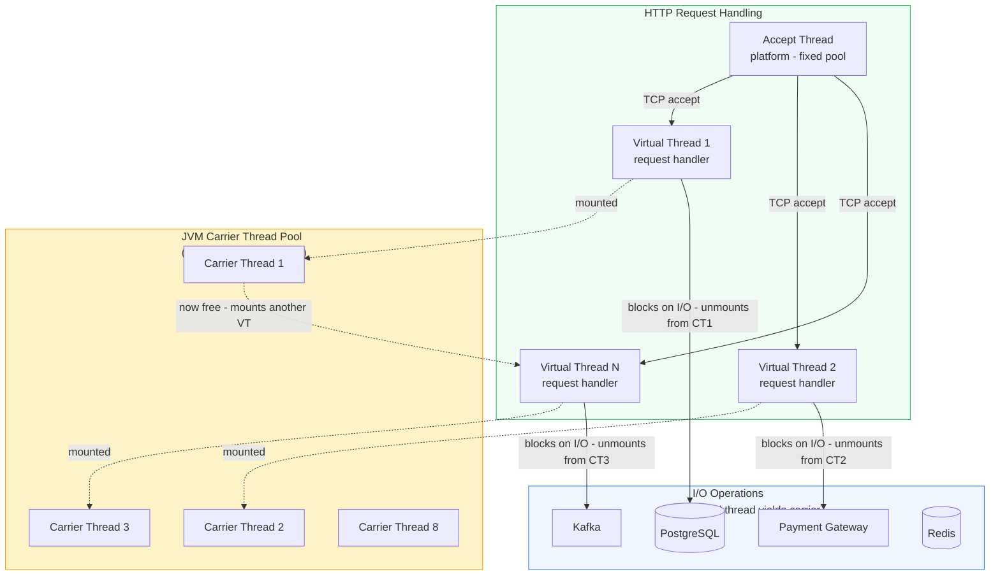

## نظرة عامة

تغيّر الخيوط الافتراضية (مشروع Loom، المُنهى في Java 21 عبر JEP 444) نموذج الكلفة الأساسي لتطبيقات Java المتزامنة المعتمدة على الإدخال/الإخراج. فخيط المنصة يستهلك نحو 1 ميغابايت من ذاكرة مكدس نظام التشغيل ويتطلب تبديل سياق في نظام التشغيل عند الحجب — أي أن خدمة تعالج 10,000 طلب متزامن تحتاج 10,000 خيط منصة و10 غيغابايت من ذاكرة المكدس، إضافة إلى عبء جدولة ضخم. أما الخيط الافتراضي فبنية تديرها JVM تُجدول على مجموعة صغيرة من خيوط المنصة الحاملة؛ والخيط الافتراضي المحجوب لا يستهلك إلا بضع مئات من البايتات في الكومة ويتخلى عن خيطه الحامل لعمل آخر فورًا.

يجعل Spring Boot ‏(منذ 3.2، وما زال في 4) تبني الخيوط الافتراضية تغييرًا من سطر إعداد واحد على Java 21+: ‏`spring.threads.virtual.enabled=true`. وهذه الخاصية الواحدة تحوّل عدة أنظمة فرعية دفعة واحدة: معالجة الطلبات في خادم الويب المدمج (Tomcat/Jetty)، و`applicationTaskExecutor` الافتراضي الذي يستخدمه `@Async`، ومجدول المهام `@Scheduled`، وحاويات مستمعي الرسائل المدعومة (Kafka، وRabbitMQ). ولخدمة معالجة مدفوعات تجري عدة استدعاءات إدخال/إخراج لاحقة لكل طلب (البوابة، ومحرك الاحتيال، ودفتر الأستاذ، وأسعار الصرف)، تزيل الخيوط الافتراضية مشكلة تحديد حجم مجمع الخيوط كليًا.

لكن التبني ليس خاليًا من الاحتكاك تمامًا. فالقلق التشغيلي الحرج هو **تثبيت الخيط الحامل (pinning)**: في Java 21–23، حين يُحجب خيط افتراضي داخل كتلة `synchronized` — وفي كل الإصدارات، حين يُحجب داخل دالة أصلية — يبقى مثبتًا على خيط المنصة الحامل ولا يستطيع التنازل، فيبطل فائدة الخيوط الافتراضية وقد يثبت كل الخيوط الحاملة تحت الحمل. ‏(أزال Java 24 عبر JEP 491 حالة `synchronized`.) وكثيرًا ما تراكم قواعد كود التقنية المالية استخدام `synchronized` في مكتبات التشفير، وكود مجمعات الاتصالات، وحزم تطوير الامتثال القديمة. ويعلمك هذا الدرس اكتشاف التثبيت وتشخيصه وإصلاحه — ويقدم `StructuredTaskScope` لنمط التفرع المتوازي الشائع في خطوط إثراء المدفوعات.

## أهداف التعلم

- فهم ماهية الخيوط الافتراضية، وكيف تجدولها JVM، ولماذا تزيل مشكلة تحديد حجم مجمع الخيوط للخدمات المعتمدة على الإدخال/الإخراج
- ضبط `spring.threads.virtual.enabled=true` وفهم الأنظمة الفرعية التي يعيد ضبطها
- شرح ماهية تثبيت الخيط الحامل، ولماذا يسببه `synchronized` في Java 21–23، وكيف تكتشفه بحدث JFR ‏`jdk.VirtualThreadPinned`
- استبدال `synchronized` بـ `ReentrantLock` لإزالة التثبيت في مكتبة تشفير للدفع
- استخدام `StructuredTaskScope` ‏(واجهة معاينة) لإثراء المدفوعات المتوازي مع المهلة والإلغاء
- استبدال `ThreadLocal` بـ `ScopedValue` لتمرير سياق الطلب في بيئة الخيوط الافتراضية
- كتابة اختبار تكامل يتحقق من استخدام الخيوط الافتراضية في متحكم Spring Boot 4

## الإعداد التلقائي للخيوط الافتراضية في SB4

حين تُضبط `spring.threads.virtual.enabled=true` ‏(ويعمل التطبيق على Java 21+)، يفعّل Spring Boot عدة مخصِّصات للإعداد التلقائي. وكل منها يتراجع حين تعرّف bean خاصًا بك، فيمكن تجاوزها فرديًا. والمقتطفات أدناه أمثلة مبسطة لما يفعله الإعداد التلقائي.

```yaml
# application.yml
spring:
  threads:
    virtual:
      enabled: true
```

**‏Tomcat** — يستبدل `TomcatVirtualThreadsWebServerFactoryCustomizer` مجمع خيوط NIO بمنفذ يخصص خيطًا افتراضيًا لكل طلب:

```java
// Spring Boot 4 source (simplified) — TomcatVirtualThreadsWebServerFactoryCustomizer
@Bean
@ConditionalOnProperty(value = "spring.threads.virtual.enabled", havingValue = "true")
@ConditionalOnClass(Tomcat.class)
public TomcatProtocolHandlerCustomizer<?> virtualThreadTomcatProtocolHandlerCustomizer() {
    return protocolHandler ->
            protocolHandler.setExecutor(Executors.newVirtualThreadPerTaskExecutor());
}
```

يُعالج كل طلب HTTP وارد الآن على خيطه الافتراضي الخاص. وتبقى خيوط القبول (التي تقبل اتصالات TCP من نظام التشغيل) خيوط منصة — فهي ليست افتراضية. ويُتجاهل `server.tomcat.threads.max` حين تكون الخيوط الافتراضية فعالة.

**‏`@Async`** — يسجّل الإعداد التلقائي لتنفيذ المهام `SimpleAsyncTaskExecutor` ينشئ خيطًا افتراضيًا جديدًا لكل مهمة كـ `applicationTaskExecutor` افتراضي:

```java
// Simplified — what the task execution auto-configuration does
@Bean(name = { "applicationTaskExecutor", "taskExecutor" })
@ConditionalOnMissingBean(Executor.class)
public SimpleAsyncTaskExecutor applicationTaskExecutor() {
    var executor = new SimpleAsyncTaskExecutor("task-");
    executor.setVirtualThreads(true);
    // Unbounded by default! Cap it for work that hits limited resources:
    //   spring.task.execution.simple.concurrency-limit=200
    return executor;
}
```

هذا يعني أن دوال `@Async` تعمل على الخيوط الافتراضية تلقائيًا. وإن عرّف التطبيق *أي* bean من نوع `Executor` خاص به، يتراجع هذا الافتراضي — فراجع beans المنفذات القائمة أثناء الترحيل.

**‏`@Scheduled`** — يسجّل الإعداد التلقائي لجدولة المهام `SimpleAsyncTaskScheduler` يشغّل كل تنفيذ مجدول على خيط افتراضي:

```java
// Simplified — what the task scheduling auto-configuration does
@Bean
@ConditionalOnMissingBean({ TaskScheduler.class, ScheduledExecutorService.class })
public SimpleAsyncTaskScheduler taskScheduler() {
    var scheduler = new SimpleAsyncTaskScheduler();
    scheduler.setThreadNamePrefix("scheduling-");
    scheduler.setVirtualThreads(true);
    return scheduler;
}
```

**مستمعو الرسائل** — تستخدم مصانع حاويات مستمعي Kafka وRabbitMQ الخيوط الافتراضية لخيوط المستهلكين أيضًا.

ما لا يتغير: ما زالت دوال `@EventListener` تعمل بشكل متزامن على الخيط الناشر (إلا إن علّمتها أيضًا بـ `@Async`)، وما زال لـ HikariCP مجمع ثابت من اتصالات قاعدة البيانات — فالخيوط الافتراضية تزيل حد الخيوط، لا حد الاتصالات.

البنية الناتجة تحت الخيوط الافتراضية:



## تثبيت الخيط الحامل: الاكتشاف والتشخيص

يحدث تثبيت الخيط الحامل حين لا يمكن فصل خيط افتراضي عن خيطه الحامل. والسببان:

1. **كتلة أو دالة `synchronized` ‏(Java 21–23)**: تثبت هذه الإصدارات الخيط الافتراضي على حامله حين يُحجب داخل كتلة `synchronized`. وأصلح Java 24 هذا (JEP 491) — ففي Java 24/25، لم يعد `synchronized` يسبب التثبيت. ويجب على الفرق التي ما زالت على Java 21 LTS التعامل معه يدويًا.
2. **استدعاء دالة أصلية (كل الإصدارات)**: الحجب داخل كود أصلي (JNI، أو إطار أصلي مثل استدعاء دالة أجنبية) يثبت الخيط طوال مدة الاستدعاء.

في خدمة دفع، التثبيت خطير لأن عددًا صغيرًا من الخيوط الحاملة (الافتراضي: `Runtime.getRuntime().availableProcessors()`) قد تُثبت كلها في آن واحد، فتتوقف الخدمة كاملة بينما تنتظر آلاف الخيوط الافتراضية في الطابور حاملًا.

**اكتشاف التثبيت وقت التطوير (Java 21–23):**

```bash
# Start the payment service with pinning diagnostics enabled
# (this flag was removed in Java 24 — use the JFR event below instead)
java -Djdk.tracePinnedThreads=full \
     -jar payment-service.jar

# Output when pinning occurs (truncated for readability):
# Thread[#47,ForkJoinPool-1-worker-1,5,CarrierThreads]
#     com.acme.payments.crypto.LegacyHsmSigner.sign(LegacyHsmSigner.java:83)   <== synchronized method
#         com.acme.payments.service.PaymentSigningService.signPayment(PaymentSigningService.java:51)
#         com.acme.payments.service.PaymentProcessingService.initiatePayment(PaymentProcessingService.java:112)
```

**اكتشاف التثبيت وقت التشغيل بمسجّل رحلات JDK ‏(كل الإصدارات):**

```bash
# Record a 60-second JFR snapshot while running load test
java -XX:StartFlightRecording=duration=60s,filename=payment-service.jfr \
     -jar payment-service.jar

# Analyze with JDK Mission Control or jfr command:
jfr print --events jdk.VirtualThreadPinned payment-service.jfr
```

## إصلاح التثبيت: ‏`ReentrantLock` مقابل `synchronized`

في Java 21–23، إصلاح التثبيت الناتج عن `synchronized` هو استبدال `synchronized` بـ `java.util.concurrent.locks.ReentrantLock` ‏(أو الترقية إلى Java 24+). فـ `ReentrantLock.lock()` و`unlock()` عمليتا إيقاف/استئناف تنفذهما JVM دون تثبيت — فينفصل الخيط الافتراضي أثناء انتظار القفل.

```java
package com.acme.payments.crypto;

import java.security.PrivateKey;
import java.util.concurrent.locks.ReentrantLock;

/**
 * Legacy HSM signing bridge — originally used synchronized to protect
 * the HSM session handle from concurrent access.
 *
 * BEFORE (causes carrier thread pinning with virtual threads):
 */
public class LegacyHsmSignerBefore {

    private final PrivateKey signingKey;

    public LegacyHsmSignerBefore(PrivateKey signingKey) {
        this.signingKey = signingKey;
    }

    // synchronized method pins the carrier thread for the entire HSM operation
    // Under virtual threads with 100 concurrent payment signings and 8 carrier threads,
    // all 8 carriers can be pinned waiting for HSM access.
    public synchronized byte[] sign(byte[] payload) {
        // HSM I/O — this blocks for 50-200ms in production
        return performHsmSign(signingKey, payload);
    }

    private byte[] performHsmSign(PrivateKey key, byte[] data) {
        // ... HSM library call (native or blocking I/O)
        return new byte[0]; // placeholder
    }
}

/**
 * AFTER: ReentrantLock eliminates carrier thread pinning.
 * Virtual threads waiting for the lock unmount from their carrier thread,
 * allowing other virtual threads to run.
 */
public class LegacyHsmSigner {

    private final PrivateKey signingKey;
    // ReentrantLock.lock() does NOT pin the carrier thread
    private final ReentrantLock hsmLock = new ReentrantLock();

    public LegacyHsmSigner(PrivateKey signingKey) {
        this.signingKey = signingKey;
    }

    public byte[] sign(byte[] payload) {
        hsmLock.lock();
        try {
            // Virtual thread is mounted for the duration of this critical section.
            // If the HSM call itself blocks internally (e.g., via a socket),
            // the virtual thread will pin only if the socket operation uses
            // a synchronized native call. For pure Java I/O it unmounts fine.
            return performHsmSign(signingKey, payload);
        } finally {
            hsmLock.unlock();
        }
    }

    private byte[] performHsmSign(PrivateKey key, byte[] data) {
        // HSM library call
        return new byte[0]; // placeholder
    }
}
```

إن لم تستطع تعديل مصدر المكتبة الخارجية، فشغّل استدعاءاتها على مجمع خيوط منصة مخصص لعزل التثبيت:

```java
package com.acme.payments.crypto;

import java.util.concurrent.ExecutorService;
import java.util.concurrent.Executors;

/**
 * Wraps a pinning legacy crypto library in a fixed platform thread pool.
 * Virtual threads submit work here and block (without pinning) while the
 * platform thread executes the synchronized library code.
 *
 * Pool size should be set to the HSM's maximum concurrent session count.
 */
public class PinningLibraryWrapper {

    // Platform thread pool — deliberately NOT virtual threads
    private final ExecutorService hsmPlatformPool =
            Executors.newFixedThreadPool(10, Thread.ofPlatform()
                    .name("hsm-platform-", 0)
                    .factory());

    private final LegacyHsmSignerBefore legacySigner; // the pinning library

    public PinningLibraryWrapper(LegacyHsmSignerBefore legacySigner) {
        this.legacySigner = legacySigner;
    }

    /**
     * The calling virtual thread blocks here, but it does NOT pin its carrier.
     * It parks (unmounts) while the platform thread in hsmPlatformPool runs
     * the synchronized legacySigner.sign() call.
     */
    public byte[] sign(byte[] payload) throws Exception {
        return hsmPlatformPool.submit(() -> legacySigner.sign(payload)).get();
    }
}
```

## التزامن المنظم: إثراء المدفوعات المتوازي

يوفر `StructuredTaskScope` واجهة تزامن آمنة لأنماط التفرع/التجميع. وهو ما زال **واجهة معاينة** (يحتاج `--enable-preview`): قدّمه JEP 453 كمعاينة في Java 21، وأعاد Java 25 ‏(JEP 505) تصميمه — فيُنشأ النطاق بـ `StructuredTaskScope.open(Joiner.awaitAllSuccessfulOrThrow(), cfg -> cfg.withTimeout(...))` بدل `new ShutdownOnFailure()`. ويستخدم المثال أدناه واجهة Java 21–24؛ والمفاهيم متطابقة. فبدل الإرسال إلى منفذ وإدارة دورات حياة `Future` يدويًا، تفتح كتلة `StructuredTaskScope`، وتفرّع المهام داخلها، ثم تجمعها — ويضمن النطاق اكتمال كل المهام المتفرعة أو إلغاءها قبل عودة الجمع.

تلغي سياسة `ShutdownOnFailure` كل المهام الفرعية المتبقية إن فشلت أي منها. وهذه السياسة الصحيحة لإثراء المدفوعات: إن فشل جلب درجة الاحتيال، فلا فائدة من انتظار سعر الصرف.

```java
package com.acme.payments.service;

import com.acme.payments.fraud.FraudScore;
import com.acme.payments.fraud.FraudScoringClient;
import com.acme.payments.fx.ExchangeRate;
import com.acme.payments.fx.FxRateClient;
import com.acme.payments.ledger.AccountInfo;
import com.acme.payments.ledger.LedgerClient;
import org.springframework.stereotype.Service;

import java.time.Duration;
import java.time.Instant;
import java.util.UUID;
import java.util.concurrent.StructuredTaskScope;

/**
 * Enriches a payment with data from three upstream services in parallel.
 *
 * Uses StructuredTaskScope.ShutdownOnFailure:
 *   - If any enrichment fails, the scope shuts down and remaining subtasks are cancelled
 *   - The overall timeout is 2 seconds — if any subtask doesn't complete, all are cancelled
 *   - ScopedValue propagates the request correlation ID to all subtasks without ThreadLocal
 */
@Service
public class PaymentEnrichmentService {

    // ScopedValue replaces ThreadLocal for context propagation in virtual thread environments
    public static final ScopedValue<String> CORRELATION_ID = ScopedValue.newInstance();

    private final FraudScoringClient fraudClient;
    private final FxRateClient fxRateClient;
    private final LedgerClient ledgerClient;

    public PaymentEnrichmentService(
            FraudScoringClient fraudClient,
            FxRateClient fxRateClient,
            LedgerClient ledgerClient) {
        this.fraudClient = fraudClient;
        this.fxRateClient = fxRateClient;
        this.ledgerClient = ledgerClient;
    }

    /**
     * Enriches a payment by concurrently fetching fraud score, FX rate, and account info.
     * All three calls happen in parallel. The first failure cancels the others.
     * Total timeout: 2 seconds.
     *
     * @param paymentId       the payment being enriched
     * @param sourceAccountId the account making the payment
     * @param fromCurrency    source currency for FX lookup
     * @param toCurrency      target currency for FX lookup
     * @param correlationId   request correlation ID, propagated via ScopedValue
     * @return enriched payment data
     */
    public EnrichedPayment enrich(
            UUID paymentId,
            UUID sourceAccountId,
            String fromCurrency,
            String toCurrency,
            String correlationId
    ) throws InterruptedException {

        // ScopedValue.where() binds the value for the scope of the runWhere lambda.
        // All forked subtasks inherit the binding — they read CORRELATION_ID.get()
        // and get the same correlationId without any ThreadLocal propagation.
        return ScopedValue.where(CORRELATION_ID, correlationId).call(() -> {
            try (var scope = new StructuredTaskScope.ShutdownOnFailure()) {

                // Fork all three enrichment calls concurrently
                StructuredTaskScope.Subtask<FraudScore> fraudSubtask =
                        scope.fork(() -> fetchFraudScore(paymentId, sourceAccountId));

                StructuredTaskScope.Subtask<ExchangeRate> fxSubtask =
                        scope.fork(() -> fetchExchangeRate(fromCurrency, toCurrency));

                StructuredTaskScope.Subtask<AccountInfo> accountSubtask =
                        scope.fork(() -> fetchAccountInfo(sourceAccountId));

                // Wait for all subtasks, with a 2-second deadline
                scope.joinUntil(Instant.now().plus(Duration.ofSeconds(2)));

                // throwIfFailed() rethrows the first exception from any subtask.
                // If joinUntil timed out, throws TimeoutException.
                scope.throwIfFailed();

                // All subtasks completed successfully — assemble the enriched payment
                return new EnrichedPayment(
                        paymentId,
                        fraudSubtask.get(),
                        fxSubtask.get(),
                        accountSubtask.get()
                );

            } catch (java.util.concurrent.TimeoutException e) {
                throw new PaymentEnrichmentTimeoutException(
                        "Payment enrichment timed out for payment " + paymentId, e);
            } catch (Exception e) {
                throw new PaymentEnrichmentException(
                        "Payment enrichment failed for payment " + paymentId, e);
            }
        });
    }

    private FraudScore fetchFraudScore(UUID paymentId, UUID accountId) {
        // CORRELATION_ID.get() returns the value bound by ScopedValue.where() above.
        // This works across virtual thread boundaries — no ThreadLocal needed.
        String corrId = CORRELATION_ID.get();
        return fraudClient.score(paymentId, accountId, corrId);
    }

    private ExchangeRate fetchExchangeRate(String from, String to) {
        String corrId = CORRELATION_ID.get();
        return fxRateClient.getRate(from, to, corrId);
    }

    private AccountInfo fetchAccountInfo(UUID accountId) {
        String corrId = CORRELATION_ID.get();
        return ledgerClient.getAccount(accountId, corrId);
    }

    // ── Domain types ──────────────────────────────────────────────────────────

    public record EnrichedPayment(
            UUID paymentId,
            FraudScore fraudScore,
            ExchangeRate exchangeRate,
            AccountInfo accountInfo
    ) {}

    public static class PaymentEnrichmentTimeoutException extends RuntimeException {
        public PaymentEnrichmentTimeoutException(String message, Throwable cause) {
            super(message, cause);
        }
    }

    public static class PaymentEnrichmentException extends RuntimeException {
        public PaymentEnrichmentException(String message, Throwable cause) {
            super(message, cause);
        }
    }
}
```

```java
// Supporting interfaces for the enrichment clients
package com.acme.payments.fraud;

import java.util.UUID;

public interface FraudScoringClient {
    FraudScore score(UUID paymentId, UUID accountId, String correlationId);
}

public record FraudScore(UUID paymentId, int score, boolean blocked, String reason) {}
```

```java
package com.acme.payments.fx;

import java.math.BigDecimal;
import java.time.Instant;
import java.util.UUID;

public interface FxRateClient {
    ExchangeRate getRate(String fromCurrency, String toCurrency, String correlationId);
}

public record ExchangeRate(String from, String to, BigDecimal rate, Instant fetchedAt) {}
```

```java
package com.acme.payments.ledger;

import java.math.BigDecimal;
import java.util.UUID;

public interface LedgerClient {
    AccountInfo getAccount(UUID accountId, String correlationId);
}

public record AccountInfo(UUID accountId, String iban, BigDecimal availableBalance, String currency) {}
```

## ‏`ScopedValue` مقابل `ThreadLocal` لتمرير السياق

‏`ThreadLocal` هو الآلية التقليدية لتمرير الحالة الخاصة بالطلب (معرّفات الارتباط، وسياق الأمان، وسياق المستأجر) عبر مكدس الاستدعاءات دون تمريرها في كل توقيع دالة. وتحت الخيوط الافتراضية، يعمل `ThreadLocal` لكن فيه مشكلتان:

1. **كلفة التوريث**: ينسخ `InheritableThreadLocal` القيم إلى الخيوط الأبناء وقت التفرع. ومع `StructuredTaskScope` الذي يفرّع مئات الخيوط الافتراضية، قد يكون هذا النسخ مكلفًا.
2. **الذاكرة ودورة الحياة**: قيم `ThreadLocal` قابلة للتعديل ويجب إزالتها صراحة. والمكتبات التي تخزن كائنات مكلفة لكل خيط في `ThreadLocal` ‏(المنسّقات، والمخازن المؤقتة) تفترض بضعة خيوط طويلة العمر في مجمع؛ ومع خيط افتراضي لكل طلب — ولا يجب أبدًا تجميع الخيوط الافتراضية — تُعاد بناء تلك الذاكرات المؤقتة لكل طلب وتتضاعف بعدد الخيوط المتزامنة.

‏`ScopedValue` بديل منظم غير قابل للتعديل. وكان واجهة معاينة في Java 21–24 ‏(من JEP 446 فصاعدًا) وأصبح نهائيًا في Java 25 ‏(JEP 506). ويُربط `ScopedValue` طوال مدة كتلة `ScopedValue.where(...).run(...)` أو `.call(...)` ويُفك ربطه تلقائيًا حين تخرج الكتلة. وترثه المهام الفرعية المتفرعة داخل `StructuredTaskScope` دون نسخ.

```java
package com.acme.payments.context;

import org.springframework.stereotype.Component;
import org.springframework.web.filter.OncePerRequestFilter;

import jakarta.servlet.FilterChain;
import jakarta.servlet.ServletException;
import jakarta.servlet.http.HttpServletRequest;
import jakarta.servlet.http.HttpServletResponse;
import java.io.IOException;

/**
 * Servlet filter that binds request-scoped context via ScopedValue.
 * Replaces ThreadLocal-based RequestContextHolder for virtual thread safety.
 */
@Component
public class PaymentRequestContextFilter extends OncePerRequestFilter {

    // Static ScopedValue declarations — these are shared constants, not instances per request
    public static final ScopedValue<String> CORRELATION_ID = ScopedValue.newInstance();
    public static final ScopedValue<String> TENANT_ID = ScopedValue.newInstance();
    public static final ScopedValue<String> USER_ID = ScopedValue.newInstance();

    @Override
    protected void doFilterInternal(
            HttpServletRequest request,
            HttpServletResponse response,
            FilterChain filterChain
    ) throws ServletException, IOException {

        String correlationId = request.getHeader("X-Correlation-Id");
        if (correlationId == null) correlationId = java.util.UUID.randomUUID().toString();

        String tenantId = request.getHeader("X-Tenant-Id");
        String userId = request.getHeader("X-User-Id");

        // Bind all three ScopedValues for the duration of this request's filter chain.
        // Any code — including code forked in StructuredTaskScope — can read these values.
        // They are automatically unbound when the lambda exits (request complete).
        try {
            ScopedValue.where(CORRELATION_ID, correlationId)
                    .where(TENANT_ID, tenantId != null ? tenantId : "default")
                    .where(USER_ID, userId != null ? userId : "anonymous")
                    .call(() -> {
                        filterChain.doFilter(request, response);
                        return null;
                    });
        } catch (Exception e) {
            if (e instanceof ServletException se) throw se;
            if (e instanceof IOException ioe) throw ioe;
            throw new ServletException(e);
        }
    }
}
```

تحفظان: ما زال `SecurityContextHolder` في Spring Security وMDC في SLF4J قائمين على `ThreadLocal`، فأبقهما لتلك الأطر؛ و`ScopedValue` *غير* مرئي في العمل المسلّم إلى منفذ (مثل دالة `@Async`) — بل فقط في الكود المستدعى داخل الربط وفي المهام الفرعية لـ `StructuredTaskScope`.

```java
// Anywhere in the call stack (including subtasks in StructuredTaskScope):
public class SomeDeepService {

    public void process() {
        // No method parameter threading needed — just read the ScopedValue
        String correlationId = PaymentRequestContextFilter.CORRELATION_ID.get();
        String tenantId = PaymentRequestContextFilter.TENANT_ID.get();

        // ... use correlationId and tenantId
    }
}
```

## ‏`@Async` مع الخيوط الافتراضية: قبل وبعد

قبل الخيوط الافتراضية، تطلب `@Async` منفذ `ThreadPoolTaskExecutor` مخصصًا للتحكم في حجم المجمع وسلوك الطابور. ومع `spring.threads.virtual.enabled=true`، ينشئ المنفذ الافتراضي خيطًا افتراضيًا لكل مهمة ولا يلزم تحديد حجم المجمع لمعظم الحالات — لكن اضبط حدًا للتزامن حين يصل العمل غير المتزامن إلى مورد محدود (مرحّل SMTP، أو واجهة شريك بحدود معدل، أو مجمع قاعدة البيانات).

```java
package com.acme.payments.notifications;

import org.springframework.scheduling.annotation.Async;
import org.springframework.stereotype.Service;

import java.util.UUID;
import java.util.concurrent.CompletableFuture;

@Service
public class PaymentNotificationService {

    // ── BEFORE virtual threads (SB3 pattern) ─────────────────────────────────
    // Required a custom @Bean ThreadPoolTaskExecutor with tuned pool size/queue.
    // Pool sizing was a guessing game: too small → queuing lag; too large → memory waste.

    // ── AFTER virtual threads (SB4 pattern) ──────────────────────────────────
    // @Async uses the virtual-thread SimpleAsyncTaskExecutor automatically.
    // No pool size tuning needed — each invocation gets its own virtual thread.

    @Async
    public CompletableFuture<Void> sendPaymentConfirmation(UUID paymentId, String recipientEmail) {
        // This runs on a virtual thread. The SMTP call blocks but doesn't consume
        // a platform thread while waiting for the mail server response.
        sendEmail(recipientEmail, buildConfirmationEmail(paymentId));
        return CompletableFuture.completedFuture(null);
    }

    @Async
    public CompletableFuture<Void> sendWebhook(UUID paymentId, String webhookUrl) {
        // HTTP POST to external webhook URL — blocking but on virtual thread
        postWebhook(webhookUrl, buildWebhookPayload(paymentId));
        return CompletableFuture.completedFuture(null);
    }

    @Async
    public CompletableFuture<Void> auditLog(UUID paymentId, String eventType) {
        // DB write — blocking I/O on virtual thread
        writeAuditRecord(paymentId, eventType);
        return CompletableFuture.completedFuture(null);
    }

    private void sendEmail(String recipient, String body) { /* SMTP call */ }
    private void postWebhook(String url, String payload) { /* HTTP POST */ }
    private void writeAuditRecord(UUID paymentId, String type) { /* JDBC write */ }
    private String buildConfirmationEmail(UUID paymentId) { return ""; }
    private String buildWebhookPayload(UUID paymentId) { return ""; }
}
```

إن احتجت منفذًا مخصصًا بخيوط منصة لبعض العمل، فتذكر أن تعريف *أي* bean من نوع `Executor` يجعل المنفذ الافتراضي المضبوط تلقائيًا يتراجع. فعرّف الافتراضي ذا الخيوط الافتراضية صراحة بجانبه:

```java
@Configuration
@EnableAsync
public class AsyncConfig {

    // This bean is used by @Async methods that explicitly name it
    // e.g., @Async("hsmExecutor")
    @Bean("hsmExecutor")
    public Executor hsmExecutor() {
        // Platform threads for HSM operations that cannot be de-pinned
        var executor = new ThreadPoolTaskExecutor();
        executor.setCorePoolSize(5);
        executor.setMaxPoolSize(10);
        executor.setQueueCapacity(50);
        executor.setThreadNamePrefix("hsm-");
        executor.initialize();
        return executor;
    }

    // Because hsmExecutor is an Executor bean, the auto-configured default
    // backs off -- so declare the virtual-thread default explicitly
    @Bean(name = { "applicationTaskExecutor", "taskExecutor" })
    public SimpleAsyncTaskExecutor applicationTaskExecutor() {
        var executor = new SimpleAsyncTaskExecutor("task-");
        executor.setVirtualThreads(true);
        executor.setConcurrencyLimit(200);
        return executor;
    }
}
```

## الخلاصة

- تحوّل `spring.threads.virtual.enabled=true` ‏(Java 21+) خادم الويب، ومنفذ `@Async` الافتراضي، ومجدول `@Scheduled`، ومستمعي الرسائل إلى الخيوط الافتراضية. ولا تلزم تغييرات كود أخرى للتحويل الأساسي — لكن مجمعات اتصالات قاعدة البيانات وحدود معدل الشركاء ما زالت تحدّ الإنتاجية.
- تثبيت الخيط الحامل هو المخاطرة التشغيلية الأساسية: من `synchronized` في Java 21–23 ‏(أُصلح في Java 24)، ومن الاستدعاءات الأصلية الحاجبة في كل الإصدارات. واكتشفه بأحداث JFR ‏`jdk.VirtualThreadPinned` ‏(و`-Djdk.tracePinnedThreads=full` في Java 21–23). واستبدل `synchronized` بـ `ReentrantLock`، أو رقِّ JDK، أو اعزل المكتبات المسببة للتثبيت في مجمع خيوط منصة مخصص.
- ‏`StructuredTaskScope` ‏(ما زال واجهة معاينة؛ وأعيد تصميمه في Java 25) هو النموذج الصحيح للتفرع المتوازي في إثراء المدفوعات. فهو يوفر إلغاءً منظمًا، وفرضًا للمهل، وانتشارًا نظيفًا للأخطاء دون إدارة `Future` يدويًا.
- ‏`ScopedValue` ‏(نهائي في Java 25) يحل محل `ThreadLocal` لتمرير سياق الطلب في بيئات الخيوط الافتراضية. فهو غير قابل للتعديل، ويُفك ربطه تلقائيًا حين يخرج النطاق، وترثه المهام الفرعية لـ `StructuredTaskScope` دون عبء نسخ.
- ‏`@Async` مع الخيوط الافتراضية يزيل تخمين حجم مجمع الخيوط للعمل غير المتزامن المعتمد على الإدخال/الإخراج. واحتفظ بمنفذات خيوط منصة مسماة فقط للكود الذي لا يمكن فك تثبيته (الاستدعاءات الأصلية، ومكتبات `synchronized` القديمة).

<!-- KNOWLEDGE-CHECK [
  {
    "id": "kc-vt301-01",
    "question": "خدمة دفع على Java 21 تفعّل spring.threads.virtual.enabled=true. وتحت حمل عالٍ تصبح غير مستجيبة رغم أن وحدة المعالجة خاملة وآلاف الخيوط الافتراضية معلقة. ويُظهر تفريغ الخيوط كل خيط حامل محجوبًا على قراءة مقبس داخل دالة synchronized في مكتبة عميل HSM قديمة. ما السبب الأرجح والإصلاح؟",
    "options": [
      "مجدول الخيوط الافتراضية في JVM مضبوط بشكل خاطئ — زِد خاصية النظام jdk.virtualThreadScheduler.parallelism",
      "تستخدم المكتبة دوال synchronized تثبت الخيوط الحاملة؛ استبدل synchronized بـ ReentrantLock أو اعزل استدعاءات المكتبة في مجمع خيوط منصة",
      "لا تستطيع الخيوط الافتراضية إجراء عمليات تشفيرية — استخدم @Async مع ThreadPoolTaskExecutor لكل استدعاءات التشفير",
      "مجمع اتصالات قاعدة البيانات اللاحقة مستنفد — زِد spring.datasource.hikari.maximum-pool-size"
    ],
    "correct": 1,
    "explanation": "في Java 21–23، يبقى الخيط الافتراضي الذي يُحجب داخل دالة synchronized مثبتًا على حامله. وحين تُثبت كل الخيوط الحاملة منتظرة إدخال/إخراج HSM، لا يستطيع أي خيط افتراضي آخر العمل فتتوقف الخدمة. والإصلاحات: استبدل synchronized بـ ReentrantLock ‏(إن كنت تملك الكود)، أو رقِّ إلى Java 24+ حيث أزال JEP 491 هذا التثبيت، أو شغّل استدعاءات المكتبة على مجمع خيوط منصة ثابت مخصص لعزلها. وزيادة توازي المجدول تضيف حاملات فقط وتؤجل التوقف."
  },
  {
    "id": "kc-vt301-02",
    "question": "تستخدم PaymentEnrichmentService الواجهة StructuredTaskScope.ShutdownOnFailure ‏(واجهة المعاينة في Java 21–24) لاستدعاء خدمات تقييم الاحتيال، وأسعار الصرف، ومعلومات الحساب بالتزامن مع مهلة ثانيتين. وتعيد خدمة تقييم الاحتيال 503 بعد 500 مللي ثانية. ماذا يحدث للمهمتين الفرعيتين لسعر الصرف ومعلومات الحساب؟",
    "options": [
      "تستمران في العمل حتى تكتملا أو تنتهي مهلة كل منهما",
      "تُلغيان فورًا حين يكتشف ShutdownOnFailure فشل المهمة الفرعية للاحتيال",
      "ترميان CancellationException الذي يجب التقاطه في callable كل مهمة فرعية",
      "تنتظر scope.throwIfFailed() اكتمالهما قبل إعادة رمي استثناء الاحتيال"
    ],
    "correct": 1,
    "explanation": "سياسة ShutdownOnFailure هي إغلاق النطاق (إلغاء كل المهام الفرعية المتبقية) بمجرد فشل أي مهمة فرعية. فحين ترمي المهمة الفرعية لتقييم الاحتيال استثناءً بسبب 503، يبدأ النطاق الإغلاق: تتلقى المهمتان الفرعيتان لسعر الصرف ومعلومات الحساب مقاطعة إلغاء وتتوقفان. ثم تعيد scope.throwIfFailed() رمي أول استثناء من المهام الفرعية. ولا تحتاج المهام الفرعية إلى التقاط CancellationException — فالنطاق يتعامل مع الإلغاء داخليًا."
  },
  {
    "id": "kc-vt301-03",
    "question": "يرحّل فريق من تمرير معرّف الارتباط القائم على ThreadLocal إلى ScopedValue لأمان الخيوط الافتراضية. أي عبارة تصف بشكل صحيح كيف ينتشر ScopedValue إلى المهام الفرعية المتفرعة في StructuredTaskScope؟",
    "options": [
      "يجب إعادة ربط ScopedValues صراحة في lambda كل مهمة فرعية باستخدام ScopedValue.where()",
      "ترث كل المهام الفرعية المتفرعة داخل النطاق ScopedValues المربوطة في النطاق الأب تلقائيًا دون نسخ",
      "ScopedValues محلية للخيط افتراضيًا ويجب تحويلها إلى InheritableScopedValue لتوريثها للمهام الفرعية",
      "ينشر StructuredTaskScope قيم ScopedValues فقط إن صُرح بها static final في الصنف نفسه"
    ],
    "correct": 1,
    "explanation": "ترث المهام الفرعية المتفرعة داخل StructuredTaskScope الذي يعمل داخل كتلة ScopedValue.where(...).call() روابط ScopedValue تلقائيًا. فترى المهمة الفرعية الربط نفسه دون أي إعادة ربط أو نسخ صريح. وهذه ميزة أساسية على InheritableThreadLocal، الذي ينسخ كل القيم المحلية للخيط عند التفرع. ورؤية ScopedValue بنيوية بحتة (يحددها مكدس الاستدعاءات)، لا بتصريحات الأصناف. ‏(أصبح ScopedValue واجهة نهائية في Java 25؛ وما زال StructuredTaskScope واجهة معاينة.)"
  },
  {
    "id": "kc-vt301-04",
    "question": "بعد تفعيل spring.threads.virtual.enabled=true، أصبحت دالة إشعارات الدفع @Async القائمة لدى فريق تعمل على الخيوط الافتراضية. لكن لديهم أيضًا دالة @Async معلّمة بـ @Async(\"hsmExecutor\") يجب أن تستمر في العمل على خيوط المنصة. ماذا يحدث لدالة @Async(\"hsmExecutor\")؟",
    "options": [
      "تنتقل تلقائيًا إلى الخيوط الافتراضية لأن spring.threads.virtual.enabled=true يتجاوز كل المنفذات",
      "تستمر في استخدام مجمع خيوط المنصة hsmExecutor لأن المنفذ المسمى يتجاوز المنفذ الافتراضي",
      "ترمي NoSuchBeanDefinitionException لأن SB4 يزيل دعم منفذات @Async المسماة",
      "تستخدم الخيوط الافتراضية داخليًا ضمن مجمع hsmExecutor، الذي يجب إعادة ضبطه لمنع ذلك"
    ],
    "correct": 1,
    "explanation": "دوال @Async التي تسمي bean منفذ صراحة — @Async(\"hsmExecutor\") — تستخدم ذلك المنفذ دائمًا. وتؤثر spring.threads.virtual.enabled=true فقط على المنفذ الافتراضي المضبوط تلقائيًا (applicationTaskExecutor). وتحفظ واحد: لأن hsmExecutor نفسه bean من نوع Executor، يتراجع المنفذ الافتراضي المضبوط تلقائيًا، فصرّح بمنفذ افتراضي ذي خيوط افتراضية صراحة بجانبه."
  }
] -->

<!-- PRACTICAL-CHALLENGE {
  "id": "pc-vt3-01",
  "title": "تفعيل الخيوط الافتراضية والتحقق منها في خدمة دفع",
  "description": "فعّل الخيوط الافتراضية في خدمة دفع على Spring Boot 4، واكتشف مشكلة تثبيت خيط حامل وأصلحها، ونفّذ تدفق إثراء مدفوعات متوازيًا بـ StructuredTaskScope.",
  "tasks": [
    {
      "id": "pc-vt301-01",
      "description": "فعّل spring.threads.virtual.enabled=true في خدمة دفع على Spring Boot 4. واكتب اختبار تكامل باستخدام @SpringBootTest مع MockMvc يرسل 500 طلب متزامن إلى POST /payments ويتحقق من: (أ) أن حالة استجابة HTTP هي 202 لكل الطلبات، (ب) أن الخيط الذي يعالج الطلب خيط افتراضي (Thread.currentThread().isVirtual() == true، متحقق منه عبر نقطة تصحيح أو خطاف اختبار)، (ج) أن الوقت الإجمالي لـ 500 طلب أقل من 10 ثوانٍ مع تأخير لاحق مُحاكى بـ 20 مللي ثانية لكل طلب."
    },
    {
      "id": "pc-vt301-02",
      "description": "حدد دالة synchronized في صنف LegacyHsmSigner لخدمة الدفع. وشغّل الخدمة على Java 21 مع تسجيل JFR لحدث jdk.VirtualThreadPinned ‏(أو -Djdk.tracePinnedThreads=full) وأطلق أثر تثبيت باستدعاء نقطة التوقيع. واستبدل الدالة synchronized بـ ReentrantLock. واكتب اختبار وحدة ينشئ 100 خيط افتراضي تستدعي كلها sign() بالتزامن ويتحقق من عدم حدوث جمود أو توقف خلال 5 ثوانٍ. ثم كرر تشغيل JFR على Java 25 بالنسخة الأصلية synchronized وقارن."
    },
    {
      "id": "pc-vt301-03",
      "description": "نفّذ PaymentEnrichmentService باستخدام StructuredTaskScope ‏(مع --enable-preview؛ ShutdownOnFailure في Java 21–24 أو Joiner.awaitAllSuccessfulOrThrow() في Java 25) لاستدعاء FraudScoringClient وFxRateClient وLedgerClient بالتوازي مع مهلة ثانيتين. واستخدم ScopedValue لتمرير معرّف الارتباط. واكتب اختبار وحدة بعملاء مُحاكين حيث ينام FraudScoringClient ‏100 مللي ثانية، وFxRateClient ‏150 مللي ثانية، وLedgerClient ‏200 مللي ثانية — وتحقق من إعادة EnrichedPayment في أقل من 300 مللي ثانية (لا 450 مللي ثانية تتابعيًا). واكتب اختبارًا ثانيًا يرمي فيه FraudScoringClient استثناءً وتحقق من رمي PaymentEnrichmentException وإلغاء المهمتين الفرعيتين للعميلين الآخرين."
    }
  ]
} -->
