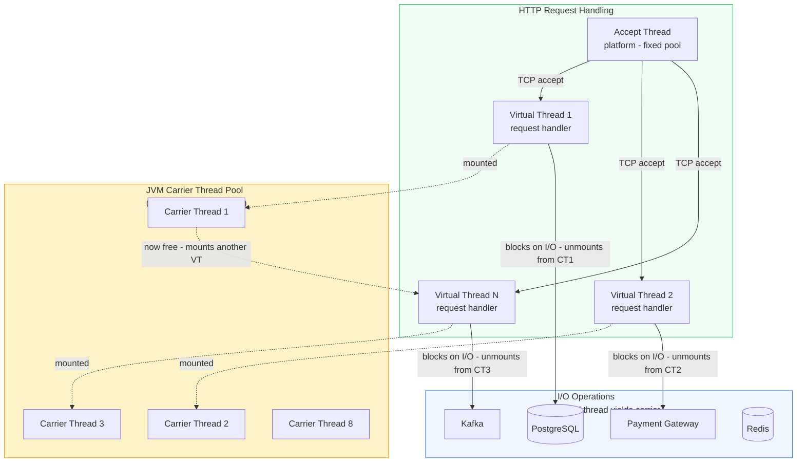

## Overview

Virtual threads (Project Loom, finalized in Java 21 via JEP 444) change the fundamental cost model for I/O-bound concurrent Java applications. A platform thread consumes approximately 1 MB of OS stack memory and requires an OS context switch on blocking — meaning a service handling 10,000 concurrent requests needs 10,000 platform threads and 10 GB of stack memory, plus enormous scheduling overhead. A virtual thread is a JVM-managed construct scheduled on a small pool of carrier platform threads; a blocked virtual thread consumes only a few hundred bytes on the heap and yields its carrier thread for other work immediately.

Spring Boot (since 3.2, and still in 4) makes virtual thread adoption a one-line configuration change on Java 21+: `spring.threads.virtual.enabled=true`. This single property switches several subsystems at once: the embedded web server's request handling (Tomcat/Jetty), the default `applicationTaskExecutor` used by `@Async`, the `@Scheduled` task scheduler, and supported messaging listener containers (Kafka, RabbitMQ). For a payment processing service that makes multiple downstream I/O calls per request (gateway, fraud engine, ledger, FX rates), virtual threads eliminate the thread-pool sizing problem entirely.

The adoption is not entirely frictionless, however. The critical operational concern is **carrier thread pinning**: on Java 21–23, when a virtual thread blocks inside a `synchronized` block — and on every version, when it blocks inside a native method — it stays pinned to its carrier platform thread and cannot yield, defeating the benefit of virtual threads and potentially pinning all carrier threads under load. (Java 24, via JEP 491, removed the `synchronized` case.) Fintech codebases frequently accumulate `synchronized` usage in cryptographic libraries, connection pool code, and legacy compliance SDKs. This lesson teaches you to detect, diagnose, and fix pinning — and introduces `StructuredTaskScope` for the specific pattern of parallel fan-out that is ubiquitous in payment enrichment pipelines.

## Learning Objectives

- Understand what virtual threads are, how the JVM schedules them, and why they eliminate the thread-pool sizing problem for I/O-bound services
- Configure `spring.threads.virtual.enabled=true` and understand the subsystems it reconfigures
- Explain what carrier thread pinning is, why `synchronized` causes it on Java 21–23, and how to detect it with JFR's `jdk.VirtualThreadPinned` event
- Replace `synchronized` with `ReentrantLock` to eliminate pinning in a payment crypto library
- Use `StructuredTaskScope` (a preview API) for parallel payment enrichment with timeout and cancellation
- Replace `ThreadLocal` with `ScopedValue` for passing request context in a virtual thread environment
- Write an integration test that verifies virtual thread usage in a Spring Boot 4 controller

## SB4 Virtual Thread Auto-Configuration

When `spring.threads.virtual.enabled=true` is set (and the application runs on Java 21+), Spring Boot activates several auto-configuration customizers. Each backs off when you define your own bean, so they can be overridden individually. The snippets below are simplified illustrations of what the auto-configuration does.

```yaml
# application.yml
spring:
  threads:
    virtual:
      enabled: true
```

**Tomcat** — `TomcatVirtualThreadsWebServerFactoryCustomizer` replaces the NIO thread pool with a virtual-thread-per-request executor:

```java
// Spring Boot 4 source (simplified) — TomcatVirtualThreadsWebServerFactoryCustomizer
@Bean
@ConditionalOnProperty(value = "spring.threads.virtual.enabled", havingValue = "true")
@ConditionalOnClass(Tomcat.class)
public TomcatProtocolHandlerCustomizer<?> virtualThreadTomcatProtocolHandlerCustomizer() {
    return protocolHandler ->
            protocolHandler.setExecutor(Executors.newVirtualThreadPerTaskExecutor());
}
```

Each incoming HTTP request is now handled on its own virtual thread. The accept threads (the threads that accept TCP connections from the OS) remain platform threads — they are not virtual. `server.tomcat.threads.max` is ignored when virtual threads are active.

**`@Async`** — the task execution auto-configuration registers a `SimpleAsyncTaskExecutor` that creates a new virtual thread per task as the default `applicationTaskExecutor`:

```java
// Simplified — what the task execution auto-configuration does
@Bean(name = { "applicationTaskExecutor", "taskExecutor" })
@ConditionalOnMissingBean(Executor.class)
public SimpleAsyncTaskExecutor applicationTaskExecutor() {
    var executor = new SimpleAsyncTaskExecutor("task-");
    executor.setVirtualThreads(true);
    // Unbounded by default! Cap it for work that hits limited resources:
    //   spring.task.execution.simple.concurrency-limit=200
    return executor;
}
```

This means `@Async` methods run on virtual threads automatically. If the application defines *any* `Executor` bean of its own, this default backs off — review existing executor beans during migration.

**`@Scheduled`** — the task scheduling auto-configuration registers a `SimpleAsyncTaskScheduler` that runs each scheduled execution on a virtual thread:

```java
// Simplified — what the task scheduling auto-configuration does
@Bean
@ConditionalOnMissingBean({ TaskScheduler.class, ScheduledExecutorService.class })
public SimpleAsyncTaskScheduler taskScheduler() {
    var scheduler = new SimpleAsyncTaskScheduler();
    scheduler.setThreadNamePrefix("scheduling-");
    scheduler.setVirtualThreads(true);
    return scheduler;
}
```

**Messaging listeners** — the Kafka and RabbitMQ listener container factories use virtual threads for their consumer threads as well.

What does *not* change: `@EventListener` methods still run synchronously on the publishing thread (unless you also annotate them with `@Async`), and HikariCP still has a fixed pool of database connections — virtual threads remove the thread limit, not the connection limit.

The resulting architecture under virtual threads:



## Carrier Thread Pinning: Detection and Diagnosis

Carrier thread pinning occurs when a virtual thread cannot be unmounted from its carrier thread. Two causes:

1. **`synchronized` block or method (Java 21–23)**: these versions pin the virtual thread to its carrier while it blocks inside a `synchronized` block. Java 24 fixed this (JEP 491) — on Java 24/25, `synchronized` no longer pins. Teams still on Java 21 LTS must handle it manually.
2. **Native method call (all versions)**: blocking inside native code (JNI, or a native frame such as a foreign function call) pins the thread for the duration of the call.

In a payment service, pinning is dangerous because a small number of carrier threads (default: `Runtime.getRuntime().availableProcessors()`) can all be pinned simultaneously, causing the entire service to stall while thousands of virtual threads are queued waiting for a carrier.

**Detecting pinning at development time (Java 21–23):**

```bash
# Start the payment service with pinning diagnostics enabled
# (this flag was removed in Java 24 — use the JFR event below instead)
java -Djdk.tracePinnedThreads=full \
     -jar payment-service.jar

# Output when pinning occurs (truncated for readability):
# Thread[#47,ForkJoinPool-1-worker-1,5,CarrierThreads]
#     com.acme.payments.crypto.LegacyHsmSigner.sign(LegacyHsmSigner.java:83)   <== synchronized method
#         com.acme.payments.service.PaymentSigningService.signPayment(PaymentSigningService.java:51)
#         com.acme.payments.service.PaymentProcessingService.initiatePayment(PaymentProcessingService.java:112)
```

**Detecting pinning at runtime with JDK Flight Recorder (all versions):**

```bash
# Record a 60-second JFR snapshot while running load test
java -XX:StartFlightRecording=duration=60s,filename=payment-service.jfr \
     -jar payment-service.jar

# Analyze with JDK Mission Control or jfr command:
jfr print --events jdk.VirtualThreadPinned payment-service.jfr
```

## Fixing Pinning: `ReentrantLock` vs `synchronized`

On Java 21–23, the fix for `synchronized`-caused pinning is to replace `synchronized` with `java.util.concurrent.locks.ReentrantLock` (or to upgrade to Java 24+). `ReentrantLock.lock()` and `unlock()` are park/unpark operations that the JVM implements without pinning — the virtual thread unmounts while waiting for the lock.

```java
package com.acme.payments.crypto;

import java.security.PrivateKey;
import java.util.concurrent.locks.ReentrantLock;

/**
 * Legacy HSM signing bridge — originally used synchronized to protect
 * the HSM session handle from concurrent access.
 *
 * BEFORE (causes carrier thread pinning with virtual threads):
 */
public class LegacyHsmSignerBefore {

    private final PrivateKey signingKey;

    public LegacyHsmSignerBefore(PrivateKey signingKey) {
        this.signingKey = signingKey;
    }

    // synchronized method pins the carrier thread for the entire HSM operation
    // Under virtual threads with 100 concurrent payment signings and 8 carrier threads,
    // all 8 carriers can be pinned waiting for HSM access.
    public synchronized byte[] sign(byte[] payload) {
        // HSM I/O — this blocks for 50-200ms in production
        return performHsmSign(signingKey, payload);
    }

    private byte[] performHsmSign(PrivateKey key, byte[] data) {
        // ... HSM library call (native or blocking I/O)
        return new byte[0]; // placeholder
    }
}

/**
 * AFTER: ReentrantLock eliminates carrier thread pinning.
 * Virtual threads waiting for the lock unmount from their carrier thread,
 * allowing other virtual threads to run.
 */
public class LegacyHsmSigner {

    private final PrivateKey signingKey;
    // ReentrantLock.lock() does NOT pin the carrier thread
    private final ReentrantLock hsmLock = new ReentrantLock();

    public LegacyHsmSigner(PrivateKey signingKey) {
        this.signingKey = signingKey;
    }

    public byte[] sign(byte[] payload) {
        hsmLock.lock();
        try {
            // Virtual thread is mounted for the duration of this critical section.
            // If the HSM call itself blocks internally (e.g., via a socket),
            // the virtual thread will pin only if the socket operation uses
            // a synchronized native call. For pure Java I/O it unmounts fine.
            return performHsmSign(signingKey, payload);
        } finally {
            hsmLock.unlock();
        }
    }

    private byte[] performHsmSign(PrivateKey key, byte[] data) {
        // HSM library call
        return new byte[0]; // placeholder
    }
}
```

If you cannot modify the third-party library's source, run its calls on a dedicated platform thread pool to quarantine the pinning:

```java
package com.acme.payments.crypto;

import java.util.concurrent.ExecutorService;
import java.util.concurrent.Executors;

/**
 * Wraps a pinning legacy crypto library in a fixed platform thread pool.
 * Virtual threads submit work here and block (without pinning) while the
 * platform thread executes the synchronized library code.
 *
 * Pool size should be set to the HSM's maximum concurrent session count.
 */
public class PinningLibraryWrapper {

    // Platform thread pool — deliberately NOT virtual threads
    private final ExecutorService hsmPlatformPool =
            Executors.newFixedThreadPool(10, Thread.ofPlatform()
                    .name("hsm-platform-", 0)
                    .factory());

    private final LegacyHsmSignerBefore legacySigner; // the pinning library

    public PinningLibraryWrapper(LegacyHsmSignerBefore legacySigner) {
        this.legacySigner = legacySigner;
    }

    /**
     * The calling virtual thread blocks here, but it does NOT pin its carrier.
     * It parks (unmounts) while the platform thread in hsmPlatformPool runs
     * the synchronized legacySigner.sign() call.
     */
    public byte[] sign(byte[] payload) throws Exception {
        return hsmPlatformPool.submit(() -> legacySigner.sign(payload)).get();
    }
}
```

## Structured Concurrency: Parallel Payment Enrichment

`StructuredTaskScope` provides a safe concurrency API for fan-out/fan-in patterns. It is still a **preview API** (it needs `--enable-preview`): JEP 453 previewed it in Java 21, and Java 25 (JEP 505) redesigned it — the scope is created with `StructuredTaskScope.open(Joiner.awaitAllSuccessfulOrThrow(), cfg -> cfg.withTimeout(...))` instead of `new ShutdownOnFailure()`. The example below uses the Java 21–24 API; the concepts are identical. Rather than submitting to an executor and manually managing `Future` lifecycles, you open a `StructuredTaskScope` block, fork tasks within it, and join — the scope guarantees all forked tasks are completed or cancelled before the join returns.

The `ShutdownOnFailure` policy cancels all remaining subtasks if any one fails. This is the correct policy for payment enrichment: if the fraud score lookup fails, there is no point in waiting for the FX rate.

```java
package com.acme.payments.service;

import com.acme.payments.fraud.FraudScore;
import com.acme.payments.fraud.FraudScoringClient;
import com.acme.payments.fx.ExchangeRate;
import com.acme.payments.fx.FxRateClient;
import com.acme.payments.ledger.AccountInfo;
import com.acme.payments.ledger.LedgerClient;
import org.springframework.stereotype.Service;

import java.time.Duration;
import java.time.Instant;
import java.util.UUID;
import java.util.concurrent.StructuredTaskScope;

/**
 * Enriches a payment with data from three upstream services in parallel.
 *
 * Uses StructuredTaskScope.ShutdownOnFailure:
 *   - If any enrichment fails, the scope shuts down and remaining subtasks are cancelled
 *   - The overall timeout is 2 seconds — if any subtask doesn't complete, all are cancelled
 *   - ScopedValue propagates the request correlation ID to all subtasks without ThreadLocal
 */
@Service
public class PaymentEnrichmentService {

    // ScopedValue replaces ThreadLocal for context propagation in virtual thread environments
    public static final ScopedValue<String> CORRELATION_ID = ScopedValue.newInstance();

    private final FraudScoringClient fraudClient;
    private final FxRateClient fxRateClient;
    private final LedgerClient ledgerClient;

    public PaymentEnrichmentService(
            FraudScoringClient fraudClient,
            FxRateClient fxRateClient,
            LedgerClient ledgerClient) {
        this.fraudClient = fraudClient;
        this.fxRateClient = fxRateClient;
        this.ledgerClient = ledgerClient;
    }

    /**
     * Enriches a payment by concurrently fetching fraud score, FX rate, and account info.
     * All three calls happen in parallel. The first failure cancels the others.
     * Total timeout: 2 seconds.
     *
     * @param paymentId       the payment being enriched
     * @param sourceAccountId the account making the payment
     * @param fromCurrency    source currency for FX lookup
     * @param toCurrency      target currency for FX lookup
     * @param correlationId   request correlation ID, propagated via ScopedValue
     * @return enriched payment data
     */
    public EnrichedPayment enrich(
            UUID paymentId,
            UUID sourceAccountId,
            String fromCurrency,
            String toCurrency,
            String correlationId
    ) throws InterruptedException {

        // ScopedValue.where() binds the value for the scope of the runWhere lambda.
        // All forked subtasks inherit the binding — they read CORRELATION_ID.get()
        // and get the same correlationId without any ThreadLocal propagation.
        return ScopedValue.where(CORRELATION_ID, correlationId).call(() -> {
            try (var scope = new StructuredTaskScope.ShutdownOnFailure()) {

                // Fork all three enrichment calls concurrently
                StructuredTaskScope.Subtask<FraudScore> fraudSubtask =
                        scope.fork(() -> fetchFraudScore(paymentId, sourceAccountId));

                StructuredTaskScope.Subtask<ExchangeRate> fxSubtask =
                        scope.fork(() -> fetchExchangeRate(fromCurrency, toCurrency));

                StructuredTaskScope.Subtask<AccountInfo> accountSubtask =
                        scope.fork(() -> fetchAccountInfo(sourceAccountId));

                // Wait for all subtasks, with a 2-second deadline
                scope.joinUntil(Instant.now().plus(Duration.ofSeconds(2)));

                // throwIfFailed() rethrows the first exception from any subtask.
                // If joinUntil timed out, throws TimeoutException.
                scope.throwIfFailed();

                // All subtasks completed successfully — assemble the enriched payment
                return new EnrichedPayment(
                        paymentId,
                        fraudSubtask.get(),
                        fxSubtask.get(),
                        accountSubtask.get()
                );

            } catch (java.util.concurrent.TimeoutException e) {
                throw new PaymentEnrichmentTimeoutException(
                        "Payment enrichment timed out for payment " + paymentId, e);
            } catch (Exception e) {
                throw new PaymentEnrichmentException(
                        "Payment enrichment failed for payment " + paymentId, e);
            }
        });
    }

    private FraudScore fetchFraudScore(UUID paymentId, UUID accountId) {
        // CORRELATION_ID.get() returns the value bound by ScopedValue.where() above.
        // This works across virtual thread boundaries — no ThreadLocal needed.
        String corrId = CORRELATION_ID.get();
        return fraudClient.score(paymentId, accountId, corrId);
    }

    private ExchangeRate fetchExchangeRate(String from, String to) {
        String corrId = CORRELATION_ID.get();
        return fxRateClient.getRate(from, to, corrId);
    }

    private AccountInfo fetchAccountInfo(UUID accountId) {
        String corrId = CORRELATION_ID.get();
        return ledgerClient.getAccount(accountId, corrId);
    }

    // ── Domain types ──────────────────────────────────────────────────────────

    public record EnrichedPayment(
            UUID paymentId,
            FraudScore fraudScore,
            ExchangeRate exchangeRate,
            AccountInfo accountInfo
    ) {}

    public static class PaymentEnrichmentTimeoutException extends RuntimeException {
        public PaymentEnrichmentTimeoutException(String message, Throwable cause) {
            super(message, cause);
        }
    }

    public static class PaymentEnrichmentException extends RuntimeException {
        public PaymentEnrichmentException(String message, Throwable cause) {
            super(message, cause);
        }
    }
}
```

```java
// Supporting interfaces for the enrichment clients
package com.acme.payments.fraud;

import java.util.UUID;

public interface FraudScoringClient {
    FraudScore score(UUID paymentId, UUID accountId, String correlationId);
}

public record FraudScore(UUID paymentId, int score, boolean blocked, String reason) {}
```

```java
package com.acme.payments.fx;

import java.math.BigDecimal;
import java.time.Instant;
import java.util.UUID;

public interface FxRateClient {
    ExchangeRate getRate(String fromCurrency, String toCurrency, String correlationId);
}

public record ExchangeRate(String from, String to, BigDecimal rate, Instant fetchedAt) {}
```

```java
package com.acme.payments.ledger;

import java.math.BigDecimal;
import java.util.UUID;

public interface LedgerClient {
    AccountInfo getAccount(UUID accountId, String correlationId);
}

public record AccountInfo(UUID accountId, String iban, BigDecimal availableBalance, String currency) {}
```

## `ScopedValue` vs `ThreadLocal` for Context Propagation

`ThreadLocal` is the traditional mechanism for passing request-scoped state (correlation IDs, security context, tenant context) down a call stack without threading it through every method signature. Under virtual threads, `ThreadLocal` works but has two problems:

1. **Inheritance cost**: `InheritableThreadLocal` copies values to child threads at fork time. With `StructuredTaskScope` forking hundreds of virtual threads, this copying can be expensive.
2. **Memory and lifecycle**: `ThreadLocal` values are mutable and must be removed explicitly. Libraries that cache expensive objects per thread in a `ThreadLocal` (formatters, buffers) assume a few long-lived pooled threads; with one virtual thread per request — virtual threads should never be pooled — those caches are rebuilt for every request and multiplied by the number of concurrent threads.

`ScopedValue` is an immutable, structured alternative. It was a preview API in Java 21–24 (JEP 446 onwards) and became final in Java 25 (JEP 506). A `ScopedValue` is bound for the duration of a `ScopedValue.where(...).run(...)` or `.call(...)` block and is automatically unbound when the block exits. It is inherited by subtasks forked within a `StructuredTaskScope` without copying.

```java
package com.acme.payments.context;

import org.springframework.stereotype.Component;
import org.springframework.web.filter.OncePerRequestFilter;

import jakarta.servlet.FilterChain;
import jakarta.servlet.ServletException;
import jakarta.servlet.http.HttpServletRequest;
import jakarta.servlet.http.HttpServletResponse;
import java.io.IOException;

/**
 * Servlet filter that binds request-scoped context via ScopedValue.
 * Replaces ThreadLocal-based RequestContextHolder for virtual thread safety.
 */
@Component
public class PaymentRequestContextFilter extends OncePerRequestFilter {

    // Static ScopedValue declarations — these are shared constants, not instances per request
    public static final ScopedValue<String> CORRELATION_ID = ScopedValue.newInstance();
    public static final ScopedValue<String> TENANT_ID = ScopedValue.newInstance();
    public static final ScopedValue<String> USER_ID = ScopedValue.newInstance();

    @Override
    protected void doFilterInternal(
            HttpServletRequest request,
            HttpServletResponse response,
            FilterChain filterChain
    ) throws ServletException, IOException {

        String correlationId = request.getHeader("X-Correlation-Id");
        if (correlationId == null) correlationId = java.util.UUID.randomUUID().toString();

        String tenantId = request.getHeader("X-Tenant-Id");
        String userId = request.getHeader("X-User-Id");

        // Bind all three ScopedValues for the duration of this request's filter chain.
        // Any code — including code forked in StructuredTaskScope — can read these values.
        // They are automatically unbound when the lambda exits (request complete).
        try {
            ScopedValue.where(CORRELATION_ID, correlationId)
                    .where(TENANT_ID, tenantId != null ? tenantId : "default")
                    .where(USER_ID, userId != null ? userId : "anonymous")
                    .call(() -> {
                        filterChain.doFilter(request, response);
                        return null;
                    });
        } catch (Exception e) {
            if (e instanceof ServletException se) throw se;
            if (e instanceof IOException ioe) throw ioe;
            throw new ServletException(e);
        }
    }
}
```

Two caveats: Spring Security's `SecurityContextHolder` and SLF4J's MDC are still `ThreadLocal`-based, so keep them in place for those frameworks; and a `ScopedValue` is *not* visible in work handed to an executor (for example an `@Async` method) — only in code called within the binding and in `StructuredTaskScope` subtasks.

```java
// Anywhere in the call stack (including subtasks in StructuredTaskScope):
public class SomeDeepService {

    public void process() {
        // No method parameter threading needed — just read the ScopedValue
        String correlationId = PaymentRequestContextFilter.CORRELATION_ID.get();
        String tenantId = PaymentRequestContextFilter.TENANT_ID.get();

        // ... use correlationId and tenantId
    }
}
```

## `@Async` with Virtual Threads: Before and After

Before virtual threads, `@Async` required a custom `ThreadPoolTaskExecutor` to control pool size and queue behavior. With `spring.threads.virtual.enabled=true`, the default executor creates a virtual thread per task and no pool sizing is needed for most cases — but set a concurrency limit when the async work hits a limited resource (an SMTP relay, a partner API with rate limits, the database pool).

```java
package com.acme.payments.notifications;

import org.springframework.scheduling.annotation.Async;
import org.springframework.stereotype.Service;

import java.util.UUID;
import java.util.concurrent.CompletableFuture;

@Service
public class PaymentNotificationService {

    // ── BEFORE virtual threads (SB3 pattern) ─────────────────────────────────
    // Required a custom @Bean ThreadPoolTaskExecutor with tuned pool size/queue.
    // Pool sizing was a guessing game: too small → queuing lag; too large → memory waste.

    // ── AFTER virtual threads (SB4 pattern) ──────────────────────────────────
    // @Async uses the virtual-thread SimpleAsyncTaskExecutor automatically.
    // No pool size tuning needed — each invocation gets its own virtual thread.

    @Async
    public CompletableFuture<Void> sendPaymentConfirmation(UUID paymentId, String recipientEmail) {
        // This runs on a virtual thread. The SMTP call blocks but doesn't consume
        // a platform thread while waiting for the mail server response.
        sendEmail(recipientEmail, buildConfirmationEmail(paymentId));
        return CompletableFuture.completedFuture(null);
    }

    @Async
    public CompletableFuture<Void> sendWebhook(UUID paymentId, String webhookUrl) {
        // HTTP POST to external webhook URL — blocking but on virtual thread
        postWebhook(webhookUrl, buildWebhookPayload(paymentId));
        return CompletableFuture.completedFuture(null);
    }

    @Async
    public CompletableFuture<Void> auditLog(UUID paymentId, String eventType) {
        // DB write — blocking I/O on virtual thread
        writeAuditRecord(paymentId, eventType);
        return CompletableFuture.completedFuture(null);
    }

    private void sendEmail(String recipient, String body) { /* SMTP call */ }
    private void postWebhook(String url, String payload) { /* HTTP POST */ }
    private void writeAuditRecord(UUID paymentId, String type) { /* JDBC write */ }
    private String buildConfirmationEmail(UUID paymentId) { return ""; }
    private String buildWebhookPayload(UUID paymentId) { return ""; }
}
```

If you need a dedicated platform-thread executor for some work, keep in mind that defining *any* `Executor` bean makes the default auto-configured executor back off. Define the virtual-thread default explicitly next to it:

```java
@Configuration
@EnableAsync
public class AsyncConfig {

    // This bean is used by @Async methods that explicitly name it
    // e.g., @Async("hsmExecutor")
    @Bean("hsmExecutor")
    public Executor hsmExecutor() {
        // Platform threads for HSM operations that cannot be de-pinned
        var executor = new ThreadPoolTaskExecutor();
        executor.setCorePoolSize(5);
        executor.setMaxPoolSize(10);
        executor.setQueueCapacity(50);
        executor.setThreadNamePrefix("hsm-");
        executor.initialize();
        return executor;
    }

    // Because hsmExecutor is an Executor bean, the auto-configured default
    // backs off -- so declare the virtual-thread default explicitly
    @Bean(name = { "applicationTaskExecutor", "taskExecutor" })
    public SimpleAsyncTaskExecutor applicationTaskExecutor() {
        var executor = new SimpleAsyncTaskExecutor("task-");
        executor.setVirtualThreads(true);
        executor.setConcurrencyLimit(200);
        return executor;
    }
}
```

## Summary

- `spring.threads.virtual.enabled=true` (Java 21+) switches the web server, the default `@Async` executor, the `@Scheduled` scheduler and messaging listeners to virtual threads. No other code changes are required for the basic switch — but database connection pools and partner rate limits still bound throughput.
- Carrier thread pinning is the primary operational risk: from `synchronized` on Java 21–23 (fixed in Java 24), and from blocking native calls on every version. Detect it with JFR `jdk.VirtualThreadPinned` events (and `-Djdk.tracePinnedThreads=full` on Java 21–23). Replace `synchronized` with `ReentrantLock`, upgrade the JDK, or quarantine pinning libraries in a dedicated platform thread pool.
- `StructuredTaskScope` (still a preview API; redesigned in Java 25) is the right model for parallel fan-out in payment enrichment. It provides structured cancellation, deadline enforcement, and clean error propagation without manual `Future` management.
- `ScopedValue` (final in Java 25) replaces `ThreadLocal` for request context propagation in virtual thread environments. It is immutable, automatically unbound when the scope exits, and inherited by `StructuredTaskScope` subtasks without copying overhead.
- `@Async` with virtual threads eliminates thread-pool sizing guesswork for I/O-bound async work. Retain named platform thread executors only for code that cannot be de-pinned (native calls, legacy `synchronized` libraries).

<!-- KNOWLEDGE-CHECK [
  {
    "id": "kc-vt301-01",
    "question": "A payment service on Java 21 enables spring.threads.virtual.enabled=true. Under high load it becomes unresponsive even though CPU is idle and thousands of virtual threads are pending. A thread dump shows every carrier thread blocked on a socket read inside a synchronized method of a legacy HSM client library. What is the most likely cause and fix?",
    "options": [
      "The JVM's virtual thread scheduler is misconfigured — increase jdk.virtualThreadScheduler.parallelism system property",
      "BouncyCastle uses synchronized methods that pin carrier threads; replace synchronized with ReentrantLock or quarantine BouncyCastle calls in a platform thread pool",
      "Virtual threads cannot perform cryptographic operations — use @Async with a ThreadPoolTaskExecutor for all crypto calls",
      "The connection pool for the downstream database is exhausted — increase spring.datasource.hikari.maximum-pool-size"
    ],
    "correct": 1,
    "explanation": "On Java 21–23, a virtual thread that blocks inside a synchronized method stays pinned to its carrier. When all carrier threads are pinned waiting on HSM I/O, no other virtual thread can run and the service stalls. Fixes: replace synchronized with ReentrantLock (if you own the code), upgrade to Java 24+ where JEP 491 removed this pinning, or run the library's calls on a dedicated fixed platform thread pool to quarantine it. Increasing scheduler parallelism only adds carriers and postpones the stall."
  },
  {
    "id": "kc-vt301-02",
    "question": "A PaymentEnrichmentService uses StructuredTaskScope.ShutdownOnFailure (the Java 21–24 preview API) to concurrently call fraud scoring, FX rates, and account info services with a 2-second deadline. The fraud scoring service returns a 503 after 500ms. What happens to the FX rate and account info subtasks?",
    "options": [
      "They continue running until they complete or timeout individually",
      "They are cancelled immediately when ShutdownOnFailure detects the fraud subtask failure",
      "They throw CancellationException which must be caught in each subtask's callable",
      "scope.throwIfFailed() waits for them to complete before rethrowing the fraud exception"
    ],
    "correct": 1,
    "explanation": "ShutdownOnFailure's policy is to shut down the scope (cancel all remaining subtasks) as soon as any subtask fails. When the fraud scoring subtask throws an exception due to the 503, the scope initiates shutdown: the FX rate and account info subtasks receive a cancellation interrupt and stop. scope.throwIfFailed() then rethrows the first subtask exception. The subtasks do not need to catch CancellationException — the scope handles cancellation internally."
  },
  {
    "id": "kc-vt301-03",
    "question": "A team is migrating from ThreadLocal-based correlation ID propagation to ScopedValue for virtual thread safety. Which statement correctly describes how ScopedValue propagates to subtasks forked in a StructuredTaskScope?",
    "options": [
      "ScopedValues must be explicitly re-bound in each subtask's lambda using ScopedValue.where()",
      "ScopedValues bound in the parent scope are automatically inherited by all subtasks forked within that scope without copying",
      "ScopedValues are thread-local by default and must be converted to InheritableScopedValue for subtask inheritance",
      "StructuredTaskScope propagates ScopedValues only if they are declared as static final in the same class"
    ],
    "correct": 1,
    "explanation": "ScopedValue bindings are automatically inherited by subtasks forked within a StructuredTaskScope that runs inside the ScopedValue.where(...).call() block. The subtask sees the same binding without any explicit re-binding or copying. This is a key advantage over InheritableThreadLocal, which copies all thread-local values on fork. The ScopedValue's visibility is purely structural (determined by the call stack), not by class declarations. (ScopedValue became a final API in Java 25; StructuredTaskScope is still a preview API.)"
  },
  {
    "id": "kc-vt301-04",
    "question": "After enabling spring.threads.virtual.enabled=true, a team's existing @Async payment notification method now runs on virtual threads. However, they also have an @Async method annotated with @Async(\"hsmExecutor\") that must continue running on platform threads. What happens to the @Async(\"hsmExecutor\") method?",
    "options": [
      "It automatically switches to virtual threads because spring.threads.virtual.enabled=true overrides all executors",
      "It continues using the hsmExecutor platform thread pool because the named executor overrides the default VirtualThreadTaskExecutor",
      "It throws NoSuchBeanDefinitionException because SB4 removes support for named @Async executors",
      "It uses virtual threads internally within the hsmExecutor pool, which must be reconfigured to prevent this"
    ],
    "correct": 1,
    "explanation": "@Async methods that explicitly name an executor bean — @Async(\"hsmExecutor\") — always use that executor. spring.threads.virtual.enabled=true only affects the auto-configured DEFAULT executor (applicationTaskExecutor). One caveat: because hsmExecutor is itself an Executor bean, the auto-configured default backs off, so declare a virtual-thread default executor explicitly alongside it."
  }
] -->

<!-- PRACTICAL-CHALLENGE {
  "id": "pc-vt3-01",
  "title": "Enable and Validate Virtual Threads in a Payment Service",
  "description": "Enable virtual threads in a Spring Boot 4 payment service, detect and fix a carrier thread pinning issue, and implement a parallel payment enrichment flow with StructuredTaskScope.",
  "tasks": [
    {
      "id": "pc-vt301-01",
      "description": "Enable spring.threads.virtual.enabled=true in a Spring Boot 4 payment service. Write an integration test using @SpringBootTest with MockMvc that sends 500 concurrent requests to POST /payments and asserts: (a) the HTTP response status is 202 for all requests, (b) the thread handling the request is a virtual thread (Thread.currentThread().isVirtual() == true, verified via a debug endpoint or test hook), and (c) the total time for 500 requests is under 10 seconds with a stubbed 20ms downstream delay per request."
    },
    {
      "id": "pc-vt301-02",
      "description": "Identify a synchronized method in the payment service's LegacyHsmSigner class. Run the service on Java 21 with JFR recording the jdk.VirtualThreadPinned event (or -Djdk.tracePinnedThreads=full) and trigger a pinning trace by calling the signing endpoint. Replace the synchronized method with ReentrantLock. Write a unit test that creates 100 virtual threads all calling sign() concurrently and verifies no deadlock or stall occurs within 5 seconds. Then repeat the JFR run on Java 25 with the original synchronized version and compare."
    },
    {
      "id": "pc-vt301-03",
      "description": "Implement the PaymentEnrichmentService using StructuredTaskScope (with --enable-preview; ShutdownOnFailure on Java 21–24 or Joiner.awaitAllSuccessfulOrThrow() on Java 25) to call FraudScoringClient, FxRateClient, and LedgerClient in parallel with a 2-second deadline. Use ScopedValue for correlation ID propagation. Write a unit test with stubbed clients where FraudScoringClient sleeps 100ms, FxRateClient sleeps 150ms, and LedgerClient sleeps 200ms — assert that EnrichedPayment is returned in under 300ms (not 450ms sequentially). Write a second test where FraudScoringClient throws an exception and assert that PaymentEnrichmentException is thrown and the other two clients' subtasks were cancelled."
    }
  ]
} -->
