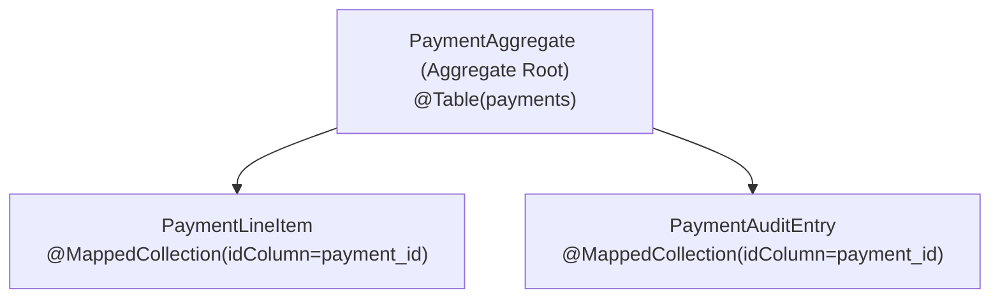
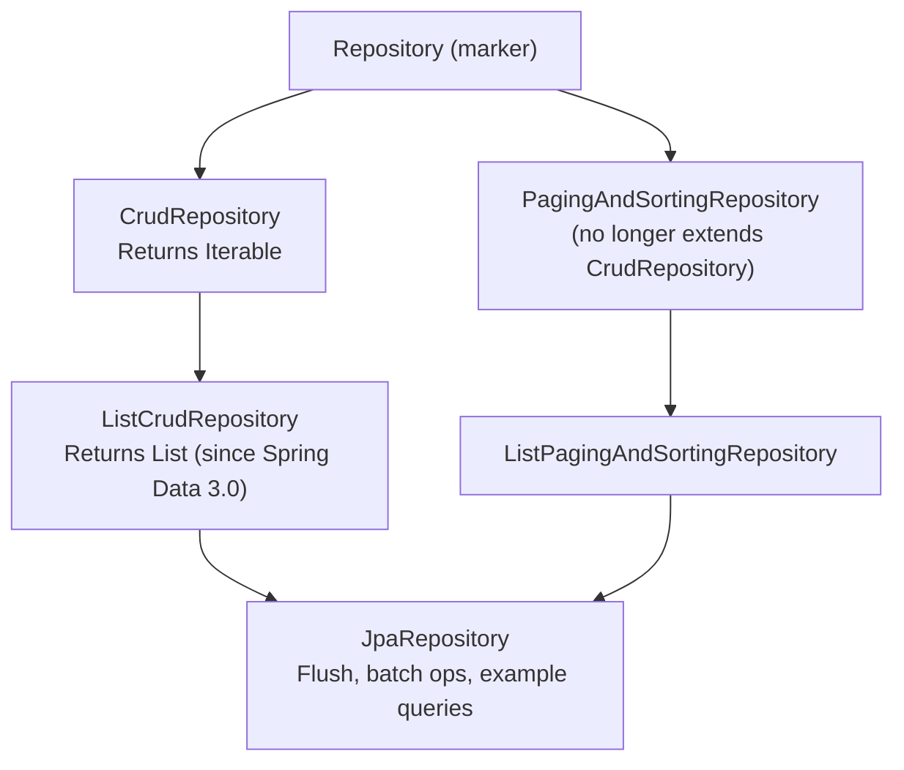

# ‏Spring Data 4 — ‏JDBC وJPA وRedis

يأتي Spring Boot 4 مع قطار إصدارات Spring Data 2025.1 ‏(Spring Data JPA 4، وJDBC 4، وRedis 4). وأهم التغييرات: ‏Hibernate ORM 7 كمزوّد JPA ‏(Jakarta Persistence 3.2)، والأمان من null عبر JSpecify في واجهات المستودعات، وواجهة `Specification` معدّلة، واستمرار استخدام Lettuce كمشغّل Redis. ويغطي هذا الدرس كل وحدة بأمثلة إنتاجية من التقنية المالية — بما في ذلك أين تناسب سجلات Java ‏(records) طبقة الاستمرارية، وأين لا تناسبها.

---

## 1. ‏Spring Data JPA 4 + Hibernate 7

ينفّذ Hibernate ORM 7 مواصفة Jakarta Persistence 3.2. والتغييرات الأكثر ظهورًا لمستخدمي Spring Data JPA:

**إزالة دوال `Session` القديمة**: أُزيلت `save()`، و`update()`، و`saveOrUpdate()`، وصيغ `delete()` القديمة (المُهملة منذ Hibernate 6.0) — استخدم عمليات Jakarta Persistence ‏`persist()`، و`merge()`، و`remove()`. ومستودعات Spring Data تستخدمها بالفعل، لكن كود DAO المكتوب يدويًا قد لا يفعل.

**سلوك أكثر صرامة**: أُزيلت عدة تساهلات من Hibernate 5/6 (مثلًا حول التعامل مع الكيانات المنفصلة والتحقق من الاستعلامات)، لذا شغّل مجموعة اختبارات التكامل كاملة — لا اختبارات الوحدة فقط — عند الترقية.

**الخيوط الافتراضية**: يعمل Hibernate جيدًا على الخيوط الافتراضية. ويأتي خطر التثبيت أساسًا من مشغلات JDBC التي تستخدم `synchronized` أثناء انتظار الشبكة — في Java 21–23 افحص إصدار المشغل؛ وفي Java 24+ زال ذلك التثبيت (انظر الدرس 03).

**تعليقات أُزيلت منذ Hibernate 6**: حدث انتقال `javax.persistence` إلى `jakarta.persistence` وإزالة تعليقات الأنواع النصية في Hibernate 5 في Spring Boot 3 ‏(Hibernate 6). ويجب على الخدمات التي تخطت ذلك الترحيل أن تقوم به الآن:

### تعليقات حقبة Hibernate 5 ‏(أُزيلت في Hibernate 6 — يجب إزالتها قبل SB4)

| أسلوب Hibernate 5 | البديل في Hibernate 6/7 |
|---|---|
| ‏`@Type(type = "org.hibernate.type.TextType")` | ‏`@JdbcTypeCode(SqlTypes.LONGVARCHAR)` |
| ‏`@TypeDef(name = "json", typeClass = JsonType.class)` | ‏`@JdbcTypeCode(SqlTypes.JSON)` ‏(أصلي منذ Hibernate 6) |
| ‏`@AnyMetaDef` | ‏`@Any` مع `@AnyDiscriminator` و`@AnyKeyJavaClass` |

لخدمات التقنية المالية التي تستخدم `JsonType` من Hypersistence Utils، يزيل ربط JSON الأصلي عبر `@JdbcTypeCode(SqlTypes.JSON)` ‏(المتاح منذ Hibernate 6) عادة الحاجة إلى التبعية الخارجية.

```java
// Before (SB3.x with Hypersistence Utils)
@Entity
public class Payment {
    @Type(JsonType.class)
    @Column(columnDefinition = "jsonb")
    private Map<String, Object> metadata;
}

// After (Hibernate 6/7, native JSON mapping)
@Entity
public class Payment {
    @JdbcTypeCode(SqlTypes.JSON)
    @Column(columnDefinition = "jsonb")
    private Map<String, Object> metadata;
}
```

---

## 2. السجلات في طبقة الاستمرارية

السجلات (records) أنواع قيم غير قابلة للتعديل — ملائمة طبيعيًا للمبالغ المالية، والمراجع، وبيانات الأحداث. لكن **كيان Jakarta Persistence لا يمكن أن يكون record**: فالكيان يحتاج مُنشئًا بلا معاملات، ويجب أن يستطيع Hibernate تعيين حقوله (المعرّفات المولّدة، ووكلاء التحميل الكسول، وفحص التغييرات). ولا يدعم Hibernate 6 ولا 7 كيانات من نوع record. لكن السجلات *تعمل* جيدًا في مكانين:

- **كائنات قيمة `@Embeddable`** ‏(مدعومة منذ Hibernate 6.0) — مثل `Money(amount, currency)` مضمّن في كيان
- **الإسقاطات (Projections)** — يربط Spring Data نتائج الاستعلامات مباشرة بالسجلات

للبيانات التي تُلحق فقط مثل أحداث الدفع، استخدم صنف كيان عاديًا بلا دوال تعيين مع `@Immutable`:

```java
// Value object: a record mapped as an embeddable (Hibernate 6.0+)
@Embeddable
public record Money(
    @Column(name = "amount", precision = 19, scale = 4, nullable = false) BigDecimal amount,
    @Column(name = "currency", length = 3, nullable = false) String currency
) {
    public Money {
        Objects.requireNonNull(amount, "amount must not be null");
        Objects.requireNonNull(currency, "currency must not be null");
    }
}

// Append-only payment event: an immutable CLASS entity
@Entity
@Table(name = "payment_events")
@Immutable  // Hibernate never generates UPDATE SQL for this entity
public class PaymentEvent {

    @Id
    @GeneratedValue(strategy = GenerationType.UUID)
    private UUID id;

    @Column(name = "payment_id", nullable = false, updatable = false)
    private UUID paymentId;

    @Column(name = "account_id", nullable = false, updatable = false)
    private UUID accountId;

    @Enumerated(EnumType.STRING)
    @Column(name = "event_type", nullable = false, updatable = false)
    private PaymentEventType eventType;

    @Embedded
    private Money amount;

    @JdbcTypeCode(SqlTypes.JSON)
    @Column(name = "event_payload", columnDefinition = "jsonb", updatable = false)
    private Map<String, Object> payload;

    @Column(name = "occurred_at", nullable = false, updatable = false)
    private Instant occurredAt;

    @Column(name = "idempotency_key", unique = true, updatable = false)
    private String idempotencyKey;

    protected PaymentEvent() { }   // required by Jakarta Persistence

    private PaymentEvent(UUID paymentId, UUID accountId, PaymentEventType eventType,
                         Money amount, Map<String, Object> payload, String idempotencyKey) {
        this.paymentId = Objects.requireNonNull(paymentId);
        this.accountId = Objects.requireNonNull(accountId);
        this.eventType = Objects.requireNonNull(eventType);
        this.amount = amount;
        this.payload = payload != null ? Map.copyOf(payload) : Map.of();
        this.occurredAt = Instant.now();
        this.idempotencyKey = idempotencyKey;
    }

    public static PaymentEvent paymentInitiated(UUID paymentId, UUID accountId,
                                                Money amount, String idempotencyKey) {
        return new PaymentEvent(paymentId, accountId, PaymentEventType.INITIATED,
                                amount, Map.of(), idempotencyKey);
    }

    public UUID getId() { return id; }
    public UUID getPaymentId() { return paymentId; }
    public Money getAmount() { return amount; }
    public Instant getOccurredAt() { return occurredAt; }
    // ... getters only, no setters
}

// Records as read-only projections
public record PaymentEventView(UUID paymentId, PaymentEventType eventType, Instant occurredAt) {}

public interface PaymentEventRepository extends ListCrudRepository<PaymentEvent, UUID> {

    List<PaymentEvent> findByPaymentIdOrderByOccurredAtAsc(UUID paymentId);

    // Spring Data maps each result row straight into the record
    List<PaymentEventView> findByAccountIdAndOccurredAtAfterOrderByOccurredAtDesc(
        UUID accountId, Instant since);
}
```

**ماذا يحدث عند `save()`**: لكيان صنف جديد، يستدعي Spring Data ‏`persist()`، ويعيّن Hibernate المعرّف المولّد على النسخة نفسها. وتعيد `save()` النسخة المُدارة — للكيانات الجديدة هي الكائن نفسه، وللمنفصلة تعيد `merge()` نسخة *مختلفة*. فاجعل استخدام القيمة المعادة عادة: `var saved = repository.save(event);`.

---

## 3. ‏Spring Data JDBC 4 — تصميم جذر التجميع

‏Spring Data JDBC ‏(SD-JDBC) الخيار الصحيح لخدمات التقنية المالية التي تريد تحكمًا صريحًا في SQL دون دورة حياة جلسة Hibernate ORM. ويفرض SD-JDBC انضباط جذر التجميع (aggregate root): يُحمّل كل تجميع ويُحفظ كوحدة، مع كيانات أبناء يملكها الجذر.



```java
// Payment aggregate root
@Table("payments")
public class PaymentAggregate {

    @Id
    private UUID id;

    @Column("account_id")
    private UUID accountId;

    @Column("amount_minor_units")
    private long amountMinorUnits;

    @Column("currency")
    private String currency;

    @Column("status")
    private String status;

    @Column("created_at")
    @CreatedDate
    private Instant createdAt;

    @Column("last_modified_at")
    @LastModifiedDate
    private Instant lastModifiedAt;

    // Child collection — owned by this aggregate, cascade-saved
    @MappedCollection(idColumn = "payment_id", keyColumn = "line_number")
    private List<PaymentLineItem> lineItems = new ArrayList<>();

    // Domain methods — no setters, mutate via business methods
    public void addLineItem(String description, long amountMinorUnits) {
        lineItems.add(new PaymentLineItem(null, description, amountMinorUnits));
    }

    public void markCompleted() {
        this.status = "COMPLETED";
    }

    public void markFailed(String reason) {
        this.status = "FAILED_" + reason;
    }
}

// Child entity record
@Table("payment_line_items")
public record PaymentLineItem(
    @Id Long id,
    @Column("description") String description,
    @Column("amount_minor_units") long amountMinorUnits
) {}
```

### تفعيل التدقيق في JDBC

```java
@Configuration
@EnableJdbcAuditing  // Required for @CreatedDate / @LastModifiedDate to populate
public class JdbcAuditingConfiguration {
}
```

### مستودع SD-JDBC 4

```java
// ListCrudRepository — preferred over CrudRepository in SD4
// Returns List<T> instead of Iterable<T>
public interface PaymentAggregateRepository
        extends ListCrudRepository<PaymentAggregate, UUID>,
                PagingAndSortingRepository<PaymentAggregate, UUID> {

    List<PaymentAggregate> findByAccountId(UUID accountId);

    List<PaymentAggregate> findByStatus(String status);

    @Query("SELECT * FROM payments WHERE account_id = :accountId " +
           "AND status = :status ORDER BY created_at DESC LIMIT :limit")
    List<PaymentAggregate> findByAccountIdAndStatus(
        @Param("accountId") UUID accountId,
        @Param("status") String status,
        @Param("limit") int limit
    );
}
```

---

## 4. تسلسل المستودعات: ‏`ListCrudRepository` مقابل `JpaRepository`

منذ Spring Data 3.0، توجد صيغ `List*` ولم يعد `PagingAndSortingRepository` يرث `CrudRepository` — فاجمع الواجهات التي تحتاجها. والتوصية استخدام `ListCrudRepository` للكود الجديد بدل `CrudRepository`:



**متى تستخدم كلًا منها**:

| المستودع | استخدمه حين |
|---|---|
| ‏`ListCrudRepository` | كود جديد، SD-JDBC أو SD-JPA، ولا تحتاج عمليات خاصة بـ JPA |
| ‏`JpaRepository` | تحتاج `flush()`، أو `deleteAllInBatch()`، أو `findAll(Example)`، أو `saveAndFlush()` |
| ‏`PagingAndSortingRepository` | تحتاج `findAll(Pageable)` دون عمليات خاصة بـ JPA |

**‏`Page` مقابل `Slice` لترقيم البيانات المالية**:

```java
public interface PaymentRepository extends ListCrudRepository<Payment, UUID>,
        PagingAndSortingRepository<Payment, UUID> {

    // Page: total count is returned — requires COUNT(*) query
    // Use for: admin dashboards, settlement reports where total count matters
    Page<Payment> findByAccountId(UUID accountId, Pageable pageable);

    // Slice: no count query — just fetches next N+1 to determine hasNext()
    // Use for: infinite scroll UIs, streaming exports, event log pagination
    Slice<Payment> findByAccountIdAndCreatedAtAfter(
        UUID accountId, Instant since, Pageable pageable);
}

// Usage in a service
public PaymentPage listPayments(UUID accountId, int page, int size) {
    var pageable = PageRequest.of(page, size, Sort.by("createdAt").descending());
    var pageResult = repository.findByAccountId(accountId, pageable);
    return new PaymentPage(
        pageResult.getContent(),
        pageResult.getTotalElements(),
        pageResult.getTotalPages()
    );
}
```

للتقارير المالية على نطاق واسع (ملايين المدفوعات لكل حساب)، يكون `Page` مع `COUNT(*)` مكلفًا. استخدم `Slice` للترقيم الموجه للمستخدم والترقيم بالمفاتيح (القائم على المؤشر) للتصديرات الكبيرة. ويدعم Spring Data ‏(منذ 3.1) الترقيم بالمفاتيح عبر `ScrollPosition` وأنواع الإرجاع `Window<T>`.

---

## 5. ‏`JpaSpecificationExecutor` لمرشحات المدفوعات

البحث الديناميكي في المدفوعات (حسب الحالة، والعملة، والنطاق الزمني، ونطاق المبلغ) متطلب شائع في التقنية المالية. ويبقي `JpaSpecificationExecutor` مع نمط `Specification` هذا قابلًا للتركيب:

```java
// Payment filter Specification builder
public class PaymentSpecifications {

    public static Specification<Payment> hasAccountId(UUID accountId) {
        return (root, query, cb) ->
            accountId == null ? null : cb.equal(root.get("accountId"), accountId);
    }

    public static Specification<Payment> hasStatus(PaymentStatus status) {
        return (root, query, cb) ->
            status == null ? null : cb.equal(root.get("status"), status);
    }

    public static Specification<Payment> hasCurrency(String currency) {
        return (root, query, cb) ->
            currency == null ? null : cb.equal(root.get("currency"), currency);
    }

    public static Specification<Payment> createdBetween(Instant from, Instant to) {
        return (root, query, cb) -> {
            if (from == null && to == null) return null;
            if (from == null) return cb.lessThanOrEqualTo(root.get("createdAt"), to);
            if (to == null) return cb.greaterThanOrEqualTo(root.get("createdAt"), from);
            return cb.between(root.get("createdAt"), from, to);
        };
    }

    public static Specification<Payment> amountAtLeast(BigDecimal minimum) {
        return (root, query, cb) ->
            minimum == null ? null : cb.greaterThanOrEqualTo(root.get("amount"), minimum);
    }
}

// Repository
public interface PaymentRepository
        extends ListCrudRepository<Payment, UUID>,
                JpaSpecificationExecutor<Payment>,
                PagingAndSortingRepository<Payment, UUID> {
}

// Usage in a service — combining specs with and()
@Service
public class PaymentSearchService {

    private final PaymentRepository repository;

    public PaymentSearchService(PaymentRepository repository) {
        this.repository = repository;
    }

    public Page<Payment> search(PaymentSearchRequest filter, Pageable pageable) {
        // Spring Data JPA 4: Specification.where(...) is deprecated —
        // start from unrestricted() and chain the filters
        Specification<Payment> spec = Specification.<Payment>unrestricted()
            .and(PaymentSpecifications.hasAccountId(filter.accountId()))
            .and(PaymentSpecifications.hasStatus(filter.status()))
            .and(PaymentSpecifications.hasCurrency(filter.currency()))
            .and(PaymentSpecifications.createdBetween(filter.from(), filter.to()))
            .and(PaymentSpecifications.amountAtLeast(filter.minimumAmount()));

        return repository.findAll(spec, pageable);
    }
}

// Request record — Java 21 records for the filter parameters
public record PaymentSearchRequest(
    UUID accountId,
    PaymentStatus status,
    String currency,
    Instant from,
    Instant to,
    BigDecimal minimumAmount
) {}
```

**كيف تتصرف المرشحات الفارغة**: الـ `Specification` التي تعيد lambda الخاصة بها `null` لا تضيف شرطًا، فتختفي المرشحات غير المضبوطة ببساطة من عبارة `WHERE` ‏(وهذا كان الحال بالفعل في Spring Data 3). **تغيير SD4**: أُهملت `Specification.where(…)` لصالح `Specification.unrestricted()`، وتتيح الأنواع الجديدة `PredicateSpecification` و`UpdateSpecification` و`DeleteSpecification` الأسلوب القابل للتركيب نفسه للتحديثات والحذف الجماعي.

---

## 6. ‏Spring Data Redis 4 / Lettuce 6

يُبقي Spring Data Redis 4 ‏Lettuce ‏(6.x) المشغّل الافتراضي، على Netty 4.2. وLettuce غير حاجب داخليًا: فاستدعاء `RedisTemplate` الحاجب من خيط افتراضي يوقف الخيط الافتراضي ببساطة حتى تسلّم حلقة أحداث Netty الاستجابة.

### إعداد الاتصال

اتصال Lettuce واحد مشترك آمن للخيوط وعادة يكفي؛ ولا تفعّل التجميع (الذي يحتاج `commons-pool2` على مسار الأصناف) إلا للأوامر الحاجبة (`BLPOP`، والمعاملات بـ `MULTI`) أو حين يُظهر التحليل أن الاتصال المشترك عنق زجاجة.

```yaml
# application.yaml — Spring Data Redis 4 / Lettuce 6 configuration
spring:
  data:
    redis:
      host: redis.internal
      port: 6379
      timeout: 1000ms
      lettuce:
        pool:
          max-active: 16        # only used when commons-pool2 is present
          max-idle: 8
          min-idle: 4
          max-wait: 500ms       # Fail fast on Redis unavailability
        shutdown-timeout: 200ms
```

### قفل موزع بـ `RedisTemplate` وLettuce 6

القفل الموزع طريقة شائعة لمنع نسختين من معالجة الدفعة نفسها في الوقت نفسه. ويستخدم النمط `SET key value NX PX ttl` ‏(تعيين ذري إن لم يكن موجودًا مع انتهاء صلاحية). وتذكر أن القفل ذا مدة الصلاحية تحسين *للأداء*، لا ضمان للصحة: فإن تجاوزت المعالجة المدة (توقف GC، أو بوابة بطيئة)، قد يدخل حامل ثانٍ. ويجب أن يأتي الضمان الحقيقي من قاعدة البيانات — قيد تفرد على مفتاح عدم التكرار.

```java
@Component
public class RedisDistributedLockService {

    private final StringRedisTemplate redisTemplate;

    // Lock TTL — set to slightly longer than your longest expected operation
    private static final Duration LOCK_TTL = Duration.ofSeconds(30);
    private static final String LOCK_PREFIX = "payment:lock:";

    public RedisDistributedLockService(StringRedisTemplate redisTemplate) {
        this.redisTemplate = redisTemplate;
    }

    /**
     * Try to acquire a distributed lock for a payment idempotency key.
     * Uses SET NX PX (atomic, single round-trip) — no SETNX + EXPIRE race condition.
     *
     * @param idempotencyKey unique key for this payment attempt
     * @param ownerId        unique identifier for this lock holder (e.g., request ID)
     * @return true if lock acquired, false if already locked
     */
    public boolean tryAcquire(String idempotencyKey, String ownerId) {
        String lockKey = LOCK_PREFIX + idempotencyKey;
        // setIfAbsent with TTL = SET key value NX PX millis — atomic in Redis
        Boolean acquired = redisTemplate.opsForValue()
            .setIfAbsent(lockKey, ownerId, LOCK_TTL);
        return Boolean.TRUE.equals(acquired);
    }

    /**
     * Release the lock only if we own it (compare-and-delete via Lua script).
     * Prevents releasing another holder's lock after TTL expiry.
     */
    public boolean release(String idempotencyKey, String ownerId) {
        String lockKey = LOCK_PREFIX + idempotencyKey;

        // Lua script: atomic compare-and-delete
        String luaScript =
            "if redis.call('get', KEYS[1]) == ARGV[1] then " +
            "  return redis.call('del', KEYS[1]) " +
            "else " +
            "  return 0 " +
            "end";

        Long result = redisTemplate.execute(
            new DefaultRedisScript<>(luaScript, Long.class),
            List.of(lockKey),
            ownerId
        );
        return Long.valueOf(1L).equals(result);
    }

    /**
     * Execute a payment operation with distributed locking.
     * Throws PaymentAlreadyProcessingException if the lock cannot be acquired.
     */
    public <T> T withLock(String idempotencyKey, Supplier<T> operation) {
        String ownerId = UUID.randomUUID().toString();
        boolean locked = tryAcquire(idempotencyKey, ownerId);

        if (!locked) {
            throw new PaymentAlreadyProcessingException(
                "Payment " + idempotencyKey + " is already being processed");
        }

        try {
            return operation.get();
        } finally {
            release(idempotencyKey, ownerId);
        }
    }
}

// Usage in a payment service
@Service
public class IdempotentPaymentService {

    private final RedisDistributedLockService lockService;
    private final PaymentRepository paymentRepository;

    public IdempotentPaymentService(
            RedisDistributedLockService lockService,
            PaymentRepository paymentRepository) {
        this.lockService = lockService;
        this.paymentRepository = paymentRepository;
    }

    public PaymentResult processPayment(PaymentRequest request) {
        return lockService.withLock(request.idempotencyKey(), () -> {

            // Check if already processed (idempotency check)
            var existing = paymentRepository.findByIdempotencyKey(request.idempotencyKey());
            if (existing.isPresent()) {
                return PaymentResult.alreadyProcessed(existing.get());
            }

            // Process and persist. The UNIQUE constraint on idempotency_key is
            // the real guarantee: if the lock TTL expired and another instance
            // got here first, this insert fails instead of double-charging
            var payment = Payment.from(request);
            var saved = paymentRepository.save(payment);
            return PaymentResult.created(saved);
        });
    }
}
```

### ‏`ReactiveRedisTemplate` مقابل `RedisTemplate` في SB4

لخدمات الدفع النموذجية في SB4 التي تستخدم المكدس الحاجب (مع الخيوط الافتراضية أو دونها)، يكون `StringRedisTemplate` و`RedisTemplate<K, V>` الخيارين الصحيحين. ومع تفعيل الخيوط الافتراضية، يتوقف الخيط الافتراضي بينما تنتظر حلقة أحداث Netty في Lettuce استجابة Redis — فلا يُهدر خيط حامل.

```
Decision rule for SB4:
- Service uses the blocking stack (virtual threads optional) → use RedisTemplate
- Service uses Project Reactor (Flux/Mono) end-to-end → use ReactiveRedisTemplate
- Do NOT mix: calling ReactiveRedisTemplate.block() on a virtual thread works but
  loses the benefit of virtual threads and adds Reactor overhead
```

---

## الخلاصة

يبني Spring Data 4 على Hibernate ORM 7 وJakarta Persistence 3.2. ومكان السجلات في طبقة الاستمرارية كائنات قيمة `@Embeddable` وإسقاطات — وتبقى الكيانات أصنافًا، تُجعل للإلحاق فقط بـ `@Immutable` ودون دوال تعيين. ويحل `ListCrudRepository` محل `CrudRepository` كواجهة أساس مفضلة. ويبقى نمط `JpaSpecificationExecutor` الأداة الصحيحة لمرشحات المدفوعات الديناميكية (البدء الآن من `Specification.unrestricted()`). وللقفل الموزع، فإن `RedisTemplate` مع `setIfAbsent` وسكربت Lua للمقارنة والحذف هو النمط القياسي — مدعومًا بقيد تفرد في قاعدة البيانات لعدم التكرار الحقيقي.

تغطي الدروس التالية في هذا المسار (05 فصاعدًا) ‏Spring Security 7، وSpring Kafka 4، ودليل الترحيل الكامل من SB3.x إلى SB4.

---

<!-- KNOWLEDGE-CHECK
[
  {
    "id": "kc-15-04-01",
    "question": "يحاول مطور ربط سجل Java ‏`PaymentEvent` ككيان JPA ‏(`@Entity public record PaymentEvent(@Id UUID id, ...)`) في تطبيق Spring Boot 4 / Hibernate 7. ماذا يحدث، وما التصميم الموصى به؟",
    "options": [
      "يعمل طالما عُلّم السجل أيضًا بـ `@Immutable`",
      "لا يمكن أن تكون السجلات كيانات Jakarta Persistence ‏(يحتاج الكيان مُنشئًا بلا معاملات وحالة قابلة للتعيين)، فيفشل الربط؛ استخدم صنف كيان غير قابل للتعديل (بلا دوال تعيين، و`@Immutable`) واستخدم السجلات لكائنات القيمة `@Embeddable` وإسقاطات الاستعلامات",
      "يعمل، لكن فقط مع توليد المعرّف `GenerationType.IDENTITY`",
      "يعمل فقط في Spring Data JDBC، ولهذا يُهمل Spring Data JPA 4 الكيانات"
    ],
    "correct": 1,
    "explanation": "تتطلب Jakarta Persistence أن يكون للكيانات مُنشئ بلا معاملات وحالة يستطيع المزوّد تعيينها — فيعيّن Hibernate المعرّفات المولّدة، وينشئ وكلاء كسولين، ويتتبع التغييرات. وللسجلات حقول نهائية ومُنشئ أساسي فقط، لذا لا يدعم Hibernate 6 ولا 7 كيانات السجلات. والسجلات مدعومة ككائنات قيمة @Embeddable ‏(Hibernate 6.0+) وكأنواع إسقاط في استعلامات Spring Data. وللبيانات التي تُلحق فقط، يعطي صنف كيان بلا دوال تعيين مع @Immutable الأمان نفسه."
  },
  {
    "id": "kc-15-04-02",
    "question": "يرث `PaymentRepository` الواجهة `ListCrudRepository<Payment, UUID>`. ويقترح عضو في الفريق التحول إلى `JpaRepository<Payment, UUID>` للوصول إلى `saveAndFlush()`. ما الأثر الإنتاجي لاستدعاء `saveAndFlush()` في خدمة دفع تعالج 1000 معاملة في الثانية؟",
    "options": [
      "لا أثر — `saveAndFlush()` مطابقة لـ `save()` في Spring Data JPA 4؛ والتفريغ يحدث تلقائيًا عند تأكيد المعاملة",
      "تجبر `saveAndFlush()` على `EntityManager.flush()` فوري بعد كل `save()`، متجاوزة مخزن الكتابة المؤجلة في Hibernate ومرسلة SQL إلى قاعدة البيانات فورًا — وقد يسبب هذا N عبارة INSERT/UPDATE فردية بدل الدفعة المحسّنة في Hibernate، فتقل الإنتاجية 2-10 أضعاف تحت التزامن العالي",
      "تحصل `saveAndFlush()` على قفل على مستوى قاعدة البيانات للصف المحفوظ — وهذا مطلوب لسلامة بيانات الدفع",
      "تفرّغ `saveAndFlush()` التغييرات إلى ذاكرة المستوى الثاني المؤقتة فقط؛ ولا أثر لها على مخزن الكتابة في قاعدة البيانات"
    ],
    "correct": 1,
    "explanation": "السلوك الافتراضي في Hibernate تخزين الكتابات مؤقتًا في ذاكرة المستوى الأول (الجلسة) وتفريغها دفعة واحدة في نهاية المعاملة. وتتجاوز `saveAndFlush()` هذا باستدعاء `EntityManager.flush()` فورًا بعد `persist()`/`merge()`. ولخدمة دفع بـ 1000 معاملة/ثانية، يعني هذا أن كل استدعاء يرسل عبارة SQL فردية إلى قاعدة البيانات فورًا بدل التجميع. ويمنع أيضًا دفعات JDBC في Hibernate ‏(`spring.jpa.properties.hibernate.jdbc.batch_size`) من العمل. واستخدم `saveAndFlush()` فقط حين تحتاج صراحة أن تكون البيانات مرئية لاستعلام لاحق في المعاملة نفسها."
  },
  {
    "id": "kc-15-04-03",
    "question": "يستخدم تنفيذ قفل موزع `redisTemplate.opsForValue().setIfAbsent(key, ownerId)` متبوعًا بـ `redisTemplate.expire(key, ttl)` في أمرين منفصلين في Redis. تحت أي ظرف إخفاق ينشئ هذا خطأ في الصحة في خدمة دفع؟",
    "options": [
      "إن كان خادم Redis تحت ضغط على المعالج، قد يُنفذ `setIfAbsent` و`expire` بترتيب خاطئ",
      "إن تعطل التطبيق أو قوطعت JVM بين `setIfAbsent` ‏(نجح) و`expire` ‏(لم يُنفذ بعد)، يبقى مفتاح القفل دون مدة صلاحية — فيصبح قفلًا دائمًا ولا يمكن إعادة معالجة الدفعة عبر مفتاح عدم التكرار هذا أبدًا",
      "يجمّع Lettuce 6 الأوامر في خط افتراضيًا — فقد يُعاد ترتيب `setIfAbsent` و`expire` في الخط",
      "لا يدعم Redis Cluster ‏`setIfAbsent` و`expire` على خانة المفتاح نفسها بشكل ذري"
    ],
    "correct": 1,
    "explanation": "هذه حالة السباق الكلاسيكية SETNX + EXPIRE. فإن تعطل التطبيق (قتل JVM، أو إعادة تشغيل الحاوية، أو نفاد الذاكرة) بعد نجاح `setIfAbsent` لكن قبل تنفيذ `expire`، يبقى المفتاح دون مدة صلاحية — فلا ينتهي أبدًا. وأي محاولة مستقبلية للحصول على القفل لمفتاح عدم التكرار هذا ستفشل إلى أجل غير مسمى، فتمنع إعادة معالجة دفعة ربما لم تكتمل. والإصلاح استخدام الصيغة الذرية: `setIfAbsent(key, value, duration)` التي تُترجم إلى `SET key value NX PX milliseconds` — أمر Redis ذري واحد يعيّن القيمة ومدة الصلاحية معًا."
  },
  {
    "id": "kc-15-04-04",
    "question": "تستخدم خدمة تقارير مدفوعات `Page<Payment> findByAccountId(UUID accountId, Pageable pageable)` لترقيم سجل المدفوعات الموجه للمستخدم. ومع 10 ملايين دفعة لكل حساب، النقطة بطيئة. ما أكثر تغيير فعالية في Spring Data 4 لتحسين زمن الاستجابة؟",
    "options": [
      "انتقل إلى `JpaRepository` واستدعِ `findAll(specification, pageable)` بدل استعلام مشتق — مواصفات JPA تولّد SQL أكفأ",
      "أضف `@QueryHints(@QueryHint(name = HINT_FETCH_SIZE, value = \"50\"))` لتقليل حجم جلب JDBC",
      "انتقل من `Page` إلى `Slice` لإزالة استعلام `COUNT(*)`، ونفّذ الترقيم بالمفاتيح باستخدام `ScrollPosition` لتجنب الترقيم القائم على OFFSET الذي يتطلب مسح الصفوف المتخطاة",
      "أضف `@Cacheable` إلى دالة المستودع لتُخزن الصفحة مؤقتًا في Redis"
    ],
    "correct": 2,
    "explanation": "يشغّل `Page<T>` استعلامين: استعلام البيانات واستعلام `COUNT(*)`. ولجدول بـ 10 ملايين صف لكل حساب، يكون `COUNT(account_id = :id)` مكلفًا حتى مع فهرس. ويزيل `Slice<T>` استعلام العد بجلب N+1 صف والتحقق من وجود المزيد. وأبعد من ذلك، يتطلب الترقيم القائم على OFFSET ‏(`LIMIT 50 OFFSET 500000`) أن تمسح قاعدة البيانات 500,000 صف وتتجاهلها لإعادة الصفحة 10,000 — بينما يستخدم الترقيم بالمفاتيح (`WHERE created_at < :lastSeen ORDER BY created_at DESC LIMIT 50`) الفهرس مباشرة. ويتيح `ScrollPosition` مع `KeysetScrollPosition` في Spring Data هذا النمط أصليًا."
  }
]
-->

<!-- PRACTICAL-CHALLENGE
{
  "id": "pc-15-04",
  "title": "‏Spring Data 4 — مستودع دفع بالسجلات، وتجميعات JDBC، وأقفال Redis",
  "description": "ابنِ طبقة بيانات بجودة الإنتاج لخدمة دفع باستخدام كيانات Spring Data JPA 4 مع سجلات قابلة للتضمين، وجذور تجميع Spring Data JDBC، وقفل موزع قائم على Redis.",
  "tasks": [
    {
      "id": "pc-15-04-01",
      "description": "عرّف سجل `Money` مربوطًا كـ `@Embeddable` ‏(المبلغ بدقة 19/مقياس 4، ورمز عملة ISO) وصنف كيان غير قابل للتعديل `PaymentEvent` معلّمًا بـ `@Entity`، و`@Immutable`، و`@Table(name = \"payment_events\")` — بلا دوال تعيين، مع مُنشئ محمي بلا معاملات، ودالة مصنع ساكنة. وضمّن الحقول: `id` ‏(UUID، ‏`@GeneratedValue(strategy = UUID)`)، و`paymentId` ‏(UUID)، و`eventType` ‏(تعداد، `@Enumerated(EnumType.STRING)`)، و`Money` المضمّن، و`payload` ‏(`Map<String, Object>`، ‏`@JdbcTypeCode(SqlTypes.JSON)`، ‏`columnDefinition = \"jsonb\"`)، و`occurredAt` ‏(Instant). واكتب `PaymentEventRepository extends ListCrudRepository<PaymentEvent, UUID>` باستعلام مشتق `findByPaymentIdOrderByOccurredAtAsc(UUID paymentId)` واستعلام إسقاط بسجل. واكتب اختبار تكامل باستخدام `@DataJpaTest` مع نسخة PostgreSQL من Testcontainers يحفظ `PaymentEvent` عبر `save()`، ويتحقق من أن للكيان المعاد `id` غير فارغ، ويسترجعه بـ `paymentId`."
    },
    {
      "id": "pc-15-04-02",
      "description": "نفّذ جذر تجميع `PaymentAggregate` في Spring Data JDBC بـ `@Table(\"payments\")`، و`List<PaymentLineItem>` معلّمة بـ `@MappedCollection(idColumn = \"payment_id\")`، و`@CreatedDate createdAt`، و`@LastModifiedDate lastModifiedAt`. وفعّل `@EnableJdbcAuditing` في صنف `@Configuration`. واكتب `PaymentAggregateRepository extends ListCrudRepository<PaymentAggregate, UUID>` واختبارًا يحفظ تجميعًا ببندين، ثم يحمّله ويتحقق من وجود البندين وتعبئة `createdAt`."
    },
    {
      "id": "pc-15-04-03",
      "description": "نفّذ صنف `PaymentSpecifications` بخمس دوال مصنع ساكنة: `hasAccountId`، و`hasStatus`، و`hasCurrency`، و`createdBetween(Instant from, Instant to)`، و`amountAtLeast(BigDecimal minimum)`. ويجب أن تعيد كل منها `Specification<Payment>` تعيد lambda الخاصة بها `null` ‏(لا شرط) حين تكون قيمة المرشح فارغة. واجمعها بدءًا من `Specification.unrestricted()`. واكتب اختبارًا يستعلم مع ضبط `hasAccountId` و`hasCurrency` فقط (والباقي فارغ) ويتحقق من أن SQL المولّد (عبر تسجيل `format_sql` في Hibernate) يحتوي شرطي `account_id` و`currency` فقط."
    },
    {
      "id": "pc-15-04-04",
      "description": "نفّذ `RedisDistributedLockService` بـ `tryAcquire(String idempotencyKey, String ownerId)` باستخدام الصيغة الذرية `StringRedisTemplate.opsForValue().setIfAbsent(key, value, Duration)` ‏(أمر واحد، لا SETNX + EXPIRE على خطوتين) و`release(String idempotencyKey, String ownerId)` باستخدام سكربت Lua للمقارنة والحذف. واكتب اختبارًا متزامنًا يطلق 20 خيطًا افتراضيًا في آن واحد تحاول الحصول على القفل نفسه — وتحقق من أن خيطًا واحدًا بالضبط يحصل عليه وأن 19 تتلقى `PaymentAlreadyProcessingException`. واستخدم نسخة Redis مضمّنة من Testcontainers ‏(`@ServiceConnection` مع `GenericContainer<>(\"redis:7.4\")`)."
    }
  ]
}
-->
