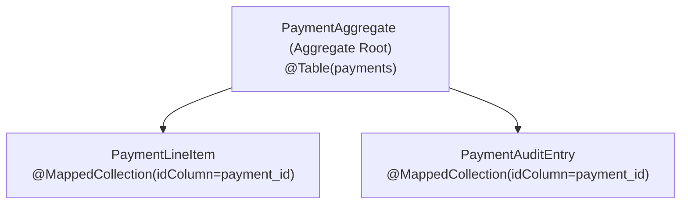
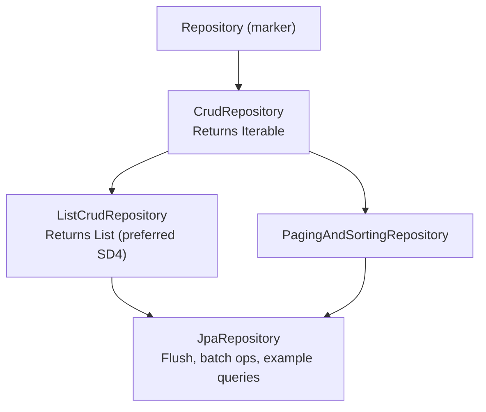

# Spring Data 4 — JDBC, JPA, and Redis

Spring Data 4 ships with Spring Boot 4 and brings three significant changes: Hibernate 7 as the JPA provider (with virtual-thread safety and record entity support), revised repository hierarchy recommendations, and Spring Data Redis 4 backed by Lettuce 6 (which eliminates Netty pinning issues with virtual threads). This lesson covers each module with production fintech examples.

---

## 1. Spring Data JPA 4 + Hibernate 7

Hibernate 7 is the first Hibernate release that is fully virtual-thread safe. The two most visible changes for Spring Data JPA users are:

**Virtual-thread safety**: all internal `synchronized` blocks replaced with `ReentrantLock`. Session acquisition, dirty checking, and batch flushing are all safe to call from virtual threads without pinning carrier threads (covered in Lesson 03).

**Record entity support**: Hibernate 7 supports immutable record entities. This is a significant ergonomic improvement for fintech event-sourced systems where domain events are naturally immutable.

**`@jakarta.persistence.*` package stability**: the full migration from `javax.persistence.*` to `jakarta.persistence.*` was completed in SB3 (Hibernate 6). SB4/Hibernate 7 adds no package changes — but Hibernate 7 drops several deprecated annotations (`@Type`, `@TypeDef`, `@AnyMetaDef`) that were carried forward from Hibernate 5/6.

### Dropped Hibernate Annotations (SB4 Migration Risk)

| Dropped in Hibernate 7 | Replacement |
|---|---|
| `@Type(type = "org.hibernate.type.TextType")` | `@JdbcTypeCode(SqlTypes.LONGVARCHAR)` |
| `@TypeDef(name = "json", typeClass = JsonType.class)` | `@JdbcTypeCode(SqlTypes.JSON)` natively in Hibernate 7 |
| `@AnyMetaDef` | `@Any` with `@AnyDiscriminator` and `@AnyKeyJavaClass` |
| `@NaturalId(mutable = false)` changed | Still exists but `mutable` default changed |

For fintech services using Hypersistence Utils (the popular Hibernate 5/6 `JsonType` library), Hibernate 7 ships native JSON mapping via `@JdbcTypeCode(SqlTypes.JSON)` — no third-party dependency needed.

```java
// Before (SB3.x with Hypersistence Utils)
@Entity
public class Payment {
    @Type(JsonType.class)
    @Column(columnDefinition = "jsonb")
    private Map<String, Object> metadata;
}

// After (SB4 / Hibernate 7)
@Entity
public class Payment {
    @JdbcTypeCode(SqlTypes.JSON)
    @Column(columnDefinition = "jsonb")
    private Map<String, Object> metadata;
}
```

---

## 2. Record Entities in Hibernate 7

Hibernate 7 supports `record` types as JPA entities. Records are immutable value types in Java 21, making them a natural fit for append-only event tables, audit trails, and reference data.

**Constraints for record entities**:
- Must have an `@Id` field
- Cannot be updated (Hibernate ignores `UPDATE` on records) — use `@Immutable`
- All fields must be in the canonical constructor
- Cannot use lazy loading on associations (since you can't set fields after construction)

```java
// PaymentEvent — immutable event record for event sourcing
@Entity
@Table(name = "payment_events")
@Immutable  // Tells Hibernate: never generate UPDATE SQL for this entity
public record PaymentEvent(

    @Id
    @GeneratedValue(strategy = GenerationType.UUID)
    UUID id,

    @Column(name = "payment_id", nullable = false)
    UUID paymentId,

    @Column(name = "account_id", nullable = false)
    UUID accountId,

    @Enumerated(EnumType.STRING)
    @Column(name = "event_type", nullable = false)
    PaymentEventType eventType,

    @JdbcTypeCode(SqlTypes.JSON)
    @Column(name = "event_payload", columnDefinition = "jsonb")
    Map<String, Object> payload,

    @Column(name = "occurred_at", nullable = false)
    Instant occurredAt,

    @Column(name = "idempotency_key", unique = true)
    String idempotencyKey
) {
    // Compact constructor for validation
    public PaymentEvent {
        Objects.requireNonNull(paymentId, "paymentId must not be null");
        Objects.requireNonNull(accountId, "accountId must not be null");
        Objects.requireNonNull(eventType, "eventType must not be null");
        Objects.requireNonNull(occurredAt, "occurredAt must not be null");
        // Defensive copy for mutable map
        payload = payload != null ? Map.copyOf(payload) : Map.of();
    }

    // Factory methods — record entities are created via constructor only
    public static PaymentEvent paymentInitiated(
            UUID paymentId, UUID accountId, MonetaryAmount amount) {
        return new PaymentEvent(
            null,  // id generated by Hibernate on INSERT
            paymentId, accountId,
            PaymentEventType.INITIATED,
            Map.of("amount", amount.getNumber().toString(),
                   "currency", amount.getCurrency().getCurrencyCode()),
            Instant.now(),
            null
        );
    }
}

// Repository — always use the RETURN VALUE of save() for the generated id
public interface PaymentEventRepository extends ListCrudRepository<PaymentEvent, UUID> {

    List<PaymentEvent> findByPaymentIdOrderByOccurredAtAsc(UUID paymentId);

    @Query("SELECT e FROM PaymentEvent e WHERE e.accountId = :accountId " +
           "AND e.occurredAt >= :since ORDER BY e.occurredAt DESC")
    List<PaymentEvent> findRecentByAccount(
        @Param("accountId") UUID accountId,
        @Param("since") Instant since
    );
}
```

**What Hibernate 7 does with record entities**: on `save()`, it generates an `INSERT`. On `findById()`, it reconstructs the record using the canonical constructor. The key gotcha: `save(event)` returns a *new* record instance with the generated `id` populated. The original `event` passed in still has `id = null`. Always use the return value: `var saved = repository.save(event);`.

---

## 3. Spring Data JDBC 4 — Aggregate Root Design

Spring Data JDBC (SD-JDBC) is the right choice for fintech services that want explicit control over SQL without the Hibernate ORM session lifecycle. SD-JDBC enforces aggregate root discipline: each aggregate is loaded and saved as a unit, with child entities owned by the root.



```java
// Payment aggregate root
@Table("payments")
public class PaymentAggregate {

    @Id
    private UUID id;

    @Column("account_id")
    private UUID accountId;

    @Column("amount_minor_units")
    private long amountMinorUnits;

    @Column("currency")
    private String currency;

    @Column("status")
    private String status;

    @Column("created_at")
    @CreatedDate
    private Instant createdAt;

    @Column("last_modified_at")
    @LastModifiedDate
    private Instant lastModifiedAt;

    // Child collection — owned by this aggregate, cascade-saved
    @MappedCollection(idColumn = "payment_id", keyColumn = "line_number")
    private List<PaymentLineItem> lineItems = new ArrayList<>();

    // Domain methods — no setters, mutate via business methods
    public void addLineItem(String description, long amountMinorUnits) {
        lineItems.add(new PaymentLineItem(null, description, amountMinorUnits));
    }

    public void markCompleted() {
        this.status = "COMPLETED";
    }

    public void markFailed(String reason) {
        this.status = "FAILED_" + reason;
    }
}

// Child entity record
@Table("payment_line_items")
public record PaymentLineItem(
    @Id Long id,
    @Column("description") String description,
    @Column("amount_minor_units") long amountMinorUnits
) {}
```

### Enabling JDBC Auditing

```java
@Configuration
@EnableJdbcAuditing  // Required for @CreatedDate / @LastModifiedDate to populate
public class JdbcAuditingConfiguration {
}
```

### SD-JDBC 4 Repository

```java
// ListCrudRepository — preferred over CrudRepository in SD4
// Returns List<T> instead of Iterable<T>
public interface PaymentAggregateRepository
        extends ListCrudRepository<PaymentAggregate, UUID>,
                PagingAndSortingRepository<PaymentAggregate, UUID> {

    List<PaymentAggregate> findByAccountId(UUID accountId);

    List<PaymentAggregate> findByStatus(String status);

    @Query("SELECT * FROM payments WHERE account_id = :accountId " +
           "AND status = :status ORDER BY created_at DESC LIMIT :limit")
    List<PaymentAggregate> findByAccountIdAndStatus(
        @Param("accountId") UUID accountId,
        @Param("status") String status,
        @Param("limit") int limit
    );
}
```

---

## 4. Repository Hierarchy: `ListCrudRepository` vs `JpaRepository`

Spring Data 4 clarifies the repository hierarchy. The key recommendation is to use `ListCrudRepository` for new code instead of `CrudRepository`:



**When to use each**:

| Repository | Use When |
|---|---|
| `ListCrudRepository` | New code, SD-JDBC or SD-JPA, don't need JPA-specific ops |
| `JpaRepository` | Need `flush()`, `deleteAllInBatch()`, `findAll(Example)`, or `saveAndFlush()` |
| `PagingAndSortingRepository` | Need `findAll(Pageable)` without JPA-specific ops |

**`Page` vs `Slice` for financial data pagination**:

```java
public interface PaymentRepository extends ListCrudRepository<Payment, UUID>,
        PagingAndSortingRepository<Payment, UUID> {

    // Page: total count is returned — requires COUNT(*) query
    // Use for: admin dashboards, settlement reports where total count matters
    Page<Payment> findByAccountId(UUID accountId, Pageable pageable);

    // Slice: no count query — just fetches next N+1 to determine hasNext()
    // Use for: infinite scroll UIs, streaming exports, event log pagination
    Slice<Payment> findByAccountIdAndCreatedAtAfter(
        UUID accountId, Instant since, Pageable pageable);
}

// Usage in a service
public PaymentPage listPayments(UUID accountId, int page, int size) {
    var pageable = PageRequest.of(page, size, Sort.by("createdAt").descending());
    var pageResult = repository.findByAccountId(accountId, pageable);
    return new PaymentPage(
        pageResult.getContent(),
        pageResult.getTotalElements(),
        pageResult.getTotalPages()
    );
}
```

For financial reports at scale (millions of payments per account), `Page` with `COUNT(*)` is expensive. Use `Slice` for user-facing pagination and keyset pagination (cursor-based) for large exports. SD4 supports keyset pagination via `ScrollPosition` for forward-only traversal.

---

## 5. `JpaSpecificationExecutor` for Payment Filters

Dynamic payment search (by status, currency, date range, amount range) is a common fintech requirement. `JpaSpecificationExecutor` with the `Specification` pattern keeps this composable:

```java
// Payment filter Specification builder
public class PaymentSpecifications {

    public static Specification<Payment> hasAccountId(UUID accountId) {
        return (root, query, cb) ->
            accountId == null ? null : cb.equal(root.get("accountId"), accountId);
    }

    public static Specification<Payment> hasStatus(PaymentStatus status) {
        return (root, query, cb) ->
            status == null ? null : cb.equal(root.get("status"), status);
    }

    public static Specification<Payment> hasCurrency(String currency) {
        return (root, query, cb) ->
            currency == null ? null : cb.equal(root.get("currency"), currency);
    }

    public static Specification<Payment> createdBetween(Instant from, Instant to) {
        return (root, query, cb) -> {
            if (from == null && to == null) return null;
            if (from == null) return cb.lessThanOrEqualTo(root.get("createdAt"), to);
            if (to == null) return cb.greaterThanOrEqualTo(root.get("createdAt"), from);
            return cb.between(root.get("createdAt"), from, to);
        };
    }

    public static Specification<Payment> amountAtLeast(BigDecimal minimum) {
        return (root, query, cb) ->
            minimum == null ? null : cb.greaterThanOrEqualTo(root.get("amount"), minimum);
    }
}

// Repository
public interface PaymentRepository
        extends ListCrudRepository<Payment, UUID>,
                JpaSpecificationExecutor<Payment>,
                PagingAndSortingRepository<Payment, UUID> {
}

// Usage in a service — combining specs with and()
@Service
public class PaymentSearchService {

    private final PaymentRepository repository;

    public PaymentSearchService(PaymentRepository repository) {
        this.repository = repository;
    }

    public Page<Payment> search(PaymentSearchRequest filter, Pageable pageable) {
        Specification<Payment> spec = Specification
            .where(PaymentSpecifications.hasAccountId(filter.accountId()))
            .and(PaymentSpecifications.hasStatus(filter.status()))
            .and(PaymentSpecifications.hasCurrency(filter.currency()))
            .and(PaymentSpecifications.createdBetween(filter.from(), filter.to()))
            .and(PaymentSpecifications.amountAtLeast(filter.minimumAmount()));

        return repository.findAll(spec, pageable);
    }
}

// Request record — Java 21 records for the filter parameters
public record PaymentSearchRequest(
    UUID accountId,
    PaymentStatus status,
    String currency,
    Instant from,
    Instant to,
    BigDecimal minimumAmount
) {}
```

**SD4 change**: in Spring Data 3.x, `Specification.where(null)` returned a spec that produced `WHERE 1=1`. In SD4, null specs are filtered out during predicate construction — the query has no `WHERE` clause at all if all specs return null, which generates cleaner SQL and avoids the need for `cb.conjunction()` workarounds.

---

## 6. Spring Data Redis 4 / Lettuce 6

Spring Data Redis 4 ships with Lettuce 6.x as the default driver. Lettuce 6 uses Netty 4.2, which contains virtual-thread compatibility fixes for the network event loop.

### Virtual-Thread Compatible Connection Pooling

```yaml
# application.yaml — Spring Data Redis 4 / Lettuce 6 configuration
spring:
  data:
    redis:
      host: redis.internal
      port: 6379
      timeout: 1000ms
      lettuce:
        pool:
          max-active: 16        # CPU cores * 2 — same guidance as HikariCP
          max-idle: 8
          min-idle: 4
          max-wait: 500ms       # Fail fast on Redis unavailability
        shutdown-timeout: 200ms
```

### Distributed Lock with `RedisTemplate` and Lettuce 6

A distributed lock is a common requirement for idempotent payment processing. The pattern uses `SET key value NX PX ttl` (atomic set-if-not-exists with expiry):

```java
@Component
public class RedisDistributedLockService {

    private final StringRedisTemplate redisTemplate;

    // Lock TTL — set to slightly longer than your longest expected operation
    private static final Duration LOCK_TTL = Duration.ofSeconds(30);
    private static final String LOCK_PREFIX = "payment:lock:";

    public RedisDistributedLockService(StringRedisTemplate redisTemplate) {
        this.redisTemplate = redisTemplate;
    }

    /**
     * Try to acquire a distributed lock for a payment idempotency key.
     * Uses SET NX PX (atomic, single round-trip) — no SETNX + EXPIRE race condition.
     *
     * @param idempotencyKey unique key for this payment attempt
     * @param ownerId        unique identifier for this lock holder (e.g., request ID)
     * @return true if lock acquired, false if already locked
     */
    public boolean tryAcquire(String idempotencyKey, String ownerId) {
        String lockKey = LOCK_PREFIX + idempotencyKey;
        // setIfAbsent with TTL = SET key value NX PX millis — atomic in Redis
        Boolean acquired = redisTemplate.opsForValue()
            .setIfAbsent(lockKey, ownerId, LOCK_TTL);
        return Boolean.TRUE.equals(acquired);
    }

    /**
     * Release the lock only if we own it (compare-and-delete via Lua script).
     * Prevents releasing another holder's lock after TTL expiry.
     */
    public boolean release(String idempotencyKey, String ownerId) {
        String lockKey = LOCK_PREFIX + idempotencyKey;

        // Lua script: atomic compare-and-delete
        String luaScript =
            "if redis.call('get', KEYS[1]) == ARGV[1] then " +
            "  return redis.call('del', KEYS[1]) " +
            "else " +
            "  return 0 " +
            "end";

        Long result = redisTemplate.execute(
            new DefaultRedisScript<>(luaScript, Long.class),
            List.of(lockKey),
            ownerId
        );
        return Long.valueOf(1L).equals(result);
    }

    /**
     * Execute a payment operation with distributed locking.
     * Throws PaymentAlreadyProcessingException if the lock cannot be acquired.
     */
    public <T> T withLock(String idempotencyKey, Supplier<T> operation) {
        String ownerId = UUID.randomUUID().toString();
        boolean locked = tryAcquire(idempotencyKey, ownerId);

        if (!locked) {
            throw new PaymentAlreadyProcessingException(
                "Payment " + idempotencyKey + " is already being processed");
        }

        try {
            return operation.get();
        } finally {
            release(idempotencyKey, ownerId);
        }
    }
}

// Usage in a payment service
@Service
public class IdempotentPaymentService {

    private final RedisDistributedLockService lockService;
    private final PaymentRepository paymentRepository;

    public IdempotentPaymentService(
            RedisDistributedLockService lockService,
            PaymentRepository paymentRepository) {
        this.lockService = lockService;
        this.paymentRepository = paymentRepository;
    }

    public PaymentResult processPayment(PaymentRequest request) {
        return lockService.withLock(request.idempotencyKey(), () -> {

            // Check if already processed (idempotency check)
            var existing = paymentRepository.findByIdempotencyKey(request.idempotencyKey());
            if (existing.isPresent()) {
                return PaymentResult.alreadyProcessed(existing.get());
            }

            // Process and persist
            var payment = Payment.from(request);
            paymentRepository.save(payment);
            return PaymentResult.created(payment);
        });
    }
}
```

### `ReactiveRedisTemplate` vs `RedisTemplate` in SB4

For typical SB4 payment services using the blocking stack with virtual threads, `StringRedisTemplate` and `RedisTemplate<K, V>` are the correct choices. The virtual thread parks while Lettuce's Netty event loop awaits the Redis response — no carrier thread is wasted.

```
Decision rule for SB4:
- Service uses virtual threads (the default) + blocking stack → use RedisTemplate
- Service uses Project Reactor (Flux/Mono) end-to-end → use ReactiveRedisTemplate
- Do NOT mix: calling ReactiveRedisTemplate.block() on a virtual thread works but
  loses the benefit of virtual threads and adds Reactor overhead
```

---

## Summary

Spring Data 4 builds on the Java 21 foundation. Hibernate 7 record entities enable immutable event types directly in the JPA layer without the complexity of custom `UserType` implementations. `ListCrudRepository` replaces `CrudRepository` as the preferred base interface. The `JpaSpecificationExecutor` pattern remains the right tool for dynamic payment filters. For distributed locking, `RedisTemplate` with `setIfAbsent` and a Lua compare-and-delete script is the production-grade pattern — Lettuce 6's Netty event loop handles the I/O while virtual threads park.

The next lessons in this track (05 onwards) cover Spring Security 7, Spring Kafka 4, and the full migration runbook from SB3.x to SB4.

---

<!-- KNOWLEDGE-CHECK
[
  {
    "id": "kc-15-04-01",
    "question": "A team annotates a `PaymentEvent` Java 21 record with `@Entity` and `@Immutable` in a Hibernate 7 / Spring Data JPA 4 application. After calling `repository.save(event)`, they call `event.id()` and find it is `null`. The database row was inserted successfully with a generated UUID. What is the cause?",
    "options": [
      "Hibernate 7 does not support `@GeneratedValue(strategy = GenerationType.UUID)` on record entities — use `@GeneratedValue(strategy = GenerationType.IDENTITY)` instead",
      "Records are immutable — Hibernate cannot set the generated `id` back on the record instance after INSERT. The `save()` return value contains the persisted instance with the generated ID; the original `event` reference remains unchanged",
      "The `@Immutable` annotation prevents Hibernate from populating the ID field — remove it to allow Hibernate to set the generated ID",
      "Spring Data JPA 4 requires `@IdClass` on record entities when using `@GeneratedValue`"
    ],
    "correct": 1,
    "explanation": "Java records are immutable — their fields are set only during construction. When Hibernate inserts a record entity and generates a UUID/sequence ID, it cannot mutate the record instance. Instead, `repository.save(entity)` returns a *new* entity instance (the return value) with the `id` field populated. This is the same contract as for regular entities, but developers often miss it with records because they expect Hibernate to mutate the passed-in instance. Always use the return value of `save()`: `var saved = repository.save(event); var id = saved.id();`"
  },
  {
    "id": "kc-15-04-02",
    "question": "A `PaymentRepository` extends `ListCrudRepository<Payment, UUID>`. A team member suggests switching to `JpaRepository<Payment, UUID>` for access to `saveAndFlush()`. What is the production implication of calling `saveAndFlush()` in a payment service that processes 1000 transactions/second?",
    "options": [
      "No implication — `saveAndFlush()` is identical to `save()` in Spring Data JPA 4; the flush happens automatically at transaction commit",
      "`saveAndFlush()` forces an immediate `EntityManager.flush()` after every `save()`, bypassing Hibernate's write-behind buffer and sending SQL to the database immediately — this can cause N individual INSERT/UPDATE statements instead of Hibernate's optimized batch, reducing throughput by 2-10x under high concurrency",
      "`saveAndFlush()` acquires a database-level lock on the saved row — this is required for payment data integrity",
      "`saveAndFlush()` only flushes changes to the second-level cache; it has no effect on the database write buffer"
    ],
    "correct": 1,
    "explanation": "Hibernate's default behavior is to buffer writes in the first-level cache (session) and flush them in a batch at the end of the transaction. `saveAndFlush()` bypasses this by calling `EntityManager.flush()` immediately after `persist()`/`merge()`. For a payment service at 1000 tx/s, this means every call sends an individual SQL statement to the database immediately rather than batching. It also prevents Hibernate's JDBC batch (`spring.jpa.properties.hibernate.jdbc.batch_size`) from working. Use `saveAndFlush()` only when you explicitly need the data visible to a subsequent query in the same transaction."
  },
  {
    "id": "kc-15-04-03",
    "question": "A distributed lock implementation uses `redisTemplate.opsForValue().setIfAbsent(key, ownerId)` followed by `redisTemplate.expire(key, ttl)` in two separate Redis commands. Under what failure condition does this create a correctness bug in a payment service?",
    "options": [
      "If the Redis server is under CPU pressure, `setIfAbsent` and `expire` may execute out of order",
      "If the application crashes or the JVM is interrupted between `setIfAbsent` (success) and `expire` (not yet executed), the lock key remains without a TTL — it becomes a permanent lock and the payment can never be reprocessed via this idempotency key",
      "Lettuce 6 pipelines commands by default — `setIfAbsent` and `expire` may be reordered in the pipeline",
      "Redis Cluster does not support `setIfAbsent` and `expire` on the same key slot atomically"
    ],
    "correct": 1,
    "explanation": "This is the classic SETNX + EXPIRE race condition. If the application crashes (JVM kill, container restart, OOM) after `setIfAbsent` succeeds but before `expire` executes, the key is left with no TTL — it never expires. Any future attempt to acquire the lock for this idempotency key will fail indefinitely, preventing reprocessing of a payment that may not have been completed. The fix is to use the atomic form: `setIfAbsent(key, value, duration)` which translates to `SET key value NX PX milliseconds` — a single atomic Redis command that sets the value and TTL together."
  },
  {
    "id": "kc-15-04-04",
    "question": "A payment report service uses `Page<Payment> findByAccountId(UUID accountId, Pageable pageable)` for user-facing payment history pagination. With 10 million payments per account, the endpoint is slow. What is the most effective Spring Data 4 change to improve latency?",
    "options": [
      "Switch to `JpaRepository` and call `findAll(specification, pageable)` instead of a derived query — JPA specifications generate more efficient SQL",
      "Add `@QueryHints(@QueryHint(name = HINT_FETCH_SIZE, value = \"50\"))` to reduce the JDBC fetch size",
      "Switch from `Page` to `Slice` to eliminate the `COUNT(*)` query, and implement keyset pagination using `ScrollPosition` to avoid OFFSET-based pagination which requires scanning skipped rows",
      "Add `@Cacheable` to the repository method so the page is cached in Redis"
    ],
    "correct": 2,
    "explanation": "`Page<T>` runs two queries: the data query and a `COUNT(*)` query. For a table with 10 million rows per account, `COUNT(account_id = :id)` is expensive even with an index. `Slice<T>` eliminates the count query by fetching N+1 rows and checking if there are more. Beyond that, OFFSET-based pagination (`LIMIT 50 OFFSET 500000`) requires the database to scan and discard 500,000 rows to return page 10,000 — keyset pagination (`WHERE created_at < :lastSeen ORDER BY created_at DESC LIMIT 50`) uses the index directly. Spring Data 4 `ScrollPosition` with `KeysetScrollPosition` enables this pattern natively on `JpaRepository`."
  }
]
-->

<!-- PRACTICAL-CHALLENGE
{
  "id": "pc-15-04",
  "title": "Spring Data 4 — Payment Repository with Records, JDBC Aggregates, and Redis Locking",
  "description": "Build a production-grade data layer for a payment service using Spring Data JPA 4 record entities, Spring Data JDBC aggregate roots, and a Redis-based distributed lock.",
  "tasks": [
    {
      "id": "pc-15-04-01",
      "description": "Define a `PaymentEvent` record entity annotated with `@Entity`, `@Immutable`, and `@Table(\"payment_events\")`. Include fields: `id` (UUID, `@GeneratedValue(strategy = UUID)`), `paymentId` (UUID), `eventType` (enum, `@Enumerated(EnumType.STRING)`), `payload` (`Map<String, Object>`, `@JdbcTypeCode(SqlTypes.JSON)`, `columnDefinition = \"jsonb\"`), and `occurredAt` (Instant). Write a `PaymentEventRepository extends ListCrudRepository<PaymentEvent, UUID>` with a `findByPaymentIdOrderByOccurredAtAsc(UUID paymentId)` derived query. Write an integration test using `@DataJpaTest` with a Testcontainers PostgreSQL instance that persists a `PaymentEvent` via `save()`, asserts the returned entity has a non-null `id`, and retrieves it by `paymentId`."
    },
    {
      "id": "pc-15-04-02",
      "description": "Implement a `PaymentAggregate` Spring Data JDBC aggregate root with `@Table(\"payments\")`, a `List<PaymentLineItem>` annotated with `@MappedCollection(idColumn = \"payment_id\")`, `@CreatedDate createdAt`, and `@LastModifiedDate lastModifiedAt`. Enable `@EnableJdbcAuditing` in a `@Configuration` class. Write a `PaymentAggregateRepository extends ListCrudRepository<PaymentAggregate, UUID>` and a test that saves an aggregate with two line items, then loads it and verifies both line items are present and `createdAt` is populated."
    },
    {
      "id": "pc-15-04-03",
      "description": "Implement a `PaymentSpecifications` class with five static factory methods: `hasAccountId`, `hasStatus`, `hasCurrency`, `createdBetween(Instant from, Instant to)`, and `amountAtLeast(BigDecimal minimum)`. Each must return a `Specification<Payment>` that returns `null` (not a no-op predicate) when the filter value is null, so it is excluded from the `Specification.where(...).and(...)` chain. Write a test that queries with only `hasAccountId` and `hasCurrency` set (others null) and verifies the generated SQL (via Hibernate's `format_sql` logging) contains only `account_id` and `currency` predicates, not empty `AND 1=1` clauses."
    },
    {
      "id": "pc-15-04-04",
      "description": "Implement `RedisDistributedLockService` with `tryAcquire(String idempotencyKey, String ownerId)` using the atomic `StringRedisTemplate.opsForValue().setIfAbsent(key, value, Duration)` (single command, not two-step SETNX + EXPIRE) and `release(String idempotencyKey, String ownerId)` using a Lua script for compare-and-delete. Write a concurrent test that launches 20 virtual threads simultaneously trying to acquire the same lock — assert that exactly one thread acquires it and 19 receive `PaymentAlreadyProcessingException`. Use an embedded Testcontainers Redis instance (`@ServiceConnection` with `GenericContainer<>(\"redis:7.4\")`."
    }
  ]
}
-->
