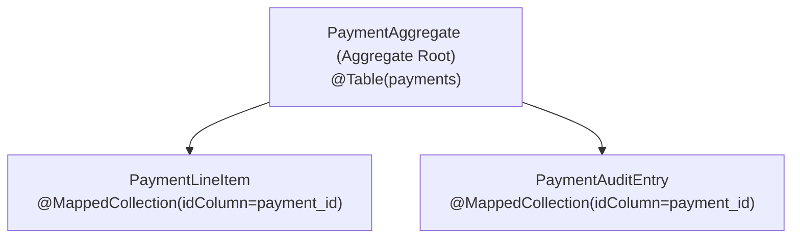
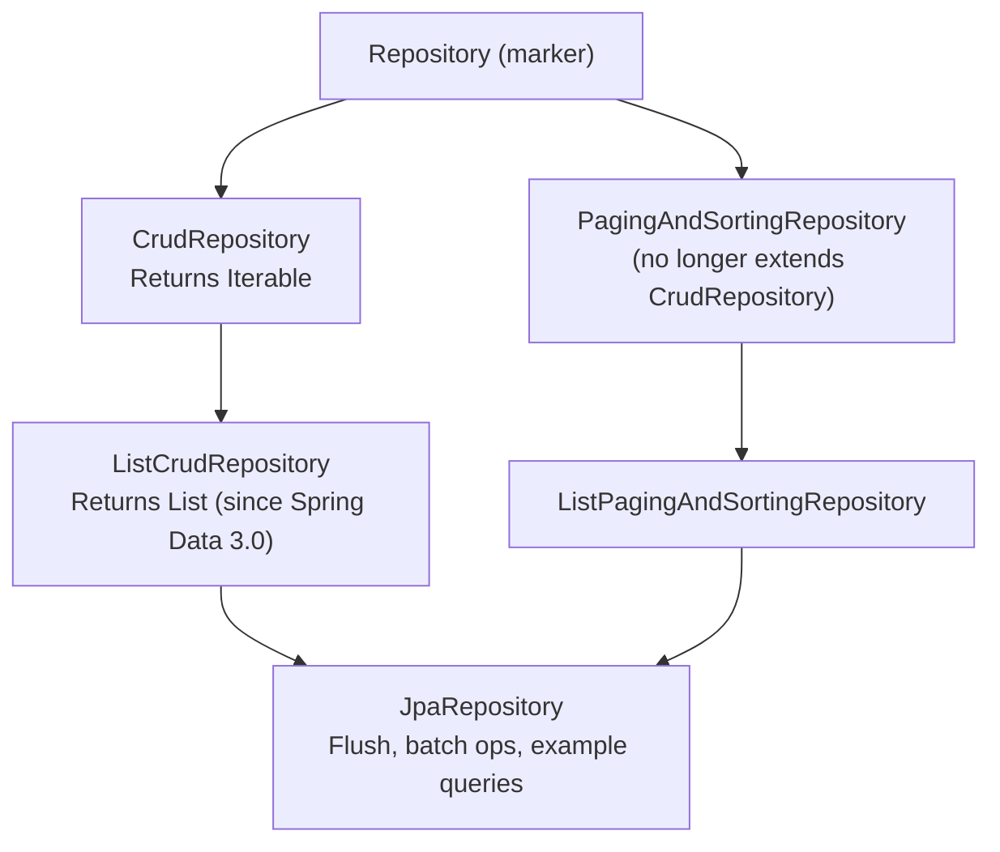

# Spring Data 4 — JDBC, JPA, and Redis

Spring Boot 4 ships the Spring Data 2025.1 release train (Spring Data JPA 4, JDBC 4, Redis 4). The changes that matter most: Hibernate ORM 7 as the JPA provider (Jakarta Persistence 3.2), JSpecify null-safety in the repository APIs, a revised `Specification` API, and continued use of Lettuce as the Redis driver. This lesson covers each module with production fintech examples — including where Java records fit in the persistence layer, and where they do not.

---

## 1. Spring Data JPA 4 + Hibernate 7

Hibernate ORM 7 implements Jakarta Persistence 3.2. The changes most visible to Spring Data JPA users:

**Removed legacy `Session` methods**: `save()`, `update()`, `saveOrUpdate()` and the old `delete()` variants (deprecated since Hibernate 6.0) are gone — use the Jakarta Persistence operations `persist()`, `merge()` and `remove()`. Spring Data repositories already use these, but hand-written DAO code may not.

**Stricter behaviour**: several leniencies from Hibernate 5/6 were removed (for example around detached entity handling and query validation), so run the full integration test suite — not just unit tests — when upgrading.

**Virtual threads**: Hibernate runs fine on virtual threads. Pinning risk comes mostly from JDBC drivers using `synchronized` while waiting on the network — on Java 21–23 check your driver version; on Java 24+ that pinning is gone (see Lesson 03).

**Annotations removed back in Hibernate 6**: the `javax.persistence` → `jakarta.persistence` move and the removal of Hibernate 5's string-based type annotations happened in Spring Boot 3 (Hibernate 6). Services that skipped that migration must do it now:

### Hibernate 5-era Annotations (Removed in Hibernate 6 — Must Go Before SB4)

| Hibernate 5 style | Hibernate 6/7 replacement |
|---|---|
| `@Type(type = "org.hibernate.type.TextType")` | `@JdbcTypeCode(SqlTypes.LONGVARCHAR)` |
| `@TypeDef(name = "json", typeClass = JsonType.class)` | `@JdbcTypeCode(SqlTypes.JSON)` (native since Hibernate 6) |
| `@AnyMetaDef` | `@Any` with `@AnyDiscriminator` and `@AnyKeyJavaClass` |

For fintech services using Hypersistence Utils' `JsonType`, native JSON mapping via `@JdbcTypeCode(SqlTypes.JSON)` (available since Hibernate 6) usually removes the need for the third-party dependency.

```java
// Before (SB3.x with Hypersistence Utils)
@Entity
public class Payment {
    @Type(JsonType.class)
    @Column(columnDefinition = "jsonb")
    private Map<String, Object> metadata;
}

// After (Hibernate 6/7, native JSON mapping)
@Entity
public class Payment {
    @JdbcTypeCode(SqlTypes.JSON)
    @Column(columnDefinition = "jsonb")
    private Map<String, Object> metadata;
}
```

---

## 2. Records in the Persistence Layer

Records are immutable value types — a natural fit for money amounts, references and event data. But **a Jakarta Persistence entity cannot be a record**: an entity needs a no-argument constructor, and Hibernate must be able to set its fields (generated ids, lazy-loading proxies, dirty checking). Neither Hibernate 6 nor 7 supports record entities. Records *do* work well in two places:

- **`@Embeddable` value objects** (supported since Hibernate 6.0) — e.g. a `Money(amount, currency)` embedded in an entity
- **Projections** — Spring Data maps query results directly into records

For append-only data such as payment events, use a regular class entity with no setters and `@Immutable`:

```java
// Value object: a record mapped as an embeddable (Hibernate 6.0+)
@Embeddable
public record Money(
    @Column(name = "amount", precision = 19, scale = 4, nullable = false) BigDecimal amount,
    @Column(name = "currency", length = 3, nullable = false) String currency
) {
    public Money {
        Objects.requireNonNull(amount, "amount must not be null");
        Objects.requireNonNull(currency, "currency must not be null");
    }
}

// Append-only payment event: an immutable CLASS entity
@Entity
@Table(name = "payment_events")
@Immutable  // Hibernate never generates UPDATE SQL for this entity
public class PaymentEvent {

    @Id
    @GeneratedValue(strategy = GenerationType.UUID)
    private UUID id;

    @Column(name = "payment_id", nullable = false, updatable = false)
    private UUID paymentId;

    @Column(name = "account_id", nullable = false, updatable = false)
    private UUID accountId;

    @Enumerated(EnumType.STRING)
    @Column(name = "event_type", nullable = false, updatable = false)
    private PaymentEventType eventType;

    @Embedded
    private Money amount;

    @JdbcTypeCode(SqlTypes.JSON)
    @Column(name = "event_payload", columnDefinition = "jsonb", updatable = false)
    private Map<String, Object> payload;

    @Column(name = "occurred_at", nullable = false, updatable = false)
    private Instant occurredAt;

    @Column(name = "idempotency_key", unique = true, updatable = false)
    private String idempotencyKey;

    protected PaymentEvent() { }   // required by Jakarta Persistence

    private PaymentEvent(UUID paymentId, UUID accountId, PaymentEventType eventType,
                         Money amount, Map<String, Object> payload, String idempotencyKey) {
        this.paymentId = Objects.requireNonNull(paymentId);
        this.accountId = Objects.requireNonNull(accountId);
        this.eventType = Objects.requireNonNull(eventType);
        this.amount = amount;
        this.payload = payload != null ? Map.copyOf(payload) : Map.of();
        this.occurredAt = Instant.now();
        this.idempotencyKey = idempotencyKey;
    }

    public static PaymentEvent paymentInitiated(UUID paymentId, UUID accountId,
                                                Money amount, String idempotencyKey) {
        return new PaymentEvent(paymentId, accountId, PaymentEventType.INITIATED,
                                amount, Map.of(), idempotencyKey);
    }

    public UUID getId() { return id; }
    public UUID getPaymentId() { return paymentId; }
    public Money getAmount() { return amount; }
    public Instant getOccurredAt() { return occurredAt; }
    // ... getters only, no setters
}

// Records as read-only projections
public record PaymentEventView(UUID paymentId, PaymentEventType eventType, Instant occurredAt) {}

public interface PaymentEventRepository extends ListCrudRepository<PaymentEvent, UUID> {

    List<PaymentEvent> findByPaymentIdOrderByOccurredAtAsc(UUID paymentId);

    // Spring Data maps each result row straight into the record
    List<PaymentEventView> findByAccountIdAndOccurredAtAfterOrderByOccurredAtDesc(
        UUID accountId, Instant since);
}
```

**What happens on `save()`**: for a new class entity, Spring Data calls `persist()`, and Hibernate sets the generated `id` on the same instance. `save()` returns the managed instance — for new entities that is the same object, for detached ones `merge()` returns a *different* instance. Make it a habit to use the return value: `var saved = repository.save(event);`.

---

## 3. Spring Data JDBC 4 — Aggregate Root Design

Spring Data JDBC (SD-JDBC) is the right choice for fintech services that want explicit control over SQL without the Hibernate ORM session lifecycle. SD-JDBC enforces aggregate root discipline: each aggregate is loaded and saved as a unit, with child entities owned by the root.



```java
// Payment aggregate root
@Table("payments")
public class PaymentAggregate {

    @Id
    private UUID id;

    @Column("account_id")
    private UUID accountId;

    @Column("amount_minor_units")
    private long amountMinorUnits;

    @Column("currency")
    private String currency;

    @Column("status")
    private String status;

    @Column("created_at")
    @CreatedDate
    private Instant createdAt;

    @Column("last_modified_at")
    @LastModifiedDate
    private Instant lastModifiedAt;

    // Child collection — owned by this aggregate, cascade-saved
    @MappedCollection(idColumn = "payment_id", keyColumn = "line_number")
    private List<PaymentLineItem> lineItems = new ArrayList<>();

    // Domain methods — no setters, mutate via business methods
    public void addLineItem(String description, long amountMinorUnits) {
        lineItems.add(new PaymentLineItem(null, description, amountMinorUnits));
    }

    public void markCompleted() {
        this.status = "COMPLETED";
    }

    public void markFailed(String reason) {
        this.status = "FAILED_" + reason;
    }
}

// Child entity record
@Table("payment_line_items")
public record PaymentLineItem(
    @Id Long id,
    @Column("description") String description,
    @Column("amount_minor_units") long amountMinorUnits
) {}
```

### Enabling JDBC Auditing

```java
@Configuration
@EnableJdbcAuditing  // Required for @CreatedDate / @LastModifiedDate to populate
public class JdbcAuditingConfiguration {
}
```

### SD-JDBC 4 Repository

```java
// ListCrudRepository — preferred over CrudRepository in SD4
// Returns List<T> instead of Iterable<T>
public interface PaymentAggregateRepository
        extends ListCrudRepository<PaymentAggregate, UUID>,
                PagingAndSortingRepository<PaymentAggregate, UUID> {

    List<PaymentAggregate> findByAccountId(UUID accountId);

    List<PaymentAggregate> findByStatus(String status);

    @Query("SELECT * FROM payments WHERE account_id = :accountId " +
           "AND status = :status ORDER BY created_at DESC LIMIT :limit")
    List<PaymentAggregate> findByAccountIdAndStatus(
        @Param("accountId") UUID accountId,
        @Param("status") String status,
        @Param("limit") int limit
    );
}
```

---

## 4. Repository Hierarchy: `ListCrudRepository` vs `JpaRepository`

Since Spring Data 3.0, the `List*` variants exist and `PagingAndSortingRepository` no longer extends `CrudRepository` — combine the interfaces you need. The recommendation is to use `ListCrudRepository` for new code instead of `CrudRepository`:



**When to use each**:

| Repository | Use When |
|---|---|
| `ListCrudRepository` | New code, SD-JDBC or SD-JPA, don't need JPA-specific ops |
| `JpaRepository` | Need `flush()`, `deleteAllInBatch()`, `findAll(Example)`, or `saveAndFlush()` |
| `PagingAndSortingRepository` | Need `findAll(Pageable)` without JPA-specific ops |

**`Page` vs `Slice` for financial data pagination**:

```java
public interface PaymentRepository extends ListCrudRepository<Payment, UUID>,
        PagingAndSortingRepository<Payment, UUID> {

    // Page: total count is returned — requires COUNT(*) query
    // Use for: admin dashboards, settlement reports where total count matters
    Page<Payment> findByAccountId(UUID accountId, Pageable pageable);

    // Slice: no count query — just fetches next N+1 to determine hasNext()
    // Use for: infinite scroll UIs, streaming exports, event log pagination
    Slice<Payment> findByAccountIdAndCreatedAtAfter(
        UUID accountId, Instant since, Pageable pageable);
}

// Usage in a service
public PaymentPage listPayments(UUID accountId, int page, int size) {
    var pageable = PageRequest.of(page, size, Sort.by("createdAt").descending());
    var pageResult = repository.findByAccountId(accountId, pageable);
    return new PaymentPage(
        pageResult.getContent(),
        pageResult.getTotalElements(),
        pageResult.getTotalPages()
    );
}
```

For financial reports at scale (millions of payments per account), `Page` with `COUNT(*)` is expensive. Use `Slice` for user-facing pagination and keyset pagination (cursor-based) for large exports. Spring Data (since 3.1) supports keyset pagination via `ScrollPosition` and `Window<T>` return types.

---

## 5. `JpaSpecificationExecutor` for Payment Filters

Dynamic payment search (by status, currency, date range, amount range) is a common fintech requirement. `JpaSpecificationExecutor` with the `Specification` pattern keeps this composable:

```java
// Payment filter Specification builder
public class PaymentSpecifications {

    public static Specification<Payment> hasAccountId(UUID accountId) {
        return (root, query, cb) ->
            accountId == null ? null : cb.equal(root.get("accountId"), accountId);
    }

    public static Specification<Payment> hasStatus(PaymentStatus status) {
        return (root, query, cb) ->
            status == null ? null : cb.equal(root.get("status"), status);
    }

    public static Specification<Payment> hasCurrency(String currency) {
        return (root, query, cb) ->
            currency == null ? null : cb.equal(root.get("currency"), currency);
    }

    public static Specification<Payment> createdBetween(Instant from, Instant to) {
        return (root, query, cb) -> {
            if (from == null && to == null) return null;
            if (from == null) return cb.lessThanOrEqualTo(root.get("createdAt"), to);
            if (to == null) return cb.greaterThanOrEqualTo(root.get("createdAt"), from);
            return cb.between(root.get("createdAt"), from, to);
        };
    }

    public static Specification<Payment> amountAtLeast(BigDecimal minimum) {
        return (root, query, cb) ->
            minimum == null ? null : cb.greaterThanOrEqualTo(root.get("amount"), minimum);
    }
}

// Repository
public interface PaymentRepository
        extends ListCrudRepository<Payment, UUID>,
                JpaSpecificationExecutor<Payment>,
                PagingAndSortingRepository<Payment, UUID> {
}

// Usage in a service — combining specs with and()
@Service
public class PaymentSearchService {

    private final PaymentRepository repository;

    public PaymentSearchService(PaymentRepository repository) {
        this.repository = repository;
    }

    public Page<Payment> search(PaymentSearchRequest filter, Pageable pageable) {
        // Spring Data JPA 4: Specification.where(...) is deprecated —
        // start from unrestricted() and chain the filters
        Specification<Payment> spec = Specification.<Payment>unrestricted()
            .and(PaymentSpecifications.hasAccountId(filter.accountId()))
            .and(PaymentSpecifications.hasStatus(filter.status()))
            .and(PaymentSpecifications.hasCurrency(filter.currency()))
            .and(PaymentSpecifications.createdBetween(filter.from(), filter.to()))
            .and(PaymentSpecifications.amountAtLeast(filter.minimumAmount()));

        return repository.findAll(spec, pageable);
    }
}

// Request record — Java 21 records for the filter parameters
public record PaymentSearchRequest(
    UUID accountId,
    PaymentStatus status,
    String currency,
    Instant from,
    Instant to,
    BigDecimal minimumAmount
) {}
```

**How null filters behave**: a `Specification` whose lambda returns `null` adds no predicate, so unset filters simply disappear from the `WHERE` clause (this was already the case in Spring Data 3). **SD4 change**: `Specification.where(…)` is deprecated in favour of `Specification.unrestricted()`, and new `PredicateSpecification`, `UpdateSpecification` and `DeleteSpecification` types allow the same composable style for bulk updates and deletes.

---

## 6. Spring Data Redis 4 / Lettuce 6

Spring Data Redis 4 keeps Lettuce (6.x) as the default driver, on Netty 4.2. Lettuce is non-blocking internally: a blocking `RedisTemplate` call from a virtual thread simply parks the virtual thread until Netty's event loop delivers the response.

### Connection Configuration

A single shared Lettuce connection is thread-safe and is usually enough; enable pooling (which needs `commons-pool2` on the classpath) only for blocking commands (`BLPOP`, transactions with `MULTI`) or when profiling shows the shared connection is a bottleneck.

```yaml
# application.yaml — Spring Data Redis 4 / Lettuce 6 configuration
spring:
  data:
    redis:
      host: redis.internal
      port: 6379
      timeout: 1000ms
      lettuce:
        pool:
          max-active: 16        # only used when commons-pool2 is present
          max-idle: 8
          min-idle: 4
          max-wait: 500ms       # Fail fast on Redis unavailability
        shutdown-timeout: 200ms
```

### Distributed Lock with `RedisTemplate` and Lettuce 6

A distributed lock is a common way to stop two instances from processing the same payment at the same time. The pattern uses `SET key value NX PX ttl` (atomic set-if-not-exists with expiry). Keep in mind that a lock with a TTL is a *performance* optimisation, not a correctness guarantee: if processing outlives the TTL (a GC pause, a slow gateway), a second holder can get in. The real guarantee must come from the database — a unique constraint on the idempotency key.

```java
@Component
public class RedisDistributedLockService {

    private final StringRedisTemplate redisTemplate;

    // Lock TTL — set to slightly longer than your longest expected operation
    private static final Duration LOCK_TTL = Duration.ofSeconds(30);
    private static final String LOCK_PREFIX = "payment:lock:";

    public RedisDistributedLockService(StringRedisTemplate redisTemplate) {
        this.redisTemplate = redisTemplate;
    }

    /**
     * Try to acquire a distributed lock for a payment idempotency key.
     * Uses SET NX PX (atomic, single round-trip) — no SETNX + EXPIRE race condition.
     *
     * @param idempotencyKey unique key for this payment attempt
     * @param ownerId        unique identifier for this lock holder (e.g., request ID)
     * @return true if lock acquired, false if already locked
     */
    public boolean tryAcquire(String idempotencyKey, String ownerId) {
        String lockKey = LOCK_PREFIX + idempotencyKey;
        // setIfAbsent with TTL = SET key value NX PX millis — atomic in Redis
        Boolean acquired = redisTemplate.opsForValue()
            .setIfAbsent(lockKey, ownerId, LOCK_TTL);
        return Boolean.TRUE.equals(acquired);
    }

    /**
     * Release the lock only if we own it (compare-and-delete via Lua script).
     * Prevents releasing another holder's lock after TTL expiry.
     */
    public boolean release(String idempotencyKey, String ownerId) {
        String lockKey = LOCK_PREFIX + idempotencyKey;

        // Lua script: atomic compare-and-delete
        String luaScript =
            "if redis.call('get', KEYS[1]) == ARGV[1] then " +
            "  return redis.call('del', KEYS[1]) " +
            "else " +
            "  return 0 " +
            "end";

        Long result = redisTemplate.execute(
            new DefaultRedisScript<>(luaScript, Long.class),
            List.of(lockKey),
            ownerId
        );
        return Long.valueOf(1L).equals(result);
    }

    /**
     * Execute a payment operation with distributed locking.
     * Throws PaymentAlreadyProcessingException if the lock cannot be acquired.
     */
    public <T> T withLock(String idempotencyKey, Supplier<T> operation) {
        String ownerId = UUID.randomUUID().toString();
        boolean locked = tryAcquire(idempotencyKey, ownerId);

        if (!locked) {
            throw new PaymentAlreadyProcessingException(
                "Payment " + idempotencyKey + " is already being processed");
        }

        try {
            return operation.get();
        } finally {
            release(idempotencyKey, ownerId);
        }
    }
}

// Usage in a payment service
@Service
public class IdempotentPaymentService {

    private final RedisDistributedLockService lockService;
    private final PaymentRepository paymentRepository;

    public IdempotentPaymentService(
            RedisDistributedLockService lockService,
            PaymentRepository paymentRepository) {
        this.lockService = lockService;
        this.paymentRepository = paymentRepository;
    }

    public PaymentResult processPayment(PaymentRequest request) {
        return lockService.withLock(request.idempotencyKey(), () -> {

            // Check if already processed (idempotency check)
            var existing = paymentRepository.findByIdempotencyKey(request.idempotencyKey());
            if (existing.isPresent()) {
                return PaymentResult.alreadyProcessed(existing.get());
            }

            // Process and persist. The UNIQUE constraint on idempotency_key is
            // the real guarantee: if the lock TTL expired and another instance
            // got here first, this insert fails instead of double-charging
            var payment = Payment.from(request);
            var saved = paymentRepository.save(payment);
            return PaymentResult.created(saved);
        });
    }
}
```

### `ReactiveRedisTemplate` vs `RedisTemplate` in SB4

For typical SB4 payment services using the blocking stack (with or without virtual threads), `StringRedisTemplate` and `RedisTemplate<K, V>` are the correct choices. With virtual threads enabled, the virtual thread parks while Lettuce's Netty event loop awaits the Redis response — no carrier thread is wasted.

```
Decision rule for SB4:
- Service uses the blocking stack (virtual threads optional) → use RedisTemplate
- Service uses Project Reactor (Flux/Mono) end-to-end → use ReactiveRedisTemplate
- Do NOT mix: calling ReactiveRedisTemplate.block() on a virtual thread works but
  loses the benefit of virtual threads and adds Reactor overhead
```

---

## Summary

Spring Data 4 builds on Hibernate ORM 7 and Jakarta Persistence 3.2. Records belong in the persistence layer as `@Embeddable` value objects and projections — entities stay classes, made append-only with `@Immutable` and no setters. `ListCrudRepository` replaces `CrudRepository` as the preferred base interface. The `JpaSpecificationExecutor` pattern remains the right tool for dynamic payment filters (now starting from `Specification.unrestricted()`). For distributed locking, `RedisTemplate` with `setIfAbsent` and a Lua compare-and-delete script is the standard pattern — backed by a database unique constraint for true idempotency.

The next lessons in this track (05 onwards) cover Spring Security 7, Spring Kafka 4, and the full migration runbook from SB3.x to SB4.

---

<!-- KNOWLEDGE-CHECK
[
  {
    "id": "kc-15-04-01",
    "question": "A developer tries to map a `PaymentEvent` Java record as a JPA entity (`@Entity public record PaymentEvent(@Id UUID id, ...)`) in a Spring Boot 4 / Hibernate 7 application. What happens, and what is the recommended design?",
    "options": [
      "It works as long as the record is also annotated with `@Immutable`",
      "Records cannot be Jakarta Persistence entities (an entity needs a no-arg constructor and settable state), so the mapping fails; use an immutable class entity (no setters, `@Immutable`) and use records for `@Embeddable` value objects and query projections",
      "It works, but only with `GenerationType.IDENTITY` id generation",
      "It works only in Spring Data JDBC, which is why Spring Data JPA 4 deprecates entities"
    ],
    "correct": 1,
    "explanation": "Jakarta Persistence requires entities to have a no-argument constructor and state that the provider can set — Hibernate assigns generated ids, creates lazy proxies, and tracks changes. Records have final fields and only a canonical constructor, so neither Hibernate 6 nor 7 supports record entities. Records are supported as @Embeddable value objects (Hibernate 6.0+) and as projection types in Spring Data queries. For append-only data, an entity class without setters plus @Immutable gives the same safety."
  },
  {
    "id": "kc-15-04-02",
    "question": "A `PaymentRepository` extends `ListCrudRepository<Payment, UUID>`. A team member suggests switching to `JpaRepository<Payment, UUID>` for access to `saveAndFlush()`. What is the production implication of calling `saveAndFlush()` in a payment service that processes 1000 transactions/second?",
    "options": [
      "No implication — `saveAndFlush()` is identical to `save()` in Spring Data JPA 4; the flush happens automatically at transaction commit",
      "`saveAndFlush()` forces an immediate `EntityManager.flush()` after every `save()`, bypassing Hibernate's write-behind buffer and sending SQL to the database immediately — this can cause N individual INSERT/UPDATE statements instead of Hibernate's optimized batch, reducing throughput by 2-10x under high concurrency",
      "`saveAndFlush()` acquires a database-level lock on the saved row — this is required for payment data integrity",
      "`saveAndFlush()` only flushes changes to the second-level cache; it has no effect on the database write buffer"
    ],
    "correct": 1,
    "explanation": "Hibernate's default behavior is to buffer writes in the first-level cache (session) and flush them in a batch at the end of the transaction. `saveAndFlush()` bypasses this by calling `EntityManager.flush()` immediately after `persist()`/`merge()`. For a payment service at 1000 tx/s, this means every call sends an individual SQL statement to the database immediately rather than batching. It also prevents Hibernate's JDBC batch (`spring.jpa.properties.hibernate.jdbc.batch_size`) from working. Use `saveAndFlush()` only when you explicitly need the data visible to a subsequent query in the same transaction."
  },
  {
    "id": "kc-15-04-03",
    "question": "A distributed lock implementation uses `redisTemplate.opsForValue().setIfAbsent(key, ownerId)` followed by `redisTemplate.expire(key, ttl)` in two separate Redis commands. Under what failure condition does this create a correctness bug in a payment service?",
    "options": [
      "If the Redis server is under CPU pressure, `setIfAbsent` and `expire` may execute out of order",
      "If the application crashes or the JVM is interrupted between `setIfAbsent` (success) and `expire` (not yet executed), the lock key remains without a TTL — it becomes a permanent lock and the payment can never be reprocessed via this idempotency key",
      "Lettuce 6 pipelines commands by default — `setIfAbsent` and `expire` may be reordered in the pipeline",
      "Redis Cluster does not support `setIfAbsent` and `expire` on the same key slot atomically"
    ],
    "correct": 1,
    "explanation": "This is the classic SETNX + EXPIRE race condition. If the application crashes (JVM kill, container restart, OOM) after `setIfAbsent` succeeds but before `expire` executes, the key is left with no TTL — it never expires. Any future attempt to acquire the lock for this idempotency key will fail indefinitely, preventing reprocessing of a payment that may not have been completed. The fix is to use the atomic form: `setIfAbsent(key, value, duration)` which translates to `SET key value NX PX milliseconds` — a single atomic Redis command that sets the value and TTL together."
  },
  {
    "id": "kc-15-04-04",
    "question": "A payment report service uses `Page<Payment> findByAccountId(UUID accountId, Pageable pageable)` for user-facing payment history pagination. With 10 million payments per account, the endpoint is slow. What is the most effective Spring Data 4 change to improve latency?",
    "options": [
      "Switch to `JpaRepository` and call `findAll(specification, pageable)` instead of a derived query — JPA specifications generate more efficient SQL",
      "Add `@QueryHints(@QueryHint(name = HINT_FETCH_SIZE, value = \"50\"))` to reduce the JDBC fetch size",
      "Switch from `Page` to `Slice` to eliminate the `COUNT(*)` query, and implement keyset pagination using `ScrollPosition` to avoid OFFSET-based pagination which requires scanning skipped rows",
      "Add `@Cacheable` to the repository method so the page is cached in Redis"
    ],
    "correct": 2,
    "explanation": "`Page<T>` runs two queries: the data query and a `COUNT(*)` query. For a table with 10 million rows per account, `COUNT(account_id = :id)` is expensive even with an index. `Slice<T>` eliminates the count query by fetching N+1 rows and checking if there are more. Beyond that, OFFSET-based pagination (`LIMIT 50 OFFSET 500000`) requires the database to scan and discard 500,000 rows to return page 10,000 — keyset pagination (`WHERE created_at < :lastSeen ORDER BY created_at DESC LIMIT 50`) uses the index directly. Spring Data 4 `ScrollPosition` with `KeysetScrollPosition` enables this pattern natively on `JpaRepository`."
  }
]
-->

<!-- PRACTICAL-CHALLENGE
{
  "id": "pc-15-04",
  "title": "Spring Data 4 — Payment Repository with Records, JDBC Aggregates, and Redis Locking",
  "description": "Build a production-grade data layer for a payment service using Spring Data JPA 4 record entities, Spring Data JDBC aggregate roots, and a Redis-based distributed lock.",
  "tasks": [
    {
      "id": "pc-15-04-01",
      "description": "Define a `Money` record mapped as `@Embeddable` (amount with precision 19/scale 4, ISO currency code) and an immutable `PaymentEvent` class entity annotated with `@Entity`, `@Immutable`, and `@Table(name = \"payment_events\")` — no setters, a protected no-arg constructor, and a static factory method. Include fields: `id` (UUID, `@GeneratedValue(strategy = UUID)`), `paymentId` (UUID), `eventType` (enum, `@Enumerated(EnumType.STRING)`), the embedded `Money`, `payload` (`Map<String, Object>`, `@JdbcTypeCode(SqlTypes.JSON)`, `columnDefinition = \"jsonb\"`), and `occurredAt` (Instant). Write a `PaymentEventRepository extends ListCrudRepository<PaymentEvent, UUID>` with a `findByPaymentIdOrderByOccurredAtAsc(UUID paymentId)` derived query and a record projection query. Write an integration test using `@DataJpaTest` with a Testcontainers PostgreSQL instance that persists a `PaymentEvent` via `save()`, asserts the returned entity has a non-null `id`, and retrieves it by `paymentId`."
    },
    {
      "id": "pc-15-04-02",
      "description": "Implement a `PaymentAggregate` Spring Data JDBC aggregate root with `@Table(\"payments\")`, a `List<PaymentLineItem>` annotated with `@MappedCollection(idColumn = \"payment_id\")`, `@CreatedDate createdAt`, and `@LastModifiedDate lastModifiedAt`. Enable `@EnableJdbcAuditing` in a `@Configuration` class. Write a `PaymentAggregateRepository extends ListCrudRepository<PaymentAggregate, UUID>` and a test that saves an aggregate with two line items, then loads it and verifies both line items are present and `createdAt` is populated."
    },
    {
      "id": "pc-15-04-03",
      "description": "Implement a `PaymentSpecifications` class with five static factory methods: `hasAccountId`, `hasStatus`, `hasCurrency`, `createdBetween(Instant from, Instant to)`, and `amountAtLeast(BigDecimal minimum)`. Each must return a `Specification<Payment>` whose lambda returns `null` (no predicate) when the filter value is null. Combine them starting from `Specification.unrestricted()`. Write a test that queries with only `hasAccountId` and `hasCurrency` set (others null) and verifies the generated SQL (via Hibernate's `format_sql` logging) contains only the `account_id` and `currency` predicates."
    },
    {
      "id": "pc-15-04-04",
      "description": "Implement `RedisDistributedLockService` with `tryAcquire(String idempotencyKey, String ownerId)` using the atomic `StringRedisTemplate.opsForValue().setIfAbsent(key, value, Duration)` (single command, not two-step SETNX + EXPIRE) and `release(String idempotencyKey, String ownerId)` using a Lua script for compare-and-delete. Write a concurrent test that launches 20 virtual threads simultaneously trying to acquire the same lock — assert that exactly one thread acquires it and 19 receive `PaymentAlreadyProcessingException`. Use an embedded Testcontainers Redis instance (`@ServiceConnection` with `GenericContainer<>(\"redis:7.4\")`."
    }
  ]
}
-->
