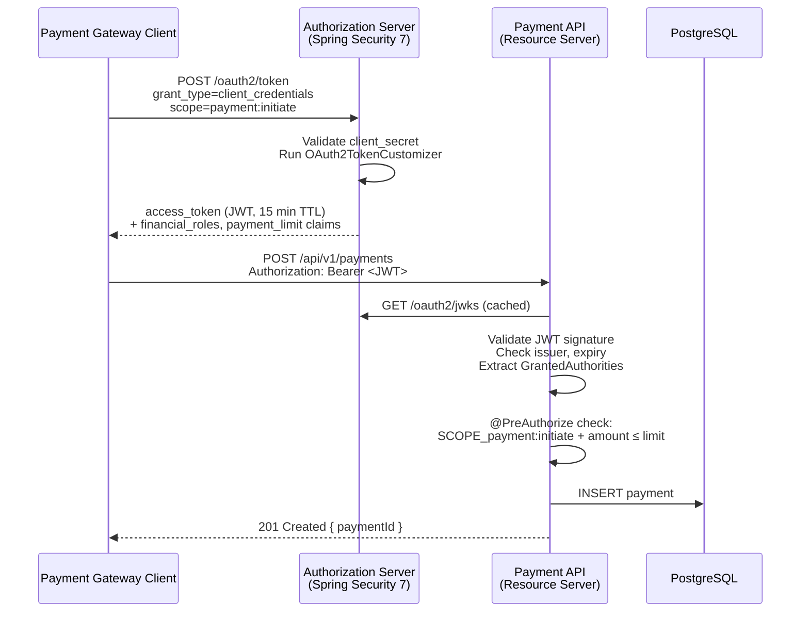

# ‏Spring Security 7 — ‏OAuth2 وJWT وخادم التفويض

يأتي Spring Security 7 مع Spring Framework 7 وSpring Boot 4. فإن كنت تشغّل خدمة تقنية مالية على Spring Boot 3.x مع Spring Security 6.x، فسطح الترحيل أصغر من قفزة 5→6 — لكن عدة واجهات أُهملت في SS6 **أُزيلت** الآن، ولم يعد أسلوب lambda اختياريًا، وانتقل Spring Authorization Server إلى داخل Spring Security نفسه. ويغطي هذا الدرس ما تغير بالضبط ولماذا، ثم يبني إعداد OAuth2 بجودة الإنتاج لمنصة دفع عالية الحجم.

---

## 1. ما الذي تغير منذ Spring Security 6.x

### الواجهات المُزالة

بعضها أُزيل بالفعل في SS 6.0؛ والباقي أُهمل في 6.x وأصبح **أخطاء ترجمة** في SS7:

| المُزال | أُزيل في | البديل |
|---|---|---|
| ‏`WebSecurityConfigurerAdapter` | 6.0 | bean من نوع `SecurityFilterChain` |
| ‏`antMatchers()` / `mvcMatchers()` / `regexMatchers()` | 6.0 | ‏`requestMatchers()` |
| ‏`authorizeRequests()` | 7.0 | ‏`authorizeHttpRequests()` |
| ‏`HttpSecurity.apply(AbstractHttpConfigurer)` | 7.0 | ‏`HttpSecurity.with(AbstractHttpConfigurer, ...)` |
| أسلوب التسلسل مع `.and()` ‏(غير lambda) | 7.0 | أسلوب lambda حصريًا |
| ‏`csrf().disable()` ‏(المجرد) | 7.0 | ‏`csrf(AbstractHttpConfigurer::disable)` |
| ‏`oauth2ResourceServer().jwt()` ‏(المجرد) | 7.0 | ‏`oauth2ResourceServer(r -> r.jwt(...))` |
| ‏`AntPathRequestMatcher` / `MvcRequestMatcher` | 7.0 | ‏`PathPatternRequestMatcher` |
| ‏`@EnableGlobalMethodSecurity` | 7.0 | ‏`@EnableMethodSecurity` |

### تغييرات `@EnableWebSecurity`

مع Spring Boot، يُطبق `@EnableWebSecurity` لك عبر الإعداد التلقائي بمجرد وجود Spring Security على مسار الأصناف، وتُلتقط beans من نوع `SecurityFilterChain` ‏(و`WebSecurityCustomizer`) تلقائيًا. وإضافة التعليق إلى إعدادك غير ضارة وتوثّق النية؛ ولا يلزم إلا خارج Spring Boot. ولا تُطلق أبدًا `@EnableWebSecurity(debug = true)` في الإنتاج — فمخرجات التصحيح تسجّل تفاصيل الطلبات، بما فيها الترويسات.

### ‏`SecurityFilterChain` هو النهج الوحيد

لا يوجد تجاوز لـ `configure(HttpSecurity)`. فكل شأن أمني يعيش في `@Bean` تعيد `SecurityFilterChain`. وتتيح لك السلاسل المرتبة المتعددة فصل نقاط actuator الداخلية عن واجهة الدفع الموجهة للعملاء بوضوح.

---

## 2. أسلوب lambda في `HttpSecurity` — قبل وبعد

إعداد أمني لواجهة دفع، يُظهر أسلوب التسلسل في SS6 وأسلوب lambda الحصري في SS7 جنبًا إلى جنب.

**‏Spring Security 6.x ‏(أُزيل في SS7):**

```java
// DOES NOT COMPILE in Spring Security 7
@Bean
SecurityFilterChain paymentApiSecurity(HttpSecurity http) throws Exception {
    http
        .authorizeRequests()                           // removed
            .antMatchers("/actuator/health").permitAll() // removed
            .anyRequest().authenticated()
        .and()
        .oauth2ResourceServer()
            .jwt();                                    // removed bare call
    return http.build();
}
```

**‏Spring Security 7 ‏(أسلوب lambda فقط):**

```java
@Configuration
@EnableWebSecurity
public class PaymentApiSecurityConfig {

    @Bean
    @Order(1)
    SecurityFilterChain actuatorSecurity(HttpSecurity http) throws Exception {
        http
            .securityMatcher("/actuator/**")
            .authorizeHttpRequests(auth -> auth
                .requestMatchers("/actuator/health/**", "/actuator/info").permitAll()
                .anyRequest().hasRole("OPS")
            )
            .csrf(AbstractHttpConfigurer::disable)
            .sessionManagement(s -> s.sessionCreationPolicy(STATELESS));
        return http.build();
    }

    @Bean
    @Order(2)
    SecurityFilterChain paymentApiSecurity(HttpSecurity http,
                                            JwtAuthenticationConverter jwtConverter) throws Exception {
        http
            .securityMatcher("/api/**")
            .authorizeHttpRequests(auth -> auth
                .requestMatchers(POST, "/api/v1/payments").hasAuthority("SCOPE_payment:initiate")
                .requestMatchers(GET,  "/api/v1/accounts/**").hasAuthority("SCOPE_account:read")
                .anyRequest().authenticated()
            )
            .oauth2ResourceServer(oauth2 -> oauth2
                .jwt(jwt -> jwt.jwtAuthenticationConverter(jwtConverter))
            )
            .csrf(AbstractHttpConfigurer::disable)
            .sessionManagement(s -> s.sessionCreationPolicy(STATELESS));
        return http.build();
    }
}
```

نقاط أساسية: يتحكم `@Order` في أي سلسلة تطابق أولًا؛ ويحدد `securityMatcher` نطاق السلسلة فلا تُطبق عالميًا؛ وسياسة الجلسة `STATELESS` هي المعيار لواجهات JWT — فحالة الجلسة على الخادم لا تتوسع أفقيًا ولا حاجة إليها حين يحمل كل طلب رمزًا.

---

## 3. خادم موارد OAuth2 في SS7

### إعداد YAML

```yaml
spring:
  security:
    oauth2:
      resourceserver:
        jwt:
          jwk-set-uri: https://auth.payments.internal/oauth2/jwks
          issuer-uri: https://auth.payments.internal
```

يجعل `issuer-uri` ‏Spring Security يجري اكتشاف OIDC عند البدء — فيجلب `/.well-known/openid-configuration` ويتحقق من أن ادعاء المُصدر في كل JWT وارد يطابق. واستخدم هذا في الإنتاج. أما `jwk-set-uri` وحده فيتخطى التحقق من المُصدر، وهذا مقبول فقط للتطوير/الاختبار حيث لا تتوفر نقطة الاكتشاف.

### محوّل مصادقة JWT مخصص للأدوار المالية

افتراضيًا، يربط `JwtAuthenticationConverter` ادعاءات `scope` بصلاحيات `SCOPE_xxx`. وتحتاج خدمة تقنية مالية استخراج ادعاءات مخصصة مثل `account_tier`، و`payment_limit`، و`permissions`.

```java
@Configuration
public class JwtConverterConfig {

    @Bean
    JwtAuthenticationConverter jwtAuthenticationConverter() {
        var converter = new JwtAuthenticationConverter();
        converter.setJwtGrantedAuthoritiesConverter(new FinancialPermissionsConverter());
        converter.setPrincipalClaimName("sub");
        return converter;
    }

    static class FinancialPermissionsConverter
            implements Converter<Jwt, Collection<GrantedAuthority>> {

        @Override
        public Collection<GrantedAuthority> convert(Jwt jwt) {
            var authorities = new ArrayList<GrantedAuthority>();

            // Map OAuth2 scopes → SCOPE_ prefix authorities
            var scopes = jwt.getClaimAsStringList("scope");
            if (scopes != null) {
                scopes.stream()
                      .map(s -> new SimpleGrantedAuthority("SCOPE_" + s))
                      .forEach(authorities::add);
            }

            // Map custom financial roles → ROLE_ prefix authorities
            var roles = jwt.getClaimAsStringList("financial_roles");
            if (roles != null) {
                roles.stream()
                     .map(r -> new SimpleGrantedAuthority("ROLE_" + r))
                     .forEach(authorities::add);
            }

            return authorities;
        }
    }
}
```

يقدم العملاء الذين يستدعون واجهة الدفع JWT مثل:

```json
{
  "sub": "user-7f3a9b",
  "iss": "https://auth.payments.internal",
  "scope": "payment:initiate account:read",
  "financial_roles": ["PAYMENT_INITIATOR", "ACCOUNT_READ"],
  "account_tier": "premium",
  "payment_limit": 50000,
  "exp": 1731456000
}
```

يتاح ادعاءا `account_tier` و`payment_limit` على `Jwt` الأساسي لقرارات التفويض اللاحقة.

---

## 4. ‏Spring Authorization Server — مضمّن للخدمات المصغّرة الداخلية

نمط شائع في التقنية المالية: خادم تفويض داخلي يصدر رموزًا تستهلكها خدمات مصغّرة متعددة (خدمة الدفع، وخدمة الحسابات، وخدمة الإشعارات). ويدعم Spring Authorization Server هذا — ومع Spring Security 7 لم يعد مشروعًا منفصلًا: بل جزء من Spring Security ويُصدر معه (ويقدم Spring Boot 4 ‏`spring-boot-starter-oauth2-authorization-server`).

### التبعية

```xml
<dependency>
    <groupId>org.springframework.security</groupId>
    <artifactId>spring-security-oauth2-authorization-server</artifactId>
    <!-- part of Spring Security 7; version managed by the Spring Boot 4 BOM -->
</dependency>
```

### إعداد خادم التفويض

```java
@Configuration
public class AuthorizationServerConfig {

    @Bean
    @Order(Ordered.HIGHEST_PRECEDENCE)
    SecurityFilterChain authServerSecurity(HttpSecurity http) throws Exception {
        // applyDefaultSecurity(http) is deprecated — configure via with(...)
        var authorizationServer = OAuth2AuthorizationServerConfigurer.authorizationServer();
        http
            .securityMatcher(authorizationServer.getEndpointsMatcher())
            .with(authorizationServer, as -> as.oidc(Customizer.withDefaults()))
            .authorizeHttpRequests(auth -> auth.anyRequest().authenticated());
        http.exceptionHandling(ex -> ex
            .defaultAuthenticationEntryPointFor(
                new LoginUrlAuthenticationEntryPoint("/login"),
                new MediaTypeRequestMatcher(TEXT_HTML)
            )
        );
        return http.build();
    }

    @Bean
    RegisteredClientRepository registeredClientRepository() {
        RegisteredClient paymentGatewayClient = RegisteredClient
            .withId(UUID.randomUUID().toString())
            .clientId("payment-gateway")
            // Demo only: in production load clients from a database-backed
            // RegisteredClientRepository and the secret from Vault
            .clientSecret("{bcrypt}" + new BCryptPasswordEncoder().encode("secret"))
            .clientAuthenticationMethod(ClientAuthenticationMethod.CLIENT_SECRET_BASIC)
            .authorizationGrantType(AuthorizationGrantType.CLIENT_CREDENTIALS)
            .scope("payment:initiate")
            .scope("account:read")
            .tokenSettings(TokenSettings.builder()
                .accessTokenTimeToLive(Duration.ofMinutes(15))
                .build())
            .build();
        return new InMemoryRegisteredClientRepository(paymentGatewayClient);
    }

    // Demo only: a key generated at startup changes on every restart (all issued
    // tokens become invalid) and differs between instances. In production, load
    // the signing key from a KMS/HSM-backed keystore and publish old and new
    // keys in the JWKS during rotation.
    @Bean
    JWKSource<SecurityContext> jwkSource() {
        RSAKey rsaKey = generateRsa();
        return new ImmutableJWKSet<>(new JWKSet(rsaKey));
    }

    private RSAKey generateRsa() {
        try {
            KeyPairGenerator generator = KeyPairGenerator.getInstance("RSA");
            generator.initialize(2048);
            KeyPair keyPair = generator.generateKeyPair();
            return new RSAKey.Builder((RSAPublicKey) keyPair.getPublic())
                .privateKey(keyPair.getPrivate())
                .keyID(UUID.randomUUID().toString())
                .build();
        } catch (NoSuchAlgorithmException e) {
            throw new IllegalStateException(e);
        }
    }
}
```

### إضافة ادعاءات مالية إلى رموز JWT الصادرة

يعمل الخطاف `OAuth2TokenCustomizer<JwtEncodingContext>` قبل توقيع الرمز وهو المكان الذي تحقن فيه ادعاءات مجال الأعمال:

```java
@Bean
OAuth2TokenCustomizer<JwtEncodingContext> tokenCustomizer(AccountService accountService) {
    return context -> {
        if (context.getTokenType().equals(OAuth2TokenType.ACCESS_TOKEN)) {
            Authentication principal = context.getPrincipal();

            // For client_credentials flow, enrich with client metadata
            if (principal instanceof OAuth2ClientAuthenticationToken clientAuth) {
                String clientId = clientAuth.getRegisteredClient().getClientId();
                AccountMetadata meta = accountService.getClientMetadata(clientId);

                context.getClaims()
                    .claim("account_tier", meta.tier())
                    .claim("payment_limit", meta.paymentLimit())
                    .claim("financial_roles", meta.roles())
                    .claim("environment", "production");
            }
        }
    };
}
```

يُبقي هذا منطق التفويض في مكان واحد — خادم التفويض — بدل تكراره في كل خادم موارد.

---

## 5. مخطط تدفق OAuth2



---

## 6. أمان الدوال مع SpEL

فعّل أمان الدوال عبر `@EnableMethodSecurity` ‏(ملاحظة: أُزيل `@EnableGlobalMethodSecurity` في SS7):

```java
@Configuration
@EnableMethodSecurity(prePostEnabled = true)
public class MethodSecurityConfig {
}
```

**تفويض الدفع باستخدام تعبيرات SpEL:**

```java
@Service
public class PaymentService {

    // Allow only if caller has PAYMENT role AND amount is within their limit
    @PreAuthorize("""
        hasRole('PAYMENT_INITIATOR') and
        #amount <= @jwtClaimsExtractor.getPaymentLimit(authentication)
        """)
    public PaymentResult initiatePayment(String accountId, BigDecimal amount, String currency) {
        // amount already validated against JWT limit by Spring Security
        return paymentRepository.create(accountId, amount, currency);
    }

    // Post-authorization: only return the payment if it belongs to the caller
    @PostAuthorize("returnObject.accountId == authentication.name")
    public Payment getPayment(String paymentId) {
        return paymentRepository.findById(paymentId)
            .orElseThrow(() -> new PaymentNotFoundException(paymentId));
    }

    // Restrict bulk export to COMPLIANCE role
    @PreAuthorize("hasRole('COMPLIANCE') and hasAuthority('SCOPE_account:read')")
    public List<Payment> exportPayments(LocalDate from, LocalDate to) {
        return paymentRepository.findByDateRange(from, to);
    }
}
```

**الـ bean ‏`jwtClaimsExtractor`:**

```java
@Component("jwtClaimsExtractor")
public class JwtClaimsExtractor {

    public BigDecimal getPaymentLimit(Authentication authentication) {
        if (authentication.getPrincipal() instanceof Jwt jwt) {
            Number limit = jwt.getClaim("payment_limit");
            return limit != null
                ? new BigDecimal(limit.toString())
                : BigDecimal.ZERO;
        }
        return BigDecimal.ZERO;
    }
}
```

تتيح صيغة `@beanName` في SpEL استدعاء beans اعتباطية داخل التعبيرات الأمنية — قوية لكن اختبرها بعناية، لأن إخفاقات تقييم SpEL تصبح `AccessDeniedException`.

---

## 7. الاختبار الأمني مع `@MockitoBean`

يزيل Spring Boot 4 ‏`@MockBean`؛ استخدم `@MockitoBean` من Spring Framework ‏(المتاح منذ Framework 6.2). ويتصرف التعليقان بالطريقة نفسها في معظم الحالات، لكن `@MockitoBean` تعليق من Spring Framework لا إضافة خاصة بـ Boot. ‏(في Boot 4، يعيش `@WebMvcTest` في وحدة `spring-boot-webmvc-test`.)

```java
@WebMvcTest(PaymentController.class)
@Import(PaymentApiSecurityConfig.class)
class PaymentControllerSecurityTest {

    @Autowired
    MockMvc mockMvc;

    @MockitoBean                          // replaces @MockBean from SB3
    PaymentService paymentService;

    @MockitoBean
    JwtClaimsExtractor jwtClaimsExtractor;

    @Test
    // roles and authorities cannot be combined in @WithMockUser — list both as authorities
    @WithMockUser(authorities = { "ROLE_PAYMENT_INITIATOR", "SCOPE_payment:initiate" })
    void initiatePayment_withValidAuthority_returns201() throws Exception {
        var request = new PaymentRequest("acc-123", new BigDecimal("100.00"), "GBP");
        var result  = new PaymentResult("pay-456", "PENDING");

        given(paymentService.initiatePayment(any(), any(), any())).willReturn(result);

        mockMvc.perform(post("/api/v1/payments")
                .contentType(APPLICATION_JSON)
                .content("""
                    {"accountId":"acc-123","amount":100.00,"currency":"GBP"}
                    """))
            .andExpect(status().isCreated())
            .andExpect(jsonPath("$.paymentId").value("pay-456"));
    }

    @Test
    void initiatePayment_withoutAuth_returns401() throws Exception {
        mockMvc.perform(post("/api/v1/payments")
                .contentType(APPLICATION_JSON)
                .content("{}"))
            .andExpect(status().isUnauthorized());
    }

    @Test
    @WithMockUser(roles = "VIEWER")           // has no SCOPE_payment:initiate
    void initiatePayment_withWrongRole_returns403() throws Exception {
        mockMvc.perform(post("/api/v1/payments")
                .contentType(APPLICATION_JSON)
                .content("{}"))
            .andExpect(status().isForbidden());
    }
}
```

يحمّل `@WebMvcTest` طبقة الويب فقط، فتُضمّن `SecurityFilterChain` كاملة لكن beans الخدمات لا. ويجلب `@Import` إعدادك الأمني صراحة حين يقع خارج حزمة المتحكم. ويستبدل `@MockitoBean` الخدمة الحقيقية `PaymentService` بمحاكاة Mockito — ويمنع تجهيز `given(...)` أي استدعاء فعلي لقاعدة البيانات.

**نصيحة**: إن كنت تختبر تعبير `@PreAuthorize` يقرأ ادعاءات JWT، فاحقن `JwtAuthenticationToken` حقيقيًا باستخدام `SecurityMockMvcRequestPostProcessors.jwt()`:

```java
@Test
void initiatePayment_withJwtBelow_limit_returns201() throws Exception {
    given(paymentService.initiatePayment(any(), any(), any()))
        .willReturn(new PaymentResult("pay-789", "PENDING"));

    mockMvc.perform(post("/api/v1/payments")
            .with(jwt()
                .jwt(j -> j
                    .claim("financial_roles", List.of("PAYMENT_INITIATOR"))
                    .claim("payment_limit", 50000)
                    .claim("scope", "payment:initiate"))
                // jwt() maps only "scope" by default — apply our converter so
                // financial_roles become ROLE_ authorities too
                .authorities(new JwtConverterConfig.FinancialPermissionsConverter()))
            .contentType(APPLICATION_JSON)
            .content("""
                {"accountId":"acc-1","amount":100.00,"currency":"GBP"}
                """))
        .andExpect(status().isCreated());
}
```

ينشئ `SecurityMockMvcRequestPostProcessors.jwt()` ‏`JwtAuthenticationToken` ويحقنه في `SecurityContext` لذلك الطلب فقط — دون أي تحقق فعلي من الرمز، فيصبح مثاليًا لاختبار وحدة منطق التفويض دون خادم تفويض.

---

## الخلاصة

- **يزيل SS7** ‏`authorizeRequests`، و`apply()`، و`AntPathRequestMatcher`، و`@EnableGlobalMethodSecurity`، وكل صيغ الأسلوب غير lambda ‏(اختفى `WebSecurityConfigurerAdapter` و`antMatchers` بالفعل في 6.0). فإن كانت خدمتك على SB3 تستخدم أيًا منها، فلن تُترجم.
- **أسلوب lambda** هو الصيغة الوحيدة الآن؛ وتفصل beans ‏`SecurityFilterChain` المتعددة المرتبة بـ `@Order` أسطح actuator، والعامة، والواجهة الموثقة بوضوح.
- إعداد **خادم موارد OAuth2** سطرا YAML + ‏`JwtAuthenticationConverter` مخصص لربط الأدوار المالية.
- يتيح **Spring Authorization Server**، الذي أصبح جزءًا من Spring Security 7، إصدار الرموز داخليًا مع ادعاءات مجال الأعمال عبر `OAuth2TokenCustomizer`.
- يفعّل **`@EnableMethodSecurity`** ‏(لا `@EnableGlobalMethodSecurity`) ‏`@PreAuthorize` / `@PostAuthorize`؛ ويمكن لتعبيرات SpEL الإشارة إلى beans في Spring لقواعد التفويض المعقدة.
- يحل **`@MockitoBean`** محل `@MockBean` في أصناف الاختبار؛ ويتيح لك `SecurityMockMvcRequestPostProcessors.jwt()` حقن ادعاءات JWT دون خادم تفويض فعلي.

---

<!-- KNOWLEDGE-CHECK
[
  {
    "id": "kc-05-01",
    "question": "في Spring Security 7، أي مما يلي سيسبب خطأ ترجمة رغم أنه كان يُترجم بنجاح في Spring Security 6؟",
    "options": [
      "استخدام @EnableWebSecurity على صنف إعداد",
      "استدعاء http.authorizeRequests(auth -> auth.requestMatchers(\"/health\").permitAll())",
      "تعريف bean من نوع SecurityFilterChain مع @Order(1)",
      "استخدام @PreAuthorize(\"hasRole('ADMIN')\")"
    ],
    "correct": 1,
    "explanation": "أُهمل authorizeRequests() في Spring Security 6 ‏(لصالح authorizeHttpRequests()) وأُزيل في Spring Security 7، فهذا الكود — الذي كان يُترجم مع تحذيرات في SS6 — يفشل في SS7. ‏(أُزيل antMatchers() بالفعل في SS 6.0.) وتبقى @EnableWebSecurity، وbeans ‏SecurityFilterChain المرتبة، و@PreAuthorize كلها صالحة."
  },
  {
    "id": "kc-05-02",
    "question": "تحتاج واجهة دفع التحقق من رموز JWT الصادرة عن خادم تفويض داخلي وفرض تطابق ادعاء المُصدر أيضًا. أي إعداد في spring.security.oauth2.resourceserver يحقق هذا تلقائيًا عند البدء؟",
    "options": [
      "spring.security.oauth2.resourceserver.jwt.public-key-location",
      "spring.security.oauth2.resourceserver.jwt.jwk-set-uri فقط",
      "spring.security.oauth2.resourceserver.jwt.issuer-uri",
      "spring.security.oauth2.resourceserver.jwt.audiences"
    ],
    "correct": 2,
    "explanation": "يطلق issuer-uri اكتشاف OIDC عند البدء — فيجلب Spring Security المسار /.well-known/openid-configuration، ويسترجع عنوان JWKS، ويتحقق من ادعاء iss في كل JWT وارد. أما jwk-set-uri وحده فيتخطى التحقق من المُصدر."
  },
  {
    "id": "kc-05-03",
    "question": "تحتاج إضافة ادعاء payment_limit إلى كل JWT يصدره Spring Authorization Server ‏(أصبح جزءًا من Spring Security 7). أي نوع bean يجب أن تنفذه؟",
    "options": [
      "OAuth2TokenIntrospectionAuthenticationProvider",
      "OAuth2TokenCustomizer<JwtEncodingContext>",
      "JwtAuthenticationConverter",
      "OAuth2AuthorizationService"
    ],
    "correct": 1,
    "explanation": "يُستدعى OAuth2TokenCustomizer<JwtEncodingContext> قبل توقيع JWT، فيعطيك الوصول إلى context.getClaims() حيث تستطيع إضافة ادعاءات اعتباطية. أما JwtAuthenticationConverter فيعمل على جانب خادم الموارد لاستخراج الصلاحيات من رمز صادر بالفعل."
  },
  {
    "id": "kc-05-04",
    "question": "في اختبار @WebMvcTest لمتحكم دفع في Spring Boot 4 محمي بـ @PreAuthorize، ما التعليق الصحيح لإنشاء محاكاة لـ bean خدمة متعاونة؟",
    "options": [
      "@MockBean ‏(من spring-boot-test)",
      "@Mock ‏(من Mockito)",
      "@MockitoBean ‏(من Spring Framework، منذ 6.2)",
      "@Spy ‏(من Mockito)"
    ],
    "correct": 2,
    "explanation": "يحل @MockitoBean ‏(org.springframework.test.context.bean.override.mockito) محل @MockBean في Spring Boot، الذي أُهمل في 3.4 وأُزيل في Spring Boot 4. وهو يسجل محاكاة Mockito في ApplicationContext الخاص بـ Spring طوال مدة الاختبار. أما @Mock فينشئ محاكاة Mockito مجردة دون تكامل مع سياق Spring."
  }
]
-->

<!-- PRACTICAL-CHALLENGE
{
  "id": "pc-05",
  "title": "تأمين خدمة دفع مصغّرة بـ Spring Security 7",
  "description": "نفّذ أمان OAuth2 بجودة الإنتاج لواجهة REST للدفع باستخدام أسلوب lambda في Spring Security 7، وخادم موارد JWT، والتفويض على مستوى الدوال.",
  "tasks": [
    {
      "id": "pc-05-01",
      "description": "أنشئ صنف PaymentApiSecurityConfig بـ bean‏ين من نوع SecurityFilterChain معلّمين بـ @Order: واحد يطابق /actuator/** يسمح بـ /actuator/health دون مصادقة ويتطلب ROLE_OPS لكل مسارات actuator الأخرى؛ وواحد يطابق /api/** يتطلب SCOPE_payment:initiate لـ POST /api/v1/payments وSCOPE_account:read لـ GET /api/v1/accounts/**. ويجب أن تستخدم السلسلتان سياسة الجلسة STATELESS وتعطلا CSRF."
    },
    {
      "id": "pc-05-02",
      "description": "نفّذ FinancialJwtAuthenticationConverter ‏(ينفذ Converter<Jwt, Collection<GrantedAuthority>>) يستخرج نطاقات OAuth2 ‏(ربطًا بصلاحيات ببادئة SCOPE_) وادعاء JWT مخصصًا financial_roles ‏(ربطًا بصلاحيات ببادئة ROLE_). واربطه في إعداد JWT لـ oauth2ResourceServer واضبط spring.security.oauth2.resourceserver.jwt.issuer-uri في application.yml."
    },
    {
      "id": "pc-05-03",
      "description": "أضف @PreAuthorize إلى PaymentService.initiatePayment(String accountId, BigDecimal amount, String currency) ليسمح بالتنفيذ فقط حين يكون للمستدعي ROLE_PAYMENT_INITIATOR ويكون المبلغ أقل من أو يساوي ادعاء payment_limit من JWT. ونفّذ bean في Spring باسم jwtClaimsExtractor يشير إليه تعبير SpEL لاستخراج الحد."
    },
    {
      "id": "pc-05-04",
      "description": "اكتب @WebMvcTest لـ PaymentController يغطي ثلاثة سيناريوهات: (1) طلب غير موثق يعيد 401، (2) طلب بـ ROLE_VIEWER لكن دون SCOPE_payment:initiate يعيد 403، (3) طلب يستخدم SecurityMockMvcRequestPostProcessors.jwt() مع financial_roles=[\"PAYMENT_INITIATOR\"] وpayment_limit=50000 ومبلغ 100.00 يعيد 201. واستخدم @MockitoBean لـ PaymentService وتحقق من أن جسم الاستجابة يحتوي paymentId."
    }
  ]
}
-->
