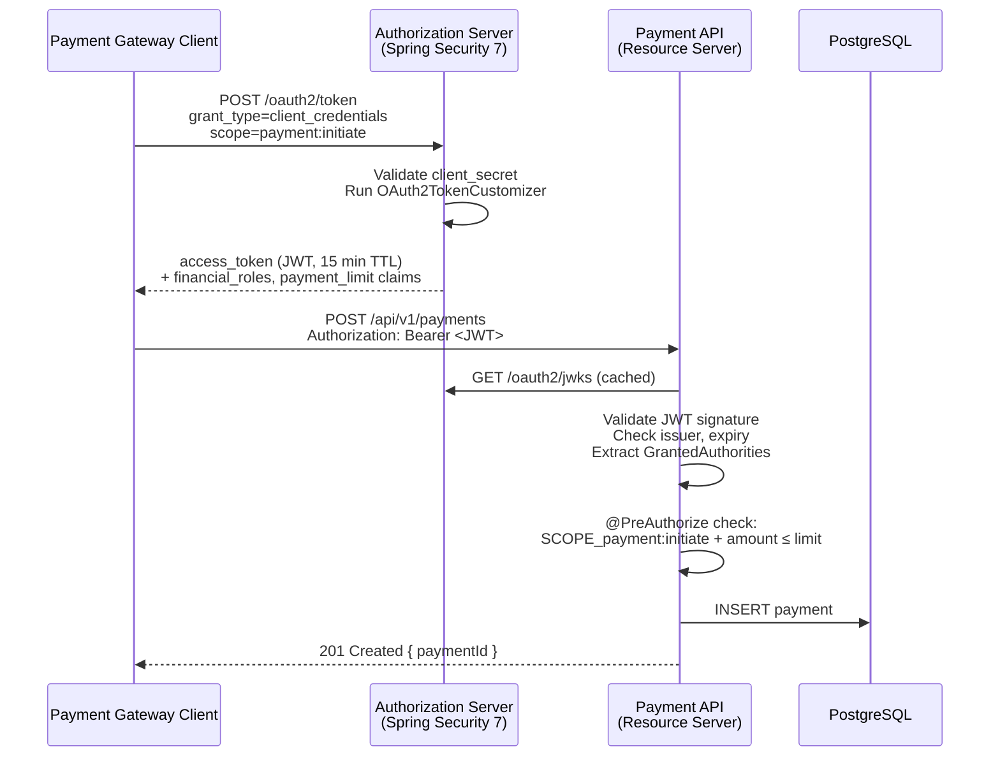

# Spring Security 7 — OAuth2, JWT, and Authorization Server

Spring Security 7 ships with Spring Framework 7 and Spring Boot 4. If you have been running a fintech service on Spring Boot 3.x with Spring Security 6.x, the migration surface is smaller than the 5→6 jump — but several APIs that were deprecated in SS6 are now **removed**, the lambda DSL is no longer optional, and Spring Authorization Server has moved into Spring Security itself. This lesson covers exactly what changed and why, then builds toward a production-grade OAuth2 setup for a high-volume payment platform.

---

## 1. What Changed from Spring Security 6.x

### Removed APIs

Some of these were already removed in SS 6.0; the rest were deprecated in 6.x and are **compilation errors** in SS7:

| Removed | Removed in | Replacement |
|---|---|---|
| `WebSecurityConfigurerAdapter` | 6.0 | `SecurityFilterChain` bean |
| `antMatchers()` / `mvcMatchers()` / `regexMatchers()` | 6.0 | `requestMatchers()` |
| `authorizeRequests()` | 7.0 | `authorizeHttpRequests()` |
| `HttpSecurity.apply(AbstractHttpConfigurer)` | 7.0 | `HttpSecurity.with(AbstractHttpConfigurer, ...)` |
| Method chaining DSL with `.and()` (non-lambda form) | 7.0 | Lambda DSL exclusively |
| `csrf().disable()` (bare) | 7.0 | `csrf(AbstractHttpConfigurer::disable)` |
| `oauth2ResourceServer().jwt()` (bare) | 7.0 | `oauth2ResourceServer(r -> r.jwt(...))` |
| `AntPathRequestMatcher` / `MvcRequestMatcher` | 7.0 | `PathPatternRequestMatcher` |
| `@EnableGlobalMethodSecurity` | 7.0 | `@EnableMethodSecurity` |

### `@EnableWebSecurity` changes

With Spring Boot, `@EnableWebSecurity` is applied for you by auto-configuration as soon as Spring Security is on the classpath, and your `SecurityFilterChain` (and `WebSecurityCustomizer`) beans are picked up automatically. Adding the annotation to your own configuration is harmless and documents intent; it is only required outside Spring Boot. Never ship `@EnableWebSecurity(debug = true)` to production — the debug output logs request details, including headers.

### `SecurityFilterChain` is the only approach

There is no `configure(HttpSecurity)` override. Every security concern lives in a `@Bean` returning `SecurityFilterChain`. Multiple ordered chains allow you to split internal actuator endpoints from the customer-facing payment API cleanly.

---

## 2. `HttpSecurity` Lambda DSL — Before and After

A payment API security configuration, showing the SS6 method-chaining style and the SS7-only lambda style side by side.

**Spring Security 6.x (removed in SS7):**

```java
// DOES NOT COMPILE in Spring Security 7
@Bean
SecurityFilterChain paymentApiSecurity(HttpSecurity http) throws Exception {
    http
        .authorizeRequests()                           // removed
            .antMatchers("/actuator/health").permitAll() // removed
            .anyRequest().authenticated()
        .and()
        .oauth2ResourceServer()
            .jwt();                                    // removed bare call
    return http.build();
}
```

**Spring Security 7 (lambda DSL only):**

```java
@Configuration
@EnableWebSecurity
public class PaymentApiSecurityConfig {

    @Bean
    @Order(1)
    SecurityFilterChain actuatorSecurity(HttpSecurity http) throws Exception {
        http
            .securityMatcher("/actuator/**")
            .authorizeHttpRequests(auth -> auth
                .requestMatchers("/actuator/health/**", "/actuator/info").permitAll()
                .anyRequest().hasRole("OPS")
            )
            .csrf(AbstractHttpConfigurer::disable)
            .sessionManagement(s -> s.sessionCreationPolicy(STATELESS));
        return http.build();
    }

    @Bean
    @Order(2)
    SecurityFilterChain paymentApiSecurity(HttpSecurity http,
                                            JwtAuthenticationConverter jwtConverter) throws Exception {
        http
            .securityMatcher("/api/**")
            .authorizeHttpRequests(auth -> auth
                .requestMatchers(POST, "/api/v1/payments").hasAuthority("SCOPE_payment:initiate")
                .requestMatchers(GET,  "/api/v1/accounts/**").hasAuthority("SCOPE_account:read")
                .anyRequest().authenticated()
            )
            .oauth2ResourceServer(oauth2 -> oauth2
                .jwt(jwt -> jwt.jwtAuthenticationConverter(jwtConverter))
            )
            .csrf(AbstractHttpConfigurer::disable)
            .sessionManagement(s -> s.sessionCreationPolicy(STATELESS));
        return http.build();
    }
}
```

Key points: `@Order` controls which chain matches first; `securityMatcher` scopes the chain so it does not apply globally; `STATELESS` session policy is the norm for JWT-based APIs — server-side session state does not scale horizontally and is not needed when every request carries a token.

---

## 3. OAuth2 Resource Server in SS7

### YAML Configuration

```yaml
spring:
  security:
    oauth2:
      resourceserver:
        jwt:
          jwk-set-uri: https://auth.payments.internal/oauth2/jwks
          issuer-uri: https://auth.payments.internal
```

`issuer-uri` causes Spring Security to perform OIDC discovery at startup — it fetches `/.well-known/openid-configuration` and validates that the issuer claim in every incoming JWT matches. Use this in production. `jwk-set-uri` alone skips issuer validation, which is acceptable only for dev/test where the discovery endpoint is not available.

### Custom JWT Authentication Converter for Financial Roles

Out of the box, `JwtAuthenticationConverter` maps `scope` claims to `SCOPE_xxx` authorities. A fintech service needs to extract custom claims such as `account_tier`, `payment_limit`, and `permissions`.

```java
@Configuration
public class JwtConverterConfig {

    @Bean
    JwtAuthenticationConverter jwtAuthenticationConverter() {
        var converter = new JwtAuthenticationConverter();
        converter.setJwtGrantedAuthoritiesConverter(new FinancialPermissionsConverter());
        converter.setPrincipalClaimName("sub");
        return converter;
    }

    static class FinancialPermissionsConverter
            implements Converter<Jwt, Collection<GrantedAuthority>> {

        @Override
        public Collection<GrantedAuthority> convert(Jwt jwt) {
            var authorities = new ArrayList<GrantedAuthority>();

            // Map OAuth2 scopes → SCOPE_ prefix authorities
            var scopes = jwt.getClaimAsStringList("scope");
            if (scopes != null) {
                scopes.stream()
                      .map(s -> new SimpleGrantedAuthority("SCOPE_" + s))
                      .forEach(authorities::add);
            }

            // Map custom financial roles → ROLE_ prefix authorities
            var roles = jwt.getClaimAsStringList("financial_roles");
            if (roles != null) {
                roles.stream()
                     .map(r -> new SimpleGrantedAuthority("ROLE_" + r))
                     .forEach(authorities::add);
            }

            return authorities;
        }
    }
}
```

Clients calling the payment API would present a JWT like:

```json
{
  "sub": "user-7f3a9b",
  "iss": "https://auth.payments.internal",
  "scope": "payment:initiate account:read",
  "financial_roles": ["PAYMENT_INITIATOR", "ACCOUNT_READ"],
  "account_tier": "premium",
  "payment_limit": 50000,
  "exp": 1731456000
}
```

The `account_tier` and `payment_limit` claims are available on the `Jwt` principal for downstream authorization decisions.

---

## 4. Spring Authorization Server — Embedded for Internal Microservices

A common fintech pattern: an internal Authorization Server issues tokens consumed by multiple microservices (payment service, account service, notification service). Spring Authorization Server supports this — and with Spring Security 7 it is no longer a separate project: it is part of Spring Security and released with it (Spring Boot 4 offers `spring-boot-starter-oauth2-authorization-server`).

### Dependency

```xml
<dependency>
    <groupId>org.springframework.security</groupId>
    <artifactId>spring-security-oauth2-authorization-server</artifactId>
    <!-- part of Spring Security 7; version managed by the Spring Boot 4 BOM -->
</dependency>
```

### Authorization Server Configuration

```java
@Configuration
public class AuthorizationServerConfig {

    @Bean
    @Order(Ordered.HIGHEST_PRECEDENCE)
    SecurityFilterChain authServerSecurity(HttpSecurity http) throws Exception {
        // applyDefaultSecurity(http) is deprecated — configure via with(...)
        var authorizationServer = OAuth2AuthorizationServerConfigurer.authorizationServer();
        http
            .securityMatcher(authorizationServer.getEndpointsMatcher())
            .with(authorizationServer, as -> as.oidc(Customizer.withDefaults()))
            .authorizeHttpRequests(auth -> auth.anyRequest().authenticated());
        http.exceptionHandling(ex -> ex
            .defaultAuthenticationEntryPointFor(
                new LoginUrlAuthenticationEntryPoint("/login"),
                new MediaTypeRequestMatcher(TEXT_HTML)
            )
        );
        return http.build();
    }

    @Bean
    RegisteredClientRepository registeredClientRepository() {
        RegisteredClient paymentGatewayClient = RegisteredClient
            .withId(UUID.randomUUID().toString())
            .clientId("payment-gateway")
            // Demo only: in production load clients from a database-backed
            // RegisteredClientRepository and the secret from Vault
            .clientSecret("{bcrypt}" + new BCryptPasswordEncoder().encode("secret"))
            .clientAuthenticationMethod(ClientAuthenticationMethod.CLIENT_SECRET_BASIC)
            .authorizationGrantType(AuthorizationGrantType.CLIENT_CREDENTIALS)
            .scope("payment:initiate")
            .scope("account:read")
            .tokenSettings(TokenSettings.builder()
                .accessTokenTimeToLive(Duration.ofMinutes(15))
                .build())
            .build();
        return new InMemoryRegisteredClientRepository(paymentGatewayClient);
    }

    // Demo only: a key generated at startup changes on every restart (all issued
    // tokens become invalid) and differs between instances. In production, load
    // the signing key from a KMS/HSM-backed keystore and publish old and new
    // keys in the JWKS during rotation.
    @Bean
    JWKSource<SecurityContext> jwkSource() {
        RSAKey rsaKey = generateRsa();
        return new ImmutableJWKSet<>(new JWKSet(rsaKey));
    }

    private RSAKey generateRsa() {
        try {
            KeyPairGenerator generator = KeyPairGenerator.getInstance("RSA");
            generator.initialize(2048);
            KeyPair keyPair = generator.generateKeyPair();
            return new RSAKey.Builder((RSAPublicKey) keyPair.getPublic())
                .privateKey(keyPair.getPrivate())
                .keyID(UUID.randomUUID().toString())
                .build();
        } catch (NoSuchAlgorithmException e) {
            throw new IllegalStateException(e);
        }
    }
}
```

### Adding Financial Claims to Issued JWTs

The `OAuth2TokenCustomizer<JwtEncodingContext>` hook runs before token signing and is where you inject business-domain claims:

```java
@Bean
OAuth2TokenCustomizer<JwtEncodingContext> tokenCustomizer(AccountService accountService) {
    return context -> {
        if (context.getTokenType().equals(OAuth2TokenType.ACCESS_TOKEN)) {
            Authentication principal = context.getPrincipal();

            // For client_credentials flow, enrich with client metadata
            if (principal instanceof OAuth2ClientAuthenticationToken clientAuth) {
                String clientId = clientAuth.getRegisteredClient().getClientId();
                AccountMetadata meta = accountService.getClientMetadata(clientId);

                context.getClaims()
                    .claim("account_tier", meta.tier())
                    .claim("payment_limit", meta.paymentLimit())
                    .claim("financial_roles", meta.roles())
                    .claim("environment", "production");
            }
        }
    };
}
```

This keeps authorization logic in one place — the Authorization Server — rather than duplicating it across every resource server.

---

## 5. OAuth2 Flow Diagram



---

## 6. Method Security with SpEL

Enable method security via `@EnableMethodSecurity` (note: `@EnableGlobalMethodSecurity` was removed in SS7):

```java
@Configuration
@EnableMethodSecurity(prePostEnabled = true)
public class MethodSecurityConfig {
}
```

**Payment authorization using SpEL expressions:**

```java
@Service
public class PaymentService {

    // Allow only if caller has PAYMENT role AND amount is within their limit
    @PreAuthorize("""
        hasRole('PAYMENT_INITIATOR') and
        #amount <= @jwtClaimsExtractor.getPaymentLimit(authentication)
        """)
    public PaymentResult initiatePayment(String accountId, BigDecimal amount, String currency) {
        // amount already validated against JWT limit by Spring Security
        return paymentRepository.create(accountId, amount, currency);
    }

    // Post-authorization: only return the payment if it belongs to the caller
    @PostAuthorize("returnObject.accountId == authentication.name")
    public Payment getPayment(String paymentId) {
        return paymentRepository.findById(paymentId)
            .orElseThrow(() -> new PaymentNotFoundException(paymentId));
    }

    // Restrict bulk export to COMPLIANCE role
    @PreAuthorize("hasRole('COMPLIANCE') and hasAuthority('SCOPE_account:read')")
    public List<Payment> exportPayments(LocalDate from, LocalDate to) {
        return paymentRepository.findByDateRange(from, to);
    }
}
```

**The `jwtClaimsExtractor` bean:**

```java
@Component("jwtClaimsExtractor")
public class JwtClaimsExtractor {

    public BigDecimal getPaymentLimit(Authentication authentication) {
        if (authentication.getPrincipal() instanceof Jwt jwt) {
            Number limit = jwt.getClaim("payment_limit");
            return limit != null
                ? new BigDecimal(limit.toString())
                : BigDecimal.ZERO;
        }
        return BigDecimal.ZERO;
    }
}
```

SpEL `@beanName` syntax lets you call arbitrary beans inside security expressions — powerful but test carefully, since SpEL evaluation failures become `AccessDeniedException`.

---

## 7. Security Testing with `@MockitoBean`

Spring Boot 4 removes `@MockBean`; use Spring Framework's `@MockitoBean` (available since Framework 6.2). The two annotations behave the same in most cases, but `@MockitoBean` is a Spring Framework annotation rather than a Boot-only add-on. (In Boot 4, `@WebMvcTest` lives in the `spring-boot-webmvc-test` module.)

```java
@WebMvcTest(PaymentController.class)
@Import(PaymentApiSecurityConfig.class)
class PaymentControllerSecurityTest {

    @Autowired
    MockMvc mockMvc;

    @MockitoBean                          // replaces @MockBean from SB3
    PaymentService paymentService;

    @MockitoBean
    JwtClaimsExtractor jwtClaimsExtractor;

    @Test
    // roles and authorities cannot be combined in @WithMockUser — list both as authorities
    @WithMockUser(authorities = { "ROLE_PAYMENT_INITIATOR", "SCOPE_payment:initiate" })
    void initiatePayment_withValidAuthority_returns201() throws Exception {
        var request = new PaymentRequest("acc-123", new BigDecimal("100.00"), "GBP");
        var result  = new PaymentResult("pay-456", "PENDING");

        given(paymentService.initiatePayment(any(), any(), any())).willReturn(result);

        mockMvc.perform(post("/api/v1/payments")
                .contentType(APPLICATION_JSON)
                .content("""
                    {"accountId":"acc-123","amount":100.00,"currency":"GBP"}
                    """))
            .andExpect(status().isCreated())
            .andExpect(jsonPath("$.paymentId").value("pay-456"));
    }

    @Test
    void initiatePayment_withoutAuth_returns401() throws Exception {
        mockMvc.perform(post("/api/v1/payments")
                .contentType(APPLICATION_JSON)
                .content("{}"))
            .andExpect(status().isUnauthorized());
    }

    @Test
    @WithMockUser(roles = "VIEWER")           // has no SCOPE_payment:initiate
    void initiatePayment_withWrongRole_returns403() throws Exception {
        mockMvc.perform(post("/api/v1/payments")
                .contentType(APPLICATION_JSON)
                .content("{}"))
            .andExpect(status().isForbidden());
    }
}
```

`@WebMvcTest` loads only the web layer, so the full `SecurityFilterChain` is included but service beans are not. `@Import` brings in your security configuration explicitly when it lives outside the controller's package. `@MockitoBean` replaces the real `PaymentService` with a Mockito mock — the `given(...)` stub prevents any actual database call.

**Tip**: If testing a `@PreAuthorize` expression that reads JWT claims, inject a real `JwtAuthenticationToken` using `SecurityMockMvcRequestPostProcessors.jwt()`:

```java
@Test
void initiatePayment_withJwtBelow_limit_returns201() throws Exception {
    given(paymentService.initiatePayment(any(), any(), any()))
        .willReturn(new PaymentResult("pay-789", "PENDING"));

    mockMvc.perform(post("/api/v1/payments")
            .with(jwt()
                .jwt(j -> j
                    .claim("financial_roles", List.of("PAYMENT_INITIATOR"))
                    .claim("payment_limit", 50000)
                    .claim("scope", "payment:initiate"))
                // jwt() maps only "scope" by default — apply our converter so
                // financial_roles become ROLE_ authorities too
                .authorities(new JwtConverterConfig.FinancialPermissionsConverter()))
            .contentType(APPLICATION_JSON)
            .content("""
                {"accountId":"acc-1","amount":100.00,"currency":"GBP"}
                """))
        .andExpect(status().isCreated());
}
```

`SecurityMockMvcRequestPostProcessors.jwt()` constructs a `JwtAuthenticationToken` and injects it into the `SecurityContext` for that request only — no actual token validation occurs, making this ideal for unit-testing authorization logic without an Authorization Server.

---

## Summary

- **SS7 removes** `authorizeRequests`, `apply()`, `AntPathRequestMatcher`, `@EnableGlobalMethodSecurity`, and all non-lambda DSL forms (`WebSecurityConfigurerAdapter` and `antMatchers` were already gone in 6.0). If your SB3 service uses any of these, it will not compile.
- **Lambda DSL** is now the only form; multiple `@Order`ed `SecurityFilterChain` beans cleanly separate actuator, public, and authenticated API surfaces.
- **OAuth2 Resource Server** configuration is two YAML lines + a custom `JwtAuthenticationConverter` for financial role mapping.
- **Spring Authorization Server**, now part of Spring Security 7, enables internal token issuance with business-domain claims via `OAuth2TokenCustomizer`.
- **`@EnableMethodSecurity`** (not `@EnableGlobalMethodSecurity`) enables `@PreAuthorize` / `@PostAuthorize`; SpEL expressions can reference Spring beans for complex authorization rules.
- **`@MockitoBean`** replaces `@MockBean` in test classes; `SecurityMockMvcRequestPostProcessors.jwt()` lets you inject JWT claims without a live Authorization Server.

---

<!-- KNOWLEDGE-CHECK
[
  {
    "id": "kc-05-01",
    "question": "In Spring Security 7, which of the following will cause a compilation error that compiled successfully under Spring Security 6?",
    "options": [
      "Using @EnableWebSecurity on a configuration class",
      "Calling http.authorizeRequests(auth -> auth.requestMatchers(\"/health\").permitAll())",
      "Defining a SecurityFilterChain bean with @Order(1)",
      "Using @PreAuthorize(\"hasRole('ADMIN')\")"
    ],
    "correct": 1,
    "explanation": "authorizeRequests() was deprecated in Spring Security 6 (in favour of authorizeHttpRequests()) and removed in Spring Security 7, so this code — which compiled with warnings on SS6 — fails on SS7. (antMatchers() was already removed in SS 6.0.) @EnableWebSecurity, ordered SecurityFilterChain beans and @PreAuthorize all remain valid."
  },
  {
    "id": "kc-05-02",
    "question": "A payment API needs to validate JWTs issued by an internal Authorization Server and also enforce that the issuer claim matches. Which spring.security.oauth2.resourceserver configuration achieves this automatically at startup?",
    "options": [
      "spring.security.oauth2.resourceserver.jwt.public-key-location",
      "spring.security.oauth2.resourceserver.jwt.jwk-set-uri only",
      "spring.security.oauth2.resourceserver.jwt.issuer-uri",
      "spring.security.oauth2.resourceserver.jwt.audiences"
    ],
    "correct": 2,
    "explanation": "issuer-uri triggers OIDC discovery at startup — Spring Security fetches /.well-known/openid-configuration, retrieves the JWKS URI, and validates the iss claim on every incoming JWT. jwk-set-uri alone skips issuer validation."
  },
  {
    "id": "kc-05-03",
    "question": "You need to add a payment_limit claim to every JWT issued by Spring Authorization Server (now part of Spring Security 7). Which bean type should you implement?",
    "options": [
      "OAuth2TokenIntrospectionAuthenticationProvider",
      "OAuth2TokenCustomizer<JwtEncodingContext>",
      "JwtAuthenticationConverter",
      "OAuth2AuthorizationService"
    ],
    "correct": 1,
    "explanation": "OAuth2TokenCustomizer<JwtEncodingContext> is called before the JWT is signed, giving you access to context.getClaims() where you can add arbitrary claims. JwtAuthenticationConverter runs on the resource server side to extract authorities from an already-issued token."
  },
  {
    "id": "kc-05-04",
    "question": "In a @WebMvcTest for a Spring Boot 4 payment controller secured with @PreAuthorize, what is the correct annotation to create a mock of a collaborating service bean?",
    "options": [
      "@MockBean (from spring-boot-test)",
      "@Mock (from Mockito)",
      "@MockitoBean (from Spring Framework, since 6.2)",
      "@Spy (from Mockito)"
    ],
    "correct": 2,
    "explanation": "@MockitoBean (org.springframework.test.context.bean.override.mockito) replaces Spring Boot's @MockBean, which was deprecated in 3.4 and removed in Spring Boot 4. It registers a Mockito mock in the Spring ApplicationContext for the duration of the test. @Mock creates a bare Mockito mock with no Spring context integration."
  }
]
-->

<!-- PRACTICAL-CHALLENGE
{
  "id": "pc-05",
  "title": "Secure a Payment Microservice with Spring Security 7",
  "description": "Implement production-grade OAuth2 security for a payment REST API using Spring Security 7's lambda DSL, JWT resource server, and method-level authorization.",
  "tasks": [
    {
      "id": "pc-05-01",
      "description": "Create a PaymentApiSecurityConfig class with two @Order-annotated SecurityFilterChain beans: one matching /actuator/** that permits /actuator/health without auth and requires ROLE_OPS for all other actuator paths; one matching /api/** that requires SCOPE_payment:initiate for POST /api/v1/payments and SCOPE_account:read for GET /api/v1/accounts/**. Both chains must use STATELESS session policy and disable CSRF."
    },
    {
      "id": "pc-05-02",
      "description": "Implement a FinancialJwtAuthenticationConverter (implementing Converter<Jwt, Collection<GrantedAuthority>>) that extracts both OAuth2 scopes (mapping to SCOPE_ prefixed authorities) and a custom financial_roles JWT claim (mapping to ROLE_ prefixed authorities). Wire it into the oauth2ResourceServer JWT configuration and configure spring.security.oauth2.resourceserver.jwt.issuer-uri in application.yml."
    },
    {
      "id": "pc-05-03",
      "description": "Add @PreAuthorize to PaymentService.initiatePayment(String accountId, BigDecimal amount, String currency) so it allows execution only when the caller has ROLE_PAYMENT_INITIATOR and the amount is less than or equal to the payment_limit claim from the JWT. Implement a JwtClaimsExtractor Spring bean (named jwtClaimsExtractor) that the SpEL expression references to extract the limit."
    },
    {
      "id": "pc-05-04",
      "description": "Write a @WebMvcTest for PaymentController that covers three scenarios: (1) unauthenticated request returns 401, (2) request with ROLE_VIEWER but missing SCOPE_payment:initiate returns 403, (3) request using SecurityMockMvcRequestPostProcessors.jwt() with financial_roles=[\"PAYMENT_INITIATOR\"] and payment_limit=50000 and an amount of 100.00 returns 201. Use @MockitoBean for PaymentService and assert the response body contains paymentId."
    }
  ]
}
-->
