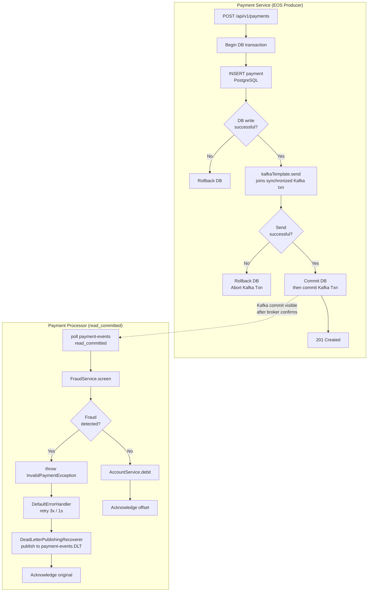

# ‏Spring Kafka 4 — الإعداد ودلالات "مرة واحدة بالضبط"

يُكمل Apache Kafka 4.0 الانتقال إلى KRaft ‏(بيانات Kafka الوصفية عبر Raft) — فلم يعد ZooKeeper مُهملًا فحسب، بل اختفى. ويتماشى Spring Kafka 4 ‏(SK4) مع هذا ويقدم عدة تنظيفات للواجهات تهم خدمات التقنية المالية التي تعالج ملايين أحداث الدفع يوميًا. ويركز هذا الدرس على ما انكسر، وما تحسن، وكيف تنفذ دلالات "مرة واحدة بالضبط" عبر كتابة في PostgreSQL ونشر في Kafka.

---

## 1. ‏KRaft — اختفى ZooKeeper

### ما اختفى من الإعداد

يزيل Apache Kafka 4.0 كل مسارات الكود المعتمدة على ZooKeeper من الوسيط (broker). ولا تتأثر تطبيقات العملاء تقريبًا — فهي تتحدث إلى الوسطاء عبر `bootstrap-servers` — لكن الإعدادات القديمة كثيرًا ما تحمل مُدخلات `zookeeper.*` يجب تنظيفها:

**خصائص متبقية يجب حذفها:**

| الخاصية المتبقية | ملاحظات |
|---|---|
| ‏`spring.kafka.admin.properties.zookeeper.connect` | اختفت إدارة ZK؛ استخدم KRaft |
| ‏`spring.kafka.properties.zookeeper.session.timeout.ms` | خاصة بـ ZK؛ احذفها من الإعدادات |
| ‏`spring.kafka.properties.zookeeper.connection.timeout.ms` | خاصة بـ ZK؛ احذفها من الإعدادات |
| كل مُدخلات `zookeeper.*` في `spring.kafka.properties` | غير صالحة مع وسطاء Kafka 4.0 |

**قبل (SB3 / نشر Kafka 3.x):**

```yaml
spring:
  kafka:
    bootstrap-servers: kafka-0:9092,kafka-1:9092,kafka-2:9092
    properties:
      zookeeper.connect: zk-0:2181,zk-1:2181,zk-2:2181
      zookeeper.session.timeout.ms: 15000
```

**بعد (SB4 / ‏Kafka 4.0 بـ KRaft):**

```yaml
spring:
  kafka:
    bootstrap-servers: kafka-0:9092,kafka-1:9092,kafka-2:9092
    # No zookeeper.* properties — the Kafka client only logs
    # "supplied but isn't a known config" warnings for them
    properties:
      security.protocol: SASL_SSL
      sasl.mechanism: SCRAM-SHA-512
```

عناوين الوسطاء متطابقة — فـ KRaft لا يغير البروتوكول الموجه للعملاء. ‏(لم تعد عملاء Kafka تحتاج ZooKeeper منذ اختفاء المستهلك القديم المكتوب بـ Scala؛ ومُدخلات `zookeeper.*` في إعدادات العملاء بقايا يتجاهلها العميل مع تحذير.) والتغيير في طبقة البيانات الوصفية للوسيط: وسطاء Kafka 4.0 يعملون بـ KRaft فقط، لذا يجب ترحيل العناقيد إلى KRaft ‏(عبر Kafka 3.9) قبل الترقية.

### أثر KRaft على عمليات إدارة Kafka

لم يعد `KafkaAdmin` ‏(المستخدم للإنشاء التلقائي لـ beans ‏`NewTopic`) يقبل العمليات القائمة على ZooKeeper. فكل عمليات الإدارة تمر الآن عبر بروتوكول Kafka Admin مباشرة إلى الوسطاء. والأثر العملي: تعمل تصريحات `@Bean NewTopic` بشكل مطابق في SB4 — فعميل الإدارة الأساسي يتصل بالوسطاء بدل ZooKeeper.

```java
@Bean
NewTopic paymentEventsTopic() {
    return TopicBuilder.name("payment-events")
        .partitions(12)
        .replicas(3)
        .config(TopicConfig.RETENTION_MS_CONFIG, String.valueOf(Duration.ofDays(7).toMillis()))
        .config(TopicConfig.COMPRESSION_TYPE_CONFIG, "lz4")
        .build();
}

@Bean
NewTopic paymentEventsDlt() {
    return TopicBuilder.name("payment-events.DLT")
        .partitions(12)
        .replicas(3)
        .build();
}
```

---

## 2. ‏`KafkaTemplate` — ‏`CompletableFuture` في كل مكان

كان `ListenableFuture` نوعًا مساعدًا في Spring استخدمه Spring Kafka 2.x لنتائج الإرسال غير المتزامن. ومنذ **Spring Kafka 3.0** ‏(Spring Boot 3)، تعيد كل صيغ `KafkaTemplate.send()` ‏`CompletableFuture<SendResult<K, V>>`، وأزال Spring Framework 7 ‏`ListenableFuture` كليًا. ويجب على الخدمات التي تخطت ترحيل Boot 3 تحويل ردود النداء الآن.

**أسلوب Spring Kafka 2.x:**

```java
// Does not compile on Spring Kafka 3 or 4
ListenableFuture<SendResult<String, PaymentEvent>> future =
    kafkaTemplate.send("payment-events", event.paymentId(), event);
future.addCallback(
    success -> log.info("Sent {}", success.getProducerRecord().key()),
    failure -> log.error("Failed to send", failure)
);
```

**‏Spring Kafka 4:**

```java
@Service
@RequiredArgsConstructor
public class PaymentEventPublisher {

    private final KafkaTemplate<String, PaymentEvent> kafkaTemplate;

    public CompletableFuture<String> publishPaymentCreated(PaymentEvent event) {
        return kafkaTemplate
            .send("payment-events", event.paymentId(), event)
            .thenApply(result -> {
                log.info("Published payment {} to partition {} offset {}",
                    event.paymentId(),
                    result.getRecordMetadata().partition(),
                    result.getRecordMetadata().offset());
                return event.paymentId();
            })
            .exceptionally(ex -> {
                log.error("Failed to publish payment {}: {}", event.paymentId(), ex.getMessage());
                throw new PaymentEventPublishException(event.paymentId(), ex);
            });
    }
}
```

يضبط Spring Boot تلقائيًا `KafkaTemplate` تستطيع حقنه بأنواعك العامة الخاصة (`KafkaTemplate<String, PaymentEvent>`)؛ والمُسلسِلات المضبوطة هي التي تقرر ما يُكتب فعليًا. ولاحظ أن `exceptionally` يلاحظ الإخفاق فقط — وما زال على المستدعي تقرير ما يفعله بحدث لم يُنشر (إعادة المحاولة، أو صندوق الصادر، أو إفشال الطلب).

---

## 3. دلالات "مرة واحدة بالضبط" — قاعدة البيانات + Kafka في معاملة واحدة

هذا أهم نمط في التقنية المالية: كتابة دفعة في PostgreSQL ونشر حدث `PaymentCreated` في Kafka يجب أن يكونا ذريين. إما أن ينجح كلاهما أو لا ينجح أي منهما.

### إعداد المنتج لـ EOS

```yaml
spring:
  kafka:
    producer:
      transaction-id-prefix: payment-svc-txn-
      acks: all
      retries: 2147483647         # MAX_INT — let the producer retry indefinitely
      properties:
        enable.idempotence: true
        max.in.flight.requests.per.connection: 5
        delivery.timeout.ms: 120000
    consumer:
      isolation-level: read_committed   # Only read committed Kafka messages
      auto-offset-reset: earliest
      group-id: payment-processor
```

يجعل `transaction-id-prefix` المنتج معاملاتيًا ويطلق الإعداد التلقائي لـ `KafkaTransactionManager`. ومع `enable.idempotence=true` و`acks=all`، يعطيك هذا دلالات "مرة واحدة بالضبط" *داخل Kafka* ‏(EOS): فحلقات الاستهلاك-المعالجة-الإنتاج والنشر متعدد السجلات تُؤكد ذريًا، ولا يرى المستهلكون بـ `read_committed` السجلات الملغاة أبدًا.

### معاملة تمتد عبر قاعدة البيانات وKafka

لا يمكن لقاعدة بيانات وKafka مشاركة معاملة ACID واحدة. وكان `ChainedKafkaTransactionManager` ‏(المُهمل في Spring Kafka 2.7، والمُزال في 3.0) يسلسلهما؛ واليوم النمط الموصى به جعل **معاملة JPA المعاملة الخارجية** وترك `KafkaTemplate` المعاملاتي *يزامن* معاملة Kafka الخاصة به معها.

```java
@Service
@RequiredArgsConstructor
@Transactional   // the primary (JPA) transaction manager
public class PaymentCommandHandler {

    private final PaymentRepository paymentRepository;
    private final KafkaTemplate<String, PaymentEvent> kafkaTemplate;

    /**
     * The JPA transaction is the outer one. The send() joins a Kafka transaction
     * that Spring synchronizes with it: the DB commits first, then Kafka.
     * If the method throws, both roll back. If Kafka's commit fails AFTER the
     * DB commit, the event is lost -- see the outbox note below.
     */
    public PaymentResult handleCreatePayment(CreatePaymentCommand cmd) {
        // 1. Persist payment in PostgreSQL within the synchronized JPA transaction
        Payment payment = paymentRepository.save(Payment.from(cmd));

        // 2. Publish event inside the same Kafka transaction
        PaymentEvent event = PaymentEvent.created(payment);
        kafkaTemplate.send("payment-events", payment.getId(), event);

        return PaymentResult.of(payment);
    }
}
```

**إعداد مدير المعاملات:**

```java
@Configuration
public class TransactionConfig {

    @Bean
    KafkaTransactionManager<String, PaymentEvent> kafkaTransactionManager(
            ProducerFactory<String, PaymentEvent> producerFactory) {
        return new KafkaTransactionManager<>(producerFactory);
    }

    // Spring Boot's JPA transaction manager backs off when ANY TransactionManager
    // bean exists (including the Kafka one) -- so declare it explicitly and make
    // it the primary one used by plain @Transactional
    @Bean
    @Primary
    PlatformTransactionManager transactionManager(EntityManagerFactory emf) {
        return new JpaTransactionManager(emf);
    }
}
```

**النموذج الذهني الصحيح**: يبدأ `@Transactional` معاملة JPA. وحين يعمل `kafkaTemplate.send()` داخلها، يبدأ القالب المعاملاتي معاملة Kafka ويسجلها في `TransactionSynchronizationManager` الخاص بـ Spring. وعند النجاح، يؤكد Spring معاملة قاعدة البيانات ثم يؤكد معاملة Kafka. وإن رمت الدالة استثناءً، تتراجع قاعدة البيانات وتُلغى معاملة Kafka، فلا يرى مستهلكو `read_committed` الحدث أبدًا.

‏(**لا** تضع `@Transactional(transactionManager = "kafkaTransactionManager")` على الدالة بدلًا من ذلك: فسيعمل استدعاء المستودع حينها في معاملة JPA *خاصة به*، تُؤكد فورًا — قبل Kafka — وسيترك إخفاق لاحق الدفعة في قاعدة البيانات دون حدثها.)

هذا تأكيد أحادي المرحلة بأفضل جهد، لا XA — فإن فشل تأكيد Kafka بعد تأكيد قاعدة البيانات (الوسيط غير قابل للوصول في تلك اللحظة)، يضيع الحدث. وللذرية الحقيقية في التقنية المالية الإنتاجية، استخدم **نمط صندوق الصادر المعاملاتي (transactional outbox)**: أدرج صف حدث في معاملة قاعدة البيانات نفسها، واترك مرحّلًا (مثل Debezium CDC أو مستطلِع) ينشره في Kafka.

---

## 4. تغييرات `@KafkaListener` في SK4

### استبدال واجهة معالجة الأخطاء

أُهملت الواجهتان القديمتان `ErrorHandler`/`BatchErrorHandler` و`SeekToCurrentErrorHandler` في Spring Kafka 2.8 وأُزيلت في **3.0**. والبديل `CommonErrorHandler` ‏(عادة `DefaultErrorHandler`)، الذي يتعامل مع الاستهلاك سجلًا بسجل والاستهلاك الدفعي عبر واجهة واحدة. وكما مع `ListenableFuture`، لا يصيب هذا إلا الخدمات التي تخطت ترحيل Boot 3.

**أسلوب Spring Kafka 2.x:**

```java
// Does not compile on Spring Kafka 3 or 4
@Bean
ConcurrentKafkaListenerContainerFactory<String, PaymentEvent> factory(
        ConsumerFactory<String, PaymentEvent> cf) {
    var factory = new ConcurrentKafkaListenerContainerFactory<String, PaymentEvent>();
    factory.setErrorHandler(new SeekToCurrentErrorHandler());  // removed
    return factory;
}
```

**‏SK4:**

```java
@Bean
ConcurrentKafkaListenerContainerFactory<String, PaymentEvent> paymentListenerFactory(
        ConsumerFactory<String, PaymentEvent> cf,
        KafkaTemplate<String, PaymentEvent> kafkaTemplate) {

    var factory = new ConcurrentKafkaListenerContainerFactory<String, PaymentEvent>();
    factory.setConsumerFactory(cf);
    factory.setConcurrency(3);                    // 3 consumer threads
    factory.setAutoStartup(true);
    // The listener below takes an Acknowledgment -> manual ack mode
    factory.getContainerProperties().setAckMode(ContainerProperties.AckMode.MANUAL);

    // DefaultErrorHandler replaces SeekToCurrentErrorHandler
    var dlt = new DeadLetterPublishingRecoverer(kafkaTemplate,
        (record, ex) -> new TopicPartition(record.topic() + ".DLT", record.partition()));

    var errorHandler = new DefaultErrorHandler(dlt,
        new FixedBackOff(1_000L, 3L));            // 3 retries, 1s apart
    errorHandler.addNotRetryableExceptions(
        InvalidPaymentException.class,            // don't retry business validation errors
        SerializationException.class
    );

    factory.setCommonErrorHandler(errorHandler);  // SK4 method name
    return factory;
}
```

### مستهلك أحداث الدفع مع النشر إلى رسائل الموت

```java
@Component
@RequiredArgsConstructor
public class PaymentEventConsumer {

    private final FraudService fraudService;
    private final AccountService accountService;

    @KafkaListener(
        id = "payment-processor",                 // used by the health indicator below
        topics = "payment-events",
        groupId = "payment-processor",
        containerFactory = "paymentListenerFactory"
    )
    public void onPaymentEvent(
            @Payload PaymentEvent event,
            @Header(KafkaHeaders.RECEIVED_TOPIC) String topic,
            @Header(KafkaHeaders.RECEIVED_PARTITION) int partition,
            @Header(KafkaHeaders.OFFSET) long offset,
            Acknowledgment ack) {

        log.info("Processing payment {} from {}-{} @ {}",
            event.paymentId(), topic, partition, offset);

        try {
            fraudService.screen(event);
            accountService.debit(event.accountId(), event.amount());
            ack.acknowledge();
        } catch (FraudDetectedException e) {
            // Rethrow as non-retryable so DefaultErrorHandler routes to DLT
            throw new InvalidPaymentException("Fraud detected: " + event.paymentId(), e);
        }
    }

    @KafkaListener(topics = "payment-events.DLT", groupId = "payment-dlt-processor")
    public void onDeadLetter(
            @Payload PaymentEvent event,
            @Header Map<String, Object> headers) {
        log.error("DLT received payment {}, original exception: {}",
            event.paymentId(),
            headers.get("kafka_dlt-exception-message"));
        // Alert, manual review queue, etc.
    }
}
```

---

## 5. مخطط تدفق "مرة واحدة بالضبط"



---

## 6. فحوص صحة المستهلك وقابلية المراقبة

```yaml
management:
  endpoints:
    web:
      exposure:
        include: health, info, kafka, metrics, prometheus
  health:
    kafka:
      enabled: true

spring:
  kafka:
    listener:
      observation-enabled: true    # Micrometer tracing spans per message
```

يحقن `observation-enabled: true` ‏`Observation` من Micrometer حول كل استدعاء لـ `@KafkaListener`. ومع bean ‏`Tracer` ‏(Brave أو OpenTelemetry)، ينتج هذا تتبعات موزعة تربط طلب HTTP ‏(جانب المنتج) باستدعاء مستهلك Kafka.

**فحص برمجي لتأخر المستهلك** (فكّر مرتين قبل ربط التأخر بفحص *الجاهزية*: فارتفاع مفاجئ في التأخر سيُخرج كل pods المستهلكين من الخدمة دفعة واحدة — وعادة مكان التأخر مقياس وتنبيه، كما في دروس قابلية المراقبة):

```java
@Component
@RequiredArgsConstructor
public class KafkaLagHealthIndicator implements HealthIndicator {

    private final KafkaListenerEndpointRegistry registry;
    // Not auto-configured: create one from Boot's KafkaAdmin, e.g.
    // AdminClient.create(kafkaAdmin.getConfigurationProperties())
    private final AdminClient adminClient;

    @Override
    public Health health() {
        try {
            var container = registry.getListenerContainer("payment-processor");
            if (container == null || !container.isRunning()) {
                return Health.down().withDetail("reason", "container not running").build();
            }

            Map<TopicPartition, OffsetAndMetadata> offsets =
                adminClient.listConsumerGroupOffsets("payment-processor")
                           .partitionsToOffsetAndMetadata().get(5, TimeUnit.SECONDS);

            long totalLag = calculateLag(offsets);
            if (totalLag > 100_000) {
                // There is no Health.degraded(); use a custom status
                // (and map it to an HTTP code via management.endpoint.health.status.http-mapping)
                return Health.status("DEGRADED")
                    .withDetail("lag", totalLag)
                    .withDetail("threshold", 100_000)
                    .build();
            }
            return Health.up().withDetail("lag", totalLag).build();
        } catch (Exception e) {
            return Health.down(e).build();
        }
    }
}
```

---

## 7. الاختبار بـ `@EmbeddedKafka` ووضع KRaft

صار `@EmbeddedKafka` يعمل افتراضيًا بوضع KRaft منذ Spring Kafka 3.1، ويزيل Spring Kafka 4 الوسيط المضمّن القائم على ZooKeeper كليًا. ويجب تحديث الاختبارات التي اعتمدت على `EmbeddedKafkaZKBroker` أو إعدادات خاصة بـ ZooKeeper؛ واختبارات `@EmbeddedKafka` العادية تُترجم عادة دون تغيير.

```java
@SpringBootTest
@EmbeddedKafka(
    partitions = 3,
    brokerProperties = {
        "listeners=PLAINTEXT://localhost:${random.int[10000,20000]}",
        "log.dir=/tmp/kafka-test-${random.uuid}"
    },
    topics = { "payment-events", "payment-events.DLT" }
)
@TestPropertySource(properties = {
    "spring.kafka.consumer.auto-offset-reset=earliest",
    "spring.kafka.consumer.group-id=payment-processor-test"
})
class PaymentEventConsumerIntegrationTest {

    @Autowired
    EmbeddedKafkaBroker broker;

    @Autowired
    KafkaTemplate<String, PaymentEvent> kafkaTemplate;

    @MockitoBean
    FraudService fraudService;

    @MockitoBean
    AccountService accountService;

    @Test
    void paymentEvent_processedSuccessfully() throws Exception {
        var event = PaymentEvent.created("pay-001", "acc-123", new BigDecimal("250.00"), "GBP");

        doNothing().when(fraudService).screen(event);
        doNothing().when(accountService).debit(any(), any());

        kafkaTemplate.send("payment-events", event.paymentId(), event).get(10, SECONDS);

        await().atMost(10, SECONDS)
               .untilAsserted(() ->
                   verify(accountService).debit("acc-123", new BigDecimal("250.00")));
    }

    @Test
    void fraudulentPayment_publishedToDlt() throws Exception {
        var event = PaymentEvent.created("pay-002", "acc-456", new BigDecimal("99999.00"), "GBP");

        doThrow(new FraudDetectedException("velocity limit exceeded"))
            .when(fraudService).screen(event);

        kafkaTemplate.send("payment-events", event.paymentId(), event).get(10, SECONDS);

        // DefaultErrorHandler retries 3x then publishes to DLT
        await().atMost(30, SECONDS).untilAsserted(() -> {
            var consumer = createConsumer(broker, "payment-events.DLT");
            var dltRecords = KafkaTestUtils.getRecords(consumer);
            assertThat(dltRecords).hasSize(1);
            assertThat(dltRecords.iterator().next().key()).isEqualTo("pay-002");
        });
    }
}
```

**مهم**: يبدأ `@EmbeddedKafka` وسيطًا جديدًا لكل صنف اختبار افتراضيًا. ولمجموعات الاختبار الكبيرة، علّم صنف الاختبار بـ `@DirtiesContext(classMode = AFTER_CLASS)` فقط إن كنت تعدّل حالة Kafka مشتركة — وإلا فاتركه. وانظر الدرس 8 لإرشادات أداء الاختبارات المفصلة.

---

## الخلاصة

- **‏KRaft هو الوضع الوحيد** في Kafka 4.0. احذف كل خصائص `zookeeper.*` من إعدادات تطبيقات Spring Boot — فهي بقايا لا يحتاجها العملاء، ورحّل العناقيد إلى KRaft قبل ترقية الوسطاء.
- **اختفى `ListenableFuture`** ‏(منذ Spring Kafka 3.0؛ وأُزيل من Framework 7) — يعيد `KafkaTemplate.send()` ‏`CompletableFuture<SendResult<K, V>>`. وحدّث كود ردود النداء لاستخدام `thenApply` / `exceptionally` / `whenComplete`.
- **تتطلب EOS** ‏`transaction-id-prefix` + ‏`enable.idempotence=true` + ‏`acks=all` على المنتج، و`isolation-level=read_committed` على المستهلكين. ولجمع كتابة في قاعدة البيانات ونشر في Kafka، اجعل معاملة JPA هي `@Transactional` الخارجية ودع `KafkaTemplate` المعاملاتي يتزامن معها (تأكيد أحادي المرحلة بأفضل جهد)؛ واستخدم نمط صندوق الصادر للذرية الحقيقية.
- يحل **`CommonErrorHandler`** ‏(منذ Spring Kafka 2.8/3.0) محل `ErrorHandler` و`BatchErrorHandler`. واستخدم `DefaultErrorHandler` مع `FixedBackOff` و`DeadLetterPublishingRecoverer` لإعادة المحاولة + موضوع رسائل الموت في إعداد واحد.
- يربط **`observation-enabled: true`** امتدادات تتبع Micrometer حول استدعاءات المستمعين للتتبع الموزع دون تغييرات في الكود.
- يعمل **`@EmbeddedKafka`** بوضع KRaft فقط في SK4 ‏(أُزيل الوسيط المضمّن القائم على ZooKeeper) — والاختبارات العادية تُترجم عادة دون تغيير.

---

<!-- KNOWLEDGE-CHECK
[
  {
    "id": "kc-06-01",
    "question": "خدمة دفع على Spring Boot 3.x لديها spring.kafka.properties.zookeeper.connect=zk-0:2181 في application.yml. وعند ترحيلها إلى Spring Boot 4 مع Kafka 4.0، ما الإجراء الصحيح؟",
    "options": [
      "غيّر المنفذ من 2181 إلى 2888 لوضع KRaft",
      "استبدلها بـ spring.kafka.properties.kraft.quorum.voters",
      "احذف الخاصية كليًا — وسطاء KRaft يستخدمون bootstrap-servers فقط",
      "انقلها تحت spring.kafka.admin.properties"
    ],
    "correct": 2,
    "explanation": "يزيل Kafka 4.0 ‏ZooKeeper كليًا. ولا تحتاج تطبيقات العملاء إلا bootstrap-servers لاكتشاف العنقود. والخاصية zookeeper.connect بلا معنى لوسطاء Kafka 4.0 ويجب حذفها من إعدادات التطبيقات. ولا توجد خاصية عميل باسم kraft.quorum.voters."
  },
  {
    "id": "kc-06-02",
    "question": "في Spring Kafka 3 و4، ماذا يعيد KafkaTemplate.send()؟",
    "options": [
      "ListenableFuture<SendResult<K, V>>",
      "Future<RecordMetadata>",
      "CompletableFuture<SendResult<K, V>>",
      "Mono<SendResult<K, V>>"
    ],
    "correct": 2,
    "explanation": "منذ Spring Kafka 3.0، تعيد send() ‏CompletableFuture<SendResult<K, V>>، متماشية مع واجهة التزامن القياسية في Java ‏(وأزال Spring Framework 7 ‏ListenableFuture كليًا). والأنواع التفاعلية مثل Mono متاحة عبر ReactiveKafkaProducerTemplate، لا KafkaTemplate."
  },
  {
    "id": "kc-06-03",
    "question": "لضبط @KafkaListener ليعيد محاولة الرسائل الفاشلة 3 مرات بتأخير ثانية ثم ينشر الرسائل غير القابلة للاسترداد إلى موضوع رسائل الموت في Spring Kafka 3/4، أي صنف يجب أن تستخدم كـ CommonErrorHandler؟",
    "options": [
      "SeekToCurrentErrorHandler مع DeadLetterPublishingRecoverer",
      "DefaultErrorHandler مع FixedBackOff وDeadLetterPublishingRecoverer",
      "RetryingMessageListenerAdapter مع ExponentialBackOff",
      "BatchErrorHandler مع KafkaBackOff"
    ],
    "correct": 1,
    "explanation": "حل DefaultErrorHandler ‏(الذي ينفذ CommonErrorHandler) محل SeekToCurrentErrorHandler في Spring Kafka 2.8 وهو المعيار منذ 3.0. ويقبل ConsumerRecordRecoverer — عادة DeadLetterPublishingRecoverer — واستراتيجية BackOff مثل FixedBackOff(1000L, 3L). وأُزيل SeekToCurrentErrorHandler وBatchErrorHandler في 3.0."
  },
  {
    "id": "kc-06-04",
    "question": "لتفعيل امتدادات التتبع الموزع حول استدعاءات @KafkaListener دون كتابة أي كود في المستمع، أي خاصية إعداد في Spring Boot 4 يجب ضبطها؟",
    "options": [
      "spring.kafka.listener.ack-mode=manual",
      "spring.kafka.listener.observation-enabled=true",
      "management.tracing.kafka.enabled=true",
      "spring.kafka.producer.properties.interceptor.classes=TracingProducerInterceptor"
    ],
    "correct": 1,
    "explanation": "تجعل spring.kafka.listener.observation-enabled=true الحاوية ConcurrentMessageListenerContainer تغلّف كل استدعاء مستمع في Observation من Micrometer، فتنشئ الامتدادات تلقائيًا. ويتكامل هذا مع أي Tracer مسجل (Brave أو OpenTelemetry) دون تغييرات كود في المستمع."
  }
]
-->

<!-- PRACTICAL-CHALLENGE
{
  "id": "pc-06",
  "title": "بناء خط أحداث دفع بدلالات \"مرة واحدة بالضبط\"",
  "description": "نفّذ ناشرًا ومستهلكًا لأحداث الدفع بجودة الإنتاج بدلالات \"مرة واحدة بالضبط\"، ومعالجة رسائل الموت، وقابلية المراقبة باستخدام Spring Kafka 4.",
  "tasks": [
    {
      "id": "pc-06-01",
      "description": "اضبط application.yml لدلالات \"مرة واحدة بالضبط\": اضبط spring.kafka.producer.transaction-id-prefix=payment-svc-txn-، وenable.idempotence=true، وacks=all، وretries=2147483647؛ واضبط spring.kafka.consumer.isolation-level=read_committed وspring.kafka.listener.observation-enabled=true. وصرّح بـ beans من نوع NewTopic لـ payment-events ‏(12 قسمًا، وعامل تكرار 3، واحتفاظ 7 أيام) وpayment-events.DLT ‏(12 قسمًا، وعامل تكرار 3)."
    },
    {
      "id": "pc-06-02",
      "description": "نفّذ PaymentCommandHandler بدالة handleCreatePayment(CreatePaymentCommand) معلّمة بـ @Transactional العادي (مدير معاملات JPA الأساسي). ويجب أن تقوم الدالة بـ: (1) حفظ كيان Payment عبر PaymentRepository، (2) استدعاء kafkaTemplate.send(\"payment-events\", payment.getId(), PaymentEvent.created(payment)) فتتزامن معاملة Kafka مع معاملة JPA. وفي صنف TransactionConfig، صرّح بـ JpaTransactionManager كـ @Primary ‏(فمدير Boot سيتراجع) إلى جانب KafkaTransactionManager. واكتب اختبارًا يثبت أن استثناءً يُرمى بعد send() لا يترك صفًا في قاعدة البيانات ولا سجل Kafka مؤكدًا."
    },
    {
      "id": "pc-06-03",
      "description": "أنشئ bean من نوع ConcurrentKafkaListenerContainerFactory باسم paymentListenerFactory مع: concurrency=3، وAckMode.MANUAL، وDefaultErrorHandler يستخدم FixedBackOff(1000L, 3L)، وDeadLetterPublishingRecoverer يوجّه إلى موضوع رسائل الموت بالقسم المطابق (record.topic() + \".DLT\")، وإضافة InvalidPaymentException كاستثناء غير قابل لإعادة المحاولة. واكتب دالة @KafkaListener في PaymentEventConsumer تستدعي FraudService.screen() وAccountService.debit() وتستخدم Acknowledgment يدويًا."
    },
    {
      "id": "pc-06-04",
      "description": "اكتب صنف اختبار تكامل @EmbeddedKafka باسم PaymentEventConsumerIntegrationTest بدالتي اختبار: واحدة تتحقق من أن PaymentEvent صالحًا يؤدي إلى استدعاء AccountService.debit() ‏(استخدم Awaitility)، وواحدة تتحقق من أن PaymentEvent يسبب رمي FraudDetectedException ينتهي على payment-events.DLT بعد استنفاد المحاولات. واستخدم @MockitoBean لـ FraudService وAccountService."
    }
  ]
}
-->
