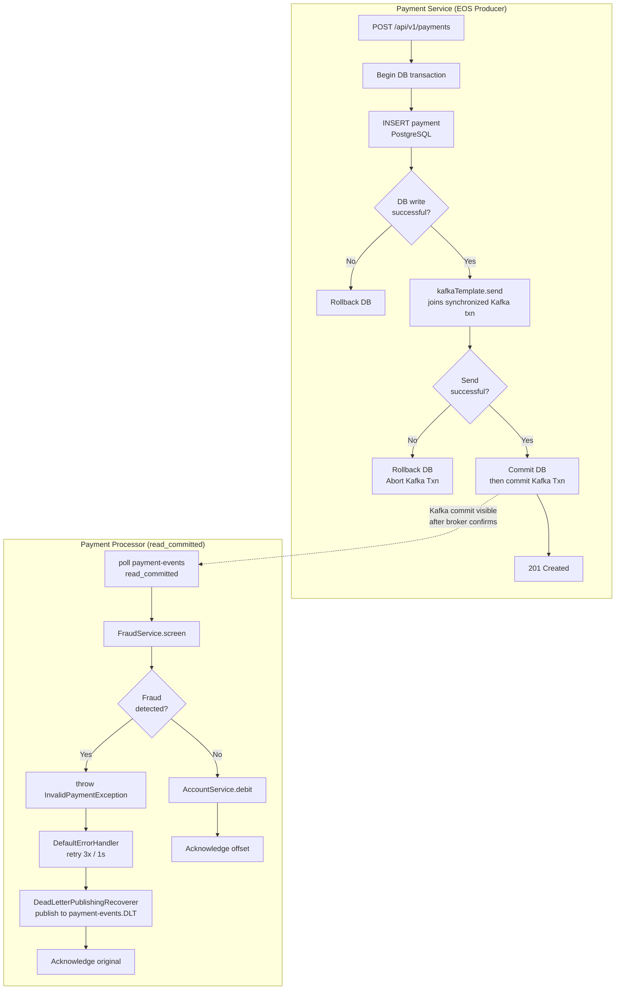

# Spring Kafka 4 — Configuration and Exactly-Once Semantics

Apache Kafka 4.0 completes the KRaft (Kafka Raft Metadata) transition — ZooKeeper is not just deprecated, it is gone. Spring Kafka 4 (SK4) aligns with this and ships several API cleanups that matter for fintech services processing millions of payment events daily. This lesson focuses on what broke, what improved, and how to implement exactly-once semantics across a PostgreSQL write and a Kafka publish.

---

## 1. KRaft — ZooKeeper Is Gone

### What Disappeared from Configuration

Apache Kafka 4.0 removes all ZooKeeper-dependent code paths from the broker. Client applications are barely affected — they talk to brokers via `bootstrap-servers` — but old configurations often still carry `zookeeper.*` entries that should be cleaned up:

**Leftover properties to delete:**

| Leftover property | Notes |
|---|---|
| `spring.kafka.admin.properties.zookeeper.connect` | ZK admin gone; use KRaft |
| `spring.kafka.properties.zookeeper.session.timeout.ms` | ZK-only; remove from configs |
| `spring.kafka.properties.zookeeper.connection.timeout.ms` | ZK-only; remove from configs |
| All `zookeeper.*` entries in `spring.kafka.properties` | Invalid in Kafka 4.0 brokers |

**Before (SB3 / Kafka 3.x deployment):**

```yaml
spring:
  kafka:
    bootstrap-servers: kafka-0:9092,kafka-1:9092,kafka-2:9092
    properties:
      zookeeper.connect: zk-0:2181,zk-1:2181,zk-2:2181
      zookeeper.session.timeout.ms: 15000
```

**After (SB4 / Kafka 4.0 KRaft):**

```yaml
spring:
  kafka:
    bootstrap-servers: kafka-0:9092,kafka-1:9092,kafka-2:9092
    # No zookeeper.* properties — the Kafka client only logs
    # "supplied but isn't a known config" warnings for them
    properties:
      security.protocol: SASL_SSL
      sasl.mechanism: SCRAM-SHA-512
```

The broker addresses are identical — KRaft does not change the client-facing protocol. (Kafka clients have not needed ZooKeeper since the old Scala consumer disappeared; `zookeeper.*` entries in client configs are leftovers that the client ignores with a warning.) The change is in the broker metadata layer: Kafka 4.0 brokers run KRaft only, so clusters must be migrated to KRaft (via Kafka 3.9) before upgrading.

### KRaft Impact on Kafka Admin Operations

`KafkaAdmin` (used for `NewTopic` bean auto-creation) no longer accepts ZooKeeper-based operations. All admin operations now go via the Kafka Admin protocol directly to brokers. The practical implication: `@Bean NewTopic` declarations work identically in SB4 — the underlying admin client just connects to brokers rather than ZooKeeper.

```java
@Bean
NewTopic paymentEventsTopic() {
    return TopicBuilder.name("payment-events")
        .partitions(12)
        .replicas(3)
        .config(TopicConfig.RETENTION_MS_CONFIG, String.valueOf(Duration.ofDays(7).toMillis()))
        .config(TopicConfig.COMPRESSION_TYPE_CONFIG, "lz4")
        .build();
}

@Bean
NewTopic paymentEventsDlt() {
    return TopicBuilder.name("payment-events.DLT")
        .partitions(12)
        .replicas(3)
        .build();
}
```

---

## 2. `KafkaTemplate` — `CompletableFuture` Everywhere

`ListenableFuture` was a Spring utility type used by Spring Kafka 2.x for async send results. Since **Spring Kafka 3.0** (Spring Boot 3), all `KafkaTemplate.send()` overloads return `CompletableFuture<SendResult<K, V>>`, and Spring Framework 7 has removed `ListenableFuture` altogether. Services that skipped the Boot 3 migration must convert their callbacks now.

**Spring Kafka 2.x style:**

```java
// Does not compile on Spring Kafka 3 or 4
ListenableFuture<SendResult<String, PaymentEvent>> future =
    kafkaTemplate.send("payment-events", event.paymentId(), event);
future.addCallback(
    success -> log.info("Sent {}", success.getProducerRecord().key()),
    failure -> log.error("Failed to send", failure)
);
```

**Spring Kafka 4:**

```java
@Service
@RequiredArgsConstructor
public class PaymentEventPublisher {

    private final KafkaTemplate<String, PaymentEvent> kafkaTemplate;

    public CompletableFuture<String> publishPaymentCreated(PaymentEvent event) {
        return kafkaTemplate
            .send("payment-events", event.paymentId(), event)
            .thenApply(result -> {
                log.info("Published payment {} to partition {} offset {}",
                    event.paymentId(),
                    result.getRecordMetadata().partition(),
                    result.getRecordMetadata().offset());
                return event.paymentId();
            })
            .exceptionally(ex -> {
                log.error("Failed to publish payment {}: {}", event.paymentId(), ex.getMessage());
                throw new PaymentEventPublishException(event.paymentId(), ex);
            });
    }
}
```

Spring Boot auto-configures a `KafkaTemplate` that you can inject with your own generic types (`KafkaTemplate<String, PaymentEvent>`); the configured serializers decide what is actually written. Note that `exceptionally` only observes a failure — the caller must still decide what to do with an event that could not be published (retry, outbox, or fail the request).

---

## 3. Exactly-Once Semantics — DB + Kafka in One Transaction

This is the most critical pattern for fintech: writing a payment to PostgreSQL and publishing a `PaymentCreated` event to Kafka must be atomic. Either both succeed or neither does.

### Producer Configuration for EOS

```yaml
spring:
  kafka:
    producer:
      transaction-id-prefix: payment-svc-txn-
      acks: all
      retries: 2147483647         # MAX_INT — let the producer retry indefinitely
      properties:
        enable.idempotence: true
        max.in.flight.requests.per.connection: 5
        delivery.timeout.ms: 120000
    consumer:
      isolation-level: read_committed   # Only read committed Kafka messages
      auto-offset-reset: earliest
      group-id: payment-processor
```

`transaction-id-prefix` makes the producer transactional and triggers `KafkaTransactionManager` auto-configuration. Combined with `enable.idempotence=true` and `acks=all`, this gives you exactly-once semantics *within Kafka* (EOS): consume-process-produce loops and multi-record publishes commit atomically, and `read_committed` consumers never see aborted records.

### Spanning a DB Transaction and a Kafka Transaction

A database and Kafka cannot share one ACID transaction. `ChainedKafkaTransactionManager` (deprecated in Spring Kafka 2.7, removed in 3.0) used to chain them; today the recommended pattern is to make the **JPA transaction the outer transaction** and let the transactional `KafkaTemplate` *synchronize* its Kafka transaction with it.

```java
@Service
@RequiredArgsConstructor
@Transactional   // the primary (JPA) transaction manager
public class PaymentCommandHandler {

    private final PaymentRepository paymentRepository;
    private final KafkaTemplate<String, PaymentEvent> kafkaTemplate;

    /**
     * The JPA transaction is the outer one. The send() joins a Kafka transaction
     * that Spring synchronizes with it: the DB commits first, then Kafka.
     * If the method throws, both roll back. If Kafka's commit fails AFTER the
     * DB commit, the event is lost -- see the outbox note below.
     */
    public PaymentResult handleCreatePayment(CreatePaymentCommand cmd) {
        // 1. Persist payment in PostgreSQL within the synchronized JPA transaction
        Payment payment = paymentRepository.save(Payment.from(cmd));

        // 2. Publish event inside the same Kafka transaction
        PaymentEvent event = PaymentEvent.created(payment);
        kafkaTemplate.send("payment-events", payment.getId(), event);

        return PaymentResult.of(payment);
    }
}
```

**Transaction manager configuration:**

```java
@Configuration
public class TransactionConfig {

    @Bean
    KafkaTransactionManager<String, PaymentEvent> kafkaTransactionManager(
            ProducerFactory<String, PaymentEvent> producerFactory) {
        return new KafkaTransactionManager<>(producerFactory);
    }

    // Spring Boot's JPA transaction manager backs off when ANY TransactionManager
    // bean exists (including the Kafka one) -- so declare it explicitly and make
    // it the primary one used by plain @Transactional
    @Bean
    @Primary
    PlatformTransactionManager transactionManager(EntityManagerFactory emf) {
        return new JpaTransactionManager(emf);
    }
}
```

**The correct mental model**: `@Transactional` starts the JPA transaction. When `kafkaTemplate.send()` runs inside it, the transactional template starts a Kafka transaction and registers it with Spring's `TransactionSynchronizationManager`. On success, Spring commits the database transaction and then commits the Kafka transaction. If the method throws, the database rolls back and the Kafka transaction is aborted, so `read_committed` consumers never see the event.

(Do **not** put `@Transactional(transactionManager = "kafkaTransactionManager")` on the method instead: the repository call would then run in its *own* JPA transaction, committed immediately — before Kafka — and a later failure would leave the payment in the database without its event.)

This is best-effort one-phase commit, not XA — if Kafka's commit fails after the database commit (broker unreachable at that moment), the event is lost. For true atomicity in production fintech, use the **transactional outbox pattern**: insert an event row in the same database transaction, and let a relay (e.g. Debezium CDC or a poller) publish it to Kafka.

---

## 4. `@KafkaListener` Changes in SK4

### Error Handler API Replacement

The legacy `ErrorHandler`/`BatchErrorHandler` interfaces and `SeekToCurrentErrorHandler` were deprecated in Spring Kafka 2.8 and removed in **3.0**. The replacement is `CommonErrorHandler` (usually `DefaultErrorHandler`), which handles both record-by-record and batch consumption through a single interface. As with `ListenableFuture`, this only bites services that skipped the Boot 3 migration.

**Spring Kafka 2.x style:**

```java
// Does not compile on Spring Kafka 3 or 4
@Bean
ConcurrentKafkaListenerContainerFactory<String, PaymentEvent> factory(
        ConsumerFactory<String, PaymentEvent> cf) {
    var factory = new ConcurrentKafkaListenerContainerFactory<String, PaymentEvent>();
    factory.setErrorHandler(new SeekToCurrentErrorHandler());  // removed
    return factory;
}
```

**SK4:**

```java
@Bean
ConcurrentKafkaListenerContainerFactory<String, PaymentEvent> paymentListenerFactory(
        ConsumerFactory<String, PaymentEvent> cf,
        KafkaTemplate<String, PaymentEvent> kafkaTemplate) {

    var factory = new ConcurrentKafkaListenerContainerFactory<String, PaymentEvent>();
    factory.setConsumerFactory(cf);
    factory.setConcurrency(3);                    // 3 consumer threads
    factory.setAutoStartup(true);
    // The listener below takes an Acknowledgment -> manual ack mode
    factory.getContainerProperties().setAckMode(ContainerProperties.AckMode.MANUAL);

    // DefaultErrorHandler replaces SeekToCurrentErrorHandler
    var dlt = new DeadLetterPublishingRecoverer(kafkaTemplate,
        (record, ex) -> new TopicPartition(record.topic() + ".DLT", record.partition()));

    var errorHandler = new DefaultErrorHandler(dlt,
        new FixedBackOff(1_000L, 3L));            // 3 retries, 1s apart
    errorHandler.addNotRetryableExceptions(
        InvalidPaymentException.class,            // don't retry business validation errors
        SerializationException.class
    );

    factory.setCommonErrorHandler(errorHandler);  // SK4 method name
    return factory;
}
```

### Payment Event Consumer with Dead-Letter Publishing

```java
@Component
@RequiredArgsConstructor
public class PaymentEventConsumer {

    private final FraudService fraudService;
    private final AccountService accountService;

    @KafkaListener(
        id = "payment-processor",                 // used by the health indicator below
        topics = "payment-events",
        groupId = "payment-processor",
        containerFactory = "paymentListenerFactory"
    )
    public void onPaymentEvent(
            @Payload PaymentEvent event,
            @Header(KafkaHeaders.RECEIVED_TOPIC) String topic,
            @Header(KafkaHeaders.RECEIVED_PARTITION) int partition,
            @Header(KafkaHeaders.OFFSET) long offset,
            Acknowledgment ack) {

        log.info("Processing payment {} from {}-{} @ {}",
            event.paymentId(), topic, partition, offset);

        try {
            fraudService.screen(event);
            accountService.debit(event.accountId(), event.amount());
            ack.acknowledge();
        } catch (FraudDetectedException e) {
            // Rethrow as non-retryable so DefaultErrorHandler routes to DLT
            throw new InvalidPaymentException("Fraud detected: " + event.paymentId(), e);
        }
    }

    @KafkaListener(topics = "payment-events.DLT", groupId = "payment-dlt-processor")
    public void onDeadLetter(
            @Payload PaymentEvent event,
            @Header Map<String, Object> headers) {
        log.error("DLT received payment {}, original exception: {}",
            event.paymentId(),
            headers.get("kafka_dlt-exception-message"));
        // Alert, manual review queue, etc.
    }
}
```

---

## 5. Exactly-Once Flow Diagram



---

## 6. Consumer Health Checks and Observability

```yaml
management:
  endpoints:
    web:
      exposure:
        include: health, info, kafka, metrics, prometheus
  health:
    kafka:
      enabled: true

spring:
  kafka:
    listener:
      observation-enabled: true    # Micrometer tracing spans per message
```

`observation-enabled: true` injects a Micrometer `Observation` around each `@KafkaListener` invocation. Combined with a `Tracer` bean (Brave or OpenTelemetry), this produces distributed traces that connect the HTTP request (producer side) to the Kafka consumer invocation.

**Programmatic consumer lag check** (think twice before wiring lag into a *readiness* probe: a lag spike would take every consumer pod out of service at once — usually lag belongs in a metric and an alert, as in the observability lessons):

```java
@Component
@RequiredArgsConstructor
public class KafkaLagHealthIndicator implements HealthIndicator {

    private final KafkaListenerEndpointRegistry registry;
    // Not auto-configured: create one from Boot's KafkaAdmin, e.g.
    // AdminClient.create(kafkaAdmin.getConfigurationProperties())
    private final AdminClient adminClient;

    @Override
    public Health health() {
        try {
            var container = registry.getListenerContainer("payment-processor");
            if (container == null || !container.isRunning()) {
                return Health.down().withDetail("reason", "container not running").build();
            }

            Map<TopicPartition, OffsetAndMetadata> offsets =
                adminClient.listConsumerGroupOffsets("payment-processor")
                           .partitionsToOffsetAndMetadata().get(5, TimeUnit.SECONDS);

            long totalLag = calculateLag(offsets);
            if (totalLag > 100_000) {
                // There is no Health.degraded(); use a custom status
                // (and map it to an HTTP code via management.endpoint.health.status.http-mapping)
                return Health.status("DEGRADED")
                    .withDetail("lag", totalLag)
                    .withDetail("threshold", 100_000)
                    .build();
            }
            return Health.up().withDetail("lag", totalLag).build();
        } catch (Exception e) {
            return Health.down(e).build();
        }
    }
}
```

---

## 7. Testing with `@EmbeddedKafka` and KRaft Mode

`@EmbeddedKafka` has defaulted to KRaft mode since Spring Kafka 3.1, and Spring Kafka 4 removes the ZooKeeper-based embedded broker entirely. Tests that relied on `EmbeddedKafkaZKBroker` or ZooKeeper-specific settings must be updated; plain `@EmbeddedKafka` tests usually compile unchanged.

```java
@SpringBootTest
@EmbeddedKafka(
    partitions = 3,
    brokerProperties = {
        "listeners=PLAINTEXT://localhost:${random.int[10000,20000]}",
        "log.dir=/tmp/kafka-test-${random.uuid}"
    },
    topics = { "payment-events", "payment-events.DLT" }
)
@TestPropertySource(properties = {
    "spring.kafka.consumer.auto-offset-reset=earliest",
    "spring.kafka.consumer.group-id=payment-processor-test"
})
class PaymentEventConsumerIntegrationTest {

    @Autowired
    EmbeddedKafkaBroker broker;

    @Autowired
    KafkaTemplate<String, PaymentEvent> kafkaTemplate;

    @MockitoBean
    FraudService fraudService;

    @MockitoBean
    AccountService accountService;

    @Test
    void paymentEvent_processedSuccessfully() throws Exception {
        var event = PaymentEvent.created("pay-001", "acc-123", new BigDecimal("250.00"), "GBP");

        doNothing().when(fraudService).screen(event);
        doNothing().when(accountService).debit(any(), any());

        kafkaTemplate.send("payment-events", event.paymentId(), event).get(10, SECONDS);

        await().atMost(10, SECONDS)
               .untilAsserted(() ->
                   verify(accountService).debit("acc-123", new BigDecimal("250.00")));
    }

    @Test
    void fraudulentPayment_publishedToDlt() throws Exception {
        var event = PaymentEvent.created("pay-002", "acc-456", new BigDecimal("99999.00"), "GBP");

        doThrow(new FraudDetectedException("velocity limit exceeded"))
            .when(fraudService).screen(event);

        kafkaTemplate.send("payment-events", event.paymentId(), event).get(10, SECONDS);

        // DefaultErrorHandler retries 3x then publishes to DLT
        await().atMost(30, SECONDS).untilAsserted(() -> {
            var consumer = createConsumer(broker, "payment-events.DLT");
            var dltRecords = KafkaTestUtils.getRecords(consumer);
            assertThat(dltRecords).hasSize(1);
            assertThat(dltRecords.iterator().next().key()).isEqualTo("pay-002");
        });
    }
}
```

**Important**: `@EmbeddedKafka` starts a fresh broker per test class by default. For large test suites, annotate the test class with `@DirtiesContext(classMode = AFTER_CLASS)` only if you mutate shared Kafka state — otherwise leave it off. See Lesson 8 for detailed test performance guidance.

---

## Summary

- **KRaft is the only mode** in Kafka 4.0. Remove all `zookeeper.*` properties from your Spring Boot application configs — SK4 will warn and Kafka 4.0 brokers will ignore them.
- **`ListenableFuture` is gone** (since Spring Kafka 3.0; removed from Framework 7) — `KafkaTemplate.send()` returns `CompletableFuture<SendResult<K, V>>`. Update callback code to use `thenApply` / `exceptionally` / `whenComplete`.
- **EOS requires** `transaction-id-prefix` + `enable.idempotence=true` + `acks=all` on the producer, and `isolation-level=read_committed` on consumers. To combine a DB write and a Kafka publish, make the JPA transaction the outer `@Transactional` and let the transactional `KafkaTemplate` synchronize with it (best-effort 1PC); use the outbox pattern for real atomicity.
- **`CommonErrorHandler`** (since Spring Kafka 2.8/3.0) replaces `ErrorHandler` and `BatchErrorHandler`. Use `DefaultErrorHandler` with `FixedBackOff` and `DeadLetterPublishingRecoverer` for retry + DLT in one configuration.
- **`observation-enabled: true`** wires Micrometer tracing spans around listener invocations for distributed tracing without code changes.
- **`@EmbeddedKafka`** runs KRaft only in SK4 (the ZooKeeper embedded broker is removed) — plain tests usually compile unchanged.

---

<!-- KNOWLEDGE-CHECK
[
  {
    "id": "kc-06-01",
    "question": "A Spring Boot 3.x payment service has spring.kafka.properties.zookeeper.connect=zk-0:2181 in its application.yml. When migrated to Spring Boot 4 with Kafka 4.0, what is the correct action?",
    "options": [
      "Change the port from 2181 to 2888 for KRaft mode",
      "Replace it with spring.kafka.properties.kraft.quorum.voters",
      "Remove the property entirely — KRaft brokers use bootstrap-servers only",
      "Move it under spring.kafka.admin.properties"
    ],
    "correct": 2,
    "explanation": "Kafka 4.0 removes ZooKeeper entirely. Client applications only need bootstrap-servers to discover the cluster. The zookeeper.connect property is meaningless to Kafka 4.0 brokers and should be deleted from application configs. There is no kraft.quorum.voters client property."
  },
  {
    "id": "kc-06-02",
    "question": "In Spring Kafka 3 and 4, what does KafkaTemplate.send() return?",
    "options": [
      "ListenableFuture<SendResult<K, V>>",
      "Future<RecordMetadata>",
      "CompletableFuture<SendResult<K, V>>",
      "Mono<SendResult<K, V>>"
    ],
    "correct": 2,
    "explanation": "Since Spring Kafka 3.0, send() returns CompletableFuture<SendResult<K, V>>, aligning with the standard Java concurrency API (Spring Framework 7 has removed ListenableFuture entirely). Reactive types like Mono are available through ReactiveKafkaProducerTemplate, not KafkaTemplate."
  },
  {
    "id": "kc-06-03",
    "question": "To configure a @KafkaListener to retry failed messages 3 times with a 1-second delay and then publish unrecoverable messages to a dead-letter topic in Spring Kafka 3/4, which class should you use as the CommonErrorHandler?",
    "options": [
      "SeekToCurrentErrorHandler with a DeadLetterPublishingRecoverer",
      "DefaultErrorHandler with FixedBackOff and DeadLetterPublishingRecoverer",
      "RetryingMessageListenerAdapter with ExponentialBackOff",
      "BatchErrorHandler with KafkaBackOff"
    ],
    "correct": 1,
    "explanation": "DefaultErrorHandler (which implements CommonErrorHandler) replaced SeekToCurrentErrorHandler in Spring Kafka 2.8 and is the standard since 3.0. It accepts a ConsumerRecordRecoverer — typically a DeadLetterPublishingRecoverer — and a BackOff strategy like FixedBackOff(1000L, 3L). SeekToCurrentErrorHandler and BatchErrorHandler were removed in 3.0."
  },
  {
    "id": "kc-06-04",
    "question": "To enable distributed tracing spans around @KafkaListener invocations without writing any listener code, which Spring Boot 4 configuration property should you set?",
    "options": [
      "spring.kafka.listener.ack-mode=manual",
      "spring.kafka.listener.observation-enabled=true",
      "management.tracing.kafka.enabled=true",
      "spring.kafka.producer.properties.interceptor.classes=TracingProducerInterceptor"
    ],
    "correct": 1,
    "explanation": "spring.kafka.listener.observation-enabled=true instructs the ConcurrentMessageListenerContainer to wrap each listener invocation in a Micrometer Observation, automatically creating spans. This integrates with any registered Tracer (Brave or OpenTelemetry) without code changes in the listener."
  }
]
-->

<!-- PRACTICAL-CHALLENGE
{
  "id": "pc-06",
  "title": "Build an Exactly-Once Payment Event Pipeline",
  "description": "Implement a production-grade payment event publisher and consumer with exactly-once semantics, dead-letter handling, and observability using Spring Kafka 4.",
  "tasks": [
    {
      "id": "pc-06-01",
      "description": "Configure application.yml for exactly-once semantics: set spring.kafka.producer.transaction-id-prefix=payment-svc-txn-, enable.idempotence=true, acks=all, retries=2147483647; set spring.kafka.consumer.isolation-level=read_committed and spring.kafka.listener.observation-enabled=true. Declare @Bean NewTopic beans for payment-events (12 partitions, RF 3, 7-day retention) and payment-events.DLT (12 partitions, RF 3)."
    },
    {
      "id": "pc-06-02",
      "description": "Implement PaymentCommandHandler with a method handleCreatePayment(CreatePaymentCommand) annotated with plain @Transactional (the primary JPA transaction manager). The method must: (1) save a Payment entity via PaymentRepository, (2) call kafkaTemplate.send(\"payment-events\", payment.getId(), PaymentEvent.created(payment)) so the Kafka transaction is synchronized with the JPA one. In a TransactionConfig class, declare the JpaTransactionManager as @Primary (Boot's would back off) alongside the KafkaTransactionManager. Write a test proving that an exception thrown after send() leaves neither a database row nor a committed Kafka record."
    },
    {
      "id": "pc-06-03",
      "description": "Create a ConcurrentKafkaListenerContainerFactory bean named paymentListenerFactory with: concurrency=3, AckMode.MANUAL, a DefaultErrorHandler using FixedBackOff(1000L, 3L), a DeadLetterPublishingRecoverer that routes to partition-matched DLT topic (record.topic() + \".DLT\"), and InvalidPaymentException added as a non-retryable exception. Write a @KafkaListener method in PaymentEventConsumer that calls FraudService.screen() and AccountService.debit() and uses manual Acknowledgment."
    },
    {
      "id": "pc-06-04",
      "description": "Write an @EmbeddedKafka integration test class PaymentEventConsumerIntegrationTest with two test methods: one verifying that a valid PaymentEvent results in AccountService.debit() being called (use Awaitility), and one verifying that a PaymentEvent that causes FraudDetectedException to be thrown ends up on payment-events.DLT after retries are exhausted. Use @MockitoBean for FraudService and AccountService."
    }
  ]
}
-->
