# ترحيل خدمة دفع من Spring Boot 3.x إلى 4.x

هذا الدرس شرح ترحيل خطوة بخطوة، لا نظرة عامة مفاهيمية. والهدف خدمة دفع إنتاجية تعمل على Spring Boot 3.5.x تعالج معاملات FPS ‏(المدفوعات السريعة)، وتخزن في PostgreSQL، وتنشر في Kafka، وتستخدم Spring Security مع JWT. وفي النهاية، يُترجم كل صنف وتنجح كل الاختبارات تحت Spring Boot 4.

---

## حالة الخدمة قبل الترحيل

```
payment-service/
├── pom.xml                              (spring-boot-starter-parent 3.5.x)
├── src/main/java/
│   ├── config/
│   │   ├── SecurityConfig.java          (authorizeRequests() + .and() DSL — REMOVED in SS7)
│   │   ├── JacksonConfig.java           (Jackson2ObjectMapperBuilderCustomizer — Jackson 3)
│   │   └── FlywayConfig.java            (relies on core starter — needs its own starter)
│   ├── service/
│   │   └── PaymentService.java          (@Autowired fields — cleanup, not breaking)
│   ├── repository/
│   │   └── PaymentRepository.java       (uses getById() — REMOVED)
│   ├── client/
│   │   └── FpsClient.java               (RestTemplate — maintenance mode)
│   └── ...
└── src/test/
    └── ...                              (@MockBean — REMOVED)
```

> [!NOTE]
> رقِّ إلى أحدث Spring Boot 3.5.x أولًا وأصلح كل تحذير إهمال هناك. فمعظم إزالات Boot 4 كانت مُهملة في 3.x، لذا يجعل بناء 3.5 الخالي من التحذيرات القفزة إلى 4.0 أصغر بكثير. وبقايا ترحيل Boot 2 → 3 — ‏`WebSecurityConfigurerAdapter`، و`antMatchers`، وخصائص `spring.redis.*`، و`ListenableFuture` و`SeekToCurrentErrorHandler` في Kafka، و`/actuator/httptrace` — تفشل بالفعل في Boot 3، فالخدمة التي تُبنى على 3.5 لم تعد تحتويها.

---

## الخطوة 1: قائمة التحقق قبل الترحيل

قبل لمس `pom.xml`:

**1.1 تحقق من JDK**

يعمل Spring Boot 4 على Java 17 أو أحدث؛ ويوصى بـ Java 21+ ‏(الخيوط الافتراضية)، وJava 25 هو LTS الحالي. وقرر ما إذا كنت ستغيّر JDK في الإصدار نفسه أو بشكل منفصل — ففعل الاثنين معًا يجعل نسب الإخفاقات أصعب.

```bash
java -version
# Must output: openjdk version "17.x.x" or higher (21 or 25 recommended)
```

**1.2 أضف `spring-boot-properties-migrator` إلى `pom.xml`**

تحلل هذه التبعية بيئتك عند البدء، وتطبع الخصائص المعاد تسميتها أو المُزالة مع بدائلها، وترحّل المعاد تسميتها مؤقتًا لك. أضفها للترحيل — وأزلها قبل بناء الإصدار النهائي.

```xml
<dependency>
    <groupId>org.springframework.boot</groupId>
    <artifactId>spring-boot-properties-migrator</artifactId>
    <scope>runtime</scope>
</dependency>
```

شغّلها مع الأب Boot 4 ‏(فهي تبلّغ عن الخصائص التي أعاد الإصدار *الجديد* تسميتها) وأصلح كل خاصية مُبلّغ عنها.

**1.3 تحقق من توافق التبعيات**

يدير BOM الخاص بـ Spring Boot 4 إصدارات مشاريع Spring ومكتبات خارجية كثيرة (Hibernate 7، وJackson 3، وFlyway، وLiquibase، وTestcontainers، وMicrometer). وتحتاج المكتبات خارج BOM فحوصًا يدوية — وانتبه خصوصًا لأي شيء يمس JSON، بسبب Jackson 3:

| نوع التبعية | ما يجب فحصه |
|---|---|
| springdoc-openapi | خط إصدار يدعم Spring Boot 4 |
| مُسلسِلات Confluent / Avro / Kafka المخصصة | التوافق مع Jackson 3، أو إبقاؤها على Jackson 2 عمدًا |
| MapStruct، وLombok | إصدارات حالية (معالجات التعليقات مقابل JDK الجديد) |
| starters المنصة الداخلية | محدّثة لحزم الإعداد التلقائي المقسّمة إلى وحدات (الدرس 1) |
| المكتبات التي تستخدم Undertow | يجب أن تنتقل إلى Tomcat أو Jetty |

**1.4 شغّل مجموعة الاختبارات كاملة ناجحة على SB3**

لا تبدأ الترحيل بمجموعة اختبارات فاشلة. فيجب أن تُنسب أي إخفاقات يسببها الترحيل إليه بوضوح.

---

## الخطوة 2: رفع الإصدار في POM / Gradle

```xml
<!-- Before -->
<parent>
    <groupId>org.springframework.boot</groupId>
    <artifactId>spring-boot-starter-parent</artifactId>
    <version>3.5.7</version>
</parent>

<!-- After -->
<parent>
    <groupId>org.springframework.boot</groupId>
    <artifactId>spring-boot-starter-parent</artifactId>
    <version>4.0.0</version>
</parent>
```

**‏Gradle ‏(`build.gradle.kts`):**

```kotlin
plugins {
    id("org.springframework.boot") version "4.0.0"
    id("io.spring.dependency-management") version "1.1.7"
}
```

### تغييرات الـ starters في SB4

| التغيير | الإجراء |
|---|---|
| أُزيل `spring-boot-starter-undertow` | استخدم Tomcat ‏(الافتراضي) أو `spring-boot-starter-jetty` |
| ‏`spring-boot-starter-web` ← `spring-boot-starter-webmvc` | الاسم القديم ما زال يعمل (مُهمل)؛ وأعد التسمية حين يناسب |
| ‏`spring-boot-starter-aop` ← `spring-boot-starter-aspectj` | أعد التسمية |
| ‏Flyway / Liquibase | أضف `spring-boot-starter-flyway` / `spring-boot-starter-liquibase` — فالـ starters الأساسية لم تعد تجلب إعدادهما التلقائي |
| شرائح الاختبار (`@WebMvcTest`، و`@DataJpaTest`، …) | أضف starters/وحدات الاختبار المقابلة (مثل `spring-boot-starter-webmvc-test`) وحدّث الاستيرادات |
| تحتاج بناءً أول سريعًا؟ | يجلب `spring-boot-starter-classic` / `spring-boot-starter-test-classic` كل الوحدات كجسر مؤقت |

تبقى `spring-boot-starter-webflux`، و`spring-boot-starter-data-jpa`، و`spring-boot-starter-data-redis`، و`spring-boot-starter-security`، و`spring-boot-starter-kafka`، والـ starters الأساسية الأخرى.

بعد رفع الأب، شغّل:

```bash
mvn dependency:tree | grep "spring-boot" | grep "\-\-"
# Review any SNAPSHOT or unresolved versions
```

---

## الخطوة 3: التغييرات العشرة الأكثر شيوعًا

اعمل عليها بالترتيب — فالبنود اللاحقة كثيرًا ما تعتمد على إصلاحات سابقة. والبنود 1–7 تكسر البناء أو بدء التشغيل؛ والبنود 8–10 تنظيفات موصى بها بشدة.

### التغيير 1: ‏`@MockBean` ← `@MockitoBean`

أُزيل `@MockBean` و`@SpyBean` ‏(من `spring-boot-test`، المُهملان منذ 3.4) في Spring Boot 4. والبدائل `@MockitoBean` و`@MockitoSpyBean` من `spring-test` في Spring Framework ‏(المتاحان منذ 6.2).

**قبل:**

```java
@WebMvcTest(PaymentController.class)
class PaymentControllerTest {
    @MockBean
    PaymentService paymentService;    // removed
}
```

**بعد:**

```java
@WebMvcTest(PaymentController.class)
class PaymentControllerTest {
    @MockitoBean
    PaymentService paymentService;    // Spring Framework test support
}
```

أمر sed من سطر واحد لترحيل كل ملفات الاختبار (GNU sed؛ وعلى macOS استخدم `sed -i ''`):

```bash
find src/test -name "*.java" -exec sed -i \
  -e 's/@MockBean/@MockitoBean/g' -e 's/@SpyBean/@MockitoSpyBean/g' \
  -e 's/import org.springframework.boot.test.mock.mockito.MockBean;/import org.springframework.test.context.bean.override.mockito.MockitoBean;/' \
  -e 's/import org.springframework.boot.test.mock.mockito.SpyBean;/import org.springframework.test.context.bean.override.mockito.MockitoSpyBean;/' {} \;
# Then move any @MockitoBean fields out of @TestConfiguration classes (see Lesson 2)
```

---

### التغيير 2: ‏Spring Security 7 — ‏`authorizeRequests()` وأسلوب `.and()`

أُهمل كلاهما في Spring Security 6 وأُزيلا في 7.

**قبل (يُترجم مع تحذيرات في SS6):**

```java
@Bean
SecurityFilterChain security(HttpSecurity http) throws Exception {
    http.authorizeRequests()                 // removed in SS7
            .anyRequest().authenticated()
        .and()                               // removed in SS7
        .oauth2ResourceServer().jwt();       // removed in SS7
    return http.build();
}
```

**بعد:** انظر الدرس 5 لترحيل `SecurityFilterChain` الكامل. والبديل الأدنى القابل للعمل:

```java
@Configuration
public class SecurityConfig {
    @Bean
    SecurityFilterChain security(HttpSecurity http) throws Exception {
        http.authorizeHttpRequests(auth -> auth.anyRequest().authenticated())
            .oauth2ResourceServer(r -> r.jwt(Customizer.withDefaults()));
        return http.build();
    }
}
```

---

### التغيير 3: ‏Jackson 3

يستخدم Spring Boot 4 ‏Jackson 3 افتراضيًا. وتنتقل حزم databind من `com.fasterxml.jackson.databind` إلى `tools.jackson.databind` ‏(وتبقى التعليقات في `com.fasterxml.jackson.annotation`)، وتُعاد تسمية خطافات التخصيص في Boot.

**قبل:**

```java
import com.fasterxml.jackson.databind.ObjectMapper;
import com.fasterxml.jackson.databind.SerializationFeature;

@Bean
Jackson2ObjectMapperBuilderCustomizer jacksonCustomizer() {
    return builder -> builder.featuresToDisable(SerializationFeature.FAIL_ON_EMPTY_BEANS);
}
```

**بعد:**

```java
import tools.jackson.databind.json.JsonMapper;
import tools.jackson.databind.SerializationFeature;

@Bean
JsonMapperBuilderCustomizer jacksonCustomizer() {
    return builder -> builder.disable(SerializationFeature.FAIL_ON_EMPTY_BEANS);
}
// Java time support is built into Jackson 3 — no JavaTimeModule registration
```

يغيّر Jackson 3 أيضًا عدة إعدادات افتراضية. فإن احتجت وقتًا للتحقق من عقود JSON لديك، اضبط `spring.jackson.use-jackson2-defaults=true` لإبقاء إعدادات Jackson 2 الافتراضية، وأضف اختبارات عقود (الدرس 8) تثبّت JSON الدقيق الذي يتلقاه شركاؤك — فالمبالغ والتواريخ وقيم التعدادات في واجهات الدفع يجب ألا تتغير بصمت.

---

### التغيير 4: الـ starters المقسّمة إلى وحدات والإعداد التلقائي المنقول

أعراض نموذجية: تتوقف ترحيلات Flyway بصمت (لا `spring-boot-starter-flyway`)، أو تفشل شرائح الاختبار في الترجمة (وحدات اختبار مفقودة)، أو لم يعد مرجع `@AutoConfiguration(after = …)` في starter داخلي يُحل لأن صنف Boot انتقل إلى حزمة جديدة. وأصلحها بجدول الـ starters في الخطوة 2 ونهج `afterName` من الدرس 1.

```xml
<!-- Flyway now needs its own starter -->
<dependency>
    <groupId>org.springframework.boot</groupId>
    <artifactId>spring-boot-starter-flyway</artifactId>
</dependency>
<dependency>
    <groupId>org.flywaydb</groupId>
    <artifactId>flyway-database-postgresql</artifactId>
</dependency>
```

---

### التغيير 5: ‏Hibernate 7 — إزالة دوال `Session` القديمة

لم يعد كود DAO المكتوب يدويًا الذي يستدعي `Session.save()`، أو `update()`، أو `saveOrUpdate()`، أو `delete()` القديمة يُترجم. ولا تتأثر مستودعات Spring Data.

```java
// Before (Hibernate 5/6 Session API)
session.saveOrUpdate(payment);

// After (Jakarta Persistence operations)
if (payment.getId() == null) {
    entityManager.persist(payment);
} else {
    payment = entityManager.merge(payment);
}
```

---

### التغيير 6: ‏`JpaRepository.getById()` ← `getReferenceById()`

أُزيلت `getById()` ‏(و`getOne()` الأقدم)، المُهملتان منذ Spring Data 2.7، في Spring Data JPA 4.

**قبل:**

```java
Payment payment = paymentRepository.getById(paymentId);  // removed
```

**بعد:**

```java
// getReferenceById() returns a lazy proxy — may throw EntityNotFoundException on access
Payment payment = paymentRepository.getReferenceById(paymentId);

// If you need an existence check, use findById:
Payment payment = paymentRepository.findById(paymentId)
    .orElseThrow(() -> new PaymentNotFoundException(paymentId));
```

تعيد `getReferenceById()` وكيل Hibernate دون الوصول إلى قاعدة البيانات. والوصول إلى أي حقل غير المعرّف على الوكيل يطلق `SELECT`. وإن لم يكن الكيان موجودًا، يُرمى `EntityNotFoundException` عند تلك النقطة، لا عند استدعاء `getReferenceById()`.

---

### التغيير 7: إزالة Undertow

يجب على الخدمات التي استخدمت `spring-boot-starter-undertow` الانتقال إلى Tomcat ‏(الافتراضي) أو Jetty، وترجمة إعدادات `server.undertow.*` ‏(أعداد الخيوط، وأحجام المخازن المؤقتة، وسجلات الوصول) إلى ما يقابلها في `server.tomcat.*` أو `server.jetty.*`. وأعد تشغيل اختبارات الحمل بعدها: فمعالجة الاتصالات والحدود الافتراضية تختلف.

```yaml
# Before
server:
  undertow:
    threads:
      worker: 64
# After (Tomcat) — or enable virtual threads and drop thread tuning entirely
server:
  tomcat:
    threads:
      max: 64
```

---

### التغيير 8 (موصى به): ‏`RestTemplate` ← `RestClient`

ما زال `RestTemplate` يعمل في SB4 لكنه في وضع الصيانة، ويخطط فريق Spring لإهماله. وواجهة `RestClient` ‏(المقدمة في Spring Framework 6.1 / SB3.2) هي البديل.

**قبل:**

```java
@Service
public class FpsClient {
    private final RestTemplate restTemplate;

    public FpsPaymentResponse submit(FpsPaymentRequest request) {
        return restTemplate.postForObject(
            "https://fps.bank.internal/payments",
            request,
            FpsPaymentResponse.class
        );
    }
}
```

**بعد:**

```java
@Service
public class FpsClient {
    private final RestClient restClient;

    public FpsClient(RestClient.Builder builder) {
        this.restClient = builder
            .baseUrl("https://fps.bank.internal")
            .defaultHeader(HttpHeaders.CONTENT_TYPE, MediaType.APPLICATION_JSON_VALUE)
            .build();
    }

    public FpsPaymentResponse submit(FpsPaymentRequest request) {
        return restClient.post()
            .uri("/payments")
            .body(request)
            .retrieve()
            .body(FpsPaymentResponse.class);
    }
}
```

يرمي `RestClient` أصنافًا فرعية من `RestClientException` عند 4xx/5xx افتراضيًا ويستخدم سلسلة `HttpMessageConverter` نفسها التي يستخدمها `RestTemplate`.

---

### التغيير 9 (موصى به): حقن الحقول ← حقن المُنشئ

ما زال حقن الحقول بـ `@Autowired` يعمل في Spring Boot 4 — فهذا ليس تغييرًا كاسرًا. لكن الترحيل لحظة جيدة للانتقال إلى حقن المُنشئ: تصبح التبعيات `final`، ويمكن إنشاء الصنف في اختبارات وحدة عادية، وتظهر التبعيات الدائرية (التي يرفضها Spring Boot افتراضيًا منذ 2.6) فورًا.

**قبل:**

```java
@Service
public class PaymentService {
    @Autowired
    private PaymentRepository repository;  // field injection

    @Autowired
    private FraudService fraudService;
}
```

**بعد:**

```java
@Service
@RequiredArgsConstructor                   // Lombok, or write the constructor manually
public class PaymentService {
    private final PaymentRepository repository;
    private final FraudService fraudService;
}
```

---

### التغيير 10 (موصى به): الأمان من null مع JSpecify

واجهات Spring الآن معلّمة بـ JSpecify. ويمكنك اختياريًا تعليم حزمك بـ `@NullMarked` وتشغيل NullAway في البناء: فيعلّم المترجم حينها الأماكن التي يمرر فيها كودك قيمة قد تكون null ‏(مبلغًا اختياريًا، أو مرجع حساب مفقودًا) إلى واجهات Spring أو إلى معاملاتك غير القابلة للـ null.

```java
// package-info.java
@NullMarked
package com.acme.payments.service;

import org.jspecify.annotations.NullMarked;
```

---

## الخطوة 4: ترتيب الترحيل

يجب حل التبعيات بهذا الترتيب لتجنب أخطاء الترجمة الوسيطة:

```mermaid
flowchart LR
    A[1. Latest 3.5.x\nzero deprecations] --> B[2. POM bump to 4.0\n+ properties-migrator]
    B --> C[3. Starters & modules\nFlyway, test slices,\nUndertow → Tomcat]
    C --> D[4. Data layer\nHibernate 7, getById,\nSpecification]
    D --> E[5. Spring Security 7\nlambda DSL only]
    E --> F[6. Jackson 3\npackages + contract tests]
    F --> G[7. Test layer\n@MockBean → @MockitoBean]
    G --> H[8. Recommended cleanups\nRestClient, constructor\ninjection, JSpecify]
    H --> I[9. Remove properties-migrator\nFinal green build]
```



**لماذا هذا الترتيب؟**

- **الـ starters أولًا**: الوحدات المفقودة تنتج أخطاء مربكة في كل مكان آخر؛ فأصلح رسم التبعيات قبل الكود.
- **البيانات تاليًا**: المستودعات والكيانات أساسية — فطبقتا الخدمات والأمان تعتمدان على الوصول إلى البيانات.
- **الأمان تاليًا**: تغييرات `SecurityFilterChain` محصورة لكن يجب أن تُترجم قبل أن تعمل اختبارات التكامل.
- **‏Jackson بعد ترجمة الكود**: تغييرات التسلسل تؤثر على عقود JSON التي تحتاج تحققًا من طرف إلى طرف.
- **الاختبارات أخيرًا**: ترحيل `@MockitoBean` آلي ومنخفض المخاطر؛ فافعله بمجرد أن يُترجم كود الإنتاج بنظافة.

---

## الخطوة 5: التحقق من الترحيل

### 5.1 ‏JVM أولًا، والصورة الأصلية لاحقًا

معالجة AOT ليست فعالة على JVM إلا إن اخترتها (`-Dspring.aot.enabled=true`) أو بنيت صورة أصلية. فاجعل بناء JVM ناجحًا كاملًا أولًا؛ ثم فقط شغّل بناء AOT/الصورة الأصلية، لأن تلميحات الصورة الأصلية المفقودة فئة مشكلات منفصلة.

### 5.2 فحص صحة Actuator

```bash
curl http://localhost:8080/actuator/health | jq .
# Expect: {"status":"UP","components":{"db":{"status":"UP"}, ...}}
```

### 5.3 مجموعة الاختبارات كاملة

```bash
mvn verify -Dspring.profiles.active=test
# Target: all unit and integration tests green, no deprecation warnings
```

### 5.4 اختبار الدخان: المسارات الحرجة

اكتب أو شغّل اختبارات دخان مقابل هذه المسارات في بيئة تجهيز:

```bash
# 1. Submit a payment (tests DB + Kafka + Security)
curl -X POST http://localhost:8080/api/v1/payments \
  -H "Authorization: Bearer $TOKEN" \
  -H "Content-Type: application/json" \
  -d '{"accountId":"acc-001","amount":100.00,"currency":"GBP"}'
# Expect: 201 Created

# 2. Confirm the Kafka event was published — and its JSON is unchanged (Jackson 3!)
# 3. Confirm the Redis cache is populated
# 4. Confirm /actuator/health/liveness and /readiness return UP
```

### 5.5 ‏AOT والصورة الأصلية (إن كنت تستخدمهما)

```bash
mvn -Pnative native:compile     # AOT processing + GraalVM native executable
./target/payment-service        # Run the native executable
# (mvn -Pnative spring-boot:build-image builds a native container image instead)
```

تولّد معالجة AOT تلميحات الانعكاس والوكلاء والموارد لما تستطيع رؤيته. وتظهر التلميحات المفقودة كـ `ClassNotFoundException`، أو حقول JSON مفقودة، أو أخطاء مشابهة وقت التشغيل في الصورة الأصلية — لا في بناء JVM. فشغّل اختبارات التكامل مقابل الملف التنفيذي الأصلي، وأصلح الثغرات بـ `@RegisterReflectionForBinding` أو `RuntimeHintsRegistrar`.

---

## الخلاصة

يتضمن ترحيل SB3 → SB4 لخدمة دفع نموذجية في التقنية المالية:

1. **أحدث 3.5.x دون تحذيرات إهمال** و`spring-boot-properties-migrator`، قبل لمس أي شيء آخر؛ وJDK 17+ ‏(يوصى بـ 21 أو 25).
2. **رفع POM** إلى `4.0.0`؛ وتعديل الـ starters ‏(starters لـ Flyway/Liquibase، ووحدات الاختبار، وإزالة Undertow، وإعادة تسمية starters الويب/aop).
3. **التغييرات الكاسرة**: ‏`@MockBean` ← `@MockitoBean`، وأسلوب lambda في Spring Security 7، وJackson 3، والإعداد التلقائي المقسّم إلى وحدات، وواجهة `Session` في Hibernate 7، و`getById()` ← `getReferenceById()`، وUndertow ← Tomcat/Jetty. **التنظيفات الموصى بها**: ‏`RestClient`، وحقن المُنشئ، وJSpecify.
4. **ترتيب الترحيل**: الـ starters ← البيانات ← الأمان ← Jackson ← الاختبارات ← التنظيفات.
5. **التحقق**: بناء JVM ناجح أولًا؛ وفحص الصحة؛ ومجموعة الاختبارات كاملة؛ واختبارات الدخان بما فيها عقود JSON؛ ثم AOT/الصورة الأصلية.

الترحيل آلي لمعظم التغييرات. وقرارات الحكم تدور حول مدى تبني `RestClient` بعمق (يستحق)، وكيف تتحقق من أن Jackson 3 لم يغيّر أي عقد JSON، وكيف تتعامل مع نمط معاملات Kafka (انظر الدرس 6).

---

<!-- KNOWLEDGE-CHECK
[
  {
    "id": "kc-07-01",
    "question": "أثناء الترحيل من Spring Boot 3.5 إلى 4.0، تضيف spring-boot-properties-migrator كتبعية وقت تشغيل. ما النقطة الصحيحة في الترحيل لإزالتها؟",
    "options": [
      "أزلها قبل رفع إصدار spring-boot-starter-parent",
      "أبقها دائمًا — ليس لها كلفة وقت تشغيل",
      "أزلها بعد حل كل تحذيرات الخصائص المُهملة وقبل بناء الإصدار النهائي",
      "أزلها بعد أول تشغيل اختبارات ناجح على SB4"
    ],
    "correct": 2,
    "explanation": "‏spring-boot-properties-migrator أداة تشخيص. ويجب إضافتها قبل الترحيل لتحديد إعادات تسمية الخصائص، واستخدامها لإصلاحها، ثم إزالتها قبل بناء الإصدار النهائي. وإبقاؤها دائمًا يضيف عبئًا عند البدء وقد يخفي أخطاء الإعداد."
  },
  {
    "id": "kc-07-02",
    "question": "تستخدم خدمة دفع JpaRepository.getById(paymentId) في طبقة الخدمات كاملة. وعند ترحيلها إلى Spring Boot 4، فإن استدعاءات هذه الدالة:",
    "options": [
      "تستمر في العمل لكن تسجّل تحذير إهمال",
      "ترمي UnsupportedOperationException وقت التشغيل",
      "تفشل في الترجمة — أُزيلت getById() في Spring Data 4",
      "تعيد null بدل رمي EntityNotFoundException"
    ],
    "correct": 2,
    "explanation": "أُهملت getById() ‏(وgetOne()) في Spring Data 2.7 وأُزيلتا في Spring Data JPA 4 ‏(المرافق لـ Spring Boot 4). فلن يُترجم الكود. والبديل getReferenceById() لوكيل كسول أو findById() لجلب فوري مع Optional."
  },
  {
    "id": "kc-07-03",
    "question": "بعد رفع خدمة دفع إلى Spring Boot 4، لم يعد صنف إعداد يستورد com.fasterxml.jackson.databind.ObjectMapper ويصرّح بـ Jackson2ObjectMapperBuilderCustomizer يؤثر على JSON الذي تنتجه الخدمة. ما السبب والإصلاح؟",
    "options": [
      "أُزيل دعم JSON من Spring Boot 4؛ أضف Gson بدلًا منه",
      "يستخدم Spring Boot 4 ‏Jackson 3، الذي تعيش أصناف databind فيه في tools.jackson.* ويُخصص بـ JsonMapperBuilderCustomizer؛ رحّل المخصِّص (التعليقات في com.fasterxml.jackson.annotation تبقى دون تغيير) وتحقق من عقود JSON بالاختبارات",
      "أُزيلت خصائص spring.jackson.*؛ اضبط كل شيء في الكود",
      "يستخدم RestClient ‏ObjectMapper مختلفًا عن RestTemplate"
    ],
    "correct": 1,
    "explanation": "يضبط Spring Boot 4 تلقائيًا Jackson 3. وانتقلت حزم databind فيه من com.fasterxml.jackson.databind إلى tools.jackson.databind، وأصبح خطاف Boot ‏JsonMapperBuilderCustomizer، فلم يعد مخصِّص Jackson 2 يُطبق على المُخطِّط المضبوط تلقائيًا. رحّل المخصِّص، وأبقِ التعليقات غير المتغيرة، واستخدم spring.jackson.use-jackson2-defaults=true إن احتجت إعدادات Jackson 2 الافتراضية مؤقتًا، وثبّت JSON المُنتج باختبارات العقود."
  },
  {
    "id": "kc-07-04",
    "question": "لماذا يوصى بترحيل Spring Data ‏(JPA/المستودعات) قبل Spring Security عند ترقية خدمة دفع من SB3 إلى SB4؟",
    "options": [
      "يعتمد Spring Security 7 على تعليقات Spring Data 4",
      "أصناف الوصول إلى البيانات أساسية؛ وطبقتا الخدمات والأمان تعتمدان عليها، فإصلاح الترجمة في طبقة البيانات أولًا يمنع الأخطاء المتتالية في الطبقات العليا",
      "ترحيل Spring Data أسرع ويبني الثقة قبل معالجة الأمان",
      "تتطلب ترحيلات JPA تغيير مخطط قاعدة البيانات الذي يجب أن يسبق تغييرات الأمان"
    ],
    "correct": 1,
    "explanation": "أصناف الوصول إلى البيانات (المستودعات، والكيانات) تبعيات لأصناف الخدمات، التي هي بدورها تبعيات للمتحكمات وإعدادات الأمان. فإن لم يُترجم كود المستودعات، لا تستطيع طبقة الخدمات الترجمة، ولا اختبارات التكامل. وإصلاح الطبقات الأساسية أولًا يمنع إخفاقات الترجمة المتتالية التي تحجب العمل المتبقي الفعلي."
  }
]
-->

<!-- PRACTICAL-CHALLENGE
{
  "id": "pc-07",
  "title": "ترحيل خدمة دفع من Spring Boot 3.5 إلى 4.0",
  "description": "نفّذ ترحيلًا منهجيًا لخدمة دفع في التقنية المالية، معالجًا كل التغييرات الكاسرة ومتحققًا من الصحة في كل خطوة.",
  "tasks": [
    {
      "id": "pc-07-01",
      "description": "بدءًا من خدمة دفع على Spring Boot 3.5.x بلا أي تحذيرات إهمال: (1) أضف spring-boot-properties-migrator كتبعية وقت تشغيل، (2) ارفع spring-boot-starter-parent إلى 4.0.0 في pom.xml، (3) شغّل mvn verify وسجّل كل أخطاء الترجمة وبدء التشغيل. وصنّف كلًا منها في: واجهة مُزالة، أو خاصية معاد تسميتها، أو starter/وحدة مفقودة، أو إعداد افتراضي متغير، أو صنف منقول. ووثّق القائمة كاملة قبل إجراء أي إصلاحات."
    },
    {
      "id": "pc-07-02",
      "description": "أصلح ما يلي بالترتيب: (1) أضف starters الخاصة بـ Flyway وشرائح الاختبار التي يحتاجها البناء الآن، (2) استبدل JpaRepository.getById() بـ getReferenceById() ‏(أو findById()) في كل مواضع الاستدعاء، (3) رحّل SecurityConfig من authorizeRequests()/.and() إلى أسلوب lambda مع authorizeHttpRequests()، (4) استبدل كل تعليقات @MockBean و@SpyBean في أصناف الاختبار بـ @MockitoBean و@MockitoSpyBean وحدّث استيراداتها. وكتنظيف، استبدل حقن الحقول بـ @Autowired في أصناف الخدمات بحقن المُنشئ."
    },
    {
      "id": "pc-07-03",
      "description": "رحّل FpsClient من RestTemplate إلى RestClient: أنشئ bean من نوع RestClient في صنف ClientConfig باستخدام RestClient.Builder مع baseUrl مضبوط على عنوان نقطة FPS، ثم أعد كتابة FpsClient.submit() لتستخدم restClient.post().uri(\"/payments\").body(request).retrieve().body(FpsPaymentResponse.class). وأضف معالجة أخطاء باستخدام onStatus() لرمي FpsPaymentException عند استجابات 4xx/5xx."
    },
    {
      "id": "pc-07-04",
      "description": "رحّل JacksonConfig من Jackson2ObjectMapperBuilderCustomizer ‏(com.fasterxml.jackson.databind) إلى JsonMapperBuilderCustomizer في Jackson 3 ‏(tools.jackson.databind). واكتب اختبار عقد يسلسل PaymentRecord يحتوي مبلغًا BigDecimal، ورمز عملة، وحقل createdAt من نوع Instant، ويتحقق من JSON الدقيق (المبلغ كرقم بخانتين عشريتين، وطابع زمني ISO-8601 يطابق \\d{4}-\\d{2}-\\d{2}T\\d{2}:\\d{2}:\\d{2}Z) — وشغّله على Boot 3.5 قبل الترحيل وعلى Boot 4 بعده لإثبات أن العقد لم يتغير."
    }
  ]
}
-->
