# Migrating a Spring Boot 3.x Payment Service to 4.x

This lesson is a step-by-step migration walkthrough, not a conceptual overview. The target is a production payment service running Spring Boot 3.5.x that processes FPS (Faster Payments) transactions, stores to PostgreSQL, publishes to Kafka, and uses Spring Security with JWT. By the end, every class compiles and all tests pass under Spring Boot 4.

---

## Pre-Migration State of the Service

```
payment-service/
├── pom.xml                              (spring-boot-starter-parent 3.5.x)
├── src/main/java/
│   ├── config/
│   │   ├── SecurityConfig.java          (authorizeRequests() + .and() DSL — REMOVED in SS7)
│   │   ├── JacksonConfig.java           (Jackson2ObjectMapperBuilderCustomizer — Jackson 3)
│   │   └── FlywayConfig.java            (relies on core starter — needs its own starter)
│   ├── service/
│   │   └── PaymentService.java          (@Autowired fields — cleanup, not breaking)
│   ├── repository/
│   │   └── PaymentRepository.java       (uses getById() — REMOVED)
│   ├── client/
│   │   └── FpsClient.java               (RestTemplate — maintenance mode)
│   └── ...
└── src/test/
    └── ...                              (@MockBean — REMOVED)
```

> [!NOTE]
> Upgrade to the latest Spring Boot 3.5.x first and fix every deprecation warning there. Most Boot 4 removals were deprecated in 3.x, so a warning-free 3.5 build makes the jump to 4.0 much smaller. Leftovers from the Boot 2 → 3 migration — `WebSecurityConfigurerAdapter`, `antMatchers`, `spring.redis.*` properties, Kafka's `ListenableFuture` and `SeekToCurrentErrorHandler`, `/actuator/httptrace` — already fail on Boot 3, so a service that builds on 3.5 no longer has them.

---

## Step 1: Pre-Migration Checklist

Before touching `pom.xml`:

**1.1 Verify the JDK**

Spring Boot 4 runs on Java 17 or later; Java 21+ is recommended (virtual threads), and Java 25 is the current LTS. Decide whether to change the JDK in the same release or separately — doing both at once makes failures harder to attribute.

```bash
java -version
# Must output: openjdk version "17.x.x" or higher (21 or 25 recommended)
```

**1.2 Add `spring-boot-properties-migrator` to `pom.xml`**

This dependency analyses your environment at startup, prints renamed or removed properties with their replacements, and temporarily migrates renamed ones for you. Add it for the migration — remove it before the final release build.

```xml
<dependency>
    <groupId>org.springframework.boot</groupId>
    <artifactId>spring-boot-properties-migrator</artifactId>
    <scope>runtime</scope>
</dependency>
```

Run it with the Boot 4 parent (it reports the properties that the *new* version renamed) and fix every reported property.

**1.3 Verify Dependency Compatibility**

The Spring Boot 4 BOM manages the versions of Spring projects and many third-party libraries (Hibernate 7, Jackson 3, Flyway, Liquibase, Testcontainers, Micrometer). Libraries outside the BOM need manual checks — pay particular attention to anything that touches JSON, because of Jackson 3:

| Dependency type | What to check |
|---|---|
| springdoc-openapi | A release line that supports Spring Boot 4 |
| Confluent / Avro / custom Kafka serializers | Jackson 3 compatibility, or keep them on Jackson 2 deliberately |
| MapStruct, Lombok | Current releases (annotation processors vs the new JDK) |
| Internal platform starters | Updated for the modular auto-configuration packages (Lesson 1) |
| Libraries using Undertow | Must move to Tomcat or Jetty |

**1.4 Run the full test suite green on SB3**

Do not start the migration with a failing test suite. Any failures introduced by the migration should be clearly attributable to it.

---

## Step 2: POM / Gradle Version Bump

```xml
<!-- Before -->
<parent>
    <groupId>org.springframework.boot</groupId>
    <artifactId>spring-boot-starter-parent</artifactId>
    <version>3.5.7</version>
</parent>

<!-- After -->
<parent>
    <groupId>org.springframework.boot</groupId>
    <artifactId>spring-boot-starter-parent</artifactId>
    <version>4.0.0</version>
</parent>
```

**Gradle (`build.gradle.kts`):**

```kotlin
plugins {
    id("org.springframework.boot") version "4.0.0"
    id("io.spring.dependency-management") version "1.1.7"
}
```

### Starter Changes in SB4

| Change | Action |
|---|---|
| `spring-boot-starter-undertow` removed | Use Tomcat (default) or `spring-boot-starter-jetty` |
| `spring-boot-starter-web` → `spring-boot-starter-webmvc` | Old name still works (deprecated); rename when convenient |
| `spring-boot-starter-aop` → `spring-boot-starter-aspectj` | Rename |
| Flyway / Liquibase | Add `spring-boot-starter-flyway` / `spring-boot-starter-liquibase` — the core starters no longer bring their auto-configuration |
| Test slices (`@WebMvcTest`, `@DataJpaTest`, …) | Add the matching test starters/modules (e.g. `spring-boot-starter-webmvc-test`) and update imports |
| Need a quick first build? | `spring-boot-starter-classic` / `spring-boot-starter-test-classic` pull in all modules as a temporary bridge |

`spring-boot-starter-webflux`, `spring-boot-starter-data-jpa`, `spring-boot-starter-data-redis`, `spring-boot-starter-security`, `spring-boot-starter-kafka`, and the other core starters remain.

After bumping the parent, run:

```bash
mvn dependency:tree | grep "spring-boot" | grep "\-\-"
# Review any SNAPSHOT or unresolved versions
```

---

## Step 3: The 10 Most Common Changes

Work through these in order — later items often depend on earlier fixes. Items 1–7 break the build or startup; items 8–10 are strongly recommended cleanups.

### Change 1: `@MockBean` → `@MockitoBean`

`@MockBean` and `@SpyBean` (from `spring-boot-test`, deprecated since 3.4) are **removed** in Spring Boot 4. The replacements are `@MockitoBean` and `@MockitoSpyBean` from Spring Framework's `spring-test` (available since 6.2).

**Before:**

```java
@WebMvcTest(PaymentController.class)
class PaymentControllerTest {
    @MockBean
    PaymentService paymentService;    // removed
}
```

**After:**

```java
@WebMvcTest(PaymentController.class)
class PaymentControllerTest {
    @MockitoBean
    PaymentService paymentService;    // Spring Framework test support
}
```

A sed one-liner to migrate all test files (GNU sed; on macOS use `sed -i ''`):

```bash
find src/test -name "*.java" -exec sed -i \
  -e 's/@MockBean/@MockitoBean/g' -e 's/@SpyBean/@MockitoSpyBean/g' \
  -e 's/import org.springframework.boot.test.mock.mockito.MockBean;/import org.springframework.test.context.bean.override.mockito.MockitoBean;/' \
  -e 's/import org.springframework.boot.test.mock.mockito.SpyBean;/import org.springframework.test.context.bean.override.mockito.MockitoSpyBean;/' {} \;
# Then move any @MockitoBean fields out of @TestConfiguration classes (see Lesson 2)
```

---

### Change 2: Spring Security 7 — `authorizeRequests()` and the `.and()` DSL

Both were deprecated in Spring Security 6 and are removed in 7.

**Before (compiled with warnings on SS6):**

```java
@Bean
SecurityFilterChain security(HttpSecurity http) throws Exception {
    http.authorizeRequests()                 // removed in SS7
            .anyRequest().authenticated()
        .and()                               // removed in SS7
        .oauth2ResourceServer().jwt();       // removed in SS7
    return http.build();
}
```

**After:** See Lesson 5 for the full `SecurityFilterChain` migration. The minimum viable replacement:

```java
@Configuration
public class SecurityConfig {
    @Bean
    SecurityFilterChain security(HttpSecurity http) throws Exception {
        http.authorizeHttpRequests(auth -> auth.anyRequest().authenticated())
            .oauth2ResourceServer(r -> r.jwt(Customizer.withDefaults()));
        return http.build();
    }
}
```

---

### Change 3: Jackson 3

Spring Boot 4 uses Jackson 3 by default. The databind packages move from `com.fasterxml.jackson.databind` to `tools.jackson.databind` (the annotations in `com.fasterxml.jackson.annotation` stay), and Boot's customisation hooks are renamed.

**Before:**

```java
import com.fasterxml.jackson.databind.ObjectMapper;
import com.fasterxml.jackson.databind.SerializationFeature;

@Bean
Jackson2ObjectMapperBuilderCustomizer jacksonCustomizer() {
    return builder -> builder.featuresToDisable(SerializationFeature.FAIL_ON_EMPTY_BEANS);
}
```

**After:**

```java
import tools.jackson.databind.json.JsonMapper;
import tools.jackson.databind.SerializationFeature;

@Bean
JsonMapperBuilderCustomizer jacksonCustomizer() {
    return builder -> builder.disable(SerializationFeature.FAIL_ON_EMPTY_BEANS);
}
// Java time support is built into Jackson 3 — no JavaTimeModule registration
```

Jackson 3 also changes several default settings. If you need time to verify your JSON contracts, set `spring.jackson.use-jackson2-defaults=true` to keep Jackson 2's defaults, and add contract tests (Lesson 8) that pin the exact JSON your partners receive — amounts, dates and enum values in payment APIs must not change silently.

---

### Change 4: Modular Starters and Relocated Auto-Configuration

Typical symptoms: Flyway migrations silently stop running (no `spring-boot-starter-flyway`), test slices fail to compile (missing test modules), or an internal starter's `@AutoConfiguration(after = …)` reference no longer resolves because Boot's class moved to a new package. Fix with the starter table in Step 2 and the `afterName` approach from Lesson 1.

```xml
<!-- Flyway now needs its own starter -->
<dependency>
    <groupId>org.springframework.boot</groupId>
    <artifactId>spring-boot-starter-flyway</artifactId>
</dependency>
<dependency>
    <groupId>org.flywaydb</groupId>
    <artifactId>flyway-database-postgresql</artifactId>
</dependency>
```

---

### Change 5: Hibernate 7 — Legacy `Session` Methods Removed

Hand-written DAO code that calls `Session.save()`, `update()`, `saveOrUpdate()` or the old `delete()` no longer compiles. Spring Data repositories are unaffected.

```java
// Before (Hibernate 5/6 Session API)
session.saveOrUpdate(payment);

// After (Jakarta Persistence operations)
if (payment.getId() == null) {
    entityManager.persist(payment);
} else {
    payment = entityManager.merge(payment);
}
```

---

### Change 6: `JpaRepository.getById()` → `getReferenceById()`

`getById()` (and the older `getOne()`), deprecated since Spring Data 2.7, are removed in Spring Data JPA 4.

**Before:**

```java
Payment payment = paymentRepository.getById(paymentId);  // removed
```

**After:**

```java
// getReferenceById() returns a lazy proxy — may throw EntityNotFoundException on access
Payment payment = paymentRepository.getReferenceById(paymentId);

// If you need an existence check, use findById:
Payment payment = paymentRepository.findById(paymentId)
    .orElseThrow(() -> new PaymentNotFoundException(paymentId));
```

`getReferenceById()` returns a Hibernate proxy without hitting the database. Accessing any non-ID field on the proxy triggers a `SELECT`. If the entity does not exist, `EntityNotFoundException` is thrown at that point, not at the `getReferenceById()` call.

---

### Change 7: Undertow Removed

Services that used `spring-boot-starter-undertow` must switch to Tomcat (the default) or Jetty, and translate `server.undertow.*` settings (thread counts, buffer sizes, access logs) to their `server.tomcat.*` or `server.jetty.*` equivalents. Re-run load tests afterwards: connection handling and default limits differ.

```yaml
# Before
server:
  undertow:
    threads:
      worker: 64
# After (Tomcat) — or enable virtual threads and drop thread tuning entirely
server:
  tomcat:
    threads:
      max: 64
```

---

### Change 8 (recommended): `RestTemplate` → `RestClient`

`RestTemplate` still works in SB4 but is in maintenance mode, and the Spring team plans to deprecate it. The `RestClient` API (introduced in Spring Framework 6.1 / SB3.2) is the replacement.

**Before:**

```java
@Service
public class FpsClient {
    private final RestTemplate restTemplate;

    public FpsPaymentResponse submit(FpsPaymentRequest request) {
        return restTemplate.postForObject(
            "https://fps.bank.internal/payments",
            request,
            FpsPaymentResponse.class
        );
    }
}
```

**After:**

```java
@Service
public class FpsClient {
    private final RestClient restClient;

    public FpsClient(RestClient.Builder builder) {
        this.restClient = builder
            .baseUrl("https://fps.bank.internal")
            .defaultHeader(HttpHeaders.CONTENT_TYPE, MediaType.APPLICATION_JSON_VALUE)
            .build();
    }

    public FpsPaymentResponse submit(FpsPaymentRequest request) {
        return restClient.post()
            .uri("/payments")
            .body(request)
            .retrieve()
            .body(FpsPaymentResponse.class);
    }
}
```

`RestClient` throws `RestClientException` subclasses on 4xx/5xx by default and uses the same `HttpMessageConverter` chain as `RestTemplate`.

---

### Change 9 (recommended): Field Injection → Constructor Injection

Field injection with `@Autowired` still works in Spring Boot 4 — this is not a breaking change. But the migration is a good moment to switch to constructor injection: dependencies become `final`, the class can be constructed in plain unit tests, and circular dependencies (which Spring Boot rejects by default since 2.6) surface immediately.

**Before:**

```java
@Service
public class PaymentService {
    @Autowired
    private PaymentRepository repository;  // field injection

    @Autowired
    private FraudService fraudService;
}
```

**After:**

```java
@Service
@RequiredArgsConstructor                   // Lombok, or write the constructor manually
public class PaymentService {
    private final PaymentRepository repository;
    private final FraudService fraudService;
}
```

---

### Change 10 (recommended): Null-Safety with JSpecify

Spring's APIs are now annotated with JSpecify. Optionally annotate your own packages with `@NullMarked` and run NullAway in the build: the compiler then flags places where your code passes a possibly-null value (an optional amount, a missing account reference) into Spring APIs or your own non-null parameters.

```java
// package-info.java
@NullMarked
package com.acme.payments.service;

import org.jspecify.annotations.NullMarked;
```

---

## Step 4: Migration Order

Dependencies must be resolved in this order to avoid intermediate compilation errors:

```mermaid
flowchart LR
    A[1. Latest 3.5.x\nzero deprecations] --> B[2. POM bump to 4.0\n+ properties-migrator]
    B --> C[3. Starters & modules\nFlyway, test slices,\nUndertow → Tomcat]
    C --> D[4. Data layer\nHibernate 7, getById,\nSpecification]
    D --> E[5. Spring Security 7\nlambda DSL only]
    E --> F[6. Jackson 3\npackages + contract tests]
    F --> G[7. Test layer\n@MockBean → @MockitoBean]
    G --> H[8. Recommended cleanups\nRestClient, constructor\ninjection, JSpecify]
    H --> I[9. Remove properties-migrator\nFinal green build]
```



**Why this order?**

- **Starters first**: missing modules produce confusing errors everywhere else; fix the dependency graph before the code.
- **Data next**: repositories and entities are foundational — service and security layers depend on data access.
- **Security next**: `SecurityFilterChain` changes are contained but must compile before integration tests can run.
- **Jackson after the code compiles**: serialization changes affect JSON contracts that need to be validated end-to-end.
- **Tests last**: the `@MockitoBean` migration is mechanical and low-risk; do it once the production code compiles cleanly.

---

## Step 5: Validating the Migration

### 5.1 JVM First, Native Later

AOT processing is not active on the JVM unless you opt in (`-Dspring.aot.enabled=true`) or build a native image. Get the JVM build fully green first; only then run the AOT/native build, because missing native hints are a separate class of problem.

### 5.2 Actuator Health Check

```bash
curl http://localhost:8080/actuator/health | jq .
# Expect: {"status":"UP","components":{"db":{"status":"UP"}, ...}}
```

### 5.3 Full Test Suite

```bash
mvn verify -Dspring.profiles.active=test
# Target: all unit and integration tests green, no deprecation warnings
```

### 5.4 Smoke Test: Critical Paths

Write or run smoke tests against these paths in a staging environment:

```bash
# 1. Submit a payment (tests DB + Kafka + Security)
curl -X POST http://localhost:8080/api/v1/payments \
  -H "Authorization: Bearer $TOKEN" \
  -H "Content-Type: application/json" \
  -d '{"accountId":"acc-001","amount":100.00,"currency":"GBP"}'
# Expect: 201 Created

# 2. Confirm the Kafka event was published — and its JSON is unchanged (Jackson 3!)
# 3. Confirm the Redis cache is populated
# 4. Confirm /actuator/health/liveness and /readiness return UP
```

### 5.5 AOT and Native (If You Use Them)

```bash
mvn -Pnative native:compile     # AOT processing + GraalVM native executable
./target/payment-service        # Run the native executable
# (mvn -Pnative spring-boot:build-image builds a native container image instead)
```

AOT processing generates reflection, proxy, and resource hints for what it can see. Missing hints surface as `ClassNotFoundException`, missing JSON fields or similar errors at runtime in the native image — not in the JVM build. Run the integration tests against the native executable, and fix gaps with `@RegisterReflectionForBinding` or a `RuntimeHintsRegistrar`.

---

## Summary

The SB3 → SB4 migration for a typical fintech payment service involves:

1. **Latest 3.5.x without deprecation warnings** and `spring-boot-properties-migrator`, before touching anything else; JDK 17+ (21 or 25 recommended).
2. **POM bump** to `4.0.0`; adjust starters (Flyway/Liquibase starters, test modules, Undertow removed, renamed web/aop starters).
3. **Breaking changes**: `@MockBean` → `@MockitoBean`, Spring Security 7 lambda DSL, Jackson 3, modular auto-configuration, Hibernate 7 `Session` API, `getById()` → `getReferenceById()`, Undertow → Tomcat/Jetty. **Recommended cleanups**: `RestClient`, constructor injection, JSpecify.
4. **Migration order**: Starters → Data → Security → Jackson → Tests → cleanups.
5. **Validation**: JVM build green first; health check; full test suite; smoke tests including JSON contracts; then AOT/native.

The migration is mechanical for most of the changes. The judgment calls are around how deeply to adopt `RestClient` (worth it), how to verify that Jackson 3 did not change any JSON contract, and how to handle the Kafka transaction pattern (see Lesson 6).

---


<!-- KNOWLEDGE-CHECK
[
  {
    "id": "kc-07-01",
    "question": "During migration from Spring Boot 3.5 to 4.0, you add spring-boot-properties-migrator as a runtime dependency. What is the correct point in the migration to remove it?",
    "options": [
      "Remove it before bumping the spring-boot-starter-parent version",
      "Keep it permanently — it has no runtime cost",
      "Remove it after all deprecated property warnings are resolved and before the final release build",
      "Remove it after the first successful test run on SB4"
    ],
    "correct": 2,
    "explanation": "spring-boot-properties-migrator is a diagnostic tool. It should be added before the migration to identify property renames, used to fix them, and then removed before the final release build. Keeping it permanently adds startup overhead and can mask configuration errors."
  },
  {
    "id": "kc-07-02",
    "question": "A payment service uses JpaRepository.getById(paymentId) throughout its service layer. When migrated to Spring Boot 4, calls to this method will:",
    "options": [
      "Continue working but log a deprecation warning",
      "Throw UnsupportedOperationException at runtime",
      "Fail to compile — getById() is removed in Spring Data 4",
      "Return null instead of throwing EntityNotFoundException"
    ],
    "correct": 2,
    "explanation": "getById() (and getOne()) were deprecated in Spring Data 2.7 and are removed in Spring Data JPA 4 (shipped with Spring Boot 4). The code will not compile. The replacement is getReferenceById() for a lazy proxy or findById() for an eager fetch with Optional."
  },
  {
    "id": "kc-07-03",
    "question": "After bumping a payment service to Spring Boot 4, a configuration class that imports com.fasterxml.jackson.databind.ObjectMapper and declares a Jackson2ObjectMapperBuilderCustomizer no longer affects the JSON the service produces. What is the cause and the fix?",
    "options": [
      "JSON support was removed from Spring Boot 4; add Gson instead",
      "Spring Boot 4 uses Jackson 3, whose databind classes live in tools.jackson.* and which is customised with JsonMapperBuilderCustomizer; migrate the customizer (annotations in com.fasterxml.jackson.annotation stay unchanged) and verify JSON contracts with tests",
      "The spring.jackson.* properties were removed; configure everything in code",
      "RestClient uses a different ObjectMapper than RestTemplate"
    ],
    "correct": 1,
    "explanation": "Spring Boot 4 auto-configures Jackson 3. Its databind packages moved from com.fasterxml.jackson.databind to tools.jackson.databind, and Boot's hook is now JsonMapperBuilderCustomizer, so a Jackson 2 customizer no longer applies to the auto-configured mapper. Migrate the customizer, keep the unchanged annotations, use spring.jackson.use-jackson2-defaults=true if you need Jackson 2 defaults temporarily, and pin the produced JSON with contract tests."
  },
  {
    "id": "kc-07-04",
    "question": "Why is it recommended to migrate Spring Data (JPA/repositories) before Spring Security when upgrading a payment service from SB3 to SB4?",
    "options": [
      "Spring Security 7 depends on Spring Data 4 annotations",
      "Data access classes are foundational; service and security layers depend on them, so fixing compilation at the data layer first prevents cascading errors in upper layers",
      "Spring Data migration is faster and builds confidence before tackling security",
      "JPA migrations require a database schema change that must precede security changes"
    ],
    "correct": 1,
    "explanation": "Data access classes (repositories, entities) are dependencies of service classes, which are in turn dependencies of controllers and security configurations. If repository code does not compile, the service layer cannot compile, and neither can integration tests. Fixing foundational layers first prevents cascading compilation failures that obscure the actual remaining work."
  }
]
-->

<!-- PRACTICAL-CHALLENGE
{
  "id": "pc-07",
  "title": "Migrate a Payment Service from Spring Boot 3.5 to 4.0",
  "description": "Execute a systematic migration of a fintech payment service, addressing all breaking changes and validating correctness at each step.",
  "tasks": [
    {
      "id": "pc-07-01",
      "description": "Starting from a Spring Boot 3.5.x payment service with zero deprecation warnings: (1) add spring-boot-properties-migrator as a runtime dependency, (2) bump spring-boot-starter-parent to 4.0.0 in pom.xml, (3) run mvn verify and record all compilation and startup errors. Categorize each into: removed API, renamed property, missing starter/module, changed default, or relocated class. Document the full list before making any fixes."
    },
    {
      "id": "pc-07-02",
      "description": "Fix the following in order: (1) add the Flyway and test-slice starters the build now needs, (2) replace JpaRepository.getById() with getReferenceById() (or findById()) across all call sites, (3) migrate SecurityConfig from authorizeRequests()/.and() to the lambda DSL with authorizeHttpRequests(), (4) replace all @MockBean and @SpyBean annotations in test classes with @MockitoBean and @MockitoSpyBean and update their imports. As a cleanup, replace @Autowired field injection in service classes with constructor injection."
    },
    {
      "id": "pc-07-03",
      "description": "Migrate FpsClient from RestTemplate to RestClient: create a RestClient bean in a ClientConfig class using RestClient.Builder with baseUrl set to the FPS endpoint URL, then rewrite FpsClient.submit() to use restClient.post().uri(\"/payments\").body(request).retrieve().body(FpsPaymentResponse.class). Add error handling using onStatus() to throw FpsPaymentException on 4xx/5xx responses."
    },
    {
      "id": "pc-07-04",
      "description": "Migrate JacksonConfig from Jackson2ObjectMapperBuilderCustomizer (com.fasterxml.jackson.databind) to a Jackson 3 JsonMapperBuilderCustomizer (tools.jackson.databind). Write a contract test that serializes a PaymentRecord containing a BigDecimal amount, a currency code and a createdAt Instant, and asserts the exact JSON (amount as a number with two decimals, ISO-8601 timestamp matching \\d{4}-\\d{2}-\\d{2}T\\d{2}:\\d{2}:\\d{2}Z) — run it on Boot 3.5 before and Boot 4 after the migration to prove the contract did not change."
    }
  ]
}
-->
