# Migrating a Spring Boot 3.x Payment Service to 4.x

This lesson is a step-by-step migration walkthrough, not a conceptual overview. The target is a production payment service running Spring Boot 3.3.x that processes FPS (Faster Payments) transactions, stores to PostgreSQL, publishes to Kafka, and uses Spring Security with JWT. By the end, every class compiles and all tests pass under Spring Boot 4.

---

## Pre-Migration State of the Service

```
payment-service/
├── pom.xml                              (spring-boot-starter-parent 3.3.x)
├── src/main/java/
│   ├── config/
│   │   ├── SecurityConfig.java          (extends WebSecurityConfigurerAdapter — GONE)
│   │   ├── KafkaConfig.java             (uses ErrorHandler — GONE)
│   │   └── RedisConfig.java             (spring.redis.* properties — RENAMED)
│   ├── service/
│   │   └── PaymentService.java          (@Autowired fields — strict mode warning)
│   ├── repository/
│   │   └── PaymentRepository.java       (uses getById() — RENAMED)
│   ├── client/
│   │   └── FpsClient.java               (RestTemplate — soft deprecated)
│   └── ...
└── src/test/
    └── ...                              (@MockBean — REPLACED)
```

---

## Step 1: Pre-Migration Checklist

Before touching `pom.xml`:

**1.1 Verify Java 21+**

Spring Boot 4 requires Java 21 as the minimum. Java 17 is no longer supported.

```bash
java -version
# Must output: openjdk version "21.x.x" or higher
```

**1.2 Add `spring-boot-properties-migrator` to `pom.xml`**

This dependency scans your `application.yml` / `application.properties` at startup and logs all deprecated or renamed properties with their replacements. Add it temporarily — remove before the final release build.

```xml
<dependency>
    <groupId>org.springframework.boot</groupId>
    <artifactId>spring-boot-properties-migrator</artifactId>
    <scope>runtime</scope>
</dependency>
```

Start the application with SB3 still on the classpath and read the output. You will typically see `spring.redis.*` → `spring.data.redis.*` and various actuator path changes. Fix these before bumping the parent version.

**1.3 Verify Dependency Compatibility**

Check each major dependency for a SB4-compatible version. The Spring Boot 4 BOM manages these versions automatically once you bump the parent, but third-party libraries (Flyway, MapStruct, Kafka Avro Serializer, etc.) need manual verification.

| Dependency | Minimum SB4-compatible version |
|---|---|
| Flyway | 10.x |
| Liquibase | 4.27+ |
| Hibernate | 6.5+ |
| Jackson | 2.17+ |
| Testcontainers | 1.20+ |
| Confluent Avro Serializer | 7.6+ |

**1.4 Run the full test suite green on SB3**

Do not start the migration with a failing test suite. Any failures introduced by the migration should be clearly attributable to it.

---

## Step 2: POM / Gradle Version Bump

```xml
<!-- Before -->
<parent>
    <groupId>org.springframework.boot</groupId>
    <artifactId>spring-boot-starter-parent</artifactId>
    <version>3.3.5</version>
</parent>

<!-- After -->
<parent>
    <groupId>org.springframework.boot</groupId>
    <artifactId>spring-boot-starter-parent</artifactId>
    <version>4.0.0</version>
</parent>
```

**Gradle (`build.gradle.kts`):**

```kotlin
plugins {
    id("org.springframework.boot") version "4.0.0"
    id("io.spring.dependency-management") version "1.1.6"
}
```

### Removed Starters in SB4

| Removed starter | Replacement / action |
|---|---|
| `spring-boot-starter-data-elasticsearch` split | Use `spring-boot-starter-data-elasticsearch` for HTTP client or `spring-boot-starter-data-elasticsearch-reactive` for reactive — now two separate artifacts |
| `spring-boot-starter-actuator` Jolokia support | Jolokia auto-configuration removed; add `jolokia-core` manually if needed |
| `spring-boot-starter-security` CAS support | CAS auto-configuration removed; configure manually |
| `spring-boot-starter-web-services` (CXF) | Removed; use `cxf-spring-boot-starter-jaxws` directly |

`spring-boot-starter-webflux`, `spring-boot-starter-data-jpa`, `spring-boot-starter-data-redis`, and all core starters remain.

After bumping the parent, run:

```bash
mvn dependency:tree | grep "spring-boot" | grep "\-\-"
# Review any SNAPSHOT or unresolved versions
```

---

## Step 3: The 10 Most Common Breaking Changes

Work through these in order — later items often depend on earlier fixes.

### Breaking Change 1: `@Autowired` Field Injection in Strict Mode

Spring Boot 4 enables `strictMode` in the `BeanDefinitionParsingFilter` by default. Field injection via `@Autowired` now produces a **compilation warning** in SB4.0 and will be an error in SB4.1. Migrate proactively.

**Before:**

```java
@Service
public class PaymentService {
    @Autowired
    private PaymentRepository repository;  // field injection — warning in SB4

    @Autowired
    private FraudService fraudService;
}
```

**After:**

```java
@Service
@RequiredArgsConstructor                   // Lombok, or write the constructor manually
public class PaymentService {
    private final PaymentRepository repository;
    private final FraudService fraudService;
}
```

Constructor injection also makes the class easier to test — no Spring context needed to construct it.

---

### Breaking Change 2: `RestTemplate` → `RestClient`

`RestTemplate` is not removed in SB4 but is in full maintenance mode. The `RestClient` API (introduced in SB3.2) is the production-ready replacement.

**Before:**

```java
@Service
public class FpsClient {
    private final RestTemplate restTemplate;

    public FpsPaymentResponse submit(FpsPaymentRequest request) {
        return restTemplate.postForObject(
            "https://fps.bank.internal/payments",
            request,
            FpsPaymentResponse.class
        );
    }
}
```

**After:**

```java
@Service
public class FpsClient {
    private final RestClient restClient;

    public FpsClient(RestClient.Builder builder) {
        this.restClient = builder
            .baseUrl("https://fps.bank.internal")
            .defaultHeader(HttpHeaders.CONTENT_TYPE, MediaType.APPLICATION_JSON_VALUE)
            .build();
    }

    public FpsPaymentResponse submit(FpsPaymentRequest request) {
        return restClient.post()
            .uri("/payments")
            .body(request)
            .retrieve()
            .body(FpsPaymentResponse.class);
    }
}
```

`RestClient` throws `RestClientException` subclasses on 4xx/5xx by default and uses the same `HttpMessageConverter` chain as `RestTemplate`.

---

### Breaking Change 3: `@MockBean` → `@MockitoBean`

`@MockBean` and `@SpyBean` (from `spring-boot-test`) are **removed** in Spring Boot 4. The replacements are `@MockitoBean` and `@MockitoSpyBean` from Spring Framework 7 (`spring-test`).

**Before:**

```java
@WebMvcTest(PaymentController.class)
class PaymentControllerTest {
    @MockBean
    PaymentService paymentService;    // removed
}
```

**After:**

```java
@WebMvcTest(PaymentController.class)
class PaymentControllerTest {
    @MockitoBean
    PaymentService paymentService;    // Spring Framework 7
}
```

A sed one-liner to migrate all test files in the project:

```bash
find src/test -name "*.java" -exec \
  sed -i 's/@MockBean/@MockitoBean/g; s/@SpyBean/@MockitoSpyBean/g' {} \;
# Verify import statements too:
sed -i 's/import org.springframework.boot.test.mock.mockito.MockBean/import org.springframework.test.context.bean.override.mockito.MockitoBean/g' src/test/**/*.java
```

---

### Breaking Change 4: `WebSecurityConfigurerAdapter` (SS7 enforcement)

Already removed in SS6, but any `extends WebSecurityConfigurerAdapter` will not compile with SS7 on the classpath.

**Before:**

```java
@Configuration
public class SecurityConfig extends WebSecurityConfigurerAdapter {  // removed
    @Override
    protected void configure(HttpSecurity http) throws Exception {
        http.authorizeRequests().anyRequest().authenticated();
    }
}
```

**After:** See Lesson 5 for the full `SecurityFilterChain` migration. The minimum viable replacement:

```java
@Configuration
public class SecurityConfig {
    @Bean
    SecurityFilterChain security(HttpSecurity http) throws Exception {
        http.authorizeHttpRequests(auth -> auth.anyRequest().authenticated())
            .oauth2ResourceServer(r -> r.jwt(Customizer.withDefaults()));
        return http.build();
    }
}
```

---

### Breaking Change 5: `ListenableFuture` → `CompletableFuture` in Spring Kafka

**Before:**

```java
ListenableFuture<SendResult<String, PaymentEvent>> future =
    kafkaTemplate.send("payment-events", key, event);
future.addCallback(success -> {}, failure -> {});
```

**After:**

```java
kafkaTemplate.send("payment-events", key, event)
    .thenAccept(result -> log.info("Sent to partition {}", result.getRecordMetadata().partition()))
    .exceptionally(ex -> { log.error("Send failed", ex); return null; });
```

---

### Breaking Change 6: `ErrorHandler` / `BatchErrorHandler` → `CommonErrorHandler`

**Before:**

```java
factory.setErrorHandler(new SeekToCurrentErrorHandler());       // removed
factory.setBatchErrorHandler(new RecoveringBatchErrorHandler()); // removed
```

**After:**

```java
factory.setCommonErrorHandler(new DefaultErrorHandler(
    new DeadLetterPublishingRecoverer(kafkaTemplate),
    new FixedBackOff(1000L, 3L)
));
```

---

### Breaking Change 7: `spring.redis.*` → `spring.data.redis.*`

This rename happened in SB3.1 but `spring-boot-properties-migrator` still supports the old names as aliases. In SB4, the aliases are **removed**.

**Before (`application.yml`):**

```yaml
spring:
  redis:
    host: redis.payments.internal
    port: 6379
    password: ${REDIS_PASSWORD}
    ssl: true
    lettuce:
      pool:
        max-active: 20
```

**After:**

```yaml
spring:
  data:
    redis:
      host: redis.payments.internal
      port: 6379
      password: ${REDIS_PASSWORD}
      ssl:
        enabled: true          # note: nested ssl.enabled in SB4
      lettuce:
        pool:
          max-active: 20
```

Note the `ssl` → `ssl.enabled: true` change, which is a SB3.1 → SB4 property restructure.

---

### Breaking Change 8: `JpaRepository.getById()` → `getReferenceById()`

`getById()` was deprecated in Spring Data 2.7 and **removed** in Spring Data 4 (shipped with SB4).

**Before:**

```java
Payment payment = paymentRepository.getById(paymentId);  // removed
```

**After:**

```java
// getReferenceById() returns a lazy proxy — may throw EntityNotFoundException on access
Payment payment = paymentRepository.getReferenceById(paymentId);

// If you need an existence check, use findById:
Payment payment = paymentRepository.findById(paymentId)
    .orElseThrow(() -> new PaymentNotFoundException(paymentId));
```

`getReferenceById()` returns a Hibernate proxy without hitting the database. Accessing any non-ID field on the proxy triggers a `SELECT`. If the entity does not exist, `EntityNotFoundException` is thrown at that point, not at the `getReferenceById()` call.

---

### Breaking Change 9: Actuator Endpoint Path Changes

Spring Boot 4 reorganises several actuator endpoint paths:

| SB3 path | SB4 path |
|---|---|
| `/actuator/health/liveness` | `/actuator/health/liveness` (unchanged) |
| `/actuator/health/readiness` | `/actuator/health/readiness` (unchanged) |
| `/actuator/metrics/{name}` | `/actuator/metrics/{name}` (unchanged) |
| `/actuator/httptrace` | Removed — use `/actuator/httpexchanges` (available since SB3.0) |
| `/actuator/integrationgraph` | Moved to `spring-integration-actuator` auto-configuration |

The critical one for fintech: health check probes used by Kubernetes (`/actuator/health/liveness` and `/actuator/health/readiness`) are **unchanged**, so existing Kubernetes manifests do not need updating.

If your service uses `httptrace`, update clients or Kubernetes health probes to use `httpexchanges`:

```yaml
# Before
livenessProbe:
  httpGet:
    path: /actuator/httptrace     # removed in SB4
# After — use the standard health probe instead
livenessProbe:
  httpGet:
    path: /actuator/health/liveness
```

---

### Breaking Change 10: Jackson 2.17+ `Instant` Serialization

Jackson 2.17 (bundled with SB4) changes the default serialization of `java.time.Instant` when `WRITE_DATES_AS_TIMESTAMPS` is enabled (the SB default). Previously `Instant` serialized as a decimal number (`1731456000.000000000`); in Jackson 2.17 it now serializes as an array `[seconds, nanoseconds]` by default.

**Fix** — be explicit in your `ObjectMapper` configuration:

```java
@Bean
ObjectMapper objectMapper() {
    return JsonMapper.builder()
        .addModule(new JavaTimeModule())
        .disable(SerializationFeature.WRITE_DATES_AS_TIMESTAMPS)  // always use ISO-8601
        .build();
}
```

Or in `application.yml`:

```yaml
spring:
  jackson:
    serialization:
      write-dates-as-timestamps: false
```

This makes `Instant` serialize as `"2024-11-13T12:00:00Z"` — consistent across Jackson versions and readable by all standard JSON parsers.

---

## Step 4: Migration Order

Dependencies must be resolved in this order to avoid intermediate compilation errors:

```mermaid
flowchart LR
    A[1. Java 21 baseline\n+ properties-migrator] --> B[2. POM bump\nSB4.0.0]
    B --> C[3. Property renames\nspring.redis → spring.data.redis\nssl.enabled etc]
    C --> D[4. Spring Data 4\ngetById → getReferenceById\nfindAll pagination changes]
    D --> E[5. Spring Security 7\nSecurityFilterChain\nlambda DSL only]
    E --> F[6. Spring Kafka 4\nCommonErrorHandler\nCompletableFuture\nZK properties removed]
    F --> G[7. Test layer\n@MockBean → @MockitoBean\n@EmbeddedKafka KRaft]
    G --> H[8. Jackson 2.17\nInstant serialization\nObjectMapper config]
    H --> I[9. Remove properties-migrator\nFinal green build]
```



**Why this order?**

- **Data first**: `JpaRepository` changes are foundational — service and security layers depend on data access.
- **Security second**: `SecurityFilterChain` migration is a large surface area but has no runtime dependencies on Kafka.
- **Kafka third**: `CommonErrorHandler` changes only affect the messaging layer; fix Data and Security first so integration tests work.
- **Tests last**: `@MockitoBean` migration is mechanical and low-risk; do it after the production code compiles cleanly.
- **Jackson last**: serialization changes affect JSON contracts that need to be validated end-to-end.

---

## Step 5: Validating the Migration

### 5.1 Initial: Disable AOT

Spring Boot 4 with GraalVM Native Image ships AOT (ahead-of-time) compilation enabled by default even for JVM builds in some configurations. During migration, disable it to get faster feedback:

```yaml
# application-migration.yml
spring:
  aot:
    enabled: false
```

Run the app in this profile during migration. Once the build is green, re-enable AOT and run the native build smoke test.

### 5.2 Actuator Health Check

```bash
curl http://localhost:8080/actuator/health | jq .
# Expect: {"status":"UP","components":{"db":{"status":"UP"},"kafka":{"status":"UP"}}}
```

### 5.3 Full Test Suite

```bash
mvn test -Dspring.profiles.active=test
# Target: all tests green, no @MockBean warnings in output
```

### 5.4 Smoke Test: Critical Paths

Write or run smoke tests against these paths in a staging environment:

```bash
# 1. Submit a payment (tests DB + Kafka + Security)
curl -X POST http://localhost:8080/api/v1/payments \
  -H "Authorization: Bearer $TOKEN" \
  -H "Content-Type: application/json" \
  -d '{"accountId":"acc-001","amount":100.00,"currency":"GBP"}'
# Expect: 201 Created

# 2. Confirm Kafka event was published
# 3. Confirm Redis cache populated (spring.data.redis.* config works)
# 4. Confirm /actuator/health/liveness returns UP
```

### 5.5 Re-enable AOT

```yaml
spring:
  aot:
    enabled: true
```

```bash
mvn spring-boot:build-image    # Build the native image
./target/payment-service       # Run the native executable
```

AOT processing validates that all reflection, proxy, and resource hints are registered. Any missing hints will surface as `ClassNotFoundException` or `NullPointerException` at runtime in the native image — not in the JVM build. Fix with `@RegisterReflectionForBinding` or `RuntimeHintsRegistrar`.

---

## Summary

The SB3 → SB4 migration for a typical fintech payment service involves:

1. **Java 21 baseline** and `spring-boot-properties-migrator` before touching anything else.
2. **POM bump** to `4.0.0`; check for removed starters (Jolokia, CAS).
3. **10 breakages**: field injection warnings, `RestTemplate` → `RestClient`, `@MockBean` → `@MockitoBean`, SS7 lambda DSL, Kafka `ListenableFuture` → `CompletableFuture`, `CommonErrorHandler`, Redis property rename, `getById()` → `getReferenceById()`, actuator path changes, Jackson `Instant` serialization.
4. **Migration order**: Data → Security → Kafka → Tests → Jackson.
5. **Validation**: AOT disabled for speed, then re-enabled; actuator health check; full test suite; smoke tests.

The migration is mechanical for most of the breakages. The judgment calls are around whether to adopt `RestClient` deeply (worth it) and how to handle the Kafka EOS transaction manager pattern (see Lesson 6).

---

<!-- KNOWLEDGE-CHECK
[
  {
    "id": "kc-07-01",
    "question": "During migration from Spring Boot 3.3 to 4.0, you add spring-boot-properties-migrator as a runtime dependency. What is the correct point in the migration to remove it?",
    "options": [
      "Remove it before bumping the spring-boot-starter-parent version",
      "Keep it permanently — it has no runtime cost",
      "Remove it after all deprecated property warnings are resolved and before the final release build",
      "Remove it after the first successful test run on SB4"
    ],
    "correct": 2,
    "explanation": "spring-boot-properties-migrator is a diagnostic tool. It should be added before the migration to identify property renames, used to fix them, and then removed before the final release build. Keeping it permanently adds startup overhead and can mask configuration errors."
  },
  {
    "id": "kc-07-02",
    "question": "A payment service uses JpaRepository.getById(paymentId) throughout its service layer. When migrated to Spring Boot 4, calls to this method will:",
    "options": [
      "Continue working but log a deprecation warning",
      "Throw UnsupportedOperationException at runtime",
      "Fail to compile — getById() is removed in Spring Data 4",
      "Return null instead of throwing EntityNotFoundException"
    ],
    "correct": 2,
    "explanation": "getById() was deprecated in Spring Data 2.7 and removed in Spring Data 4 (shipped with Spring Boot 4). The code will not compile. The replacement is getReferenceById() for a lazy proxy or findById() for an eager fetch with Optional."
  },
  {
    "id": "kc-07-03",
    "question": "After migrating to Spring Boot 4, your payment service Instant fields serialize as [1731456000, 0] (an array) in JSON responses instead of the expected ISO-8601 string. What is the root cause?",
    "options": [
      "JavaTimeModule is no longer auto-registered in Spring Boot 4",
      "Jackson 2.17 changes the default Instant serialization to array format when WRITE_DATES_AS_TIMESTAMPS is enabled",
      "The spring.jackson.date-format property was renamed in SB4",
      "RestClient uses a different ObjectMapper than RestTemplate"
    ],
    "correct": 1,
    "explanation": "Jackson 2.17 (bundled with SB4) changed the default Instant serialization to [seconds, nanoseconds] array format when WRITE_DATES_AS_TIMESTAMPS is not explicitly disabled. The fix is to set spring.jackson.serialization.write-dates-as-timestamps=false or configure the ObjectMapper bean explicitly."
  },
  {
    "id": "kc-07-04",
    "question": "Why is it recommended to migrate Spring Data (JPA/repositories) before Spring Security when upgrading a payment service from SB3 to SB4?",
    "options": [
      "Spring Security 7 depends on Spring Data 4 annotations",
      "Data access classes are foundational; service and security layers depend on them, so fixing compilation at the data layer first prevents cascading errors in upper layers",
      "Spring Data migration is faster and builds confidence before tackling security",
      "JPA migrations require a database schema change that must precede security changes"
    ],
    "correct": 1,
    "explanation": "Data access classes (repositories, entities) are dependencies of service classes, which are in turn dependencies of controllers and security configurations. If getById() does not compile, the service layer cannot compile, and neither can integration tests. Fixing foundational layers first prevents cascading compilation failures that obscure the actual remaining work."
  }
]
-->

<!-- PRACTICAL-CHALLENGE
{
  "id": "pc-07",
  "title": "Migrate a Payment Service from Spring Boot 3.3 to 4.0",
  "description": "Execute a systematic migration of a fintech payment service, addressing all breaking changes and validating correctness at each step.",
  "tasks": [
    {
      "id": "pc-07-01",
      "description": "Starting from a Spring Boot 3.3.5 payment service: (1) add spring-boot-properties-migrator as a runtime dependency, (2) bump spring-boot-starter-parent to 4.0.0 in pom.xml, (3) run mvn compile and record all compilation errors. Categorize each error into one of: removed API, renamed property, changed method signature, or removed class. Document the full list before making any fixes."
    },
    {
      "id": "pc-07-02",
      "description": "Fix the following breaking changes in order: (1) replace all @Autowired field injection in service classes with constructor injection using @RequiredArgsConstructor, (2) replace JpaRepository.getById() with getReferenceById() across all repository call sites, (3) rename all spring.redis.* properties to spring.data.redis.* in application.yml including changing ssl: true to ssl.enabled: true, (4) replace all @MockBean and @SpyBean annotations in test classes with @MockitoBean and @MockitoSpyBean and update their import statements."
    },
    {
      "id": "pc-07-03",
      "description": "Migrate FpsClient from RestTemplate to RestClient: create a RestClient bean in a ClientConfig class using RestClient.Builder with baseUrl set to the FPS endpoint URL, then rewrite FpsClient.submit() to use restClient.post().uri(\"/payments\").body(request).retrieve().body(FpsPaymentResponse.class). Add error handling using onStatus() to throw FpsPaymentException on 4xx/5xx responses."
    },
    {
      "id": "pc-07-04",
      "description": "Configure ObjectMapper to prevent Jackson 2.17 Instant serialization regression: declare an ObjectMapper @Bean using JsonMapper.builder() with JavaTimeModule added and WRITE_DATES_AS_TIMESTAMPS disabled. Write a unit test that serializes a PaymentRecord containing a createdAt Instant field and asserts the JSON output contains an ISO-8601 string (matching pattern \\d{4}-\\d{2}-\\d{2}T\\d{2}:\\d{2}:\\d{2}Z) rather than a numeric array."
    }
  ]
}
-->
