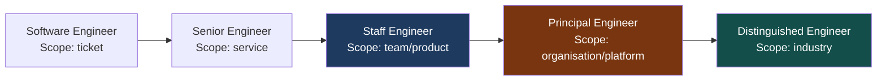

# The Staff & Principal Engineer Operating Model

> [!NOTE]
> The transition to Staff and Principal engineer is not a promotion — it is a role change. The skills that made you a great Senior Engineer are necessary but not sufficient. This lesson defines the operating model: what you do, how you create impact, and how success is measured.

## The Levelling Gap

Most engineers plateau at Senior level because the path forward requires a different kind of work. At Senior level, you:
- Solve technically complex problems within a defined scope
- Write excellent, reviewable code
- Mentor within your immediate team
- Deliver features with high quality and reliability

At Staff/Principal level, the scope changes:
- You define what problems are worth solving
- Your primary output is **decision quality and organisation capability**, not code
- Your mentoring spans multiple teams and time horizons
- You are accountable for outcomes, not just delivery



---

## The Four Operating Modes

Principal engineers operate in four modes, rotating based on what the organisation needs:

### 1. Technical Leadership — Shaping Direction

You define the technical direction for systems under your scope. This is not "I decided what to build" but "I created the conditions and decisions that allow others to build correctly."

Outputs:
- Architecture Decision Records (ADRs) for significant choices
- RFCs (Request for Comments) for major technical proposals
- Engineering principles documents
- Technology radar contributions

```
Example ADR impact:
"We will use the Outbox pattern for all cross-service event publishing"
↓
This one decision prevents 3 future dual-write incidents
Affects 12 services over 2 years
No single piece of code — but 1000x leverage over fixing each incident individually
```

### 2. Technical Depth — Solving Unsolvable Problems

Staff/Principal engineers must still go deep when needed. The difference: you go deep on problems others cannot solve, not problems others haven't gotten to yet.

**Wrong:** taking on an interesting ticket because you want to code
**Right:** pairing with the team to unblock a 3-week-stalled performance problem that has an upcoming SLA breach

The test: if someone else on the team could have solved it in 2 weeks, you should not have spent 2 weeks on it. Your time has organisation-level opportunity cost.

### 3. Glue Work — Cross-Team Coordination

The engineering problems that don't belong to any single team often don't get solved. Principal engineers own the orphaned problems.

```
Payment reconciliation has three owners:
  - Payments team: owns the payment event
  - Finance team: owns the ledger
  - Settlement team: owns the settlement record

Reconciliation failures fall between all three.
Nobody wants to own the cross-cutting reconciliation platform.
The Principal Engineer makes it happen.
```

### 4. Raising the Bar — Capability Building

Your most leveraged investment is making every engineer around you better.

- Technical reviews that teach, not just gate
- Design reviews that ask "did you consider X?" rather than "you should do X"
- Writing architecture guides that become the team's shared mental model
- Creating reusable libraries that eliminate whole categories of problems

---

## Scope and Radius of Influence

The clearest difference between Staff and Principal is scope:

| Level | Scope | Time Horizon | Decision Authority |
|---|---|---|---|
| **Senior** | Service / component | Sprint / quarter | Implementation choices |
| **Staff** | Team / product area | Quarter / half-year | Service architecture |
| **Principal** | Organisation / platform | Half-year / year | Platform strategy |
| **Distinguished** | Industry / technology | 1-3 years | Technology direction |

> [!NOTE]
> Scope is about where your decisions have impact, not about how many people report to you. Principal engineers are Individual Contributors (ICs) — they build influence through technical leadership, not reporting lines.

---

## The No-Manager's Rules of Influence

As a principal engineer without direct authority over engineers, you must influence through:

**Technical credibility** — People follow your direction because you have demonstrated you understand the problem deeply and your past decisions were right.

```
Building credibility: be right often. When wrong, say so explicitly and publicly.
"I recommended X. It didn't work. Here's why I was wrong and what we're doing instead."
Engineers trust leaders who update on evidence.
```

**Narrative framing** — You shape how problems are understood. The engineer who can most clearly articulate the problem usually drives the solution.

```
Weak: "We need to migrate off the legacy payment gateway"
Strong: "Our legacy payment gateway cannot support PSD2 SCA requirements arriving in Q2.
        Migration cost is £2M over 6 months. Non-compliance fine risk is £50M.
        We need to decide by November to meet the Q2 deadline."
```

**Coalition building** — Major architectural decisions affect multiple teams. Build the coalition before the decision — not to manipulate, but to surface concerns early and design something everyone can commit to.

**Working in public** — write designs, decisions, and learnings in shared channels. The principal engineer who works silently in a corner of the codebase has no organisational impact.

---

## What Does a Principal Engineer Actually Produce?

This is the most common confusion. Principal engineers produce:

**Documents** (ADRs, RFCs, design docs, incident postmortems, engineering guides)
**Decisions** (what to build, what not to build, what to adopt)
**Code** (selectively — prototypes that prove feasibility, libraries that set patterns, fixes to unsolvable problems)
**Reviews** (architecture reviews, senior engineer promotions, interview calibration)
**Relationships** (cross-team, with management, with external vendors/regulators)

The ratio changes with seniority:

| Level | Code % | Docs/Decisions % | Relationships % |
|---|---|---|---|
| Senior | 60-70% | 20-30% | 10% |
| Staff | 30-40% | 40-50% | 20% |
| Principal | 15-25% | 45-55% | 25-30% |
| Distinguished | 5-10% | 40-50% | 40-50% |

> [!WARNING]
> If you are a principal engineer writing code 60% of the time, you are under-delivering. This is a common failure mode — the technically strong engineer who stays in their comfort zone rather than developing the uncomfortable skills of influence, strategy, and coalition-building.

---

## The Staff Engineer Archetypes

Will Larson's *Staff Engineer* identifies four archetypes. Financial services organisations need all four:

### Tech Lead
*"Where is the engineering team going and how do we get there?"*

Closest to senior engineering work but with broader scope. Partners with engineering management. Sets technical direction for one or two teams.

### Architect
*"What is the right technical solution to this complex cross-cutting problem?"*

Operates across team boundaries. Designs systems too big for one team. Common in financial services (payment platform, core banking modernisation, data platform).

### Solver
*"Here is the impossible problem nobody else can fix."*

Parachutes into critical situations: the production incident that's been unresolved for 72 hours, the performance crisis 3 weeks before a major launch, the security vulnerability requiring immediate remediation.

### Right Hand
*"I extend the reach of an executive to deliver their technical vision."*

Works closely with a CTO or VP Engineering. Translates business vision into engineering strategy. Represents engineering perspective in business decisions. Common at the most senior levels.

**Most financial services principal engineers operate primarily as Architects or Tech Leads**, with Solver capabilities for critical incidents.

---

## Success Metrics for Principal Engineers

Senior engineers are measured by what they build. Principal engineers are measured by what their teams build.

```
Wrong success metrics for Principal Engineer:
  ✗ Lines of code written
  ✗ PRs merged
  ✗ Jira tickets closed
  ✗ Features shipped by me

Right success metrics:
  ✓ Engineering decisions made that prevented incidents
  ✓ Architectural patterns adopted that accelerated team velocity
  ✓ Engineers promoted through mentoring and sponsorship
  ✓ Technical debt reduced systematically across the organisation
  ✓ Platform capabilities delivered that enable 10+ teams
  ✓ Regulatory compliance achieved through scalable technical design
```

### The 6-Month Impact Statement

A useful exercise: write a 6-month impact statement in this format:

```
"Over the next 6 months, I will work on [problem/initiative].
The impact will be: [measurable outcomes for the organisation].
Success looks like: [specific, observable results].
I will know I've failed if: [counterfactual — what failure looks like]."
```

A Senior engineer's impact statement is typically 1-3 bullet points about features delivered.
A Principal engineer's impact statement describes capability changes: "12 teams will be able to..."

<!-- KNOWLEDGE-CHECK
{
  "questions": [
    {
      "id": "q1",
      "text": "A Principal Engineer notices a critical performance bottleneck in a service. The team lead says they'll fix it next sprint. The Principal Engineer could fix it in 2 days. What should they do?",
      "options": [
        "Fix it themselves — it's faster and they can do it better",
        "Fix it themselves but document the solution so the team learns",
        "Work with the team lead to understand the complexity, unblock any blockers, and let the team fix it — with availability to pair if stuck",
        "Escalate to engineering management to reprioritise the sprint"
      ],
      "correct": 2,
      "explanation": "Taking the work from the team reduces their capability and opportunity to grow. The Principal Engineer's leverage is highest when they enable the team to solve problems, not when they solve them instead. Exception: if the team is blocked by something only the Principal can resolve (architectural constraint, external dependency), that's the right intervention point."
    },
    {
      "id": "q2",
      "text": "You are a Principal Engineer proposing to migrate 8 services from a legacy event bus to Kafka. Three team leads are resistant because of the migration effort. What is the most effective approach?",
      "options": [
        "Get the CTO to mandate the migration — authority will overcome resistance",
        "Write a compelling RFC with the full cost/benefit analysis, present it to each resistant team, incorporate their concerns into the design, and build consensus before the decision meeting",
        "Migrate one team's service as a proof of concept without asking permission",
        "Drop the initiative — if teams are resistant, it's not worth pursuing"
      ],
      "correct": 1,
      "explanation": "Coalition building through legitimate influence (evidence, shared understanding, incorporating concerns) produces durable decisions. Authority-imposed decisions generate compliance without commitment — teams will find reasons to slow the migration. A unilateral proof of concept creates distrust. The RFC process with broad engagement is the standard Principal Engineer approach."
    },
    {
      "id": "q3",
      "text": "A Principal Engineer at a fintech is spending 65% of their time writing code and 35% on design docs and reviews. Their manager flags this as a concern. What is the most likely issue?",
      "options": [
        "The Principal Engineer is producing too much and needs to slow down",
        "The ratio suggests they are operating more like a Senior Engineer — their organisation-wide impact is likely lower than expected at Principal level",
        "Their manager doesn't appreciate technical work",
        "They should be spending more time in management meetings"
      ],
      "correct": 1,
      "explanation": "Principal Engineers expected to have ~15-25% of time in code, 45-55% in documents/decisions, 25-30% in relationships. 65% code suggests they are staying in their comfort zone and under-investing in higher-leverage activities. The question to ask is: is the organisation-level impact (decisions, capability, platform) commensurate with the expectation?"
    },
    {
      "id": "q4",
      "text": "Which archetype describes a Principal Engineer who designs the cross-cutting payment platform that 12 product teams build on, defines the event schema standards, and owns the multi-year migration from the legacy core banking system?",
      "options": [
        "Tech Lead — they're setting technical direction",
        "Solver — they're solving a hard technical problem",
        "Right Hand — they're working directly with a CTO",
        "Architect — they're designing cross-team, cross-service systems at an organisational scale"
      ],
      "correct": 3,
      "explanation": "The Architect archetype operates across team boundaries to design systems too large for any one team. Payment platforms, core banking modernisation, and data platforms are classic Architect scope. The Tech Lead is more focused on one or two teams. The Solver parachutes into specific crises. The Right Hand is specifically partnered with an executive."
    }
  ]
}
-->

<!-- PRACTICAL-CHALLENGE
{
  "title": "The Staff & Principal Engineer Operating Model \u2014 Production Implementation",
  "difficulty": "principal",
  "estimatedMinutes": 85,
  "tasks": [
    {
      "id": "1",
      "description": "Write your 90-day plan"
    },
    {
      "id": "2",
      "description": "Identify your archetype"
    },
    {
      "id": "3",
      "description": "Write your 6-month impact statement"
    },
    {
      "id": "4",
      "description": "Design a decision-making framework"
    }
  ]
}
-->
