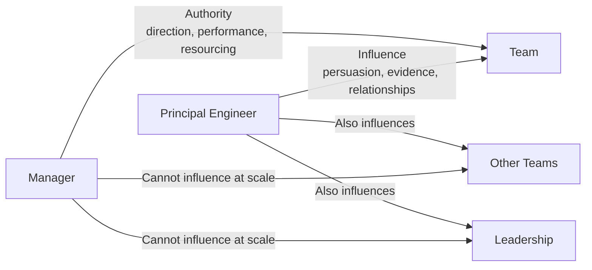
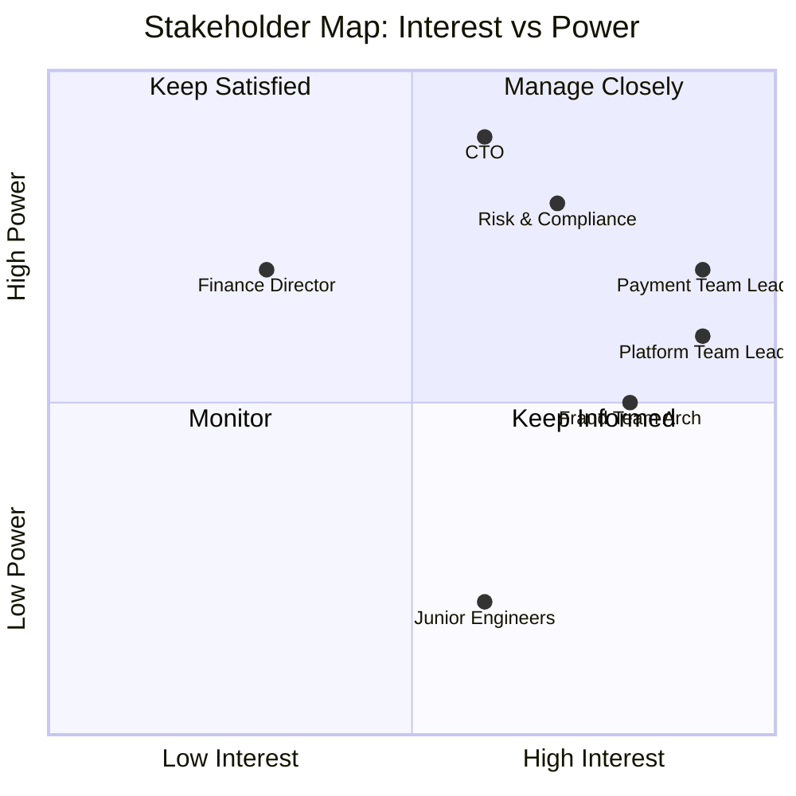
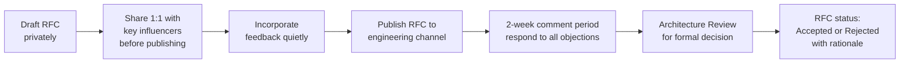

# Cross-Team Influence — Driving Change Without Authority

The principal engineer's most common misconception is that technical correctness creates organisational change. It does not. You can be completely right about the best technical approach and still fail to change anything, because organisations do not make decisions based on technical merit alone. They make decisions based on trust, relationships, priorities, and politics.

This lesson is about the operational reality of driving technical change across teams when you have no authority over their engineers, their roadmaps, or their management chains. It covers the practical techniques that work at scale in financial services organisations: stakeholder mapping, building the case, using RFCs as influence tools, handling resistance, and navigating upward without damaging relationships.

---

## The Authority Gap

Principal engineers have influence but not authority. This is correct and appropriate. Here is why:



Authority is fast and narrow — a manager can tell their team what to do. Influence is slow and broad — a principal engineer can shift the direction of an entire engineering organisation, but only over time and through relationships.

The authority gap is a feature, not a deficiency. If principal engineers had formal authority over other teams, they would become managers, their span of influence would narrow, and they would stop doing the technical work that makes them valuable. The tradeoff is intentional.

**Practical implication:** You will never be able to mandate technical decisions across teams. You can make a decision so obviously correct, so well-evidenced, and so well-socialised that the other team chooses it themselves. That is the goal.

---

## Technical Persuasion vs Organisational Influence

These are different skills that are both required:

| Dimension | Technical Persuasion | Organisational Influence |
|-----------|---------------------|------------------------|
| Audience | Engineers and architects | Engineering managers, product, finance, compliance |
| Currency | Evidence, benchmarks, design quality | Trust, relationships, strategic alignment |
| Medium | RFC, design doc, code review | 1:1, pre-meeting, executive briefing |
| Timescale | Days to weeks | Months |
| Failure mode | Being technically right but socially clumsy | Winning politically but implementing something wrong |

A principal engineer who has only technical persuasion skills can convince their own team but cannot change the organisation. One who has only organisational influence skills can drive change but may push through technically poor decisions. You need both.

**Developing organisational influence:** Most engineers develop technical persuasion naturally through their work. Organisational influence requires deliberate investment in relationships that feel unproductive in the short term — regular 1:1s with counterparts in other teams, attending cross-functional meetings not because you are required to but because you want to understand their constraints.

---

## Stakeholder Mapping

Before proposing a change, map everyone who will be affected by it or will have a role in its adoption.



**Four stakeholder types:**

**Decision Makers** (high power, high interest): Their formal approval is required. Invest significant time understanding their concerns. Never surprise them in a room full of people — brief them beforehand.

**Influencers** (medium power, high interest): They shape the opinions of decision makers. Often tech leads or senior engineers in affected teams. Win them and they will advocate for you. Ignore them and they will undermine the proposal.

**Blockers** (high power, variable interest): They may not be invested in the outcome but have the power to stop the change. The head of risk and compliance is often a blocker — not because they oppose the change but because a new approach introduces compliance uncertainty they need to resolve first. Address their concerns proactively.

**Sponsors** (high power, strategic alignment): An executive who wants the change to happen for strategic reasons. Having a sponsor does not mean you can skip influencing everyone else — it means you have air cover if the process stalls.

---

## Building the Case: The Structure That Works

The structure of a proposal determines whether it gets adopted or shelved. Engineers typically write proposals in reverse order — they describe the technical solution first and the problem last. Decision makers think in the opposite order.

```
Problem Statement (evidence-based, not opinion)
  ↓
Options Analysis (at least 3: status quo, your preferred option, alternative)
  ↓
Recommendation (clear, single recommendation — not "it depends")
  ↓
Specific Ask (what you need from this audience, right now)
```

**Example: proposing event-driven architecture across the payment platform**

```markdown
## Problem Statement
Synchronous service calls between payment-service, fraud-service, and
notification-service create a dependency chain that causes 3–5 P2 incidents
per quarter. In Q3, payment-service latency degradation caused fraud-service
timeouts, which caused 23% of payments to fail during peak processing.
Evidence: incident reports INC-2024-087, INC-2024-134, INC-2024-201.

## Options

Option A — Status quo (synchronous calls):
  Pros: familiar, simple local reasoning
  Cons: cascading failures, tight temporal coupling, cannot scale services independently
  Risk: incident rate will increase as transaction volume grows 40% next year

Option B — Event-driven via Kafka:
  Pros: temporal decoupling, independent scaling, natural audit trail
  Cons: eventual consistency (acceptable for notifications, requires care for fraud checks)
  Cost: 6 weeks engineering across 3 teams, Kafka cluster (£800/month)
  Risk: team upskilling required

Option C — Circuit breakers + retry (without events):
  Pros: lower change surface
  Cons: masks the problem rather than solving it; shared latency budget still exists

## Recommendation
Option B — Event-driven via Kafka. The cascading failure risk is unacceptable
at projected transaction volumes. Option C treats symptoms.

## Specific Ask
Approval to run a 2-week proof of concept with the payment team, with
findings presented at the next architecture review (Nov 15).
```

The specific ask is never "please agree with me". It is a small, concrete, low-risk next step. Asking for a proof of concept is easier to say yes to than "please re-architect your entire service".

---

## RFC as an Influence Tool

Request for Comments documents are typically thought of as technical documentation. They are also one of the most powerful influence tools available to a principal engineer, when used correctly.

**RFC as documentation:** Captures design decisions for posterity. Useful but passive.

**RFC as influence tool:** Forces the author to structure their thinking rigorously. Gives all stakeholders a text to react to rather than a blank canvas. Creates a record that the right people were consulted. Surfaces objections in writing where they can be addressed systematically.

**The RFC influence workflow:**



The critical step most engineers skip is B — sharing the draft 1:1 before publishing. When you publish an RFC without pre-socialising it, the first time most people see it is in the public forum. They form their initial reaction publicly, and changing a public position is costly to them. By sharing 1:1 first, you give people the chance to raise concerns privately, feel heard, and often become advocates once their concern is addressed.

---

## Working With Resistant Teams

Resistance to change is not irrational. It is a rational response to an increase in work and risk with uncertain benefits. The four most common resistance patterns in fintech engineering organisations:

**Pattern 1: "We don't have time"**

This is almost always true. Teams are always busy. It is also almost always a proxy for "this is not our priority". Do not argue about whether they have time. Understand what their current priorities are and find the intersection.

*Response:* "I understand the roadmap is full. Where does this fit relative to the Q4 reliability work? Could we scope the initial change to three days rather than three weeks?"

**Pattern 2: "Our case is different"**

This is sometimes true and usually false. Teams often believe their domain is unique in ways that exempt them from general engineering standards. Sometimes they are right — payment processing has constraints that a reporting service does not. Often they are rationalising.

*Response:* Engage genuinely with the specifics. "Walk me through what's different about your case. I want to understand it." Then either acknowledge the genuine difference and adapt the proposal, or gently demonstrate that the case is not as unique as believed. Never dismiss the concern without investigation.

**Pattern 3: "We tried this before and it failed"**

Historical failure creates legitimate scepticism. The failure may have been because the idea was wrong, or because implementation was poor, or because context has changed.

*Response:* "Tell me about what happened. I want to understand what went wrong." Then either acknowledge it failed for inherent reasons (and your proposal addresses those), or demonstrate that the context is different now. Never pretend the previous failure did not happen.

**Pattern 4: "This is not our priority right now"**

This is a signal about where you sit in their priority stack, not a permanent no. It means the change needs either to become more urgent (new evidence, new risk) or to wait for a natural opportunity (new quarter, new roadmap cycle, related incident).

*Response:* "What would need to be true for this to become a priority?" Understand the conditions and work toward them, or accept that now is not the right time and revisit in the next planning cycle.

---

## Coalition Building

A coalition is two or more teams aligned on the same technical direction. It is exponentially more powerful than a single-team endorsement.

**How to build a coalition:**

1. Identify two or three teams whose problems this change also solves
2. Brief each team lead individually before any public forum
3. When you present to leadership, have representatives from each team present alongside you or explicitly supportive
4. Document that multiple teams want this — a unilateral principal engineer proposal is easy to deprioritise; a multi-team request is much harder to dismiss

**Coalition anti-pattern:** Assembling names on a document without genuine buy-in. If your coalition members do not actually support the change, they will be silent or lukewarm in the room. That is worse than presenting alone because it signals you overstated your support.

---

## The Pre-Meeting

The pre-meeting is the most underused influence technique in engineering organisations. Its purpose is to socialise an idea with key stakeholders before the official meeting where a decision is made.

**Why it works:**
- Decision makers do not like surprises in public forums
- It gives them time to think without performance pressure
- Objections raised in private are easier to address than objections raised publicly
- By the time you are in the room, you already know who supports, who is neutral, and who has concerns

**How to conduct a pre-meeting:**

```
Duration: 30 minutes maximum
Format: 1:1 (not a group pre-meeting — that is just an earlier official meeting)
Agenda:
  - "I wanted to share something before the architecture review next week"
  - 5 minutes: explain the proposal at a high level
  - 20 minutes: listen actively, ask what concerns they have
  - 5 minutes: confirm whether they are comfortable, and what you will address before the review

After: incorporate their feedback (even partially), then say so in the review:
  "Thanks to [name] who raised a concern about X in a conversation earlier this week —
  I've addressed it by..."
```

Naming people who contributed to shaping the proposal is good for them (recognition) and good for you (demonstrates consultation).

---

## Writing vs Talking: Async vs Synchronous

| Situation | Prefer Async (RFC/doc) | Prefer Synchronous (meeting) |
|-----------|----------------------|------------------------------|
| Complex technical proposal | Yes — people need time to process | No — real-time reaction is premature |
| Team is geographically distributed | Yes — writing persists | No — time zones create exclusion |
| Decision is contentious | Yes — creates a record | Also yes — but after async first |
| Quick alignment needed | No | Yes — a 15-minute call beats 10 Slack messages |
| Relationship-building | No | Yes — writing is transactional |
| Surfacing concerns across many people | Yes — scales to 50 readers | No — 50 people on a call is not a conversation |

**Practical rule:** default to async for technical proposals and synchronous for relationship-building and final decisions. Never call a meeting to share information that could have been an email.

---

## Navigating Upward

Escalating to senior leadership is sometimes necessary. Done correctly, it creates momentum. Done incorrectly, it damages the relationship with the teams involved and your own credibility.

**When to escalate:**

- A technical risk has been identified, explained at the working level, and not acted upon
- A deadlock exists between teams that cannot be resolved peer-to-peer
- A decision requires resourcing (headcount, infrastructure budget) that only leadership can approve
- A compliance or regulatory risk exists that leadership must be aware of regardless of the technical discussion

**How to frame for executives:**

Executives think in terms of risk, cost, and strategic outcomes. Never lead with technical details.

```
Frame: "We have a reliability risk that will affect us in Q1 as volumes grow."
Not:  "Our synchronous service call model creates temporal coupling that
       degrades under backpressure scenarios."

Frame: "This change reduces incident rate by an estimated 60% based on
       the Q3 data, at a cost of 6 weeks engineering across three teams."
Not:  "Kafka gives us better decoupling."

Frame: "The fraud team and payment team both support this. We need your
       approval to allocate the 6 weeks."
Not:  "I think we should do this."
```

Bring a document. Executives rarely remember verbal conversations accurately enough to act on them. The document also signals that you have thought through the problem carefully.

---

## Case Study: Introducing Event-Driven Architecture Across 8 Teams

**Context:** A fintech processes 50M payments/month. Synchronous dependencies between 8 services cause cascading failures. A principal engineer wants to migrate to event-driven architecture. They have no authority over any of the 8 teams.

**Month 1: Problem documentation and stakeholder mapping**

Document three recent incidents that demonstrate the cascading failure pattern. Quantify the impact: 23% payment failure rate during 2 of the 5 incidents. Identify key stakeholders: 8 team leads, CTO, Head of Reliability.

**Month 2: Technical proposal and coalition building**

Draft RFC. Brief the two most affected team leads (payment and fraud) 1:1. Incorporate their feedback. Brief the Head of Reliability — this directly solves their reliability goal. Brief the CTO with the executive frame (risk, cost, benefit).

**Month 3: First architecture review**

Present RFC at the cross-team architecture review with payment team lead and fraud team lead both explicitly supportive. Proposal is not approved — two teams raise concerns about data consistency. Acknowledge concerns as legitimate; commit to addressing them in the next revision.

**Month 4: Revised proposal and proof of concept**

Revise RFC to address consistency concerns with a specific pattern for each affected use case. Propose a proof of concept with two teams (payment and notification — lowest coupling risk). PoC is approved.

**Month 5: Proof of concept results**

PoC demonstrates no incidents in 4 weeks of parallel running. Latency impact: +12ms for async publish (acceptable). Present results with data. All 8 team leads now supportive. CTO approves full migration.

**Month 6: Migration plan published and work begins**

Migration sequenced to avoid simultaneous risk across teams. Each team migrates independently with the platform team supporting Kafka integration.

**Key lessons from the case study:**

1. The process took 6 months. The technical work was straightforward. The organisational work was not.
2. The CTO was briefed in Month 2 — not asked for approval, just informed. When asked in Month 5, approval was fast because they had no surprises.
3. The two teams that raised concerns in Month 3 became the strongest advocates once their concerns were addressed. Never treat an objection as an obstacle — treat it as an opportunity to improve the proposal.

---

## Production Pitfalls

### Pitfall 1: Relying Only on Being Right

**Problem:** A principal engineer has identified a genuine architectural problem and has the correct solution. They write a thorough technical document, present it at the architecture review, and are met with lukewarm reception. They respond by writing a more detailed document, presenting it again more forcefully, and cannot understand why no one is acting.

The issue is that being technically correct is necessary but not sufficient. The other teams are busy, have different priorities, and have no personal stake in this person's proposal. Technical correctness does not create urgency for anyone except the person who identified the problem.

```
Symptom: "Why won't anyone just listen? The proposal is clearly right."
Root cause: Organisational influence was never built.
```

**Prevention:** Ask yourself: "Have I invested in a relationship with the lead of each affected team before this proposal?" If you have never had a 1:1 with the payment team lead except when you are asking them to do something, you have not built the trust base that makes proposals easy to adopt.

Build relationships continuously, not transactionally. Invest in understanding other teams' problems and helping with them before you need them to adopt your proposal.

---

### Pitfall 2: Skipping the Pre-Meeting

**Problem:** A principal engineer publishes an RFC and schedules an architecture review for the following week without any 1:1 preparation. In the review, the most senior engineering manager in the room immediately raises a concern about the migration risk. Three other attendees who had not thought carefully about the proposal suddenly agree that migration risk is concerning. The meeting ends without a decision.

The concern was entirely addressable — a phased migration plan would have resolved it. But raised publicly and without preparation, it became an anchor that pulled everyone toward deferral.

```
Timeline:
  Monday: RFC published
  Tuesday: Architecture review scheduled
  Wednesday-Thursday: No pre-meetings
  Friday: Architecture review — concern raised publicly — deferred

What should have happened:
  Monday: RFC draft shared with 3 key stakeholders
  Tuesday-Wednesday: 1:1 pre-meetings, migration concern raised privately
  Thursday: RFC revised to include phased migration plan
  Friday: Architecture review — no surprises — approved
```

**Prevention:** Add "pre-meeting list" to your RFC template. Before any formal review, hold a 1:1 with every person who could raise a blocking concern.

---

### Pitfall 3: Not Building the Coalition Before You Need It

**Problem:** A principal engineer needs to adopt a new security standard across 6 teams. They write an RFC, present it, and get it approved by leadership. They then proceed to implement it with their own team. When they approach the other 5 teams, each team raises concerns they could have raised during the RFC process. The engineer finds themselves negotiating the same proposal individually with 5 teams after formal approval, which is slower and more frustrating than doing it before.

Formal approval from leadership does not create buy-in at the team level. Teams feel that something was done *to* them rather than *with* them.

```
Anti-pattern:
  Write RFC → Get leadership approval → Implement with own team
  → Discover other teams are not adopting → Start the influence work you should
  have done before the RFC

Correct pattern:
  Identify champions in each team → Co-author RFC with their input
  → Publish with broad support → Get leadership approval
  → Implementation is a formality because teams already own it
```

**Prevention:** When an RFC will require adoption by multiple teams, involve a representative from each team in drafting it. Even one round of feedback per team means they have intellectual ownership of the solution. People implement what they helped design.

---

## Lesson Checklist

- [ ] You can explain the authority gap and why it exists in principal engineer roles
- [ ] You can map stakeholders into the four categories: decision makers, influencers, blockers, sponsors
- [ ] You can write a proposal using the problem → options → recommendation → specific ask structure
- [ ] You can describe the RFC influence workflow including the pre-publication 1:1 step
- [ ] You can identify and respond to each of the four resistance patterns
- [ ] You can describe the pre-meeting technique and when to use it
- [ ] You understand when to prefer async written communication vs synchronous meetings
- [ ] You can frame a technical proposal appropriately for an executive audience (risk, cost, benefit — not technical detail)
- [ ] You have worked through the event-driven architecture case study and can apply its lessons to your own context

---

<!-- KNOWLEDGE-CHECK
{"questions":[{"text":"You have written an RFC proposing a new API versioning standard that affects 6 teams. The architecture review is next Thursday. What is the most important step to take before the meeting?","options":["Send a Slack message to all 6 teams asking them to review the RFC","Gather more data to strengthen the technical argument","Hold 1:1 pre-meetings with the leads of affected teams to surface and address concerns before the room","Add more technical detail to the RFC so no one can find any gaps"],"correct":2,"explanation":"The pre-meeting is the most critical influence technique before a formal review. It allows you to surface concerns 1:1 where they can be addressed without public commitment effects. When a concern is raised publicly in a review, other attendees often anchor on it and deferral becomes likely. By addressing concerns before the meeting, you ensure the review can proceed without surprises and the revised proposal has genuine support."},{"text":"A team lead tells you: 'We tried moving to event-driven architecture three years ago and it was a disaster.' What is the most effective response?","options":["Explain that the technology has improved significantly since then","Say that the previous attempt failed because of execution, not concept","Ask them to tell you what happened so you can understand what went wrong before updating your proposal","Acknowledge the concern but proceed with the proposal since the previous failure is irrelevant to the current decision"],"correct":2,"explanation":"Historical failure creates legitimate scepticism that must be engaged with genuinely. By asking them to explain what happened, you demonstrate respect for their experience, you learn whether the failure was due to inherent problems with the approach or execution issues, and you can then either acknowledge the concern is valid (and adapt) or demonstrate that the context has changed. Dismissing the previous failure damages trust and signals you are not listening."},{"text":"You need executive approval for a 6-week cross-team initiative. How should you open the conversation with the CTO?","options":["Explain the technical architecture and why it is superior to the current approach","Lead with the business risk: a reliability problem that will worsen as transaction volume grows next quarter","Request the meeting agenda be expanded to include a detailed technical review","Share the RFC and ask for feedback on the technical details"],"correct":1,"explanation":"Executives think in terms of risk, cost, and strategic outcomes. Leading with the business risk (cascading failures during peak volume growth) creates the urgency and context for the ask. Technical details can follow once the business case is established. Never ask an executive to evaluate technical details before they understand why the change matters."}]}
-->

<!-- PRACTICAL-CHALLENGE
{"title":"Cross-Team Technical Change Campaign","difficulty":"principal","estimatedMinutes":90,"tasks":[{"id":"1","description":"Map the stakeholders for a proposed change in your organisation (or a hypothetical fintech: introduce distributed tracing across 5 teams using OpenTelemetry). Create a stakeholder map with at least 8 stakeholders placed on the power/interest quadrant. Classify each as decision maker, influencer, blocker, or sponsor. Write a 2-sentence engagement plan for each stakeholder type."},{"id":"2","description":"Write a full RFC for the OpenTelemetry adoption proposal following the problem-options-recommendation-specific ask structure. The RFC must include: quantified problem statement with incident evidence, three options with pros/cons/costs, a clear single recommendation, a specific limited ask (not full approval), and a pre-meeting list of people to brief before publication."},{"id":"3","description":"For each of the four resistance patterns (no time, our case is different, tried before, not our priority), write a 3-sentence response that acknowledges the concern, engages with it genuinely, and moves the conversation forward. Each response must be specific to the OpenTelemetry adoption context — not generic advice."},{"id":"4","description":"Write a 1-page executive briefing for the CTO on the OpenTelemetry adoption. It must: open with business risk (not technology), quantify cost (engineering weeks, infrastructure cost), quantify benefit (incident reduction estimate, debugging time reduction), state which teams support it, and close with a specific approval request. Avoid all technical jargon — write as if the reader does not know what a trace is."}]}
-->
