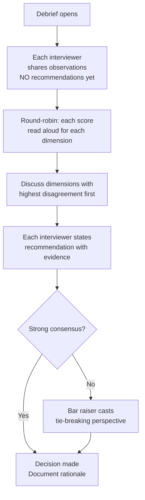

# Technical Interviewing — Hiring for Principal-Level Roles

Hiring a principal engineer is one of the highest-leverage decisions an engineering organisation makes. A strong principal engineer elevates the technical quality, decision-making, and culture of multiple teams simultaneously. A weak hire — particularly one who is technically strong but organisationally ineffective, or one who sets a low bar for quality — can damage an organisation for years.

The challenge is that principal-level hiring requires evaluating qualitatively different signals than senior engineer hiring. Senior engineers are evaluated primarily on technical execution. Principal engineers are evaluated on strategic thinking, organisational influence, handling ambiguity, and system-wide judgment — capabilities that are difficult to assess in a 90-minute room.

This lesson covers the full principal-level interview loop: structure, problem selection, scoring rubrics, debrief mechanics, and the anti-patterns that cause good candidates to be rejected and weak candidates to be hired.

---

## Why Principal Hiring Differs From Senior Hiring

The difference is not about technical depth — many senior engineers match principal engineers technically. The difference is scope, ambiguity, and cross-organisational influence.

| Dimension | Senior Engineer | Principal Engineer |
|-----------|---------------|-------------------|
| Scope | Feature, component, or service | Platform, domain, or organisation-wide |
| Ambiguity tolerance | Comfortable with defined problem space | Comfortable defining the problem space |
| Influence | Within their team | Across multiple teams without authority |
| Time horizon | Current sprint to current quarter | Current quarter to next 18 months |
| Technical decisions | Owns implementation decisions | Shapes architectural direction |
| Failure mode | Technically strong but limited scope | May be technically strong but unable to operate at scope |

Evaluating a senior engineer and calling the result "principal-level assessment" is the most common principal hiring failure. The questions, scenarios, and signals must be calibrated to the actual responsibilities of the role.

---

## Interview Loop Structure

A principal-level interview loop for a fintech engineering role:

```mermaid
gantt
    title Principal Engineer Interview Loop
    dateFormat X
    axisFormat %s min

    section Hiring Manager Screen
    30 min context-setting + career history  :0, 30
    15 min role expectations + questions     :30, 45

    section System Design (Day 1)
    15 min problem framing + requirements    :0, 15
    50 min design + trade-off discussion     :15, 65
    15 min operational thinking + wrap       :65, 80
    10 min candidate questions               :80, 90

    section Technical Leadership (Day 2)
    15 min intro + context                   :0, 15
    35 min behavioural + scenario questions  :15, 50
    5 min debrief preview                    :50, 55
    5 min candidate questions                :55, 60

    section Cross-Functional (Day 2)
    20 min stakeholder collaboration stories :0, 20
    15 min ambiguity/conflict scenario       :20, 35
    5 min culture + questions                :35, 45

    section Bar Raiser (Day 2)
    20 min background + motivation           :0, 20
    30 min deep-dive on a previous decision  :20, 50
    10 min candidate questions               :50, 60
```



**Hiring Manager (45 min):** Sets context for the role, assesses career trajectory, evaluates strategic thinking through career narrative. Must assess: does this person think at the right scope? Do their previous decisions show principal-level judgment?

**System Design (90 min, 2 interviewers):** The primary technical signal. 90 minutes is the minimum for a problem complex enough to reveal principal-level thinking. Two interviewers enable one to drive while the other observes and takes detailed notes — prevents post-hoc memory inflation.

**Technical Leadership (60 min):** Behavioural questions focused on cross-team influence, handling disagreement, and driving technical direction. Avoids questions that can be answered with generic "I communicated well" stories.

**Cross-Functional (45 min):** A non-engineering interviewer (product, finance, or risk) assesses whether the candidate can communicate technical concepts to non-technical stakeholders and understand business constraints.

**Bar Raiser (60 min):** An independent assessor not part of the hiring team. Their role is to evaluate against the company-wide engineering bar, not the team's immediate needs. They have veto power.

---

## System Design Problem Selection for Fintech

The problem must be complex enough to require genuine architectural thinking at the principal level. It must have no single correct answer, multiple legitimate trade-offs, and an operational dimension.

**Criteria for a good principal-level system design problem:**

- Multiple conflicting requirements (throughput vs consistency, latency vs durability)
- Scale that forces non-trivial architectural choices (cannot be solved with a single database)
- Real failure modes that require operational thinking (what breaks? how do you detect it? how do you recover?)
- Ambiguity in requirements (the candidate must ask clarifying questions and frame the problem)
- Domain context that rewards fintech knowledge without requiring specialist knowledge to solve

**Fintech system design problems calibrated for principal level:**

| Problem | Why It Works at Principal Level |
|---------|--------------------------------|
| Fraud detection at 100,000 TPS | Requires real-time vs batch trade-off, feature store design, explainability, false positive rate management, operational monitoring |
| Double-entry ledger with idempotency | Requires consistency model selection, idempotency key design, reconciliation strategy, multi-currency considerations |
| Payment reconciliation across 15 rails | Requires async processing design, failure handling per rail, alert thresholds, human exception workflow |
| Risk limit enforcement at 5ms p99 | Requires caching strategy, consistency vs availability trade-off, circuit breaker design, limit update propagation |

**Problem framing:** Always give candidates a deliberately underspecified problem statement. "Design a fraud detection system for a payments company" is correct. "Design a fraud detection system that uses a feature store with 50ms SLA, processes Kafka events, and uses a XGBoost model" removes all the interesting thinking.

---

## Excellent vs Weak Signal: Principal vs Strong Senior

This table is used in debrief to calibrate observations. The same behaviour can be a strong positive signal or a neutral signal depending on the question.

| Dimension | Strong Senior Signal | Principal Signal | Weak Signal (at principal level) |
|-----------|---------------------|-----------------|----------------------------------|
| Requirements | Asks good clarifying questions | Explicitly frames trade-offs in requirements before designing | Accepts first stated requirements without challenge |
| Scope | Designs the requested system well | Challenges problem boundaries — "should this be one system or two?" | Immediately dives into implementation details |
| Trade-offs | Identifies major trade-offs | Quantifies trade-offs with numbers and business impact | Lists options without comparing them |
| Technical depth | Strong depth in chosen area | Demonstrates depth across multiple areas, knows the edges | Surface-level on all topics |
| Operational thinking | Considers monitoring | Designs for observability, failure modes, and runbooks | No mention of operations until prompted |
| Communication | Clear verbal explanation | Adapts explanation level to audience, checks for understanding | Monologues without checking for follow-up |
| Adaptability | Handles constraint changes gracefully | Proactively identifies how constraints change the design | Gets flustered or restarts when constraints change |

---

## Scoring Rubric: Seven Dimensions

Each dimension is scored 1–4 by each interviewer independently before the debrief.

| Score | Description |
|-------|-------------|
| 4 — Exceptional | Clear positive signal for hire; evidence of principal-level capability |
| 3 — Strong | Good signal; above expectations for a strong candidate |
| 2 — Adequate | Meets bar; would not block hire but not a strong positive |
| 1 — Weak | Below bar; would block hire if consistent across interviewers |

**Dimension 1: Requirements Clarification**

Assesses whether the candidate frames the problem before solving it. At principal level, this includes challenging problem boundaries and surfacing hidden assumptions.

```
Score 4: Candidate identifies unstated requirements, challenges scope assumptions,
         and explicitly states what they will NOT cover and why.
Score 1: Candidate begins designing immediately with no clarifying questions;
         solves a different problem than the one intended.
```

**Dimension 2: Scope Management**

Can the candidate manage the depth/breadth tension in a 90-minute session?

```
Score 4: Candidate creates a clear agenda at the start ("I'll cover X, Y, Z —
         let me start with X which is most critical"), adjusts when prompted,
         never gets stuck in one area for more than 20 minutes.
Score 1: Candidate spends 60 of 90 minutes on data modelling and never
         addresses failure handling.
```

**Dimension 3: Trade-off Analysis**

The core principal-level skill: genuinely comparing options with specific criteria.

```
Score 4: "Option A gives us lower latency at p99 but requires accepting
         eventual consistency in the fraud signal. For a fraud prevention
         system, I'd trade latency for consistency — a delayed fraud block is
         better than missing a fraud signal. Option B achieves 5ms p99 by
         reading from a local cache, but I need to handle the case where the
         cache is stale during a risk limit update."
Score 1: "We could use Kafka or we could use a database. I'd use Kafka."
```

**Dimension 4: Technical Depth**

Does the candidate understand the systems they are proposing at a level that reveals real experience?

```
Score 4: When asked "how would you handle Kafka consumer lag during a surge?",
         candidate describes consumer group rebalancing, lag monitoring via
         consumer_lag metric, and a backpressure strategy — without being led.
Score 1: Candidate proposes Kafka but cannot discuss partition strategy,
         ordering guarantees, or consumer group mechanics.
```

**Dimension 5: Operational Thinking**

Does the candidate design for failure and recovery, not just the happy path?

```
Score 4: "I'd instrument this with three key metrics: processing latency p99,
         dead letter queue depth, and reconciliation lag. If DLQ depth exceeds
         threshold, the alert goes to the on-call engineer with a runbook
         that covers the three most likely causes."
Score 1: Candidate describes the system design completely but mentions
         monitoring only when explicitly asked.
```

**Dimension 6: Communication**

Can the candidate adjust their communication for a non-technical interviewer?

```
Score 4: When asked by a cross-functional interviewer "what does eventual
         consistency mean for the fraud team?", candidate says: "It means
         there's a short window — typically under 500ms — where a payment
         could proceed even if a fraud signal has just been raised. We manage
         this by flagging those payments for immediate human review rather
         than blocking them, so we avoid false positives while maintaining
         the control."
Score 1: Candidate responds to a non-technical question with a detailed
         explanation of CAP theorem without checking for understanding.
```

**Dimension 7: Adaptability**

How does the candidate handle a mid-interview constraint change?

```
Score 4: When told "actually, the regulator requires a fully synchronous
         fraud check with every payment", candidate says: "That changes the
         design significantly — let me show you how I'd adjust the latency
         budget. We'd need to move the model inference to a co-located
         service rather than a remote call. Here's how I'd reshape the
         critical path..."
Score 1: Candidate becomes visibly frustrated, restarts their design,
         and asks to disregard previous work.
```

---

## Technical Leadership Question Bank

Behavioural questions for the Technical Leadership interview. For each question, the interviewer uses the STAR-E format: Situation, Task, Action, Result, and Evidence (what specifically did you do — the action must be verifiable).

### Category 1: Driving Technical Direction

- "Tell me about a time you identified a significant technical risk that the team had not noticed. How did you raise it and what happened?"
- "Describe a technical standard or practice you introduced that was eventually adopted beyond your immediate team. What was the adoption process?"
- "Tell me about a time when the direction you advocated for turned out to be wrong. How did you recognise it and what did you do?"

### Category 2: Handling Disagreement

- "Describe a situation where you strongly disagreed with a technical decision that had already been made. How did you handle it?"
- "Tell me about a time you were overruled on a technical decision by a more senior stakeholder. How did you respond, and was your response the right one in retrospect?"
- "Have you ever had to tell a team that the approach they were planning was wrong? Walk me through how you did it."

### Category 3: Ambiguity and Urgency

- "Describe a situation where you had to make a significant technical decision with insufficient information. What was your process?"
- "Tell me about a time when you were leading a production incident that turned out to be more complex than initially expected. What did you do when the first hypothesis was wrong?"
- "Have you ever had to simultaneously manage an urgent production issue and a longer-term architectural decision that the production issue was revealing? How did you prioritise?"

### Category 4: Cross-Functional Influence

- "Tell me about a time you had to persuade a non-engineering stakeholder (product, finance, compliance) to accept a technical constraint or requirement. How did you approach it?"
- "Describe a time when you had to represent the engineering perspective in a business decision. What was your approach and what was the outcome?"
- "Have you ever identified a technical change that required buy-in from teams outside engineering? How did you build that buy-in?"

---

## Debrief Structure: Preventing Anchoring

The debrief is where hiring decisions are made. It is also where the most common biases operate. The debrief structure must prevent anchoring — the tendency for the first strong opinion expressed to dominate the room.



**Observations before recommendations:** Each interviewer shares what they observed — specific behaviours and evidence — before stating a recommendation. This prevents the first "hire/no-hire" from anchoring the room.

**Score disagreement:** When two interviewers score the same dimension 4 and 1, there is either a genuine calibration difference or one interviewer has different evidence. Surfacing this produces better decisions than averaging.

**Evidence requirement:** Every recommendation must cite specific evidence from the interview. "They seemed sharp" is not evidence. "When I added the constraint that all payments must be processed synchronously, they immediately identified the latency implication and proposed co-locating the fraud model — without prompting" is evidence.

---

## Bar Raiser Role

The bar raiser is an interviewer from outside the hiring team who assesses against the company-wide engineering bar, not the team's immediate needs or pressure to fill a vacancy.

**What makes a bar raiser effective:**

- They know the company's principal-level standards from multiple hiring panels
- They have no stake in filling the role quickly
- They ask the same questions about every candidate, enabling calibration over time
- They write up specific evidence for any veto, never just "gut feel"

**Bar raiser veto:** The bar raiser can veto a hire. This veto is exercised with specific evidence ("Candidate could not articulate a trade-off across multiple interviews and could not adjust when given new constraints — this is below the bar for principal scope") and must be discussed in the debrief, not issued unilaterally afterward.

**Common bar raiser error:** Vetoing a hire because "they were only as strong as [a specific existing principal engineer]". The bar is the minimum acceptable standard for the role, not the top performer in the company.

---

## Levelling Matrix: L5 / L6 / L7

| Dimension | L5 (Staff Engineer) | L6 (Principal Engineer) | L7 (Distinguished Engineer) |
|-----------|--------------------|-----------------------|----------------------------|
| Scope | Single domain | Multiple domains or platform | Business unit or company |
| Impact horizon | 1–2 quarters | 2–4 quarters | 1–3 years |
| Strategy | Contributes to strategy | Sets technical strategy for domain | Sets multi-domain technical strategy |
| External influence | Internal only | Some external (standards, vendors) | Industry-level (speaker, standards body) |
| Ambiguity | Operates in well-defined ambiguity | Comfortable in poorly-defined spaces | Defines the space for others |
| Failure mode | Strong exec but scope-limited | Organisationally effective but needs occasional senior guidance | Rare — most gap is polish |

During debrief, the levelling question is not "hire or no hire" — it is "at what level and why". A candidate who is a strong L5 but not an L6 should be offered at L5 or given feedback for L6. Forcing an L5 into an L6 role is unfair to the candidate and harmful to the organisation.

---

## Anti-Patterns in Principal Hiring

**Halo effect:** A candidate makes one exceptional statement early in the interview and the interviewer rates all subsequent dimensions generously. Prevention: score each dimension independently on a physical score sheet, do not review previous scores while the interview is in progress.

**Mirror hiring:** Interviewers rate candidates who are most similar to themselves (same background, same previous employer, same communication style) more highly. Prevention: diverse interview panels; structured scoring rubric that focuses on evidence of capability, not stylistic similarity.

**Credentials over evidence:** A candidate from a prestigious company or with an impressive CV is rated highly without evidence from the actual interview. Prevention: the debrief rule that every recommendation requires evidence from the interview — previous employer is not evidence.

**Brilliant jerk tolerance:** A technically exceptional candidate who is dismissive of interviewers' questions, interrupts, or demonstrates contempt for less experienced engineers is hired on technical merit alone. Prevention: communication and adaptability are scored dimensions; a 1 on either is a blocking signal regardless of technical scores.

**Underselling the role:** Interviewers describe the role in terms of its current state rather than its potential, causing strong candidates to self-select out. Prevention: hiring managers must brief the full scope and growth opportunity, not just the immediate work.

---

## Candidate Experience

Strong candidates evaluate organisations as carefully as organisations evaluate candidates. What strong principal candidates assess during an interview process:

- **Quality of interviewers:** are they thoughtful, well-prepared, do they ask questions that reveal real thinking?
- **Problem quality:** is the system design problem interesting and realistic?
- **Respect for time:** are interviews well-organised? Is feedback given promptly?
- **Transparency:** do they explain the loop, the scoring, and the timeline upfront?
- **Culture signal:** do interviewers speak positively about their colleagues and the work, or reveal dysfunction through what they say and what they avoid?

**48-hour feedback SLA:** Strong candidates receive competing offers. A 7-day feedback timeline loses candidates to organisations that move faster. The debrief must happen within 24 hours of the final interview. Feedback must be delivered to the candidate within 48 hours.

If you cannot meet the 48-hour SLA, communicate proactively: "We expect to have feedback for you by [specific date]." Silence is interpreted as disorganisation or disinterest.

---

## Production Pitfalls

### Pitfall 1: Using Senior-Calibrated Questions for a Principal-Level Assessment

**Problem:** A hiring committee adapts their existing senior engineer interview without changing the substance of the system design problem. The problem has a known optimal solution, can be solved with a single data store, and does not require cross-team thinking. Every candidate who can design a standard CRUD application passes. The committee hires someone who performs well at senior level but cannot operate at principal scope.

```
Senior-calibrated problem: "Design a user authentication service."
  → Single service, well-understood problem, known solution
  → No multi-system trade-offs required
  → Strong senior can answer this fully

Principal-calibrated problem: "Design a fraud detection system for a
payments company processing 100,000 transactions per second."
  → Requires trade-off between batch ML and real-time inference
  → Requires operational thinking (model drift, feature drift)
  → Requires cross-team thinking (data team, risk team, platform team)
  → Strong senior will make a reasonable start; principal engineer will
    surface the hard trade-offs and address the operational questions unprompted
```

**Prevention:** For every system design problem in the interview bank, write an explicit "principal-level differentiator" note — the specific behaviour or answer that only a principal engineer typically provides.

---

### Pitfall 2: Debrief Dominated by the Most Senior Voice

**Problem:** The engineering director opens the debrief with "I thought they were excellent, definitely a hire." All subsequent debrief participants moderate their feedback upward. The bar raiser, who saw significant weaknesses in trade-off analysis, notes the concern but does not push it strongly enough against the director's enthusiasm. The candidate is hired. Within six months, the new hire's inability to reason through trade-offs is causing problems in architecture reviews.

This is the anchoring effect in action. It is entirely preventable.

```
Anchoring debrief (wrong):
  Director: "I thought they were excellent."
  Interviewer A: "Yes, I had a few concerns but overall positive."
  Interviewer B: "I saw some gaps but I think the director's experience
                  with the system design section is more relevant."
  Bar raiser: "I had concerns about trade-off analysis but let me note
               that my panel might not reflect the full picture."
  Decision: Hire

Evidence-first debrief (correct):
  Facilitator: "Let's go around and share observations — no recommendations yet."
  Interviewer A: [specific observations, no recommendation]
  Interviewer B: [specific observations, no recommendation]
  Director: [specific observations from their panel]
  Bar raiser: [specific observations]
  Facilitator: "I note scores of 4,4,1,2 on trade-off analysis.
                Let's understand that gap before moving to recommendations."
```

**Prevention:** Assign a debrief facilitator (not the hiring manager) whose sole job is to enforce the observations-before-recommendations protocol.

---

### Pitfall 3: Ignoring the Candidate Experience for Senior Candidates

**Problem:** A candidate has 5 competing offers. The hiring process took 3 weeks, interviewers were 20 minutes late to the system design session, and feedback took 8 days to arrive. The candidate accepts another offer. The hiring committee concludes that the candidate was not genuinely interested, when in fact the candidate was enthusiastic but experienced the process as a signal about organisational functioning.

Strong candidates have optionality. They interpret interview process quality as a leading indicator of what it would be like to work at the company.

```
Candidate experience audit:
  Was the loop explained upfront with timing?         Yes / No
  Were all interviewers prepared with the same brief? Yes / No
  Did interviewers start and end on time?             Yes / No
  Was the system design problem interesting?          Yes / No
  Did each interviewer leave time for candidate Qs?   Yes / No
  Was feedback delivered within 48 hours?             Yes / No
  Was the feedback specific and actionable?           Yes / No
```

**Prevention:** Assign a recruiting coordinator who is responsible for logistics and enforces the 48-hour SLA. Conduct a process retrospective after each declined offer — ask the candidate (where willing) what influenced their decision.

---

## Lesson Checklist

- [ ] You can explain the key differences between evaluating a senior engineer and evaluating a principal engineer
- [ ] You can design a 5-component principal engineer interview loop with appropriate timing and goals for each stage
- [ ] You can select or create a system design problem appropriate for principal-level assessment in fintech
- [ ] You can apply the 7-dimension scoring rubric and give a 1 or 4 score with specific evidence for each dimension
- [ ] You can facilitate a debrief that prevents anchoring by enforcing observations-before-recommendations
- [ ] You can explain the bar raiser's role and when the veto is appropriate
- [ ] You can distinguish L5/L6/L7 candidates using the levelling matrix
- [ ] You can identify and correct each of the five hiring anti-patterns
- [ ] You can design a candidate experience that meets the 48-hour feedback SLA

---

<!-- KNOWLEDGE-CHECK
{"questions":[{"text":"During a system design debrief, the hiring manager states 'I thought this was clearly a strong hire' before anyone else has shared their observations. What is the most important thing the debrief facilitator should do next?","options":["Thank the hiring manager and ask others if they agree","Ask the hiring manager to share the specific evidence for their assessment, then proceed with observations from other interviewers before anyone states a recommendation","Proceed quickly to gather individual scores to validate the hiring manager's view","Ask the bar raiser to give their overall recommendation to balance the hiring manager's view"],"correct":1,"explanation":"The debrief facilitator must enforce the observations-before-recommendations protocol to prevent anchoring. When a senior voice states a recommendation early, subsequent participants moderate their feedback toward that view. The correct response is to ask for specific evidence (which is useful input regardless) and then continue gathering observations from all interviewers before allowing any recommendations. This ensures each interviewer's independent assessment is on record before group dynamics take over."},{"text":"A candidate performs exceptionally well on technical depth but during the cross-functional interview, they respond to a simple business question from the product manager with a 10-minute explanation of distributed consensus algorithms without checking for understanding. How should this be reflected in the scoring?","options":["It is a minor issue and should not affect the technical scores which are very strong","It should be scored as a 1 on the Communication dimension — adapting to audience is a principal-level requirement","It should be noted but weighted less than technical performance which is more important at this level","The cross-functional interviewer is not a technical peer so this dimension is less reliable"],"correct":1,"explanation":"A principal engineer's scope requires communicating with product, finance, compliance, and risk stakeholders regularly. Inability to adjust communication level to the audience is a critical gap at principal level — not a stylistic issue. Communication is one of the seven scored dimensions and a 1 on this dimension is a blocking signal regardless of technical scores. A technically brilliant engineer who cannot work effectively with non-technical stakeholders cannot operate at principal scope."},{"text":"A bar raiser wants to veto a hire. Under what conditions is this appropriate?","options":["When the bar raiser personally found the candidate unimpressive or hard to connect with","When the candidate's scores are lower than the current median of the principal engineering team","When the bar raiser has specific evidence from the interview that the candidate is below the company-wide bar for the principal role, and can articulate that evidence in the debrief","When more than one interviewer has concerns, regardless of whether the concerns are specific or general"],"correct":2,"explanation":"A bar raiser veto must be based on specific evidence from the interview, articulated clearly in the debrief. 'Gut feel', 'seemed less sharp than our current principals', or unspecified concerns are not valid grounds for veto. The bar raiser's role is to maintain the company-wide minimum bar, not to filter against the best current performers. A veto without evidence undermines the debrief process and creates a chilling effect on subsequent bar raisers."}]}
-->

<!-- PRACTICAL-CHALLENGE
{"title":"Principal Engineer Interview Loop Design and Execution","difficulty":"principal","estimatedMinutes":120,"tasks":[{"id":"1","description":"Design a complete system design interview problem for a principal engineer role at a fintech. The problem must: be underspecified (no mention of technology choices), have at least 3 genuine trade-offs with no single correct answer, include an operational dimension (failure modes, monitoring), and have a written 'principal-level differentiator' note describing the specific behaviours that distinguish a principal answer from a strong senior answer. Test the problem by estimating how a senior engineer and a principal engineer would each spend the 90 minutes."},{"id":"2","description":"Build a scoring rubric for the system design problem you created. For each of the 7 dimensions (requirements clarification, scope management, trade-off analysis, technical depth, operational thinking, communication, adaptability), write a score-4 example answer and a score-1 example answer specific to your problem. The examples must be concrete enough that two independent interviewers would reach the same score within 1 point for the same candidate behaviour."},{"id":"3","description":"Write a question bank for the Technical Leadership interview: 2 questions for each of the 4 categories (driving direction, handling disagreement, ambiguity/urgency, cross-functional influence). For each question, write: the question text, the behaviour it is designed to surface, a score-4 example answer (with the STAR-E elements identified), and two follow-up probes for candidates who give superficial initial answers."},{"id":"4","description":"Design a debrief process for a 5-person interview panel. Write: a debrief agenda (timings for each step), the specific instructions the facilitator gives at each step to enforce the observations-before-recommendations protocol, the criteria for escalating to the bar raiser for a final decision, and a template for the hire/no-hire written record that documents the evidence for the decision and can be referenced if the decision is questioned later."}]}
-->
