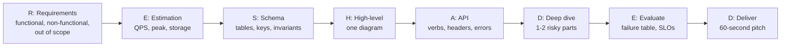
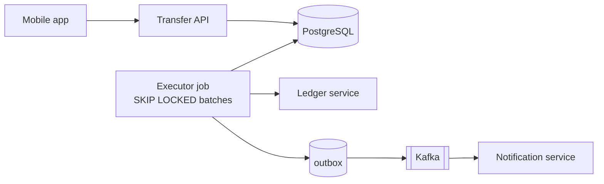

## في دقيقة واحدة

تستخدم كل مشكلة تصميم في هذا المسار الخطوات الثماني نفسها، **RESHADED**: المتطلبات (Requirements)، والتقدير (Estimation)، والمخطط (Schema)، والتصميم عالي المستوى (High-level design)، والواجهة (API)، والتعمق (Deep dive)، والتقييم (Evaluate)، والتسليم (Deliver). وتحميك الخطوات من الإخفاقين الكلاسيكيين: التصميم قبل أن تعرف المشكلة، ونفاد الوقت قبل إظهار العمق. وفي التقنية المالية، يعني العمق دائمًا تقريبًا *الصحة تحت الإخفاق*: لا خصم مزدوج، ولا أموال مفقودة، وكل حركة قابلة للإثبات. ويعلّم هذا الدرس كل خطوة على مثال صغير واحد. وتطبقها دروس المشكلات التالية (L2–L7).

## تشبيه

‏RESHADED بطاقة وصفة. فالطاهي الجيد ما زال يتكيف مع المكونات (تقلبات المُقابِل)، لكنه لا ينسى أبدًا تسخين الفرن مسبقًا (توضيح المتطلبات) أو التذوق قبل التقديم (تقييم الإخفاقات).

## المخطط



## ابنِه خطوة بخطوة

المثال المستمر: **"صمّم واجهة تتيح للمستخدمين جدولة تحويل بنكي لتاريخ مستقبلي."**

### ‏R: المتطلبات (نحو 5 دقائق)

اكتب ثلاث قوائم على اللوح.

- **الوظيفية:** إنشاء التحويلات المجدولة، وإلغاؤها، وسردها؛ والتنفيذ في تاريخ الاستحقاق؛ وإبلاغ المستخدم.
- **غير الوظيفية:** يُنفذ التحويل مرة واحدة على الأكثر؛ ويُنفذ خلال ساعة من الوقت المجدول؛ وزمن استجابة الواجهة p99 تحت 300 مللي ثانية؛ وإتاحة 99.95% للواجهة (افتراض: اسأل).
- **خارج النطاق:** التحويلات المتكررة، وصرف العملات، وتقييم الاحتيال (قل ذلك صراحة).

أسئلة توضيحية مهمة في التقنية المالية:

| السؤال | لماذا يغيّر التصميم |
|---|---|
| هل يمكن تنفيذ دفعة مرتين أبدًا إن لم نكن متأكدين؟ | لا ← مفاتيح عدم تكرار من طرف إلى طرف، وحالة "غير معروف"، ومطابقة |
| أي قنوات (دفتر الأستاذ الداخلي، أو Faster Payments، أو SEPA)؟ | أوقات الإغلاق، ونوافذ التسوية، ودلالات الإخفاق |
| ماذا لو كان الرصيد منخفضًا جدًا في تاريخ الاستحقاق؟ | سياسة إعادة المحاولة، والإبلاغ، وقاعدة العمل |
| احتياجات الاحتفاظ بالبيانات والتدقيق؟ | سجل للإلحاق فقط، وتقدير التخزين |
| الحجم والذروات؟ | يقود التقدير والتقسيم |

### ‏E: التقدير (نحو 4 دقائق)

اكتب دائمًا السلسلة **المستخدمون النشطون يوميًا ← الطلبات/ثانية ← الذروة ← التخزين ← العقد**، وقل إن المدخلات افتراضات.

```text
Users with scheduled transfers: 2,000,000 (assumption)
New schedules per day: 2 M × 0.2 = 400,000 → 400,000 / 86,400 ≈ 4.6 writes/s average
Peak factor 10 (month-end, assumption) → ≈ 46 writes/s
Executions: most land on the 1st and 25th (salary days): say 1,000,000 on one day,
  spread over 6 hours → 1,000,000 / 21,600 ≈ 46 executions/s
Storage: 400,000/day × 1 KB × 365 ≈ 146 GB/year (+ history rows ≈ ×3) ≈ 0.5 TB/year
Nodes: one PostgreSQL primary + replica is enough for writes; 2–3 stateless API instances for HA.
```

الاستنتاج الذي تقوله بصوت عالٍ: *"الحجم متواضع؛ والجزء الصعب هو الصحة يوم التنفيذ، لا الإنتاجية."* وهذا يخبر المُقابِل أين ستتعمق.

### ‏S: المخطط (نحو 4 دقائق)

```sql
CREATE TABLE scheduled_transfer (
    id               UUID PRIMARY KEY,
    owner_id         VARCHAR(64) NOT NULL,
    idempotency_key  VARCHAR(64) NOT NULL,
    from_account     VARCHAR(34) NOT NULL,
    to_account       VARCHAR(34) NOT NULL,
    amount_minor     BIGINT      NOT NULL CHECK (amount_minor > 0),
    currency         CHAR(3)     NOT NULL,
    execute_on       DATE        NOT NULL,
    status           VARCHAR(16) NOT NULL,   -- SCHEDULED, EXECUTING, EXECUTED, FAILED, CANCELLED
    version          BIGINT      NOT NULL,   -- optimistic locking for cancel vs execute
    UNIQUE (owner_id, idempotency_key)
);
CREATE INDEX due_transfers ON scheduled_transfer (execute_on) WHERE status = 'SCHEDULED';
```

قل أي الثوابت يفرضها المخطط: مبلغ موجب، وعملة مع كل مبلغ، وتحويل واحد لكل مفتاح عدم تكرار، وإصدار للإلغاء المتزامن مقابل التنفيذ.

### ‏H: التصميم عالي المستوى (نحو 7 دقائق)



أبقه في خمسة إلى سبعة صناديق. وسمِّ المسار **المتزامن** (الواجهة ← قاعدة البيانات) والمسار **غير المتزامن** (المنفّذ ← دفتر الأستاذ ← الأحداث).

### ‏A: الواجهة (نحو 4 دقائق)

```http
POST /v1/scheduled-transfers            Idempotency-Key: 3f6c…   → 201 Created, Location, ETag: "1"
DELETE /v1/scheduled-transfers/{id}     If-Match: "1"            → 204, or 412 Precondition Failed if it changed
GET  /v1/scheduled-transfers?status=SCHEDULED&cursor=…           → 200, cursor pagination
```

الأخطاء تفاصيل مشكلة وفق RFC 9457 ‏(`application/problem+json`): ‏`type`، و`title`، و`status`، و`detail`. وسمِّ أربعة أساسيات في التقنية المالية: **Idempotency-Key** عند الإنشاء، و**If-Match/ETag** عند التحديث أو الإلغاء، و**الإصدارات** في المسار أو ترويسة، و**لا تفاصيل داخلية** في رسائل الخطأ.

### ‏D: التعمق (نحو 13 دقيقة): اختر الجزء الأخطر

هنا: *"كيف نضمن تنفيذ كل تحويل مرة واحدة بالضبط، حتى مع نسختين من المنفّذ وتعطل في منتصف الطريق؟"* أجب بآليات، لا بصفات:

1. احجز الصفوف المستحقة بـ `SELECT … FOR UPDATE SKIP LOCKED`، واضبطها على `EXECUTING` وأكّد (حجز).
2. استدعِ دفتر الأستاذ مع **معرّف التحويل كمفتاح عدم تكرار**، فلا تستطيع إعادة المحاولة بعد تعطل الترحيل مرتين ([المسار 05: عدم التكرار](#/tracks/track-05/lessons/track-05-lesson-12)).
3. علّم `EXECUTED` واكتب حدث الإبلاغ في صندوق الصادر في معاملة واحدة ([المسار 05: صندوق الصادر](#/tracks/track-05/lessons/track-05-lesson-13)).
4. يعيد مُكنّس تشغيل الصفوف العالقة في `EXECUTING` لأكثر من N دقيقة. وهذا آمن لأن الخطوة 2 عديمة الأثر عند التكرار.

### ‏E: التقييم (نحو 5 دقائق)

| الإخفاق | الاكتشاف | التخفيف | نطاق الضرر |
|---|---|---|---|
| تعطل المنفّذ بعد الترحيل في دفتر الأستاذ | صفوف عالقة في EXECUTING ‏(مقياس + تنبيه) | يعيد المُكنّس المحاولة بمفتاح عدم التكرار نفسه | تأخر الإبلاغ فقط |
| تعطل دفتر الأستاذ يوم الرواتب | معدل الأخطاء، وعمر التراكم | التراجع وإعادة المحاولة ضمن هدف الساعة؛ واستدعاء المناوب إن تجاوز عمر التراكم 30 دقيقة | تحويلات متأخرة |
| إلغاء المستخدم أثناء التنفيذ | تعارض الإصدار | رفض الإلغاء بـ 409 بمجرد الوصول إلى EXECUTING | مستخدم واحد |

أضف مؤشرات وأهداف مستوى الخدمة (SLIs/SLOs): *تأخر التنفيذ p99 < ‏60 دقيقة*، و*إتاحة الواجهة 99.95%*، و*التنفيذات المكررة = 0* (تُقاس بالمطابقة).

### ‏D: التسليم (نحو 3 دقائق)

عرض من 60 ثانية: المشكلة، والأرقام الأساسية، والتصميم في جملة واحدة، والضمانان وكيف يُفرضان، والمخاطرة الرئيسية المتبقية وما ستفعله بعد ذلك.

## ما الذي يسوء

**الخطأ: "إنه مرة واحدة بالضبط لأننا نستخدم Kafka."** يسمّي المرشح تقنية بدل آلية. فيسأل المُقابِل "وإن مات المعالج بعد الترحيل لكن قبل تأكيد الإزاحة؟"، ولا يملك التصميم إجابة.

**الإصلاح:** اذكر الضمان كآلية: *مفتاح عدم تكرار عند الأثر الجانبي + قيد تفرد + إعادات محاولة آمنة للإعادة*. ثم امشِ عبر سيناريو التعطل خطوة بخطوة.

**الاختبار (تمرين):** لكل ضمان في تصميمك، اذكر الإخفاق الذي سيكسره وسطر التصميم الذي يمنعه. فإن لم تستطع، فهو ليس ضمانًا.

## المقايضات: متى لا تتبع RESHADED خطوة بخطوة

- **المشكلات كثيفة الصحة** (المطابقة، ودفاتر الأستاذ): اختصر التقدير إلى سطر واحد واقضِ الوقت على الثوابت.
- **الجولات التي يقودها المُقابِل:** إن قفز المُقابِل إلى "كيف تمنع التنفيذ المزدوج؟"، فاذهب إليه الآن وعد إلى الواجهة لاحقًا إن سمح الوقت.
- **الأسئلة المفتوحة جدًا** ("صمّم بنكًا"): استخدم R لتقليص النطاق إلى تدفق واحد، وقل ذلك.

## أسئلة وأجوبة المقابلة

**إحماء: "من أين تبدأ؟"**
- *الإجابة النموذجية:* المتطلبات والأسئلة التوضيحية، خاصة "هل يمكن أن تتحرك الأموال مرتين؟"، ثم الحجم.
- *الإجابة الخاطئة الشائعة:* "بالخدمات المصغّرة."
- *لماذا تفشل:* حل قبل مشكلة؛ ولا يتعلم المُقابِل شيئًا عن حكمك.

**قياسي: "لماذا قدّرت قبل الرسم؟"**
- *الإجابة النموذجية:* الأرقام تقرر ما إذا كانت قاعدة بيانات واحدة كافية، وما إذا كنت أحتاج التقسيم، وأين المخاطرة الحقيقية (هنا الصحة، لا الإنتاجية).
- *الإجابة الخاطئة الشائعة:* "المُقابِلون يتوقعون ذلك."
- *لماذا تفشل:* تعامل التقدير كطقس، لا كمدخل للقرارات.

**قياسي: "ماذا يضيف If-Match إلى نقطة الإلغاء لديك؟"**
- *الإجابة النموذجية:* تزامن متفائل عبر HTTP: يرسل العميل ETag الذي رآه؛ فإن تغيّر التحويل (مثلًا بدأ التنفيذ)، يعيد الخادم 412 بدل الإلغاء الأعمى.
- *الإجابة الخاطئة الشائعة:* "إنه للتخزين المؤقت."
- *لماذا تفشل:* تُستخدم ETags للتخزين المؤقت، لكنها هنا تحمي تغيير حالة من تحديث مفقود.

**عميق: "تعمل نسختان من المنفّذ في الوقت نفسه. امشِ بي عبر لماذا لا يمكن أن يعمل تحويل مرتين."**
- *الإجابة النموذجية:* يمنع `SKIP LOCKED` الحجوزات المتزامنة؛ ويُؤكد الحجز كـ EXECUTING؛ ويستخدم استدعاء دفتر الأستاذ معرّف التحويل كمفتاح عدم تكرار، فحتى إعادة التشغيل بعد تعطل لا أثر لها؛ وتثبت المطابقة صفر تكرارات.
- *الإجابة الخاطئة الشائعة:* "نستخدم قفلًا موزعًا في Redis."
- *لماذا تفشل:* تنتهي الأقفال أثناء توقف المعالج. ويجب أن يكون الأثر الجانبي عديم الأثر عند التكرار على أي حال.

**عميق: "كيف سيتغير هذا عند 100 ضعف الحجم؟"**
- *الإجابة النموذجية:* قسّم جدول التحويلات المستحقة حسب التاريخ ووزّع المنفّذين حسب تجزئة الحساب؛ وتبقى الضمانات لكل تحويل كما هي لأنها لا تعتمد على منفّذ واحد.
- *الإجابة الخاطئة الشائعة:* "انتقل إلى NoSQL."
- *لماذا تفشل:* تُسقط الضمانات المعاملاتية التي يعتمد عليها التصميم، دون سبب.

## قلها في 30 ثانية

"أستخدم RESHADED: المتطلبات مع أسئلة توضيحية خاصة بالتقنية المالية، وتقديرات بحسابات ظاهرة، ومخطط يفرض الثوابت، ومخطط معماري واحد، وواجهة مع Idempotency-Key وIf-Match وتفاصيل المشكلة، ثم تعمق في المواضع التي قد تضيع فيها الأموال، وجدول إخفاقات مع أهداف مستوى الخدمة، وملخص من 60 ثانية."

## الخلاصة

- الخطوات الثماني نفسها في كل مرة؛ وصِل إلى التعمق بحلول الدقيقة 25.
- يخبرك التقدير أين المخاطرة؛ فقلها بصوت عالٍ.
- الضمانات آليات (مفاتيح، وقيود، وآثار جانبية عديمة الأثر عند التكرار)، لا أسماء تقنيات أبدًا.

## انظر أيضًا

- [إدارة جولة الـ 45 دقيقة (ورقة التشغيل)](#/tracks/track-15/lessons/track-15-lesson-02)
- [مرجع: الأنماط، والتقدير، واختيار قاعدة البيانات](#/tracks/track-14/lessons/track-14-lesson-08)
- [المسار 05: أنماط عدم التكرار](#/tracks/track-05/lessons/track-05-lesson-12)

<!-- KNOWLEDGE-CHECK
[
  {
    "id": "kc-1401-01",
    "question": "في RESHADED، ماذا يعني حرف E الذي يأتي مباشرة بعد المتطلبات، ولماذا يأتي قبل الرسم؟",
    "options": [
      "التقييم (Evaluate): تراجع أنماط الإخفاق قبل الالتزام بتصميم",
      "التقدير (Estimation): الأرقام تقرر ما إذا كانت قاعدة بيانات واحدة تكفي أو يجب أن يتوسع التصميم",
      "التشفير (Encryption): متطلبات الأمان تشكّل كل الصناديق اللاحقة",
      "الأحداث (Events): تسرد أحداث المجال قبل المخطط"
    ],
    "correct": 1,
    "explanation": "الخطوة الثانية هي التقدير. بضعة أسطر من الحسابات (الطلبات في الثانية في الذروة، والتخزين في السنة) تخبرك ما إذا كان خادم PostgreSQL أساسي واحد يكفي. والرسم أولًا كثيرًا ما يقود إلى تصميم مبالغ فيه."
  },
  {
    "id": "kc-1401-02",
    "question": "يقول مرشح: \"إنها مرة واحدة بالضبط لأننا نستخدم Kafka.\" أي عبارة ستحصل على تقييم أفضل؟",
    "options": [
      "\"نستخدم معاملات Kafka، فالكتابة في قاعدة البيانات مرة واحدة بالضبط أيضًا.\"",
      "\"نعيد المحاولة حتى ينجح الاستدعاء، فكل دفعة تحدث مرة واحدة.\"",
      "\"مفتاح عدم تكرار عند الأثر الجانبي، وقيد تفرد، واستجابة مخزنة تجعل إعادات المحاولة آمنة؛ والتسليم نفسه مرة واحدة على الأقل.\"",
      "\"نستخدم قفلًا موزعًا حول الطلب كله.\""
    ],
    "correct": 2,
    "explanation": "يجب ذكر الضمان كآلية. فالتسليم عبر الشبكة مرة واحدة على الأقل؛ و*الآثار* مرة واحدة بالضبط تأتي من مفتاح عدم تكرار يُطالب به تحت قيد تفرد، مع إعادة الاستجابة المخزنة عند إعادات المحاولة."
  },
  {
    "id": "kc-1401-03",
    "question": "أي جزء من التصميم يجب أن تختاره للتعمق؟",
    "options": [
      "الجزء الأخطر: حيث يمكن فقدان الأموال، أو تكرارها، أو تركها في حالة غير معروفة",
      "الجزء الذي فيه أكثر الصناديق في المخطط",
      "الجزء الذي تعرفه أكثر، أيًا كانت المخاطرة",
      "الواجهة الأمامية، لأن المُقابِل يستطيع رؤيتها"
    ],
    "correct": 0,
    "explanation": "في التقنية المالية، يعني العمق الصحة تحت الإخفاق. فاختر الخطوة التي قد تسبب فيها إعادة محاولة، أو تعطل، أو سباق خصمًا مرتين أو فقدان أموال، أو اسأل المُقابِل أي جزء يريد."
  },
  {
    "id": "kc-1401-04",
    "question": "ماذا تضيف الترويسة If-Match إلى نقطة إلغاء؟",
    "options": [
      "تجعل الطلب عديم الأثر عند التكرار، فلا حاجة لمفتاح عدم تكرار",
      "تشفّر جسم الطلب",
      "تسمح للخادم بتخزين الاستجابة مؤقتًا",
      "التزامن المتفائل: إن تغيّر المورد منذ قرأ العميل الـ ETag الخاص به، يعيد الخادم 412 بدل الإلغاء دون تحقق"
    ],
    "correct": 3,
    "explanation": "تحمل If-Match الـ ETag الذي رآه العميل. فإن تقدم التحويل (مثلًا بدأ التنفيذ)، لم يعد الإصدار مطابقًا، فيجيب الخادم بـ 412 Precondition Failed بدل تطبيق قرار قديم."
  }
]
-->

<!-- PRACTICAL-CHALLENGE
{
  "id": "pc-1401",
  "title": "طبّق RESHADED على تصميم صغير",
  "description": "طبّق الخطوات الثماني على خدمة تحويل داخلي (نقل أموال بين حسابين للعميل نفسه) وتدرّب على التوقيت.",
  "tasks": [
    {
      "id": "pc-1401-01",
      "description": "اكتب المتطلبات (الوظيفية، وغير الوظيفية، وخارج النطاق) وثلاثة أسئلة توضيحية، ثم التقدير مع إظهار الحسابات: المستخدمون، والتحويلات في الثانية في المتوسط وفي الذروة (اذكر معامل الذروة)، والتخزين في السنة."
    },
    {
      "id": "pc-1401-02",
      "description": "اكتب المخطط (الحسابات، والتحويلات بمفتاح عدم تكرار فريد، وقيود دفتر الأستاذ) والواجهة: POST /v1/transfers مع Idempotency-Key، وGET حسب المعرّف، ونقطة إلغاء محمية بـ If-Match/ETag."
    },
    {
      "id": "pc-1401-03",
      "description": "التعمق: اشرح كتابةً لماذا لا تستطيع نسختا تنفيذ تشغيل التحويل نفسه مرتين (المطالبة بتحديث مشروط أو قيد تفرد)، ثم أضف جدول إخفاقات من أربعة صفوف: الإخفاق، والاكتشاف، والتخفيف، ونطاق الضرر."
    },
    {
      "id": "pc-1401-04",
      "description": "سجّل نفسك وأنت تقدم عرض التسليم في 60 ثانية وتحقق أنه يسمّي المخاطر المتبقية."
    }
  ]
}
-->
