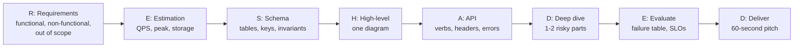
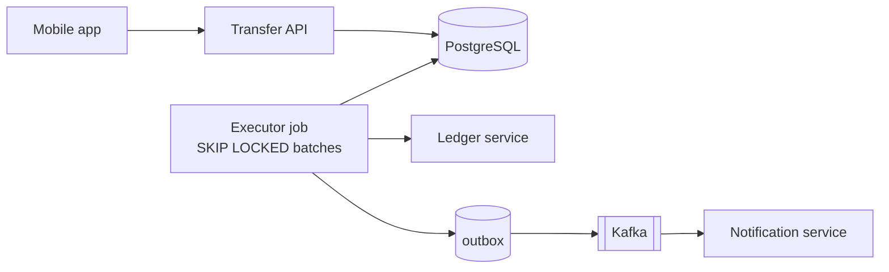

## In one minute

Every design problem in this track uses the same eight steps, **RESHADED**: Requirements,
Estimation, Schema, High-level design, API, Deep dive, Evaluate, Deliver. The steps keep you from
the two classic failures: designing before you know the problem, and running out of time before
showing depth. In fintech, depth almost always means *correctness under failure*: no double charges,
no lost money, every movement provable. This lesson teaches each step on one small example. The
problem lessons that follow (L2–L7) apply it.

## Analogy

RESHADED is a recipe card. A good cook still adapts to the ingredients (the interviewer's twists), but
never forgets to preheat the oven (clarify requirements) or to taste before serving (evaluate failures).

## Diagram



## Build it step by step

The running example: **"Design an API that lets users schedule a bank transfer for a future date."**

### R: Requirements (about 5 minutes)

Write three lists on the board.

- **Functional:** create, cancel, list scheduled transfers; execute on the due date; notify the user.
- **Non-functional:** a transfer executes at most once; executes within 1 hour of the scheduled time;
  API p99 under 300 ms; 99.95% availability for the API (assumption: ask).
- **Out of scope:** recurring transfers, FX, fraud scoring (say so explicitly).

Clarifying questions that matter in fintech:

| Question | Why it changes the design |
|---|---|
| Can a payment ever be executed twice if we are unsure? | No → idempotency keys end to end, "unknown" state, reconciliation |
| Which rails (internal ledger, Faster Payments, SEPA)? | Cut-off times, settlement windows, failure semantics |
| What if the balance is too low on the due date? | Retry policy, notification, business rule |
| Data retention and audit needs? | Append-only history, storage estimate |
| Scale and peaks? | Drives estimation and partitioning |

### E: Estimation (about 4 minutes)

Always write the chain **DAU → requests/s → peak → storage → nodes**, and say the inputs are assumptions.

```text
Users with scheduled transfers: 2,000,000 (assumption)
New schedules per day: 2 M × 0.2 = 400,000 → 400,000 / 86,400 ≈ 4.6 writes/s average
Peak factor 10 (month-end, assumption) → ≈ 46 writes/s
Executions: most land on the 1st and 25th (salary days): say 1,000,000 on one day,
  spread over 6 hours → 1,000,000 / 21,600 ≈ 46 executions/s
Storage: 400,000/day × 1 KB × 365 ≈ 146 GB/year (+ history rows ≈ ×3) ≈ 0.5 TB/year
Nodes: one PostgreSQL primary + replica is enough for writes; 2–3 stateless API instances for HA.
```

The conclusion you say aloud: *"Scale is modest; the hard part is correctness on execution day, not
throughput."* That tells the interviewer where you will go deep.

### S: Schema (about 4 minutes)

```sql
CREATE TABLE scheduled_transfer (
    id               UUID PRIMARY KEY,
    owner_id         VARCHAR(64) NOT NULL,
    idempotency_key  VARCHAR(64) NOT NULL,
    from_account     VARCHAR(34) NOT NULL,
    to_account       VARCHAR(34) NOT NULL,
    amount_minor     BIGINT      NOT NULL CHECK (amount_minor > 0),
    currency         CHAR(3)     NOT NULL,
    execute_on       DATE        NOT NULL,
    status           VARCHAR(16) NOT NULL,   -- SCHEDULED, EXECUTING, EXECUTED, FAILED, CANCELLED
    version          BIGINT      NOT NULL,   -- optimistic locking for cancel vs execute
    UNIQUE (owner_id, idempotency_key)
);
CREATE INDEX due_transfers ON scheduled_transfer (execute_on) WHERE status = 'SCHEDULED';
```

Say which invariants the schema enforces: positive amount, currency with every amount, one transfer
per idempotency key, and a version for concurrent cancel-vs-execute.

### H: High-level design (about 7 minutes)



Keep it to five to seven boxes. Name the **synchronous** path (API → DB) and the **asynchronous** path
(executor → ledger → events).

### A: API (about 4 minutes)

```http
POST /v1/scheduled-transfers            Idempotency-Key: 3f6c…   → 201 Created, Location, ETag: "1"
DELETE /v1/scheduled-transfers/{id}     If-Match: "1"            → 204, or 412 Precondition Failed if it changed
GET  /v1/scheduled-transfers?status=SCHEDULED&cursor=…           → 200, cursor pagination
```

Errors are RFC 9457 problem details (`application/problem+json`): `type`, `title`, `status`, `detail`.
Name four fintech essentials: **Idempotency-Key** on create, **If-Match/ETag** on update or cancel,
**versioning** in the path or a header, and **no internal details** in error messages.

### D: Deep dive (about 13 minutes): pick the riskiest part

Here: *"How do we guarantee each transfer executes exactly once, even with two executor instances and a
crash mid-way?"* Answer with mechanisms, not adjectives:

1. Claim due rows with `SELECT … FOR UPDATE SKIP LOCKED`, set `EXECUTING` and commit (a claim).
2. Call the ledger with **the transfer id as the idempotency key**, so a retry after a crash cannot
   post twice ([Track 05: idempotency](#/tracks/track-05/lessons/track-05-lesson-12)).
3. Mark `EXECUTED` and write the notification event to the outbox in one transaction
   ([Track 05: outbox](#/tracks/track-05/lessons/track-05-lesson-13)).
4. A sweeper re-drives rows stuck in `EXECUTING` for more than N minutes. Safe because step 2 is idempotent.

### E: Evaluate (about 5 minutes)

| Failure | Detection | Mitigation | Blast radius |
|---|---|---|---|
| Executor crashes after ledger posting | Rows stuck in EXECUTING (metric + alert) | Sweeper retries with the same idempotency key | Delayed notification only |
| Ledger down on salary day | Error rate, backlog age | Back off and retry within the 1-hour SLO; page if backlog age > 30 min | Late transfers |
| User cancels while executing | Version conflict | Cancel rejected with 409 once EXECUTING | One user |

Add SLIs/SLOs: *execution lateness p99 < 60 min*, *API availability 99.95%*, *duplicate executions = 0*
(measured by reconciliation).

### D: Deliver (about 3 minutes)

A 60-second pitch: problem, key numbers, the design in one sentence, the two guarantees and how they
are enforced, the main risk left and what you would do next.

## What goes wrong

**Bug: "it's exactly-once because we use Kafka."** The candidate names a technology instead of a
mechanism. The interviewer asks "and if the process dies after posting but before committing the
offset?", and the design has no answer.

**Fix:** state the guarantee as a mechanism: *idempotency key at the side effect + unique constraint +
replay-safe retries*. Then walk the crash scenario step by step.

**Test (practice):** for every guarantee in your design, say the failure that would break it and the
line of the design that prevents it. If you can't, it isn't a guarantee.

## Trade-offs: when NOT to follow RESHADED step by step

- **Correctness-heavy problems** (reconciliation, ledgers): shorten estimation to one line and spend
  the time on invariants.
- **Interviewer-led rounds:** if the interviewer jumps to "how would you prevent double execution?",
  go there now and come back to the API later if time allows.
- **Very open questions** ("design a bank"): use R to cut scope to one flow, and say so.

## Interview Q&A

**Warm-up: "Where do you start?"**
- *Model answer:* requirements and clarifying questions, especially "can money move twice?", then scale.
- *Common wrong answer:* "With the microservices."
- *Why it fails:* a solution before a problem; the interviewer learns nothing about your judgement.

**Standard: "Why did you estimate before drawing?"**
- *Model answer:* the numbers decide whether one database is enough, whether I need partitioning, and
  where the real risk is (here correctness, not throughput).
- *Common wrong answer:* "Interviewers expect it."
- *Why it fails:* it treats estimation as ritual, not as an input to decisions.

**Standard: "What does If-Match add to your cancel endpoint?"**
- *Model answer:* optimistic concurrency over HTTP: the client sends the ETag it saw; if the transfer
  changed (e.g. started executing), the server returns 412 instead of cancelling blindly.
- *Common wrong answer:* "It's for caching."
- *Why it fails:* ETags are used for caching, but here they protect a state change from a lost update.

**Deep: "Two executor instances run at the same time. Walk me through why a transfer can't run twice."**
- *Model answer:* `SKIP LOCKED` prevents concurrent claims; the claim is committed as EXECUTING; the
  ledger call uses the transfer id as the idempotency key, so even a re-drive after a crash is a no-op;
  reconciliation proves zero duplicates.
- *Common wrong answer:* "We use a distributed lock in Redis."
- *Why it fails:* locks expire while a process is paused. The side effect must be idempotent anyway.

**Deep: "How would this change at 100× scale?"**
- *Model answer:* partition the due-transfer table by date and shard executors by a hash of the
  account; the per-transfer guarantees stay the same because they don't depend on a single executor.
- *Common wrong answer:* "Switch to NoSQL."
- *Why it fails:* it drops the transactional guarantees the design relies on, without a reason.

## Say it in 30 seconds

"I use RESHADED: requirements with fintech clarifying questions, estimates with the arithmetic shown, a
schema that enforces invariants, one diagram, an API with Idempotency-Key, If-Match and problem details,
then deep dives on where money can be lost, a failure table with SLOs, and a 60-second summary."

## Recap

- Same eight steps every time; reach the deep dive by minute 25.
- Estimation tells you where the risk is; say it aloud.
- Guarantees are mechanisms (keys, constraints, idempotent side effects), never technology names.

## See also

- [Running the 45-minute round (run-sheet)](#/tracks/track-15/lessons/track-15-lesson-02)
- [Reference: patterns, estimation, database choice](#/tracks/track-14/lessons/track-14-lesson-08)
- [Track 05: Idempotency patterns](#/tracks/track-05/lessons/track-05-lesson-12)
