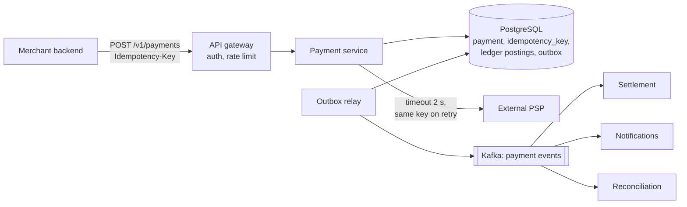
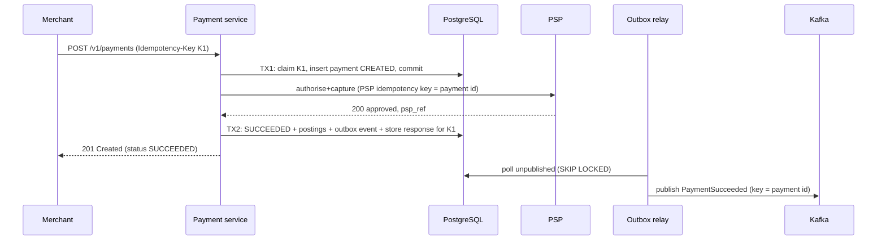

## في دقيقة واحدة

"صمّم خدمة دفع تتيح للتجار تحصيل المبالغ من العملاء عبر مزوّد دفع خارجي (PSP)." يغطي الجزء 1 أول 24 دقيقة: المتطلبات، والتقديرات، والمخطط، والتصميم عالي المستوى مع المسار السعيد، والواجهة. ويرتكز التصميم على حقيقة واحدة يجب أن تقولها مبكرًا: **قد ينتهي استدعاء مزوّد الدفع بنتيجة غير معروفة**، لذا يجب أن تكون كل خطوة آمنة لإعادة المحاولة ويجب أن تكون كل دفعة قابلة للتتبع حتى حالة نهائية. ويتولى الجزء 2 التعمق ومعالجة الإخفاقات. والنسخة القابلة للتشغيل من هذا التصميم هي [المشروع الختامي 1](#/capstone/payment-service).

## تشبيه

خدمة الدفع مكتب بريد حريص. فكل طرد يحصل على رقم تتبع قبل مغادرته (مفتاح عدم التكرار)، ويسجله موظف الشباك قبل تسليمه لشركة الشحن (قاعدة البيانات قبل مزوّد الدفع)، وإن لم تتصل شركة الشحن، فأنت تتصل بها؛ ولا ترسل طردًا ثانيًا.

## المخطط



## ابنِه خطوة بخطوة

### خطة الوقت لهذه المشكلة (45 دقيقة)

| الدقيقة | الخطوة | هذا الدرس / التالي |
|---|---|---|
| 0–5 | المتطلبات + الأسئلة | الجزء 1 |
| 5–9 | التقدير | الجزء 1 |
| 9–13 | المخطط | الجزء 1 |
| 13–20 | التصميم عالي المستوى + المسار السعيد | الجزء 1 |
| 20–24 | الواجهة | الجزء 1 |
| 24–37 | التعمق: عدم التكرار + صندوق الصادر؛ النتائج غير المعروفة لمزوّد الدفع | الجزء 2 |
| 37–42 | جدول الإخفاقات، والاتساق، والأمان، وأهداف مستوى الخدمة | الجزء 2 |
| 42–45 | عرض من 60 ثانية | الجزء 2 |

### ‏R: المتطلبات

- **الوظيفية:** إنشاء دفعة (بطاقة أو من حساب إلى حساب عبر مزوّد دفع واحد)، والحصول على حالتها، واستردادها (كليًا أو جزئيًا)، وإرسال الأحداث إلى التسوية والإشعارات والمطابقة.
- **غير الوظيفية:** لا خصم مرتين لطلب واحد أبدًا؛ ولا فقدان لدفعة مقبولة أبدًا؛ وزمن استجابة واجهة الإنشاء p99 < ‏500 مللي ثانية باستثناء وقت مزوّد الدفع (افتراض: أكّد)؛ وإتاحة الواجهة 99.95%؛ وسجل تدقيق كامل.
- **خارج النطاق:** تقييم الاحتيال (انظر [L4](#/tracks/track-14/lessons/track-14-lesson-04))، وصرف العملات، والمدفوعات الصادرة، والتوجيه بين مزوّدي دفع متعددين.

الأسئلة التوضيحية والإجابات التي نفترضها:

| السؤال | الإجابة المفترضة | الأثر على التصميم |
|---|---|---|
| هل يُسمح للتاجر بإعادة المحاولة؟ | نعم، عند انتهاء المهلة | مفتاح عدم التكرار مطلوب عند الإنشاء |
| نتيجة متزامنة أم غير متزامنة للتاجر؟ | متزامنة إن أجاب مزوّد الدفع خلال ثانيتين، وإلا `PROCESSING` + ‏webhook | نموذج الحالة يتضمن `PROCESSING`/`UNKNOWN` |
| الحجم؟ | 10 ملايين عميل، دفعتان يوميًا لكل منهم | التقدير أدناه |
| عملات متعددة؟ | نعم، لكن دون تحويل | المبلغ + العملة في كل صف |
| الاحتفاظ؟ | متعدد السنوات، يحدده الامتثال (حسب النطاق القضائي) | التقسيم حسب الوقت، والأرشفة |

### ‏E: التقدير (الافتراضات مذكورة)

```text
Payments/day: 10 M × 2 = 20 M
Average: 20,000,000 / 86,400 ≈ 231 payments/s
Peak (assume 5× in evening/payday peaks): ≈ 1,160 payments/s
Rows per payment: payment 1 + idempotency key 1 + ledger postings 2 + outbox 1 = 5 inserts
  → peak ≈ 5,800 row inserts/s, in short transactions
Long-term storage: payment (~1 KB) + 2 postings (~200 B each) ≈ 1.4 KB × 20 M ≈ 28 GB/day ≈ 10 TB/year
Short-lived: idempotency keys (kept ~24 h, assumption) ≈ 20 GB; outbox rows purged after publish
Reads: status GETs, assume 3 per payment → ≈ 3,500 reads/s at peak → replicas or cache
```

ما يجب قوله: *"يستطيع خادم PostgreSQL أساسي واحد بمعاملات قصيرة أن يتحمل معدل الكتابة هذا على الأرجح، لكنني سأثبت ذلك باختبار حمل قبل القرار. وسأقسّم حسب الشهر للاحتفاظ والأرشفة، لا للإنتاجية. وإن نمونا 10 أضعاف، سأوزّع حسب التاجر."* ولا تذكر حدًا ثابتًا لـ "عمليات الإدراج في الثانية" لـ PostgreSQL. فهو يعتمد على العتاد، والفهارس، وشكل المعاملات.

### ‏S: المخطط

```sql
CREATE TABLE payment (
    id              UUID         PRIMARY KEY,
    merchant_id     VARCHAR(64)  NOT NULL,
    amount_minor    BIGINT       NOT NULL CHECK (amount_minor > 0),
    currency        CHAR(3)      NOT NULL,
    status          VARCHAR(16)  NOT NULL,    -- CREATED, PROCESSING, SUCCEEDED, FAILED, UNKNOWN, REFUNDED
    psp_reference   VARCHAR(64),
    refunded_minor  BIGINT       NOT NULL DEFAULT 0 CHECK (refunded_minor <= amount_minor),
    version         BIGINT       NOT NULL,     -- optimistic locking + ETag
    created_at      TIMESTAMPTZ  NOT NULL
) PARTITION BY RANGE (created_at);

CREATE TABLE idempotency_key (
    merchant_id      VARCHAR(64) NOT NULL,
    idempotency_key  VARCHAR(64) NOT NULL,
    request_hash     CHAR(64)    NOT NULL,     -- same key + different body → 422
    response_status  INT,
    response_body    TEXT,
    created_at       TIMESTAMPTZ NOT NULL DEFAULT now(),
    PRIMARY KEY (merchant_id, idempotency_key)
);

CREATE TABLE payment_event (                    -- append-only audit history
    id          BIGSERIAL PRIMARY KEY,
    payment_id  UUID        NOT NULL,
    from_status VARCHAR(16),
    to_status   VARCHAR(16) NOT NULL,
    reason      VARCHAR(200),
    at          TIMESTAMPTZ NOT NULL DEFAULT now()
);

CREATE TABLE outbox_event (
    id           BIGSERIAL PRIMARY KEY,
    event_id     UUID         NOT NULL UNIQUE,
    aggregate_id UUID         NOT NULL,         -- Kafka key: per-payment ordering
    payload      JSONB        NOT NULL,
    published_at TIMESTAMPTZ
);
```

إضافة إلى جداول دفتر الأستاذ من [المسار 05](#/tracks/track-05/lessons/track-05-lesson-01): كل دفعة محصّلة ترحّل قيودًا متوازنة (حساب مقاصة العميل ↔ مستحقات التاجر).

ثوابت تقولها بصوت عالٍ: المال وحدات صغرى + عملة؛ ودفعة واحدة لكل (تاجر، مفتاح)؛ ولا تتجاوز المبالغ المستردة المبلغ أبدًا؛ والسجل للإلحاق فقط.

### ‏H: التصميم عالي المستوى والمسار السعيد



معاملتان، لا واحدة: يجب ألا يعمل استدعاء مزوّد الدفع بينما تُبقي معاملة قاعدة بيانات واتصالها مفتوحين. وتجعل TX1 الطلب دائمًا *قبل* أن نتواصل مع مزوّد الدفع، فيترك أي تعطل بعدها صفًا `CREATED` نستطيع التعافي منه. ويُمرر معرّف الدفعة إلى مزوّد الدفع كمفتاح عدم التكرار *الخاص به*، فتكون إعادات محاولتنا آمنة أيضًا.

### ‏A: الواجهة

```http
POST /v1/payments
Authorization: Bearer <merchant token>
Idempotency-Key: 9b2c7d3e-…            (required; 8–64 chars; scoped per merchant)
Content-Type: application/json

{"amount": "42.50", "currency": "EUR", "paymentMethod": "pm_tok_…", "reference": "Order 1001"}

201 Created           Location: /v1/payments/{id}    ETag: "3"
202 Accepted          status PROCESSING: PSP did not answer in time; final result by webhook
409 Conflict          same key still being processed (retry later)
422 Unprocessable     same key, different body
```

```http
GET  /v1/payments/{id}                         → 200 + ETag; 404 if not this merchant's (BOLA)
POST /v1/payments/{id}/refunds                 Idempotency-Key + If-Match: "3"   → 201, or 412 if changed
```

جسم الخطأ (RFC 9457):

```json
{"type": "https://api.example.com/problems/idempotency-key-reuse",
 "title": "Idempotency key reuse", "status": 422,
 "detail": "This Idempotency-Key was already used with a different request body"}
```

الإصدارات: `/v1` في المسار (يدعم Spring Framework 7 هذا بإصدارات الواجهات المدمجة، كما في المشروع الختامي 1). والمبالغ كنصوص عشرية أو وحدات صغرى، ولا أعداد عائمة في JSON أبدًا.

## ما الذي يسوء

**الخطأ: استدعاء مزوّد الدفع داخل معاملة قاعدة البيانات.** تحت الحمل، يحتجز زمن استجابة مزوّد الدفع الاتصالات؛ فيجف المجمع؛ ويبدأ كل طلب، بما فيه قراءات الحالة، في انتهاء المهلة. وإن نجح مزوّد الدفع لكن فشل التأكيد، يُخصم من العميل دون سجل.

**الإصلاح:** ‏TX1 ‏(نية دائمة) ← استدعاء مزوّد الدفع خارج أي معاملة ← TX2 ‏(النتيجة + دفتر الأستاذ + صندوق الصادر). والتعافي من الأعطال بينهما في الجزء 2.

**الاختبار:** تُظهر اختبارات [المشروع الختامي 1](#/capstone/payment-service) الجزء المعاملاتي؛ ويضيف الجزء 2 مسار الإخفاق الذي تستطيع إعادة إنتاجه ببديل لمزوّد الدفع تنتهي مهلته.

## المقايضات: متى لا تستخدم هذا التصميم

- إن كان مزوّد الدفع غير متزامن كليًا (webhook فقط)، فأسقط النتيجة المتزامنة وأعد 202 دائمًا.
- للتحويلات الداخلية في دفتر الأستاذ دون طرف خارجي، معاملة واحدة كافية (انظر [المشروع الختامي 2](#/capstone/wallet-ledger)).
- عند حجم منخفض جدًا، قد يكون مرحّل صندوق صادر منفصل أكثر مما تحتاج؛ فمستطلِع مجدول في الخدمة نفسها يكفي.

## أسئلة وأجوبة المقابلة

**إحماء: "لماذا ترويسة مفتاح عدم تكرار وليس معرّف الطلب فقط؟"**
- *الإجابة النموذجية:* يحدد المفتاح *محاولة الطلب* عبر إعادات المحاولة ونطاقه التاجر. وقد يُعاد استخدام معرّفات الطلبات، أو تغيب، أو لا تكون فريدة بين التجار. والترويسة شأن من شؤون البروتوكول.
- *الإجابة الخاطئة الشائعة:* "نزيل التكرار حسب المبلغ والبطاقة."
- *لماذا تفشل:* سيُدمج شراءان حقيقيان متطابقان خطأً.

**قياسي: "لماذا معاملتان بدل واحدة؟"**
- *الإجابة النموذجية:* لا تُبقِ معاملة قاعدة بيانات مفتوحة عبر استدعاء بعيد أبدًا. تسجل TX1 النية فيكون التعطل قابلًا للتعافي؛ وتسجل TX2 النتيجة مع دفتر الأستاذ وصندوق الصادر ذريًا.
- *الإجابة الخاطئة الشائعة:* "معاملة واحدة أكثر أمانًا."
- *لماذا تفشل:* تحتجز الاتصالات أثناء زمن استجابة مزوّد الدفع، ولا تستطيع التراجع عن عملية مزوّد الدفع على أي حال.

**قياسي: "كيف وصلت من 10 ملايين مستخدم إلى رقم التخزين؟"**
- *الإجابة النموذجية:* امشِ عبر السلسلة: 20 مليون دفعة يوميًا، ونحو 1.4 كيلوبايت من البيانات طويلة العمر لكل منها، ونحو 28 غيغابايت يوميًا، ونحو 10 تيرابايت سنويًا. ثم قل أي افتراض يهم أكثر (البايتات لكل صف) وكيف ستتحقق منه.
- *الإجابة الخاطئة الشائعة:* "على الأرجح بضعة تيرابايتات."
- *لماذا تفشل:* لا حسابات يعني لا طريقة للتحقق أو التعديل.

**عميق: "لماذا ETag/If-Match على المبالغ المستردة؟"**
- *الإجابة النموذجية:* مشغّلان يستردان في آن واحد قد يجتازان كلاهما فحصًا مقابل مبلغ قديم؛ ويجعل If-Match الثاني يفشل بـ 412 ويعيد القراءة، وقيد قاعدة البيانات `CHECK (refunded_minor <= amount_minor)` هو خط الدفاع الأخير.
- *الإجابة الخاطئة الشائعة:* "الاستردادات نادرة، فالتزامن لا يهم."
- *لماذا تفشل:* النادر ليس مستحيلًا. والاسترداد الزائد يخسر أموالًا حقيقية.

## قلها في 30 ثانية

"ينشئ التجار الدفعات مع Idempotency-Key. أسجل النية في معاملة واحدة، وأستدعي مزوّد الدفع خارج أي معاملة مع معرّف دفعتنا كمفتاح عدم التكرار الخاص به، ثم أسجل النتيجة، وقيود دفتر الأستاذ، وحدث صندوق الصادر معًا. والتقديرات: نحو 230 دفعة في الثانية في المتوسط ونحو 1,200 في الذروة، ونحو 10 تيرابايت سنويًا، فنقطة البداية خادم PostgreSQL أساسي واحد مقسّم، يُثبت باختبار حمل."

## الخلاصة

- قل مبكرًا: قد تكون نتائج مزوّد الدفع غير معروفة، فيجب أن يكون كل شيء آمنًا لإعادة المحاولة.
- النية ← مزوّد الدفع (دون معاملة) ← النتيجة + دفتر الأستاذ + صندوق الصادر.
- الواجهة: ‏Idempotency-Key، وETag/If-Match، و`/v1`، وأخطاء RFC 9457، ولا أعداد عائمة.

## انظر أيضًا

- [الجزء 2: التعمق، والإخفاقات، وأهداف مستوى الخدمة](#/tracks/track-14/lessons/track-14-lesson-03)
- [المشروع الختامي 1: خدمة الدفع](#/capstone/payment-service)
- [المسار 05: السيناريو B: المدفوعات المكررة](#/tracks/track-05/lessons/track-05-lesson-03)

<!-- KNOWLEDGE-CHECK
[
  {
    "id": "kc-1402-01",
    "question": "لماذا يجب ألا يحدث استدعاء مزوّد الدفع (PSP) داخل معاملة قاعدة البيانات؟",
    "options": [
      "قواعد البيانات لا تستطيع إجراء استدعاءات HTTP",
      "زمن استجابة المزوّد سيحجز اتصالًا لكل طلب ويستنفد المجمع، والتراجع لا يستطيع إلغاء خصم أجراه المزوّد بالفعل",
      "يتطلب المزوّد معاملة XA خاصة به",
      "سيجعل الدفعة عديمة الأثر عند التكرار مرتين"
    ],
    "correct": 1,
    "explanation": "التصميم هو TX1 (النية الدائمة) ← استدعاء المزوّد خارج أي معاملة ← TX2 (النتيجة، ودفتر الأستاذ، وصندوق الصادر). وإبقاء معاملة مفتوحة عبر استدعاء خارجي بطيء يستنفد الاتصالات، والخصم الخارجي لا يغطيه التراجع أصلًا."
  },
  {
    "id": "kc-1402-02",
    "question": "لماذا نستخدم الترويسة Idempotency-Key بدل معرّف طلب التاجر فقط؟",
    "options": [
      "المفتاح يعرّف محاولة طلب واحدة عبر إعادات المحاولة ونطاقه لكل تاجر؛ ومعرّفات الطلبات قد يُعاد استخدامها، أو تغيب، أو لا تكون فريدة عبر التجار",
      "معرّفات الطلبات أطول من أن تُفهرس",
      "الترويسات مشفرة والجسم ليس كذلك",
      "يرفض المزوّد معرّفات الطلبات"
    ],
    "correct": 0,
    "explanation": "عدم التكرار مسألة بروتوكول: المفتاح يسمّي عملية واحدة، أيًا كانت بيانات الأعمال. وتحديد نطاقه لكل تاجر يتجنب التصادم بين التجار."
  },
  {
    "id": "kc-1402-03",
    "question": "ماذا تخزّن TX1، قبل استدعاء المزوّد؟",
    "options": [
      "لا شيء: صف الدفعة يُكتب فقط بعد أن يجيب المزوّد",
      "سطر في سجل التدقيق فقط",
      "النية الدائمة: الدفعة في حالة معلقة ومفتاح عدم التكرار المُطالب به، فيترك التعطل سجلًا قابلًا للتتبع يجب حسمه",
      "قيود دفتر الأستاذ النهائية"
    ],
    "correct": 2,
    "explanation": "إن ماتت العملية أثناء استدعاء المزوّد، فالصف المعلق (مع المفتاح ومرجع المزوّد) هو ما يسمح لعامل بإيجاد الدفعة وحسم نتيجتها الحقيقية لاحقًا."
  },
  {
    "id": "kc-1402-04",
    "question": "كيف يجب تخزين مبلغ الدفعة؟",
    "options": [
      "كـ double بخانتين عشريتين",
      "كنص منسق مثل \"10.50 GBP\"",
      "كـ float مع العملة في جدول آخر",
      "كعدد صحيح بالوحدات الصغرى (أو رقم عشري بمقياس ثابت) مع رمز عملة ISO 4217"
    ],
    "correct": 3,
    "explanation": "الفاصلة العائمة الثنائية لا تستطيع تمثيل معظم المبالغ العشرية بدقة. والوحدات الصغرى (1050 لـ 10.50 GBP) أو رقم عشري بمقياس ثابت مع عملة صريحة تتجنب انحراف التقريب."
  }
]
-->

<!-- PRACTICAL-CHALLENGE
{
  "id": "pc-1402",
  "title": "خدمة الدفع: من المتطلبات إلى الواجهة",
  "description": "أنتج مخرجات النصف الأول من جولة خدمة الدفع كما ستفعل على السبورة.",
  "tasks": [
    {
      "id": "pc-1402-01",
      "description": "اكتب ورقة التقدير من 10 ملايين مستخدم إلى الدفعات في الثانية (المتوسط والذروة) والتخزين في السنة، مع ذكر كل افتراض."
    },
    {
      "id": "pc-1402-02",
      "description": "اكتب DDL لجداول payment وidempotency_key وقيود دفتر الأستاذ وصندوق الصادر: المبالغ بالوحدات الصغرى مع العملة، وقيد فريد على (merchant_id, idempotency_key)، وقيد CHECK للحالة."
    },
    {
      "id": "pc-1402-03",
      "description": "حدّد الواجهة: POST /v1/payments مع Idempotency-Key واستجاباتها 201/202/409/422، وGET /v1/payments/{id} مع ETag، وPOST /v1/payments/{id}/refunds محمية بـ If-Match. واستخدم problem details وفق RFC 9457 للأخطاء."
    }
  ]
}
-->
