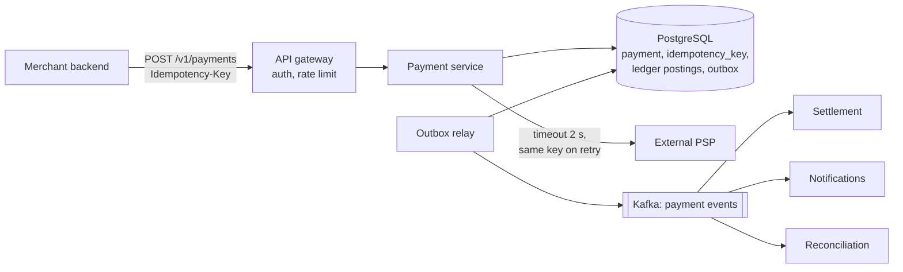
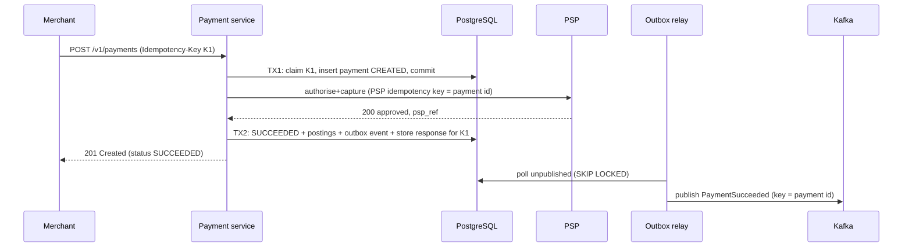

## In one minute

"Design a payment service that lets merchants charge customers through an external payment
provider (PSP)." Part 1 covers the first 24 minutes: requirements, estimates, schema, the high-level
design with the happy path, and the API. The design hinges on one fact you should say early: **a call
to a PSP can end in an unknown outcome**, so every step must be safe to retry and every payment must
be traceable to a final state. Part 2 does the deep dives and failure handling. The runnable version of
this design is [capstone 1](#/capstone/payment-service).

## Analogy

A payment service is a careful post office. Every parcel gets a tracking number before it leaves
(idempotency key), the counter clerk records it before handing it to the courier (the database before
the PSP), and if the courier doesn't call back, you phone the courier; you don't send a second parcel.

## Diagram



## Build it step by step

### Time plan for this problem (45 minutes)

| Min | Step | This lesson / next |
|---|---|---|
| 0–5 | Requirements + questions | Part 1 |
| 5–9 | Estimation | Part 1 |
| 9–13 | Schema | Part 1 |
| 13–20 | High-level design + happy path | Part 1 |
| 20–24 | API | Part 1 |
| 24–37 | Deep dives: idempotency + outbox; PSP unknown outcomes | Part 2 |
| 37–42 | Failure table, consistency, security, SLOs | Part 2 |
| 42–45 | 60-second pitch | Part 2 |

### R: Requirements

- **Functional:** create a payment (card or account-to-account via one PSP), get its status, refund
  it (full or partial), send events to settlement, notifications and reconciliation.
- **Non-functional:** never charge twice for one request; never lose an accepted payment; create API
  p99 < 500 ms excluding PSP time (assumption: confirm); API availability 99.95%; full audit history.
- **Out of scope:** fraud scoring (see [L4](#/tracks/track-14/lessons/track-14-lesson-04)), FX, payouts,
  multi-PSP routing.

Clarifying questions and the answers we assume:

| Question | Assumed answer | Effect on the design |
|---|---|---|
| Is the merchant allowed to retry? | Yes, on timeouts | Idempotency key required on create |
| Sync or async result to the merchant? | Sync if the PSP answers within 2 s, else `PROCESSING` + webhook | Status model includes `PROCESSING`/`UNKNOWN` |
| Volume? | 10 M customers, 2 payments/day each | Estimation below |
| Multiple currencies? | Yes, but no conversion | Amount + currency on every row |
| Retention? | Multi-year, set by compliance (depends on jurisdiction) | Partition by time, archive |

### E: Estimation (assumptions stated)

```text
Payments/day: 10 M × 2 = 20 M
Average: 20,000,000 / 86,400 ≈ 231 payments/s
Peak (assume 5× in evening/payday peaks): ≈ 1,160 payments/s
Rows per payment: payment 1 + idempotency key 1 + ledger postings 2 + outbox 1 = 5 inserts
  → peak ≈ 5,800 row inserts/s, in short transactions
Long-term storage: payment (~1 KB) + 2 postings (~200 B each) ≈ 1.4 KB × 20 M ≈ 28 GB/day ≈ 10 TB/year
Short-lived: idempotency keys (kept ~24 h, assumption) ≈ 20 GB; outbox rows purged after publish
Reads: status GETs, assume 3 per payment → ≈ 3,500 reads/s at peak → replicas or cache
```

What to say: *"A single PostgreSQL primary with short transactions can plausibly take this write
rate, but I'd prove it with a load test before deciding. I'll partition by month for retention and
archiving, not for throughput. If we grow 10×, I'd shard by merchant."* Don't quote a fixed
"inserts per second" limit for PostgreSQL. It depends on hardware, indexes and transaction shape.

### S: Schema

```sql
CREATE TABLE payment (
    id              UUID         PRIMARY KEY,
    merchant_id     VARCHAR(64)  NOT NULL,
    amount_minor    BIGINT       NOT NULL CHECK (amount_minor > 0),
    currency        CHAR(3)      NOT NULL,
    status          VARCHAR(16)  NOT NULL,    -- CREATED, PROCESSING, SUCCEEDED, FAILED, UNKNOWN, REFUNDED
    psp_reference   VARCHAR(64),
    refunded_minor  BIGINT       NOT NULL DEFAULT 0 CHECK (refunded_minor <= amount_minor),
    version         BIGINT       NOT NULL,     -- optimistic locking + ETag
    created_at      TIMESTAMPTZ  NOT NULL
) PARTITION BY RANGE (created_at);

CREATE TABLE idempotency_key (
    merchant_id      VARCHAR(64) NOT NULL,
    idempotency_key  VARCHAR(64) NOT NULL,
    request_hash     CHAR(64)    NOT NULL,     -- same key + different body → 422
    response_status  INT,
    response_body    TEXT,
    created_at       TIMESTAMPTZ NOT NULL DEFAULT now(),
    PRIMARY KEY (merchant_id, idempotency_key)
);

CREATE TABLE payment_event (                    -- append-only audit history
    id          BIGSERIAL PRIMARY KEY,
    payment_id  UUID        NOT NULL,
    from_status VARCHAR(16),
    to_status   VARCHAR(16) NOT NULL,
    reason      VARCHAR(200),
    at          TIMESTAMPTZ NOT NULL DEFAULT now()
);

CREATE TABLE outbox_event (
    id           BIGSERIAL PRIMARY KEY,
    event_id     UUID         NOT NULL UNIQUE,
    aggregate_id UUID         NOT NULL,         -- Kafka key: per-payment ordering
    payload      JSONB        NOT NULL,
    published_at TIMESTAMPTZ
);
```

Plus the ledger tables from [Track 05](#/tracks/track-05/lessons/track-05-lesson-01): every captured
payment posts balanced entries (customer clearing account ↔ merchant payable).

Invariants to say aloud: money is minor units + currency; one payment per (merchant, key); refunds
can never exceed the amount; history is append-only.

### H: High-level design and happy path



Two transactions, not one: the PSP call must not run while holding a database transaction and its
connection open. TX1 makes the request durable *before* we contact the PSP, so a crash afterwards
leaves a `CREATED` row we can recover from. The payment id is passed to the PSP as *its* idempotency
key, so our own retries are safe too.

### A: API

```http
POST /v1/payments
Authorization: Bearer <merchant token>
Idempotency-Key: 9b2c7d3e-…            (required; 8–64 chars; scoped per merchant)
Content-Type: application/json

{"amount": "42.50", "currency": "EUR", "paymentMethod": "pm_tok_…", "reference": "Order 1001"}

201 Created           Location: /v1/payments/{id}    ETag: "3"
202 Accepted          status PROCESSING: PSP did not answer in time; final result by webhook
409 Conflict          same key still being processed (retry later)
422 Unprocessable     same key, different body
```

```http
GET  /v1/payments/{id}                         → 200 + ETag; 404 if not this merchant's (BOLA)
POST /v1/payments/{id}/refunds                 Idempotency-Key + If-Match: "3"   → 201, or 412 if changed
```

Error body (RFC 9457):

```json
{"type": "https://api.example.com/problems/idempotency-key-reuse",
 "title": "Idempotency key reuse", "status": 422,
 "detail": "This Idempotency-Key was already used with a different request body"}
```

Versioning: `/v1` in the path (Spring Framework 7 supports this with built-in API versioning, as in
capstone 1). Amounts as decimal strings or minor units, never JSON floats.

## What goes wrong

**Bug: calling the PSP inside the database transaction.** Under load, PSP latency holds connections;
the pool runs dry; every request, including status reads, starts timing out. And if the PSP succeeds
but the commit fails, the customer is charged with no record.

**Fix:** TX1 (durable intent) → PSP call outside any transaction → TX2 (result + ledger + outbox).
Recovery for crashes between them is in Part 2.

**Test:** [capstone 1](#/capstone/payment-service)'s tests show the transactional part; Part 2 adds
the failure path you can reproduce with a PSP stub that times out.

## Trade-offs: when NOT to use this design

- If the PSP is fully asynchronous (webhook-only), drop the synchronous result and always return 202.
- For internal ledger transfers with no external party, one transaction is fine (see
  [capstone 2](#/capstone/wallet-ledger)).
- At very low volume, a separate outbox relay may be more than you need; a scheduled poller in the same
  service is enough.

## Interview Q&A

**Warm-up: "Why an idempotency key header and not just the order id?"**
- *Model answer:* the key identifies the *request attempt* across retries and is scoped per merchant.
  Order ids may be reused, absent or not unique across merchants. The header is a protocol concern.
- *Common wrong answer:* "We deduplicate on amount and card."
- *Why it fails:* two real identical purchases would be wrongly merged.

**Standard: "Why two transactions instead of one?"**
- *Model answer:* never hold a DB transaction across a remote call. TX1 records intent so a crash is
  recoverable; TX2 records the outcome with the ledger and outbox atomically.
- *Common wrong answer:* "One transaction is safer."
- *Why it fails:* it pins connections during PSP latency, and it cannot roll back the PSP anyway.

**Standard: "How did you get from 10 million users to the storage number?"**
- *Model answer:* walk the chain: 20 M payments/day, about 1.4 KB of long-lived data each, about 28 GB/day,
  about 10 TB/year. Then say which assumption matters most (bytes per row) and how you would check it.
- *Common wrong answer:* "Probably a few terabytes."
- *Why it fails:* no arithmetic means no way to check or adjust it.

**Deep: "Why ETag/If-Match on refunds?"**
- *Model answer:* two operators refunding at once could both pass a check against a stale amount;
  If-Match makes the second one fail with 412 and re-read, and the DB `CHECK (refunded_minor <=
  amount_minor)` is the last line of defence.
- *Common wrong answer:* "Refunds are rare, so concurrency doesn't matter."
- *Why it fails:* rare isn't never. Over-refunding loses real money.

## Say it in 30 seconds

"Merchants create payments with an Idempotency-Key. I record the intent in one transaction, call the
PSP outside any transaction with our payment id as its idempotency key, then record the result, ledger
postings and an outbox event together. Estimates: about 230 payments per second on average and about
1,200 at peak, around 10 TB a year, so one partitioned PostgreSQL primary is the starting point, to be
proven with a load test."

## Recap

- Say early: PSP outcomes can be unknown, so everything must be retry-safe.
- Intent → PSP (no transaction) → result + ledger + outbox.
- API: Idempotency-Key, ETag/If-Match, `/v1`, RFC 9457 errors, no floats.

## See also

- [Part 2: deep dives, failures, SLOs](#/tracks/track-14/lessons/track-14-lesson-03)
- [Capstone 1: payment service](#/capstone/payment-service)
- [Track 05: Scenario B: duplicate payments](#/tracks/track-05/lessons/track-05-lesson-03)

<!-- KNOWLEDGE-CHECK
[
  {
    "id": "kc-1402-01",
    "question": "Why must the call to the payment provider (PSP) not happen inside the database transaction?",
    "options": [
      "Databases cannot make HTTP calls",
      "PSP latency would hold a connection per request and exhaust the pool, and a rollback cannot undo a charge the PSP already made",
      "The PSP requires its own XA transaction",
      "It would make the payment idempotent twice"
    ],
    "correct": 1,
    "explanation": "The design is TX1 (durable intent) → PSP call outside any transaction → TX2 (result, ledger, outbox). Holding a transaction open across a slow external call exhausts connections, and the external charge isn't covered by the rollback anyway."
  },
  {
    "id": "kc-1402-02",
    "question": "Why use an Idempotency-Key header instead of just the merchant's order id?",
    "options": [
      "The key identifies one request attempt across retries and is scoped per merchant; order ids may be reused, missing or not unique across merchants",
      "Order ids are too long to index",
      "Headers are encrypted and the body is not",
      "The PSP rejects order ids"
    ],
    "correct": 0,
    "explanation": "Idempotency is a protocol concern: the key names one operation, whatever the business data. Scoping it per merchant avoids collisions between merchants."
  },
  {
    "id": "kc-1402-03",
    "question": "What does TX1, before the PSP call, store?",
    "options": [
      "Nothing: the payment row is written only after the PSP answers",
      "Only an audit log line",
      "The durable intent: the payment in a pending state and the claimed idempotency key, so a crash leaves a traceable record to resolve",
      "The final ledger postings"
    ],
    "correct": 2,
    "explanation": "If the process dies during the PSP call, the pending row (with the key and the PSP reference) is what lets a worker find the payment and resolve its real outcome later."
  },
  {
    "id": "kc-1402-04",
    "question": "How should the payment amount be stored?",
    "options": [
      "As a double with two decimals",
      "As a formatted string like \"10.50 GBP\"",
      "As a float with the currency in another table",
      "As an integer in minor units (or a fixed-scale decimal) together with an ISO 4217 currency code"
    ],
    "correct": 3,
    "explanation": "Binary floating point cannot represent most decimal amounts exactly. Minor units (1050 for 10.50 GBP) or a fixed-scale decimal plus an explicit currency avoid rounding drift."
  }
]
-->

<!-- PRACTICAL-CHALLENGE
{
  "id": "pc-1402",
  "title": "Payment service: requirements to API",
  "description": "Produce the first-half artefacts of the payment-service round as you would on a whiteboard.",
  "tasks": [
    {
      "id": "pc-1402-01",
      "description": "Write the estimation sheet from 10 million users to payments per second (average and peak) and storage per year, with every assumption stated."
    },
    {
      "id": "pc-1402-02",
      "description": "Write the DDL for payment, idempotency_key, ledger posting and outbox tables: amounts in minor units with a currency, a unique (merchant_id, idempotency_key), and a status check constraint."
    },
    {
      "id": "pc-1402-03",
      "description": "Specify the API: POST /v1/payments with Idempotency-Key and its 201/202/409/422 responses, GET /v1/payments/{id} with an ETag, and POST /v1/payments/{id}/refunds protected with If-Match. Use RFC 9457 problem details for errors."
    }
  ]
}
-->
