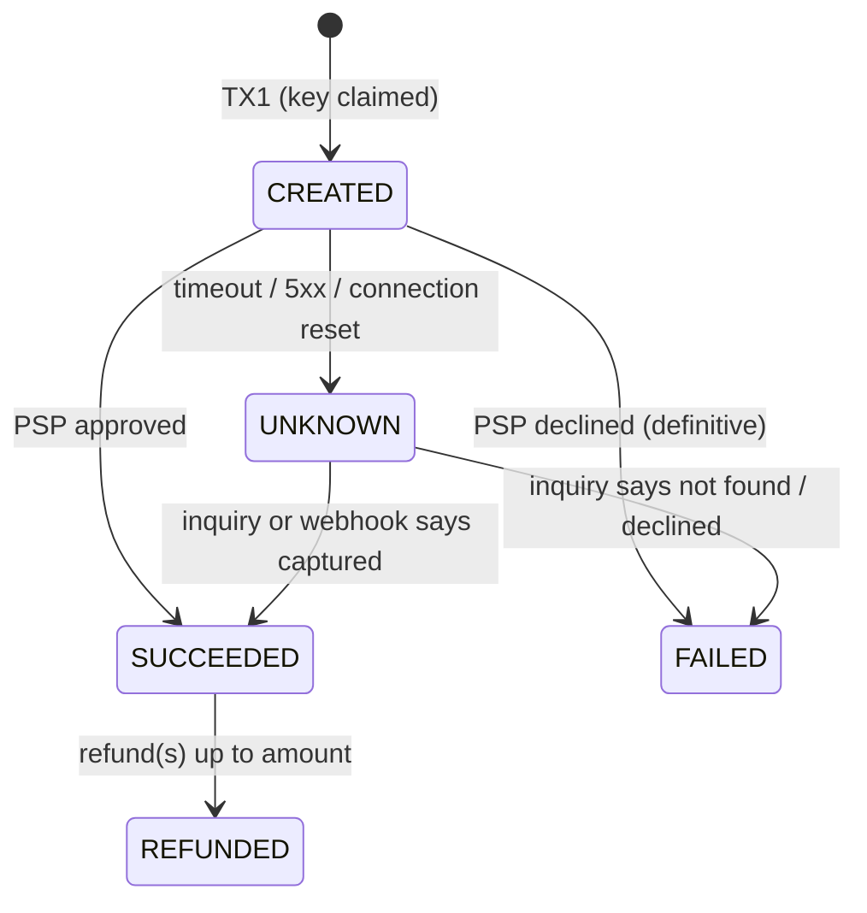
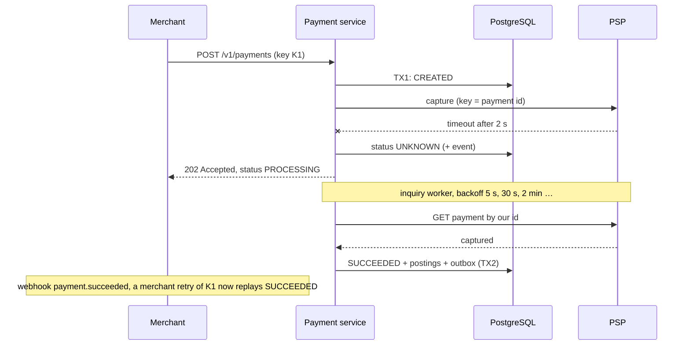

## في دقيقة واحدة

الدقائق 24–45 من جولة خدمة الدفع. تعمقان: **(1) آثار "مرة واحدة بالضبط"** (حجز مفتاح عدم التكرار، وصندوق الصادر، والمستهلكون عديمو الأثر عند التكرار) و**(2) نتائج مزوّد الدفع غير المعروفة** (انتهاء المهلة، وحالة `UNKNOWN`، والاستعلام، والمطابقة). ثم جدول أنماط الإخفاق، وملاحظات الاتساق والأمان، ومؤشرات وأهداف مستوى الخدمة، والعرض من 60 ثانية. والقاعدة الكامنة وراء كل ذلك: *النتيجة التي لا تعرفها ليست إخفاقًا؛ بل حالة يجب أن تحسمها.*

## تشبيه

إن أرسلت شيكًا ولم تسمع شيئًا، فلا تكتب شيكًا ثانيًا. بل تسأل البنك ما إذا كان الأول قد صُرف. وانتهاء مهلة مزوّد الدفع مثله: اسأل، ولا تكرر بشكل أعمى.

## المخطط



## ابنِه خطوة بخطوة

### التعمق 1: آثار "مرة واحدة بالضبط" (نحو 7 دقائق)

ثلاث آليات، كل منها من [المسار 05](#/tracks/track-05/lessons/track-05-lesson-12):

1. **احجز مفتاح عدم التكرار بمفتاح أساسي.** ‏`INSERT … ON CONFLICT DO NOTHING` على `(merchant_id, idempotency_key)`. وينتظر التكرار المتزامن الإدراج المتعارض، ثم يرى الصف المؤكد ويعيد الاستجابة المخزنة. والمفتاح نفسه بجسم مختلف ← 422.
2. **صندوق الصادر المعاملاتي.** يُكتب صف حدث `PaymentSucceeded` في TX2 مع الحالة وقيود دفتر الأستاذ. وينشر مرحّل بـ `acks=all` ويعلّم الصف منشورًا فقط بعد الإقرار.
3. **مستهلكون عديمو الأثر عند التكرار.** تسجل التسوية `event_id` في جدول `processed_event` في المعاملة نفسها لأثرها الخاص، فلا يغيّر الحدث المعاد تسليمه شيئًا.

مخطط مختصر بـ Spring Boot 4 ‏(مقتطف من [كود المشروع الختامي 1](#/capstone/payment-service) المختبر):

```java
@Transactional
public StoredResponse create(String merchantId, String key, CreatePaymentRequest request) {
    String hash = Hashing.sha256Hex(request.canonical());
    int claimed = jdbc.sql("""
            INSERT INTO idempotency_key (merchant_id, idempotency_key, request_hash)
            VALUES (:m, :k, :h) ON CONFLICT (merchant_id, idempotency_key) DO NOTHING
            """).param("m", merchantId).param("k", key).param("h", hash).update();
    if (claimed == 0) {
        return replay(merchantId, key, hash);           // waits for a concurrent twin, then replays
    }
    // … insert payment, insert outbox row, store the response, all in this transaction
}
```

### التعمق 2: نتائج مزوّد الدفع غير المعروفة (نحو 6 دقائق)

مسار الإخفاق حين تنتهي مهلة مزوّد الدفع:



قواعد تذكرها:

- صنّف استجابات مزوّد الدفع: **حاسمة** (موافقة، أو رفض) مقابل **غير حاسمة** (انتهاء المهلة، أو 5xx، أو إعادة ضبط الاتصال). والحاسمة فقط تصبح حالات نهائية.
- احسم `UNKNOWN` بـ **الاستعلام** (البحث عن الحالة بمعرّفنا) أو webhook مزوّد الدفع، ولا تحسمه أبدًا بإرسال خصم جديد بمفتاح جديد.
- إعادة محاولة التحصيل آمنة فقط لأن مزوّد الدفع يرى مفتاح عدم التكرار نفسه (معرّف الدفعة).
- **المطابقة** في نهاية اليوم مقابل ملف تسوية مزوّد الدفع هي شبكة الأمان الأخيرة ([المشروع الختامي 4](#/capstone/settlement-reconciliation)).

المرونة حول استدعاء مزوّد الدفع (مشروحة في [المسار 06](#/tracks/track-06/lessons/track-06-lesson-05)): مهلة قراءة ثانيتين، وقاطع دائرة فيفشل الانقطاع سريعًا إلى `PROCESSING`، وحد للتزامن فلا تستهلك استدعاءات مزوّد الدفع البطيئة كل خيوط الطلبات. ولدى [المشروع الختامي 3](#/capstone/card-authorisation) نسخة مختبرة من هذا بالضبط.

### ‏E: التقييم: جدول أنماط الإخفاق (نحو 5 دقائق)

| الإخفاق | الاكتشاف | التخفيف | نطاق الضرر |
|---|---|---|---|
| يعيد التاجر المحاولة بعد انتهاء المهلة | عداد الإعادات (مقياس) | يعيد مفتاح عدم التكرار الاستجابة المخزنة | لا شيء |
| طلبان متطابقان في اللحظة نفسها | انتظارات قيد التفرد | يسلسلهما المفتاح الأساسي؛ دفعة واحدة | لا شيء |
| انتهاء مهلة مزوّد الدفع | معدل الاستجابات غير الحاسمة، وعمر `UNKNOWN` | ‏`UNKNOWN` + استعلام + webhook؛ ولا إعادة خصم بمفتاح جديد أبدًا | نتيجة متأخرة لتلك الدفعات |
| انقطاع مزوّد الدفع | يُفتح قاطع الدائرة؛ تنبيه معدل الأخطاء | الفشل السريع إلى `PROCESSING`؛ وطابور الاستعلامات؛ وصفحة الحالة | كل الدفعات الجديدة متأخرة، ولا شيء مكرر |
| تعطل بين نجاح مزوّد الدفع وTX2 | صفوف `CREATED` أقدم من N دقيقة | تشغّل مهمة التعافي الاستعلام، ثم TX2 | نتيجة متأخرة |
| ‏Kafka غير متاح | عمر صندوق الصادر (أقدم صف غير منشور) | يعيد المرحّل المحاولة؛ وما زالت الدفعات مقبولة | تأخر لاحق فقط |
| تسليم حدث مكرر | تعارضات `processed_event` | مستهلكون عديمو الأثر عند التكرار | لا شيء |
| تبديل الخادم الأساسي لقاعدة البيانات | فحوص الصحة، وارتفاع الأخطاء | تبديل مُدار؛ ويعيد العملاء المحاولة بالمفتاح نفسه | ثوانٍ إلى دقائق من 5xx |
| عدم تطابق دفتر الأستاذ/مزوّد الدفع | كسر في المطابقة | سير عمل الاستثناءات، وقيود تصحيحية | دفعات منفردة |

### ملاحظات الاتساق والأمان

- **متسق بقوة:** حالة الدفعة، وحجوزات عدم التكرار، وقيود دفتر الأستاذ (معاملة PostgreSQL واحدة). **متسق في النهاية:** الإشعارات، والتحليلات، ولوحات التجار (عبر Kafka).
- **الأمان:** هوية التاجر من بيانات اعتماد عميل OAuth2، لا من الجسم أبدًا؛ وكل قراءة محصورة في نطاق التاجر (BOLA)؛ ورموز وسائل الدفع فقط، لا أرقام PAN أبدًا (نطاق PCI DSS)؛ ورسائل webhook موقعة بـ HMAC؛ والمدخلات متحقق منها عند الحافة؛ ولا تفاصيل داخلية في استجابات المشكلات.

### مؤشرات وأهداف مستوى الخدمة (أهداف توضيحية: اتفق عليها مع الأعمال)

| المؤشر (SLI) | الهدف (SLO) |
|---|---|
| إتاحة واجهة الإنشاء (غير 5xx) | ‏99.95% على 30 يومًا |
| زمن استجابة الإنشاء باستثناء وقت مزوّد الدفع | p99 < 500 مللي ثانية |
| الوقت حتى الحالة النهائية (SUCCEEDED/FAILED) | ‏99% خلال دقيقة؛ و100% خلال 24 ساعة |
| الخصومات المكررة (من المطابقة) | 0 |
| عمر صندوق الصادر (أقدم حدث غير منشور) | < 60 ثانية في 99.9% من الدقائق |

### ‏D: التسليم: العرض من 60 ثانية

"ينشئ التجار الدفعات مع Idempotency-Key، يُحجز بمفتاح أساسي فتنهار إعادات المحاولة المتزامنة إلى دفعة واحدة. أسجل النية أولًا، وأستدعي مزوّد الدفع خارج أي معاملة باستخدام معرّف دفعتنا كمفتاح عدم التكرار الخاص به، وأسجل النتيجة، وقيود دفتر الأستاذ، وحدث صندوق الصادر في معاملة واحدة. وتذهب حالات انتهاء المهلة إلى حالة UNKNOWN، تُحسم بالاستعلام أو webhook ولا تُحسم أبدًا بإعادة الخصم. وتصل الأحداث إلى التسوية مرة واحدة على الأقل ويزيل المستهلكون التكرار. وتثبت المطابقة مع ملف تسوية مزوّد الدفع عدم وجود تكرارات. وعند نحو 1,200 دفعة في الثانية في الذروة، يكفي خادم PostgreSQL أساسي مقسّم. وبعد ذلك سأضيف التوجيه بين مزوّدي دفع متعددين وأوزّع حسب التاجر عند نمو 10 أضعاف."

## ما الذي يسوء

**الخطأ: معاملة انتهاء المهلة كإخفاق.** تعلّم الخدمة الدفعة `FAILED`، فيعيد التاجر المحاولة بمفتاح **جديد**، وكان مزوّد الدفع قد حصّل المحاولة الأولى فعلًا: خصم مزدوج.

**الإصلاح:** تذهب حالات انتهاء المهلة إلى `UNKNOWN`؛ وتعيد الواجهة `202`/`PROCESSING`؛ ويحسم عامل الاستعلام الحالة؛ وتعيد محاولة التاجر بالمفتاح *نفسه* النتيجة النهائية.

**الاختبار:** بديل لمزوّد الدفع يحصّل المال ثم يؤخر استجابته إلى ما بعد المهلة (يُظهر `FakeFraudServer` في المشروع الختامي 3 تقنية البديل؛ ويُظهر `brokerDownKeepsEventsInTheOutboxUntilItRecovers` في المشروع الختامي 1 شكل اختبار الإخفاق ثم التعافي). وتحقق من تحصيل واحد وحالة نهائية SUCCEEDED.

## المقايضات: متى لا تستخدم هذه الآليات

- **معاملات EOS في Kafka بدل صندوق الصادر:** لا تغطي إلا Kafka-إلى-Kafka؛ وتغيير حالتنا في PostgreSQL، فلا تحل هذه المشكلة.
- **‏2PC/XA مع الوسيط:** غير متاح عادة لمزوّد الدفع وبطيء وهش جدًا لمسار الواجهة.
- **‏CDC ‏(Debezium) بدل مرحّل الاستطلاع:** أفضل عند الحجم العالي؛ وبنية تحتية أكثر للتشغيل.

## أسئلة وأجوبة المقابلة (أسئلة المتابعة)

**إحماء: "ماذا يحدث إن أعاد التاجر المحاولة بالمفتاح نفسه بينما الطلب الأول ما زال يعمل؟"**
- *الإجابة النموذجية:* ينتظر الإدراج الثاني المفتاح غير المؤكد للأول؛ ثم إما يعيد الاستجابة المخزنة أو، إن كان الأول ما زال في استدعاء مزوّد الدفع (المفتاح محجوز في TX1)، يعيد 409 "قيد المعالجة".
- *الإجابة الخاطئة الشائعة:* "نتحقق أولًا مما إذا كان المفتاح موجودًا."
- *لماذا تفشل:* الفحص ثم الإدراج فيه سباق؛ وقيد التفرد وحده يحكم.

**قياسي: "مزوّد الدفع متعطل لمدة 20 دقيقة. ماذا يرى التجار؟"**
- *الإجابة النموذجية:* يُفتح القاطع، وتعيد الدفعات الجديدة 202/PROCESSING بسرعة، وتوضع الاستعلامات في طابور، وتصل النتائج عبر webhook حين يتعافى مزوّد الدفع. ويبلغ التنبيه وصفحة الحالة التجار. ولا تكرارات.
- *الإجابة الخاطئة الشائعة:* "أخطاء 500 حتى يعود."
- *لماذا تفشل:* سيعيد التجار المحاولة بمفاتيح جديدة وستحصل على تكرارات حين يتعافى مزوّد الدفع.

**قياسي: "لماذا لا تنشر في Kafka مباشرة بعد التأكيد؟"**
- *الإجابة النموذجية:* تعطل بين التأكيد والنشر يضيّع الحدث (مشكلة الكتابة المزدوجة). ويجعل صندوق الصادر الحدث جزءًا من التأكيد.
- *الإجابة الخاطئة الشائعة:* "‏Kafka موثوق."
- *لماذا تفشل:* الفجوة في معالجك *أنت*، لا في Kafka.

**قياسي: "كيف تعرف أنه لا توجد خصومات مكررة؟"**
- *الإجابة النموذجية:* بالبناء (المفاتيح، والقيود، واستدعاءات مزوّد الدفع عديمة الأثر عند التكرار)، وبالإثبات: مطابقة يومية مقابل تقرير تسوية مزوّد الدفع، مع التنبيه على أي كسر.
- *الإجابة الخاطئة الشائعة:* "اختباراتنا تغطيها."
- *لماذا تفشل:* لا تستطيع الاختبارات تغطية مجهولات الإنتاج؛ والمطابقة هي الفحص المستقل.

**عميق: "وسّع هذا 10 أضعاف."**
- *الإجابة النموذجية:* نحو 12,000 دفعة/ثانية في الذروة. وزّع حسب معرّف التاجر (كل دفعات التاجر ومفاتيحه على جزء واحد، فيبقى فحص عدم التكرار محليًا)، وانقل المرحّل إلى CDC، وأضف نسخ قراءة أو نموذج قراءة CQRS لقراءات الحالة، وأبقِ المطابقة لكل جزء.
- *الإجابة الخاطئة الشائعة:* "أضف خوادم تطبيقات أكثر."
- *لماذا تفشل:* مسار الكتابة في قاعدة البيانات هو عنق الزجاجة، لا الطبقة عديمة الحالة.

**عميق: "يصل استرداد ورد مبلغ (chargeback) للدفعة نفسها في الوقت نفسه."**
- *الإجابة النموذجية:* كلاهما تغيير حالة محمي بـ `@Version`/If-Match وفحص في قاعدة البيانات بأن المسترد + المردود ≤ المحصّل؛ ويعيد الخاسر المحاولة مقابل حالة حديثة ([المشروع الختامي 3](#/capstone/card-authorisation)).
- *الإجابة الخاطئة الشائعة:* "هذا لا يمكن أن يحدث."
- *لماذا تفشل:* يحدث، وإعادة أموال زائدة خسارة مباشرة.

**عميق: "ماذا تخزن لعدم التكرار، ولكم من الوقت؟"**
- *الإجابة النموذجية:* المفتاح، وبصمة الطلب، وحالة الاستجابة وجسمها، والطوابع الزمنية. واحتفظ بها لنافذة إعادة المحاولة التي تعد بها (وثّقها، مثلًا 24 ساعة)، ثم احذفها على دفعات. والدفعات نفسها تُحفظ وفق قواعد الاحتفاظ.
- *الإجابة الخاطئة الشائعة:* "إلى الأبد، للأمان."
- *لماذا تفشل:* نمو غير محدود ولا عقد موثق للعملاء.

## أخطاء شائعة

- استدعاء مزوّد الدفع داخل معاملة قاعدة بيانات.
- تعليم حالات انتهاء المهلة كإخفاقات.
- ادعاءات "التسليم مرة واحدة بالضبط" دون الأثر الجانبي عديم الأثر عند التكرار.
- لا مطابقة في التصميم.
- نسيان التفويض لكل تاجر عند القراءة (BOLA).

## قلها في 30 ثانية

"التعمق الأول: مفتاح عدم التكرار محجوز بمفتاح أساسي، وصندوق الصادر في المعاملة نفسها، ومستهلكون عديمو الأثر عند التكرار. والتعمق الثاني: تصبح حالات انتهاء مهلة مزوّد الدفع UNKNOWN، تُحسم بالاستعلام أو webhook بالمفتاح نفسه، ولا تُحسم أبدًا بإعادة الخصم. ثم جدول الإخفاقات، وأهداف مستوى الخدمة بما فيها صفر خصومات مكررة، والمطابقة كإثبات."

## الخلاصة

- غير المعروف حالة، لا إخفاق.
- *آثار* "مرة واحدة بالضبط" = مفاتيح + قيود + صندوق صادر + مستهلكون عديمو الأثر عند التكرار.
- تتضمن أهداف مستوى الخدمة الصحة (صفر تكرارات)، المثبتة بالمطابقة.

## انظر أيضًا

- [الجزء 1: من المتطلبات إلى الواجهة](#/tracks/track-14/lessons/track-14-lesson-02)
- [المسار 05: صندوق الصادر المعاملاتي](#/tracks/track-05/lessons/track-05-lesson-13)
- [المسار 05: السيناريو G: تسليم Kafka المكرر](#/tracks/track-05/lessons/track-05-lesson-08)
- [المشروع الختامي 1](#/capstone/payment-service)

<!-- KNOWLEDGE-CHECK
[
  {
    "id": "kc-1403-01",
    "question": "ينتهي وقت استدعاء مزوّد الدفع. ماذا يجب أن تفعل الخدمة؟",
    "options": [
      "تعلّم الدفعة FAILED ليتمكن التاجر من إعادة المحاولة",
      "تعلّمها UNKNOWN، وتجيب 202 PROCESSING، وتترك عامل استعلام يسأل المزوّد عن النتيجة الحقيقية بالمرجع نفسه",
      "تعيد المحاولة فورًا بمفتاح عدم تكرار جديد",
      "تتراجع عن دفتر الأستاذ وترسل استردادًا"
    ],
    "correct": 1,
    "explanation": "انتهاء المهلة يعني أن النتيجة غير معروفة، لا فاشلة. وتعليمها FAILED يدعو إلى إعادة محاولة قد تخصم مرتين. ويحسمها عامل الاستعلام، والمطابقة هي شبكة الأمان الأخيرة."
  },
  {
    "id": "kc-1403-02",
    "question": "يعيد التاجر المحاولة بالمفتاح نفسه بينما الطلب الأول ما زال داخل استدعاء المزوّد. ماذا يحدث؟",
    "options": [
      "تُنشأ دفعة ثانية",
      "ينتظر الخادم إلى الأبد",
      "المفتاح مُطالب به بالفعل في TX1، فيجيب الخادم 409 \"قيد التنفيذ\" (أو يعيد الاستجابة المخزنة بعد انتهاء الأول)",
      "يكتب الطلب الثاني فوق الأول"
    ],
    "correct": 2,
    "explanation": "المطالبة بالإدراج أولًا تعني أن الطلب الثاني يجد المفتاح. فإن كان الأول ما زال يعمل يحصل على 409؛ وبعد اكتمال الأول، تُعاد الاستجابة المخزنة."
  },
  {
    "id": "kc-1403-03",
    "question": "لماذا لا ننشر حدث الدفعة إلى Kafka مباشرة بعد تأكيد قاعدة البيانات؟",
    "options": [
      "التعطل بين التأكيد والنشر يُضيع الحدث؛ وصندوق الصادر يكتبه في المعاملة نفسها ومرحّل ينشره مرة واحدة على الأقل",
      "لا يستطيع Kafka قبول أحداث من خدمات Java",
      "سيكون أسرع من اللازم للمستهلكين",
      "يتطلب Kafka معاملة XA مع PostgreSQL"
    ],
    "correct": 0,
    "explanation": "هذه مشكلة الكتابة المزدوجة. وصندوق الصادر المعاملاتي يجعل الحدث جزءًا من التأكيد؛ ويزيل المستهلكون التكرار حسب معرّف الحدث لأن المرحّل مرة واحدة على الأقل."
  },
  {
    "id": "kc-1403-04",
    "question": "كيف تعرف أنه لا توجد خصومات مكررة في الإنتاج؟",
    "options": [
      "لأن الكود فيه إعادات محاولة",
      "لأن Kafka مرة واحدة بالضبط",
      "بفحص السجلات يدويًا كل أسبوع",
      "قيود التفرد تمنعها، والمطابقة اليومية مع تقرير تسوية المزوّد تثبت ذلك، مع تنبيه على أي كسر"
    ],
    "correct": 3,
    "explanation": "المنع (المفاتيح والقيود) والإثبات (المطابقة) منفصلان. فالمطابقة تقارن سجلين مستقلين وتُظهر أي فرق."
  }
]
-->

<!-- PRACTICAL-CHALLENGE
{
  "id": "pc-1403",
  "title": "خدمة الدفع: التعمقات والإخفاقات",
  "description": "ابنِ واختبر التعمقين من هذا الدرس في خدمة Spring Boot صغيرة (أو وسّع المشروع الختامي 1).",
  "tasks": [
    {
      "id": "pc-1403-01",
      "description": "نفّذ عدم التكرار بالإدراج أولًا: طالِب بالمفتاح تحت قيد تفرد، وخزّن الاستجابة، وأعدها عند إعادة المحاولة، وارفض المفتاح نفسه بجسم مختلف. وأثبت ذلك باختبار يطلق 20 طلبًا متزامنًا بمفتاح واحد ويتحقق من دفعة واحدة بالضبط."
    },
    {
      "id": "pc-1403-02",
      "description": "أضف حالة UNKNOWN: بديل مزوّد تنتهي مهلته يترك الدفعة UNKNOWN وتعيد الواجهة 202؛ ومهمة استعلام تحسمها إلى CAPTURED أو FAILED بسؤال البديل. واختبر النتيجتين."
    },
    {
      "id": "pc-1403-03",
      "description": "اكتب جدول أنماط الإخفاق (خمسة صفوف على الأقل: انتهاء مهلة المزوّد، وتعطل المزوّد، وتبديل قاعدة البيانات، وتعطل Kafka، والحدث المكرر) وثلاثة أهداف لمستوى الخدمة مع كيفية قياس كل منها."
    }
  ]
}
-->
