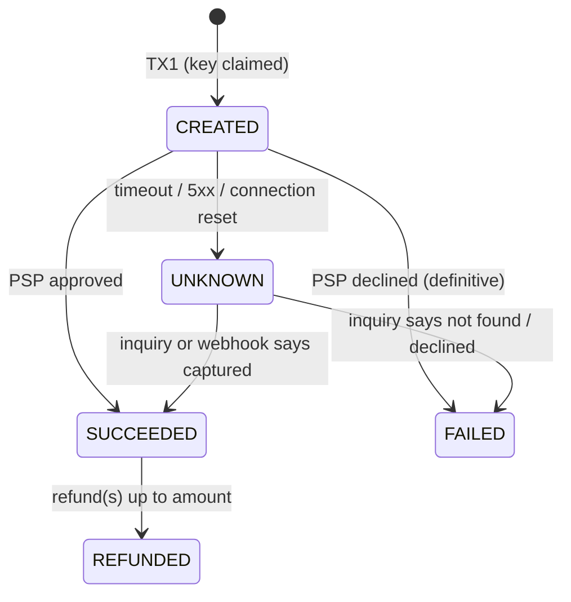
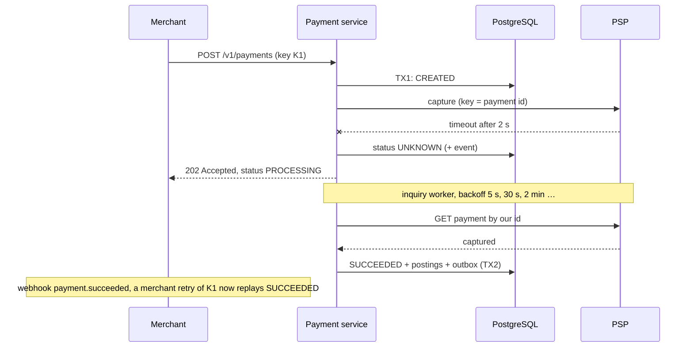

## In one minute

Minutes 24–45 of the payment-service round. Two deep dives: **(1) exactly-once effects**
(idempotency key claim, outbox, idempotent consumers) and **(2) unknown PSP outcomes** (timeouts,
the `UNKNOWN` state, inquiry, reconciliation). Then a failure-mode table, consistency and security
notes, SLIs/SLOs and the 60-second pitch. The rule underneath it all: *an outcome you don't know is
not a failure; it is a state you must resolve.*

## Analogy

If you post a cheque and hear nothing, you don't write a second cheque. You ask the bank whether the
first one cleared. A PSP timeout is the same: ask, don't repeat blindly.

## Diagram



## Build it step by step

### Deep dive 1: exactly-once effects (about 7 minutes)

Three mechanisms, each from [Track 05](#/tracks/track-05/lessons/track-05-lesson-12):

1. **Claim the idempotency key with a primary key.** `INSERT … ON CONFLICT DO NOTHING` on
   `(merchant_id, idempotency_key)`. A concurrent duplicate waits on the conflicting insert, then sees
   the committed row and replays the stored response. Same key with a different body → 422.
2. **Transactional outbox.** The `PaymentSucceeded` event row is written in TX2 with the status and the
   ledger postings. A relay publishes with `acks=all` and marks the row published only after the ack.
3. **Idempotent consumers.** Settlement records `event_id` in a `processed_event` table in the same
   transaction as its own effect, so a redelivered event changes nothing.

Compact Spring Boot 4 sketch (excerpt from the tested [capstone 1 code](#/capstone/payment-service)):

```java
@Transactional
public StoredResponse create(String merchantId, String key, CreatePaymentRequest request) {
    String hash = Hashing.sha256Hex(request.canonical());
    int claimed = jdbc.sql("""
            INSERT INTO idempotency_key (merchant_id, idempotency_key, request_hash)
            VALUES (:m, :k, :h) ON CONFLICT (merchant_id, idempotency_key) DO NOTHING
            """).param("m", merchantId).param("k", key).param("h", hash).update();
    if (claimed == 0) {
        return replay(merchantId, key, hash);           // waits for a concurrent twin, then replays
    }
    // … insert payment, insert outbox row, store the response, all in this transaction
}
```

### Deep dive 2: unknown PSP outcomes (about 6 minutes)

Failure path when the PSP times out:



Rules to state:

- Classify PSP responses: **definitive** (approved, declined) vs **indeterminate** (timeout, 5xx,
  connection reset). Only definitive ones become final states.
- Resolve `UNKNOWN` by **inquiry** (status lookup by our id) or the PSP's webhook, and never by
  sending a new charge with a new key.
- Retrying the capture is safe only because the PSP sees the same idempotency key (the payment id).
- End-of-day **reconciliation** against the PSP settlement file is the final safety net
  ([capstone 4](#/capstone/settlement-reconciliation)).

Resilience around the PSP call (taught in [Track 06](#/tracks/track-06/lessons/track-06-lesson-05)):
a 2-second read timeout, a circuit breaker so an outage fails fast into `PROCESSING`, and a concurrency
limit so slow PSP calls cannot consume every request thread. [Capstone 3](#/capstone/card-authorisation)
has a tested version of exactly this.

### E: Evaluate: failure-mode table (about 5 minutes)

| Failure | Detection | Mitigation | Blast radius |
|---|---|---|---|
| Merchant retries after a timeout | Replay counter (metric) | Idempotency key replays the stored response | None |
| Two identical requests at the same instant | Unique-constraint waits | Primary key serialises them; one payment | None |
| PSP timeout | Indeterminate-response rate, `UNKNOWN` age | `UNKNOWN` + inquiry + webhook; never re-charge with a new key | Delayed result for those payments |
| PSP outage | Circuit breaker opens; error-rate alert | Fail fast to `PROCESSING`; queue inquiries; status page | All new payments delayed, none duplicated |
| Crash between PSP success and TX2 | `CREATED` rows older than N min | Recovery job runs inquiry, then TX2 | Delayed result |
| Kafka unavailable | Outbox age (oldest unpublished row) | Relay retries; payments still accepted | Downstream delay only |
| Duplicate event delivery | `processed_event` conflicts | Idempotent consumers | None |
| Database primary failover | Health checks, error spike | Managed failover; clients retry with the same key | Seconds to minutes of 5xx |
| Ledger/PSP mismatch | Reconciliation break | Exception workflow, correcting entries | Individual payments |

### Consistency and security notes

- **Strongly consistent:** payment status, idempotency claims and ledger postings (one PostgreSQL
  transaction). **Eventually consistent:** notifications, analytics and merchant dashboards (via Kafka).
- **Security:** merchant identity from OAuth2 client credentials, never from the body; every read
  scoped by merchant (BOLA); payment-method tokens only, never PANs (PCI DSS scope); webhooks signed with
  HMAC; inputs validated at the edge; no internal details in problem responses.

### SLIs and SLOs (illustrative targets: agree them with the business)

| SLI | SLO |
|---|---|
| Create API availability (non-5xx) | 99.95% over 30 days |
| Create latency excluding PSP time | p99 < 500 ms |
| Time to final state (SUCCEEDED/FAILED) | 99% within 1 minute; 100% within 24 h |
| Duplicate charges (from reconciliation) | 0 |
| Outbox age (oldest unpublished event) | < 60 s for 99.9% of minutes |

### D: Deliver: the 60-second pitch

"Merchants create payments with an Idempotency-Key, claimed by a primary key so concurrent retries
collapse to one payment. I record the intent first, call the PSP outside any transaction using our
payment id as its idempotency key, and record the outcome, ledger postings and an outbox event in one
transaction. Timeouts go to an UNKNOWN state, resolved by inquiry or webhook and never by re-charging.
Events reach settlement at least once and consumers de-duplicate. Reconciliation with the PSP's
settlement file proves no duplicates. At about 1,200 payments per second at peak, a partitioned
PostgreSQL primary is enough. Next I'd add multi-PSP routing and shard by merchant at 10× growth."

## What goes wrong

**Bug: treating a timeout as a failure.** The service marks the payment `FAILED`, the merchant retries
with a **new** key, and the PSP had in fact captured the first attempt: double charge.

**Fix:** timeouts go to `UNKNOWN`; the API returns `202`/`PROCESSING`; the inquiry worker resolves the
state; the merchant's retry with the *same* key replays the eventual result.

**Test:** a PSP stub that captures the money and then delays its response past the timeout (capstone 3's
`FakeFraudServer` shows the stub technique; capstone 1's `brokerDownKeepsEventsInTheOutboxUntilItRecovers`
shows the failure-then-recovery test shape). Assert one capture and a final state of SUCCEEDED.

## Trade-offs: when NOT to use these mechanisms

- **Kafka EOS transactions instead of the outbox:** they only cover Kafka-to-Kafka; our state change is in
  PostgreSQL, so they don't solve this problem.
- **2PC/XA with the broker:** usually unavailable for the PSP and too slow and fragile for the API path.
- **CDC (Debezium) instead of a polling relay:** better at high volume; more infrastructure to run.

## Interview Q&A (follow-up questions)

**Warm-up: "What happens if the merchant retries with the same key while the first request is still running?"**
- *Model answer:* the second insert waits on the first's uncommitted key; then it either replays the
  stored response or, if the first is still in the PSP call (key claimed in TX1), returns 409 "in progress".
- *Common wrong answer:* "We check if the key exists first."
- *Why it fails:* check-then-insert races; only the unique constraint arbitrates.

**Standard: "The PSP is down for 20 minutes. What do merchants see?"**
- *Model answer:* the breaker opens, new payments return 202/PROCESSING quickly, inquiries are queued,
  and results arrive by webhook when the PSP recovers. Alerting and a status page tell merchants. No duplicates.
- *Common wrong answer:* "500 errors until it's back."
- *Why it fails:* merchants will retry with new keys and you'll get duplicates when the PSP recovers.

**Standard: "Why not publish to Kafka directly after commit?"**
- *Model answer:* a crash between commit and publish loses the event (the dual-write problem). The
  outbox makes the event part of the commit.
- *Common wrong answer:* "Kafka is reliable."
- *Why it fails:* the gap is in *your* process, not in Kafka.

**Standard: "How do you know there are no duplicate charges?"**
- *Model answer:* by construction (keys, constraints, idempotent PSP calls), and by proof:
  daily reconciliation against the PSP settlement report, alerting on any break.
- *Common wrong answer:* "Our tests cover it."
- *Why it fails:* tests can't cover production's unknowns; reconciliation is the independent check.

**Deep: "Scale this 10×."**
- *Model answer:* about 12,000 payments/s at peak. Shard by merchant id (all of a merchant's payments
  and keys on one shard, so the idempotency check stays local), move the relay to CDC, add read replicas
  or a CQRS read model for status reads, and keep per-shard reconciliation.
- *Common wrong answer:* "Add more application servers."
- *Why it fails:* the database write path is the bottleneck, not the stateless tier.

**Deep: "A refund and a chargeback arrive for the same payment at the same time."**
- *Model answer:* both are state changes guarded by `@Version`/If-Match and a DB check that refunded +
  charged-back ≤ captured; the loser retries against fresh state ([capstone 3](#/capstone/card-authorisation)).
- *Common wrong answer:* "That can't happen."
- *Why it fails:* it does, and over-returning money is a direct loss.

**Deep: "What do you store for idempotency, and for how long?"**
- *Model answer:* key, request hash, response status and body, timestamps. Keep it for the retry window you
  promise (document it, e.g. 24 h), then purge in batches. Payments themselves are kept per retention rules.
- *Common wrong answer:* "Forever, to be safe."
- *Why it fails:* unbounded growth and no documented contract for clients.

## Common mistakes

- Calling the PSP inside a DB transaction.
- Marking timeouts as failures.
- "Exactly-once delivery" claims without the idempotent side effect.
- No reconciliation in the design.
- Forgetting authorisation per merchant on reads (BOLA).

## Say it in 30 seconds

"Deep dive one: idempotency key claimed by a primary key, outbox in the same transaction, idempotent
consumers. Deep dive two: PSP timeouts become UNKNOWN, resolved by inquiry or webhook with the same
key, never by re-charging. Then a failure table, SLOs including zero duplicate charges, and
reconciliation as the proof."

## Recap

- Unknown is a state, not a failure.
- Exactly-once *effects* = keys + constraints + outbox + idempotent consumers.
- SLOs include correctness (zero duplicates), proven by reconciliation.

## See also

- [Part 1: requirements to API](#/tracks/track-14/lessons/track-14-lesson-02)
- [Track 05: Transactional outbox](#/tracks/track-05/lessons/track-05-lesson-13)
- [Track 05: Scenario G: duplicate Kafka delivery](#/tracks/track-05/lessons/track-05-lesson-08)
- [Capstone 1](#/capstone/payment-service)
