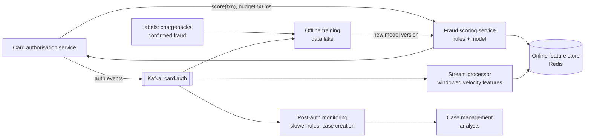
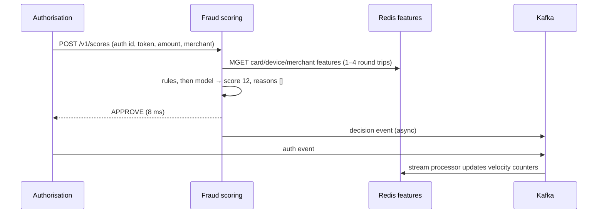

## في دقيقة واحدة

"صمّم نظامًا يقيّم كل دفعة بطاقة للاحتيال قبل الموافقة عليها." مساران: **مسار تقييم متزامن** داخل ميزانية زمن التفويض (قواعد + نموذج على خصائص محسوبة مسبقًا، عشرات المللي ثانية)، و**مسار غير متزامن** يحسب الخصائص من تيار الأحداث، ويراقب بعد الحدث، ويغذي التسميات (ردود المبالغ، والاحتيال المؤكد) عائدًا إلى التدريب. وتُكسب المقابلة بثلاثة أشياء: ميزانية زمن الاستجابة، وما يحدث حين يكون التقييم بطيئًا أو متعطلًا، وكيف تبقى الخصائص حديثة ومتسقة بين التدريب والخدمة.

## تشبيه

للمطار فحص سريع عند البوابة (مسح بطاقة الصعود، ثانية أو ثانيتان) وتحقيقات أبطأ خلف الكواليس (قوائم المراقبة، والأنماط). والبوابة لا تنتظر التحقيق أبدًا؛ بل تستخدم ما يعرفه التحقيق بالفعل.

## المخطط



## ابنِه خطوة بخطوة

### خطة الوقت

‏0–5 المتطلبات · 5–9 التقديرات · 9–13 المخطط · 13–20 الرسم · 20–24 الواجهة · 24–37 تعمقان · 37–42 الإخفاقات وأهداف مستوى الخدمة · 42–45 العرض.

### ‏R: المتطلبات

- **الوظيفية:** تقييم كل تفويض (موافقة / رفض / تحقق إضافي مثل 3-D Secure)؛ وشرح القرار (رموز الأسباب)؛ وتمكين المحللين من مراجعة الحالات؛ والتعلم من الاحتيال المؤكد وردود المبالغ.
- **غير الوظيفية:** زمن التقييم p99 ضمن الميزانية التي يعطيها مسار التفويض (افترض **50 مللي ثانية**)؛ ويجب ألا يعطّل التقييم التفويضات؛ وقواعد جديدة قابلة للنشر خلال دقائق دون إصدار كود؛ وكل قرار قابل للتدقيق (المدخلات، وإصدار النموذج، والمخرج).
- **خارج النطاق:** مراقبة معاملات مكافحة غسل الأموال وفحص العقوبات (لوائح وملف زمن استجابة مختلفان)، وبحث النماذج نفسه.

أسئلة توضيحية: ما ميزانية التفويض من طرف إلى طرف؟ ماذا يحدث اليوم حين يتعطل نظام الاحتيال (الفشل مفتوحًا أم مغلقًا)؟ أي الإشارات موجودة (الجهاز، وفئة التاجر، والجغرافيا)؟ ما سرعة وصول ردود المبالغ (أسابيع، فالتسميات متأخرة)؟ هل التحقق الإضافي متاح؟

### ‏E: التقدير (الافتراضات مذكورة)

```text
Card transactions: 30 M/day → 30,000,000 / 86,400 ≈ 350/s average; peak 5× ≈ 1,750/s
Features per score: ~20 key lookups (card, device, merchant, customer) → ≈ 35,000 feature reads/s at peak
  → batch them: one pipelined round trip or MGET per entity → ~4 round trips per score
Events stored for training: 30 M × 2 KB ≈ 60 GB/day ≈ 22 TB/year (columnar format compresses this a lot)
Stream state: velocity counters for, say, 50 M active cards × 3 windows × ~50 B ≈ 7.5 GB in Redis
Scoring nodes: if one node scores ~500/s within budget (measure!), peak needs 4 + headroom → 6–8 nodes
```

### ‏S: المخطط

```sql
-- Decision log: append-only, one row per scored authorisation (audit and training)
CREATE TABLE fraud_decision (
    auth_id        UUID         PRIMARY KEY,
    card_token     VARCHAR(64)  NOT NULL,           -- never the PAN
    amount_minor   BIGINT       NOT NULL,
    currency       CHAR(3)      NOT NULL,
    score          SMALLINT,                        -- NULL when scoring was unavailable
    decision       VARCHAR(16)  NOT NULL,           -- APPROVE, DECLINE, STEP_UP, STAND_IN
    reason_codes   TEXT[]       NOT NULL,
    model_version  VARCHAR(32),
    rules_version  VARCHAR(32)  NOT NULL,
    features       JSONB        NOT NULL,           -- exactly what the model saw (training-serving parity)
    decided_at     TIMESTAMPTZ  NOT NULL
) PARTITION BY RANGE (decided_at);

CREATE TABLE fraud_label (                          -- arrives days or weeks later
    auth_id    UUID        PRIMARY KEY REFERENCES fraud_decision (auth_id),
    label      VARCHAR(16) NOT NULL,                -- FRAUD, GENUINE
    source     VARCHAR(16) NOT NULL,                -- CHARGEBACK, ANALYST, CUSTOMER
    labelled_at TIMESTAMPTZ NOT NULL
);
```

تعيش الخصائص الحية في مفاتيح Redis مثل `vel:card:{token}:1h` ‏(عدد) مع مدة صلاحية.

### ‏H: المسار السعيد



### ‏A: الواجهة

```http
POST /v1/scores                      (internal, mTLS between services)
Idempotency-Key: <authorisation id>  (the same auth must get the same decision on retry)
{"authId": "…", "cardToken": "tok_…", "amount": "120.00", "currency": "GBP", "merchantId": "m_1", "mcc": "5411"}

200 {"decision": "STEP_UP", "score": 71, "reasons": ["NEW_DEVICE", "VELOCITY_1H"], "modelVersion": "2026-11-01"}
```

إدارة القواعد: `PUT /v1/rules/{id}` مع `If-Match` ‏(يجب ألا يكتب محللان يعدّلان القاعدة نفسها فوق بعضهما)، بإصدارات وتدقيق. والأخطاء كتفاصيل مشكلة وفق RFC 9457.

### ‏D: التعمق 1: ميزانية زمن الاستجابة والتدهور (نحو 7 دقائق)

| الخطوة | الميزانية (توضيحية) |
|---|---|
| الشبكة إلى خدمة التقييم والعودة | 5 مللي ثانية |
| جلب الخصائص (مجمّع في خط) | 10 مللي ثانية |
| القواعد | 5 مللي ثانية |
| استدلال النموذج (داخل العملية، مثل الأشجار المعززة بالتدرج) | 10 مللي ثانية |
| هامش لذيل p99 | 20 مللي ثانية |
| **الإجمالي** | **50 مللي ثانية** |

التدهور **قرار منتج تجعله صريحًا**: حين لا تتوفر الدرجة (انتهاء المهلة، أو قاطع مفتوح، أو حمل زائد)، طبّق سياسة بديلة، مثل الموافقة على المبالغ الصغيرة والرفض أو طلب التحقق الإضافي فوق حد. ويفرض المستدعي مهلة صارمة، وقاطع دائرة، وحد تزامن. وينفّذ [المشروع الختامي 3](#/capstone/card-authorisation) هذا بالضبط ويختبره. مقتطف مبسط (الكود المختبر يسجل كل حالة على حدة):

```java
@ConcurrencyLimit(limitString = "${cards.fraud.max-concurrent-calls}", policy = ConcurrencyLimit.ThrottlePolicy.REJECT)
public OptionalInt score(FraudClient.ScoreRequest request) {
    try {
        return OptionalInt.of(breaker.executeSupplier(() -> client.score(request)).score());
    } catch (CallNotPermittedException | RestClientException unavailable) {
        return OptionalInt.empty();   // the caller applies the written stand-in policy
    }
}
```

أظهر اختبار الحمل فيه أن الحاجز يوجّه نحو 8% من الاستدعاءات إلى السياسة البديلة عند 100 طلب متزامن. وهذا هو المقياس الذي يوضع على لوحة ويُنبّه عليه.

### ‏D: التعمق 2: خصائص حديثة ومتسقة (نحو 6 دقائق)

- **خصائص السرعة** (المعاملات لكل بطاقة في الساعة الأخيرة، والتجار المختلفون في 24 ساعة) تُحسب من تيار أحداث التفويض. والنسخة البسيطة: عدادات Redis لكل حاوية زمنية.

  ```text
  INCR  vel:card:tok_123:2026111309        # bucket = hour
  EXPIRE vel:card:tok_123:2026111309 7200  # keep 2 h
  # 1-hour sliding count ≈ current bucket + weighted previous bucket
  ```

  على نطاق واسع، يحسب معالج تيارات (تجميع بنوافذ في Kafka Streams، أو Flink) النوافذ ويكتبها في المخزن الحي؛ ويستطيع إعادة الحساب من السجل بعد خطأ.
- **الحداثة:** حدث *هذا* التفويض ليس في التيار بعد حين يُقيّم، فتضيف خدمة التقييم المعاملة الحالية إلى العدادات بنفسها.
- **التكافؤ بين التدريب والخدمة:** سجّل الخصائص التي رآها النموذج بالضبط (`features` بصيغة JSONB) ودرّب على تلك القيم المسجلة، لا على قيم معاد حسابها. وإلا تعلّم النموذج من بيانات لا يراها حيًا أبدًا.
- **تأخر التسميات:** تصل ردود المبالغ بعد أسابيع، فقيّم النماذج على بيانات ناضجة، واستخدم تسميات المحللين لتغذية راجعة أسرع.

### ‏E: جدول أنماط الإخفاق

| الإخفاق | الاكتشاف | التخفيف | نطاق الضرر |
|---|---|---|---|
| التقييم بطيء | زمن p99، ومعدل انتهاء المهلة | مهلة صارمة + سياسة بديلة | قرارات بالقواعد البديلة |
| التقييم متعطل | القاطع مفتوح، وتنبيه معدل البديل | السياسة البديلة؛ واستدعاء المناوب | مخاطر احتيال أعلى للمبالغ الصغيرة |
| ‏Redis متعطل / بطيء | أخطاء جلب الخصائص | التقييم بقيم افتراضية + القواعد فقط؛ ووسم ثقة منخفضة | انخفاض دقة النموذج |
| تأخر معالج التيارات | تأخر المستهلك، وعمر الخصائص | تنبيه؛ وتتقادم الخصائص؛ وتوسيع المستهلكين | تفوّت قواعد السرعة الاندفاعات |
| نشر نموذج سيئ | شذوذ في معدلي الرفض والموافقة | وضع الظل أولًا، ثم الكناري، والتراجع بنقرة واحدة إلى الإصدار السابق | عملاء مرفوضون خطأً |
| إعادات محاولة تفويض مكررة | مفتاح عدم التكرار نفسه | إعادة القرار المسجل | لا شيء |

### ملاحظات الاتساق والأمان

- يُتخذ القرار على خصائص **متسقة في النهاية** (عمرها بضع ثوانٍ)، وهذا مقبول. وسجل القرارات متسق بقوة وللإلحاق فقط.
- رموز البطاقات فقط؛ ولا أرقام PAN في الخصائص، أو السجلات، أو بحيرة البيانات (نطاق PCI DSS). ويرى المحللون بيانات مخفاة.
- تغييرات القواعد والنماذج مدققة (من، وماذا، ومتى)، مع مبدأ الصانع والمدقق للقواعد التي ترفض تلقائيًا.

### مؤشرات وأهداف مستوى الخدمة (توضيحية)

زمن التقييم p99 < ‏50 مللي ثانية؛ ومعدل السياسة البديلة < 0.5% من التفويضات لكل 5 دقائق؛ وعمر الخصائص p99 < ‏10 ثوانٍ؛ واكتمال سجل القرارات 100% ‏(يُطابق مع التفويضات يوميًا).

### التسليم: العرض من 60 ثانية

"يقع التقييم في مسار التفويض بميزانية 50 مللي ثانية: قراءات خصائص مجمّعة من Redis، ثم القواعد، ثم نموذج داخل العملية، مع تسجيل كل قرار وخصائصه الدقيقة. ويغلّفه المستدعي بمهلة، وقاطع، وحد تزامن، وتقرر سياسة بديلة صريحة حين لا نستطيع التقييم. وتأتي خصائص السرعة من تيار أحداث التفويض عبر معالج بنوافذ. ويستخدم التدريب الخصائص المسجلة إضافة إلى التسميات المتأخرة من ردود المبالغ والمحللين. وتمر النماذج الجديدة بوضع الظل والكناري. وعند نحو 1,750 تفويضًا في الثانية في الذروة، تغطي نحو 8 عقد تقييم وعنقود Redis واحد الحمل."

## ما الذي يسوء

**الخطأ: تبعية متزامنة على كل شيء.** تستدعي خدمة التقييم ثلاث خدمات داخلية حيًا للخصائص؛ فتصبح إحداها بطيئة، وتنتهي مهلة التقييم، ومع الفشل مغلقًا تُرفض كل دفعة بطاقة.

**الإصلاح:** احسب الخصائص مسبقًا في مخزن حي واحد؛ وحدّ الاستدعاء بمهلة وقاطع؛ وعرّف القواعد البديلة؛ وراقب معدل البديل.

**الاختبار:** يعيد `slowFraudEngineTimesOutAndFallsBackToStandInRules` و`circuitOpensAfterRepeatedFailures…` في المشروع الختامي 3 إنتاج الإخفاق والإصلاح مقابل خادم HTTP بطيء حقيقي.

## المقايضات: متى لا تقيّم بشكل متزامن

- يمكن تقييم التدفقات منخفضة المخاطر ومنخفضة القيمة (الشحنات الصغيرة) بشكل غير متزامن وعكسها عند الحاجة.
- قد تسمح التحويلات البنكية إلى مستفيدين جدد بتأخير ("قيد المراجعة") بدل قرار فوري.
- النماذج المعقدة جدًا (تحليل الرسوم البيانية) مكانها مسار المراقبة غير المتزامن.

## أسئلة وأجوبة المقابلة (أسئلة المتابعة)

**إحماء: "قواعد أم تعلم آلي؟"**
- *الإجابة النموذجية:* كلاهما: القواعد للأنماط المعروفة، والحظر التنظيمي، ورد الفعل الفوري على هجوم جديد؛ والنماذج للأنماط الدقيقة. والقواعد قابلة للنشر خلال دقائق.
- *الإجابة الخاطئة الشائعة:* "التعلم الآلي يحل محل القواعد."
- *لماذا تفشل:* لا تستطيع انتظار إعادة التدريب أثناء هجوم نشط.

**قياسي: "خدمة الاحتيال متعطلة. موافقة أم رفض؟"**
- *الإجابة النموذجية:* لا هذا ولا ذاك عالميًا: سياسة بديلة حسب المبلغ وشريحة المخاطر، مراقبة، مع مالك موثق (فريق المخاطر).
- *الإجابة الخاطئة الشائعة:* "ارفض كل شيء للأمان."
- *لماذا تفشل:* هذا انقطاع كامل للعملاء؛ وهو أيضًا قرار أعمال لا يجب أن يتخذه المهندسون وحدهم.

**قياسي: "كيف تبقي الخصائص حديثة؟"**
- *الإجابة النموذجية:* معالجة التيارات من أحداث التفويض إلى المخزن الحي، إضافة إلى إضافة المعاملة الحالية داخل الطلب؛ والتنبيه على عمر الخصائص.
- *الإجابة الخاطئة الشائعة:* "أعد حساب الخصائص من قاعدة البيانات مع كل طلب."
- *لماذا تفشل:* بطيء جدًا للميزانية، ويحمّل قاعدة البيانات الأساسية.

**قياسي: "كيف تنشر نموذجًا جديدًا بأمان؟"**
- *الإجابة النموذجية:* وضع الظل (يقيّم لكن لا يتصرف)، وقارن القرارات، ثم كناري لنسبة صغيرة، وراقب معدلي الموافقة والرفض، وأبقِ التراجع الفوري.
- *الإجابة الخاطئة الشائعة:* "انشر حين تكون الدقة دون اتصال أفضل."
- *لماذا تفشل:* المقاييس دون اتصال تفوّت انجراف البيانات الحية والانحراف بين التدريب والخدمة.

**عميق: "ما الانحراف بين التدريب والخدمة وكيف تتجنبه؟"**
- *الإجابة النموذجية:* خصائص تُحسب بشكل مختلف في التدريب والتشغيل الحي. سجّل الخصائص كما قُدمت ودرّب عليها؛ وشارك تعريفات الخصائص بين المعالجة الدفعية والتيارات.
- *الإجابة الخاطئة الشائعة:* "استخدم ملف النموذج نفسه."
- *لماذا تفشل:* النموذج نفسه؛ والمدخلات مختلفة.

**عميق: "كيف تشرح رفضًا لعميل أو منظم؟"**
- *الإجابة النموذجية:* رموز أسباب من القواعد وتفسيرات النموذج مخزنة مع القرار، وإصدارات النموذج والقواعد مسجلة، وأداة إعادة تقيّم بالخصائص المسجلة.
- *الإجابة الخاطئة الشائعة:* "النموذج قرر."
- *لماذا تفشل:* غير قابل للتدقيق؛ ويحتاج المنظمون ودعم العملاء أسبابًا.

## أخطاء شائعة

- لا ميزانية لزمن الاستجابة؛ ولا بديل.
- خصائص تُجلب حيًا من خدمات كثيرة.
- تجاهل التسميات المتأخرة عند تقييم النماذج.
- أرقام PAN في مخزن الخصائص أو السجلات.

## قلها في 30 ثانية

"مسار تقييم متزامن بـ 50 مللي ثانية على خصائص محسوبة مسبقًا مع مدخلات مسجلة؛ وسياسة بديلة صريحة خلف مهلة وقاطع وحد تزامن؛ وخصائص سرعة من التيارات؛ وتدريب على الخصائص المسجلة مع التسميات المتأخرة؛ وإصدارات نماذج بوضع الظل ثم الكناري."

## الخلاصة

- خصص ميزانية لزمن الاستجابة؛ وصمّم الوضع المتدهور قبل المسار السعيد.
- الخصائص الحية محسوبة مسبقًا؛ وسجّل ما رآه النموذج بالضبط.
- الإصدارات: الظل ← الكناري ← التراجع جاهز.

## انظر أيضًا

- [المسار 04: بنية اكتشاف الاحتيال](#/tracks/track-04/lessons/track-04-lesson-16)
- [المسار 06: أنماط البدائل](#/tracks/track-06/lessons/track-06-lesson-14)
- [المشروع الختامي 3: تفويض البطاقات مع خطاف الاحتيال](#/capstone/card-authorisation)

<!-- KNOWLEDGE-CHECK
[
  {
    "id": "kc-1404-01",
    "question": "خدمة تقييم الاحتيال متعطلة أثناء التفويض. ما السلوك الصحيح؟",
    "options": [
      "رفض كل دفعة حتى تتعافى",
      "الموافقة على كل دفعة حتى تتعافى",
      "إعادة محاولة استدعاء التقييم حتى يجيب",
      "تطبيق سياسة بديلة متفق عليها مسبقًا حسب المبلغ وشريحة المخاطر، خلف مهلة وقاطع دائرة، مراقبة ويملكها فريق المخاطر"
    ],
    "correct": 3,
    "explanation": "لا الموافقة على الكل ولا رفض الكل مقبول. فالسياسة البديلة الموثقة تُبقي الدفعات منخفضة المخاطر جارية وتحجز أو ترفض عالية المخاطر حين لا يتوفر التقييم."
  },
  {
    "id": "kc-1404-02",
    "question": "ما انحراف التدريب عن التشغيل (training-serving skew)؟",
    "options": [
      "يُدرَّب النموذج على بيانات أكثر مما يخدم",
      "تُحسب الميزات بشكل مختلف للتدريب عنه وقت التشغيل، فيرى النموذج الحي مدخلات لم يُدرَّب عليها",
      "التشغيل أبطأ من التدريب",
      "عنقود التدريب وعنقود التشغيل يشغّلان إصدارين مختلفين من JVM"
    ],
    "correct": 1,
    "explanation": "تجنّبه بتعريف واحد لكل ميزة يتشاركه المساران الدفعي (التدريب) والفوري (التشغيل)، عادة عبر مخزن ميزات، وبتسجيل الميزات المستخدمة فعلًا وقت القرار."
  },
  {
    "id": "kc-1404-03",
    "question": "لماذا نحسب الميزات مسبقًا في مخزن فوري واحد بدل استدعاء خدمات أخرى أثناء التقييم؟",
    "options": [
      "التوزيع الحي على عدة خدمات يكسر ميزانية زمن الاستجابة البالغة عشرات المللي ثانية ويجعل كل تبعية نقطة فشل",
      "المخازن الفورية أرخص من قواعد البيانات",
      "الخدمات الأخرى لا تملك البيانات",
      "تشترط الجهات التنظيمية مخزن ميزات"
    ],
    "correct": 0,
    "explanation": "يجب أن يقرأ المسار المتزامن ميزات محسوبة مسبقًا ببحث سريع واحد، تحت مهلة. والمسار غير المتزامن يُبقيها حديثة من تدفق الأحداث."
  },
  {
    "id": "kc-1404-04",
    "question": "كيف تنشر نموذج احتيال جديدًا بأمان؟",
    "options": [
      "استبدل النموذج القديم ليلًا حين تكون الحركة منخفضة",
      "انشره على كل الحركة مع تفعيل علم ميزة",
      "شغّله في وضع الظل (يقيّم ولا يتصرف) وقارن القرارات، ثم جرّبه على نسبة صغيرة من الحركة، مع مراقبة معدلات الموافقة والرفض، وتراجع فوري",
      "اطلب من علماء البيانات الموافقة ثم انشره"
    ],
    "correct": 2,
    "explanation": "وضع الظل يُظهر كيف سيقرر النموذج الجديد دون أثر على العملاء؛ والنشر التجريبي يحدّ نطاق الضرر؛ ومعدلات الموافقة والرفض هي إشارات الأعمال التي تراقبها."
  }
]
-->

<!-- PRACTICAL-CHALLENGE
{
  "id": "pc-1404",
  "title": "تصميم خط كشف الاحتيال",
  "description": "حوّل تصميم الدرس إلى مخرجات ملموسة تستطيع الدفاع عنها في مقابلة.",
  "tasks": [
    {
      "id": "pc-1404-01",
      "description": "اكتب ميزانية زمن الاستجابة للمسار المتزامن (ميزانية التفويض الكلية، والشبكة، وقراءة الميزات، والقواعد، والنموذج، والهامش) وجدول السياسة البديلة المستخدم حين تنتهي مهلة التقييم، حسب شريحة المبلغ ومخاطر التاجر."
    },
    {
      "id": "pc-1404-02",
      "description": "صمّم ثلاث ميزات (مثل إنفاق البطاقة في آخر ساعة، والتجار المختلفون في 24 ساعة، والمسافة عن آخر معاملة): نوافذها حسب وقت الحدث، وكيف تُعالج الأحداث المتأخرة، وكيف يغذي التعريف نفسه التدريب والتشغيل."
    },
    {
      "id": "pc-1404-03",
      "description": "اكتب خطة إطلاق لنموذج جديد: مقاييس المقارنة في وضع الظل، ونسبة النشر التجريبي ومدته، وحدود التنبيه على معدلات الموافقة والرفض، وخطوة التراجع."
    }
  ]
}
-->
