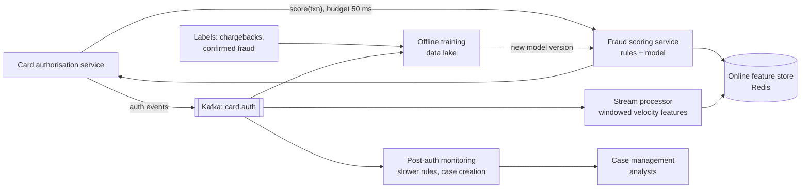
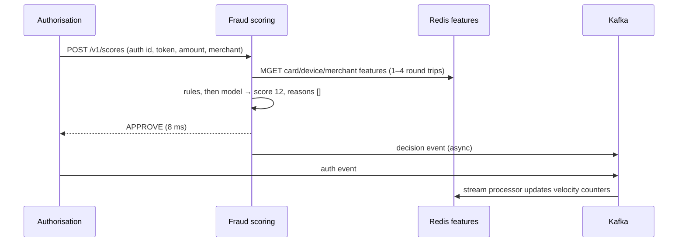

## In one minute

"Design a system that scores every card payment for fraud before it is approved." Two paths: a
**synchronous scoring path** inside the authorisation latency budget (rules + model on pre-computed
features, tens of milliseconds), and an **asynchronous path** that computes features from the event
stream, monitors after the fact and feeds labels (chargebacks, confirmed fraud) back into training.
The interview is won on three things: the latency budget, what happens when scoring is slow or down,
and how features stay fresh and consistent between training and serving.

## Analogy

An airport has a fast check at the gate (boarding pass scan, a second or two) and slower investigations
behind the scenes (watch lists, patterns). The gate never waits for the investigation; it uses what the
investigation already knows.

## Diagram



## Build it step by step

### Time plan

0–5 requirements · 5–9 estimates · 9–13 schema · 13–20 diagram · 20–24 API · 24–37 two deep dives ·
37–42 failures and SLOs · 42–45 pitch.

### R: Requirements

- **Functional:** score each authorisation (approve / decline / step-up such as 3-D Secure); explain the
  decision (reason codes); let analysts review cases; learn from confirmed fraud and chargebacks.
- **Non-functional:** scoring p99 within the budget the authorisation path gives us (assume **50 ms**);
  scoring must not take authorisations down; new rules deployable within minutes without a code release;
  every decision auditable (inputs, model version, output).
- **Out of scope:** AML transaction monitoring and sanctions screening (different regulations and
  latency profile), model research itself.

Clarifying questions: What is the end-to-end authorisation budget? What happens today when fraud is
down (fail open or closed)? Which signals exist (device, merchant category, geography)? How fast do
chargebacks arrive (weeks, so labels are delayed)? Is step-up authentication available?

### E: Estimation (assumptions stated)

```text
Card transactions: 30 M/day → 30,000,000 / 86,400 ≈ 350/s average; peak 5× ≈ 1,750/s
Features per score: ~20 key lookups (card, device, merchant, customer) → ≈ 35,000 feature reads/s at peak
  → batch them: one pipelined round trip or MGET per entity → ~4 round trips per score
Events stored for training: 30 M × 2 KB ≈ 60 GB/day ≈ 22 TB/year (columnar format compresses this a lot)
Stream state: velocity counters for, say, 50 M active cards × 3 windows × ~50 B ≈ 7.5 GB in Redis
Scoring nodes: if one node scores ~500/s within budget (measure!), peak needs 4 + headroom → 6–8 nodes
```

### S: Schema

```sql
-- Decision log: append-only, one row per scored authorisation (audit and training)
CREATE TABLE fraud_decision (
    auth_id        UUID         PRIMARY KEY,
    card_token     VARCHAR(64)  NOT NULL,           -- never the PAN
    amount_minor   BIGINT       NOT NULL,
    currency       CHAR(3)      NOT NULL,
    score          SMALLINT,                        -- NULL when scoring was unavailable
    decision       VARCHAR(16)  NOT NULL,           -- APPROVE, DECLINE, STEP_UP, STAND_IN
    reason_codes   TEXT[]       NOT NULL,
    model_version  VARCHAR(32),
    rules_version  VARCHAR(32)  NOT NULL,
    features       JSONB        NOT NULL,           -- exactly what the model saw (training-serving parity)
    decided_at     TIMESTAMPTZ  NOT NULL
) PARTITION BY RANGE (decided_at);

CREATE TABLE fraud_label (                          -- arrives days or weeks later
    auth_id    UUID        PRIMARY KEY REFERENCES fraud_decision (auth_id),
    label      VARCHAR(16) NOT NULL,                -- FRAUD, GENUINE
    source     VARCHAR(16) NOT NULL,                -- CHARGEBACK, ANALYST, CUSTOMER
    labelled_at TIMESTAMPTZ NOT NULL
);
```

Online features live in Redis keys such as `vel:card:{token}:1h` (count) with a TTL.

### H: Happy path



### A: API

```http
POST /v1/scores                      (internal, mTLS between services)
Idempotency-Key: <authorisation id>  (the same auth must get the same decision on retry)
{"authId": "…", "cardToken": "tok_…", "amount": "120.00", "currency": "GBP", "merchantId": "m_1", "mcc": "5411"}

200 {"decision": "STEP_UP", "score": 71, "reasons": ["NEW_DEVICE", "VELOCITY_1H"], "modelVersion": "2026-11-01"}
```

Rules management: `PUT /v1/rules/{id}` with `If-Match` (two analysts editing one rule must not
overwrite each other), versioned and audited. Errors as RFC 9457 problem details.

### D: Deep dive 1: latency budget and degradation (about 7 minutes)

| Step | Budget (illustrative) |
|---|---|
| Network to scoring service and back | 5 ms |
| Feature fetch (pipelined) | 10 ms |
| Rules | 5 ms |
| Model inference (in-process, e.g. gradient-boosted trees) | 10 ms |
| Headroom for p99 tail | 20 ms |
| **Total** | **50 ms** |

Degradation is a **product decision you make explicit**: when the score is unavailable (timeout,
circuit open, overload), apply a stand-in policy, e.g. approve small amounts and decline or step up
above a limit. The caller enforces a hard timeout, a circuit breaker and a concurrency limit.
[Capstone 3](#/capstone/card-authorisation) implements and tests exactly this. Simplified excerpt
(the tested code logs each case separately):

```java
@ConcurrencyLimit(limitString = "${cards.fraud.max-concurrent-calls}", policy = ConcurrencyLimit.ThrottlePolicy.REJECT)
public OptionalInt score(FraudClient.ScoreRequest request) {
    try {
        return OptionalInt.of(breaker.executeSupplier(() -> client.score(request)).score());
    } catch (CallNotPermittedException | RestClientException unavailable) {
        return OptionalInt.empty();   // the caller applies the written stand-in policy
    }
}
```

Its load test showed the bulkhead routing about 8% of calls to stand-in at 100 concurrent requests. That
is the metric to put on a dashboard and alert on.

### D: Deep dive 2: fresh, consistent features (about 6 minutes)

- **Velocity features** (transactions per card in the last hour, distinct merchants in 24 h) are
  computed from the auth event stream. Simple version: Redis counters per time bucket.

  ```text
  INCR  vel:card:tok_123:2026111309        # bucket = hour
  EXPIRE vel:card:tok_123:2026111309 7200  # keep 2 h
  # 1-hour sliding count ≈ current bucket + weighted previous bucket
  ```

  At scale, a stream processor (Kafka Streams windowed aggregation, or Flink) computes the windows and
  writes them to the online store; it can re-compute from the log after a bug.
- **Freshness:** the event of *this* authorisation is not yet in the stream when it is scored, so the
  scoring service adds the current transaction to the counts itself.
- **Training-serving parity:** log exactly the features the model saw (`features` JSONB) and train on
  those logged values, not on recomputed ones. Otherwise the model learns from data it never sees live.
- **Label delay:** chargebacks arrive weeks later, so evaluate models on matured data, and use analyst
  labels for faster feedback.

### E: Failure-mode table

| Failure | Detection | Mitigation | Blast radius |
|---|---|---|---|
| Scoring slow | p99 latency, timeout rate | Hard timeout + stand-in policy | Decisions on stand-in rules |
| Scoring down | Breaker open, stand-in rate alert | Stand-in; page on-call | Higher fraud risk for small amounts |
| Redis down / slow | Feature fetch errors | Score with defaults + rules only; flag reduced confidence | Model accuracy drops |
| Stream processor lagging | Consumer lag, feature age | Alert; features get stale; scale consumers | Velocity rules miss bursts |
| Bad model deployed | Decline-rate and approval-rate anomaly | Shadow mode first, canary, one-click rollback to previous version | Wrongly declined customers |
| Duplicate auth retries | Same idempotency key | Return the logged decision | None |

### Consistency and security notes

- The decision is made on **eventually consistent** features (a few seconds old), and that is acceptable.
  The decision log is strongly consistent and append-only.
- Card tokens only; no PANs in features, logs or the data lake (PCI DSS scope). Analysts see masked data.
- Rule and model changes are audited (who, what, when), with maker-checker for rules that auto-decline.

### SLIs/SLOs (illustrative)

Scoring p99 < 50 ms; stand-in rate < 0.5% of authorisations per 5 minutes; feature age p99 < 10 s;
decision log completeness 100% (reconciled against authorisations daily).

### Deliver: 60-second pitch

"Scoring sits in the authorisation path with a 50 ms budget: pipelined feature reads from Redis, rules,
then an in-process model, with every decision and its exact features logged. The caller wraps it in a
timeout, breaker and concurrency limit, and an explicit stand-in policy decides when we can't score.
Velocity features come from the auth event stream through a windowed processor. Training uses the
logged features plus delayed labels from chargebacks and analysts. New models go through shadow mode
and a canary. At around 1,750 authorisations per second at peak, about 8 scoring nodes and one Redis
cluster cover it."

## What goes wrong

**Bug: synchronous dependency on everything.** The scoring service calls three internal services live
for features; one gets slow, scoring times out, and with fail-closed every card payment is declined.

**Fix:** pre-compute features into one online store; bound the call with a timeout and breaker; define
stand-in rules; monitor the stand-in rate.

**Test:** capstone 3's `slowFraudEngineTimesOutAndFallsBackToStandInRules` and
`circuitOpensAfterRepeatedFailures…` reproduce the failure and the fix against a real slow HTTP server.

## Trade-offs: when NOT to score synchronously

- Low-risk, low-value flows (small top-ups) can be scored asynchronously and reversed if needed.
- Bank transfers to new payees may allow a delay ("pending review") instead of an instant decision.
- Very complex models (graph analysis) belong in the asynchronous monitoring path.

## Interview Q&A (follow-ups)

**Warm-up: "Rules or ML?"**
- *Model answer:* both: rules for known patterns, regulatory blocks and instant reaction to a new
  attack; models for subtle patterns. Rules are deployable in minutes.
- *Common wrong answer:* "ML replaces rules."
- *Why it fails:* you can't wait for retraining during an active attack.

**Standard: "The fraud service is down. Approve or decline?"**
- *Model answer:* neither globally: a stand-in policy by amount and risk segment, monitored, with a
  documented owner (risk team).
- *Common wrong answer:* "Decline everything to be safe."
- *Why it fails:* that is a total outage for customers; also a business decision engineers shouldn't make alone.

**Standard: "How do you keep features fresh?"**
- *Model answer:* stream processing from auth events into the online store, plus adding the current
  transaction in-request; alert on feature age.
- *Common wrong answer:* "Recompute features from the database on each request."
- *Why it fails:* too slow for the budget, and it loads the primary database.

**Standard: "How do you deploy a new model safely?"**
- *Model answer:* shadow mode (score but don't act), compare decisions, then canary a small percentage,
  watch approval and decline rates, keep instant rollback.
- *Common wrong answer:* "Deploy when offline accuracy is better."
- *Why it fails:* offline metrics miss live data drift and training-serving skew.

**Deep: "What is training-serving skew and how do you avoid it?"**
- *Model answer:* features computed differently in training and live. Log the features as served and train
  on those; share feature definitions between batch and stream.
- *Common wrong answer:* "Use the same model file."
- *Why it fails:* the model is the same; the inputs differ.

**Deep: "How do you explain a decline to a customer or regulator?"**
- *Model answer:* reason codes from rules and model explanations stored with the decision, model and rule
  versions logged, and a replay tool that re-scores with the logged features.
- *Common wrong answer:* "The model decided."
- *Why it fails:* not auditable; regulators and customer support need reasons.

## Common mistakes

- No latency budget; no fallback.
- Features fetched live from many services.
- Ignoring delayed labels when evaluating models.
- PANs in the feature store or logs.

## Say it in 30 seconds

"A 50 ms synchronous scoring path on pre-computed features with logged inputs; an explicit stand-in policy
behind a timeout, breaker and concurrency limit; streaming velocity features; training on logged features
with delayed labels; and shadow, then canary, model releases."

## Recap

- Budget the latency; design the degraded mode before the happy path.
- Online features pre-computed; log exactly what the model saw.
- Releases: shadow → canary → rollback ready.

## See also

- [Track 04: Fraud detection architecture](#/tracks/track-04/lessons/track-04-lesson-16)
- [Track 06: Fallback patterns](#/tracks/track-06/lessons/track-06-lesson-14)
- [Capstone 3: card authorisation with fraud hook](#/capstone/card-authorisation)

<!-- KNOWLEDGE-CHECK
[
  {
    "id": "kc-1404-01",
    "question": "The fraud scoring service is down during authorisation. What is the right behaviour?",
    "options": [
      "Decline every payment until it recovers",
      "Approve every payment until it recovers",
      "Retry the scoring call until it answers",
      "Apply a pre-agreed stand-in policy by amount and risk segment, behind a timeout and circuit breaker, monitored and owned by the risk team"
    ],
    "correct": 3,
    "explanation": "Neither approve-all nor decline-all is acceptable. A documented stand-in policy keeps low-risk payments flowing and holds or declines high-risk ones while scoring is unavailable."
  },
  {
    "id": "kc-1404-02",
    "question": "What is training-serving skew?",
    "options": [
      "The model is trained on more data than it serves",
      "Features are computed differently for training than at serving time, so the live model sees inputs it was not trained on",
      "Serving is slower than training",
      "The training cluster and serving cluster run different JVM versions"
    ],
    "correct": 1,
    "explanation": "Avoid it with one definition of each feature, shared by the batch (training) and online (serving) paths, typically through a feature store, and by logging the features actually used at decision time."
  },
  {
    "id": "kc-1404-03",
    "question": "Why pre-compute features into one online store instead of calling other services during scoring?",
    "options": [
      "Live fan-out to several services breaks the tens-of-milliseconds latency budget and makes every dependency a failure point",
      "Online stores are cheaper than databases",
      "Other services do not have the data",
      "Regulators require a feature store"
    ],
    "correct": 0,
    "explanation": "The synchronous path should read pre-computed features with one fast lookup, under a timeout. The asynchronous path keeps them fresh from the event stream."
  },
  {
    "id": "kc-1404-04",
    "question": "How do you deploy a new fraud model safely?",
    "options": [
      "Replace the old model at night when traffic is low",
      "Deploy it to all traffic with a feature flag turned on",
      "Run it in shadow mode (score but don't act) and compare decisions, then canary a small share of traffic, watching approval and decline rates, with instant rollback",
      "Ask the data scientists to sign off and deploy"
    ],
    "correct": 2,
    "explanation": "Shadow mode shows how the new model would decide without customer impact; the canary limits the blast radius; approval and decline rates are the business signals to watch."
  }
]
-->

<!-- PRACTICAL-CHALLENGE
{
  "id": "pc-1404",
  "title": "Fraud detection pipeline design",
  "description": "Turn the lesson's design into concrete artefacts you could defend in an interview.",
  "tasks": [
    {
      "id": "pc-1404-01",
      "description": "Write the latency budget for the synchronous path (total authorisation budget, network, feature lookup, rules, model, margin) and the stand-in policy table used when scoring times out, by amount band and merchant risk."
    },
    {
      "id": "pc-1404-02",
      "description": "Design three features (e.g. card spend in the last 1 h, distinct merchants in 24 h, distance from last transaction): their event-time windows, how late events are handled, and how the same definition feeds training and serving."
    },
    {
      "id": "pc-1404-03",
      "description": "Write a rollout plan for a new model: shadow-mode comparison metrics, canary percentage and duration, the alert thresholds on approval and decline rates, and the rollback step."
    }
  ]
}
-->
