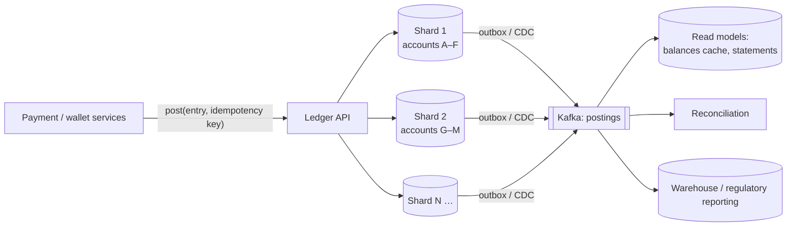
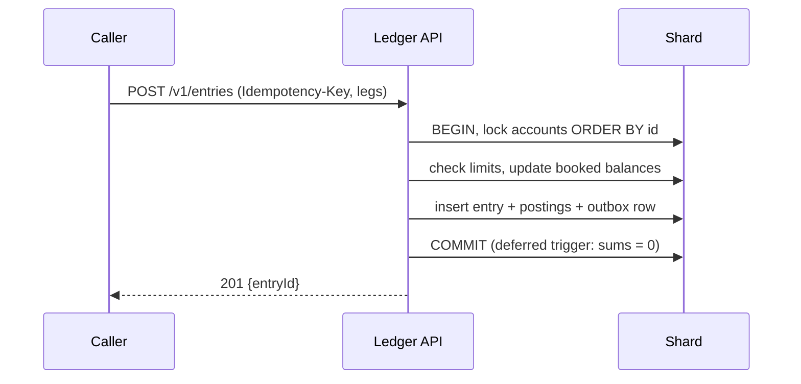

## في دقيقة واحدة

"صمّم دفتر الأستاذ الذي يسجل كل حركة أموال لتطبيق شبيه بالبنوك." الجوهر هو القيد المزدوج: قيود كل مُدخل مجموعها صفر لكل عملة، والأرصدة مشتقة من القيود، ولا شيء يُحدّث أو يُحذف أبدًا. وعلى نطاق واسع، الأجزاء الصعبة هي **التزامن على الحسابات الساخنة**، و**التوزيع دون فقدان الذرية**، و**القراءات** (الأرصدة وكشوف الحساب) التي لا تبطئ مسار الكتابة. وتُشرح الأساسيات في [المسار 05](#/tracks/track-05/lessons/track-05-lesson-01)؛ وهذا الدرس عن كيف تعرضها وتوسعها في 45 دقيقة. و[المشروع الختامي 2](#/capstone/wallet-ledger) هو النسخة المختبرة بقاعدة بيانات واحدة.

## تشبيه

دفتر الأستاذ كتاب محاسب مكتوب بالحبر: لا تمحو سطرًا أبدًا، بل تضيف سطرًا تصحيحيًا. وللحاق بشركة كبيرة، توظف عدة محاسبين بدفاتر منفصلة حسب العميل، ودفتر مقاصة للأموال التي تتحرك بينها.

## المخطط



## ابنِه خطوة بخطوة

### ‏R: المتطلبات

- **الوظيفية:** ترحيل مُدخل (قيدان أو أكثر)، والحصول على الرصيد (المتاح والمقيد)، وكشف حساب لنطاق زمني، وعكس مُدخل، والحجوزات (حجز الأموال قبل التحصيل).
- **غير الوظيفية:** لا فقدان أو تكرار لمُدخل أبدًا؛ ولا رصيد عميل دون حده؛ وزمن قراءة الرصيد p99 < ‏50 مللي ثانية؛ وزمن الترحيل p99 < ‏100 مللي ثانية (افتراضات)؛ واحتفاظ متعدد السنوات؛ وتدقيق كامل.
- **وضّح:** عملة واحدة لكل حساب؟ هل يُسمح بالسحب على المكشوف لبعض أنواع الحسابات؟ من يستدعي دفتر الأستاذ: الخدمات الداخلية فقط؟ هل يجب أن تكون كشوف الحساب غير قابلة للتغيير بمجرد إصدارها؟

### ‏E: التقدير (الافتراضات مذكورة)

```text
Accounts: 20 M customer accounts + a few thousand internal (fees, clearing, FX positions)
Entries: 50 M/day → 50,000,000 / 86,400 ≈ 580 entries/s; peak 5× ≈ 2,900/s
Postings: ~2.5 per entry → peak ≈ 7,250 posting inserts/s
Storage: 50 M × (entry 300 B + 2.5 × 150 B) ≈ 34 GB/day ≈ 12 TB/year before indexes
Hot accounts: one merchant receiving 5% of all payments at peak → ≈ 145 updates/s on ONE row
```

ما تستنتجه بصوت عالٍ: *قد تتسع الإنتاجية الإجمالية في بضعة أجزاء؛ والمخاطرة الحقيقية هي الحساب الساخن، حيث يسلسل قفل الصف التحديثات.*

### ‏S: المخطط (لكل جزء)

```sql
CREATE TABLE account (
    id              BIGINT PRIMARY KEY,           -- from a sequence / id service, encodes shard
    currency        CHAR(3)  NOT NULL,
    type            VARCHAR(16) NOT NULL,          -- CUSTOMER, MERCHANT, CLEARING, FEES, FX_POSITION
    booked_minor    BIGINT   NOT NULL DEFAULT 0,
    held_minor      BIGINT   NOT NULL DEFAULT 0,   -- reservations (holds)
    overdraft_minor BIGINT   NOT NULL DEFAULT 0,
    version         BIGINT   NOT NULL,
    CHECK (booked_minor - held_minor >= -overdraft_minor)
);
CREATE TABLE journal_entry (
    id              BIGINT PRIMARY KEY,
    idempotency_key VARCHAR(64) NOT NULL UNIQUE,
    kind            VARCHAR(32) NOT NULL,
    reverses        BIGINT REFERENCES journal_entry (id),   -- corrections are new entries
    created_at      TIMESTAMPTZ NOT NULL
);
CREATE TABLE posting (
    entry_id     BIGINT NOT NULL REFERENCES journal_entry (id),
    account_id   BIGINT NOT NULL REFERENCES account (id),
    amount_minor BIGINT NOT NULL,                  -- signed
    currency     CHAR(3) NOT NULL,
    created_at   TIMESTAMPTZ NOT NULL
) PARTITION BY RANGE (created_at);
-- + deferred trigger: postings of one entry sum to zero per currency; UPDATE/DELETE forbidden
```

### ‏H: المسار السعيد (تحويل داخل الجزء نفسه)



### ‏A: الواجهة

```http
POST /v1/entries          Idempotency-Key: <caller op id>
{"kind": "TRANSFER", "legs": [{"account": 1001, "amount": "-25.00", "currency": "EUR"},
                              {"account": 2002, "amount": "25.00",  "currency": "EUR"}]}
→ 201 {"entryId": …} | 422 problem: unbalanced, insufficient funds | 409 same key, different legs

POST /v1/entries/{id}/reversal   Idempotency-Key       → 201 new reversing entry
GET  /v1/accounts/{id}/balance                         → {"booked": "…", "available": "…", "asOf": "…"}
GET  /v1/accounts/{id}/statement?from=…&to=…&cursor=…  → paginated postings
```

واجهة دفتر الأستاذ داخلية (mTLS، وهويات الخدمات). والمبالغ نصوص أو وحدات صغرى.

### ‏D: التعمق 1: الحسابات الساخنة (نحو 7 دقائق)

صف واحد يتلقى ~145 تحديثًا/ثانية يتسلسل على قفله. والخيارات، من الأبسط:

1. **أبقِ المعاملة صغيرة جدًا** (قفل، وتحديث، وإدراج، وتأكيد) وقِس: قد تكفي المعاملات القصيرة.
2. **الحسابات الفرعية:** قسّم حساب التاجر إلى N حسابًا فرعيًا (مثل 16)، وأضف إلى واحد عشوائي، واجمعها للرصيد. والخصم منه نادر (المدفوعات الصادرة) ويمكنه قفل كل الحسابات الفرعية بالترتيب.
3. **الإضافات المخزنة مؤقتًا:** الإضافات إلى حساب *مستقبِل* ساخن لا تحتاج فحص رصيد، فألحق القيود دون قفل صف الرصيد، وادمجها في الرصيد بشكل غير متزامن. والرصيد المتاح = المقيد + الإضافات غير المدمجة.
4. لا تستخدم القفل المتفائل على صف ساخن أبدًا: فيتحول التنافس إلى عاصفة من إعادات المحاولة.

### ‏D: التعمق 2: التوزيع دون فقدان الذرية (نحو 6 دقائق)

- وزّع حسب **معرّف الحساب** (حسابات العملاء موزعة بالتساوي؛ والحسابات الداخلية مكررة لكل جزء كـ "حسابات مقاصة محلية للجزء").
- **مُدخل داخل الجزء نفسه:** معاملة ACID محلية واحدة، كما أعلاه.
- **تحويل بين الأجزاء** (A على الجزء 1 ← B على الجزء 2): **ساغا (saga)** بحساب مقاصة على كل جزء. الخطوة 1 على الجزء 1: خصم من A، وإضافة إلى المقاصة-1 (متوازن محليًا). والخطوة 2 على الجزء 2: خصم من المقاصة-2، وإضافة إلى B. وكل خطوة عديمة الأثر عند التكرار (بمفتاح). والإخفاق بعد الخطوة 1 يشغّل التعويض (عكس الخطوة 1). ويجب أن يكون صافي حسابات المقاصة صفرًا عبر الأجزاء، وتتحقق مهمة مطابقة من ذلك. ‏([المسار 05: الساغا](#/tracks/track-05/lessons/track-05-lesson-14))
- مصادر الأحداث (event sourcing) تمثيل بديل، لا حيلة توسع: فالقيود *هي* سجل الأحداث بالفعل ([المسار 05 الدرس 18](#/tracks/track-05/lessons/track-05-lesson-18)).

### ‏E: جدول أنماط الإخفاق

| الإخفاق | الاكتشاف | التخفيف | نطاق الضرر |
|---|---|---|---|
| يعيد المستدعي محاولة مُدخل | مفتاح عدم تكرار فريد | إعادة معرّف المُدخل الموجود | لا شيء |
| جمود بين تحويلات متعاكسة | أخطاء الجمود | قفل الحسابات بترتيب المعرّف | لا شيء إن كان مرتبًا |
| فشل الخطوة 2 في الساغا | حالة الساغا / انتهاء المهلة | إعادة محاولة الخطوة 2 (عديمة الأثر عند التكرار) أو تعويض الخطوة 1 | أموال في المقاصة حتى الحسم |
| صافي حسابات المقاصة ليس صفرًا | المطابقة | التحقيق، والقيود التصحيحية | تنبيه لسلامة دفتر الأستاذ |
| تعطل الخادم الأساسي لجزء | فحوص الصحة | التبديل؛ ويعيد المستدعون المحاولة بالمفاتيح نفسها | الحسابات على ذلك الجزء |
| تأخر نموذج القراءة | مقياس تأخر الأحداث | إظهار `asOf`؛ والفحوص الحرجة تقرأ من الأساسي | أرصدة معروضة قديمة |

### الاتساق والأمان

اتساق قوي للقيود وفحوص الرصيد على كل جزء؛ واتساق نهائي لكشوف الحساب، والبحث، والتحليلات. وواجهة داخلية فقط بهويات الخدمات؛ وقوائم سماح لكل خدمة بأنواع المُدخلات التي يحق للمستدعي ترحيلها؛ والإلحاق فقط مفروض بصلاحيات قاعدة البيانات والمشغلات؛ وكل تصحيح مُدخل عكسي مع سبب.

### مؤشرات وأهداف مستوى الخدمة (توضيحية)

إتاحة الترحيل 99.99% · زمن الترحيل p99 < ‏100 مللي ثانية · زمن الرصيد p99 < ‏50 مللي ثانية · المُدخلات غير المتوازنة = 0 · كسور مطابقة الرصيد مقابل القيود = 0 · صافي المقاصة عبر الأجزاء = 0 في نهاية اليوم.

### التسليم: العرض من 60 ثانية

"دفتر أستاذ بالقيد المزدوج للإلحاق فقط: مُدخلات بقيود متوازنة لكل عملة، مفروضة في قاعدة البيانات، عديمة الأثر عند التكرار بالمفتاح، والتصحيحات كعكوس. ويملك كل جزء مجموعة حسابات ويرحّل محليًا بأقفال مرتبة في معاملات قصيرة. والتحويلات بين الأجزاء ساغات عبر حسابات مقاصة لكل جزء تثبت المطابقة أن صافيها صفر. وتستخدم حسابات التجار الساخنة حسابات فرعية أو إضافات مخزنة مؤقتًا. وتُقدم الأرصدة وكشوف الحساب من نماذج قراءة يغذيها صندوق الصادر. وعند نحو 2,900 مُدخل في الثانية في الذروة، تغطي حفنة من الأجزاء الحمل."

## ما الذي يسوء

**الخطأ: عمود الرصيد كمصدر للحقيقة.** يشغّل سكربت أثناء حادث `UPDATE account SET balance = …` ‏"لإصلاح" عميل؛ فلا قيد، ولا سبب، ولم تعد الدفاتر متوازنة.

**الإصلاح:** الأرصدة مشتقة؛ والتصحيحات مُدخلات؛ وتمنع قاعدة البيانات تحديث القيود، وتقارن مهمة مطابقة الأرصدة المخزنة مؤقتًا بالقيود.

**الاختبار:** ‏`reconciliationDetectsABalanceThatDriftedFromThePostings` و`ledgerIsAppendOnly` في المشروع الختامي 2.

## المقايضات: متى لا توزّع

تحت بضعة آلاف من المُدخلات في الثانية، يكون خادم PostgreSQL أساسي واحد مضبوط جيدًا مع تقسيم زمني أبسط ويُبقي كل تحويل معاملة ACID واحدة. ووزّع حين تقول القياسات ذلك، وأبقِ ربط الحساب ← الجزء صريحًا.

## أسئلة وأجوبة المقابلة (أسئلة المتابعة)

**إحماء: "لماذا تخزن القيود إن كانت لديك أرصدة؟"**
- *الإجابة النموذجية:* القيود هي الحقيقة وسجل التدقيق؛ والأرصدة ذاكرة مؤقتة يجب أن تكون قابلة للإثبات منها.
- *الإجابة الخاطئة الشائعة:* "للتحليلات."
- *لماذا تفشل:* تفوّت التدقيق، والتصحيحات، والمطابقة.

**قياسي: "كيف تمنع الأرصدة السالبة تحت التزامن؟"**
- *الإجابة النموذجية:* اقفل صفوف الحسابات بترتيب المعرّف، وافحص الرصيد المتاح، وحدّث، وأبقِ قيد CHECK في قاعدة البيانات كدعم أخير.
- *الإجابة الخاطئة الشائعة:* "افحص الرصيد في التطبيق قبل الترحيل."
- *لماذا تفشل:* سباق الفحص ثم الفعل دون قفل أو تحديث مشروط.

**قياسي: "كيف تتعامل مع تاجر يتلقى آلاف الدفعات في الثانية؟"**
- *الإجابة النموذجية:* حسابات فرعية أو إضافات مخزنة مؤقتًا؛ فالإضافات لا تحتاج فحص رصيد.
- *الإجابة الخاطئة الشائعة:* "قفل متفائل مع إعادات محاولة."
- *لماذا تفشل:* الصف الأسخن ينتج أكثر إعادات المحاولة.

**قياسي: "كيف تصحح مُدخلًا خاطئًا؟"**
- *الإجابة النموذجية:* رحّل مُدخلًا عكسيًا يشير إلى الأصلي، ثم المُدخل الصحيح، مع سبب.
- *الإجابة الخاطئة الشائعة:* "حدّث المبلغ."
- *لماذا تفشل:* تدمّر سجل التدقيق وتكسر المطابقة.

**عميق: "يعبر تحويل جزأين. امشِ بي عبر تعطل بعد الخطوة الأولى."**
- *الإجابة النموذجية:* يُظهر سجل الساغا أن الخطوة 1 تمت؛ فيعيد المنسق محاولة الخطوة 2 بمفتاح عدم التكرار الخاص بها، أو يعوّض الخطوة 1 بعد انتهاء المهلة. وفي الأثناء، تبقى الأموال في حساب مقاصة، مرئي ومطابق.
- *الإجابة الخاطئة الشائعة:* "استخدم 2PC عبر الأجزاء."
- *لماذا تفشل:* يحجب عند إخفاق المنسق ويربط إتاحة الأجزاء ببعضها.

**عميق: "كيف تنتج كشف حساب لشهر سابق بسرعة؟"**
- *الإجابة النموذجية:* القيود مقسمة زمنيًا ومفهرسة بـ (الحساب، والوقت)؛ وكشوف الحساب الصادرة مخزنة بشكل غير قابل للتغيير؛ والقراءة من نسخة قراءة أو نموذج قراءة.
- *الإجابة الخاطئة الشائعة:* "اجمع كل القيود منذ فتح الحساب في كل مرة."
- *لماذا تفشل:* الكلفة تنمو إلى الأبد. واستخدم أرصدة افتتاحية لكل فترة (نقاط تفتيش).

## أخطاء شائعة

- الرصيد كحقيقة؛ وتحديثات للقيود.
- القفل المتفائل على الحسابات الساخنة.
- التوزيع دون خطة للتحويلات بين الأجزاء.
- لا مطابقة لحسابات المقاصة.

## قلها في 30 ثانية

"قيد مزدوج للإلحاق فقط، متوازن لكل عملة ومفروض بقاعدة البيانات؛ وترحيلات عديمة الأثر عند التكرار؛ وأقفال مرتبة؛ وحسابات فرعية للحسابات الساخنة؛ وأجزاء حسب الحساب مع ساغات عبر حسابات المقاصة؛ ونماذج قراءة للأرصدة وكشوف الحساب؛ والمطابقة تثبت كل ذلك."

## الخلاصة

- القيود هي الحقيقة؛ والأرصدة ذاكرة مؤقتة مطابقة.
- الحسابات الساخنة هي مشكلة التوسع الحقيقية.
- بين الأجزاء = ساغا + حسابات مقاصة + مطابقة.

## انظر أيضًا

- [المسار 05: دفتر الأستاذ بالقيد المزدوج](#/tracks/track-05/lessons/track-05-lesson-01)
- [المسار 05: السيناريو J: تحديثات الرصيد المتزامنة على نطاق واسع](#/tracks/track-05/lessons/track-05-lesson-11)
- [المشروع الختامي 2: دفتر أستاذ المحفظة](#/capstone/wallet-ledger)

<!-- KNOWLEDGE-CHECK
[
  {
    "id": "kc-1405-01",
    "question": "يشغّل مهندس دعم UPDATE account SET balance = … لإصلاح رصيد عميل. لماذا هذا خطأ في دفتر أستاذ بالقيد المزدوج؟",
    "options": [
      "إنه بطيء جدًا على الجداول الكبيرة",
      "الأرصدة مشتقة من القيود؛ والتحديث المباشر لا يترك قيدًا، ولا سببًا، ودفاتر لم تعد متوازنة. ويجب أن تكون التصحيحات مُدخلات جديدة (عكسية)",
      "عبارات UPDATE غير مسموحة في PostgreSQL",
      "لا بأس إن تم داخل معاملة"
    ],
    "correct": 1,
    "explanation": "القيود هي الحقيقة وسجل التدقيق. فامنع تحديث القيود في قاعدة البيانات، ودع مهمة مطابقة تقارن الأرصدة المخزنة مؤقتًا بالقيود."
  },
  {
    "id": "kc-1405-02",
    "question": "حساب تاجر يتلقى نحو 145 إضافة في الثانية وأصبح قفل صفه عنق الزجاجة. أي خيار هو الأنسب؟",
    "options": [
      "القفل المتفائل مع إعادات المحاولة على صف الحساب",
      "قفل Redis موزع حول كل قيد",
      "قسّم الحساب إلى حسابات فرعية (أضف إلى واحد عشوائي، واجمعها للرصيد)، أو خزّن الإضافات مؤقتًا دون قفل صف الرصيد",
      "زد حجم مجمع اتصالات قاعدة البيانات"
    ],
    "correct": 2,
    "explanation": "الإضافات لا تحتاج فحص رصيد، فيمكن توزيعها أو تخزينها مؤقتًا. والقفل المتفائل على أسخن صف يحوّل التنافس إلى عاصفة إعادات محاولة."
  },
  {
    "id": "kc-1405-03",
    "question": "تحويل ينقل أموالًا بين حسابين على جزأين مختلفين. كيف يبقى صحيحًا؟",
    "options": [
      "ساغا عبر حسابات مقاصة لكل جزء: خصم من A وإضافة إلى المقاصة على الجزء 1، ثم خصم من المقاصة وإضافة إلى B على الجزء 2، كل خطوة عديمة الأثر عند التكرار، مع تعويض ومطابقة تثبت أن صافي المقاصة صفر",
      "التأكيد على مرحلتين عبر الأجزاء",
      "اكتب القيدين على الجزء 1 وانسخهما لاحقًا",
      "اقفل الجزأين بقفل عام"
    ],
    "correct": 0,
    "explanation": "كل خطوة متوازنة محليًا، فتبقى دفاتر كل جزء صحيحة. وتبقى الأموال مرئية في حساب مقاصة حتى تنتهي الساغا، والمطابقة تثبت أن صافي المقاصة صفر."
  },
  {
    "id": "kc-1405-04",
    "question": "كيف تنتج كشف حساب لشهر قديم بسرعة؟",
    "options": [
      "اجمع كل القيود منذ فتح الحساب",
      "اقرأه من سجلات التطبيق",
      "أعد بناءه من Kafka من البداية",
      "استخدم قيودًا مقسمة زمنيًا ومفهرسة بـ (الحساب، والوقت)، مع أرصدة افتتاحية لكل فترة، وخزّن الكشوف الصادرة بشكل غير قابل للتغيير"
    ],
    "correct": 3,
    "explanation": "الجمع من بداية الزمن ينمو إلى الأبد. ونقاط التفتيش لكل فترة (الأرصدة الافتتاحية) تحدّ العمل، والكشوف الصادرة يجب ألا تتغير بعد إرسالها."
  }
]
-->

<!-- PRACTICAL-CHALLENGE
{
  "id": "pc-1405",
  "title": "دفتر الأستاذ على نطاق واسع",
  "description": "تدرّب على قرارات تصميم دفتر الأستاذ بـ SQL واختبارات حقيقية.",
  "tasks": [
    {
      "id": "pc-1405-01",
      "description": "أنشئ جدولي journal_entry وposting في PostgreSQL مع مشغّل قيد مؤجل يرفض مُدخلًا لا يساوي مجموع قيوده صفرًا لكل عملة، ومشغّل أو صلاحيات تمنع UPDATE وDELETE على القيود. واختبر الاثنين."
    },
    {
      "id": "pc-1405-02",
      "description": "نفّذ استراتيجية حساب ساخن بـ 16 حسابًا فرعيًا: تذهب الإضافات إلى حساب فرعي عشوائي، والرصيد يجمعها. واختبر حمل 1,000 إضافة متزامنة وقارن الإنتاجية مع صف حساب واحد."
    },
    {
      "id": "pc-1405-03",
      "description": "اكتب ساغا التحويل بين الأجزاء كمخطط تسلسل مع حسابات المقاصة، بما فيه مسار التعويض، واستعلام المطابقة الذي يتحقق من أن صافي المقاصة صفر."
    }
  ]
}
-->
