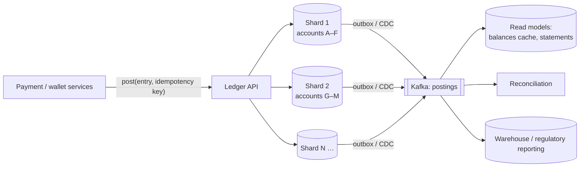
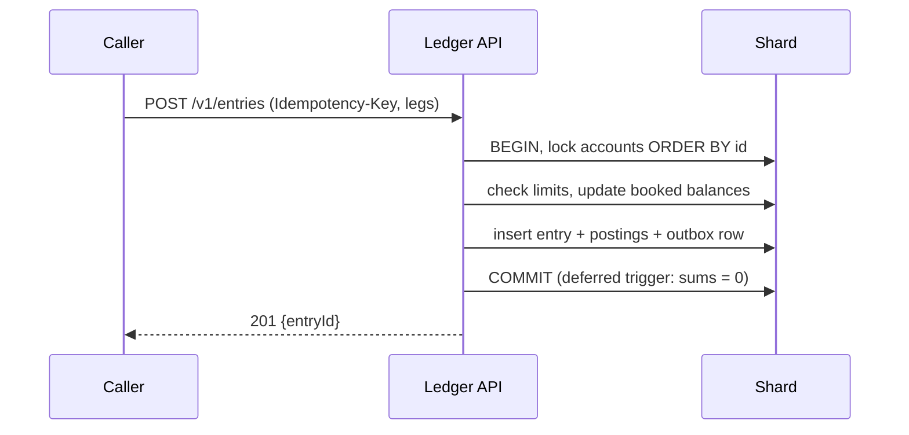

## In one minute

"Design the ledger that records every money movement for a bank-like app." The core is double-entry:
every entry's postings sum to zero per currency, balances derive from postings, and nothing is ever
updated or deleted. At scale the hard parts are **concurrency on hot accounts**, **sharding without
losing atomicity**, and **reads** (balances and statements) that don't slow the write path. The
fundamentals are taught in [Track 05](#/tracks/track-05/lessons/track-05-lesson-01); this lesson is how
you present and scale them in 45 minutes. [Capstone 2](#/capstone/wallet-ledger) is the tested,
single-database version.

## Analogy

A ledger is an accountant's book written in pen: you never erase a line, you add a correcting line. To
keep up with a big company, you hire several accountants with separate books by customer, and a
clearing book for money that moves between them.

## Diagram



## Build it step by step

### R: Requirements

- **Functional:** post an entry (2+ postings), get balance (available and booked), statement for a date
  range, reverse an entry, holds (reserve funds before capture).
- **Non-functional:** never lose or duplicate an entry; no customer balance below its limit; balance
  read p99 < 50 ms; post p99 < 100 ms (assumptions); multi-year retention; full audit.
- **Clarify:** single currency per account? Overdrafts allowed for some account types? Who calls the
  ledger: only internal services? Do statements need to be immutable once issued?

### E: Estimation (assumptions stated)

```text
Accounts: 20 M customer accounts + a few thousand internal (fees, clearing, FX positions)
Entries: 50 M/day → 50,000,000 / 86,400 ≈ 580 entries/s; peak 5× ≈ 2,900/s
Postings: ~2.5 per entry → peak ≈ 7,250 posting inserts/s
Storage: 50 M × (entry 300 B + 2.5 × 150 B) ≈ 34 GB/day ≈ 12 TB/year before indexes
Hot accounts: one merchant receiving 5% of all payments at peak → ≈ 145 updates/s on ONE row
```

What to conclude aloud: *total throughput may fit a few shards; the real risk is the hot account, where
row locking serialises updates.*

### S: Schema (per shard)

```sql
CREATE TABLE account (
    id              BIGINT PRIMARY KEY,           -- from a sequence / id service, encodes shard
    currency        CHAR(3)  NOT NULL,
    type            VARCHAR(16) NOT NULL,          -- CUSTOMER, MERCHANT, CLEARING, FEES, FX_POSITION
    booked_minor    BIGINT   NOT NULL DEFAULT 0,
    held_minor      BIGINT   NOT NULL DEFAULT 0,   -- reservations (holds)
    overdraft_minor BIGINT   NOT NULL DEFAULT 0,
    version         BIGINT   NOT NULL,
    CHECK (booked_minor - held_minor >= -overdraft_minor)
);
CREATE TABLE journal_entry (
    id              BIGINT PRIMARY KEY,
    idempotency_key VARCHAR(64) NOT NULL UNIQUE,
    kind            VARCHAR(32) NOT NULL,
    reverses        BIGINT REFERENCES journal_entry (id),   -- corrections are new entries
    created_at      TIMESTAMPTZ NOT NULL
);
CREATE TABLE posting (
    entry_id     BIGINT NOT NULL REFERENCES journal_entry (id),
    account_id   BIGINT NOT NULL REFERENCES account (id),
    amount_minor BIGINT NOT NULL,                  -- signed
    currency     CHAR(3) NOT NULL,
    created_at   TIMESTAMPTZ NOT NULL
) PARTITION BY RANGE (created_at);
-- + deferred trigger: postings of one entry sum to zero per currency; UPDATE/DELETE forbidden
```

### H: Happy path (same-shard transfer)



### A: API

```http
POST /v1/entries          Idempotency-Key: <caller op id>
{"kind": "TRANSFER", "legs": [{"account": 1001, "amount": "-25.00", "currency": "EUR"},
                              {"account": 2002, "amount": "25.00",  "currency": "EUR"}]}
→ 201 {"entryId": …} | 422 problem: unbalanced, insufficient funds | 409 same key, different legs

POST /v1/entries/{id}/reversal   Idempotency-Key       → 201 new reversing entry
GET  /v1/accounts/{id}/balance                         → {"booked": "…", "available": "…", "asOf": "…"}
GET  /v1/accounts/{id}/statement?from=…&to=…&cursor=…  → paginated postings
```

The ledger API is internal (mTLS, service identities). Amounts are strings or minor units.

### D: Deep dive 1: hot accounts (about 7 minutes)

A single row receiving ~145 updates/s serialises on its lock. Options, from simplest:

1. **Keep the transaction tiny** (lock, update, insert, commit) and measure: short transactions may be enough.
2. **Sub-accounts:** split the merchant account into N sub-accounts (e.g. 16), credit a random one, and
   sum them for the balance. Debits from it are rare (payouts) and can lock all sub-accounts in order.
3. **Buffered credits:** credits to a hot *receiving* account need no balance check, so append postings
   without locking the balance row, and roll them into the balance asynchronously. Available balance =
   booked + unrolled credits.
4. Never use optimistic locking on a hot row: contention turns into a retry storm.

### D: Deep dive 2: sharding without losing atomicity (about 6 minutes)

- Shard by **account id** (customer accounts spread evenly; internal accounts replicated per shard as
  "shard-local clearing accounts").
- **Same-shard entry:** one local ACID transaction, as above.
- **Cross-shard transfer** (A on shard 1 → B on shard 2): a **saga** with a clearing account on each
  shard. Step 1 on shard 1: debit A, credit clearing-1 (balanced locally). Step 2 on shard 2: debit
  clearing-2, credit B. Each step is idempotent (keyed). A failure after step 1 runs the compensation
  (reverse step 1). Clearing accounts must net to zero across shards, and a reconciliation job checks it.
  ([Track 05: Saga](#/tracks/track-05/lessons/track-05-lesson-14))
- Event sourcing is an alternative representation, not a scaling trick: the postings already *are* the
  event log ([Track 05 L18](#/tracks/track-05/lessons/track-05-lesson-18)).

### E: Failure-mode table

| Failure | Detection | Mitigation | Blast radius |
|---|---|---|---|
| Caller retries an entry | Unique idempotency key | Return the existing entry id | None |
| Deadlock between opposite transfers | Deadlock errors | Lock accounts in id order | None if ordered |
| Saga step 2 fails | Saga state / timeout | Retry step 2 (idempotent) or compensate step 1 | Money in clearing until resolved |
| Clearing accounts don't net to zero | Reconciliation | Investigate, correcting entries | Ledger integrity alert |
| Shard primary fails | Health checks | Failover; callers retry with same keys | Accounts on that shard |
| Read model lag | Event lag metric | Show `asOf`; critical checks read the primary | Stale displayed balances |

### Consistency and security

Strong consistency for postings and balance checks on each shard; eventual consistency for statements,
search and analytics. Internal-only API with service identities; per-service allow-lists for which
entry kinds a caller may post; append-only enforced by DB permissions and triggers; every correction is
a reversing entry with a reason.

### SLIs/SLOs (illustrative)

Post availability 99.99% · post p99 < 100 ms · balance p99 < 50 ms · unbalanced entries = 0 · balance
vs postings reconciliation breaks = 0 · clearing net across shards = 0 at end of day.

### Deliver: 60-second pitch

"An append-only double-entry ledger: entries with postings that balance per currency, enforced in the
database, idempotent by key, corrections as reversals. Each shard owns a set of accounts and posts locally
with ordered locks in short transactions. Cross-shard transfers are sagas through per-shard clearing
accounts that reconciliation proves net to zero. Hot merchant accounts use sub-accounts or buffered credits.
Balances and statements are served from read models fed by the outbox. At about 2,900 entries per second at
peak, a handful of shards covers it."

## What goes wrong

**Bug: the balance column as the source of truth.** An incident script runs `UPDATE account SET balance
= …` to "fix" a customer; there is no posting, no reason, and the books no longer balance.

**Fix:** balances are derived; corrections are entries; the database forbids updates to postings, and a
reconciliation job compares cached balances with the postings.

**Test:** capstone 2's `reconciliationDetectsABalanceThatDriftedFromThePostings` and `ledgerIsAppendOnly`.

## Trade-offs: when NOT to shard

Below a few thousand entries per second, one well-tuned PostgreSQL primary with time partitioning is simpler
and keeps every transfer a single ACID transaction. Shard when measurements say so, and keep the account →
shard mapping explicit.

## Interview Q&A (follow-ups)

**Warm-up: "Why store postings if you have balances?"**
- *Model answer:* postings are the truth and the audit trail; balances are a cache that must be provable
  from them.
- *Common wrong answer:* "For analytics."
- *Why it fails:* misses audit, corrections and reconciliation.

**Standard: "How do you prevent negative balances under concurrency?"**
- *Model answer:* lock the account rows in id order, check available balance, update, and keep a DB
  CHECK as a backstop.
- *Common wrong answer:* "Check the balance in the application before posting."
- *Why it fails:* check-then-act race without a lock or conditional update.

**Standard: "How do you handle a merchant receiving thousands of payments per second?"**
- *Model answer:* sub-accounts or buffered credits; credits don't need a balance check.
- *Common wrong answer:* "Optimistic locking with retries."
- *Why it fails:* the hottest row produces the most retries.

**Standard: "How do you correct a wrong entry?"**
- *Model answer:* post a reversing entry referencing the original, then the correct entry, with a reason.
- *Common wrong answer:* "Update the amount."
- *Why it fails:* destroys the audit trail and breaks reconciliation.

**Deep: "A transfer crosses two shards. Walk me through a crash after the first step."**
- *Model answer:* the saga log shows step 1 done; the coordinator retries step 2 with its idempotency key,
  or compensates step 1 after a timeout. Meanwhile, the money sits in a clearing account, which is visible
  and reconciled.
- *Common wrong answer:* "Use 2PC across shards."
- *Why it fails:* blocks on coordinator failure and couples shard availability.

**Deep: "How do you produce a statement for a past month quickly?"**
- *Model answer:* postings are partitioned by time and indexed by (account, time); issued statements are
  stored immutably; read from a replica or read model.
- *Common wrong answer:* "Sum all postings since account opening each time."
- *Why it fails:* cost grows forever. Use opening balances per period (checkpoints).

## Common mistakes

- Balance as truth; updates to postings.
- Optimistic locking on hot accounts.
- Sharding without a plan for cross-shard transfers.
- No reconciliation of clearing accounts.

## Say it in 30 seconds

"Append-only double-entry, balanced per currency and enforced by the database; idempotent posts; ordered
locks; sub-accounts for hot accounts; shards by account with sagas through clearing accounts; read models
for balances and statements; reconciliation proves it all."

## Recap

- Postings are truth; balances are a reconciled cache.
- Hot accounts are the real scaling problem.
- Cross-shard = saga + clearing accounts + reconciliation.

## See also

- [Track 05: Double-entry ledger](#/tracks/track-05/lessons/track-05-lesson-01)
- [Track 05: Scenario J: concurrent balance updates at scale](#/tracks/track-05/lessons/track-05-lesson-11)
- [Capstone 2: wallet ledger](#/capstone/wallet-ledger)

<!-- KNOWLEDGE-CHECK
[
  {
    "id": "kc-1405-01",
    "question": "A support engineer runs UPDATE account SET balance = … to fix a customer's balance. Why is this wrong in a double-entry ledger?",
    "options": [
      "It is too slow on large tables",
      "Balances are derived from postings; a direct update leaves no posting, no reason and books that no longer balance. Corrections must be new (reversing) entries",
      "UPDATE statements are not allowed in PostgreSQL",
      "It is fine if done inside a transaction"
    ],
    "correct": 1,
    "explanation": "The postings are the truth and the audit trail. Block updates to postings in the database, and let a reconciliation job compare cached balances with the postings."
  },
  {
    "id": "kc-1405-02",
    "question": "A merchant account receives about 145 credits per second and its row lock becomes the bottleneck. Which option fits best?",
    "options": [
      "Optimistic locking with retries on the account row",
      "A distributed Redis lock around each posting",
      "Split the account into sub-accounts (credit a random one, sum them for the balance), or buffer credits without locking the balance row",
      "Increase the database connection pool"
    ],
    "correct": 2,
    "explanation": "Credits need no balance check, so they can be spread or buffered. Optimistic locking on the hottest row turns contention into a retry storm."
  },
  {
    "id": "kc-1405-03",
    "question": "A transfer moves money between accounts on two different shards. How is it kept correct?",
    "options": [
      "A saga through per-shard clearing accounts: debit A and credit clearing on shard 1, then debit clearing and credit B on shard 2, each step idempotent, with compensation and a reconciliation that clearing nets to zero",
      "Two-phase commit across the shards",
      "Write both postings to shard 1 and copy them later",
      "Lock both shards with a global lock"
    ],
    "correct": 0,
    "explanation": "Each step balances locally, so each shard's books stay correct. The money sits visibly in a clearing account until the saga finishes, and reconciliation proves clearing nets to zero."
  },
  {
    "id": "kc-1405-04",
    "question": "How do you produce a statement for an old month quickly?",
    "options": [
      "Sum all postings since the account was opened",
      "Read it from application logs",
      "Rebuild it from Kafka from the beginning",
      "Use postings partitioned by time and indexed by (account, time), plus opening balances per period, and store issued statements immutably"
    ],
    "correct": 3,
    "explanation": "Summing from the start of time grows forever. Period checkpoints (opening balances) bound the work, and issued statements must not change once sent."
  }
]
-->

<!-- PRACTICAL-CHALLENGE
{
  "id": "pc-1405",
  "title": "Ledger at scale",
  "description": "Practise the ledger design decisions with real SQL and tests.",
  "tasks": [
    {
      "id": "pc-1405-01",
      "description": "Create journal_entry and posting tables in PostgreSQL with a deferred constraint trigger that rejects an entry whose postings don't sum to zero per currency, and a trigger or grants that block UPDATE and DELETE on postings. Test both."
    },
    {
      "id": "pc-1405-02",
      "description": "Implement a hot-account strategy with 16 sub-accounts: credits go to a random sub-account, the balance sums them. Load-test 1,000 concurrent credits and compare throughput with a single account row."
    },
    {
      "id": "pc-1405-03",
      "description": "Write the cross-shard transfer saga as a sequence diagram with clearing accounts, including the compensation path, and the reconciliation query that checks clearing nets to zero."
    }
  ]
}
-->
