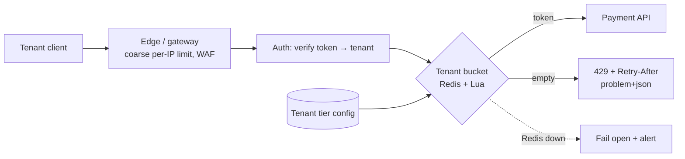
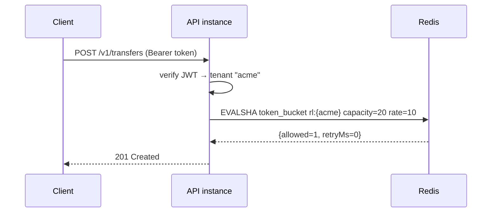

## في دقيقة واحدة

"صمّم تحديد المعدل لواجهة دفع عامة يستخدمها مستأجرون كثيرون." تحمي الحدود المنصة وتجعل المشاركة عادلة: فاندفاع مستأجر واحد أو خطأ في إعادة المحاولة لديه يجب ألا يضر الآخرين. واستخدم **دلو الرموز (token bucket) لكل مستأجر** (اندفاعات مسموحة حتى سعة معينة، ومعدل تعبئة ثابت)، مع الحالة في مخزن مشترك (Redis) وخطوة القراءة-التعبئة-الأخذ ذرية عبر سكربت Lua. ثم قرر صراحة ما يحدث حين يفشل المحدد نفسه. و[المشروع الختامي 5](#/capstone/instant-p2p) هو التنفيذ المختبر.

## تشبيه

دلو الرموز آلة تذاكر في متحف: تُطبع التذاكر بمعدل ثابت والموزع يحمل N على الأكثر. وتستطيع مجموعة مدرسية أخذ دفعة من التذاكر دفعة واحدة، لكن عليها بعدها انتظار تذاكر جديدة.

## المخطط



## ابنِه خطوة بخطوة

### ‏R: المتطلبات

- **الوظيفية:** تحديد الطلبات لكل مستأجر (واختياريًا لكل مفتاح واجهة، ولكل نقطة)؛ ومستويات (قياسي، ومميز)؛ وإعادة 429 مع موعد إعادة المحاولة؛ وتغيير الحدود دون إعادة نشر.
- **غير الوظيفية:** يضيف < 2 مللي ثانية p99 للطلب (افتراض)؛ وصحيح عبر كل نسخ الواجهة؛ ويجب ألا يصبح المحدد نقطة فشل وحيدة للمدفوعات.
- **وضّح:** لكل مستأجر أم لكل مستخدم نهائي؟ حد صارم أم سماحية للاندفاع؟ هل بعض النقاط (قراءات الحالة) أرخص من غيرها؟ الفشل مفتوحًا أم مغلقًا إن انكسر المحدد؟

### ‏E: التقدير (الافتراضات مذكورة)

```text
Tenants: 5,000; API traffic at peak 20,000 requests/s across all instances
Limiter calls: 1 per request → 20,000 Redis script calls/s at peak
State: 5,000 tenants × few endpoint buckets × ~100 B ≈ well under 10 MB
Latency: one Redis round trip in the same zone, typically sub-millisecond (measure in your environment)
Redis: a small primary + replica handles this rate; use cluster mode if limits per end user (millions of keys)
```

### ‏S: المخطط

‏hash في Redis لكل دلو: `rl:{tenant}:{endpoint}` ← `tokens` ‏(عدد عشري)، و`ts` ‏(مللي ثانية)، مع مدة صلاحية تساوي وقت التعبئة الكاملة. وتعيش مستويات المستأجرين في قاعدة بيانات الإعداد وتُخزن مؤقتًا في كل نسخة:

```sql
CREATE TABLE tenant_limit (
    tenant_id   VARCHAR(64) PRIMARY KEY,
    tier        VARCHAR(16) NOT NULL,
    capacity    INT         NOT NULL CHECK (capacity > 0),
    refill_per_second NUMERIC(10,3) NOT NULL CHECK (refill_per_second > 0),
    version     BIGINT      NOT NULL
);
```

### ‏H: المسار السعيد



### ‏A: سلوك الواجهة

```http
HTTP/1.1 429 Too Many Requests
Retry-After: 2
Content-Type: application/problem+json

{"type": "https://api.example.com/problems/rate-limited", "title": "Too many requests",
 "status": 429, "detail": "Rate limit exceeded for your tenant"}
```

واجهة إدارة الحدود: `PUT /v1/tenants/{id}/limits` مع `If-Match` ‏(لا تحديثات مفقودة بين مشغّلين)، مدققة. وحقول ترويسة `RateLimit` من IETF ما زالت مسودة؛ و`Retry-After` هي الترويسة المستقرة.

### ‏D: التعمق 1: اختيار الخوارزمية (نحو 6 دقائق)

| الخوارزمية | السلوك | الذاكرة | الضعف الأساسي |
|---|---|---|---|
| عداد النافذة الثابتة | N في الدقيقة، يُعاد ضبطه عند بداية الدقيقة | عداد واحد | حتى 2N حول حد النافذة |
| السجل المنزلق | دقيق: يخزن وقت كل طلب | O(الطلبات) | الذاكرة والكلفة عند المعدلات العالية |
| عداد النافذة المنزلقة | النافذة الحالية + السابقة بأوزان | عدادان | تقريبي |
| **دلو الرموز** | اندفاع حتى السعة، وتعبئة ثابتة | قيمتان | يحتاج تحديثًا ذريًا |
| الدلو المتسرب (طابور) | ينعّم معدل الإخراج | طابور | يضيف زمن انتظار؛ وغير مناسب للواجهات المتزامنة |

اختر دلو الرموز: حالة O(1)، والاندفاعات تطابق الحركة الحقيقية (دفعات الرواتب)، والمعدل الثابت يحمي الأنظمة اللاحقة. واجعله ذريًا بسكربت Lua يستخدم **ساعة Redis**، فلا تستطيع خوادم التطبيقات ذات الساعات المنحرفة كسره. مقتطف من [سكربت المشروع الختامي 5](#/capstone/instant-p2p) المختبر:

```lua
local t = redis.call('TIME')
local now = tonumber(t[1]) * 1000 + math.floor(tonumber(t[2]) / 1000)
local data = redis.call('HMGET', KEYS[1], 'tokens', 'ts')
local tokens = tonumber(data[1]) or capacity
local ts = tonumber(data[2]) or now
tokens = math.min(capacity, tokens + math.max(0, now - ts) * rate / 1000)
-- take one token if available, else compute retry_ms; HSET + PEXPIRE; return {allowed, retry_ms}
```

### ‏D: التعمق 2: أين تفرض الحد، وماذا لو فشل Redis (نحو 7 دقائق)

- **الطبقات:** حد خشن لكل IP عند الحافة (يوقف الفيضانات المجهولة قبل التحقق من JWT)؛ ودلاء لكل مستأجر بعد المصادقة (العدالة)؛ وتكاليف لكل نقطة (دفعة صادرة جماعية = 10 رموز).
- **سياسة الإخفاق:** مع مهلة Redis ‏200 مللي ثانية، افشل **مفتوحًا** مع تنبيه لضابط *عدالة*. فيقلل انقطاع Redis حينها العدالة، لا المدفوعات. وأضف دلوًا محليًا في الذاكرة لكل نسخة (الحد ÷ عدد النسخ) كبديل تقريبي. ولضابط *أمان* (مثل سقف صارم لقيمة المدفوعات الصادرة يوميًا)، افشل **مغلقًا**.
- **المفاتيح الساخنة:** مستأجر ضخم واحد على مفتاح Redis واحد: قسّم دلوه إلى K دلاء فرعية (لكل منها السعة/K) تُختار بتجزئة معرّف الطلب.
- **إعادات المحاولة:** العملاء الذين يتجاهلون `Retry-After` ويعيدون المحاولة فورًا يفاقمون الحمل الزائد. فوثّق التراجع الأسي مع التشتيت في دليل واجهتك.

### ‏E: جدول أنماط الإخفاق

| الإخفاق | الاكتشاف | التخفيف | نطاق الضرر |
|---|---|---|---|
| ‏Redis بطيء | زمن المحدد p99 | مهلة 200 مللي ثانية ← الفشل مفتوحًا + البديل المحلي | العدالة فقط |
| ‏Redis متعطل | معدل الأخطاء، والتنبيه | الفشل مفتوحًا + الدلاء المحلية؛ واستدعاء المناوب | العدالة فقط |
| عاصفة إعادات محاولة لمستأجر | معدل 429 لكل مستأجر | يمتصها الدلو؛ وتواصل مع المستأجر | ذلك المستأجر فقط |
| إعداد خاطئ (حد منخفض جدًا) | ارتفاع 429 بعد تغيير إعداد | إعداد بإصدارات، وتراجع، وIf-Match على التعديلات | مستوى مستأجرين واحد |
| انحراف الساعات بين خوادم التطبيقات | لا ينطبق | وقت خادم Redis داخل السكربت | لا شيء |

### الاتساق والأمان

تحديثات الدلو ذرية لكل مفتاح (خادم Redis أساسي واحد)؛ ولا تُستخدم النسخ المكررة للتحديد. وتأتي هوية المستأجر فقط من الرمز المتحقق منه. ولا تكشف استجابات تحديد المعدل شيئًا عن المستأجرين الآخرين. وهذا تخفيف لـ OWASP API4 ‏(الاستهلاك غير المقيد للموارد).

### مؤشرات وأهداف مستوى الخدمة (توضيحية)

زمن المحدد المضاف p99 < 2 مللي ثانية؛ وإتاحة المحدد 99.99% ‏(الفشل مفتوحًا يُحسب متدهورًا، لا متعطلًا)؛ ومعدل 429 الكاذب (التحديد رغم البقاء تحت الحصة، من التدقيقات) ≈ 0.

### التسليم: العرض من 60 ثانية

"دلاء رموز لكل مستأجر في Redis، ذرية بسكربت Lua يستخدم وقت Redis، تُفحص بعد المصادقة فتكون هوية المستأجر موثوقة. وحد خشن لكل IP عند الحافة. وتحمل استجابات 429 الترويسة Retry-After وجسم مشكلة. وإن كان Redis بطيئًا أو متعطلًا نفشل مفتوحًا مع دلاء بديلة محلية وتنبيه، لأن هذا ضابط عدالة. والحدود بمستويات، وبإصدارات، وقابلة للتعديل دون نشر. وعند 20,000 طلب في الثانية، يكفي خادم Redis أساسي صغير مع نسخة مكررة."

## ما الذي يسوء

**الخطأ: حدود لكل نسخة.** تسمح كل من 10 نسخ بـ 100 طلب/ثانية، فيحصل المستأجر فعليًا على 1,000/ثانية، وبعد التوسع التلقائي إلى 20 نسخة، 2,000/ثانية. فيُحمّل مزوّد الدفع اللاحق فوق طاقته.

**الإصلاح:** حالة مشتركة (دلو Redis) للحد الحقيقي؛ والدلاء المحلية فقط كبديل متدهور.

**الاختبار:** ‏`rateLimitIsPerTenant` في المشروع الختامي 5 واختبار الحمل بمستأجرين (حصل المستأجر الصاخب على 936 × 429 بينما مرت كل تحويلات المستأجر الهادئ الـ 1,000).

## المقايضات: متى لا تستخدم محددًا مركزيًا

- معدلات عالية جدًا لكل مستأجر (مئات الآلاف في الثانية): استخدم محددات محلية مع مزامنة دورية، واقبل حدودًا تقريبية.
- الحركة الداخلية بين الخدمات: استخدم حدود التزامن/الحواجز والضغط العكسي بدلًا من ذلك.

## أسئلة وأجوبة المقابلة (أسئلة المتابعة)

**إحماء: "لماذا 429 لا 503؟"**
- *الإجابة النموذجية:* تقول 429 إنك *أنت* أرسلت الكثير؛ وتقول 503 إننا *نحن* غير متاحين. ويتفاعل العملاء بشكل مختلف.
- *الإجابة الخاطئة الشائعة:* "كلاهما يعمل."
- *لماذا تفشل:* يكسر منطق إعادة المحاولة والتنبيه لدى العملاء.

**قياسي: "لماذا سكربت Lua؟"**
- *الإجابة النموذجية:* يجب أن تكون القراءة والتعبئة والأخذ ذرية عبر النسخ؛ ويشغّل Redis السكربت دون تداخل أوامر أخرى على المفتاح.
- *الإجابة الخاطئة الشائعة:* "‏GET ثم SET من Java."
- *لماذا تفشل:* تقرأ نسختان الرموز نفسها وتأخذ كلتاهما الرمز الأخير.

**قياسي: "الفشل مفتوحًا أم مغلقًا؟"**
- *الإجابة النموذجية:* مفتوحًا لحدود العدالة مع تنبيه وبديل محلي؛ ومغلقًا لسقوف الأمان.
- *الإجابة الخاطئة الشائعة:* "مغلقًا، للأمان."
- *لماذا تفشل:* ستوقف ومضة في Redis كل المدفوعات.

**قياسي: "كيف تحدد المعدل بالمال، لا بالطلبات؟"**
- *الإجابة النموذجية:* ضابط منفصل: سقف قيمة لكل مستأجر يُفحص في معاملة الدفع (أو دلو كلفته المبلغ)، يفشل مغلقًا، لأنه ضابط أمان.
- *الإجابة الخاطئة الشائعة:* "استخدم محدد الطلبات نفسه."
- *لماذا تفشل:* عدد الطلبات لا يقول شيئًا عن القيمة المعرضة للخطر.

**عميق: "مستأجر واحد يمثل 40% من الحركة. مشكلات؟"**
- *الإجابة النموذجية:* مفتاح ساخن على جزء Redis واحد؛ فقسّم دلوه إلى دلاء فرعية، وفكّر في مستوى مخصص وتخطيط للسعة.
- *الإجابة الخاطئة الشائعة:* "‏Redis سريع بما يكفي."
- *لماذا تفشل:* إنتاجية المفتاح الواحد محدودة بمعالج جزء واحد.

**عميق: "كيف تختبره؟"**
- *الإجابة النموذجية:* اختبارات تكامل على Redis حقيقي (Testcontainers) للاندفاع والتعبئة؛ واختبار حمل متعدد المستأجرين يثبت العزل؛ وحقن أعطال لمهل Redis.
- *الإجابة الخاطئة الشائعة:* "اختبار وحدة للخوارزمية بمحاكاة."
- *لماذا تفشل:* لا تظهر مشكلات الذرية والتوزيع إلا مع مخزن مشترك حقيقي.

## أخطاء شائعة

- التحديد قبل المصادقة (هوية خاطئة) أو لكل نسخة فقط.
- لا Retry-After؛ ولا سياسة إخفاق.
- تجاهل عواصف إعادات محاولة العملاء.

## قلها في 30 ثانية

"دلو رموز لكل مستأجر في Redis، ذري عبر Lua بوقت Redis، يُفرض بعد المصادقة، و429 مع Retry-After، والفشل مفتوحًا مع بديل محلي لحدود العدالة ومغلقًا لسقوف القيمة، وحدود بمستويات تُغيّر دون نشر."

## الخلاصة

- دلو الرموز: اندفاعات مع معدل ثابت، وحالة O(1).
- حالة مشتركة ذرية؛ وساعة الخادم.
- قرر سياسة الإخفاق ووثّقها.

## انظر أيضًا

- [المسار 02: تحديد المعدل الموزع](#/tracks/track-02/lessons/track-02-lesson-17)
- [المسار 01: تحديد المعدل، والخنق، والضغط العكسي](#/tracks/track-01/lessons/track-01-lesson-14)
- [المشروع الختامي 5: التحويل الفوري بين الأفراد](#/capstone/instant-p2p)

<!-- KNOWLEDGE-CHECK
[
  {
    "id": "kc-1406-01",
    "question": "لماذا تُنفَّذ خطوة القراءة-التعبئة-الأخذ في دلو الرموز كسكربت Lua في Redis؟",
    "options": [
      "Lua أسرع من Java",
      "يشغّل Redis السكربت دون تداخل أوامر أخرى على المفتاح، فلا تستطيع نسختان من الواجهة أخذ الرمز الأخير معًا؛ أما GET ثم SET من Java فسيتسابقان",
      "سكربتات Lua تُحفظ على القرص",
      "يتجنب الحاجة إلى المصادقة"
    ],
    "correct": 1,
    "explanation": "يجب أن تكون الخطوة ذرية عبر النسخ. ويستخدم السكربت أيضًا ساعة Redis نفسها (TIME)، فلا تستطيع خوادم التطبيقات ذات الساعات المنحرفة كسر حسابات التعبئة."
  },
  {
    "id": "kc-1406-02",
    "question": "أصبح Redis، المستخدم لحدود العدالة لكل مستأجر، بطيئًا أو غير متاح. ماذا يجب أن يفعل المحدد؟",
    "options": [
      "الفشل مغلقًا: رفض كل الطلبات حتى يتعافى Redis",
      "إعادة محاولة Redis حتى يجيب",
      "الفشل مفتوحًا مع تنبيه والرجوع إلى دلو محلي تقريبي في الذاكرة لكل نسخة",
      "تحويل كل مستأجر إلى أدنى مستوى"
    ],
    "correct": 2,
    "explanation": "لضابط عدالة، يجب أن يقلل انقطاع Redis العدالة، لا أن يوقف المدفوعات. أما ضوابط الأمان، مثل سقف يومي صارم لقيمة المدفوعات الصادرة، فتفشل مغلقة."
  },
  {
    "id": "kc-1406-03",
    "question": "كل من 10 نسخ من الواجهة تسمح بـ 100 طلب في الثانية لكل مستأجر بعدادات محلية. ما الحد الحقيقي؟",
    "options": [
      "نحو 1,000 في الثانية، ويزداد مع كل نسخة يضيفها التوسع التلقائي",
      "100 في الثانية بالضبط",
      "100 في الثانية مقسومة على 10",
      "يعتمد على موازن الحمل فقط"
    ],
    "correct": 0,
    "explanation": "الحدود لكل نسخة تتضاعف مع عدد النسخ. والحد الحقيقي يحتاج حالة مشتركة؛ والدلاء المحلية بديل متدهور فقط."
  },
  {
    "id": "kc-1406-04",
    "question": "تجاوز مستأجر حده. ما الاستجابة الصحيحة؟",
    "options": [
      "200 مع رسالة خطأ في الجسم",
      "503 Service Unavailable",
      "401 Unauthorized",
      "429 Too Many Requests مع الترويسة Retry-After وجسم problem+json"
    ],
    "correct": 3,
    "explanation": "429 تقول إن العميل أرسل الكثير؛ و503 تقول إن الخادم غير متاح. ويتفاعل العملاء بشكل مختلف، فالتمييز مهم لمنطق إعادة المحاولة والتنبيه لديهم."
  }
]
-->

<!-- PRACTICAL-CHALLENGE
{
  "id": "pc-1406",
  "title": "محدد معدل موزع",
  "description": "ابنِ محدد معدل لكل مستأجر وأثبت سلوكه بالاختبارات.",
  "tasks": [
    {
      "id": "pc-1406-01",
      "description": "نفّذ دلو رموز في سكربت Lua في Redis يستخدم redis.call('TIME')، مع السعة ومعدل التعبئة كمعاملات، ويعيد {allowed, retryMs}. واستدعه من مرشّح Spring يعمل بعد المصادقة ويعيد 429 مع Retry-After."
    },
    {
      "id": "pc-1406-02",
      "description": "اكتب اختبارات تكامل على Redis حقيقي (Testcontainers): اندفاع حتى السعة يمر، والطلب التالي يحصل على 429، وطلب بعد فترة التعبئة يمر مجددًا. وأضف اختبارًا بمستأجرين يثبت أن المستأجر الصاخب لا يستهلك حصة المستأجر الهادئ."
    },
    {
      "id": "pc-1406-03",
      "description": "أضف سياسة الإخفاق: مهلة Redis ‏200 مللي ثانية، والفشل مفتوحًا مع دلو محلي لكل نسخة ومقياس/تنبيه. واختبرها بإيقاف حاوية Redis مؤقتًا."
    }
  ]
}
-->
