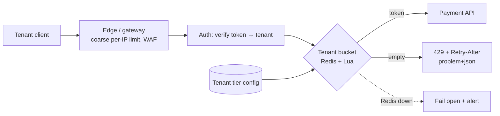
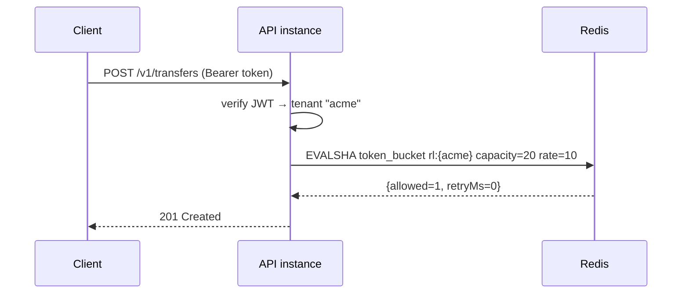

## In one minute

"Design rate limiting for a public payments API used by many tenants." Limits protect the platform and
make sharing fair: one tenant's burst or retry bug must not hurt the others. Use a **token bucket per
tenant** (bursts allowed up to a capacity, steady refill rate), with the state in a shared store
(Redis) and the read-refill-take step made atomic by a Lua script. Then decide, explicitly, what happens
when the limiter itself fails. [Capstone 5](#/capstone/instant-p2p) is the tested implementation.

## Analogy

A token bucket is a ticket machine at a museum: tickets are printed at a steady rate and the dispenser
holds at most N. A school group can take a burst of tickets at once, but then has to wait for new ones.

## Diagram



## Build it step by step

### R: Requirements

- **Functional:** limit requests per tenant (and optionally per API key, per endpoint); tiers (standard,
  premium); return 429 with when to retry; change limits without redeploying.
- **Non-functional:** adds < 2 ms p99 to a request (assumption); correct across all API instances; the
  limiter must not become a single point of failure for payments.
- **Clarify:** per tenant or per end user? Hard limit or burst allowance? Are some endpoints (status reads)
  cheaper than others? Fail open or closed if the limiter breaks?

### E: Estimation (assumptions stated)

```text
Tenants: 5,000; API traffic at peak 20,000 requests/s across all instances
Limiter calls: 1 per request → 20,000 Redis script calls/s at peak
State: 5,000 tenants × few endpoint buckets × ~100 B ≈ well under 10 MB
Latency: one Redis round trip in the same zone, typically sub-millisecond (measure in your environment)
Redis: a small primary + replica handles this rate; use cluster mode if limits per end user (millions of keys)
```

### S: Schema

Redis hash per bucket: `rl:{tenant}:{endpoint}` → `tokens` (float), `ts` (ms), with a TTL equal to the time
to refill fully. Tenant tiers live in the config database and are cached in each instance:

```sql
CREATE TABLE tenant_limit (
    tenant_id   VARCHAR(64) PRIMARY KEY,
    tier        VARCHAR(16) NOT NULL,
    capacity    INT         NOT NULL CHECK (capacity > 0),
    refill_per_second NUMERIC(10,3) NOT NULL CHECK (refill_per_second > 0),
    version     BIGINT      NOT NULL
);
```

### H: Happy path



### A: API behaviour

```http
HTTP/1.1 429 Too Many Requests
Retry-After: 2
Content-Type: application/problem+json

{"type": "https://api.example.com/problems/rate-limited", "title": "Too many requests",
 "status": 429, "detail": "Rate limit exceeded for your tenant"}
```

Admin API for limits: `PUT /v1/tenants/{id}/limits` with `If-Match` (no lost updates between two
operators), audited. The IETF `RateLimit` header fields are still a draft; `Retry-After` is the stable header.

### D: Deep dive 1: algorithm choice (about 6 minutes)

| Algorithm | Behaviour | Memory | Main weakness |
|---|---|---|---|
| Fixed window counter | N per minute, resets on the minute | 1 counter | Up to 2N around a window boundary |
| Sliding log | Exact: stores each request time | O(requests) | Memory and cost at high rates |
| Sliding window counter | Weighted current + previous window | 2 counters | Approximate |
| **Token bucket** | Burst up to capacity, steady refill | 2 values | Needs atomic update |
| Leaky bucket (queue) | Smooths output rate | Queue | Adds latency; not for sync APIs |

Choose a token bucket: O(1) state, bursts match real traffic (payroll runs), and the steady rate protects
downstream systems. Make it atomic with a Lua script that uses **Redis's clock**, so app servers with
drifting clocks can't break it. Excerpt from the tested [capstone 5 script](#/capstone/instant-p2p):

```lua
local t = redis.call('TIME')
local now = tonumber(t[1]) * 1000 + math.floor(tonumber(t[2]) / 1000)
local data = redis.call('HMGET', KEYS[1], 'tokens', 'ts')
local tokens = tonumber(data[1]) or capacity
local ts = tonumber(data[2]) or now
tokens = math.min(capacity, tokens + math.max(0, now - ts) * rate / 1000)
-- take one token if available, else compute retry_ms; HSET + PEXPIRE; return {allowed, retry_ms}
```

### D: Deep dive 2: where to enforce, and what if Redis fails (about 7 minutes)

- **Layering:** a coarse per-IP limit at the edge (stops anonymous floods before JWT validation);
  per-tenant buckets after authentication (fairness); per-endpoint costs (a bulk payout = 10 tokens).
- **Failure policy:** with a 200 ms Redis timeout, fail **open** with an alert for a *fairness* control. A
  Redis outage then degrades fairness, not payments. Add a local in-memory bucket per instance
  (limit ÷ instance count) as a rough fallback. For a *safety* control (e.g. a hard cap on payout value
  per day), fail **closed**.
- **Hot keys:** one huge tenant on one Redis key: shard its bucket into K sub-buckets (each with
  capacity/K) chosen by a hash of the request id.
- **Retries:** clients that ignore `Retry-After` and retry instantly make overload worse. Document
  exponential backoff with jitter in your API guide.

### E: Failure-mode table

| Failure | Detection | Mitigation | Blast radius |
|---|---|---|---|
| Redis slow | Limiter latency p99 | 200 ms timeout → fail open + local fallback | Fairness only |
| Redis down | Error rate, alert | Fail open + local buckets; page on-call | Fairness only |
| Tenant retry storm | 429 rate per tenant | Bucket absorbs it; contact tenant | That tenant only |
| Wrong config (limit too low) | 429 spike after a config change | Versioned config, rollback, If-Match on edits | One tenant tier |
| Clock skew between app servers | n/a | Redis server time inside the script | None |

### Consistency and security

Bucket updates are atomic per key (single Redis primary); replicas are not used for limiting. Tenant
identity comes only from the verified token. Rate-limit responses reveal nothing about other tenants.
This is OWASP API4 (unrestricted resource consumption) mitigation.

### SLIs/SLOs (illustrative)

Limiter added latency p99 < 2 ms; limiter availability 99.99% (fail-open counted as degraded, not down);
false 429 rate (limited while under quota, from audits) ≈ 0.

### Deliver: 60-second pitch

"Per-tenant token buckets in Redis, made atomic by a Lua script using Redis time, checked after
authentication so tenant identity is trusted. A coarse per-IP limit sits at the edge. 429 responses carry
Retry-After and a problem body. If Redis is slow or down we fail open with local fallback buckets and an
alert, because this is a fairness control. Limits are tiered, versioned and editable without a deploy.
At 20,000 requests per second, one small Redis primary with a replica is enough."

## What goes wrong

**Bug: per-instance limits.** Each of 10 instances allows 100 requests/s, so a tenant really gets
1,000/s, and after autoscaling to 20 instances, 2,000/s. The downstream PSP gets overloaded.

**Fix:** shared state (Redis bucket) for the real limit; local buckets only as a degraded fallback.

**Test:** capstone 5's `rateLimitIsPerTenant` and its two-tenant load test (the noisy tenant got 936 × 429
while the quiet tenant got all 1,000 transfers through).

## Trade-offs: when NOT to use a central limiter

- Very high rates per tenant (hundreds of thousands per second): use local limiters with periodic sync,
  and accept approximate limits.
- Internal service-to-service traffic: use concurrency limits/bulkheads and backpressure instead.

## Interview Q&A (follow-ups)

**Warm-up: "Why 429 and not 503?"**
- *Model answer:* 429 says *you* sent too many; 503 says *we* are unavailable. Clients react differently.
- *Common wrong answer:* "Either works."
- *Why it fails:* it breaks clients' retry and alerting logic.

**Standard: "Why a Lua script?"**
- *Model answer:* read, refill and take must be atomic across instances; Redis runs a script without
  interleaving other commands on the key.
- *Common wrong answer:* "GET then SET from Java."
- *Why it fails:* two instances read the same tokens and both take the last one.

**Standard: "Fail open or closed?"**
- *Model answer:* open for fairness limits with an alert and local fallback; closed for safety caps.
- *Common wrong answer:* "Closed, to be safe."
- *Why it fails:* a Redis blip would stop all payments.

**Standard: "How do you rate-limit by money, not requests?"**
- *Model answer:* a separate control: a per-tenant value cap checked in the payment transaction (or a
  bucket whose cost is the amount), failing closed, because it is a safety control.
- *Common wrong answer:* "Use the same request limiter."
- *Why it fails:* request count says nothing about value at risk.

**Deep: "One tenant is 40% of traffic. Problems?"**
- *Model answer:* a hot key on one Redis shard; split its bucket into sub-buckets, and consider a dedicated
  tier and capacity planning.
- *Common wrong answer:* "Redis is fast enough."
- *Why it fails:* single-key throughput is bounded by one shard's CPU.

**Deep: "How do you test it?"**
- *Model answer:* integration tests on real Redis (Testcontainers) for burst and refill; a multi-tenant load
  test that proves isolation; fault injection for Redis timeouts.
- *Common wrong answer:* "Unit-test the algorithm with a mock."
- *Why it fails:* the atomicity and distribution problems only show up with a real shared store.

## Common mistakes

- Limiting before authentication (wrong identity) or only per instance.
- No Retry-After; no failure policy.
- Ignoring client retry storms.

## Say it in 30 seconds

"Token bucket per tenant in Redis, atomic via Lua with Redis time, enforced after authentication, 429 with
Retry-After, fail open with local fallback for fairness limits and closed for value caps, tiered limits
changed without deploys."

## Recap

- Token bucket: bursts plus a steady rate, O(1) state.
- Atomic shared state; server clock.
- Decide and document the failure policy.

## See also

- [Track 02: Distributed rate limiting](#/tracks/track-02/lessons/track-02-lesson-17)
- [Track 01: Rate limiting, throttling and back pressure](#/tracks/track-01/lessons/track-01-lesson-14)
- [Capstone 5: instant P2P](#/capstone/instant-p2p)

<!-- KNOWLEDGE-CHECK
[
  {
    "id": "kc-1406-01",
    "question": "Why is the token bucket's read-refill-take step run as a Redis Lua script?",
    "options": [
      "Lua is faster than Java",
      "Redis runs the script without interleaving other commands on the key, so two API instances can't both take the last token; GET then SET from Java would race",
      "Lua scripts are persisted to disk",
      "It avoids the need for authentication"
    ],
    "correct": 1,
    "explanation": "The step must be atomic across instances. The script also uses Redis's own clock (TIME), so app servers with drifting clocks can't break the refill math."
  },
  {
    "id": "kc-1406-02",
    "question": "Redis, used for per-tenant fairness limits, becomes slow or unavailable. What should the limiter do?",
    "options": [
      "Fail closed: reject all requests until Redis recovers",
      "Retry Redis until it answers",
      "Fail open with an alert and fall back to a rough local in-memory bucket per instance",
      "Switch every tenant to the lowest tier"
    ],
    "correct": 2,
    "explanation": "For a fairness control, a Redis outage should degrade fairness, not stop payments. Safety controls, such as a hard daily cap on payout value, fail closed instead."
  },
  {
    "id": "kc-1406-03",
    "question": "Each of 10 API instances allows 100 requests per second per tenant using local counters. What is the real limit?",
    "options": [
      "About 1,000 per second, and it grows with every instance autoscaling adds",
      "Exactly 100 per second",
      "100 per second divided by 10",
      "It depends on the load balancer only"
    ],
    "correct": 0,
    "explanation": "Per-instance limits multiply with the instance count. The real limit needs shared state; local buckets are only a degraded fallback."
  },
  {
    "id": "kc-1406-04",
    "question": "A tenant goes over its limit. What response is correct?",
    "options": [
      "200 with an error message in the body",
      "503 Service Unavailable",
      "401 Unauthorized",
      "429 Too Many Requests with a Retry-After header and a problem+json body"
    ],
    "correct": 3,
    "explanation": "429 says the client sent too many; 503 says the server is unavailable. Clients react differently, so the distinction matters for their retry and alerting logic."
  }
]
-->

<!-- PRACTICAL-CHALLENGE
{
  "id": "pc-1406",
  "title": "Distributed rate limiter",
  "description": "Build a per-tenant rate limiter and prove its behaviour with tests.",
  "tasks": [
    {
      "id": "pc-1406-01",
      "description": "Implement a token bucket in a Redis Lua script that uses redis.call('TIME'), with capacity and refill rate as arguments, returning {allowed, retryMs}. Call it from a Spring filter that runs after authentication and returns 429 with Retry-After."
    },
    {
      "id": "pc-1406-02",
      "description": "Write integration tests on real Redis (Testcontainers): a burst up to capacity passes, the next request gets 429, and a request after the refill interval passes again. Add a two-tenant test proving a noisy tenant doesn't consume the quiet tenant's quota."
    },
    {
      "id": "pc-1406-03",
      "description": "Add the failure policy: a 200 ms Redis timeout, fail open with a local per-instance bucket and a metric/alert. Test it by pausing the Redis container."
    }
  ]
}
-->
