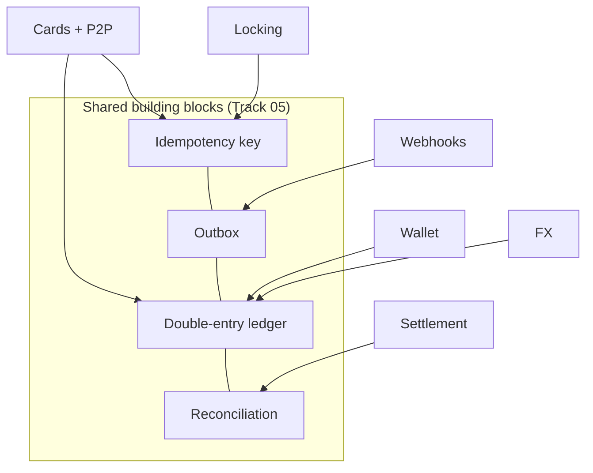
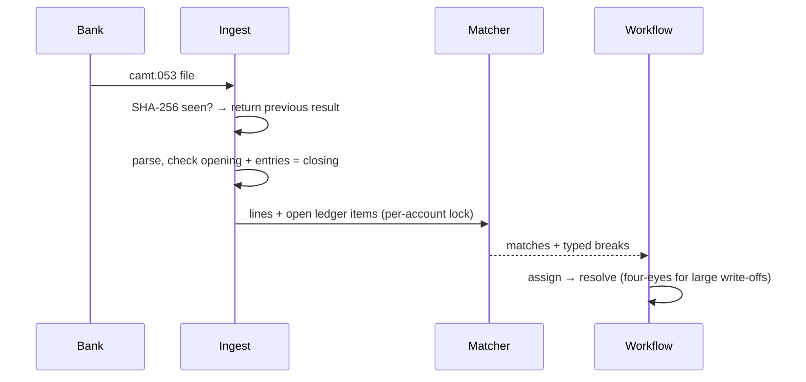
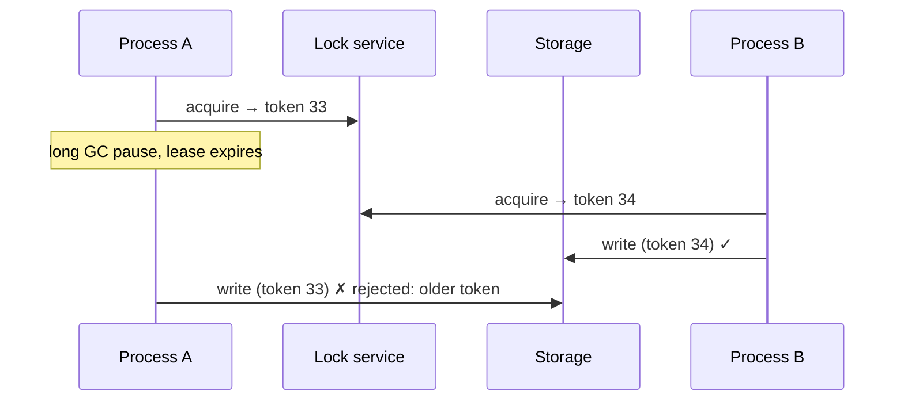

## في دقيقة واحدة

ست مشكلات يكثر السؤال عنها، كل منها كإجابة RESHADED مختصرة تستطيع توسيعها إلى 45 دقيقة: المتطلبات، وسطر تقدير واحد، والمخطط الأساسي، ورسم، والواجهة، وأصعب نقطتين، وجدول إخفاقات قصير، وعرض. ولأربع منها تنفيذ كامل مختبر في المشاريع الختامية. فاستخدمها للعمق واستخدم هذا الدرس للاتساع. واقضِ نحو 10 دقائق لكل مشكلة: اقرأها، ثم قل العرض بصوت عالٍ دون ملاحظات.

## تشبيه

افتتاحيات الشطرنج: لا تحفظ مباريات كاملة، لكنك تعرف النقلات الأولى والفخاخ النموذجية لكل افتتاحية، فيبدأ وسط المباراة من موقع قوي.

## المخطط

## ابنِه خطوة بخطوة

### المشكلة A: المحفظة الرقمية (النسخة المعمقة: [المشروع الختامي 2](#/capstone/wallet-ledger))

- **‏R:** الشحن، والدفع، والتحويل بين الأفراد، وأرصدة متعددة العملات؛ ولا رصيد سالب أبدًا؛ وفوري.
- **‏E:** ‏5 ملايين مستخدم × 3 معاملات/يوم = 15 مليون/يوم ≈ 174/ثانية في المتوسط، ≈ 870/ثانية في الذروة (5×).
- **‏S:** ‏`account(currency, balance_minor, version)`، و`journal_entry(idempotency_key UNIQUE)`، و`posting(signed amount)`.
- **‏H:** الواجهة ← دفتر الأستاذ (معاملة ACID واحدة لكل تحويل) ← صندوق الصادر ← الإشعارات.
- **‏A:** ‏`POST /v1/transfers` مع `Idempotency-Key`؛ و`GET /v1/wallets/{id}`؛ ومشكلة 422 لعدم كفاية الرصيد.
- **أصعب النقاط:** الإنفاق المتزامن (اقفل الحسابات بترتيب المعرّف، أو `UPDATE … WHERE balance >= :x` مشروط)؛ والشحن من البطاقات إضافة *معلقة* حتى التحصيل.
- **الإخفاقات:** طلب مكرر ← إعادة بالمفتاح؛ وجمود ← قفل مرتب؛ وانحراف الرصيد ← مطابقة.
- **العرض:** "دفتر أستاذ بالقيد المزدوج مع قفل مرتب وثوابت تفرضها قاعدة البيانات؛ وتحويلات عديمة الأثر عند التكرار؛ والمطابقة تثبت أن الأرصدة تساوي القيود."

### المشكلة B: التسوية والمطابقة (النسخة المعمقة: [المشروع الختامي 4](#/capstone/settlement-reconciliation))

- **‏R:** استيعاب ملفات البنوك أو الشبكات اليومية، ومطابقتها مع دفتر أستاذنا، وتصنيف الفروقات وحسمها.
- **‏E:** ‏2 مليون سطر/يوم عبر 20 حسابًا بنكيًا؛ وملفات حتى ~400 ميغابايت (افتراض) ← تحليل متدفق، وإدراجات دفعية.
- **‏S:** ‏`statement_file(sha256 UNIQUE)`، و`statement_line`، و`ledger_item`، و`match(UNIQUE line, UNIQUE item)`، و`recon_break(type, status, version)`، و`break_event` ‏(للإلحاق فقط).
- **‏H:** ‏SFTP/واجهة ← مخزن الملفات ← المحلل (آمن من XXE، وفحص التوازن) ← المطابِق ← الكسور ← واجهة سير العمل.

- **أصعب النقاط:** لا تطابق المرشحين الغامضين تلقائيًا أبدًا؛ وفروقات التوقيت ليست كسورًا حتى تتجاوز سماحية معينة؛ والملفات المصححة المعاد إرسالها تحتاج مسارًا صريحًا مدققًا.
- **العرض:** "استيعاب عديم الأثر عند التكرار ومتحقق منه؛ ودالة مطابقة نقية مختبرة؛ وكسور مصنفة؛ وسير عمل مدقق بمبدأ الصانع والمدقق."

### المشكلة C: الإشعارات وwebhooks ‏(النسخة المعمقة: [المشروع الختامي 5](#/capstone/instant-p2p))

- **‏R:** إبلاغ العملاء (إشعارات الدفع، والبريد) والشركاء (webhooks) بأحداث الدفع، بموثوقية، دون أن يكون للتكرارات أثر.
- **‏E:** ‏20 مليون حدث/يوم ≈ 230/ثانية في المتوسط، ≈ 1,150/ثانية في الذروة؛ ونقاط webhook تتفاوت من 50 مللي ثانية إلى 30 ثانية.
- **‏S:** ‏`webhook_endpoint(tenant, url, secret)`، و`delivery(id, status, attempts, next_attempt_at, lease_until)`.
- **‏H:** الأحداث (صندوق الصادر ← Kafka) ← خدمة التسليم ← طوابير لكل مستأجر ← HTTP مع إعادات المحاولة.
- **‏A:** ‏`PUT /v1/webhooks` ‏(عنوان متحقق منه، والسر يُعاد مرة واحدة)؛ والترويسات `Webhook-Id`، و`Webhook-Timestamp`، و`Webhook-Signature` ‏(HMAC).
- **أصعب النقاط:** مرة واحدة على الأقل بالتصميم (يزيل المستقبِلون التكرار حسب `Webhook-Id`)؛ واستئجار الصفوف بدل حجز أقفال قاعدة البيانات أثناء استدعاءات HTTP؛ والتراجع مع التشتيت، ثم DEAD؛ وفحوص SSRF على عناوين المستأجرين؛ ويجب ألا يؤخر مستأجر بطيء الآخرين (حدود تزامن لكل مستأجر).

| الإخفاق | التخفيف |
|---|---|
| نقطة متعطلة لساعات | تراجع أسي مع تشتيت، وحد أقصى للمحاولات، وDEAD + أداة إعادة |
| نقطة بطيئة | سقف تزامن لكل مستأجر، ومهلة قراءة 5 ثوانٍ |
| انتحال التوقيع / الإعادة | ‏HMAC على المعرّف + الطابع الزمني + الجسم؛ ورفض الطوابع الزمنية القديمة |

- **العرض:** "مغذّى من صندوق الصادر، ومستأجر، وموقّع، ومعاد محاولته مع التشتيت، ومزال تكراره حسب المعرّف عند المستقبِل، ومعزول لكل مستأجر."

### المشكلة D: صرف العملات (النسخة المعمقة: جزء صرف العملات في [المشروع الختامي 2](#/capstone/wallet-ledger))

- **‏R:** تقديم سعر، وتمكين العميل من القبول خلال N ثانية، والتحويل بين المحافظ.
- **‏E:** مليون عملية تحويل/يوم ≈ 12/ثانية؛ وتحديثات الأسعار مرات كثيرة في الثانية لكل زوج من بيانات السوق.
- **‏S:** ‏`fx_quote(id, pair, rate NUMERIC(18,8), sell_minor, buy_minor, expires_at, used_at)`.
- **‏H:** تغذية بيانات السوق ← خدمة الأسعار (السعر الأوسط + الهامش) ← واجهة العروض ← دفتر الأستاذ (4 قيود عبر حسابات مراكز الصرف).
- **‏A:** ‏`POST /v1/fx/quotes` ← عرض بانتهاء صلاحية؛ و`POST /v1/fx/conversions {quoteId}` مع `Idempotency-Key`.
- **أصعب النقاط:** يُستهلك العرض مرة واحدة بالضبط قبل انتهاء صلاحيته (`UPDATE … WHERE used_at IS NULL AND expires_at > now()` مشروط واحد)؛ والتقريب قاعدة مكتوبة (مثل التقريب للأسفل لصالح العميل) تُطبق في مكان واحد؛ وتتوازن كل عملة بشكل منفصل في دفتر الأستاذ؛ ويجب أن تُوقف بيانات السوق القديمة تقديم العروض (قاطع دائرة على عمر التغذية).
- **العرض:** "عروض قصيرة العمر للاستخدام مرة واحدة؛ وتقريب صريح؛ ومُدخلات دفتر أستاذ متوازنة بـ 4 قيود؛ وإيقاف العروض حين تكون الأسعار قديمة."

### المشكلة E: القفل الموزع لتحديثات الرصيد

- **‏R:** "يجب أن تحدّث عملية واحدة فقط الحساب في كل مرة." وضّح لماذا. فعادة ما يُحتاج فعلًا هو *عدم فقدان التحديثات*، لا قفل.
- **هيكل الإجابة:**
  1. فضّل قاعدة البيانات: `SELECT … FOR UPDATE`، أو `UPDATE` مشروط، أو `@Version`. فالصف *هو* القفل، ولا يمكن أن ينتهي في منتصف الكتابة.
  2. إن لزمت خدمة أقفال (مثل تنسيق مهمة عبر الخدمات)، فاستخدم عقود إيجار مع **رموز تسييج (fencing tokens)**: يحمل كل منح رقمًا متزايدًا، ويرفض المورد الكتابات التي تحمل رقمًا أقدم.
  3. **نقد Redlock:** لقفل Redis ‏(عقدة واحدة أو Redlock عبر عدة عقد) مدة صلاحية. والعملية التي تتوقف (GC، أو تعطل الآلة الافتراضية، أو الشبكة) أطول من المدة تفقد القفل دون أن تعرف وتكتب مع ذلك. ويعتمد Redlock أيضًا على انحراف ساعات محدود وافتراضات توقيت. ودون التسييج، الصحة غير مضمونة، فاستخدمه فقط للكفاءة (تجنب العمل المكرر)، لا لصحة الأموال أبدًا. ‏(انظر تحليل Kleppmann لعام 2016 في المراجع وتوثيق Redis نفسه للرأي المقابل.)

- **العرض:** "استخدم صف قاعدة البيانات كقفل للأموال. وإن لم يكن هناك مفر من خدمة أقفال، فاستخدم عقود إيجار مع رموز تسييج يفحصها المورد. وأقفال Redis للكفاءة، لا للصحة."

### المشكلة F: تفويض البطاقات والتحويل الفوري بين الأفراد (النسختان المعمقتان: [المشروع الختامي 3](#/capstone/card-authorisation)، [المشروع الختامي 5](#/capstone/instant-p2p))

- **البطاقات، R:** التفويض (الحجز)، والتحصيل (ربما جزئيًا، قبل انتهاء الصلاحية)، والعكس، والاسترداد، ورد المبلغ؛ وفحص احتيال ضمن ميزانية زمن الاستجابة.
- **البطاقات، أصعب النقاط:** آلة حالات بثوابت المبالغ (المحصّل ≤ المفوّض؛ والمسترد + المردود ≤ المحصّل)؛ وعمليات عديمة الأثر عند التكرار حسب معرّف العملية؛ وتحصيلات متزامنة بقفل متفائل + إعادة محاولة؛ واستدعاء الاحتيال بمهلة، وقاطع، وحاجز، وسياسة بديلة مكتوبة؛ ورموز البطاقات فقط.
- **التحويل الفوري بين الأفراد، R:** إرسال الأموال بين مستخدمي المنصة (أو عبر قناة فورية) خلال ثوانٍ، بتعدد المستأجرين.
- **التحويل بين الأفراد، أصعب النقاط:** الهوية من الرمز فقط، والملكية تُفحص في الاستعلام (BOLA)؛ وخصم مشروط؛ وحدود معدل لكل مستأجر؛ وwebhooks إلى أنظمة الشركاء الخلفية؛ وللقنوات الخارجية، الدفعة نهائية بمجرد قبول القناة لها، فلا "تراجع"، بل دفعة إرجاع جديدة فقط.

| الإخفاق | التخفيف |
|---|---|
| محرك الاحتيال بطيء | انتهاء المهلة ← سياسة بديلة حسب المبلغ |
| تحصيل بعد انتهاء الصلاحية | ترفضه آلة الحالات؛ ويعيد التاجر التفويض |
| انتهاء مهلة القناة لدفعة فورية | حالة غير معروفة ← استعلام عن الحالة في القناة، ولا إعادة إرسال بمعرّف جديد أبدًا |

- **العرض (البطاقات):** "آلة حالات بأنواع مختومة وقواعد مبالغ تفرضها قاعدة البيانات، وعمليات عديمة الأثر عند التكرار، وخطاف احتيال خلف مهلة وقاطع وحاجز مع بديل صريح."

## ما الذي يسوء

**الخطأ: إجابة عامة واحدة لكل مشكلة.** "خدمات مصغّرة + Kafka + Redis" للست جميعًا. فلا يسمع المُقابِل أي مخاطرة خاصة بالمشكلة: انتهاء صلاحية العرض لصرف العملات، والغموض للمطابقة، والتوقفات للأقفال.

**الإصلاح:** لكل مشكلة، سمِّ مخاطرتها المميزة *الواحدة* في الدقائق الخمس الأولى وصمّم حولها.

**الاختبار:** غطِّ العروض، ولكل مشكلة، قل المخاطرة المميزة في جملة واحدة. فاتتك واحدة؟ أعد قراءة ذلك القسم.

## المقايضات: متى لا تستخدم الصيغة المختصرة

حين يطرح المُقابِل إحدى هذه كسؤال الـ 45 دقيقة الرئيسي، وسّعها بخطة RESHADED كاملة: تقديرات بالحسابات، ومخطط كامل، والتسلسلان، وجدول إخفاقات كامل، وأهداف مستوى الخدمة. واستخدم ملف README للمشروع الختامي المقابل كمادتك المعمقة.

## أسئلة وأجوبة المقابلة

**إحماء: "ما المخاطرة المميزة في تصميم صرف العملات؟"**
- *الإجابة النموذجية:* استخدام العرض مرتين أو بعد انتهاء صلاحيته، والتقريب الذي يخلق المال أو يعدمه.
- *الإجابة الخاطئة الشائعة:* "زمن الاستجابة."
- *لماذا تفشل:* تفوّت مخاطر الصحة التي تكلف أموالًا.

**قياسي: "لماذا يجب أن تكون webhooks مرة واحدة على الأقل؟"**
- *الإجابة النموذجية:* لا نستطيع معرفة ما إذا كان المستقبِل قد عالج طلبًا انتهت مهلته، فنعيد المحاولة بالمعرّف نفسه ويزيل المستقبِل التكرار.
- *الإجابة الخاطئة الشائعة:* "سنضمن التسليم مرة واحدة بالضبط."
- *لماذا تفشل:* مستحيل عبر شبكة غير موثوقة إلى طرف ثالث.

**قياسي: "هل يجب أن نطابق أسطر البنك ذات المبلغ نفسه تلقائيًا؟"**
- *الإجابة النموذجية:* فقط حين يوجد مرشح واحد بالضبط ضمن نافذة التاريخ؛ والغموض يذهب إلى إنسان.
- *الإجابة الخاطئة الشائعة:* "نعم، طابق أقرب تاريخ."
- *لماذا تفشل:* مطابقة خاطئة تخفي كسرين حقيقيين.

**عميق: "هل Redlock آمن لمنع الإنفاق المزدوج؟"**
- *الإجابة النموذجية:* لا. فالتوقفات وانتهاء الصلاحية يعنيان أن حاملَين قد يتصرفان؛ وتحتاج الصحة رموز تسييج أو، الأفضل، قيدًا في قاعدة البيانات أو تحديثًا مشروطًا عند الكتابة نفسها.
- *الإجابة الخاطئة الشائعة:* "نعم، مع خمس عقد Redis."
- *لماذا تفشل:* عقد أكثر لا تصلح عميلًا متوقفًا.

**عميق: "تنتهي مهلة دفعة فورية عند القناة. ماذا تفعل؟"**
- *الإجابة النموذجية:* علّمها غير معروفة، واستعلم عن حالتها في القناة بمعرّفنا من طرف إلى طرف، واحسمها؛ ولا تعد الإرسال بمعرّف جديد أبدًا؛ وطابق في نهاية اليوم.
- *الإجابة الخاطئة الشائعة:* "أعد محاولة الدفعة."
- *لماذا تفشل:* قد ترسل دفعة جديدة الأموال مرتين، والمدفوعات الفورية لا يمكن استرجاعها بحرية.

## قلها في 30 ثانية

"ستة تصاميم مختصرة، لكل منها مخاطرة مميزة واحدة: المحفظة (الإنفاق المتزامن)، والتسوية (المطابقات الغامضة)، وwebhooks ‏(تسليم غير معروف، فمرة واحدة على الأقل مع إزالة التكرار)، وصرف العملات (عروض للاستخدام مرة واحدة تنتهي صلاحيتها والتقريب)، والقفل (التوقفات، فرموز التسييج أو قاعدة البيانات)، والبطاقات والتحويل بين الأفراد (آلات الحالات، وفحوص الملكية، ونتائج القنوات غير المعروفة)."

## الخلاصة

- لكل مشكلة مخاطرة مميزة واحدة؛ فسمّها مبكرًا.
- اللبنات نفسها تتكرر: عدم التكرار، وصندوق الصادر، ودفتر الأستاذ، والمطابقة.
- استخدم المشاريع الختامية كمادة معمقة لأربع من الست.

## انظر أيضًا

- [المسار 05: عدم التكرار](#/tracks/track-05/lessons/track-05-lesson-12)
- [المسار 02: الأقفال الموزعة](#/tracks/track-02/lessons/track-02-lesson-09)
- [المسار 04: المدفوعات الفورية](#/tracks/track-04/lessons/track-04-lesson-08)
- [مرجع: الأنماط، والتقدير، واختيار قاعدة البيانات](#/tracks/track-14/lessons/track-14-lesson-08)

<!-- KNOWLEDGE-CHECK
[
  {
    "id": "kc-1407-01",
    "question": "ما المخاطرة المميزة التي يجب تسميتها مبكرًا في تصميم تحويل العملات؟",
    "options": [
      "زمن الاستجابة في الشبكة بين مراكز البيانات",
      "استخدام العرض مرتين أو بعد انتهاء صلاحيته، والتقريب الذي يخلق المال أو يعدمه",
      "حجم تغذية بيانات السوق",
      "الاختيار بين REST وgRPC"
    ],
    "correct": 1,
    "explanation": "يجب أن يُستهلك العرض مرة واحدة بالضبط قبل انتهاء صلاحيته (UPDATE مشروط واحد)، ويجب أن يكون التقريب قاعدة مكتوبة تُطبق في مكان واحد، مع توازن كل عملة بشكل منفصل في دفتر الأستاذ."
  },
  {
    "id": "kc-1407-02",
    "question": "لماذا يجب أن يكون تسليم webhooks مرة واحدة على الأقل؟",
    "options": [
      "لأن HTTP لا يدعم المرة الواحدة بالضبط بحكم القانون",
      "لأن المستقبِلين يفضلون التكرارات",
      "لا نستطيع معرفة ما إذا كان المستقبِل قد عالج طلبًا انتهت مهلته، فنعيد المحاولة بـ Webhook-Id نفسه ويزيل المستقبِل التكرار",
      "لأن Kafka مرة واحدة على الأقل"
    ],
    "correct": 2,
    "explanation": "التسليم مرة واحدة بالضبط إلى طرف ثالث عبر شبكة غير موثوقة مستحيل. فوقّع الحمولة (HMAC على المعرّف، والطابع الزمني، والجسم) ووثّق إزالة التكرار حسب المعرّف."
  },
  {
    "id": "kc-1407-03",
    "question": "هل Redlock آمن لمنع الإنفاق المزدوج؟",
    "options": [
      "لا: قد يعيش عميل متوقف أطول من عقد إيجاره ويكتب مع ذلك. وتحتاج الصحة رموز تسييج أو، الأفضل، قيدًا في قاعدة البيانات أو تحديثًا مشروطًا عند الكتابة نفسها",
      "نعم، مع خمس عقد Redis أو أكثر",
      "نعم، إن كانت مدة الصلاحية طويلة بما يكفي",
      "نعم، لأن Redis أحادي الخيط"
    ],
    "correct": 0,
    "explanation": "العقد الأكثر لا تصلح عميلًا متوقفًا (GC، أو تعطل الآلة الافتراضية). فاستخدم أقفال Redis للكفاءة فقط، مثل تجنب العمل المكرر، لا لصحة الأموال أبدًا."
  },
  {
    "id": "kc-1407-04",
    "question": "تنتهي مهلة دفعة فورية عند القناة. ماذا تفعل؟",
    "options": [
      "أعد محاولتها بمعرّف جديد من طرف إلى طرف",
      "علّمها فاشلة وأعد المبلغ للعميل",
      "اطلب من العميل المحاولة مجددًا",
      "علّمها غير معروفة، واستعلم عن حالتها في القناة بمعرّفنا من طرف إلى طرف، واحسمها، وطابق في نهاية اليوم؛ ولا تعد الإرسال بمعرّف جديد أبدًا"
    ],
    "correct": 3,
    "explanation": "المدفوعات الفورية نهائية بمجرد قبول القناة لها ولا يمكن استرجاعها بحرية، فإعادة الإرسال بمعرّف جديد قد ترسل الأموال مرتين."
  }
]
-->

<!-- PRACTICAL-CHALLENGE
{
  "id": "pc-1407",
  "title": "ست مشكلات، ستة عروض",
  "description": "حوّل الإجابات المختصرة إلى استجابات متدرب عليها ومؤقتة.",
  "tasks": [
    {
      "id": "pc-1407-01",
      "description": "لكل من المشكلات الست (المحفظة، والتسوية، وwebhooks، وصرف العملات، والقفل، والبطاقات/التحويل بين الأفراد)، اكتب المخاطرة المميزة في جملة واحدة والآلية التي تعالجها."
    },
    {
      "id": "pc-1407-02",
      "description": "اختر مشكلة واحدة ووسّعها إلى إجابة RESHADED كاملة في 45 دقيقة على الورق، مع التقديرات، والمخطط، والتسلسلين، وجدول إخفاقات."
    },
    {
      "id": "pc-1407-03",
      "description": "سجّل نفسك وأنت تقدم العروض الستة ذات الـ 60 ثانية. وأعد سماعها وتحقق أن كلًا منها يسمّي مخاطرته المميزة في أول 15 ثانية."
    }
  ]
}
-->
