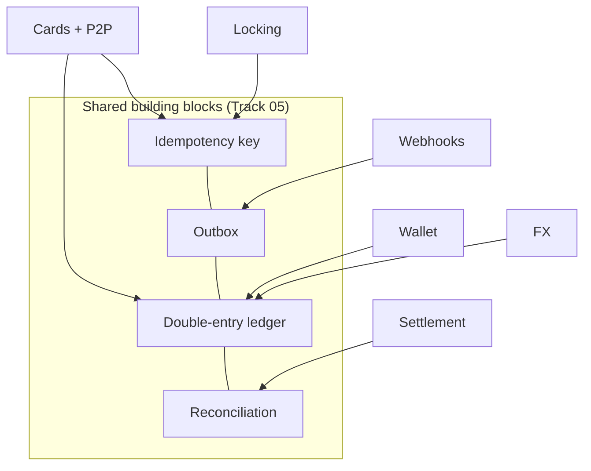
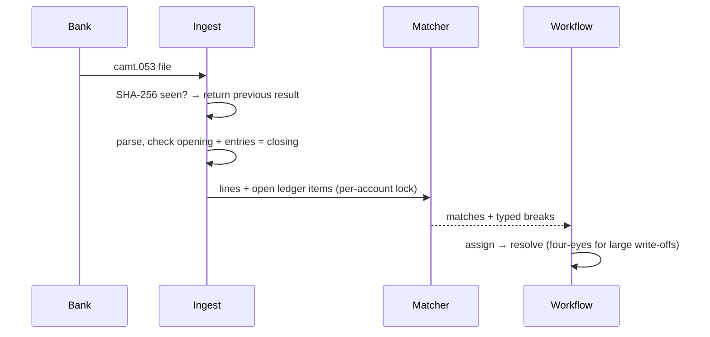
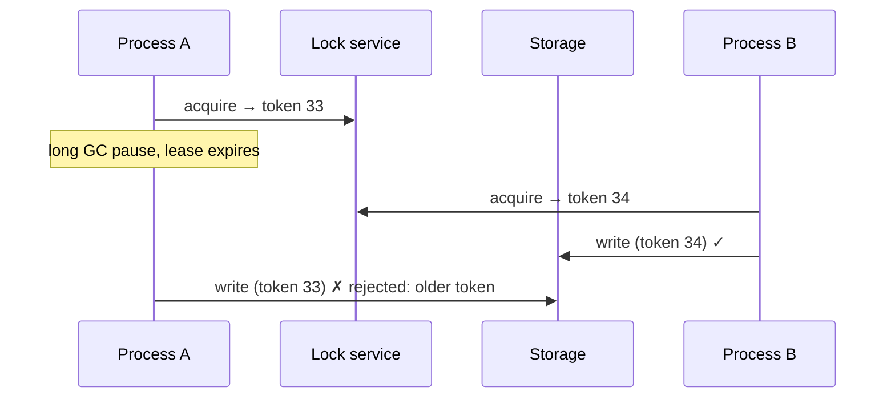

## In one minute

Six frequently asked problems, each as a compact RESHADED answer you can expand to 45 minutes:
requirements, one estimate line, key schema, a diagram, the API, the two hardest points, a short failure
table and a pitch. Four of them have a full, tested implementation in the capstones. Use those for depth
and this lesson for breadth. Spend about 10 minutes per problem: read it, then say the pitch aloud
without notes.

## Analogy

Chess openings: you don't memorise whole games, but you know the first moves and the typical traps of
each opening, so the middle game starts from a strong position.

## Diagram

## Build it step by step

### Problem A: Digital wallet (deep version: [capstone 2](#/capstone/wallet-ledger))

- **R:** top up, pay, P2P transfer, multi-currency balances; never negative; instant.
- **E:** 5 M users × 3 transactions/day = 15 M/day ≈ 174/s average, ≈ 870/s peak (5×).
- **S:** `account(currency, balance_minor, version)`, `journal_entry(idempotency_key UNIQUE)`, `posting(signed amount)`.
- **H:** API → ledger (one ACID transaction per transfer) → outbox → notifications.
- **A:** `POST /v1/transfers` with `Idempotency-Key`; `GET /v1/wallets/{id}`; 422 problem for insufficient funds.
- **Hardest points:** concurrent spending (lock accounts in id order, or a conditional `UPDATE … WHERE
  balance >= :x`); top-ups from cards are a *pending* credit until captured.
- **Failures:** duplicate request → key replay; deadlock → ordered locking; balance drift → reconciliation.
- **Pitch:** "A double-entry ledger with ordered locking and DB-enforced invariants; idempotent transfers;
  reconciliation proves balances equal postings."

### Problem B: Settlement and reconciliation (deep version: [capstone 4](#/capstone/settlement-reconciliation))

- **R:** ingest daily bank or scheme files, match them to our ledger, classify and resolve differences.
- **E:** 2 M lines/day across 20 bank accounts; files up to ~400 MB (assumption) → streaming parse, batch inserts.
- **S:** `statement_file(sha256 UNIQUE)`, `statement_line`, `ledger_item`, `match(UNIQUE line, UNIQUE item)`,
  `recon_break(type, status, version)`, `break_event` (append-only).
- **H:** SFTP/API → file store → parser (XXE-safe, balance check) → matcher → breaks → workflow UI.

- **Hardest points:** never auto-match ambiguous candidates; timing differences are not breaks until a
  tolerance passes; re-sent corrected files need an explicit, audited path.
- **Pitch:** "Idempotent, validated ingest; a pure, tested matching function; typed breaks; an audited
  maker-checker workflow."

### Problem C: Notifications and webhooks (deep version: [capstone 5](#/capstone/instant-p2p))

- **R:** notify customers (push, email) and partners (webhooks) on payment events, reliably, without
  duplicates mattering.
- **E:** 20 M events/day ≈ 230/s average, ≈ 1,150/s peak; webhook endpoints vary from 50 ms to 30 s.
- **S:** `webhook_endpoint(tenant, url, secret)`, `delivery(id, status, attempts, next_attempt_at, lease_until)`.
- **H:** events (outbox → Kafka) → delivery service → per-tenant queues → HTTP with retries.
- **A:** `PUT /v1/webhooks` (validated URL, secret returned once); headers `Webhook-Id`,
  `Webhook-Timestamp`, `Webhook-Signature` (HMAC).
- **Hardest points:** at-least-once by design (receivers de-duplicate on `Webhook-Id`); lease rows instead
  of holding DB locks during HTTP calls; backoff with jitter, then DEAD; SSRF checks on tenant URLs; one
  slow tenant must not delay others (per-tenant concurrency limits).

| Failure | Mitigation |
|---|---|
| Endpoint down for hours | Exponential backoff with jitter, max attempts, DEAD + replay tool |
| Slow endpoint | Per-tenant concurrency cap, 5 s read timeout |
| Signature spoofing / replay | HMAC over id + timestamp + body; reject old timestamps |

- **Pitch:** "Outbox-fed, leased, signed, retried with jitter, de-duplicated by id at the receiver, isolated per tenant."

### Problem D: FX exchange (deep version: FX part of [capstone 2](#/capstone/wallet-ledger))

- **R:** quote a rate, let the customer accept within N seconds, convert between wallets.
- **E:** 1 M conversions/day ≈ 12/s; rate updates many times per second per pair from market data.
- **S:** `fx_quote(id, pair, rate NUMERIC(18,8), sell_minor, buy_minor, expires_at, used_at)`.
- **H:** market-data feed → rate service (mid + spread) → quote API → ledger (4 legs through FX position accounts).
- **A:** `POST /v1/fx/quotes` → quote with expiry; `POST /v1/fx/conversions {quoteId}` with `Idempotency-Key`.
- **Hardest points:** a quote is consumed exactly once before expiry (one conditional `UPDATE … WHERE
  used_at IS NULL AND expires_at > now()`); rounding is a written rule (e.g. round down for the customer)
  applied in one place; each currency balances separately in the ledger; stale market data must stop
  quoting (circuit breaker on the feed age).
- **Pitch:** "Short-lived, single-use quotes; explicit rounding; 4-leg balanced ledger entries; stop
  quoting when rates are stale."

### Problem E: Distributed locking for balance updates

- **R:** "Only one process may update an account at a time." Clarify why. Usually what's really needed is
  *no lost updates*, not a lock.
- **Answer structure:**
  1. Prefer the database: `SELECT … FOR UPDATE`, a conditional `UPDATE`, or `@Version`. The row *is*
     the lock, and it can't expire mid-write.
  2. If a lock service is needed (e.g. coordinating a job across services), use leases with **fencing
     tokens**: each grant carries an increasing number, and the resource rejects writes carrying an older
     number.
  3. **Redlock critique:** a Redis lock (single node or Redlock across several) has a TTL. A process that
     pauses (GC, VM stall, network) longer than the TTL loses the lock without knowing and still writes.
     Redlock also relies on bounded clock drift and timing assumptions. Without fencing, correctness isn't
     guaranteed, so use it only for efficiency (avoiding duplicate work), never for money correctness.
     (See Kleppmann's 2016 analysis in the references and Redis's own documentation for the opposing view.)

- **Pitch:** "Use the database row as the lock for money. If a lock service is unavoidable, use leases with
  fencing tokens checked by the resource. Redis locks are for efficiency, not correctness."

### Problem F: Card authorisation and instant P2P (deep versions: [capstone 3](#/capstone/card-authorisation), [capstone 5](#/capstone/instant-p2p))

- **Cards, R:** authorise (hold), capture (possibly partial, before expiry), reverse, refund, chargeback;
  a fraud check within the latency budget.
- **Cards, hardest points:** a state machine with amount invariants (captured ≤ authorised; refunded +
  charged back ≤ captured); idempotent operations by operation id; concurrent captures with optimistic
  locking + retry; fraud call with timeout, breaker, bulkhead and a written stand-in policy; card tokens only.
- **Instant P2P, R:** send money between users of the platform (or across a real-time rail) in seconds,
  multi-tenant.
- **P2P, hardest points:** identity from the token only, ownership checked in the query (BOLA); conditional
  debit; per-tenant rate limits; webhooks to partner backends; for external rails, the payment is final once
  the rail accepts it, so there is no "undo", only a new return payment.

| Failure | Mitigation |
|---|---|
| Fraud engine slow | Timeout → stand-in policy by amount |
| Capture after expiry | Rejected by the state machine; merchant re-authorises |
| Rail timeout on an instant payment | Unknown state → status inquiry on the rail, never resend with a new id |

- **Pitch (cards):** "A sealed-type state machine with DB-enforced amount rules, idempotent operations, and a
  fraud hook behind timeout, breaker and bulkhead with an explicit fallback."

## What goes wrong

**Bug: one generic answer for every problem.** "Microservices + Kafka + Redis" for all six. The interviewer
hears no problem-specific risk: quote expiry for FX, ambiguity for reconciliation, pauses for locks.

**Fix:** for each problem, name its *one* signature risk in the first five minutes and design around it.

**Test:** cover the pitches and, for each problem, say the signature risk in one sentence. Missing one?
Reread that section.

## Trade-offs: when NOT to use the compact form

When an interviewer asks one of these as the main 45-minute question, expand it with the full RESHADED
plan: estimates with arithmetic, full schema, both sequences, a complete failure table and SLOs. Use the
matching capstone README as your deep material.

## Interview Q&A

**Warm-up: "What's the signature risk in an FX design?"**
- *Model answer:* using a quote twice or after expiry, and rounding that creates or destroys money.
- *Common wrong answer:* "Latency."
- *Why it fails:* it misses the correctness risks that cost money.

**Standard: "Why do webhooks have to be at-least-once?"**
- *Model answer:* we can't know whether a timed-out request was processed by the receiver, so we retry
  with the same id and the receiver de-duplicates.
- *Common wrong answer:* "We'll guarantee exactly-once delivery."
- *Why it fails:* impossible over an unreliable network to a third party.

**Standard: "Should we auto-match bank lines with the same amount?"**
- *Model answer:* only when there is exactly one candidate within the date window; ambiguity goes to a human.
- *Common wrong answer:* "Yes, match the closest date."
- *Why it fails:* a wrong match hides two real breaks.

**Deep: "Is Redlock safe for preventing double spending?"**
- *Model answer:* no. Pauses and expiry mean two holders can act; correctness needs fencing tokens or, better,
  a database constraint or conditional update at the write itself.
- *Common wrong answer:* "Yes, with five Redis nodes."
- *Why it fails:* more nodes don't fix a paused client.

**Deep: "Instant payment times out at the rail. What do you do?"**
- *Model answer:* mark it unknown, query the rail's status by our end-to-end id, and resolve; never resend
  with a new id; reconcile at end of day.
- *Common wrong answer:* "Retry the payment."
- *Why it fails:* a new payment may send the money twice, and instant payments can't be recalled freely.

## Say it in 30 seconds

"Six compact designs, one signature risk each: wallet (concurrent spending), settlement (ambiguous matches),
webhooks (unknown delivery, so at-least-once plus de-duplication), FX (single-use expiring quotes and
rounding), locking (pauses, so fencing tokens or the database), cards and P2P (state machines, ownership checks
and unknown rail outcomes)."

## Recap

- Each problem has one signature risk; name it early.
- The same building blocks recur: idempotency, outbox, ledger, reconciliation.
- Use the capstones as deep material for four of the six.

## See also

- [Track 05: Idempotency](#/tracks/track-05/lessons/track-05-lesson-12)
- [Track 02: Distributed locks](#/tracks/track-02/lessons/track-02-lesson-09)
- [Track 04: Real-time payments](#/tracks/track-04/lessons/track-04-lesson-08)
- [Reference: patterns, estimation, database choice](#/tracks/track-14/lessons/track-14-lesson-08)
