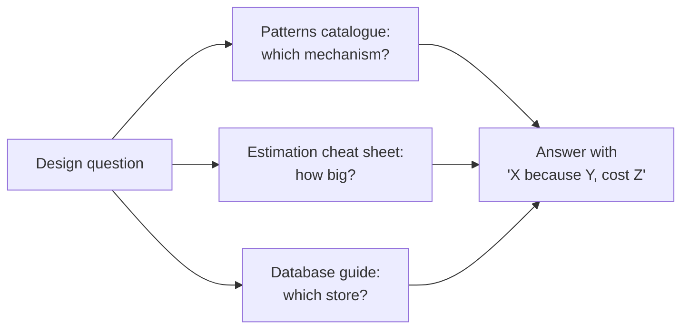

## في دقيقة واحدة

ثلاثة مراجع من صفحة واحدة لكل جولة تصميم: **دليل الأنماط** (المشكلة ← النمط ← الكلفة ← أين يُشرح)، و**ورقة التقدير المختصرة** (الحسابات ورتب الحجم)، و**دليل اختيار قاعدة البيانات** (أي مخزن لأي مهمة، ولماذا PostgreSQL هو الافتراضي للأموال). والمقابلات التجريبية ومعايير التقييم موجودة في [المسار 15 الدرس 5](#/tracks/track-15/lessons/track-15-lesson-05). ولم يعد هذا الدرس يكررها.

## تشبيه

كتيب المرجع السريع للطيار: ليس لتعلم الطيران، بل لعدم نسيان خطوة تحت الضغط.

## المخطط

## ابنِه خطوة بخطوة

### 1. دليل الأنماط

| المشكلة | النمط | الكلفة / متى لا | يُشرح في |
|---|---|---|---|
| إعادات محاولة العميل تنشئ تكرارات | مفتاح عدم تكرار + قيد تفرد + استجابة مخزنة | التخزين، وعقد الاحتفاظ | [المسار 05 الدرس 12](#/tracks/track-05/lessons/track-05-lesson-12) |
| يجب أن تتفق الكتابة في قاعدة البيانات ونشر الحدث | صندوق الصادر المعاملاتي (مستطلِع أو CDC) | مرة واحدة على الأقل؛ وبنية تحتية للمرحّل | [المسار 05 الدرس 13](#/tracks/track-05/lessons/track-05-lesson-13) |
| المستهلك يرى تكرارات | مستهلك عديم الأثر عند التكرار (جدول الأحداث المعالجة) | الاحتفاظ بالجدول | [المسار 05 الدرس 08](#/tracks/track-05/lessons/track-05-lesson-08) |
| معاملة عبر خدمات متعددة | ساغا + تعويضات | حالات وسيطة مرئية | [المسار 05 الدرس 14](#/tracks/track-05/lessons/track-05-lesson-14) |
| تحديث مفقود على صف | قفل متشائم / تحديث مشروط / `@Version` | التنافس مقابل إعادات المحاولة | [المسار 05 الدرس 16](#/tracks/track-05/lessons/track-05-lesson-16)، و[الدرس 17](#/tracks/track-05/lessons/track-05-lesson-17) |
| صحة الأموال | قيد مزدوج، وإلحاق فقط، وعكوس | نسختان من الحقيقة تحتاجان مطابقة | [المسار 05 الدرس 01](#/tracks/track-05/lessons/track-05-lesson-01) |
| إثبات الصحة | المطابقة (الداخلية والخارجية) | سير عمل تشغيلي | [المسار 05 الدرس 22](#/tracks/track-05/lessons/track-05-lesson-22) |
| حمل القراءة / أشكال قراءة مختلفة | نموذج قراءة CQRS، والنسخ المكررة، والذاكرة المؤقتة | التقادم | [المسار 05 الدرس 19](#/tracks/track-05/lessons/track-05-lesson-19) |
| تبعية بطيئة | مهلة + قاطع دائرة + حاجز + بديل | إجابات متدهورة | [المسار 06 الدروس 02–05](#/tracks/track-06/lessons/track-06-lesson-02) |
| إخفاقات عابرة | إعادة المحاولة مع تراجع أسي + تشتيت (للعمليات عديمة الأثر عند التكرار فقط) | تضخيم الحمل | [المسار 06 الدرس 04](#/tracks/track-06/lessons/track-06-lesson-04) |
| العدالة / الحمل الزائد | تحديد المعدل بدلو الرموز، وإسقاط الحمل | طلبات مرفوضة | [المسار 14 الدرس 06](#/tracks/track-14/lessons/track-14-lesson-06) |
| توزيع العمل | طابور `FOR UPDATE SKIP LOCKED`، وعقود الإيجار | حمل على قاعدة البيانات | [المسار 05 الدرس 17](#/tracks/track-05/lessons/track-05-lesson-17) |
| التنسيق عبر العمليات | عقود إيجار + رموز تسييج (لا أقفال Redis عادية) | خدمة أقفال | [المسار 02 الدرس 09](#/tracks/track-02/lessons/track-02-lesson-09) |
| الترتيب لكل كيان | مفتاح Kafka = معرّف الكيان | أقسام ساخنة | [المسار 09 الدرس 01](#/tracks/track-09/lessons/track-09-lesson-01) |
| التعافي من الكوارث | نسخ مكررة + نسخ احتياطية + استعادة مختبرة؛ وأهداف RPO/RTO | الكلفة، والتعقيد | [المسار 06 الدرس 08](#/tracks/track-06/lessons/track-06-lesson-08) |

**‏RPO/RTO** في سطر واحد: ‏RPO = كم من البيانات تستطيع فقدانه (الوقت منذ آخر نسخة آمنة)؛ وRTO = كم من الوقت حتى تعود الخدمة. ويمكن للتكرار المتزامن أن يقرّب RPO من الصفر بكلفة في زمن الاستجابة.

### 2. ورقة التقدير المختصرة

**السلسلة:** المستخدمون ← الإجراءات/اليوم ← المتوسط/ثانية (÷ 86,400 ≈ ÷ 100,000) ← الذروة (× 2–10، اذكرها) ← البايتات/السجل × السجلات/اليوم ← التخزين/السنة (× 365) ← النسخ المكررة والفهارس (× 2–3) ← العقد (الذروة ÷ السعة المقاسة لكل عقدة، + هامش).

| تحويلات سريعة | |
|---|---|
| يوم واحد | ‏86,400 ثانية (استخدم 10⁵ للحساب الذهني، ثم صحّح) |
| مليون/يوم | ≈ 12/ثانية في المتوسط |
| 100 مليون/يوم | ≈ 1,160/ثانية في المتوسط |
| 1 كيلوبايت × مليون | 1 غيغابايت |
| 1 غيغابايت/يوم × 365 | ≈ 0.37 تيرابايت/سنة |

**رتب الحجم** (توضيحية؛ يختلف العتاد، فقل "تقريبًا" وقِس):

| العملية | زمن الاستجابة التقريبي |
|---|---|
| مرجع في الذاكرة الرئيسية | ~100 نانوثانية |
| قراءة 1 ميغابايت تتابعيًا من الذاكرة | ~عشرات الميكروثواني |
| رحلة ذهاب وإياب داخل مركز بيانات / منطقة واحدة | ~0.5 مللي ثانية |
| قراءة عشوائية من SSD | ~0.1 مللي ثانية |
| استعلام PostgreSQL بسيط مفهرس على ذاكرة مؤقتة دافئة، في المنطقة نفسها | ~1 مللي ثانية |
| رحلة ذهاب وإياب بين المناطق الجغرافية | ~عشرات إلى 100+ مللي ثانية |

**لا تذكر أبدًا إنتاجية ثابتة لقاعدة بيانات** ("‏PostgreSQL يقوم بـ N إدراجًا في الثانية"). بل قل: "يبدو هذا في متناول خادم أساسي واحد بمعاملات قصيرة؛ وسأؤكد باختبار حمل." وتُظهر اختبارات الحمل في المشاريع الختامية كيف تقيس.

### 3. دليل اختيار قاعدة البيانات

| الحاجة | الاختيار الافتراضي | لماذا | انتبه |
|---|---|---|---|
| الأموال، والأرصدة، ودفاتر الأستاذ، ومفاتيح عدم التكرار | **PostgreSQL** ‏(أو قاعدة بيانات علائقية أخرى بخيارات قابلة للتسلسل) | ‏ACID متعدد الصفوف، والقيود، والمشغلات، وأدوات ناضجة | حدود الكتابة في خادم أساسي واحد ← التقسيم، ثم التوزيع |
| توزيع الأحداث، والإعادة، وفك الاقتران | **Kafka** | سجل مرتب لكل قسم، واحتفاظ، ومجموعات مستهلكين | مرة واحدة على الأقل؛ والترتيب لكل قسم فقط |
| العدادات، وحدود المعدل، والحالة قصيرة العمر | **Redis** | في الذاكرة، وسكربتات ذرية، ومدد صلاحية | ليس نظام سجل؛ وخطط لفقدان البيانات |
| البحث في المعاملات | **محرك بحث** (مثل OpenSearch/Elasticsearch) يغذيه CDC | نص كامل وترشيح | متسق في النهاية؛ وقابل لإعادة البناء |
| التحليلات، والتقارير التنظيمية | **مستودع / بحيرة عمودية** | مسح رخيص للسجل التاريخي | زمن الدفعات |
| حجم كتابة عالٍ جدًا، ووصول بسيط بالمفتاح، ومتعدد المناطق | **‏SQL موزع** (مثل CockroachDB، وSpanner) أو مخازن الأعمدة العريضة | توسع أفقي | زمن الإجماع؛ ودلالات معاملات مختلفة: اقرأ توثيقها |
| مستندات بشكل مرن | قاعدة بيانات مستندات أو `JSONB` في PostgreSQL | مرونة المخطط | أبقِ حقول الأموال مطبوعة الأنواع ومقيدة |

**كيف تقولها:** "لدفتر الأستاذ سأستخدم PostgreSQL لأنني أحتاج معاملات ذرية متعددة الصفوف وقيودًا. وKafka للأحداث، وRedis للعدادات والحدود فقط، وفهرس بحث يغذيه CDC للبحث في المعاملات. وإن لم يكفِ خادم أساسي واحد، سأوزّع حسب الحساب قبل التفكير في قاعدة بيانات SQL موزعة."

## ما الذي يسوء

**الخطأ: إجابات تبدأ بالتقنية.** "سأستخدم Cassandra لأنه يتوسع" لدفتر أستاذ يحتاج تحديثات ذرية متعددة الصفوف وقيودًا.

**الإصلاح:** ابدأ من المتطلب (الذرية، والقيود، وشكل الاستعلام، وتقدير الحجم) واختر أبسط مخزن يلبيه؛ وسمِّ الكلفة.

**الاختبار:** لكل مخزن في تصميمك، أكمل الجملة "…لأنني أحتاج ___، والكلفة هي ___."

## المقايضات: متى لا تستخدم هذه المراجع

إنها افتراضات، لا قوانين. فقد تشغّل شركة كل شيء على منصة واحدة تعرفها جيدًا؛ فقل كيف ستكيّف التصميم معها بدل الدفاع عن أداتك المفضلة.

## أسئلة وأجوبة المقابلة

**إحماء: "من المتوسط إلى الذروة: أي معامل تستخدم؟"**
- *الإجابة النموذجية:* أسأل؛ وإن لم يكن معروفًا، أفترض 3–10× حسب العمل (يوم الرواتب، والأمسيات، والحملات) وأقول الافتراض بصوت عالٍ.
- *الإجابة الخاطئة الشائعة:* "الذروة هي المتوسط."
- *لماذا تفشل:* تفشل الأنظمة في الذروة، لا في المتوسط.

**قياسي: "لماذا لا Redis فقط للأرصدة؟ إنه سريع."**
- *الإجابة النموذجية:* تحتاج الأرصدة المتانة، والذرية متعددة المفاتيح مع القيود، والقيود، والتدقيق؛ وRedis ذاكرة مؤقتة أو مخزن عدادات، لا دفتر أستاذ.
- *الإجابة الخاطئة الشائعة:* "لدى Redis استمرارية."
- *لماذا تفشل:* إعدادات الاستمرارية لا تعطي قيودًا علائقية أو ضمانات معاملاتية متعددة الصفوف.

**قياسي: "ما RPO وRTO لدفتر أستاذ مدفوعات؟"**
- *الإجابة النموذجية:* ‏RPO قريب من الصفر (نسخة متزامنة في منطقة أخرى)، وRTO بالدقائق مع تبديل آلي مختبر؛ والأهداف قرارات أعمال لها تكاليف.
- *الإجابة الخاطئة الشائعة:* "نأخذ نسخة احتياطية ليلًا."
- *لماذا تفشل:* يوم من المدفوعات المفقودة غير مقبول.

**عميق: "متى تختار SQL الموزع على PostgreSQL الموزّع يدويًا؟"**
- *الإجابة النموذجية:* حين تكون المعاملات بين الأجزاء متكررة ويفضّل الفريق شراء الاتساق من قاعدة البيانات على بناء الساغات، ويكون زمن الإجماع الإضافي مقبولًا. وأثبت ذلك بقياس معياري على حمل عملك.
- *الإجابة الخاطئة الشائعة:* "دائمًا، فهو يتوسع تلقائيًا."
- *لماذا تفشل:* تتجاهل زمن الاستجابة، والكلفة، والنضج التشغيلي، ودلالات المعاملات المختلفة.

## قلها في 30 ثانية

"ثلاث أوراق مختصرة: دليل أنماط يربط كل مخاطرة في التقنية المالية بآليتها وكلفتها؛ وسلسلة تقدير مع التحويلات ورتب الحجم، ولا إنتاجية ثابتة لقاعدة بيانات أبدًا؛ ودليل قواعد بيانات: ‏PostgreSQL للأموال، وKafka للأحداث، وRedis للعدادات، والبحث والمستودع يغذيهما CDC."

## الخلاصة

- النمط = آلية + كلفة + أين يُشرح.
- التقدير: أظهر السلسلة، واذكر الافتراضات، وقِس السعة.
- ‏PostgreSQL للأموال افتراضيًا؛ وبرّر كل مخزن آخر.

## انظر أيضًا

- [إطار تصميم الأنظمة](#/tracks/track-14/lessons/track-14-lesson-01)
- [المقابلات التجريبية ومعايير التقييم](#/tracks/track-15/lessons/track-15-lesson-05)
- [المسار 08: إطار قرار قواعد البيانات](#/tracks/track-08/lessons/track-08-lesson-22)

<!-- KNOWLEDGE-CHECK
[
  {
    "id": "kc-1408-01",
    "question": "أي مخزن هو الاختيار الافتراضي للأرصدة ودفاتر الأستاذ ومفاتيح عدم التكرار، ولماذا؟",
    "options": [
      "Redis، لأنه الأسرع",
      "PostgreSQL (أو قاعدة بيانات علائقية أخرى)، لأنه يعطي معاملات ACID متعددة الصفوف وقيودًا",
      "Kafka، لأنه يحفظ كل حدث",
      "قاعدة بيانات مستندات، لأن المخطط مرن"
    ],
    "correct": 1,
    "explanation": "تحتاج الأموال تحديثات ذرية عبر عدة صفوف (خصم، وإضافة، ومفتاح عدم تكرار) وقيودًا تفرضها قاعدة البيانات. وRedis ذاكرة مؤقتة أو مخزن عدادات، لا نظام سجل."
  },
  {
    "id": "kc-1408-02",
    "question": "كيف يجب أن تتحدث عن إنتاجية قاعدة البيانات في مقابلة؟",
    "options": [
      "اذكر رقمًا ثابتًا، مثل \"PostgreSQL يقوم بـ 10,000 إدراج في الثانية\"",
      "تجنّب الأرقام تمامًا",
      "قل إن الحمل يبدو في متناول خادم أساسي واحد بمعاملات قصيرة، وإنك ستؤكد ذلك باختبار حمل",
      "قل إن قواعد البيانات تتوسع بلا حدود"
    ],
    "correct": 2,
    "explanation": "الإنتاجية تعتمد على العتاد، والمخطط، وشكل المعاملات، والإعداد. فاذكر التقدير وكيف ستقيسه."
  },
  {
    "id": "kc-1408-03",
    "question": "ماذا يعني RPO وRTO؟",
    "options": [
      "RPO هو كم من البيانات تستطيع فقدانه (الوقت منذ آخر نسخة آمنة)؛ وRTO هو كم من الوقت حتى تعود الخدمة",
      "RPO هو الطلبات لكل عملية؛ وRTO هو عبء رحلة الذهاب والإياب",
      "RPO هو مالك خطة التعافي؛ وRTO هو نتيجة اختبار التعافي",
      "كلاهما يقيس زمن الاستجابة أثناء التبديل"
    ],
    "correct": 0,
    "explanation": "لدفتر أستاذ مدفوعات، يجب أن يكون RPO قريبًا من الصفر (نسخة متزامنة في منطقة أخرى) وRTO بالدقائق مع تبديل آلي مختبر. وكلاهما قرار أعمال له تكاليف."
  },
  {
    "id": "kc-1408-04",
    "question": "كم طلبًا في الثانية تقريبًا يساوي مليون طلب في اليوم، في المتوسط؟",
    "options": [
      "نحو 1,000 في الثانية",
      "نحو 1 في الثانية",
      "نحو 120 في الثانية",
      "نحو 12 في الثانية"
    ],
    "correct": 3,
    "explanation": "اليوم 86,400 ثانية، فـ 1,000,000 ÷ 86,400 ≈ 11.6. ثم طبّق معامل ذروة مذكورًا (2–10×) لتخطيط السعة."
  }
]
-->

<!-- PRACTICAL-CHALLENGE
{
  "id": "pc-1408",
  "title": "ابنِ مراجعك ذات الصفحة الواحدة",
  "description": "اصنع نسخك الخاصة من الأوراق المرجعية الثلاث واختبرها تحت ضغط الوقت.",
  "tasks": [
    {
      "id": "pc-1408-01",
      "description": "اكتب من الذاكرة ورقة أنماط من صفحة واحدة: عشر مشكلات في التقنية المالية على الأقل، لكل منها نمطها، وكلفتها، ومتى لا تستخدمه. وقارنها بجدول الدرس وسدّ الفجوات."
    },
    {
      "id": "pc-1408-02",
      "description": "أجرِ ثلاثة تقديرات في خمس دقائق لكل منها، مع إظهار السلسلة (المستخدمون ← الإجراءات/اليوم ← المتوسط/ثانية ← الذروة ← التخزين/السنة ← العقد): تغذية تفويضات شبكة بطاقات، ومحفظة تحويل بين الأفراد، وخدمة كشوف حساب."
    },
    {
      "id": "pc-1408-03",
      "description": "لتصميم من اختيارك، اسرد كل مخزن بيانات وأكمل الجملة \"…لأنني أحتاج ___، والكلفة هي ___\" لكل منها."
    }
  ]
}
-->
