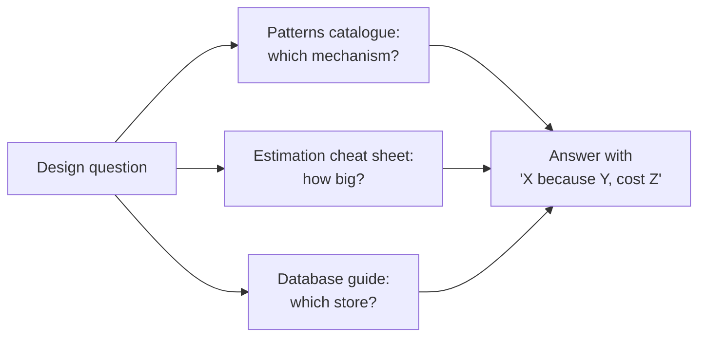

## In one minute

Three one-page references for every design round: a **patterns catalogue** (problem → pattern → cost →
where it's taught), an **estimation cheat sheet** (the arithmetic and the orders of magnitude), and a
**database choice guide** (which store for which job, and why PostgreSQL is the default for money).
Mock interviews and rubrics live in [Track 15 L5](#/tracks/track-15/lessons/track-15-lesson-05).
This lesson no longer duplicates them.

## Analogy

A pilot's quick-reference handbook: not for learning to fly, but for not forgetting a step under pressure.

## Diagram

## Build it step by step

### 1. Patterns catalogue

| Problem | Pattern | Cost / when not | Taught in |
|---|---|---|---|
| Client retries create duplicates | Idempotency key + unique constraint + stored response | Storage, retention contract | [T05 L12](#/tracks/track-05/lessons/track-05-lesson-12) |
| DB write + event publish must agree | Transactional outbox (poller or CDC) | At-least-once; relay infra | [T05 L13](#/tracks/track-05/lessons/track-05-lesson-13) |
| Consumer sees duplicates | Idempotent consumer (processed-event table) | Table retention | [T05 L08](#/tracks/track-05/lessons/track-05-lesson-08) |
| Multi-service transaction | Saga + compensations | Visible intermediate states | [T05 L14](#/tracks/track-05/lessons/track-05-lesson-14) |
| Lost update on a row | Pessimistic lock / conditional update / `@Version` | Contention vs retries | [T05 L16](#/tracks/track-05/lessons/track-05-lesson-16), [L17](#/tracks/track-05/lessons/track-05-lesson-17) |
| Money correctness | Double-entry, append-only, reversals | Two-copy truth needs reconciliation | [T05 L01](#/tracks/track-05/lessons/track-05-lesson-01) |
| Proving correctness | Reconciliation (internal and external) | Operational workflow | [T05 L22](#/tracks/track-05/lessons/track-05-lesson-22) |
| Read load / different read shapes | CQRS read model, replicas, cache | Staleness | [T05 L19](#/tracks/track-05/lessons/track-05-lesson-19) |
| Slow dependency | Timeout + circuit breaker + bulkhead + fallback | Degraded answers | [T06 L02–L05](#/tracks/track-06/lessons/track-06-lesson-02) |
| Transient failures | Retry with exponential backoff + jitter (idempotent ops only) | Load amplification | [T06 L04](#/tracks/track-06/lessons/track-06-lesson-04) |
| Fairness / overload | Token-bucket rate limiting, load shedding | Rejected requests | [T14 L06](#/tracks/track-14/lessons/track-14-lesson-06) |
| Work distribution | `FOR UPDATE SKIP LOCKED` queue, leases | DB load | [T05 L17](#/tracks/track-05/lessons/track-05-lesson-17) |
| Coordination across processes | Leases + fencing tokens (not plain Redis locks) | Lock service | [T02 L09](#/tracks/track-02/lessons/track-02-lesson-09) |
| Ordering per entity | Kafka key = entity id | Hot partitions | [T09 L01](#/tracks/track-09/lessons/track-09-lesson-01) |
| Disaster recovery | Replicas + backups + tested restore; RPO/RTO targets | Cost, complexity | [T06 L08](#/tracks/track-06/lessons/track-06-lesson-08) |

**RPO/RTO** in one line: RPO = how much data you can lose (time since the last safe copy); RTO = how long
until service is back. Synchronous replication can bring RPO to near zero at a latency cost.

### 2. Estimation cheat sheet

**The chain:** users → actions/day → average/s (÷ 86,400 ≈ ÷ 100,000) → peak (× 2–10, state it) →
bytes/record × records/day → storage/year (× 365) → replicas and indexes (× 2–3) → nodes (peak ÷
measured capacity per node, + headroom).

| Quick conversions | |
|---|---|
| 1 day | 86,400 s (use 10⁵ for mental maths, then correct) |
| 1 M/day | ≈ 12/s average |
| 100 M/day | ≈ 1,160/s average |
| 1 KB × 1 M | 1 GB |
| 1 GB/day × 365 | ≈ 0.37 TB/year |

**Orders of magnitude** (illustrative; hardware varies, so say "roughly" and measure):

| Operation | Rough latency |
|---|---|
| Main-memory reference | ~100 ns |
| Read 1 MB sequentially from memory | ~tens of µs |
| Round trip within one data centre / zone | ~0.5 ms |
| SSD random read | ~0.1 ms |
| Simple indexed PostgreSQL query on a warm cache, same zone | ~1 ms |
| Cross-region round trip | ~tens to 100+ ms |

**Never quote a fixed throughput for a database** ("PostgreSQL does N inserts per second"). Say: "This
looks within reach of one primary with short transactions; I'd confirm with a load test." The capstone load
tests show how to measure.

### 3. Database choice guide

| Need | Default choice | Why | Watch out |
|---|---|---|---|
| Money, balances, ledgers, idempotency keys | **PostgreSQL** (or another relational DB with serialisable options) | Multi-row ACID, constraints, triggers, mature tooling | Single-primary write limits → partition, then shard |
| Event distribution, replay, decoupling | **Kafka** | Ordered log per partition, retention, consumer groups | At-least-once; ordering only per partition |
| Counters, rate limits, short-lived state | **Redis** | In-memory, atomic scripts, TTLs | Not a system of record; plan for loss |
| Search over transactions | **Search engine** (e.g. OpenSearch/Elasticsearch) fed by CDC | Full-text and filtering | Eventually consistent; rebuildable |
| Analytics, regulatory reporting | **Columnar warehouse / lake** | Cheap scans over history | Batch latency |
| Very high write volume, simple key access, multi-region | **Distributed SQL** (e.g. CockroachDB, Spanner) or wide-column stores | Horizontal scale | Latency of consensus; different transaction semantics: read their docs |
| Documents with flexible shape | Document DB or PostgreSQL `JSONB` | Schema flexibility | Keep money fields typed and constrained |

**How to say it:** "For the ledger I'd use PostgreSQL because I need multi-row atomic transactions and
constraints. Kafka for events, Redis only for counters and limits, and a search index fed by CDC for
transaction search. If one primary isn't enough, I'd shard by account before considering a distributed SQL
database."

## What goes wrong

**Bug: technology-first answers.** "I'd use Cassandra because it scales" for a ledger that needs atomic
multi-row updates and constraints.

**Fix:** start from the requirement (atomicity, constraints, query shape, scale estimate) and pick the
simplest store that meets it; name the cost.

**Test:** for each store in your design, finish the sentence "…because I need ___, and the cost is ___."

## Trade-offs: when NOT to use these references

They are defaults, not laws. A company may run everything on one platform it knows well; say how you'd
adapt the design to it rather than arguing for your favourite tool.

## Interview Q&A

**Warm-up: "Average to peak: what factor do you use?"**
- *Model answer:* I ask; if unknown, I assume 3–10× depending on the business (payday, evenings,
  campaigns) and say the assumption aloud.
- *Common wrong answer:* "Peak is the average."
- *Why it fails:* systems fail at peak, not on average.

**Standard: "Why not just Redis for balances? It's fast."**
- *Model answer:* balances need durability, multi-key atomicity with postings, constraints and audit;
  Redis is a cache or counter store, not a ledger.
- *Common wrong answer:* "Redis has persistence."
- *Why it fails:* persistence settings don't give relational constraints or multi-row transactional guarantees.

**Standard: "What are RPO and RTO for a payments ledger?"**
- *Model answer:* RPO near zero (synchronous replica in another zone), RTO in minutes with tested automated
  failover; the targets are business decisions with costs.
- *Common wrong answer:* "We back up nightly."
- *Why it fails:* a day of lost payments is unacceptable.

**Deep: "When would you choose distributed SQL over sharded PostgreSQL?"**
- *Model answer:* when cross-shard transactions are frequent and the team prefers to buy consistency from
  the database over building sagas, and the added latency of consensus is acceptable. Prove it with a
  benchmark on your workload.
- *Common wrong answer:* "Always, it scales automatically."
- *Why it fails:* ignores latency, cost, operational maturity and different transaction semantics.

## Say it in 30 seconds

"Three cheat sheets: a patterns catalogue mapping each fintech risk to its mechanism and cost; an estimation
chain with conversions and orders of magnitude, never a fixed database throughput; and a database guide:
PostgreSQL for money, Kafka for events, Redis for counters, search and warehouse fed by CDC."

## Recap

- Pattern = mechanism + cost + where it's taught.
- Estimation: show the chain, state assumptions, measure capacity.
- PostgreSQL for money by default; justify every other store.

## See also

- [System design framework](#/tracks/track-14/lessons/track-14-lesson-01)
- [Mock interviews and rubrics](#/tracks/track-15/lessons/track-15-lesson-05)
- [Track 08: Database decision framework](#/tracks/track-08/lessons/track-08-lesson-22)
