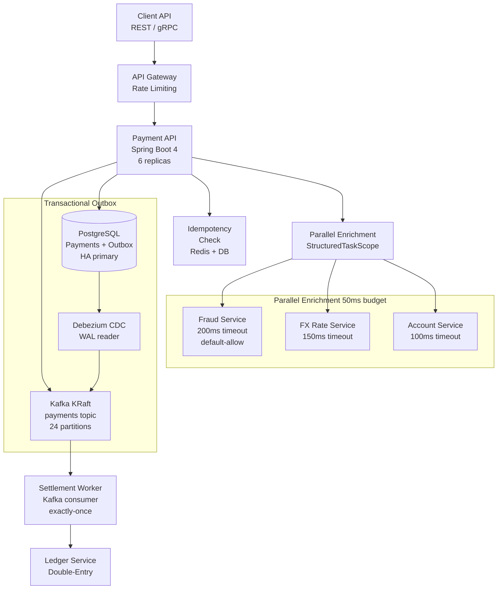
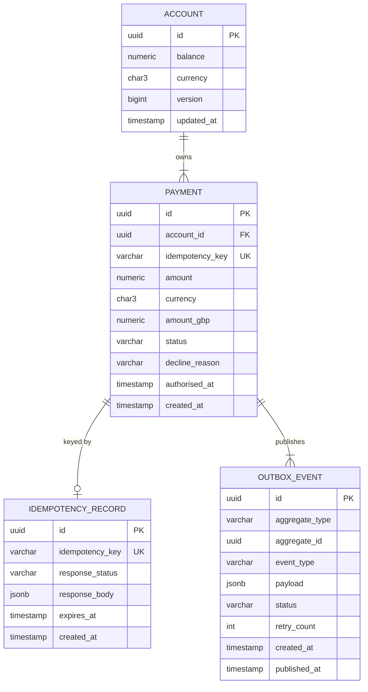
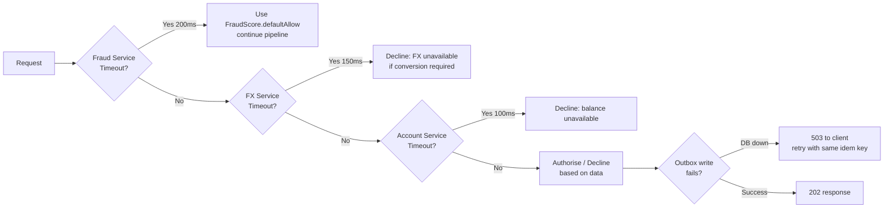

# High-Throughput Payment Processing Platform

## Project Overview

Build a production-grade payment gateway capable of processing **50,000 transactions per second** with sub-100ms P99 authorisation latency, exactly-once delivery semantics, and financial-grade idempotency guarantees.

This project integrates: distributed systems, concurrency, async processing, transaction integrity, and reliability engineering.

**What you will build:**
- Payment authorisation API with parallel enrichment pipeline using `StructuredTaskScope`
- Idempotency engine with distributed deduplication
- Transactional Outbox for exactly-once Kafka event publishing
- Settlement worker with Kafka consumer exactly-once semantics
- SLO dashboards and alerting

---

## System Requirements

### Functional Requirements

| Requirement | Specification |
|---|---|
| Payment submission | Synchronous authorisation response |
| Idempotency | Same request replayed ≤ 24h returns identical result |
| Currencies | GBP, EUR, USD — real-time FX conversion |
| Fraud screening | Third-party call, 200ms timeout, default allow |
| Settlement | Asynchronous, at-least-once with idempotent consumer |
| Audit | Every decision logged with actor, timestamp, decision |

### Non-Functional Requirements

| SLO | Target |
|---|---|
| P50 authorisation latency | < 30ms |
| P99 authorisation latency | < 100ms |
| Availability | 99.95% (20-min/month error budget) |
| Throughput | 50,000 TPS sustained |
| Idempotency window | 24 hours |
| Data durability | Zero loss (acks=all, min.insync.replicas=2) |

---

## Architecture



---

## Domain Model



---

## Database Schema

```sql
CREATE TABLE payments (
    id               UUID DEFAULT gen_random_uuid() PRIMARY KEY,
    account_id       UUID NOT NULL,
    idempotency_key  VARCHAR(255) NOT NULL,
    amount           NUMERIC(20,4) NOT NULL CHECK (amount > 0),
    currency         CHAR(3) NOT NULL,
    amount_gbp       NUMERIC(20,4) NOT NULL,
    fx_rate          NUMERIC(16,8) NOT NULL DEFAULT 1,
    status           VARCHAR(20) NOT NULL DEFAULT 'PENDING',
    decline_reason   VARCHAR(100),
    fraud_score      INTEGER,
    authorised_at    TIMESTAMPTZ,
    created_at       TIMESTAMPTZ NOT NULL DEFAULT now(),
    
    CONSTRAINT payments_status_check CHECK (
        status IN ('PENDING', 'AUTHORISED', 'DECLINED', 'REVERSED', 'SETTLED')
    ),
    CONSTRAINT payments_idempotency_key_uk UNIQUE (idempotency_key)
);

CREATE TABLE outbox_events (
    id              UUID DEFAULT gen_random_uuid() PRIMARY KEY,
    aggregate_type  VARCHAR(100) NOT NULL,
    aggregate_id    UUID NOT NULL,
    event_type      VARCHAR(100) NOT NULL,
    payload         JSONB NOT NULL,
    status          VARCHAR(20) NOT NULL DEFAULT 'PENDING',
    retry_count     INTEGER NOT NULL DEFAULT 0,
    created_at      TIMESTAMPTZ NOT NULL DEFAULT now(),
    published_at    TIMESTAMPTZ,
    
    CONSTRAINT outbox_status_check CHECK (status IN ('PENDING', 'PUBLISHED', 'FAILED'))
);

-- Partial index: only unpublished events are queried for dispatch
CREATE INDEX idx_outbox_pending ON outbox_events (created_at) WHERE status = 'PENDING';
CREATE INDEX idx_payments_account ON payments (account_id, created_at DESC);
```

---

## API Design

### POST /v1/payments — Authorise Payment

**Request:**
```json
{
  "idempotencyKey": "client-ref-abc123",
  "accountId": "acc-00000001",
  "amount": "250.00",
  "currency": "EUR",
  "description": "Invoice payment INV-2024-0042"
}
```

**Response (202 Accepted — first call):**
```json
{
  "paymentId": "pay-xxxxxxxx",
  "status": "AUTHORISED",
  "amountGBP": "214.73",
  "fxRate": "1.1642",
  "authorisedAt": "2024-11-07T14:23:01.123Z"
}
```

**Response (200 OK — duplicate call, same idempotency key):**
```json
{
  "paymentId": "pay-xxxxxxxx",
  "status": "AUTHORISED",
  "amountGBP": "214.73",
  "fxRate": "1.1642",
  "authorisedAt": "2024-11-07T14:23:01.123Z",
  "idempotent": true
}
```

---

## Implementation

### Domain Records (Java 21)

```java
// Immutable value objects using Java 21 records
public record PaymentRequest(
    String idempotencyKey,
    UUID accountId,
    BigDecimal amount,
    String currency,
    String description
) {}

public record EnrichedPayment(
    PaymentRequest request,
    FraudScore fraudScore,
    FxRate fxRate,
    Account account,
    Instant enrichedAt
) {}

public record PaymentResult(
    UUID paymentId,
    String status,
    BigDecimal amountGBP,
    BigDecimal fxRate,
    Instant authorisedAt,
    boolean idempotent
) {
    public static PaymentResult idempotent(IdempotencyRecord record) {
        return record.toPaymentResult().withIdempotent(true);
    }
}

// Sealed interface for authorisation decisions
public sealed interface AuthorisationDecision
    permits AuthorisationDecision.Approved, AuthorisationDecision.Declined {

    record Approved(BigDecimal amountGBP, BigDecimal fxRate) implements AuthorisationDecision {}
    record Declined(String reason, int fraudScore)           implements AuthorisationDecision {}
}
```

### Idempotency Engine

```java
@Service
public class IdempotencyService {

    private final IdempotencyRepository repository;
    private final RedisTemplate<String, String> redis;
    
    private static final Duration WINDOW = Duration.ofHours(24);
    private static final String REDIS_PREFIX = "idem:";

    // Check-then-store with database UNIQUE constraint as the final arbiter.
    // Redis provides fast-path cache; DB provides correctness under concurrent load.
    public Optional<IdempotencyRecord> check(String key) {
        // Fast path: check Redis cache
        String cached = redis.opsForValue().get(REDIS_PREFIX + key);
        if (cached != null) {
            return Optional.of(IdempotencyRecord.fromJson(cached));
        }
        // Slow path: check database
        return repository.findByKeyAndNotExpired(key, Instant.now());
    }

    @Transactional
    public IdempotencyRecord store(String key, PaymentResult result) {
        var record = new IdempotencyRecord(
            null,
            key,
            result.status(),
            result.toJson(),
            Instant.now().plus(WINDOW),
            Instant.now()
        );
        
        try {
            repository.insert(record);  // throws DataIntegrityViolationException on duplicate key
        } catch (DataIntegrityViolationException e) {
            // Race condition: another request stored the result concurrently.
            // Return the winning result — caller gets idempotent response.
            return repository.findByKeyAndNotExpired(key, Instant.now())
                .orElseThrow(() -> new IllegalStateException("Idempotency store inconsistency"));
        }
        
        // Write through to Redis cache
        redis.opsForValue().set(REDIS_PREFIX + key, record.toJson(), WINDOW);
        return record;
    }
}
```

### Parallel Enrichment Pipeline — `StructuredTaskScope` (Java 21)

```java
@Service
public class PaymentEnrichmentService {

    private final FraudService fraudService;
    private final FxService fxService;
    private final AccountService accountService;

    // StructuredTaskScope gives structured, scoped parallelism with clean cancellation
    // semantics. ShutdownOnFailure cancels siblings immediately when any subtask fails,
    // which is safer than CompletableFuture.allOf() where exceptions can be silently
    // swallowed or delayed.
    public EnrichedPayment enrich(PaymentRequest request) throws InterruptedException {
        try (var scope = new StructuredTaskScope.ShutdownOnFailure()) {

            // Fork all three I/O-bound calls onto virtual threads
            var fraudTask   = scope.fork(() -> fraudWithTimeout(request));
            var fxTask      = request.currency().equals("GBP")
                                ? scope.fork(() -> FxRate.one())
                                : scope.fork(() -> fxService.getRate(request.currency(), "GBP"));
            var accountTask = scope.fork(() -> accountService.getWithBalance(request.accountId()));

            // Block until all three complete or any one throws
            scope.joinUntil(Instant.now().plusMillis(300)); // hard outer deadline
            scope.throwIfFailed();                          // re-throws first subtask exception

            return new EnrichedPayment(
                request,
                fraudTask.get(),
                fxTask.get(),
                accountTask.get(),
                Instant.now()
            );
        }
    }

    // Fraud call uses its own timeout; default-allow on timeout (soft failure)
    private FraudScore fraudWithTimeout(PaymentRequest request) {
        try {
            return fraudService.score(request);
        } catch (TimeoutException e) {
            return FraudScore.defaultAllow();
        }
    }
}
```

### Transactional Outbox — Exactly-Once Kafka Publishing

```java
@Service
@Transactional
public class PaymentService {

    private final PaymentRepository paymentRepository;
    private final OutboxRepository outboxRepository;
    private final IdempotencyService idempotencyService;
    private final PaymentEnrichmentService enrichmentService;

    public PaymentResult authorise(PaymentRequest request) throws InterruptedException {
        // 1. Check idempotency
        var existing = idempotencyService.check(request.idempotencyKey());
        if (existing.isPresent()) {
            return PaymentResult.idempotent(existing.get());
        }

        // 2. Enrich outside the transaction — network calls must not hold DB connections.
        // Enrichment is called before @Transactional opens a connection.
        var enriched = enrichmentService.enrich(request);

        // 3. Make authorisation decision using pattern matching on sealed type
        var decision = makeDecision(enriched);

        // 4. Persist payment + outbox event in ONE TRANSACTION
        var payment = Payment.from(request, decision, enriched);
        paymentRepository.insert(payment);

        outboxRepository.insert(new OutboxEvent(
            null,
            "Payment",
            payment.id(),
            "PaymentAuthorised",
            PaymentAuthorisedEvent.from(payment),
            "PENDING",
            0,
            Instant.now(),
            null
        ));

        // 5. Store idempotency record in same transaction
        var result = PaymentResult.from(payment);
        idempotencyService.store(request.idempotencyKey(), result);

        return result;
        // Outbox event picked up by Debezium CDC → Kafka.
        // No dual-write: DB write and "Kafka publish" are atomic.
    }

    private AuthorisationDecision makeDecision(EnrichedPayment enriched) {
        return switch (enriched) {
            case EnrichedPayment e when e.fraudScore().isHighRisk() ->
                new AuthorisationDecision.Declined("FRAUD_RISK", e.fraudScore().value());
            case EnrichedPayment e when e.account().balance()
                    .compareTo(e.request().amount().multiply(e.fxRate().rate())) < 0 ->
                new AuthorisationDecision.Declined("INSUFFICIENT_FUNDS", 0);
            case EnrichedPayment e ->
                new AuthorisationDecision.Approved(
                    e.request().amount().multiply(e.fxRate().rate()),
                    e.fxRate().rate()
                );
        };
    }
}
```

### Settlement Worker — Exactly-Once Consumer

```java
@Service
public class SettlementWorker {

    private final KafkaConsumer<String, PaymentEvent> consumer;
    private final KafkaProducer<String, SettlementEvent> producer;
    private final LedgerService ledgerService;

    public void run() {
        consumer.subscribe(List.of("payments.authorised"));

        while (true) {
            var records = consumer.poll(Duration.ofMillis(100));
            
            producer.beginTransaction();
            try {
                for (var record : records) {
                    var settlement = ledgerService.settle(record.value());
                    producer.send(new ProducerRecord<>("settlements.completed",
                        record.key(), settlement));
                }
                // Commit offsets AND output messages atomically
                producer.sendOffsetsToTransaction(
                    getOffsets(records), consumer.groupMetadata());
                producer.commitTransaction();
                
            } catch (Exception e) {
                producer.abortTransaction();
                log.error("Settlement transaction aborted, will retry", e);
            }
        }
    }
}
```

---

## Kafka Configuration (KRaft — no ZooKeeper)

```yaml
# application.yml — Spring Boot 4 / Spring Kafka 4
spring:
  kafka:
    bootstrap-servers: kafka-0:9092,kafka-1:9092,kafka-2:9092
    producer:
      key-serializer: org.apache.kafka.common.serialization.StringSerializer
      value-serializer: org.springframework.kafka.support.serializer.JsonSerializer
      acks: all
      retries: 3
      properties:
        enable.idempotence: true
        max.in.flight.requests.per.connection: 1
        transactional.id: payments-producer-${spring.application.instance-id}
    consumer:
      group-id: settlement-worker
      key-deserializer: org.apache.kafka.common.serialization.StringDeserializer
      value-deserializer: org.springframework.kafka.support.serializer.JsonDeserializer
      isolation-level: read_committed       # only consume committed transactional messages
      auto-offset-reset: earliest
    listener:
      ack-mode: MANUAL_IMMEDIATE
```

```java
// KRaft topic creation — no ZooKeeper AdminClient dependency
@Bean
public NewTopic paymentsTopic() {
    return TopicBuilder.name("payments.authorised")
        .partitions(24)
        .replicas(3)
        .config(TopicConfig.MIN_IN_SYNC_REPLICAS_CONFIG, "2")
        .build();
}
```

---

## HikariCP Configuration (Virtual Threads)

With virtual threads, the optimal pool size is `CPU_CORES * 2`, not thread count. Virtual threads are parked (not OS-blocked) while waiting for a JDBC connection, so a small pool of physical DB connections is sufficient. Oversizing the pool wastes PostgreSQL backend processes.

```yaml
spring:
  datasource:
    hikari:
      maximum-pool-size: 16          # CPU_CORES * 2 (8-core node)
      minimum-idle: 8
      connection-timeout: 2000       # fail fast under overload
      idle-timeout: 300000
      max-lifetime: 1200000
      pool-name: PaymentHikariPool
      # Virtual threads park on lock acquisition, not OS block.
      # Pinning risk: PostgreSQL JDBC driver uses synchronized internally.
      # Monitor with: -Djdk.tracePinnedThreads=full
```

```java
@Configuration
public class DataSourceConfig {

    @Bean
    public DataSource dataSource(DataSourceProperties props) {
        var config = new HikariConfig();
        config.setJdbcUrl(props.getUrl());
        config.setUsername(props.getUsername());
        config.setPassword(props.getPassword());
        // Pool sized for DB backend connection cost, not thread concurrency
        int poolSize = Runtime.getRuntime().availableProcessors() * 2;
        config.setMaximumPoolSize(poolSize);
        config.setMinimumIdle(poolSize / 2);
        config.setConnectionTimeout(2_000);
        return new HikariDataSource(config);
    }
}
```

---

## Concurrency Strategy

| Operation | Strategy | Rationale |
|---|---|---|
| Balance debit | Conditional atomic UPDATE (`WHERE balance >= amount`) | Prevents overdraft without locking |
| Idempotency store | DB UNIQUE constraint | Correct under concurrent insertions |
| Outbox dispatch | Single Debezium reader per partition | No concurrent dispatch races |
| FX rate reads | Stale-tolerant (Redis cache, 30s TTL) | AP — eventual consistency acceptable |
| Enrichment | `StructuredTaskScope.ShutdownOnFailure` | Structured cancellation, cleaner than allOf |

```java
// Atomic conditional debit — prevents double-spend race condition
int updated = jdbcTemplate.update(
    "UPDATE accounts SET balance = balance - ?, version = version + 1 " +
    "WHERE id = ? AND balance >= ? AND version = ?",
    amount, accountId, amount, expectedVersion
);
if (updated == 0) {
    throw new InsufficientFundsException(accountId);
}
```

---

## Failure Handling



---

## Architecture Decision Records

### ADR-001: Transactional Outbox over Direct Kafka Write

**Status:** Accepted

**Context:** Payment service must publish a Kafka event and persist the payment record atomically. Direct producer.send() after DB commit risks: DB committed, process crashes before Kafka write → event lost.

**Decision:** Use the Transactional Outbox pattern. Write to `outbox_events` table in the same DB transaction as the payment record. Debezium reads the WAL and publishes to Kafka, ensuring exactly-once publishing.

**Consequences:** Requires Debezium CDC deployment. Introduces ~100-500ms publishing delay. Eliminates dual-write failure mode entirely.

### ADR-002: Redis + DB for Idempotency (Not Redis Alone)

**Status:** Accepted

**Context:** Redis provides fast idempotency checks but can lose data on eviction or failure. A pure Redis solution violates durability requirements for 24-hour idempotency windows.

**Decision:** Redis as a performance cache layer; PostgreSQL UNIQUE constraint as the correctness guarantee. `UNIQUE (idempotency_key)` prevents duplicates even when Redis is down or returns a cache miss on concurrent requests.

**Consequences:** Idempotency checks hit DB on cache miss (~1-2% of requests). `DataIntegrityViolationException` handling required for race conditions (handled gracefully in `IdempotencyService.store()`).

### ADR-003: `StructuredTaskScope` over `CompletableFuture.allOf`

**Status:** Accepted (Java 21 target)

**Context:** Payment enrichment calls 3 external services in parallel. The original `CompletableFuture.allOf` approach has two weaknesses: (1) exceptions propagate late and can be silently swallowed; (2) there is no automatic cancellation of sibling tasks when one fails, leaving threads running past the response deadline.

**Decision:** Use `StructuredTaskScope.ShutdownOnFailure`. When any subtask (FX, fraud, account) throws, the scope immediately cancels the remaining forks and re-throws from `throwIfFailed()`. A hard outer deadline of 300ms is applied with `joinUntil()`.

**Consequences:** Requires Java 21 and `--enable-preview` flag removed in Java 21 GA (scopes are stable). The scope must be opened with try-with-resources to guarantee cleanup. Virtual thread pinning from JDBC drivers remains a risk — monitor with `-Djdk.tracePinnedThreads=full`.

### ADR-004: Virtual Thread HikariCP Pool Sizing

**Status:** Accepted

**Context:** Under 50k TPS with virtual threads, naively setting `maximumPoolSize` to match virtual thread concurrency would create thousands of PostgreSQL backend connections, exhausting server memory.

**Decision:** Size the pool at `CPU_CORES * 2`. Virtual threads park when blocked on pool acquisition rather than consuming OS resources. The pool bottleneck becomes the PostgreSQL backend process limit, not thread capacity.

**Consequences:** Under extreme load, virtual threads queue for connections. Monitor `hikaricp.pending.threads` metric. If P99 latency degrades, increase PostgreSQL `max_connections` before increasing pool size.

---

## Testing Strategy

### Unit Tests — Idempotency Race Condition

```java
@SpringBootTest
@Testcontainers
class IdempotencyRaceConditionTest {

    @Container
    static PostgreSQLContainer<?> postgres = new PostgreSQLContainer<>("postgres:16");

    @Container
    static GenericContainer<?> redis = new GenericContainer<>("redis:7")
        .withExposedPorts(6379);

    @Autowired
    PaymentService paymentService;

    @Test
    void concurrentRequests_sameIdempotencyKey_onlyOneProcessed() throws Exception {
        int threadCount = 50;
        var latch = new CountDownLatch(1);
        var successCount = new AtomicInteger(0);
        var idempotentCount = new AtomicInteger(0);

        // Use virtual threads for the test itself — matches production concurrency model
        try (var executor = Executors.newVirtualThreadPerTaskExecutor()) {
            var futures = IntStream.range(0, threadCount).mapToObj(i ->
                CompletableFuture.runAsync(() -> {
                    try {
                        latch.await();
                        var result = paymentService.authorise(
                            new PaymentRequest(
                                "test-key-concurrent-001",
                                testAccountId,
                                new BigDecimal("100.00"),
                                "GBP",
                                "concurrent test"
                            )
                        );
                        if (result.idempotent()) idempotentCount.incrementAndGet();
                        else successCount.incrementAndGet();
                    } catch (Exception ignored) {}
                }, executor)
            ).toArray(CompletableFuture[]::new);

            latch.countDown();  // Release all 50 virtual threads simultaneously
            CompletableFuture.allOf(futures).get(10, TimeUnit.SECONDS);
        }

        assertThat(successCount.get()).isEqualTo(1);       // exactly 1 original
        assertThat(idempotentCount.get()).isEqualTo(49);   // 49 idempotent replays
    }
}
```

### Integration Tests — Outbox Delivery (Spring Boot 4 / Spring Kafka 4)

```java
@SpringBootTest
@Testcontainers
class OutboxDeliveryIntegrationTest {

    @Container
    static PostgreSQLContainer<?> postgres = new PostgreSQLContainer<>("postgres:16");

    // Kafka KRaft — no ZooKeeper
    @Container
    static KafkaContainer kafka = new KafkaContainer(
        DockerImageName.parse("confluentinc/cp-kafka:7.6.0"))
        .withKraft();

    @Autowired PaymentService paymentService;

    @Test
    void outboxEvent_publishedToKafka_afterDbCommit() throws Exception {
        var request = new PaymentRequest(
            "outbox-test-001", testAccountId,
            new BigDecimal("100.00"), "GBP", "outbox integration test"
        );

        var result = paymentService.authorise(request);

        // Verify event appears in Kafka within 5 seconds
        try (var consumer = kafkaConsumerForTopic("payments.authorised")) {
            var records = consumer.poll(Duration.ofSeconds(5));
            assertThat(records.count()).isEqualTo(1);
            assertThat(records.iterator().next().value().paymentId())
                .isEqualTo(result.paymentId());
        }
    }
}
```

### Mock Injection — `@MockitoBean` (Spring Boot 4)

```java
@SpringBootTest
class PaymentEnrichmentServiceTest {

    // Spring Boot 4 replaces @MockBean with @MockitoBean
    @MockitoBean FraudService fraudService;
    @MockitoBean FxService fxService;
    @MockitoBean AccountService accountService;

    @Autowired PaymentEnrichmentService enrichmentService;

    @Test
    void fraudTimeout_returnsDefaultAllow_andContinuesPipeline() throws Exception {
        given(fraudService.score(any())).willAnswer(inv -> {
            Thread.sleep(300); // exceed 200ms timeout
            return FraudScore.highRisk();
        });
        given(fxService.getRate("EUR", "GBP")).willReturn(new FxRate(new BigDecimal("0.86")));
        given(accountService.getWithBalance(any())).willReturn(testAccount());

        var request = new PaymentRequest("k1", UUID.randomUUID(),
            new BigDecimal("100.00"), "EUR", "test");

        var enriched = enrichmentService.enrich(request);

        assertThat(enriched.fraudScore()).isEqualTo(FraudScore.defaultAllow());
        assertThat(enriched.fxRate().rate()).isEqualByComparingTo("0.86");
    }
}
```

---

## Performance Targets & Analysis

```
Target: 50,000 TPS, P99 < 100ms

Latency budget breakdown:
  Network ingress:         3ms
  Idempotency check:       2ms  (Redis hit)
  Parallel enrichment:    50ms  (bounded by slowest: fraud at 200ms timeout,
                                 but p50 is ~40ms; StructuredTaskScope outer
                                 deadline is 300ms hard cap)
  DB write (payment):      5ms  (NVMe SSD, single insert)
  Outbox write:            2ms  (same transaction)
  Response serialisation:  1ms
  Network egress:          3ms
  Total p50:              ~66ms ✓

For P99:
  Fraud service p99:      180ms → exceeds 100ms budget alone
  
Mitigation: fraudWithTimeout() with defaultAllow
  → p99 enrichment bounded at ~100ms (account service timeout)
  → Total p99: ~115ms — requires further optimisation

Optimisation options:
  1. Move fraud scoring async post-auth (risk-based accept/challenge)
  2. Pre-fetch fraud features from Redis (reduces to 10ms lookup)  
  3. Use gRPC instead of HTTP for internal calls (saves ~15ms on serialisation)
  4. Pool-size tuning: increase max_connections on PostgreSQL before HikariCP pool
```

---

## Deployment

```yaml
# Kubernetes HPA — scale for payment peak days
apiVersion: autoscaling/v2
kind: HorizontalPodAutoscaler
metadata:
  name: payment-api
  namespace: payments-prod
spec:
  scaleTargetRef:
    apiVersion: apps/v1
    kind: Deployment
    name: payment-api
  minReplicas: 6
  maxReplicas: 24
  metrics:
  - type: Resource
    resource:
      name: cpu
      target:
        type: Utilization
        averageUtilization: 60
  - type: Pods
    pods:
      metric:
        name: payment_queue_depth
      target:
        type: AverageValue
        averageValue: "500"
```

---

## Principal Engineer Review Criteria

Your implementation will be evaluated against:

- [ ] **Idempotency is correct under concurrent load** — 50 concurrent virtual threads, same key → 1 success, 49 idempotent
- [ ] **No dual-write failures** — payment record and Kafka event published atomically via Outbox pattern
- [ ] **No race conditions** in balance debit — atomic conditional UPDATE used
- [ ] **Timeouts configured** on all external calls; `StructuredTaskScope.ShutdownOnFailure` used for enrichment pipeline
- [ ] **Virtual thread pinning assessed** — `-Djdk.tracePinnedThreads=full` output reviewed; no pinning under load
- [ ] **HikariCP sized correctly** — `maximumPoolSize = CPU_CORES * 2`, not thread count; rationale documented
- [ ] **Kafka uses KRaft** — no ZooKeeper properties in configuration; `withKraft()` in Testcontainers
- [ ] **Spring Boot 4 patterns used** — `@MockitoBean` (not `@MockBean`), `RestClient` (not `RestTemplate`)
- [ ] **P99 latency measured** under realistic load with JMH or Gatling
- [ ] **SLO defined** — SLI, 28-day window, error budget policy documented
- [ ] **ADRs written** for the top 3 architectural decisions
- [ ] **Testcontainers integration test** for the full payment-to-Kafka flow with KRaft container

---

## Interview Debrief

### The 60-Second Pitch
> "I built a payment authorisation platform targeting 50k TPS at sub-100ms P99; the hardest problem was guaranteeing exactly-once Kafka publishing without dual-write failures, which I solved using the Transactional Outbox pattern — the payment record and the outbox event are written atomically to PostgreSQL in the same transaction, and Debezium reads the WAL to publish to Kafka independently."

### Questions Your Interviewer Will Ask

**Q1: "Walk me through what happens when two threads submit the same idempotency key at the exact same millisecond — which codepath fires and what is the exact guarantee?"**  
Model answer: Both threads enter `IdempotencyService.check()`, get a cache miss on Redis (key not yet written), and proceed to `store()`. The first thread successfully inserts into `idempotency_records` — the UNIQUE constraint on `idempotency_key` is the correctness anchor. The second thread hits a `DataIntegrityViolationException`, catches it, re-reads the now-committed row, and returns it as an idempotent response. The DB constraint is the arbitration mechanism; Redis is merely a performance optimisation. Neither thread returns an incorrect result. The key insight is that you must catch the exception and return the winning record, not propagate a 500.

**Q2: "If Debezium goes down for 10 minutes while payments are being processed, what exactly happens to the outbox, and how do you recover?"**  
Model answer: Payments continue to be authorised and committed to PostgreSQL — the payment table and outbox table are written atomically and the client receives a 202. Outbox rows accumulate in PENDING status. The `idx_outbox_pending` partial index ensures the catch-up query (`WHERE status = 'PENDING' ORDER BY created_at`) is efficient regardless of how many rows backlog. When Debezium restarts, it resumes from the last committed WAL LSN, reads all missed PENDING rows in order, and publishes them to Kafka. Kafka consumers reading `payments.authorised` are unaffected because they're reading from an immutable log — they simply catch up. The critical invariant is that Debezium is idempotent: if it crashes mid-publish, it re-reads from WAL and may produce a duplicate Kafka message, so the settlement worker must be an idempotent consumer.

**Q3: "You're at 50k TPS today. How would you scale to 500k TPS?"**  
Model answer: The bottleneck cascade at 500k TPS hits in this order: (1) PostgreSQL write throughput on the payments table — shard by `account_id` using Citus or partition by payment ID range, moving from one primary to 10; (2) Outbox-to-Kafka fan-out — Debezium connector partitioned per PostgreSQL shard, each feeding 24 Kafka partitions; (3) HikariCP and virtual thread pinning — PostgreSQL JDBC driver's `synchronized` blocks cause carrier thread pinning, so at extreme scale switch to the Vert.x PostgreSQL client or the R2DBC driver which is non-blocking at the socket level; (4) Redis idempotency layer — shard to Redis Cluster with consistent hashing on `idempotency_key`; (5) Settlement worker — scale consumer group horizontally, one partition per pod.

**Q4: "Your outbox has 24 partitions in Kafka. What is the exact delivery guarantee you get, and under what failure scenario does it break?"**  
Model answer: The guarantee is exactly-once publishing from DB to Kafka — a payment row and its outbox event are either both committed or neither is, so no event is lost on process crash. From Kafka to the settlement worker the guarantee is effectively-exactly-once using Kafka transactions: `producer.sendOffsetsToTransaction()` commits the consumer offset and the output message atomically. The scenario that breaks this is a Kafka broker split-brain during a transaction commit: if the coordinator fails after the producer calls `commitTransaction()` but before all replicas acknowledge, the transaction may be in an indeterminate state. `min.insync.replicas=2` with `acks=all` mitigates this, but it requires 2 of 3 replicas to be alive — a 2-broker outage during commit is a potential data loss window.

**Q5: "If you had to redesign this at 500k TPS knowing what you know now, what would you change about the Outbox vs CDC choice?"**  
Model answer: At 500k TPS I would evaluate replacing Debezium CDC with application-level polling outbox on each service instance using a `ScheduledExecutorService` with virtual threads. The CDC approach requires a Debezium cluster, Kafka Connect, and careful WAL slot management — each PostgreSQL WAL slot holds the WAL open indefinitely if the consumer lags, risking disk exhaustion. At that scale I would also consider event sourcing: replace the `outbox_events` table with an append-only `payment_events` store, eliminate the `payments` state table entirely, and project read models from the event log. This removes the outbox indirection — the event log IS the source of truth — and Kafka consumers rebuild from it directly. The tradeoff is query complexity: you need CQRS read projections for balance queries, which adds infrastructure but removes the dual-table consistency problem entirely.

### What to Have Ready on the Whiteboard
- **System diagram**: Client → API Gateway → Payment API (6 replicas) → [Redis idempotency check] → [StructuredTaskScope: Fraud / FX / Account] → PostgreSQL (payments + outbox) → Debezium → Kafka → Settlement Worker → Ledger Service. The most important arrows are the atomic DB write (payment + outbox in one tx) and the Debezium WAL-to-Kafka path.
- **Table schema**: The `outbox_events` table with its partial index `WHERE status = 'PENDING'` — be ready to explain why the partial index matters at high insert volume, and how `published_at` and `retry_count` drive the catch-up query.
- **One trade-off**: "I chose Transactional Outbox + Debezium CDC over application-level polling because CDC decouples publish throughput from request latency — the payment API never waits for Kafka acknowledgement. The cost is Debezium operational complexity and WAL slot management risk, which I accept because it removes the dual-write failure mode entirely."
